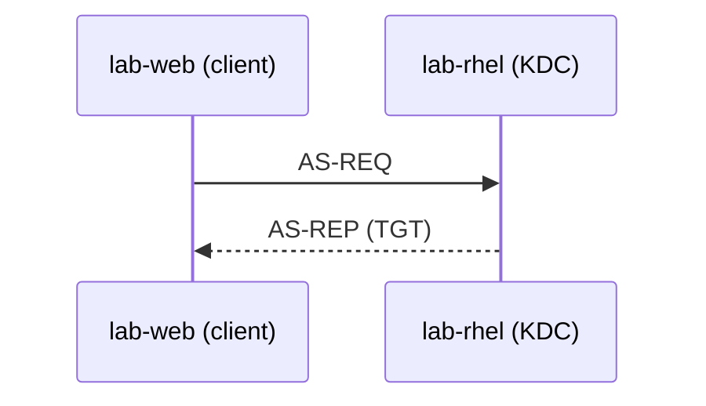

# CONVENTIONS — Workbook Linux / DevOps

Document de référence **obligatoire** pour tous les rédacteurs de modules.
Le dépôt est écrit en **Markdown GitHub** et se lit tel quel sur GitHub :
pas de format intermédiaire, pas de génération, pas de version PDF.
Langue : **français** (termes techniques en anglais quand c'est l'usage : *pipeline*, *runner*, *rollback*).
Public : administrateur/dev **niveau intermédiaire** visant un poste DevOps. Pas de blabla débutant,
pas de « qu'est-ce qu'un ordinateur ». On suppose acquis : se connecter en SSH, `cd`, `ls`, éditer un fichier.

---

## 1. Infrastructure de lab (identique dans tous les modules)

Hyperviseur **Proxmox VE 8** de l'apprenant. Réseau de lab dédié sur le bridge `vmbr1`.

| VM | VMID | OS | vCPU/RAM/Disque | IP fixe | Rôle |
|---|---|---|---|---|---|
| `lab-adm` | 9001 | Ubuntu Server 24.04 LTS | 2 / 2 Go / 20 Go | 10.10.10.10 | Poste d'admin, bastion, nœud de contrôle Ansible |
| `lab-web` | 9002 | Ubuntu Server 24.04 LTS | 2 / 2 Go / 20 Go | 10.10.10.11 | Frontal web / reverse proxy / app |
| `lab-db` | 9003 | Ubuntu Server 24.04 LTS | 2 / 2 Go / 30 Go | 10.10.10.12 | Base de données, disques supplémentaires pour LVM |
| `lab-rhel` | 9004 | Rocky Linux 9 | 2 / 2 Go / 20 Go | 10.10.10.13 | Variantes RHEL (dnf, firewalld, SELinux) |
| `lab-ops` | 9005 | Ubuntu Server 24.04 LTS | 2 / 4 Go / 40 Go | 10.10.10.14 | Docker, CI runner, monitoring, registre |
| `lab-git` | 9006 | Ubuntu Server 24.04 LTS | 1 / 1 Go / 15 Go | 10.10.10.15 | Forge Gitea (binaire + SQLite) : dépôt du workbook, portfolio ; réutilisable par les modules 21 et 25 |
| `lab-virt` | 9007 | Ubuntu Server 24.04 LTS | 4 (cpu=host, virtualisation imbriquée) / 6 Go / 40 Go | 10.10.10.16 | Virtualisation KVM/QEMU/libvirt (module 20) |

Les modules qui demandent davantage (RAM, disques) le disent dans leur section
« Mise en place », avec la commande `qm set` correspondante : on ne crée pas
de VM supplémentaire sans raison forte.

* Réseau : `10.10.10.0/24`, passerelle `10.10.10.1`, DNS `10.10.10.1` (ou 9.9.9.9 en sortie).
* Domaine de lab : `lab.local`. Noms courts résolus par `/etc/hosts` (module 11 fait mieux).
* Utilisateur standard sur toutes les VM : **`mathieu`**, membre de `sudo` (Ubuntu) / `wheel` (Rocky), clé SSH publique déployée.
* Disques additionnels sur `lab-db` : `/dev/sdb` (5 Go) et `/dev/sdc` (5 Go), non formatés, pour les labs LVM.
* Snapshot de référence sur chaque VM : **`snap-clean`**. Règle d'or : `qm snapshot <vmid> avant-labXX` avant un lab destructeur,
  `qm rollback <vmid> snap-clean` pour repartir propre.

**Distribution** : Ubuntu 24.04 est la distribution de référence de tout le workbook.
Chaque fois qu'une commande diffère sous RHEL/Rocky, ajouter un encadré **Variante Rocky / RHEL** (voir §5).
Justification à ne PAS répéter dans les modules (elle est en intro) : Ubuntu domine le marché cloud/CI,
Rocky couvre l'entreprise et les certifications RHCSA.

Pour les apprenants sans Proxmox disponible, l'annexe propose Multipass/Vagrant : ne pas en parler dans les modules.

---

## 2. Arborescence des livrables

Chaque module est un dossier avec **deux fichiers Markdown** :

```
modules/XX-slug/README.md     <- énoncé (quiz, exercices, labs, break&fix, défi)
modules/XX-slug/corrige.md    <- corrigé + explications
```

Les projets suivent la même règle dans `projets/PX-slug/`. Un nouveau module
s'inscrit dans `tools/workbook.py` (partie, ordre), puis `make nav` génère
sa navigation et met à jour les tables du README et de `docs/parcours.md`.

et, si le module l'exige, des scripts :

```
scripts/setup/setup_MXX.sh          <- prépare l'environnement du module (idempotent)
scripts/check/check_MXX_YY.sh       <- vérifie l'exercice/lab YY du module XX
scripts/break/break_MXX_YY.sh       <- casse volontairement pour un Break & Fix
```

`XX` = numéro de module sur 2 chiffres (`07`), `YY` = numéro d'item sur 2 chiffres (`03`).

---

## 3. Structure imposée d'un énoncé (`README.md`)

Un seul `#` (titre du module). Les sections suivantes, dans cet ordre, en `##` :

```markdown
# Module 07 — Scripting Bash

## 7.0 Objectifs et compétences
## 7.1 Mise en place
## 7.2 Rappel express
## 7.3 Quiz — QCM
## 7.4 Quiz — questions ouvertes
## 7.5 Exercices guidés ★
## 7.6 Labs ★★
## 7.7 Break & Fix ★★★
## 7.8 Défi du module ★★★
## 7.9 Auto-évaluation
```

Détail attendu :

* **7.0 Objectifs** : 6 à 10 puces « À la fin de ce module, je sais… », formulées comme des compétences vérifiables.
  Ajouter une ligne `Temps estimé : Xh` et `Prérequis : modules ...`.
* **7.1 Mise en place** : VM concernée(s), snapshot à prendre, paquets à installer, commande de lancement du script de setup.
* **7.2 Rappel express** : **maximum 2 pages**. Tableaux de commandes/options, schéma en texte si utile, pièges classiques.
  Ce n'est pas un cours : c'est une antisèche pour attaquer les exercices. Densité maximale, zéro remplissage.
* **7.3 QCM** : **12 à 18 questions**, 4 propositions (a/b/c/d), parfois plusieurs bonnes réponses (le préciser dans l'énoncé).
  Viser le niveau d'un entretien technique : cas concrets, sorties de commandes à interpréter, pas de récitation.
* **7.4 Questions ouvertes** : **6 à 10 questions** qui demandent d'expliquer un mécanisme, comparer deux approches,
  ou décrire une démarche de diagnostic. Inclure au moins 2 questions « on te demande en entretien… ».
* **7.5 Exercices guidés ★** : **10 à 16 exercices** courts, une commande ou un script de quelques lignes.
  Énoncé orienté résultat (« affiche les 5 plus gros fichiers de /var »), jamais « tape telle commande ».
* **7.6 Labs ★★** : **3 à 5 scénarios** en plusieurs étapes numérotées, ancrés dans un contexte réaliste
  (ticket d'exploitation, demande d'un dev, audit). Chaque lab se termine par un critère de succès observable
  et, quand c'est pertinent, la commande `bash check_MXX_YY.sh`.
* **7.7 Break & Fix ★★★** : **2 à 4 pannes**. Format : contexte, symptôme observé par l'utilisateur, ce qui est interdit
  (ex. « interdit de réinstaller le paquet »), objectif de remise en service, et la commande qui casse
  (`sudo bash break_MXX_YY.sh`). Toujours rappeler le snapshot de secours.
* **7.8 Défi** : **1 exercice long** (30–90 min) qui combine tout le module, avec cahier des charges et livrable
  (un script, un fichier de conf, un rapport).
* **7.9 Auto-évaluation** : tableau de 8 à 12 compétences avec cases `☐ Acquis ☐ À revoir`, plus 2 ou 3 « pour aller plus loin ».

### Identifiants
Numérotation **stricte**, elle sert de pont entre l'énoncé et le corrigé :

| Type | Format | Exemple |
|---|---|---|
| QCM | `Q<mod>.<n>` | `Q7.1` |
| Question ouverte | `QO<mod>.<n>` | `QO7.3` |
| Exercice guidé | `E<mod>.<n>` | `E7.12` |
| Lab | `L<mod>.<n>` | `L7.2` |
| Break & Fix | `BF<mod>.<n>` | `BF7.1` |
| Défi | `D<mod>` | `D7` |
| Projets | `PA.<n>`, `PB.<n>`, `PC.<jour>.<n>`, incidents `INC-A<n>` | `PB.3` |

En début de ligne, chaque identifiant porte une **ancre** et un **lien** vers
le même identifiant dans l'autre fichier :

```markdown
<a id="q7-1"></a>**[Q7.1](corrige.md#q7-1)** — Que fait ...          (énoncé)
### <a id="bf7-2"></a>**[BF7.2](corrige.md#bf7-2)** — « Titre »      (énoncé)
<a id="q7-1"></a>**[Q7.1](README.md#q7-1)** — *rappel de l'énoncé*  (corrigé)
```

L'ancre est l'identifiant en minuscules, points remplacés par des tirets.
`make check` vérifie que chaque ancre d'un énoncé existe dans son corrigé.

---

## 4. Structure imposée d'un corrigé (`corrige.md`)

Mêmes identifiants, même ordre. Titre : `# Module 07 — Corrigé`.
Sections `##` : `7.3 Quiz — QCM`, `7.4 Quiz — questions ouvertes`, `7.5 Exercices guidés`, `7.6 Labs`,
`7.7 Break & Fix`, `7.8 Défi du module`.

Pour **chaque** item :

1. La **réponse** (lettre du QCM, commande exacte, script complet, procédure).
2. Un encadré **Pourquoi** : l'explication du mécanisme sous-jacent. C'est le cœur du corrigé —
   on doit apprendre quelque chose même quand on avait juste. 5 à 15 lignes.
3. Quand c'est utile, un encadré **Piège** : l'erreur classique, pourquoi les autres réponses sont fausses,
   ce qui casse en production.

Pour les Break & Fix, le corrigé donne : la démarche de diagnostic pas à pas (quelles commandes, dans quel ordre,
et ce qu'on cherche dans la sortie), la cause racine, le correctif, et la prévention.

Le corrigé doit être **autoportant** : on doit pouvoir le lire seul, sans avoir l'énoncé sous les yeux,
donc rappeler l'énoncé en une ligne en italique avant la réponse.

Le corrigé alimente aussi les **aides progressives** des fiches interactives
(`tools/aides.py`), d'où quelques habitudes qui les rendent utiles : les
commandes dans des blocs `bash` (sorties en commentaires `#`), les étapes d'un
lab en intertitres `**Étape N — titre**`, la démarche d'un Break & Fix avant
`**Cause racine** :`, des notions en **gras** plutôt que des mots d'insistance,
et un « Pourquoi » qui commence par le mécanisme plutôt que par la lettre de
la réponse.

### Aides rédigées (`aides.md`)

Quand les aides tirées du corrigé ne suffisent pas, un fichier `aides.md` à
côté de l'énoncé les remplace, item par item :

```markdown
## QO1.4

Première aide, la plus vague (texte, commande, schéma…).

---

Deuxième aide, plus précise.
```

Une section `##` par identifiant (tel qu'affiché : `QO1.4`, `PC.2.1`), deux à
quatre aides séparées par `---`, sans jamais donner la réponse elle-même.
`make fiches` signale un identifiant inconnu.

---

## 5. Encadrés, schémas, navigation

### Encadrés : alertes GitHub avec libellé

Un encadré est une alerte GitHub dont la **première ligne est le libellé en
gras**. Le couple (type d'alerte, libellé) est fixe : le lecteur reconnaît
l'encadré à sa couleur, et `make check` refuse un libellé inconnu.

```markdown
> [!IMPORTANT]
> **Variante Rocky / RHEL**
>
> Sous Rocky 9 : `sudo dnf install -y nginx` et
> `sudo firewall-cmd --add-service=http --permanent`.
```

| Alerte GitHub | Libellé | Usage |
|---|---|---|
| `[!NOTE]` | `**Objectifs**` | objectifs, durée, prérequis en tête de module |
| `[!TIP]` | `**Astuce**` | raccourci, bonne pratique |
| `[!CAUTION]` | `**Attention**` | danger, action destructrice |
| `[!IMPORTANT]` | `**Variante Rocky / RHEL**` | variante Rocky/RHEL d'une commande Ubuntu |
| *(citation simple)* | `**Contexte**` | mise en situation d'un lab |
| `[!NOTE]` | `**Pourquoi**` | explication du mécanisme (corrigés) |
| `[!WARNING]` | `**Piège**` | erreur classique, ce qui casse en production (corrigés) |
| `[!TIP]` | `**Critère de succès**` | critère de succès, commande de vérification |

Chaque ligne du contenu commence par `> ` (ou `>` seul pour une ligne vide),
blocs de code compris. Pas d'encadré dans un encadré.

### Schémas

**Nouveau schéma : Mermaid**, directement dans le Markdown, rendu par GitHub
(`flowchart`, `sequenceDiagram`, `stateDiagram-v2`…). Il se modifie comme du
texte et se relit dans une revue de code. Suivi de sa légende :

````markdown


*Figure — Légende en une phrase qui dit ce que le schéma montre.*
````

Rester sobre : une dizaine de nœuds au plus, des libellés courts entre
guillemets (`A["texte, avec virgule"]`), pas de style ni de couleur imposés
(GitHub adapte le rendu au thème clair ou sombre).

**Les 48 schémas d'origine** sont des images SVG (`assets/figures/<nom>.svg`)
rendues depuis des sources TikZ (`assets/figures/src/<nom>.tex`, styles
communs dans `_styles.tex`) par `bash tools/render_figures.sh <nom>`. On les
insère ainsi (chemin relatif depuis le fichier) :

```markdown
<p align="center">.svg" alt="Schéma : <nom>"></p>

*Figure — Légende en une phrase qui dit ce que le schéma montre.*
```

### Réponses du lecteur

Les énoncés ne contiennent pas de zone de réponse : le lecteur écrit dans
`reponses/` de son *fork*, un fichier par identifiant (voir
`reponses/README.md`), ou dans les fiches interactives générées par
`make fiches`, qui exportent en Markdown.

### Navigation

Les blocs `<!-- nav:début --> … <!-- nav:fin -->` (en tête et en pied de
page) et `<!-- parcours:début --> … <!-- parcours:fin -->` sont **générés**
par `make nav` : ne pas les éditer à la main.

---

## 6. Règles d'écriture

* **Tutoiement**, ton direct et professionnel. Pas d'emoji. Pas de « Bien sûr ! », pas de conclusion pompeuse.
* Les commandes vont dans des blocs ```` ```bash ```` ; les fichiers de conf dans des blocs avec le bon langage
  (```` ```ini ````, ```` ```yaml ````, ```` ```nginx ````, ```` ```systemd ```` → utiliser `ini`).
* Toujours donner des **commandes réellement exécutables** sur l'infra du §1, avec les vrais noms d'hôtes et IP.
* Jamais de sortie de commande inventée de façon approximative : si tu montres une sortie, qu'elle soit plausible
  et cohérente avec Ubuntu 24.04 / Rocky 9.
* Les chemins, paquets et unités systemd doivent être exacts (`nginx.service`, `/etc/nginx/sites-available/`,
  `postgresql@16-main.service`, etc.).
* Pas de `sudo` sur les commandes qui n'en ont pas besoin.
* Les scripts fournis commencent par `#!/usr/bin/env bash` et `set -euo pipefail` (sauf raison pédagogique explicite).
* Longueur des lignes de code : **80 colonnes max** (au-delà, GitHub ajoute une barre de défilement et la
  fin de la commande disparaît). Couper avec `\`.
* Un code inline (`` `...` ``) qui passe à la ligne ne doit pas laisser une ligne commencer par `|` :
  GitHub la lirait comme une ligne de tableau.
* Pas de tableau de plus de 5 colonnes (illisible sur un écran étroit). Dans une cellule, un `|` s'écrit `\|`,
  y compris dans du code.
* Ne pas écrire « comme vu au module X » sans donner l'information minimale : chaque module doit rester utilisable seul.

## 7. Scripts de vérification

Contrat d'un `check_MXX_YY.sh` :

```bash
#!/usr/bin/env bash
# check_M07_02.sh — vérifie le lab L7.2
set -uo pipefail
PASS=0; FAIL=0
ok()  { printf '  [ OK ] %s\n' "$1"; PASS=$((PASS+1)); }
ko()  { printf '  [FAIL] %s\n' "$1"; FAIL=$((FAIL+1)); }
echo "== Vérification L7.2 =="
# ... tests ...
echo "Résultat : $PASS réussis, $FAIL échoués"
[ "$FAIL" -eq 0 ]
```

Les tests doivent vérifier **le résultat**, pas la méthode (peu importe comment l'apprenant y est arrivé).
Chaque `ko()` donne un indice, pas la solution : `ko "le service n'écoute pas sur 8080 (vérifie ss -tulpn)"`.

Contrat d'un `break_MXX_YY.sh` : idempotent, sauvegarde ce qu'il casse dans `/root/.breakfix-backup/`,
affiche en fin d'exécution le symptôme attendu et rien d'autre (surtout pas la cause).

## 8. Volume attendu

Chaque module fait **8 à 14 pages A4** en énoncés et **10 à 18 pages** en corrigés. On ne bride pas : mieux vaut
trop d'exercices que trop peu. Mais chaque exercice doit apporter quelque chose de nouveau — pas de variations
cosmétiques du même exercice.
