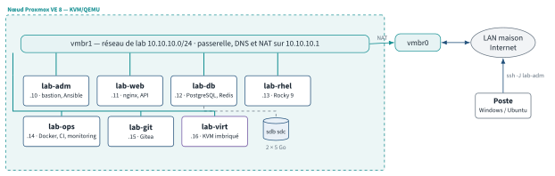
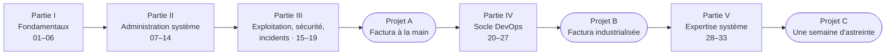

# Workbook Linux & DevOps

**Devenir expert Linux en pratiquant : 33 modules, 3 projets fil rouge et plus de 1 700 exercices corrigés et expliqués, joués sur un vrai laboratoire de machines virtuelles.**

[](https://github.com/cemah2/WorkbookLinux/actions/workflows/ci.yml)
[](LICENSE)
[](LICENSE-CODE)

Tout est en Markdown, lisible directement ici sur GitHub, sans rien
installer. Ce n'est pas un cours : c'est un cahier d'exercices. Chaque module part du
principe que tu sais te connecter en SSH, te déplacer et éditer un fichier,
puis te fait passer par les commandes, les mécanismes et les pannes qu'un
administrateur rencontre réellement — jusqu'au niveau d'un entretien
technique, puis au-delà. Tout se joue sur ton propre laboratoire, et chaque
lab se vérifie par un script.

## Ce que contient le dépôt

| | |
|---|---|
| **Modules** | 33 modules, de la ligne de commande à Kubernetes puis à l'expertise système (identité, haute disponibilité, sauvegarde, eBPF, ZFS, empaquetage), en cinq parties |
| **Projets fil rouge** | Factura à la main (A), Factura industrialisée (B), une semaine d'astreinte (C) |
| **Exercices** | 594 QCM · 295 questions ouvertes · 537 exercices guidés · 157 labs · 135 Break & Fix · 33 défis |
| **Corrigés** | chaque item a sa réponse, l'explication du mécanisme (« Pourquoi ») et l'erreur classique (« Piège ») |
| **Scripts** | 37 `setup`, 222 `check` qui vérifient le résultat, 160 `break` qui installent une panne |
| **Laboratoire** | 7 VM sur Proxmox VE (Ubuntu 24.04 + Rocky 9), déployables en une commande, et 2 nœuds de cluster pour la haute disponibilité |
| **Mémo** | l'aide-mémoire de tous les modules, à garder ouvert ([docs/memo.md](docs/memo.md)) |
| **Schémas** | 48 schémas en images SVG, et des diagrammes Mermaid rendus par GitHub (validés en CI) |

## Comment ça marche

Chaque module a la même structure, dans un dossier `modules/NN-sujet/` :

* **`README.md` — l'énoncé** : objectifs, mise en place, rappel express
  (deux pages d'antisèche), QCM, questions ouvertes, exercices guidés ★,
  labs ★★, Break & Fix ★★★, défi ★★★, grille d'auto-évaluation ;
* **`corrige.md` — le corrigé** : la réponse de chaque item, avec un encadré
  **Pourquoi** qui explique le mécanisme et un encadré **Piège** qui montre
  ce qui casse en production.

Les identifiants (`Q7.3`, `L7.2`, `BF7.1`, `D7`…) sont cliquables : depuis
l'énoncé ils mènent au corrigé de l'item, et inversement.

> [!TIP]
> **La règle des 20 minutes.** Bloqué ? Cherche vingt minutes pour de vrai
> (`man`, `--help`, journaux, documentation) avant d'ouvrir le corrigé. C'est
> dans ces vingt minutes que tu apprends ; le corrigé sert à comprendre ce que
> tu n'as pas trouvé, pas à éviter de chercher.

Dans les énoncés, les encadrés ont toujours le même sens :

| Encadré | Sens |
|---|---|
| **Objectifs** | ce que tu sauras faire, la durée, les prérequis |
| **Contexte** | la mise en situation d'un lab (ticket, demande, audit) |
| **Variante Rocky / RHEL** | la commande équivalente sur la famille Red Hat |
| **Astuce** / **Attention** | raccourci utile / action destructrice |
| **Critère de succès** | comment savoir que c'est réussi, souvent un `check_*.sh` |

Les scripts vivent dans [`scripts/`](scripts/) : `setup_MXX.sh` prépare le
terrain d'un module, `check_MXX_YY.sh` vérifie le **résultat** d'un lab (pas
la méthode), `break_MXX_YY.sh` casse volontairement une machine pour un
Break & Fix. Chaque énoncé liste ses scripts en tête de page.

## Démarrer

1. **Monter le laboratoire** : le [chapitre 0](docs/00-mise-en-place.md)
   décrit le réseau, les templates cloud-init et le déploiement automatique
   des sept VM sur Proxmox (`scripts/lab/lab-deploy.sh`). Sans Proxmox, il
   propose Multipass, Vagrant ou Docker pour une partie des modules.
2. **Récupérer le workbook sur les VM** :

   ```bash
   git clone https://github.com/cemah2/WorkbookLinux.git ~/workbook
   ```

   Les scripts sont alors dans `~/workbook/scripts/`, là où les énoncés les
   attendent (`bootstrap-lab.sh` fait ce clone pour toi).
3. **Commencer par le [module 01](modules/01-shell-bases/README.md)** et
   suivre le [parcours](docs/parcours.md) : environ 347 heures, soit
   29 semaines à 12 heures par semaine.
4. **Garder une trace** : fais un *fork* du dépôt et range tes réponses dans
   [`reponses/`](reponses/) (un fichier par lab, nommé par son identifiant).
   C'est aussi ton portfolio.

## Le laboratoire

| VM | VMID / IP | Ressources | Rôle |
|---|---|---|---|
| `lab-adm` (Ubuntu 24.04) | 9001 / 10.10.10.10 | 2 vCPU, 2 Go, 20 Go | poste d'admin, bastion, Ansible |
| `lab-web` (Ubuntu 24.04) | 9002 / 10.10.10.11 | 2 vCPU, 2 Go, 20 Go | web, reverse proxy, applications |
| `lab-db` (Ubuntu 24.04) | 9003 / 10.10.10.12 | 2 vCPU, 2 Go, 30 Go + 2 × 5 Go | bases de données, stockage, LVM |
| `lab-rhel` (Rocky 9) | 9004 / 10.10.10.13 | 2 vCPU, 2 Go, 20 Go | dnf, firewalld, SELinux |
| `lab-ops` (Ubuntu 24.04) | 9005 / 10.10.10.14 | 2 vCPU, 4 Go, 40 Go | Docker, CI, supervision |
| `lab-git` (Ubuntu 24.04) | 9006 / 10.10.10.15 | 1 vCPU, 1 Go, 15 Go | forge Gitea |
| `lab-virt` (Ubuntu 24.04) | 9007 / 10.10.10.16 | 4 vCPU, 6 Go, 40 Go | KVM imbriqué (module 20) |
| `lab-ha1`, `lab-ha2` (Ubuntu 24.04) | 9021, 9022 / 10.10.10.21, .22 | 1 vCPU, 1 Go, 20 Go | nœuds de cluster (module 29), créés au début du module |

<p align="center"></p>

Réseau isolé `10.10.10.0/24` derrière un nœud Proxmox VE 8 (bridge `vmbr1`,
NAT, DNS `dnsmasq`, bastion SSH sur `lab-adm`). Un snapshot `snap-clean`
permet de remettre chaque VM à zéro avant un lab destructeur.

## Le parcours



<!-- parcours:début -->
### Partie I — Fondamentaux du shell et du système de fichiers

Tout ce qu'un administrateur manipule cent fois par jour : le shell, l'arborescence, les droits, les comptes, le texte.

| | Module | Durée | Énoncé | Corrigé |
|---|---|---|---|---|
| **01** | Le shell au quotidien | 4 h | [énoncé](modules/01-shell-bases/README.md) | [corrigé](modules/01-shell-bases/corrige.md) |
| **02** | Système de fichiers et navigation experte | 5 h | [énoncé](modules/02-filesystem-fhs/README.md) | [corrigé](modules/02-filesystem-fhs/corrige.md) |
| **03** | Permissions, ACL et droits spéciaux | 5 h | [énoncé](modules/03-permissions/README.md) | [corrigé](modules/03-permissions/corrige.md) |
| **04** | Utilisateurs, groupes et élévation de privilèges | 5 h | [énoncé](modules/04-users-groups-sudo/README.md) | [corrigé](modules/04-users-groups-sudo/corrige.md) |
| **05** | Traitement de texte et flux de données | 6 h | [énoncé](modules/05-text-processing/README.md) | [corrigé](modules/05-text-processing/corrige.md) |
| **06** | Vim, archives et transfert de fichiers | 5 h | [énoncé](modules/06-vim-archives/README.md) | [corrigé](modules/06-vim-archives/corrige.md) |

### Partie II — Administration système

Scripter, piloter les processus et le noyau, installer, stocker, connecter, accéder à distance : le socle d'un serveur en production.

| | Module | Durée | Énoncé | Corrigé |
|---|---|---|---|---|
| **07** | Scripting Bash de niveau production | 7 h | [énoncé](modules/07-bash-scripting/README.md) | [corrigé](modules/07-bash-scripting/corrige.md) |
| **08** | Processus, signaux et systemd | 7 h | [énoncé](modules/08-processus-systemd/README.md) | [corrigé](modules/08-processus-systemd/corrige.md) |
| **09** | Noyau Linux et démarrage | 7 h | [énoncé](modules/09-noyau-demarrage/README.md) | [corrigé](modules/09-noyau-demarrage/corrige.md) |
| **10** | Gestion des paquets et des dépôts | 6 h | [énoncé](modules/10-paquets/README.md) | [corrigé](modules/10-paquets/corrige.md) |
| **11** | Stockage : partitions, LVM, RAID, NFS et iSCSI | 12 h | [énoncé](modules/11-stockage-lvm/README.md) | [corrigé](modules/11-stockage-lvm/corrige.md) |
| **12** | Réseau Linux et diagnostic | 7 h | [énoncé](modules/12-reseau/README.md) | [corrigé](modules/12-reseau/corrige.md) |
| **13** | Réseau Linux avancé : netns, bridges, netfilter, DNS | 14 h | [énoncé](modules/13-reseau-avance/README.md) | [corrigé](modules/13-reseau-avance/corrige.md) |
| **14** | SSH : accès, automatisation et tunnels | 6 h | [énoncé](modules/14-ssh/README.md) | [corrigé](modules/14-ssh/corrige.md) |

### Partie III — Exploitation, sécurité et incidents

Ce qui distingue un serveur qui tourne d'un serveur qu'on exploite : services, journaux, planification, durcissement, dépannage.

| | Module | Durée | Énoncé | Corrigé |
|---|---|---|---|---|
| **15** | Services applicatifs : nginx, PostgreSQL, Redis | 9 h | [énoncé](modules/15-services-applicatifs/README.md) | [corrigé](modules/15-services-applicatifs/corrige.md) |
| **16** | Journalisation et supervision système | 6 h | [énoncé](modules/16-logs-monitoring/README.md) | [corrigé](modules/16-logs-monitoring/corrige.md) |
| **17** | Planification : cron, at et timers systemd | 5 h | [énoncé](modules/17-cron-timers/README.md) | [corrigé](modules/17-cron-timers/corrige.md) |
| **18** | Sécurité et durcissement | 8 h | [énoncé](modules/18-securite/README.md) | [corrigé](modules/18-securite/corrige.md) |
| **19** | Dépannage, performance et gestion d'incident | 11 h | [énoncé](modules/19-troubleshooting-perf/README.md) | [corrigé](modules/19-troubleshooting-perf/corrige.md) |

### Projet A — Factura : plateforme multi-services, à la main

Premier projet fil rouge. Tu déploies, sécurises, sauvegardes et supervises une plateforme complète avec les seuls modules 1 à 19.

| | Module | Durée | Énoncé | Corrigé |
|---|---|---|---|---|
| **A** | Factura : plateforme de facturation multi-services | 20 à 30 h | [énoncé](projets/P1-factura/README.md) | [corrigé](projets/P1-factura/corrige.md) |

### Partie IV — Socle DevOps

Virtualiser, versionner, conteneuriser, automatiser, provisionner, livrer en continu, orchestrer, observer, outiller en Python.

| | Module | Durée | Énoncé | Corrigé |
|---|---|---|---|---|
| **20** | Virtualisation : KVM, QEMU et libvirt | 7 h | [énoncé](modules/20-virtualisation-kvm/README.md) | [corrigé](modules/20-virtualisation-kvm/corrige.md) |
| **21** | Git pour l'ops et l'infra-as-code | 8 h | [énoncé](modules/21-git/README.md) | [corrigé](modules/21-git/corrige.md) |
| **22** | Conteneurs : Docker et Compose | 11 h | [énoncé](modules/22-docker/README.md) | [corrigé](modules/22-docker/corrige.md) |
| **23** | Ansible : automatiser le parc | 9 h | [énoncé](modules/23-ansible/README.md) | [corrigé](modules/23-ansible/corrige.md) |
| **24** | Infrastructure as Code : OpenTofu, cloud-init, Proxmox | 9 h | [énoncé](modules/24-iac-terraform/README.md) | [corrigé](modules/24-iac-terraform/corrige.md) |
| **25** | CI/CD : intégration et déploiement continus | 10 h | [énoncé](modules/25-cicd/README.md) | [corrigé](modules/25-cicd/corrige.md) |
| **26** | Kubernetes et observabilité | 12 h | [énoncé](modules/26-kubernetes-observabilite/README.md) | [corrigé](modules/26-kubernetes-observabilite/corrige.md) |
| **27** | Python pour l'ops | 9 h | [énoncé](modules/27-python-ops/README.md) | [corrigé](modules/27-python-ops/corrige.md) |

### Projet B — Factura v2 : industrialisation DevOps

La même plateforme, reconstruite par le code : OpenTofu, Ansible, Compose, CI/CD, observabilité, k3s.

| | Module | Durée | Énoncé | Corrigé |
|---|---|---|---|---|
| **B** | Factura v2 : industrialisation DevOps | 30 à 40 h | [énoncé](projets/P2-factura-devops/README.md) | [corrigé](projets/P2-factura-devops/corrige.md) |

### Partie V — Expertise système

Ce qui fait passer d'administrateur à expert : identité centralisée, haute disponibilité, sauvegarde et reprise, traçage du noyau, systèmes de fichiers avancés, empaquetage.

| | Module | Durée | Énoncé | Corrigé |
|---|---|---|---|---|
| **28** | Identité centralisée : LDAP, Kerberos, SSSD et FreeIPA | 10 h | [énoncé](modules/28-identite-centralisee/README.md) | [corrigé](modules/28-identite-centralisee/corrige.md) |
| **29** | Haute disponibilité : HAProxy, keepalived, Pacemaker et Corosync | 10 h | [énoncé](modules/29-haute-disponibilite/README.md) | [corrigé](modules/29-haute-disponibilite/corrige.md) |
| **30** | Sauvegarde et reprise d'activité : restic, borg, PostgreSQL PITR, Proxmox | 11 h | [énoncé](modules/30-sauvegarde-pra/README.md) | [corrigé](modules/30-sauvegarde-pra/corrige.md) |
| **31** | Observer le noyau : perf, flame graphs, ftrace et eBPF | 10 h | [énoncé](modules/31-tracage-ebpf-perf/README.md) | [corrigé](modules/31-tracage-ebpf-perf/corrige.md) |
| **32** | Systèmes de fichiers avancés : intégrité, Btrfs, ZFS et mesures | 10 h | [énoncé](modules/32-fs-avances/README.md) | [corrigé](modules/32-fs-avances/corrige.md) |
| **33** | Construire et distribuer : compilation, paquets .deb et .rpm, dépôts signés | 11 h | [énoncé](modules/33-packaging-build/README.md) | [corrigé](modules/33-packaging-build/corrige.md) |

### Projet C — Une semaine d'astreinte

Examen final : cinq journées de tickets, d'incidents et de post-mortems sur la plateforme Factura.

| | Module | Durée | Énoncé | Corrigé |
|---|---|---|---|---|
| **C** | Une semaine d'astreinte | 12 à 16 h | [énoncé](projets/P3-astreinte/README.md) | [corrigé](projets/P3-astreinte/corrige.md) |

<!-- parcours:fin -->

Le détail (planning semaine par semaine, niveaux, compétences) est dans
[docs/parcours.md](docs/parcours.md) ; la grille de progression et la
correspondance avec les certifications **LFCS**, **RHCSA (EX200)**, **CKA**
et **Terraform Associate** sont dans les [annexes](docs/annexes.md).

## Structure du dépôt

```text
modules/NN-sujet/        README.md (énoncé) + corrige.md (corrigé)
projets/PX-sujet/        les trois projets fil rouge, même structure
docs/                    chapitre 0, parcours, annexes, mémo, points à vérifier
scripts/                 setup/ check/ break/ lab/ projects/ — à cloner sur les VM
assets/figures/          schémas SVG (sources TikZ dans assets/figures/src/)
reponses/                TES réponses (dans ton fork) : reponses/MXX/<identifiant>.md
tools/                   navigation générée, contrôles de cohérence (make check)
```

## Contribuer, signaler une erreur

Une commande qui ne marche pas sur Ubuntu 24.04 ou Rocky 9, une sortie
inexacte, une clé de QCM discutable, un script `check` qui refuse une bonne
réponse : ouvre une [issue « erreur dans le workbook »](https://github.com/cemah2/WorkbookLinux/issues/new/choose),
avec l'identifiant de l'item. Les points déjà connus, qui demandent une
vérification sur les vraies VM, sont listés dans
[docs/a-verifier.md](docs/a-verifier.md). Les règles de rédaction sont dans
[CONVENTIONS.md](CONVENTIONS.md), le circuit des contributions dans
[CONTRIBUTING.md](CONTRIBUTING.md).

## Licence

* Contenu pédagogique (énoncés, corrigés, mémo, docs, schémas) :
  [CC BY-NC-SA 4.0](LICENSE) — partage et adaptation libres, avec
  attribution, sans usage commercial, sous la même licence.
* Scripts et outils (`scripts/`, `tools/`) : [MIT](LICENSE-CODE).
* Polices des schémas (`assets/figures/src/fonts/`) : Source Sans 3 et
  JetBrains Mono, sous SIL Open Font License 1.1.

Auteur : Mathieu ([cemah2](https://github.com/cemah2)).
