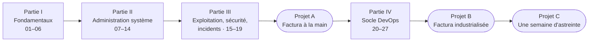

<!-- nav:début -->
[Accueil](../README.md) · [Chapitre 0 — Mise en place](00-mise-en-place.md) · **Parcours** · [Annexes](annexes.md) · [Mémo](memo.md)
<!-- nav:fin -->

# Parcours

Le workbook se suit dans l'ordre : chaque module suppose les précédents, et
les projets fil rouge réutilisent tout ce qui les précède. Environ
**285 heures** de travail (210 h de modules, 75 h de projets) : à 12 h par
semaine, compte 24 semaines ; à 6 h, une petite année.

## Planning en 19 étapes

Les étapes qui dépassent 12 h (5, 6, 7, 8, 13, 15, 16 et les trois projets)
s'étalent sur deux, voire trois semaines réelles. Les heures sont celles des
« Temps estimé » des modules ; un dépassement de 30 % est normal, un
dépassement de 100 % signifie en général que la
[règle des 20 minutes](00-mise-en-place.md#la-règle-des-20-minutes) n'est pas
respectée.

| Étape | Modules / projets | Heures | Jalon |
|---|---|---|---|
| 1 | [01](../modules/01-shell-bases/README.md) shell, [02](../modules/02-filesystem-fhs/README.md) système de fichiers | 9 | lab monté, carnet ouvert |
| 2 | [03](../modules/03-permissions/README.md) permissions, [04](../modules/04-users-groups-sudo/README.md) utilisateurs et sudo | 10 | premier Break & Fix |
| 3 | [05](../modules/05-text-processing/README.md) traitement de texte, [06](../modules/06-vim-archives/README.md) vim et archives | 11 | rapport `access.log` |
| 4 | [07](../modules/07-bash-scripting/README.md) scripting bash | 7 | dépôt Git perso créé |
| 5 | [08](../modules/08-processus-systemd/README.md) processus et systemd, [09](../modules/09-noyau-demarrage/README.md) noyau et démarrage | 14 | un service maison durci |
| 6 | [10](../modules/10-paquets/README.md) paquets, [11](../modules/11-stockage-lvm/README.md) stockage et LVM | 18 | disque de VM agrandi à chaud |
| 7 | [12](../modules/12-reseau/README.md) réseau, [13](../modules/13-reseau-avance/README.md) réseau avancé | 21 | deux netns qui se parlent via VXLAN |
| 8 | [14](../modules/14-ssh/README.md) SSH, [15](../modules/15-services-applicatifs/README.md) services applicatifs | 15 | bastion + PostgreSQL sauvegardé |
| 9 | [16](../modules/16-logs-monitoring/README.md) logs et supervision, [17](../modules/17-cron-timers/README.md) planification | 11 | logs centralisés |
| 10 | [18](../modules/18-securite/README.md) sécurité | 8 | pare-feu multi-machines |
| 11 | [19](../modules/19-troubleshooting-perf/README.md) dépannage et incident | 11 | premier post-mortem |
| 12 | [Projet A](../projets/P1-factura/README.md) « Factura » à la main | 20 à 30 | application déployée, documentée |
| 13 | [20](../modules/20-virtualisation-kvm/README.md) virtualisation KVM, [21](../modules/21-git/README.md) Git | 15 | VM libvirt clonée par script |
| 14 | [22](../modules/22-docker/README.md) Docker et Compose | 11 | image publiée sur un registre |
| 15 | [23](../modules/23-ansible/README.md) Ansible, [24](../modules/24-iac-terraform/README.md) OpenTofu / cloud-init | 18 | VM créée par le code |
| 16 | [25](../modules/25-cicd/README.md) CI/CD Gitea Actions, [26](../modules/26-kubernetes-observabilite/README.md) k3s + observabilité | 22 | pipeline vert |
| 17 | [27](../modules/27-python-ops/README.md) Python pour l'ops | 9 | outil packagé sous timer |
| 18 | [Projet B](../projets/P2-factura-devops/README.md) « Factura » industrialisée | 30 à 40 | `git push` → prod |
| 19 | [Projet C](../projets/P3-astreinte/README.md) une semaine d'astreinte | 12 à 16 | 5 incidents résolus |

## Les niveaux

Dans chaque module, la difficulté monte en trois marches :

| Niveau | Format | Ce qu'on y apprend |
|---|---|---|
| ★ | exercices guidés : une commande, un script de quelques lignes | les outils et leurs options |
| ★★ | labs : un scénario en plusieurs étapes, un critère de succès vérifié par script | enchaîner les outils sur un vrai besoin |
| ★★★ | Break & Fix et défi : une panne à diagnostiquer, un livrable long | la démarche, sous contrainte |

Les compétences transversales se mesurent sur quatre niveaux (D découverte,
A autonome, C confirmé, E expert) dans la
[grille de progression](annexes.md#annexe-a--grille-de-progression).
L'objectif réaliste en fin de workbook : **A partout, C sur la moitié**.

## Parcours ciblés

Le parcours complet est conseillé, mais tu peux viser un objectif précis.
Garde toujours la Partie I : tout le reste s'appuie dessus.

| Objectif | Modules | Remarque |
|---|---|---|
| **LFCS / RHCSA (EX200)** | 01 à 14, 16 à 18, 20 | Rocky 9 (`lab-rhel`) pour chaque variante RHEL ; détail des objectifs dans les [annexes](annexes.md#annexe-b--correspondance-certifications) |
| **Premier poste DevOps** | 01 à 08, 10, 12, 14, 15, 19, 21 à 26, projets A et B | 22 à 26 sont le cœur ; le projet B est la pièce maîtresse du portfolio |
| **Expertise système** | 01 à 20, 27, projets A et C | 09, 11, 13 et 19 vont au-delà de ce que demandent les certifications |
| **Astreinte et exploitation** | 08, 12, 15 à 19, 22, 26, projet C | à faire après le reste : le projet C mélange tout |

## Tous les modules

<!-- parcours:début -->
### Partie I — Fondamentaux du shell et du système de fichiers

Tout ce qu'un administrateur manipule cent fois par jour : le shell, l'arborescence, les droits, les comptes, le texte.

| | Module | Durée | Énoncé | Corrigé |
|---|---|---|---|---|
| **01** | Le shell au quotidien | 4 h | [énoncé](../modules/01-shell-bases/README.md) | [corrigé](../modules/01-shell-bases/corrige.md) |
| **02** | Système de fichiers et navigation experte | 5 h | [énoncé](../modules/02-filesystem-fhs/README.md) | [corrigé](../modules/02-filesystem-fhs/corrige.md) |
| **03** | Permissions, ACL et droits spéciaux | 5 h | [énoncé](../modules/03-permissions/README.md) | [corrigé](../modules/03-permissions/corrige.md) |
| **04** | Utilisateurs, groupes et élévation de privilèges | 5 h | [énoncé](../modules/04-users-groups-sudo/README.md) | [corrigé](../modules/04-users-groups-sudo/corrige.md) |
| **05** | Traitement de texte et flux de données | 6 h | [énoncé](../modules/05-text-processing/README.md) | [corrigé](../modules/05-text-processing/corrige.md) |
| **06** | Vim, archives et transfert de fichiers | 5 h | [énoncé](../modules/06-vim-archives/README.md) | [corrigé](../modules/06-vim-archives/corrige.md) |

### Partie II — Administration système

Scripter, piloter les processus et le noyau, installer, stocker, connecter, accéder à distance : le socle d'un serveur en production.

| | Module | Durée | Énoncé | Corrigé |
|---|---|---|---|---|
| **07** | Scripting Bash de niveau production | 7 h | [énoncé](../modules/07-bash-scripting/README.md) | [corrigé](../modules/07-bash-scripting/corrige.md) |
| **08** | Processus, signaux et systemd | 7 h | [énoncé](../modules/08-processus-systemd/README.md) | [corrigé](../modules/08-processus-systemd/corrige.md) |
| **09** | Noyau Linux et démarrage | 7 h | [énoncé](../modules/09-noyau-demarrage/README.md) | [corrigé](../modules/09-noyau-demarrage/corrige.md) |
| **10** | Gestion des paquets et des dépôts | 6 h | [énoncé](../modules/10-paquets/README.md) | [corrigé](../modules/10-paquets/corrige.md) |
| **11** | Stockage : partitions, LVM, RAID, NFS et iSCSI | 12 h | [énoncé](../modules/11-stockage-lvm/README.md) | [corrigé](../modules/11-stockage-lvm/corrige.md) |
| **12** | Réseau Linux et diagnostic | 7 h | [énoncé](../modules/12-reseau/README.md) | [corrigé](../modules/12-reseau/corrige.md) |
| **13** | Réseau Linux avancé : netns, bridges, netfilter, DNS | 14 h | [énoncé](../modules/13-reseau-avance/README.md) | [corrigé](../modules/13-reseau-avance/corrige.md) |
| **14** | SSH : accès, automatisation et tunnels | 6 h | [énoncé](../modules/14-ssh/README.md) | [corrigé](../modules/14-ssh/corrige.md) |

### Partie III — Exploitation, sécurité et incidents

Ce qui distingue un serveur qui tourne d'un serveur qu'on exploite : services, journaux, planification, durcissement, dépannage.

| | Module | Durée | Énoncé | Corrigé |
|---|---|---|---|---|
| **15** | Services applicatifs : nginx, PostgreSQL, Redis | 9 h | [énoncé](../modules/15-services-applicatifs/README.md) | [corrigé](../modules/15-services-applicatifs/corrige.md) |
| **16** | Journalisation et supervision système | 6 h | [énoncé](../modules/16-logs-monitoring/README.md) | [corrigé](../modules/16-logs-monitoring/corrige.md) |
| **17** | Planification : cron, at et timers systemd | 5 h | [énoncé](../modules/17-cron-timers/README.md) | [corrigé](../modules/17-cron-timers/corrige.md) |
| **18** | Sécurité et durcissement | 8 h | [énoncé](../modules/18-securite/README.md) | [corrigé](../modules/18-securite/corrige.md) |
| **19** | Dépannage, performance et gestion d'incident | 11 h | [énoncé](../modules/19-troubleshooting-perf/README.md) | [corrigé](../modules/19-troubleshooting-perf/corrige.md) |

### Projet A — Factura : plateforme multi-services, à la main

Premier projet fil rouge. Tu déploies, sécurises, sauvegardes et supervises une plateforme complète avec les seuls modules 1 à 19.

| | Module | Durée | Énoncé | Corrigé |
|---|---|---|---|---|
| **A** | Factura : plateforme de facturation multi-services | 20 à 30 h | [énoncé](../projets/P1-factura/README.md) | [corrigé](../projets/P1-factura/corrige.md) |

### Partie IV — Socle DevOps

Virtualiser, versionner, conteneuriser, automatiser, provisionner, livrer en continu, orchestrer, observer, outiller en Python.

| | Module | Durée | Énoncé | Corrigé |
|---|---|---|---|---|
| **20** | Virtualisation : KVM, QEMU et libvirt | 7 h | [énoncé](../modules/20-virtualisation-kvm/README.md) | [corrigé](../modules/20-virtualisation-kvm/corrige.md) |
| **21** | Git pour l'ops et l'infra-as-code | 8 h | [énoncé](../modules/21-git/README.md) | [corrigé](../modules/21-git/corrige.md) |
| **22** | Conteneurs : Docker et Compose | 11 h | [énoncé](../modules/22-docker/README.md) | [corrigé](../modules/22-docker/corrige.md) |
| **23** | Ansible : automatiser le parc | 9 h | [énoncé](../modules/23-ansible/README.md) | [corrigé](../modules/23-ansible/corrige.md) |
| **24** | Infrastructure as Code : OpenTofu, cloud-init, Proxmox | 9 h | [énoncé](../modules/24-iac-terraform/README.md) | [corrigé](../modules/24-iac-terraform/corrige.md) |
| **25** | CI/CD : intégration et déploiement continus | 10 h | [énoncé](../modules/25-cicd/README.md) | [corrigé](../modules/25-cicd/corrige.md) |
| **26** | Kubernetes et observabilité | 12 h | [énoncé](../modules/26-kubernetes-observabilite/README.md) | [corrigé](../modules/26-kubernetes-observabilite/corrige.md) |
| **27** | Python pour l'ops | 9 h | [énoncé](../modules/27-python-ops/README.md) | [corrigé](../modules/27-python-ops/corrige.md) |

### Projet B — Factura v2 : industrialisation DevOps

La même plateforme, reconstruite par le code : OpenTofu, Ansible, Compose, CI/CD, observabilité, k3s.

| | Module | Durée | Énoncé | Corrigé |
|---|---|---|---|---|
| **B** | Factura v2 : industrialisation DevOps | 30 à 40 h | [énoncé](../projets/P2-factura-devops/README.md) | [corrigé](../projets/P2-factura-devops/corrige.md) |

### Projet C — Une semaine d'astreinte

Examen final : cinq journées de tickets, d'incidents et de post-mortems sur la plateforme Factura.

| | Module | Durée | Énoncé | Corrigé |
|---|---|---|---|---|
| **C** | Une semaine d'astreinte | 12 à 16 h | [énoncé](../projets/P3-astreinte/README.md) | [corrigé](../projets/P3-astreinte/corrige.md) |

<!-- parcours:fin -->
