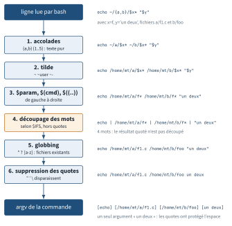
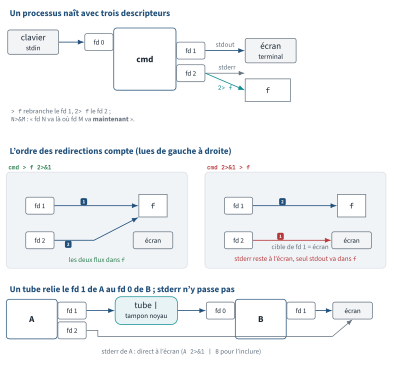

<!-- nav:début -->
[Accueil](../../README.md) › [Parcours](../../docs/parcours.md) › Partie I — Fondamentaux du shell et du système de fichiers › **Module 01**  
[Corrigé](corrige.md) · [Module 02 →](../02-filesystem-fhs/README.md)

<details><summary>Scripts du module (9)</summary>

Sur la VM indiquée en section « Mise en place », depuis `~/workbook/scripts/` (voir [chapitre 0](../../docs/00-mise-en-place.md)).

| Script | Rôle |
|---|---|
| [`setup_M01.sh`](../../scripts/setup/setup_M01.sh) | prépare le module |
| [`check_M01_01.sh`](../../scripts/check/check_M01_01.sh) | vérification |
| [`check_M01_02.sh`](../../scripts/check/check_M01_02.sh) | vérification |
| [`check_M01_03.sh`](../../scripts/check/check_M01_03.sh) | vérification |
| [`check_M01_04.sh`](../../scripts/check/check_M01_04.sh) | vérification |
| [`check_M01_05.sh`](../../scripts/check/check_M01_05.sh) | vérification |
| [`break_M01_01.sh`](../../scripts/break/break_M01_01.sh) | installe une panne |
| [`break_M01_02.sh`](../../scripts/break/break_M01_02.sh) | installe une panne |
| [`break_M01_03.sh`](../../scripts/break/break_M01_03.sh) | installe une panne |

</details>
<!-- nav:fin -->

# Module 01 — Le shell au quotidien

## 1.0 Objectifs et compétences

> [!NOTE]
> **Objectifs**
>
> À la fin de ce module, je sais :
>
> * enchaîner mes commandes sans quitter le clavier (raccourcis readline, historique,
>   `Ctrl-R`, `#!`, `!$`, `fc`) et configurer un historique exploitable en équipe ;
> * énoncer **dans l'ordre** les étapes d'expansion du shell et prédire le résultat
>   d'une ligne de commande avant de l'exécuter ;
> * choisir le bon quoting (simple, double, backslash) et manipuler sans dégât des
>   noms de fichiers contenant espaces, apostrophes ou tiret initial ;
> * distinguer variable de shell et variable d'environnement, diagnostiquer un
>   `PATH` cassé, et savoir quand utiliser `type`, `command -v` plutôt que `which` ;
> * dire quel fichier de démarrage est lu par un shell de login, interactif ou
>   non interactif, et y placer une configuration au bon endroit ;
> * rediriger stdout, stderr et les deux à la fois, dupliquer un flux avec `tee`,
>   et expliquer pourquoi l'ordre des redirections change le résultat ;
> * naviguer efficacement (`cd -`, `pushd`/`popd`, `CDPATH`) et trouver une réponse
>   dans la documentation locale sans accès internet ;
> * personnaliser un shell de production (`PS1`, `EDITOR`, pager, `shopt`) sans
>   casser les shells non interactifs, et reconnaître ce qui casse sous `dash`.
>
> **Temps estimé** : 4 h
>
> **Prérequis** : aucun (module d'entrée du workbook). Savoir se connecter en SSH suffit.

---

## 1.1 Mise en place

VM concernée : **`lab-adm` (10.10.10.10)**. Tout le module se fait avec l'utilisateur
`mathieu`, sauf les Break & Fix qui demandent `sudo`.

```bash
# depuis le shell Proxmox, avant de commencer
qm snapshot 9001 avant-lab01
```

Paquets nécessaires sur `lab-adm` :

```bash
sudo apt update
sudo apt install -y bash-completion manpages manpages-dev less tree tldr
```

> [!IMPORTANT]
> **Variante Rocky / RHEL**
>
> Sous Rocky 9 : `sudo dnf install -y bash-completion man-pages less tree` (`man-pages-posix` n'est pas livré dans Rocky 9, on s'en passe). `tldr` n'est pas dans les dépôts de base : installe-le avec
> `python3 -m pip install --user tldr`, ou passe-t'en, ce n'est utilisé qu'en E1.14.

Préparation du terrain de jeu (idempotent, à relancer sans crainte) :

```bash
bash ~/workbook/scripts/setup/setup_M01.sh
```

Il crée `~/lab01/` avec des journaux, une arborescence de déploiement et quelques
noms de fichiers volontairement hostiles.

> [!CAUTION]
> **Attention**
>
> Le module modifie ton `~/.bashrc`. Le script de setup en fait une copie dans
> `~/lab01/backup/bashrc.orig`. Si tu te retrouves avec un shell inutilisable,
> la procédure de secours est dans BF1.1 — elle fait partie du programme.

---

## 1.2 Rappel express

### Raccourcis de ligne (bibliothèque readline)

| Touches | Effet |
|---|---|
| `Ctrl-A` / `Ctrl-E` | début / fin de ligne |
| `Ctrl-W` / `Alt-Backspace` | efface le mot avant le curseur (blanc / mot) |
| `Ctrl-U` / `Ctrl-K` | coupe avant / après le curseur |
| `Ctrl-Y` | recolle ce qui vient d'être coupé |
| `Ctrl-R` puis `Ctrl-R` | recherche arrière dans l'historique, occurrence suivante |
| `Ctrl-G` | abandonne la recherche `Ctrl-R` sans exécuter |
| `Alt-.` | insère le dernier argument de la commande précédente |
| `Ctrl-L` | efface l'écran sans perdre la ligne en cours |

### Historique

| Élément | Rôle |
|---|---|
| `HISTSIZE` | nombre de lignes gardées **en mémoire** |
| `HISTFILESIZE` | nombre de lignes gardées dans `~/.bash_history` |
| `HISTCONTROL=ignoreboth` | ignore les doublons consécutifs **et** les lignes préfixées d'un espace |
| `HISTTIMEFORMAT='%F %T '` | horodate chaque entrée (stocké comme `#epoch`) |
| `shopt -s histappend` | ajoute au fichier au lieu de l'écraser |
| **Élément** | **Rôle** |
| `!!` `!$` `!*` | dernière commande, son dernier argument, tous ses arguments |
| `!nginx` / `!?nginx?` | dernière commande commençant par / contenant `nginx` |
| `fc -l` / `fc` | liste l'historique / rouvre la dernière commande dans `$EDITOR` |

### Ordre d'expansion — c'est là que tout se joue

Bash traite chaque ligne **dans cet ordre**, une seule passe :

```text
1. accolades          {a,b}  {1..5}    -> texte pur, ni fichier ni variable
2. tilde              ~  ~mathieu  ~-    -> $HOME, home d'un user, $OLDPWD
3. paramètres         $VAR  ${VAR:-def}
   arithmétique       $(( 2 * 3 ))        (ces trois-là, de gauche à droite)
   substitution cmd   $(date +%F)  `..`
4. découpage des mots   selon $IFS, uniquement sur les résultats NON quotés
5. globbing             *  ?  [a-z]  -> noms de fichiers existants
6. suppression des quotes
```

<p align="center"></p>

*Figure — Les six étapes d'expansion de bash, dans l'ordre, et ce que devient la ligne `echo ~/{a,b}/$x* "$y"` à chaque étape.*

Conséquences directes :

* `n=5; echo {1..$n}` n'imprime pas `1 2 3 4 5` : les accolades passent avant `$n`.
* `f=$(ls); rm $f` casse dès qu'un nom contient un espace : étape 4 découpe.
* `echo "*"` n'est jamais globbé : les quotes protègent avant l'étape 5.
* un glob sans correspondance est passé **littéralement** à la commande.

### Quoting

| Forme | Protège | Laisse vivre |
|---|---|---|
| `'texte'` | tout | rien (pas même `\`) |
| `"texte"` | espaces, globs, `{}` | `$`, `` ` ``, `\`, `!` (en interactif) |
| `\c` | le caractère suivant | — |

Règle de survie : **toute variable qui peut contenir un espace se cite**.
`cp "$src" "$dst"`, jamais `cp $src $dst`.

### Variables, alias, fonctions

```bash
APP=facturation            # variable de shell, invisible des processus fils
export APP                 # devient variable d'environnement
env | sort                 # ce que verront les fils
declare -p APP             # type + valeur + attributs
type -a python3            # alias ? fonction ? builtin ? toutes les pistes
command -v systemctl       # le chemin, scriptable, POSIX
hash -r                    # vide le cache des chemins de bash
```

`which` est un binaire externe (`/usr/bin/which`) : il ne voit ni les alias, ni
les fonctions, ni les builtins. `type` et `command -v` sont des builtins : ils
voient tout. En script, utilise `command -v`.

### Fichiers de démarrage

| Type de shell | Ce que bash lit |
|---|---|
| login (SSH, `su -`, console) | `/etc/profile`, puis le **premier** trouvé : `~/.bash_profile`, `~/.bash_login`, `~/.profile` |
| interactif non-login (`bash`, terminal graphique) | `/etc/bash.bashrc` puis `~/.bashrc` |
| non interactif (cron, script, `bash -c`) | `$BASH_ENV` s'il est défini ; rien sinon |
| `ssh h cmd` (non interactif, lancé par sshd) | `~/.bashrc`, mais coupé par sa garde `case $-` |

Sur Ubuntu, `~/.profile` contient un `. "$HOME/.bashrc"` : c'est ce pont qui fait
croire que « `.bashrc` est toujours lu ». Créer un `~/.bash_profile` court-circuite
`~/.profile` et coupe ce pont. Et le `~/.bashrc` d'Ubuntu commence par une garde :

```bash
case $- in
    *i*) ;;
      *) return;;
esac
```

Tout ce que tu écris après cette garde n'existe pas pour un shell non interactif.

### Redirections de base

| Écriture | Effet |
|---|---|
| `> f` / `» f` | stdout (fd 1) dans `f`, écrase / ajoute |
| `2> f` / `2» f` | stderr (fd 2) dans `f` |
| `> f 2>&1` | stdout dans `f`, **puis** stderr là où va déjà stdout |
| `2>&1 > f` | stderr vers le terminal, stdout dans `f` (l'ordre compte) |
| `&> f` / `&» f` | les deux, raccourci bash (pas POSIX) |
| `< f` | `f` sur stdin |
| `\| tee -a f` | duplique stdout : écran **et** fichier |
| `> /dev/null 2>&1` | silence complet |

`2>&1` signifie « fais pointer le fd 2 vers **la cible actuelle** du fd 1 ».
C'est une copie de destination faite au moment où le shell la lit, de gauche à
droite, pas un alias permanent.

<p align="center"></p>

*Figure — Les descripteurs 0/1/2 d'un processus, pourquoi `> f 2>&1` et `2>&1 > f` ne donnent pas le même résultat, et ce qu'un tube relie vraiment.*

### Navigation et documentation

```bash
cd -            # revient au répertoire précédent ($OLDPWD)
pushd /etc/nginx ; pushd /var/log ; dirs -v ; popd
CDPATH=.:/etc:/var/log      # cd nginx (= /etc/nginx) marche de n'importe où
man 5 crontab   # section 5 = formats de fichiers ; 1 = commandes ; 8 = admin
man -k sockets  # = apropos, cherche dans les descriptions
/motif puis n   # recherche dans une page man (pager less)
info coreutils 'ls invocation'
ls /usr/share/doc/nginx/     # README, changelogs, exemples de conf
```

---

## 1.3 Quiz — QCM

<a id="q1-1"></a>**[Q1.1](corrige.md#q1-1)** — Tu tapes ceci sur `lab-adm` :

```bash
n=5
echo {1..$n}
```

Qu'affiche la seconde ligne ?

a) `1 2 3 4 5`
b) `{1..5}`
c) `{1..$n}`
d) une erreur de syntaxe

<a id="q1-2"></a>**[Q1.2](corrige.md#q1-2)** — Le répertoire courant ne contient qu'un fichier, nommé `rapport final.log`.
Tu exécutes :

```bash
f="rapport final.log"
rm $f
```

Que se passe-t-il ?

a) le fichier est supprimé, `rm` gère les espaces
b) `rm` échoue deux fois : `cannot remove 'rapport'` et `cannot remove 'final.log'`
c) rien, `rm` refuse sans `-f`
d) `rm` supprime tous les fichiers du répertoire

<a id="q1-3"></a>**[Q1.3](corrige.md#q1-3)** — `ll` est défini par `alias ll='ls -alF'` dans ton `~/.bashrc`.
**Deux réponses correctes.**

a) `which ll` affiche `/usr/bin/ls`
b) `type ll` affiche `ll is aliased to 'ls -alF'`
c) `command -v ll` affiche `alias ll='ls -alF'`
d) `which` est un builtin bash, il connaît donc les alias

<a id="q1-4"></a>**[Q1.4](corrige.md#q1-4)** — Un collègue lance son déploiement ainsi :

```bash
./deploy.sh 2>&1 > deploy.log
```

Il se plaint que les erreurs n'apparaissent pas dans le fichier. Pourquoi ?

a) elles y sont, il regarde mal
b) stdout va dans `deploy.log`, stderr reste sur le terminal
c) stderr va dans `deploy.log`, stdout reste sur le terminal
d) `2>&1` est invalide avant une redirection, bash ignore la ligne

<a id="q1-5"></a>**[Q1.5](corrige.md#q1-5)** — Sur `lab-adm`, tu exécutes :

```bash
ssh mathieu@10.10.10.11 'echo $PATH'
```

Quel fichier de démarrage influence réellement le résultat sur `lab-web`
(Ubuntu 24.04, configuration par défaut) ?

a) `~/.bash_profile`, car c'est un shell de login
b) `~/.bashrc`, mais il s'arrête à la garde `case $- in *i*) ;; *) return;; esac`
c) `/etc/profile` puis `~/.profile`
d) aucun : un shell non interactif ne lit jamais de fichier de démarrage

<a id="q1-6"></a>**[Q1.6](corrige.md#q1-6)** — À l'intérieur d'une paire de guillemets **simples**, quels caractères
gardent une signification spéciale pour bash ?

a) `$`
b) `` ` ``
c) `\`
d) aucun

<a id="q1-7"></a>**[Q1.7](corrige.md#q1-7)** — Tu dois taper une commande contenant un mot de passe en clair et tu ne
veux pas qu'elle finisse dans `~/.bash_history`. Quelle est la méthode la plus
propre, sans perdre le reste de ton historique ?

a) `HISTCONTROL=ignoredups`, puis taper la commande normalement
b) `HISTCONTROL=ignorespace`, puis préfixer la commande d'une espace
c) `HISTSIZE=0` avant, puis remettre la valeur après
d) `unset HISTFILE` avant, puis se reconnecter

<a id="q1-8"></a>**[Q1.8](corrige.md#q1-8)** — Dans `/var/log`, qui ne contient aucun fichier `.gz`, tu tapes `ls *.gz`.
Que se passe-t-il ?

a) `ls` liste tout le répertoire
b) `ls: cannot access '*.gz': No such file or directory`
c) `ls` n'affiche rien et renvoie 0
d) bash renvoie une erreur sans jamais appeler `ls`

<a id="q1-9"></a>**[Q1.9](corrige.md#q1-9)** — Un script de rotation calcule un numéro de mois :

```bash
mois=$(date +%m)      # on est le 18 septembre
echo $(( mois + 1 ))
```

Quel est le résultat le 18 septembre 2026 ?

a) `10`
b) `bash: 09: value too great for base (error token is "09")`
c) `9`
d) `1`

<a id="q1-10"></a>**[Q1.10](corrige.md#q1-10)** — Tu veux ajouter `~/bin` à ton `PATH` depuis `~/.bashrc`.
**Deux réponses fonctionnent.**

a) `PATH=~/bin`
b) `export PATH="$HOME/bin:$PATH"`
c) `export PATH="$PATH:."`
d) `PATH="$HOME/bin:$PATH"`

<a id="q1-11"></a>**[Q1.11](corrige.md#q1-11)** — Tu cherches la signification du champ `pass` dans `/etc/fstab`
(le format du fichier, pas la commande). Quelle commande cible explicitement la bonne section, quel que soit le nom cherché ?

a) `man fstab`
b) `man 5 fstab`
c) `man -k fstab`
d) `man 1 fstab`

<a id="q1-12"></a>**[Q1.12](corrige.md#q1-12)** — Un script commence par `#!/bin/sh` et contient :

```sh
if [[ -f "$conf" ]]; then
  source /opt/app/lib.sh
fi
```

Il fonctionne sur le poste du dev (macOS) et échoue sur `lab-web` (Ubuntu 24.04).
Pourquoi ?

a) sur Ubuntu, `/bin/sh` est un lien vers `dash`, qui ne connaît ni `[[ ]]` ni `source`
b) le fichier `lib.sh` n'a pas le bit d'exécution
c) `sh` refuse les scripts sans `set -e`
d) le shebang doit être `#!/usr/bin/sh` sur Ubuntu

<a id="q1-13"></a>**[Q1.13](corrige.md#q1-13)** — Un script `maj.sh` contient `alias ll='ls -l'` puis, ligne suivante, `ll`.
Exécuté par `bash maj.sh`, que se passe-t-il ?

a) il fonctionne, l'alias est défini juste avant
b) `maj.sh: line 3: ll: command not found`, les alias ne sont pas développés dans
   un shell non interactif
c) bash refuse la définition d'alias hors session interactive
d) l'alias fonctionne mais pollue le shell appelant

<a id="q1-14"></a>**[Q1.14](corrige.md#q1-14)** — Tu veux voir la sortie d'une mise à jour à l'écran **et** la garder,
erreurs comprises :

```bash
./maj.sh | tee -a ~/lab01/logs/maj.log
```

Que manque-t-il ?

a) rien, `tee` capture déjà stderr
b) `./maj.sh 2>&1 | tee -a ...`
c) `./maj.sh &> tee -a ...`
d) `./maj.sh | tee -a ... 2>&1`

<a id="q1-15"></a>**[Q1.15](corrige.md#q1-15)** — Tu as deux terminaux SSH ouverts sur `lab-adm`, `shopt histappend` est
désactivé. Tu travailles dans les deux, puis tu les fermes l'un après l'autre.
Que contient `~/.bash_history` ?

a) l'historique fusionné des deux sessions
b) uniquement l'historique de la session fermée en dernier, qui a écrasé le fichier
c) rien, le fichier est vidé
d) l'historique de la première session seulement

<a id="q1-16"></a>**[Q1.16](corrige.md#q1-16)** — Tu es dans `/var/log`, tu vas dans `/etc/nginx`, tu veux revenir.
**Deux réponses correctes.**

a) `cd -`
b) `cd ..`
c) `cd "$OLDPWD"`
d) `cd ~`

<a id="q1-17"></a>**[Q1.17](corrige.md#q1-17)** — Pour traiter tous les fichiers de `/var/log`, deux écritures circulent
dans l'équipe :

```bash
for f in $(ls /var/log); do ...   # A
for f in /var/log/*; do ...       # B
```

Laquelle est correcte sur une machine où existe `rapport final.log` ?

a) les deux, c'est équivalent
b) A seulement
c) B seulement
d) aucune des deux, il faut `find`

---

## 1.4 Quiz — questions ouvertes

<a id="qo1-1"></a>**[QO1.1](corrige.md#qo1-1)** — Détaille, étape par étape et **dans l'ordre**, ce que fait bash de la
ligne suivante, en nommant chaque type d'expansion :

```bash
echo ~/lab01/logs/*.log "$(date +%F)" $((7 * 24))
```

Explique ensuite pourquoi l'ordre « paramètres avant globbing » est indispensable,
avec un exemple où l'ordre inverse donnerait un résultat faux.

<a id="qo1-2"></a>**[QO1.2](corrige.md#qo1-2)** — *On te demande en entretien* : « Quelle est la différence entre
`~/.bashrc` et `~/.bash_profile` ? Où poses-tu `export JAVA_HOME=/opt/jdk21` pour
qu'il soit vu à la fois par ta session SSH interactive, par `ssh lab-web 'commande'`
et par un job cron ? » Réponds comme en entretien, en trois phrases maximum par cas.

<a id="qo1-3"></a>**[QO1.3](corrige.md#qo1-3)** — *On te demande en entretien* : « `which python3` affiche
`/usr/bin/python3`, mais quand je tape `python3`, c'est une autre version qui
démarre. Donne-moi trois causes possibles et la commande qui tranche pour chacune. »

<a id="qo1-4"></a>**[QO1.4](corrige.md#qo1-4)** — Explique la différence entre `cmd > f 2>&1` et `cmd 2>&1 > f` en
raisonnant sur les descripteurs de fichiers. Dessine l'état des fd 1 et 2 après
chaque redirection.

<a id="qo1-5"></a>**[QO1.5](corrige.md#qo1-5)** — Un développeur t'écrit : « mon script marche quand je le lance à la main,
mais il échoue en cron avec `ll: command not found` et `docker: command not found` ».
Décris ta démarche de diagnostic, dans l'ordre, et le correctif que tu appliques.

<a id="qo1-6"></a>**[QO1.6](corrige.md#qo1-6)** — Pourquoi la ligne suivante est-elle une bombe, et comment l'écrirais-tu ?

```bash
rm -rf $CIBLE/*
```

Cite au moins trois protections différentes et explique ce que chacune empêche.

<a id="qo1-7"></a>**[QO1.7](corrige.md#qo1-7)** — Cite quatre constructions courantes de bash absentes de `dash`, et
décris comment tu vérifies **avant** la mise en production qu'un script en
`#!/bin/sh` est réellement POSIX.

<a id="qo1-8"></a>**[QO1.8](corrige.md#qo1-8)** — La VM `lab-db` n'a pas d'accès internet. Tu dois comprendre l'option
`--one-file-system` d'une commande d'archivage dont tu ne te souviens plus du nom.
Décris ta démarche complète avec la documentation locale uniquement.

---

## 1.5 Exercices guidés ★

<a id="e1-1"></a>**[E1.1](corrige.md#e1-1)** — Tu as lancé une longue commande `apt` il y a une dizaine de lignes.
Ré-exécute-la sans la retaper, de deux façons différentes : une à la souris zéro
avec la recherche incrémentale, une avec la syntaxe d'expansion de l'historique.

<a id="e1-2"></a>**[E1.2](corrige.md#e1-2)** — Crée en **une seule commande** l'arborescence suivante sous `~/lab01` :

```text
deploy/blue/{bin,conf,logs}
deploy/green/{bin,conf,logs}
```

<a id="e1-3"></a>**[E1.3](corrige.md#e1-3)** — Affiche le contenu de `PATH` à raison d'un répertoire par ligne, sans
utiliser `tr` ni `sed` : uniquement avec de l'expansion de paramètre.

<a id="e1-4"></a>**[E1.4](corrige.md#e1-4)** — Avec `APP=facturation`, produis successivement ces quatre sorties, et
note à chaque fois quelle forme de quoting tu as utilisée :

```text
facturation
$APP
$APP
facturation-prod
```

<a id="e1-5"></a>**[E1.5](corrige.md#e1-5)** — Dans `~/lab01/logs`, supprime le fichier nommé `-fichier-bizarre.txt`.
`rm -fichier-bizarre.txt` échoue : trouve les deux méthodes qui marchent.

<a id="e1-6"></a>**[E1.6](corrige.md#e1-6)** — Toujours dans `~/lab01/logs`, compte les lignes de **tous** les fichiers
`.log`, y compris `rapport final.log`, sans qu'aucun nom ne soit découpé.

<a id="e1-7"></a>**[E1.7](corrige.md#e1-7)** — Calcule le nombre de jours écoulés depuis le début de l'année avec
`date` et `$(( ))`. Attention : `date +%j` peut renvoyer `261`, mais teste aussi
ta commande avec une valeur commençant par un zéro (`008`).

<a id="e1-8"></a>**[E1.8](corrige.md#e1-8)** — Pour chacun de ces noms, dis ce que c'est (alias, fonction, builtin,
fichier) et depuis quelle commande tu l'as déterminé : `ls`, `cd`, `ll`, `[`,
`command`.

<a id="e1-9"></a>**[E1.9](corrige.md#e1-9)** — Écris une fonction `mkcd` qui crée un répertoire (parents compris) puis
s'y place, et rends-la disponible dans **tous** tes shells interactifs futurs.
Vérifie qu'elle ne provoque aucune sortie parasite dans un shell non interactif.

<a id="e1-10"></a>**[E1.10](corrige.md#e1-10)** — Configure ton historique pour répondre à ce cahier des charges :
10 000 lignes en mémoire, 50 000 dans le fichier, pas de doublon consécutif, les
lignes commençant par une espace ignorées, chaque entrée horodatée au format
`2026-09-18 14:02:11`, et pas d'écrasement entre sessions concurrentes.

<a id="e1-11"></a>**[E1.11](corrige.md#e1-11)** — Lance `systemctl status ssh` en affichant la sortie à l'écran et en
l'enregistrant dans `~/lab01/logs/ssh-status.log`, stderr inclus.

<a id="e1-12"></a>**[E1.12](corrige.md#e1-12)** — Rends une commande totalement muette (sortie et erreurs), d'abord avec
la forme portable, puis avec le raccourci bash. Prouve que la forme
`cmd 2>&1 > /dev/null` ne fait **pas** la même chose.

<a id="e1-13"></a>**[E1.13](corrige.md#e1-13)** — Configure `CDPATH` pour pouvoir taper `cd sites-enabled` ou `cd nginx`
depuis n'importe quel répertoire. Explique pourquoi `.` doit figurer en premier.

<a id="e1-14"></a>**[E1.14](corrige.md#e1-14)** — Trouve la page de manuel qui documente le **format** de `/etc/fstab`,
puis, sans quitter le pager, saute directement à la première occurrence de `nofail`
et affiche l'occurrence suivante. Compare le temps que ça t'a pris avec
`tldr mount`.

<a id="e1-15"></a>**[E1.15](corrige.md#e1-15)** — Définis `PROXY_URL=http://10.10.10.1:3128` sans l'exporter, puis
`export HTTPS_PROXY=http://10.10.10.1:3128`. Trouve la commande qui montre
uniquement la seconde, et celle qui montre les deux.

<a id="e1-16"></a>**[E1.16](corrige.md#e1-16)** — Depuis `~`, empile `/etc/nginx`, puis `/var/log`, affiche la pile
numérotée, reviens au sommet précédent, puis vide la pile.

---

## 1.6 Labs ★★

### <a id="l1-1"></a>**[L1.1](corrige.md#l1-1)** — Standardiser le shell du poste d'admin

> **Contexte**
>
> Tu arrives dans l'équipe. Chaque admin a son `~/.bashrc` bricolé, personne n'a le
> même prompt, et les incidents se diagnostiquent mal parce qu'on ne sait jamais sur
> quelle machine la capture d'écran a été prise. On te demande de produire une
> configuration de shell de référence, sur `lab-adm` d'abord.

1. Sauvegarde ton `~/.bashrc` actuel dans `~/lab01/backup/` (le script de setup l'a
   déjà fait, vérifie).
2. Configure un prompt `PS1` qui affiche, dans cet ordre : l'utilisateur, le nom
   d'hôte, le répertoire courant abrégé, et **le code retour de la commande
   précédente uniquement s'il est différent de 0**.
3. Définis `EDITOR` et `VISUAL` sur `vim`, et `PAGER` sur `less` avec les options
   « ne pas effacer l'écran en sortie » et « couleurs conservées ».
4. Active `histappend` et `checkwinsize`.
5. Ajoute `~/bin` en **tête** de `PATH`, en évitant de l'ajouter deux fois si le
   fichier est sourcé plusieurs fois.
6. Crée `~/bin/hostinfo` : un script qui affiche le nom d'hôte, l'IP principale et
   l'uptime, et vérifie qu'il est appelable sans chemin depuis n'importe où.
7. Vérifie que ta configuration ne produit **aucune sortie** pour un shell non
   interactif : `ssh mathieu@localhost 'echo OK'` ne doit afficher que `OK`.

> [!TIP]
> **Critère de succès**
>
> Critère de succès : un nouveau shell de login affiche le prompt attendu, `hostinfo`
> répond depuis `/tmp`, et `ssh mathieu@localhost 'echo OK'` renvoie exactement `OK`.
>
> ```bash
> bash check_M01_01.sh
> ```

---

### <a id="l1-2"></a>**[L1.2](corrige.md#l1-2)** — Ticket INC-2214 : « le script de sauvegarde ne journalise rien »

> **Contexte**
>
> Un script `~/lab01/bin/sauvegarde.sh` tourne chaque nuit. Quand il échoue, personne
> ne sait pourquoi : le fichier de log est vide ou ne contient que la moitié des
> informations. On te demande un wrapper de journalisation propre, sans toucher au
> script d'origine (il est géré par une autre équipe).

1. Lance `~/lab01/bin/sauvegarde.sh` à la main et observe : quelles lignes partent
   sur stdout, lesquelles sur stderr ? Prouve-le en redirigeant un seul des deux
   flux vers `/dev/null`.
2. Écris `~/lab01/bin/sauvegarde-wrap.sh` qui :
   * exécute `sauvegarde.sh` ;
   * envoie **stdout et stderr** dans `~/lab01/logs/sauvegarde.log`, en mode ajout ;
   * affiche quand même tout à l'écran quand on le lance interactivement ;
   * préserve le **code retour du script d'origine**, pas celui de `tee` ;
   * préfixe chaque exécution d'une ligne `=== 2026-09-18 22:00:03 début ===`.
3. Vérifie que `echo $?` après un échec du script d'origine renvoie bien son code
   (le script sort en 3 une fois sur deux, c'est voulu).
4. Ajoute une option : si la variable `SILENCIEUX=1` est positionnée, le wrapper
   n'écrit que dans le fichier et reste muet à l'écran.

> [!TIP]
> **Critère de succès**
>
> Critère de succès : `~/lab01/logs/sauvegarde.log` contient les lignes des deux flux,
> le code retour est celui du script appelé, et `SILENCIEUX=1 sauvegarde-wrap.sh`
> n'affiche rien sur le terminal.
>
> ```bash
> bash check_M01_02.sh
> ```

---

### <a id="l1-3"></a>**[L1.3](corrige.md#l1-3)** — Une livraison avec des noms de fichiers hostiles

> **Contexte**
>
> Un développeur a livré une arborescence générée sous Windows. Les noms contiennent
> des espaces, des apostrophes, un tiret initial et un point d'interrogation. Le
> script de déploiement de l'équipe plante. On te demande de normaliser l'arbo
> **sans perdre un seul fichier**.

Travaille dans `~/lab01/livraison/`.

1. Liste les fichiers du répertoire en affichant les noms de façon non ambiguë
   (les caractères spéciaux doivent être visibles).
2. Compte-les. Puis compte-les avec `for f in $(ls)` : compare et explique l'écart.
3. Renomme chaque fichier en remplaçant les espaces par des `_`, sans boucle
   `for f in $(ls ...)`.
4. Supprime le fichier dont le nom commence par un tiret.
5. Le fichier `donnees?.csv` doit être conservé tel quel : montre la commande qui
   l'affiche sans que le `?` soit interprété comme un glob.
6. Archive le résultat dans `~/lab01/livraison.tar.gz` et vérifie le contenu de
   l'archive.

> [!TIP]
> **Critère de succès**
>
> Critère de succès : aucun nom de fichier ne contient d'espace, le fichier à tiret
> initial a disparu, `donnees?.csv` existe toujours, et l'archive contient le même
> nombre de fichiers que le répertoire.
>
> ```bash
> bash check_M01_03.sh
> ```

---

### <a id="l1-4"></a>**[L1.4](corrige.md#l1-4)** — Cartographier les environnements (login / interactif / cron)

> **Contexte**
>
> `JAVA_HOME` est défini « quelque part » et personne ne sait où. Résultat : ça marche
> en SSH interactif, ça échoue en cron, et `ssh lab-web 'commande'` donne un troisième
> comportement. On te demande de produire la cartographie réelle des fichiers lus,
> preuve à l'appui, puis de poser la variable au bon endroit.

1. Instrumente les fichiers de démarrage de `mathieu` sur `lab-adm` : ajoute dans
   chacun (`~/.bash_profile` s'il existe, `~/.profile`, `~/.bashrc`) une ligne qui
   trace son passage dans `~/lab01/logs/startup.log` avec l'horodatage et le nom du
   fichier. Attention : la trace ne doit **rien écrire sur stdout**.
2. Vide le fichier de trace, puis déclenche successivement les quatre situations :
   * shell de login : `ssh mathieu@localhost` puis `exit`
   * shell interactif non-login : `bash` puis `exit`
   * commande distante non interactive : `ssh mathieu@localhost 'true'`
   * script : `bash -c true`
3. Construis un tableau à trois colonnes : situation, fichiers réellement lus,
   ordre de lecture. Écris-le dans `~/lab01/cartographie.md`.
4. Déduis-en où poser `export JAVA_HOME=/opt/jdk21` pour qu'il soit visible dans les
   **quatre** situations, sans le dupliquer. Applique-le.
5. Prouve-le : `ssh mathieu@localhost 'echo $JAVA_HOME'` doit répondre `/opt/jdk21`.

> [!TIP]
> **Astuce**
>
> Pour l'étape 1, `printf '%s %s\n' "$(date +%T)" ".bashrc" » ~/lab01/logs/startup.log`
> convient. Pense à ce qui se passe si `~/lab01/logs/` n'existe pas encore au moment
> où le fichier est lu.

> [!TIP]
> **Critère de succès**
>
> Critère de succès : `~/lab01/cartographie.md` existe et distingue les quatre cas, et
> `ssh mathieu@localhost 'echo $JAVA_HOME'` affiche `/opt/jdk21`.
>
> ```bash
> bash check_M01_04.sh
> ```

---

## 1.7 Break & Fix ★★★

> [!CAUTION]
> **Attention**
>
> Avant chaque Break & Fix : `qm snapshot 9001 avant-bf01`. Le snapshot de secours
> reste `snap-clean` (`qm rollback 9001 snap-clean`), mais l'utiliser vaut échec de
> l'exercice : l'objectif est de réparer, pas de rembobiner.

### <a id="bf1-1"></a>**[BF1.1](corrige.md#bf1-1)** — « Plus aucune commande ne marche »

```bash
sudo bash break_M01_01.sh
```

**Symptôme utilisateur** : après reconnexion SSH, toute commande répond
`bash: ls: command not found`, y compris `sudo`, `vim`, `nano`. Le shell répond
encore au prompt.

**Interdit** : restaurer une sauvegarde du fichier fautif, rollback de snapshot,
ouvrir une session graphique.

**Objectif** : retrouver un shell pleinement fonctionnel dans la session en cours,
identifier la ligne fautive, la corriger durablement, et expliquer pourquoi
`sudo` lui-même était inaccessible.

### <a id="bf1-2"></a>**[BF1.2](corrige.md#bf1-2)** — « `df` raconte n'importe quoi sur tous les comptes »

```bash
sudo bash break_M01_02.sh
```

**Symptôme utilisateur** : `df -h` affiche `usage: df [-h]` au lieu du tableau
habituel, sur tous les comptes de la machine, y compris root. Mais
`/bin/df -h` fonctionne parfaitement.

**Interdit** : réinstaller `coreutils`, redémarrer la machine.

**Objectif** : identifier ce qui masque la commande, dire à quel niveau
(session, système, profil), rétablir `df` pour tous les utilisateurs, et donner la
commande qui permet d'exécuter la vraie `df` même quand le masquage est en place.

### <a id="bf1-3"></a>**[BF1.3](corrige.md#bf1-3)** — « Mes alias et mon prompt ont disparu en SSH »

```bash
sudo bash break_M01_03.sh
```

**Symptôme utilisateur** : en SSH sur `lab-adm`, le prompt est redevenu
celui par défaut du système (plus de code retour), les alias (`ll`, `hostinfo`) n'existent plus, `PATH` ne contient plus
`~/bin`. En revanche, si on tape `bash` une fois connecté, tout revient.

**Interdit** : modifier `~/.bashrc`, il est correct.

**Objectif** : expliquer précisément pourquoi le shell de login ne lit plus la même
chose que le shell interactif, corriger, et énoncer la règle générale à retenir
pour ne plus jamais reproduire l'erreur.

---

## 1.8 Défi du module ★★★

<a id="d1"></a>**[D1](corrige.md#d1) — Audit et durcissement de l'environnement shell**

> **Contexte**
>
> Avant l'arrivée de trois nouveaux admins, on te demande un outil d'audit de
> l'environnement shell, exécutable sur n'importe quelle VM du lab, plus la
> configuration de référence qui va avec. Livrable attendu : un script + un rapport.

Cahier des charges :

1. Écris `~/bin/audit-shell.sh`, en bash, commençant par `#!/usr/bin/env bash` et
   `set -euo pipefail`, idempotent, sans `sudo`, exécutable sur `lab-adm`,
   `lab-web` et `lab-rhel` sans modification.
2. Le script produit sur stdout un rapport Markdown comprenant :
   * shell courant, version de bash, cible réelle de `/bin/sh` ;
   * type du shell dans lequel il s'exécute (login ? interactif ?) et la preuve
     utilisée pour le déterminer ;
   * liste des fichiers de démarrage existants pour l'utilisateur, avec leur taille ;
   * `PATH` éclaté une entrée par ligne, avec pour chacune : existe / n'existe pas ;
   * les alias et fonctions définis qui **masquent** une commande réelle du `PATH` ;
   * les valeurs de `HISTSIZE`, `HISTFILESIZE`, `HISTCONTROL`, `HISTTIMEFORMAT`,
     `EDITOR`, `PAGER`, et l'état de `histappend` et `checkwinsize`.
3. Le script signale en section « Anomalies » au moins ces cinq cas :
   * `.` ou une entrée vide dans `PATH` ;
   * un répertoire de `PATH` inexistant ;
   * `HISTCONTROL` ne contenant pas `ignorespace` ;
   * `histappend` désactivé ;
   * un `~/.bash_profile` existant qui ne source pas `~/.bashrc`.
4. Le script renvoie 0 si aucune anomalie, 1 sinon. Toute la trace de diagnostic
   part sur stderr, le rapport sur stdout : `audit-shell.sh > rapport.md` doit
   produire un Markdown propre.
5. Livre `~/lab01/audit-lab-adm.md` généré par le script, et corrige ton propre
   environnement jusqu'à ce que le script sorte en 0.

Temps visé : 60 à 90 minutes.

> [!TIP]
> **Critère de succès**
>
> ```bash
> bash check_M01_05.sh
> ```

---

## 1.9 Auto-évaluation

| Compétence | Acquis | À revoir |
|---|---|---|
| Naviguer dans la ligne et l'historique sans les flèches | ☐ | ☐ |
| Énoncer les 6 étapes d'expansion dans l'ordre | ☐ | ☐ |
| Prédire le résultat d'une ligne avec globs et variables | ☐ | ☐ |
| Choisir le bon quoting, gérer les noms à espaces | ☐ | ☐ |
| Distinguer variable de shell et d'environnement | ☐ | ☐ |
| Diagnostiquer un `PATH` ou un masquage de commande | ☐ | ☐ |
| Savoir quel fichier de démarrage est lu, et quand | ☐ | ☐ |
| Rediriger stdout/stderr, utiliser `tee` et `/dev/null` | ☐ | ☐ |
| Personnaliser `PS1`, `EDITOR`, pager, `shopt` sans casse | ☐ | ☐ |
| Trouver une réponse dans la doc locale hors ligne | ☐ | ☐ |
| Reconnaître ce qui casse sous `dash` | ☐ | ☐ |

Pour aller plus loin :

* Lis `man bash` à la section **EXPANSION** en entier une fois, puis la section
  **REDIRECTION**. C'est dense, mais tout le module y tient en six pages.
* Configure `~/.inputrc` (readline) : complétion insensible à la casse,
  `history-search-backward` sur les flèches haut/bas. Compare avec `Ctrl-R`.
* Compare ton `~/.bashrc` avec `/etc/skel/.bashrc` d'Ubuntu 24.04 : chaque écart
  doit être justifiable.

<!-- nav:début -->
---

[Corrigé](corrige.md) · [Module 02 →](../02-filesystem-fhs/README.md) · [Parcours](../../docs/parcours.md) · [Accueil](../../README.md)
<!-- nav:fin -->
