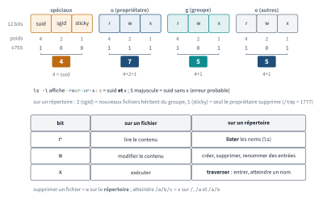

<!-- nav:début -->
[Accueil](../../README.md) › [Parcours](../../docs/parcours.md) › Partie I — Fondamentaux du shell et du système de fichiers › **Module 03**  
[← Module 02](../02-filesystem-fhs/README.md) · [Corrigé](corrige.md) · [Module 04 →](../04-users-groups-sudo/README.md)

<details><summary>Scripts du module (9)</summary>

Sur la VM indiquée en section « Mise en place », depuis `~/workbook/scripts/` (voir [chapitre 0](../../docs/00-mise-en-place.md)).

| Script | Rôle |
|---|---|
| [`setup_M03.sh`](../../scripts/setup/setup_M03.sh) | prépare le module |
| [`check_M03_01.sh`](../../scripts/check/check_M03_01.sh) | vérification |
| [`check_M03_02.sh`](../../scripts/check/check_M03_02.sh) | vérification |
| [`check_M03_03.sh`](../../scripts/check/check_M03_03.sh) | vérification |
| [`check_M03_04.sh`](../../scripts/check/check_M03_04.sh) | vérification |
| [`check_M03_05.sh`](../../scripts/check/check_M03_05.sh) | vérification |
| [`break_M03_01.sh`](../../scripts/break/break_M03_01.sh) | installe une panne |
| [`break_M03_02.sh`](../../scripts/break/break_M03_02.sh) | installe une panne |
| [`break_M03_03.sh`](../../scripts/break/break_M03_03.sh) | installe une panne |

</details>
<!-- nav:fin -->

# Module 03 — Permissions, ACL et droits spéciaux

## 3.0 Objectifs et compétences

> [!NOTE]
> **Objectifs**
>
> À la fin de ce module, je sais :
>
> * lire une ligne de `ls -l` champ par champ et donner la signification exacte de
>   `r`, `w`, `x` **sur un fichier et sur un répertoire**, sans confondre les deux ;
> * traduire dans les deux sens entre notation symbolique et octale, et poser un
>   `chmod` récursif correct qui ne rend pas les fichiers exécutables (`X` majuscule
>   ou `find -type`) ;
> * calculer le mode réel d'un fichier ou d'un répertoire à partir d'un `umask`
>   donné, et savoir **où** un umask se définit pour un shell, un service systemd
>   ou une session PAM ;
> * expliquer le rôle du SUID, du SGID (sur fichier **et** sur répertoire) et du
>   sticky bit, et dire pourquoi `/tmp` est en `1777` ;
> * trouver les binaires SUID d'un système, juger lesquels sont légitimes, et
>   décrire un scénario réel d'escalade de privilèges par un SUID ;
> * poser une ACL POSIX propre (`setfacl`, ACL par défaut sur répertoire, masque
>   effectif) et dire quand une ACL est la bonne réponse plutôt qu'un groupe ;
> * rendre un fichier immuable avec `chattr +i`, forcer un journal en append-only
>   avec `+a`, et diagnostiquer un `lsattr` ;
> * remplacer un SUID par une **capability** (`setcap cap_net_bind_service`) et
>   expliquer pourquoi c'est plus sûr ;
> * durcir les droits d'un secret (clé SSH, `/etc/shadow`, secret d'app) au niveau
>   qu'un démon exige pour démarrer ;
> * mener un diagnostic « permission denied » de bout en bout : chemin complet,
>   `namei -l`, groupes de l'utilisateur, et écarter SELinux/AppArmor.
>
> **Temps estimé** : 5 h
>
> **Prérequis** : module 01 (shell, quoting), module 02 (FHS, `find`, types de fichiers).

---

## 3.1 Mise en place

VM concernées : **`lab-web` (10.10.10.11)** pour l'essentiel (elle héberge nginx et
une arborescence d'application), **`lab-adm` (10.10.10.10)** pour les exercices de
umask et de session, et **`lab-rhel` (10.10.10.13)** pour les variantes RHEL.

```bash
# depuis le shell Proxmox, avant de commencer
qm snapshot 9002 avant-lab03
```

Paquets nécessaires sur `lab-web` :

```bash
sudo apt update
sudo apt install -y nginx acl attr libcap2-bin
```

`acl` fournit `getfacl`/`setfacl`, `attr` fournit `getfattr`, `libcap2-bin`
fournit `getcap`/`setcap`. `namei` est déjà là (paquet `util-linux`).

> [!IMPORTANT]
> **Variante Rocky / RHEL**
>
> Sous Rocky 9 : `sudo dnf install -y nginx acl attr libcap`. Le service nginx
> tourne sous l'utilisateur `nginx` (et non `www-data`), et sa racine par défaut est
> `/usr/share/nginx/html`. Adapte les noms d'utilisateur et les chemins dans tout le
> module en conséquence.

> [!CAUTION]
> **Attention**
>
> Les ACL supposent un système de fichiers qui les supporte.
> Sur Ubuntu 24.04 et Rocky 9, ext4 et XFS les activent d'office (l'option `acl` est implicite et n'apparaît même plus dans `mount`), tu n'as rien à
> faire. Sur un montage exotique (NFS ancien, certains systèmes de fichiers réseau), `setfacl` échouera
> avec `Operation not supported` : c'est un diagnostic à connaître, pas un bug.

Préparation du terrain de jeu (idempotent, à relancer sans crainte) :

```bash
sudo bash ~/workbook/scripts/setup/setup_M03.sh
```

Il crée `~/lab03/` (bac à sable de l'apprenant), les groupes et comptes de service
`facturation`/`webdev`, une arborescence applicative sous `/srv/factura` et une
racine nginx sous `/var/www/factura`, plus quelques secrets aux droits volontairement
douteux.

---

## 3.2 Rappel express

### Lire `ls -l`

```text
-rw-r-----  1 mathieu facturation  4096 Sep 18 08:12 rapport.csv
│└┬┘└┬┘└┬┘  │ └──┬──┘ └───┬─────┘
│ u  g  o   │  propr.   groupe
│           └ nb de liens durs
└ type : - fichier, d rép, l lien, c/b périph, p fifo, s socket
```

Trois triades : **user** (propriétaire), **group** (groupe propriétaire),
**other** (tout le reste). Un utilisateur tombe dans **une seule** catégorie, dans
cet ordre : s'il est le propriétaire, seuls les bits `u` s'appliquent, **même si**
les bits `g`/`o` sont plus larges. Le propriétaire d'un fichier `004` (`------r--`) ne peut pas
le lire, alors qu'un tiers le peut : le propriétaire n'est
jamais « other ». root ignore r/w (mais **pas** x : il lui faut au moins un bit x
quelque part pour exécuter).

### r/w/x : fichier contre répertoire (le point que tout le monde rate)

| Bit | Sur un **fichier** | Sur un **répertoire** |
|---|---|---|
| `r` | lire le contenu | **lister** les noms (`ls`) |
| `w` | modifier le contenu | créer/supprimer/renommer des entrées |
| `x` | exécuter | **traverser** : entrer, accéder à un fichier par son nom |

<p align="center"></p>

*Figure — Les 12 bits de mode, la lecture octale de `4755`, et ce que `r`, `w`, `x` veulent dire sur un fichier et sur un répertoire.*

Conséquences qui piègent tout le monde :

* `r` sans `x` sur un répertoire : `ls` donne les noms mais `ls -l` échoue en
  `Permission denied` sur chaque entrée (pas de traversée pour lire les inodes).
* `x` sans `r` sur un répertoire : tu ne peux pas lister, mais si tu **connais**
  le nom exact, tu accèdes au fichier. C'est le classique `chmod 711` d'un home.
* Supprimer un fichier dépend du `w` **du répertoire**, pas des droits du fichier.
  Un fichier `444` dont tu possèdes le répertoire parent se supprime sans souci.
* Pour atteindre `/a/b/c`, il faut `x` sur `/`, `/a` **et** `/a/b`. Un seul `x`
  manquant sur un parent bloque tout ce qui est en dessous.

### chmod symbolique et octal

```bash
chmod u+x,g-w,o= fichier     # ajoute x à u, retire w à g, vide o
chmod a+r fichier            # a = ugo
chmod 640 fichier            # rw- r-- ---
chmod g=u fichier            # copie les droits de u sur g
chmod -R u+rwX,go=rX arbo/   # X = x seulement si déjà x, ou si répertoire
```

Octal : `r=4 w=2 x=1`, on additionne par triade. `640 = rw- r-- ---`.
Un 4e chiffre en tête code les bits spéciaux : `4=SUID 2=SGID 1=sticky`.
`chmod 2775 d` = SGID + `rwxrwxr-x`.

### Récursif sans tout casser

`chmod -R 755` sur une arbo mixte rend **tous** les fichiers exécutables : une
faute classique. Deux bonnes méthodes :

```bash
# X majuscule : n'ajoute x que sur les répertoires et les fichiers déjà +x
chmod -R u=rwX,go=rX /var/www/factura

# ou séparer par type
find /var/www/factura -type d -exec chmod 755 {} +
find /var/www/factura -type f -exec chmod 644 {} +
```

### umask

Le umask **retire** des bits aux droits par défaut. Base : `666` pour un fichier,
`777` pour un répertoire (jamais de x par défaut sur un fichier créé).

```text
répertoire :  777 & ~022 = 755
fichier    :  666 & ~022 = 644     (le bit x « demandé » est déjà absent)
umask 027  ->  rép 750, fichier 640
umask 077  ->  rép 700, fichier 600   (isolation stricte)
```

Le calcul est un **ET avec le complément**, pas une soustraction : `umask 027` sur
un fichier donne `666 & ~027 = 640`. Où le régler :

| Portée | Endroit |
|---|---|
| shell interactif | `~/.bashrc`, `~/.profile`, `/etc/profile` |
| toutes les sessions login | `/etc/login.defs` (`UMASK 027`) + `pam_umask` |
| un service systemd | `UMask=0027` dans le `[Service]` de l'unité |
| historique/défaut système | `session optional pam_umask.so` dans `/etc/pam.d/` |

Un service **n'hérite pas** du umask de ton shell : il prend celui de systemd
(`0022` par défaut) sauf directive `UMask=`. C'est pourquoi un fichier créé par un
démon est souvent en `644` même si ton shell est en `077`.

### Bits spéciaux

| Bit | Octal | Sur fichier | Sur répertoire |
|---|---|---|---|
| SUID | 4000 | s'exécute avec l'UID du **propriétaire** | (ignoré sous Linux) |
| SGID | 2000 | s'exécute avec le GID du groupe | nouveaux fichiers héritent du **groupe** du rép |
| sticky | 1000 | (obsolète) | seul le **propriétaire** d'un fichier peut le supprimer |

Lecture dans `ls -l` : `s` = bit spécial **et** x présent ; `S`/`T` majuscule = bit
spécial **sans** x en dessous (souvent une erreur). `/tmp` est en `1777` :
tout le monde écrit, mais le sticky empêche Alice de supprimer le fichier de Bob.

```bash
find / -perm -4000 -type f 2>/dev/null    # tous les SUID du système
find / -perm -2000 -type f 2>/dev/null    # tous les SGID
```

### ACL POSIX (au-delà de ugo)

```bash
getfacl fichier                       # affiche u::/g::/o:: + entrées nommées
setfacl -m u:webdev:rX /srv/factura   # donne rX à l'utilisateur webdev
setfacl -m g:facturation:rwx dossier  # à un groupe nommé
setfacl -x u:webdev /srv/factura      # retire l'entrée
setfacl -b /srv/factura               # supprime toutes les ACL étendues
setfacl -d -m g:webdev:rX /srv/data   # ACL par DÉFAUT : héritée par les enfants
setfacl -R -m g:webdev:rX /srv/data   # applique récursivement (existant)
```

Le `+` en fin de `ls -l` (`drwxr-x---+`) signale une ACL étendue. Le **masque**
(`mask::`) plafonne les droits effectifs de toutes les entrées nommées et du groupe
propriétaire : si `mask` vaut `r--`, une entrée `u:webdev:rwx` n'accorde en réalité
que `r--` (colonne `#effective:` de `getfacl`). Une ACL par défaut (`-d`) ne change
rien aux fichiers existants : elle sert de patron pour tout ce qui sera **créé**
ensuite dans le répertoire.

### Attributs étendus

```bash
chattr +i /etc/resolv.conf     # immuable : ni modif ni suppression, même root
chattr +a /var/log/audit.log   # append-only : on ajoute, on ne réécrit pas
lsattr fichier                 # montre les attributs (i, a, ...)
chattr -i fichier              # retire l'immuabilité
```

`+i` bat les permissions **et** root : pour éditer, il faut d'abord `chattr -i`.

### Capabilities (le SUID moderne)

```bash
getcap /usr/bin/ping                          # montre les capabilities
sudo setcap cap_net_bind_service=+ep /opt/app/api   # bind < 1024 sans être root
sudo setcap -r /opt/app/api                   # retire toutes les capabilities
```

Une capability accorde **un** privilège précis au lieu de tout `root` : bien plus
sûr qu'un SUID root qui donne tous les pouvoirs si le binaire est vulnérable.

### Démarche « permission denied »

```bash
namei -l /srv/factura/exports/rapport.csv   # droits de chaque composant
id mathieu                                  # groupes réels de l'utilisateur
ls -ld /srv /srv/factura /srv/factura/exports   # traversée (x) à chaque étage
sudo -u www-data stat /srv/factura/exports/rapport.csv   # tester en tant que...
getenforce ; sudo aa-status                 # écarter SELinux / AppArmor
```

Neuf fois sur dix, la cause est un `x` manquant sur un **répertoire parent**, pas
sur le fichier lui-même. `namei -l` est l'outil qui le montre d'un coup d'œil.

---

## 3.3 Quiz — QCM

<a id="q3-1"></a>**[Q3.1](corrige.md#q3-1)** — Un fichier est en `-rw-r--r--`, propriétaire `mathieu`, groupe `dev`.
L'utilisateur `mathieu` est membre du groupe `dev`. Quels droits `mathieu` a-t-il
réellement sur ce fichier ?

a) `rw-`, parce qu'il est le propriétaire
b) `r--`, parce qu'il est membre du groupe `dev`
c) `rw-r--`, l'union des deux
d) aucun, il faut choisir une catégorie explicitement

<a id="q3-2"></a>**[Q3.2](corrige.md#q3-2)** — Un répertoire `docs/` est en `r--r--r--` (444) et t'appartient. Que se
passe-t-il quand tu tapes `ls -l docs/` ?

a) la liste détaillée s'affiche normalement
b) les noms s'affichent, mais chaque ligne donne `Permission denied` sur les détails
c) `Permission denied` immédiat, rien ne s'affiche
d) `ls` liste et affiche tout : `r` suffit pour un répertoire

<a id="q3-3"></a>**[Q3.3](corrige.md#q3-3)** — Un fichier `secret.txt` est en `r--r--r--` (444). Il est dans un
répertoire `/data` qui t'appartient et sur lequel tu as `rwx`. Peux-tu le supprimer ?

a) non, le fichier est en lecture seule
b) non, il faut au moins `w` sur le fichier
c) oui, la suppression dépend du `w` sur le répertoire, pas sur le fichier
d) oui, mais seulement avec `rm -f`

<a id="q3-4"></a>**[Q3.4](corrige.md#q3-4)** — `umask` vaut `027`. Tu crées un fichier avec `touch f` et un répertoire
avec `mkdir d`. Quels sont leurs modes ?

a) `f` en 640, `d` en 750
b) `f` en 750, `d` en 640
c) `f` en 639, `d` en 750
d) `f` en 644, `d` en 755

<a id="q3-5"></a>**[Q3.5](corrige.md#q3-5)** — Tu veux donner les droits `755` aux répertoires et `644` aux fichiers
d'une arborescence web, en une seule commande `chmod`. Laquelle ?

a) `chmod -R 755 /var/www/site`
b) `chmod -R 644 /var/www/site`
c) `chmod -R u=rwX,go=rX /var/www/site`
d) `chmod -R a+rwx /var/www/site`

<a id="q3-6"></a>**[Q3.6](corrige.md#q3-6)** — Sur `lab-web`, `ls -l /usr/bin/passwd` affiche
`-rwsr-xr-x 1 root root`. Que signifie le `s` et pourquoi est-il là ?

a) sticky bit : le binaire reste en mémoire
b) SGID : passwd s'exécute avec le groupe root
c) SUID : passwd s'exécute avec l'UID root, pour écrire dans `/etc/shadow`
d) une ACL étendue est présente

<a id="q3-7"></a>**[Q3.7](corrige.md#q3-7)** — Le répertoire `/srv/partage` est en `drwxrws---` (2770), groupe
`facturation`. Un membre du groupe y crée un fichier. Quel sera son **groupe** ?

a) le groupe primaire de l'utilisateur
b) `facturation`, hérité du répertoire grâce au SGID
c) `root`
d) aucun groupe tant qu'on ne fait pas `chgrp`

<a id="q3-8"></a>**[Q3.8](corrige.md#q3-8)** — Pourquoi `/tmp` est-il en `drwxrwxrwt` (1777) et pas simplement `777` ?

a) le `t` (sticky) autorise tout le monde à écrire
b) le `t` empêche un utilisateur de supprimer les fichiers des autres
c) le `t` rend les fichiers exécutables par défaut
d) le `t` est un vestige sans effet sur Linux moderne

<a id="q3-9"></a>**[Q3.9](corrige.md#q3-9)** — Tu lances `find / -perm -4000 -type f 2>/dev/null`. Que cherches-tu ?

a) les fichiers modifiés il y a 4000 minutes
b) les fichiers dont le mode est exactement 4000
c) tous les fichiers ayant au moins le bit SUID positionné
d) les fichiers appartenant à l'UID 4000

<a id="q3-10"></a>**[Q3.10](corrige.md#q3-10)** — `getfacl /srv/factura` montre :

```text
user::rwx
user:webdev:rwx        #effective:r--
group::r-x             #effective:r--
mask::r--
other::---
```

L'utilisateur `webdev` a-t-il le droit d'écrire dans `/srv/factura` ?

a) oui, son entrée est `rwx`
b) non : le masque `r--` plafonne son droit effectif à `r--`
c) oui, mais seulement en lecture
d) impossible à dire sans voir `other`

<a id="q3-11"></a>**[Q3.11](corrige.md#q3-11)** — Tu veux que **tous les nouveaux fichiers** créés dans `/srv/data`
donnent automatiquement `rX` au groupe `webdev`, sans avoir à relancer `setfacl`
après chaque création. Quelle commande ?

a) `setfacl -m g:webdev:rX /srv/data`
b) `setfacl -R -m g:webdev:rX /srv/data`
c) `setfacl -d -m g:webdev:rX /srv/data`
d) `chmod g+rX /srv/data`

<a id="q3-12"></a>**[Q3.12](corrige.md#q3-12)** — `chattr +i /etc/resolv.conf` a été posé. Tu es root. Que se passe-t-il
si tu tentes `echo "nameserver 9.9.9.9" > /etc/resolv.conf` ?

a) ça marche, root ignore tous les attributs
b) `Operation not permitted`, il faut d'abord `chattr -i`
c) ça marche mais un warning s'affiche
d) le fichier est vidé mais pas réécrit

<a id="q3-13"></a>**[Q3.13](corrige.md#q3-13)** — Une application doit écouter sur le port 80 sans tourner en root.
Quelle est la solution la plus sûre sur Linux moderne ?

a) `chmod u+s /opt/app/api` (SUID root)
b) lancer le service en root et ne rien changer
c) `setcap cap_net_bind_service=+ep /opt/app/api`
d) `chown root:root` et `chmod 4755`

<a id="q3-14"></a>**[Q3.14](corrige.md#q3-14)** — `ssh` refuse ta clé et journalise
`Permissions 0644 for '~/.ssh/id_ed25519' are too open`. Pourquoi ?

a) la clé est corrompue
b) ssh exige que la clé privée soit lisible seulement par son propriétaire (600)
c) il manque le bit d'exécution sur la clé
d) le problème vient de `~/.ssh` qui doit être en 777

<a id="q3-15"></a>**[Q3.15](corrige.md#q3-15)** — Tu diagnostiques un `Permission denied` sur
`/srv/factura/exports/rapport.csv` alors que le fichier est bien en `644`.
Quel est l'outil le plus direct pour trouver la cause ?

a) `cat /srv/factura/exports/rapport.csv`
b) `namei -l /srv/factura/exports/rapport.csv`
c) `chmod 777 /srv/factura/exports/rapport.csv`
d) `stat rapport.csv`

<a id="q3-16"></a>**[Q3.16](corrige.md#q3-16)** — Un répertoire est en `drwxr-x---+`. Que t'apprend le `+` final ?

a) le répertoire est un point de montage
b) une ACL POSIX étendue est présente
c) le sticky bit est actif
d) le répertoire contient des sous-répertoires

<a id="q3-17"></a>**[Q3.17](corrige.md#q3-17)** — `ls -l` montre un binaire en `-rwSr--r--`. Que signifie le `S`
**majuscule** ?

a) SUID actif et le fichier est exécutable par le propriétaire
b) SUID positionné mais **sans** bit `x` sur le propriétaire (donc inopérant/suspect)
c) sticky bit sur un fichier
d) une capability est attachée

<a id="q3-18"></a>**[Q3.18](corrige.md#q3-18)** — Tu crées un fichier via un service systemd qui n'a pas de directive
`UMask=`. Ton shell interactif est configuré avec `umask 077`. Quel umask
s'applique au fichier créé par le service ?

a) `077`, hérité de ton shell
b) `022`, la valeur par défaut de systemd
c) `000`, les services n'ont pas de umask
d) `027`, la valeur de `/etc/login.defs`

---

## 3.4 Quiz — questions ouvertes

<a id="qo3-1"></a>**[QO3.1](corrige.md#qo3-1)** — Explique, en raisonnant sur les trois triades, pourquoi le propriétaire
d'un fichier en `---rwxrwx` (mode 077) ne peut ni le lire ni le modifier alors que
n'importe quel membre du groupe ou tiers le peut. Quel principe général cela
illustre-t-il ?

<a id="qo3-2"></a>**[QO3.2](corrige.md#qo3-2)** — On te donne `umask 007`. Détaille le calcul complet du mode d'un fichier
et d'un répertoire nouvellement créés, en montrant l'opération bit à bit. Puis
explique pourquoi un umask **ne peut jamais** ajouter le bit `x` à un fichier créé
par `touch` ou une redirection.

<a id="qo3-3"></a>**[QO3.3](corrige.md#qo3-3)** — *On te demande en entretien* : « Quelle est la différence entre SGID sur
un fichier et SGID sur un répertoire ? Donne un cas d'usage réel du second. »
Réponds comme en entretien.

<a id="qo3-4"></a>**[QO3.4](corrige.md#qo3-4)** — Explique le rôle du **masque** dans une ACL POSIX. Pourquoi peut-on
avoir une entrée `u:webdev:rwx` qui n'accorde en réalité que `r--` ? Comment
`setfacl` recalcule-t-il le masque, et comment forcer une valeur ?

<a id="qo3-5"></a>**[QO3.5](corrige.md#qo3-5)** — *On te demande en entretien* : « Un binaire est en SUID root et tu y
trouves une vulnérabilité. Décris précisément ce qu'un attaquant local peut en
faire, et pourquoi une capability aurait limité les dégâts. »

<a id="qo3-6"></a>**[QO3.6](corrige.md#qo3-6)** — Compare deux façons de partager en écriture un répertoire entre trois
utilisateurs : (a) un groupe Unix + SGID + `chmod g+w`, et (b) des ACL POSIX. Dans
quel cas chacune est la bonne réponse ? Cite une limite concrète de la solution par
groupe que les ACL résolvent.

<a id="qo3-7"></a>**[QO3.7](corrige.md#qo3-7)** — Décris ta démarche complète, dans l'ordre, face à un utilisateur qui
signale `Permission denied` en lisant un fichier dont il jure qu'il est en `644`.
Nomme chaque commande et ce que tu cherches dans sa sortie, jusqu'à écarter
AppArmor/SELinux.

<a id="qo3-8"></a>**[QO3.8](corrige.md#qo3-8)** — À quoi servent `chattr +i` et `chattr +a` ? Donne un cas d'usage
opérationnel de chacun, et explique le piège que `+i` peut créer pour une mise à
jour de paquet ou un déploiement automatisé.

---

## 3.5 Exercices guidés ★

Sauf mention contraire, travaille dans `~/lab03/` sur `lab-web`.

<a id="e3-1"></a>**[E3.1](corrige.md#e3-1)** — Sans exécuter la commande, prédis le mode octal résultant, puis vérifie :
tu pars d'un fichier `600` et tu appliques `chmod g+r,o+r` ; puis sur le résultat
`chmod g=u` ; puis `chmod o=`.

<a id="e3-2"></a>**[E3.2](corrige.md#e3-2)** — Crée un répertoire `~/lab03/prive` accessible **uniquement** à toi
(personne d'autre ne doit pouvoir ni lister ni traverser), et un répertoire
`~/lab03/depot` que les membres de ton groupe peuvent traverser et lire mais pas
modifier. Donne les modes octaux exacts.

<a id="e3-3"></a>**[E3.3](corrige.md#e3-3)** — Dans `~/lab03/mixte` (fourni par le setup, il contient des `.sh` et des
`.txt` mélangés), mets tous les répertoires en `755` et tous les fichiers en `644`
sans rendre les `.txt` exécutables, **sans** utiliser `find`. Puis refais-le avec
`find`. Compare les deux commandes.

<a id="e3-4"></a>**[E3.4](corrige.md#e3-4)** — Le répertoire `~/lab03/lecture` est en `r-xr-xr-x`. Tu constates que tu
peux lire les fichiers dont tu connais le nom et que `ls` fonctionne. Retire
maintenant le `r` pour ne garder que `x` (mode `111`) et montre par deux commandes
que tu peux toujours `cat lecture/connu.txt` mais plus lister le contenu.

<a id="e3-5"></a>**[E3.5](corrige.md#e3-5)** — Affiche, pour `/srv/factura/exports/rapport.csv`, les droits de **chaque**
composant du chemin depuis la racine, en une seule commande.

<a id="e3-6"></a>**[E3.6](corrige.md#e3-6)** — Positionne le SGID sur `~/lab03/partage` (groupe `facturation`), puis
crée un fichier dedans et prouve qu'il hérite du groupe `facturation` et non de ton
groupe primaire.

<a id="e3-7"></a>**[E3.7](corrige.md#e3-7)** — Reproduis en local le comportement de `/tmp` : crée `~/lab03/commun`,
mode `1777`, puis explique (en une phrase, dans un fichier `~/lab03/commun-note.txt`)
ce que le sticky bit empêche exactement.

<a id="e3-8"></a>**[E3.8](corrige.md#e3-8)** — Liste tous les binaires SUID de `lab-web`, triés, et compte-les. Repère
dans la liste `passwd`, `sudo`, `mount` et explique en une ligne chacun pourquoi il
est légitimement SUID (fichier `~/lab03/suid-note.txt`).

<a id="e3-9"></a>**[E3.9](corrige.md#e3-9)** — Sur `/srv/factura/exports`, donne à l'utilisateur `webdev` (qui n'est ni
propriétaire ni dans le groupe) le droit de lire et traverser, **sans** le mettre
dans un groupe et sans toucher aux bits `other`. Vérifie avec `getfacl`.

<a id="e3-10"></a>**[E3.10](corrige.md#e3-10)** — Sur `/srv/factura/incoming`, pose une ACL **par défaut** telle que tout
nouveau fichier créé par le groupe `facturation` soit lisible et modifiable par le
groupe `webdev`. Crée ensuite un fichier de test et vérifie qu'il hérite bien de
l'ACL.

<a id="e3-11"></a>**[E3.11](corrige.md#e3-11)** — Reproduis d'abord la situation : `sudo setfacl -m u:webdev:rwx,m::r` `/srv/factura/exports`. L'ACL donne maintenant `u:webdev:rwx` mais `getfacl`
affiche `#effective:r--`. Corrige le masque pour que `webdev` obtienne réellement
ses droits en écriture, sans retoucher son entrée nominale.

<a id="e3-12"></a>**[E3.12](corrige.md#e3-12)** — Rends le fichier `~/lab03/immuable.conf` impossible à modifier ou
supprimer, même par root. Prouve-le avec une tentative d'écriture, puis lève la
protection.

<a id="e3-13"></a>**[E3.13](corrige.md#e3-13)** — Fais du fichier `~/lab03/audit.log` un journal **append-only** : montre
qu'on peut y ajouter une ligne avec `»` mais qu'on ne peut ni le vider avec `>` ni
le supprimer.

<a id="e3-14"></a>**[E3.14](corrige.md#e3-14)** — Copie `/bin/sleep` en `~/lab03/bindtest`, puis donne-lui la capability
`cap_net_bind_service` (effective + permitted) et vérifie avec `getcap`. Retire-la
ensuite proprement.

<a id="e3-15"></a>**[E3.15](corrige.md#e3-15)** — Durcis les droits de `~/lab03/secrets/` : le répertoire en `700`, le
fichier `~/lab03/secrets/id_ed25519` en `600`, et `~/lab03/secrets/config` en `644`.
Explique en une ligne pourquoi une clé privée en `644` fait refuser `ssh`.

<a id="e3-16"></a>**[E3.16](corrige.md#e3-16)** — Configure ton shell pour que **tout nouveau fichier** que tu crées soit
en `640` et tout nouveau répertoire en `750`, de façon persistante entre sessions.
Donne la valeur de umask et le fichier où tu la poses.

---

## 3.6 Labs ★★

### <a id="l3-1"></a>**[L3.1](corrige.md#l3-1)** — Répertoire partagé pour l'équipe facturation

> **Contexte**
>
> L'équipe facturation (utilisateurs `mathieu`, `webdev`, plus un compte de service
> `facturation`) doit collaborer sur `/srv/factura/exports`. Aujourd'hui chacun crée
> des fichiers que les autres ne peuvent pas modifier, parce que le groupe n'est pas
> hérité et que les droits par défaut excluent le groupe. On te demande un partage
> propre où tout fichier déposé est immédiatement modifiable par tout le groupe.

1. Crée (ou réutilise) le groupe `facturation` et vérifie que `mathieu` et `webdev`
   en sont membres (`id mathieu`).
2. Fais de `/srv/factura/exports` un répertoire de groupe `facturation`, en `2770`
   (SGID + `rwxrwx---`), de sorte que tout nouveau fichier hérite du groupe.
3. Le SGID règle le **groupe** mais pas les droits `w` de groupe sur les fichiers
   créés (le umask des utilisateurs retire `w` au groupe). Pose une ACL **par
   défaut** qui garantit `rw` au groupe `facturation` sur tout nouveau fichier.
4. Connecte-toi (ou `sudo -u webdev`) et crée un fichier ; prouve que `mathieu` peut
   le modifier sans intervention manuelle.
5. Vérifie que `other` n'a **aucun** accès, pas même la traversée.

> [!TIP]
> **Critère de succès**
>
> Critère de succès : un fichier créé par n'importe quel membre du groupe est en
> groupe `facturation` et modifiable par les autres membres, `other` est exclu.
>
> ```bash
> sudo bash check_M03_01.sh
> ```

---

### <a id="l3-2"></a>**[L3.2](corrige.md#l3-2)** — Accès en lecture seule pour un auditeur, sans le mettre dans le groupe

> **Contexte**
>
> Un auditeur externe (compte `webdev` dans ce lab) doit **lire** l'arborescence
> `/srv/factura` — traverser les répertoires, lire les fichiers — mais tu n'as pas le
> droit de l'ajouter au groupe `facturation` (règle de séparation des tâches), et tu
> ne veux surtout pas ouvrir les bits `other`. C'est le cas d'école où les ACL sont la
> bonne réponse.

1. Si tu as fait L3.1, `webdev` est membre de `facturation` : retire-le d'abord (`sudo gpasswd -d webdev facturation`), c'est un auditeur externe dans ce scénario. Constate ensuite l'état initial : `sudo -u webdev ls /srv/factura/exports` échoue.
2. Pose une ACL sur `/srv/factura` et son contenu qui donne à l'utilisateur
   `webdev` le droit de lire les fichiers et de traverser les répertoires (`rX`),
   récursivement.
3. Pose **aussi** une ACL par défaut pour que les fichiers créés plus tard restent
   lisibles par `webdev`.
4. Vérifie que `webdev` peut lire mais **pas** écrire (aucune entrée `w`), et que
   `other` reste à `---`.
5. Rédige dans `~/lab03/rapports/acl-audit.md` (au moins 8 lignes) : pourquoi une
   ACL et pas un groupe ici, et quel serait le risque d'avoir mis `o+rX` à la place.

> [!TIP]
> **Critère de succès**
>
> Critère de succès : `sudo -u webdev cat` fonctionne sur un fichier d'exports,
> `sudo -u webdev touch` échoue, `getfacl` montre l'entrée `user:webdev` et une entrée
> `default:user:webdev`, `other` est à `---`.
>
> ```bash
> sudo bash check_M03_02.sh
> ```

---

### <a id="l3-3"></a>**[L3.3](corrige.md#l3-3)** — Audit des binaires SUID/SGID

> **Contexte**
>
> Un audit de sécurité te demande l'inventaire des binaires SUID et SGID de `lab-web`,
> et de justifier chacun ou de le signaler. Le setup a déposé un binaire SUID
> volontairement suspect (`/usr/local/bin/factura-backup`, SUID root) pour te faire
> travailler l'œil.

1. Produis dans `~/lab03/rapports/suid-inventaire.txt` la liste complète des
   fichiers SUID **et** SGID du système, avec leurs droits (`ls -l`), triée.
2. Pour chacun des SUID « système » classiques (`passwd`, `sudo`, `mount`, `su`),
   écris en une ligne pourquoi il est légitimement SUID.
3. Repère le binaire suspect `/usr/local/bin/factura-backup` : il est SUID root et
   c'est un simple script/binaire qui n'a aucune raison de l'être. Explique en quoi
   c'est un risque d'escalade (que se passe-t-il s'il appelle une commande sans
   chemin absolu, ou s'il est modifiable ?).
4. Neutralise le risque : retire le bit SUID de `factura-backup` **sans** le
   supprimer, et vérifie qu'il n'apparaît plus dans un `find -perm -4000`.
5. Vérifie que tu n'as pas cassé les SUID légitimes au passage.

> [!TIP]
> **Critère de succès**
>
> Critère de succès : `factura-backup` n'a plus le bit SUID, l'inventaire est écrit et
> non vide, et `passwd`/`sudo`/`mount` sont toujours SUID.
>
> ```bash
> sudo bash check_M03_03.sh
> ```

---

### <a id="l3-4"></a>**[L3.4](corrige.md#l3-4)** — Un service qui écoute sur le port 80 sans être root

> **Contexte**
>
> Une petite API interne (`/usr/local/bin/factura-api`, un binaire fourni par le
> setup) doit écouter sur le port 80. Le dev l'a d'abord fait tourner en root
> « parce que sinon ça ne bind pas ». On te demande de la faire tourner sous un
> compte non privilégié tout en gardant le port 80, avec la méthode moderne.

1. Lance l'API en tant qu'utilisateur non root et constate l'échec de bind sur le
   port 80 (`Permission denied`, réservé aux ports < 1024). Sur `lab-web`, nginx occupe déjà ce port : arrête-le le temps du lab (`sudo systemctl stop nginx`) et relance-le à la fin, sinon tu obtiendras `Address already in use`.
2. Rejette d'abord la mauvaise solution : explique en une ligne pourquoi
   `chmod u+s` (SUID root) sur ce binaire serait dangereux.
3. Accorde la capability `cap_net_bind_service` au binaire avec `setcap`, vérifie
   avec `getcap`.
4. Relance l'API en tant qu'utilisateur non root et prouve qu'elle bind maintenant
   le port 80 (`ss -tlnp` ou le message de démarrage) **sans** privilège root.
5. Documente dans `~/lab03/rapports/capability.md` la différence de surface d'attaque
   entre SUID root et cette capability.

> [!TIP]
> **Critère de succès**
>
> Critère de succès : `getcap /usr/local/bin/factura-api` montre `cap_net_bind_service`,
> le binaire n'a **pas** le bit SUID, et le rapport existe.
>
> ```bash
> sudo bash check_M03_04.sh
> ```

---

## 3.7 Break & Fix ★★★

> [!CAUTION]
> **Attention**
>
> Avant chaque Break & Fix : `qm snapshot 9002 avant-bf03`. Le snapshot de secours
> reste `snap-clean` (`qm rollback 9002 snap-clean`), mais l'utiliser vaut échec de
> l'exercice : l'objectif est de réparer, pas de rembobiner.

### <a id="bf3-1"></a>**[BF3.1](corrige.md#bf3-1)** — « nginx renvoie 403 sur tout le site »

```bash
sudo bash break_M03_01.sh
```

**Symptôme utilisateur** : `http://10.10.10.11/` renvoie `403 Forbidden` sur toutes
les pages. Pourtant les fichiers HTML existent bien dans `/var/www/factura`, ils
sont en `644`, et la configuration nginx n'a pas changé. Le log
`/var/log/nginx/error.log` répète `Permission denied` en accédant aux fichiers.

**Interdit** : réécrire la configuration nginx, `chmod -R 777`, réinstaller nginx.

**Objectif** : rétablir le service (les pages se chargent en `200`), identifier le
composant du chemin qui bloque, corriger **au bon niveau et avec le bon mode**, et
expliquer pourquoi des fichiers en `644` ne suffisent pas si un répertoire parent
perd son bit `x`.

### <a id="bf3-2"></a>**[BF3.2](corrige.md#bf3-2)** — « Impossible d'écrire dans le dépôt d'exports, et le groupe ne suit plus »

```bash
sudo bash break_M03_02.sh
```

**Symptôme utilisateur** : les membres de l'équipe facturation se plaignent que les
fichiers qu'ils déposent dans `/srv/factura/exports` appartiennent au mauvais groupe
et que leurs collègues ne peuvent plus les modifier. Avant, « ça marchait ». Le
répertoire existe toujours et ils ont bien le droit d'y créer des fichiers.

**Interdit** : recréer le répertoire de zéro, changer les membres des groupes.

**Objectif** : rétablir l'héritage de groupe et les droits d'écriture partagés,
identifier ce qui a été retiré (un bit spécial et/ou une ACL), et énoncer la règle
qui garantit qu'un fichier déposé reste modifiable par tout le groupe.

### <a id="bf3-3"></a>**[BF3.3](corrige.md#bf3-3)** — « resolv.conf revient toujours et le déploiement échoue »

```bash
sudo bash break_M03_03.sh
```

**Symptôme utilisateur** : le pipeline de déploiement échoue à l'étape qui met à jour
`/etc/resolv.conf`, avec `Operation not permitted`, **alors que le job tourne en
root**. Toute tentative manuelle `echo ... > /etc/resolv.conf` en root échoue aussi.
Le fichier semble « figé ».

**Interdit** : supprimer et recréer le fichier par un autre moyen, désactiver le
pipeline.

**Objectif** : rendre le fichier modifiable, expliquer pourquoi **root lui-même**
était bloqué, et dire dans quel cas légitime on pose ce type de protection.

---

## 3.8 Défi du module ★★★

<a id="d3"></a>**[D3](corrige.md#d3) — Durcissement des permissions d'un service applicatif**

> **Contexte**
>
> On te confie le durcissement de l'application `factura` sur `lab-web` avant sa mise
> en production. Tu produis un script d'audit + de remédiation et un rapport. Le
> service tourne sous le compte `facturation`, sert des fichiers via nginx depuis
> `/var/www/factura`, lit sa conf dans `/etc/factura`, écrit ses exports dans
> `/srv/factura/exports` et garde des secrets dans `/etc/factura/secrets`.

Cahier des charges :

1. Écris `~/lab03/bin/durcir-factura.sh`, en bash, commençant par
   `#!/usr/bin/env bash` et `set -euo pipefail`, idempotent, exécuté avec `sudo`.
2. Le script vérifie et **corrige** les points suivants, en journalisant chaque
   action sur stderr et un rapport Markdown sur stdout :
   * l'arborescence web `/var/www/factura` : répertoires `755`, fichiers `644`,
     propriétaire `www-data`, sans un seul fichier exécutable parasite (méthode
     `find -type` ou `X` majuscule, jamais `chmod -R 755`) ;
   * la conf `/etc/factura/factura.conf` en `640`, propriétaire `root:facturation` ;
   * le répertoire de secrets `/etc/factura/secrets` en `700` et chaque fichier
     dedans en `600`, propriétaire `facturation` ;
   * le dépôt d'exports `/srv/factura/exports` en `2770` groupe `facturation`, avec
     une ACL par défaut donnant `rw` au groupe sur les nouveaux fichiers ;
   * aucun binaire SUID inutile sous `/usr/local/bin` lié à factura (si présent, le
     signaler et retirer le bit) ;
   * la capability `cap_net_bind_service` sur `/usr/local/bin/factura-api` s'il doit
     écouter en dessous de 1024, à la place d'un éventuel SUID.
3. Le script produit une section « Anomalies détectées » listant ce qui était
   mauvais **avant** correction, et une section « État après remédiation ».
4. Il renvoie `0` si l'état final est conforme, `1` s'il reste une anomalie non
   corrigeable automatiquement (par ex. un montage sans support ACL).
5. Livre `~/lab03/rapports/durcissement-factura.md` généré par le script, et
   fais tourner le service jusqu'à ce que nginx serve le site en `200` et que
   l'API bind le port sans être root.

Temps visé : 60 à 90 minutes.

> [!TIP]
> **Critère de succès**
>
> ```bash
> sudo bash check_M03_05.sh
> ```

---

## 3.9 Auto-évaluation

| Compétence | Acquis | À revoir |
|---|---|---|
| Lire `ls -l` et distinguer r/w/x fichier vs répertoire | ☐ | ☐ |
| Traduire symbolique ↔ octal, poser un chmod récursif sûr | ☐ | ☐ |
| Calculer un mode réel à partir d'un umask | ☐ | ☐ |
| Savoir où définir un umask (shell, PAM, systemd) | ☐ | ☐ |
| Expliquer SUID, SGID fichier et répertoire, sticky bit | ☐ | ☐ |
| Trouver et juger les binaires SUID d'un système | ☐ | ☐ |
| Poser une ACL, gérer le masque et l'ACL par défaut | ☐ | ☐ |
| Choisir entre groupe et ACL selon le besoin | ☐ | ☐ |
| Utiliser `chattr +i`/`+a` à bon escient | ☐ | ☐ |
| Remplacer un SUID par une capability | ☐ | ☐ |
| Durcir les droits d'un secret (clé SSH, shadow) | ☐ | ☐ |
| Mener un diagnostic « permission denied » complet | ☐ | ☐ |

Pour aller plus loin :

* Lis `man 7 capabilities` et repère les cinq capabilities les plus utiles en
  production (`cap_net_bind_service`, `cap_net_raw`, `cap_sys_time`,
  `cap_dac_override`, `cap_chown`). Pour chacune, dis quel SUID elle remplace.
* Explore `man 5 acl` et `man setfacl` : monte un cas à trois groupes où seules les
  ACL par défaut évitent un `setfacl` manuel après chaque dépôt.
* Compare le modèle POSIX vu ici avec le contrôle d'accès obligatoire de SELinux
  (module 18) : discretionary vs mandatory, qui décide, et pourquoi les deux
  coexistent.

<!-- nav:début -->
---

[← Module 02](../02-filesystem-fhs/README.md) · [Corrigé](corrige.md) · [Module 04 →](../04-users-groups-sudo/README.md) · [Parcours](../../docs/parcours.md) · [Accueil](../../README.md)
<!-- nav:fin -->
