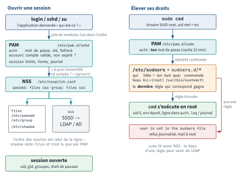

<!-- nav:début -->
[Accueil](../../README.md) › [Parcours](../../docs/parcours.md) › Partie I — Fondamentaux du shell et du système de fichiers › **Module 04**  
[← Module 03](../03-permissions/README.md) · [Corrigé](corrige.md) · [Module 05 →](../05-text-processing/README.md)

<details><summary>Scripts du module (9)</summary>

Sur la VM indiquée en section « Mise en place », depuis `~/workbook/scripts/` (voir [chapitre 0](../../docs/00-mise-en-place.md)).

| Script | Rôle |
|---|---|
| [`setup_M04.sh`](../../scripts/setup/setup_M04.sh) | prépare le module |
| [`check_M04_01.sh`](../../scripts/check/check_M04_01.sh) | vérification |
| [`check_M04_02.sh`](../../scripts/check/check_M04_02.sh) | vérification |
| [`check_M04_03.sh`](../../scripts/check/check_M04_03.sh) | vérification |
| [`check_M04_04.sh`](../../scripts/check/check_M04_04.sh) | vérification |
| [`check_M04_05.sh`](../../scripts/check/check_M04_05.sh) | vérification |
| [`break_M04_01.sh`](../../scripts/break/break_M04_01.sh) | installe une panne |
| [`break_M04_02.sh`](../../scripts/break/break_M04_02.sh) | installe une panne |
| [`break_M04_03.sh`](../../scripts/break/break_M04_03.sh) | installe une panne |

</details>
<!-- nav:fin -->

# Module 04 — Utilisateurs, groupes et élévation de privilèges

## 4.0 Objectifs et compétences

> [!NOTE]
> **Objectifs**
>
> À la fin de ce module, je sais :
>
> * lire et interpréter **champ par champ** une ligne de `/etc/passwd`, `/etc/shadow`,
>   `/etc/group` et `/etc/gshadow`, et dire à quoi sert chaque colonne ;
> * créer un compte humain et un compte de service avec les bons choix (`-m`, `-s`,
>   `--system`, home, shell) et expliquer ce qui différencie `useradd` de `adduser` ;
> * manipuler groupes primaires et secondaires sans casser une affectation existante,
>   et dire pourquoi `usermod -G` sans `-a` est une faute d'exploitation ;
> * piloter le cycle de vie d'un mot de passe avec `passwd` et `chage` : expiration,
>   avertissement, inactivité, changement forcé au premier login ;
> * distinguer les trois façons de bloquer un compte (`!` dans shadow, shell
>   `nologin`, date d'expiration) et choisir la bonne selon l'objectif ;
> * écrire une règle `sudoers` complète (`user host=(runas) commandes`), la valider
>   avec `visudo -c`, la déposer dans `/etc/sudoers.d/` avec les bons droits ;
> * repérer une délégation `sudo` qui donne root sans en avoir l'air (`vim`, `find`,
>   `less`, joker `*`) et proposer une restriction qui tient ;
> * diagnostiquer « cet utilisateur ne peut plus se connecter » de façon méthodique,
>   et récupérer une machine dont `/etc/sudoers` est inutilisable ;
> * lire la pile PAM d'un service, ajouter `pam_faillock` et `pam_pwquality`, poser
>   une limite `nofile`/`nproc` dans `limits.conf` ;
> * expliquer en entretien ce que change un annuaire centralisé (LDAP/SSSD/AD) et
>   utiliser `getent` / `/etc/nsswitch.conf` pour savoir d'où vient une identité.
>
> **Temps estimé** : 5 h
>
> **Prérequis** : module 01 (shell, variables d'environnement), module 03 (droits
> `rwx`, propriétaire/groupe d'un fichier).

---

## 4.1 Mise en place

VM concernées : **`lab-adm` (10.10.10.10)** pour l'essentiel, **`lab-web`
(10.10.10.11)** pour le lab de délégation `sudo` (L4.3).

```bash
# depuis le shell Proxmox, avant de commencer
qm snapshot 9001 avant-lab04
qm snapshot 9002 avant-lab04
```

Paquets nécessaires sur `lab-adm` :

```bash
sudo apt update
sudo apt install -y sudo passwd libpam-pwquality libpam-modules whois acl
```

`whois` fournit `mkpasswd`, utile pour fabriquer un hachage hors ligne.
`libpam-pwquality` fournit `pam_pwquality.so` et `/etc/security/pwquality.conf`,
absents d'une installation Ubuntu Server par défaut.

Sur `lab-web`, le lab L4.3 suppose nginx installé (`sudo apt install -y nginx`).

> [!IMPORTANT]
> **Variante Rocky / RHEL**
>
> Sous Rocky 9 : `sudo dnf install -y sudo shadow-utils libpwquality
> pam authselect`. Le groupe d'administration est **`wheel`**, pas `sudo`, et
> `authselect` est le bon outil pour modifier la pile PAM (éditer directement
> `/etc/pam.d/system-auth` se fait écraser à la prochaine mise à jour).

Préparation du terrain (idempotent) :

```bash
sudo bash ~/workbook/scripts/setup/setup_M04.sh
```

Il crée les groupes `factura`, `deploy`, `astreinte`, les comptes `sophie`,
`karim`, `pcontrat`, un compte de service volontairement mal créé
(`facturasvc`), l'arborescence `/opt/factura`, un fichier d'arrivées
`~/lab04/arrivees.csv` et une règle `sudo` héritée à auditer.

> [!CAUTION]
> **Attention**
>
> Ce module modifie des fichiers dont dépend ta capacité à te connecter
> (`/etc/shadow`, `/etc/sudoers`, `/etc/pam.d/`). Garde **une session root ouverte
> en permanence** dans un second terminal (`sudo -i`) pendant tout le module :
> c'est le filet de sécurité qui t'évitera de passer par la console Proxmox.
> Le snapshot `snap-clean` reste le dernier recours.

---

## 4.2 Rappel express

### Les quatre fichiers de comptes

`/etc/passwd` — lisible par tous, 7 champs :

```text
sophie : x : 1001 : 1001 : Sophie Perrin,,, : /home/sophie : /bin/bash
  1      2    3      4          5                 6            7
1 login  2 mot de passe (x = voir shadow)  3 UID  4 GID primaire
5 GECOS (nom, bureau, tél)  6 répertoire personnel  7 shell de login
```

`/etc/shadow` — mode `640 root:shadow`, 9 champs :

```text
sophie : $y$j9T$... : 20714 : 0 : 90 : 14 : 7 : 20989 :
   1         2          3     4    5    6    7     8    9
1 login  2 hachage  3 dernier changement (jours depuis 1970-01-01)
4 âge mini  5 âge maxi  6 avertissement avant expiration
7 inactivité tolérée après expiration  8 date d'expiration du COMPTE  9 réservé
```

| Champ 2 | Signification |
|---|---|
| `$y$...` | hachage yescrypt (défaut Ubuntu 24.04) |
| `$6$...` | hachage SHA-512 (défaut Rocky 9, ou `chpasswd -c SHA512`) |
| `!` ou `!hachage` | mot de passe **verrouillé** (`passwd -l`, `usermod -L`) |
| `*` | aucun mot de passe utilisable, jamais défini (comptes système) |
| vide | connexion **sans mot de passe** — anomalie majeure |

`/etc/group` : `factura:x:1002:sophie,karim` → nom, mot de passe, GID,
**membres secondaires uniquement**. Un utilisateur dont c'est le groupe
**primaire** n'apparaît pas dans cette liste.

`/etc/gshadow` : `factura:!::sophie` → nom, mot de passe de groupe
(`!` = aucun), **administrateurs** du groupe (`gpasswd -A`), membres.

### Création, modification, suppression

| Commande | Effet |
|---|---|
| `useradd -m -s /bin/bash -c "Nom" sophie` | bas niveau, ne crée **pas** le home sans `-m` |
| `adduser sophie` | script Debian interactif : home, skel, mot de passe, groupe |
| `useradd --system -s /usr/sbin/nologin -d /var/lib/x x` | compte de service, UID < 1000 |
| `usermod -aG deploy sophie` | **ajoute** un groupe secondaire |
| `usermod -G deploy sophie` | **remplace** tous les secondaires — destructeur |
| `usermod -l nouveau -d /home/nouveau -m ancien` | renomme + déplace le home |
| `usermod -L` / `-U` | verrouille / déverrouille le mot de passe |
| `userdel -r sophie` | supprime le compte **et** son home et son spool mail |
| `groupadd -g 1500 factura` / `groupdel` | crée / supprime un groupe |
| `gpasswd -a sophie factura` / `-d` / `-A` | ajoute / retire un membre, désigne un admin |

`useradd` copie `/etc/skel/` dans le home **au moment de la création**, et
seulement avec `-m`. Modifier `/etc/skel` n'a aucun effet rétroactif.

### UID / GID : les plages

| Plage | Source | Usage |
|---|---|---|
| 0 | — | root |
| 1–99 | réservé distribution | comptes statiques historiques |
| 100–999 | `SYS_UID_MIN` / `SYS_UID_MAX` | comptes système (`useradd --system`) |
| ≥ 1000 | `UID_MIN` / `UID_MAX` dans `/etc/login.defs` | humains |
| 65534 | — | `nobody` |

`/etc/login.defs` porte aussi `PASS_MAX_DAYS`, `PASS_MIN_DAYS`, `PASS_WARN_AGE` : ce sont les **valeurs par défaut appliquées aux
comptes créés ensuite**, jamais aux comptes existants. `UMASK`, lui, est relu à chaque ouverture de session par `pam_umask`.

### Identité effective

```bash
id sophie              # uid, gid primaire, tous les groupes
id -u / -un / -g / -nG # numérique / nom / primaire / tous les groupes
groups sophie          # équivalent court
getent passwd sophie   # interroge NSS, pas seulement /etc/passwd
newgrp deploy          # ouvre un sous-shell avec deploy comme groupe primaire
sg deploy -c 'cmd'     # exécute une seule commande avec ce groupe primaire
```

Les groupes d'un processus sont **figés au moment où la session s'ouvre**.
Après un `usermod -aG`, la session en cours ne voit rien : il faut se
reconnecter, ou `newgrp`, ou `exec su - $USER`.

### Mots de passe et cycle de vie

```bash
passwd sophie              # change le mot de passe
passwd -S sophie           # état : P (défini) / L (verrouillé) / NP (vide)
passwd -l / -u sophie      # verrouille / déverrouille (préfixe ! dans shadow)
chage -l sophie            # affiche toutes les dates en clair
chage -d 0 sophie          # force le changement à la prochaine connexion
chage -M 90 -m 1 -W 14 -I 7 sophie
chage -E 2026-12-31 sophie # date d'expiration du COMPTE
echo 'sophie:MotDePasse' | chpasswd     # en masse, non interactif
```

| Blocage | Ce qu'il empêche | Ce qu'il laisse passer |
|---|---|---|
| `passwd -l` | l'authentification **par mot de passe** | clé SSH, `su` depuis root, cron |
| shell `nologin` | l'ouverture d'un shell de login | `sudo -u`, services, cron |
| `chage -E` passée | **toute** ouverture de session | les processus déjà lancés |

### sudo : anatomie d'une règle

```text
karim      lab-web = (root:root)   NOPASSWD: /usr/bin/systemctl restart nginx
  1           2         3                4              5
1 qui (user, %groupe, #UID, alias)   2 sur quels hôtes   3 en tant que qui
4 étiquettes (NOPASSWD, NOEXEC, SETENV)   5 commandes autorisées, chemin ABSOLU
```

```bash
sudo visudo                  # édite /etc/sudoers, refuse d'enregistrer si KO
sudo visudo -f /etc/sudoers.d/60-deploy
sudo visudo -c                    # valide tous les fichiers
sudo -l                           # ce que J'AI le droit de faire
sudo -l -U karim                  # ce que KARIM a le droit de faire
sudo -u www-data -- cmd           # exécute en tant que www-data
sudo -i                           # shell de login root : PATH, HOME, cd /root
sudo -s                      # shell root, garde TON cwd (HOME=/root sur Ubuntu)
sudo -k                           # oublie le ticket, redemande le mot de passe
```

| `Defaults` utile | Effet |
|---|---|
| `env_reset` | vide l'environnement, sauf `env_keep` (défaut Ubuntu) |
| `secure_path="..."` | impose le `PATH` de la commande élevée |
| `timestamp_timeout=5` | minutes de validité du ticket (`0` = toujours demander) |
| `logfile=/var/log/sudo.log` | journal dédié en plus de `journalctl`/`auth.log` |
| `requiretty` / `use_pty` | force un terminal / alloue un pty (défaut Ubuntu) |
| `!authenticate` | n'exige plus le mot de passe — à manier avec des pincettes |

Les fichiers de `/etc/sudoers.d/` sont lus par ordre alphabétique, doivent être
en **0440 root:root**, et leur nom ne doit contenir ni `.` ni `~` (sinon ils sont
ignorés silencieusement).

> [!CAUTION]
> **Attention**
>
> Déléguer `vim`, `less`, `more`, `find`, `awk`, `tar`, `systemctl` ou n'importe
> quel outil capable de lancer un processus fils, c'est **déléguer root**.
> `sudo vim /etc/hosts` puis `:!/bin/bash` donne un shell root. Le raisonnement est
> toujours le même : « cet exécutable peut-il lancer un autre programme ? ».

### PAM en trois lignes

```text
/etc/pam.d/<service>   : sshd, login, sudo, su, passwd...
type     : auth | account | password | session
contrôle : required | requisite | sufficient | optional
           ou la forme étendue [success=1 default=ignore]
module   : pam_unix.so, pam_faillock.so, pam_pwquality.so, pam_limits.so
```

| Module | Type | Rôle |
|---|---|---|
| `pam_unix.so` | auth/account/password | vérifie et écrit dans `/etc/shadow` |
| `pam_faillock.so` | auth/account | verrouille après N échecs (`deny=`, `unlock_time=`) |
| `pam_pwquality.so` | password | refuse les mots de passe faibles |
| `pam_limits.so` | session | applique `/etc/security/limits.conf` |

```bash
faillock --user karim            # compteur d'échecs
faillock --user karim --reset    # remet à zéro
ulimit -n ; ulimit -u            # limites de la session courante
```

### NSS : d'où vient une identité ?

`/etc/nsswitch.conf` décide de l'ordre des sources pour chaque base :

```text
passwd:  files systemd sss
group:   files systemd sss
shadow:  files
```

`getent passwd sophie` interroge **toute la chaîne** ; `grep sophie /etc/passwd`
n'interroge que le fichier local. Sur une machine jointe à un annuaire
(LDAP/SSSD/AD), un compte peut exister pour le système sans figurer dans
`/etc/passwd` : `getent` est le seul verdict qui compte.

<p align="center"></p>

*Figure — Ouvrir une session*

login / sshd / su l'application demande « qui est-ce? » PAM `/etc/pam.d/sshd auth` mot de passe, clé, faillock `account` compte valide, non expiré? `session` limits, home, journal pile de modules, lue dans l'ordre NSS `/etc/nsswitch.conf passwd: files sss` · `group: files sss` « à quoi ressemble ce compte? » (`getent`) `files /etc/passwd /etc/group /etc/shadow sss` SSSD → LDAP / AD l'ordre des sources est celui de la ligne ; `shadow` reste `files` et n'est lu que par PAM session ouverte uid, gid, groupes, shell de `passwd` Élever ses droits Ouvrir une session (sshd, PAM, NSS, fichiers de comptes ou SSSD) et élever ses droits (`sudo`, PAM, `sudoers`, commande en root) : deux chaînes à connaître avant de dépanner un « accès refusé ».

---

## 4.3 Quiz — QCM

<a id="q4-1"></a>**[Q4.1](corrige.md#q4-1)** — Sur un serveur, `getent passwd facturasvc` renvoie :

```text
facturasvc:x:998:998::/var/lib/facturasvc:/usr/sbin/nologin
```

Que signifie le `x` en deuxième champ ?

a) le mot de passe est vide
b) le hachage se trouve dans `/etc/shadow`
c) le compte est verrouillé
d) le mot de passe a expiré

<a id="q4-2"></a>**[Q4.2](corrige.md#q4-2)** — La ligne de `sophie` dans `/etc/shadow` est :

```text
sophie:!$y$j9T$Kp2...:20714:0:90:14:7:20989:
```

**Deux réponses correctes.**

a) le mot de passe est verrouillé
b) le compte expire dans 90 jours
c) l'algorithme de hachage est yescrypt
d) le `14` est le nombre de jours avant expiration du compte

<a id="q4-3"></a>**[Q4.3](corrige.md#q4-3)** — `karim` appartient aux groupes `karim`, `sudo`, `deploy`. Tu exécutes :

```bash
sudo usermod -G docker karim
```

Quels sont ses groupes après la commande ?

a) `karim`, `sudo`, `deploy`, `docker`
b) `karim`, `docker`
c) `docker` uniquement
d) la commande échoue, `-G` exige `-a`

<a id="q4-4"></a>**[Q4.4](corrige.md#q4-4)** — Tu ajoutes `sophie` au groupe `deploy` avec `usermod -aG deploy sophie`.
Dans la session SSH que `sophie` a déjà ouverte, `id -nG` n'affiche toujours pas
`deploy`, alors que `getent group deploy` la liste bien. Pourquoi ?

a) `usermod` n'écrit dans `/etc/group` qu'au prochain redémarrage
b) les groupes sont attachés au processus à l'ouverture de session et n'évoluent plus
c) il manque un `nscd -i group` obligatoire sur Ubuntu
d) `id` lit `/etc/gshadow`, que `usermod` n'a pas mis à jour

<a id="q4-5"></a>**[Q4.5](corrige.md#q4-5)** — Sur Ubuntu 24.04, tu lances `sudo useradd nadia`. Que s'est-il passé ?

a) le home `/home/nadia` a été créé avec le contenu de `/etc/skel`
b) le compte existe, son shell est `/bin/sh` et `/home/nadia` n'existe pas
c) la commande échoue car `-m` est obligatoire
d) le compte existe avec `/bin/bash` et un home vide

<a id="q4-6"></a>**[Q4.6](corrige.md#q4-6)** — Où est défini l'UID le plus bas attribué à un compte humain ?

a) `/etc/default/useradd`
b) `/etc/login.defs`
c) `/etc/adduser.conf` uniquement
d) c'est une constante compilée dans `useradd`

<a id="q4-7"></a>**[Q4.7](corrige.md#q4-7)** — Une règle dans `/etc/sudoers.d/60-deploy` :

```text
%deploy ALL=(www-data) NOPASSWD: /usr/bin/systemctl restart nginx
```

`karim`, membre de `deploy`, tape `sudo systemctl restart nginx`. Que se passe-t-il ?

a) nginx redémarre sans demande de mot de passe
b) `sudo` refuse : la commande n'est autorisée qu'en tant que `www-data`, or
   `sudo` sans `-u` demande root
c) la commande s'exécute en tant que `www-data` et échoue faute de privilèges
d) `sudo` demande le mot de passe puis exécute

<a id="q4-8"></a>**[Q4.8](corrige.md#q4-8)** — On te demande de déléguer une tâche via `sudo`. Lesquelles de ces
autorisations donnent en pratique un shell root à l'utilisateur ?
**Trois réponses correctes.**

a) `NOPASSWD: /usr/bin/vim /etc/hosts`
b) `NOPASSWD: /usr/bin/find`
c) `NOPASSWD: /usr/bin/id`
d) `NOPASSWD: /usr/bin/less /var/log/syslog`

<a id="q4-9"></a>**[Q4.9](corrige.md#q4-9)** — Quelle différence entre `sudo -i` et `sudo -s` ?

a) aucune, ce sont deux alias
b) `sudo -i` ouvre un shell de **login** root (lit `/root/.profile`, `cd /root`,
   `PATH` de root) ; `sudo -s` garde ton environnement et ton répertoire courant
c) `sudo -s` exige un mot de passe, `sudo -i` non
d) `sudo -i` n'existe que sur Rocky

<a id="q4-10"></a>**[Q4.10](corrige.md#q4-10)** — `Defaults timestamp_timeout=0` dans `/etc/sudoers` a pour effet :

a) de ne plus jamais demander le mot de passe
b) de demander le mot de passe à **chaque** invocation de `sudo`
c) de désactiver la journalisation
d) de bloquer `sudo` au bout de 0 minute d'inactivité de session

<a id="q4-11"></a>**[Q4.11](corrige.md#q4-11)** — Un script maison `/opt/factura/bin/purge.sh` est autorisé dans
`sudoers`. `karim` le lance par `sudo purge.sh` depuis `/opt/factura/bin` et
obtient `sudo: purge.sh: command not found`, alors que `./purge.sh` existe bien.
Pourquoi ?

a) le script n'a pas le bit d'exécution
b) `secure_path` remplace le `PATH` et ne contient pas `/opt/factura/bin`
c) `sudo` refuse les scripts non signés
d) il manque `SETENV` dans la règle

<a id="q4-12"></a>**[Q4.12](corrige.md#q4-12)** — Tu veux bloquer immédiatement **toute** connexion de `pcontrat`,
y compris par clé SSH. Quelle commande choisis-tu ?

a) `sudo passwd -l pcontrat`
b) `sudo usermod -s /usr/sbin/nologin pcontrat`
c) `sudo chage -E 0 pcontrat`
d) `sudo gpasswd -d pcontrat sudo`

<a id="q4-13"></a>**[Q4.13](corrige.md#q4-13)** — `sudo chage -d 0 hugo` puis `getent shadow hugo` montre `hugo:$y$...:0:…`.
Quel est l'effet observable ?

a) le mot de passe de `hugo` est effacé
b) `hugo` doit changer son mot de passe à sa prochaine connexion
c) le compte est verrouillé jusqu'à intervention de root
d) `hugo` ne pourra plus jamais changer son mot de passe

<a id="q4-14"></a>**[Q4.14](corrige.md#q4-14)** — Dans `/etc/shadow`, quelle est la différence entre un champ de mot de
passe valant `*` et un champ valant `!` ?

a) aucune, les deux verrouillent
b) `*` = aucun mot de passe n'a jamais été défini (typique d'un compte système) ;
   `!` = un mot de passe existe peut-être mais il est verrouillé
c) `*` verrouille le compte, `!` verrouille seulement le shell
d) `!` est la syntaxe Rocky, `*` la syntaxe Debian

<a id="q4-15"></a>**[Q4.15](corrige.md#q4-15)** — `getent group factura` renvoie `factura:x:1002:karim`. Or `id sophie`
affiche `gid=1002(factura)`. Contradiction ?

a) oui, `/etc/group` est corrompu
b) non : `factura` est le groupe **primaire** de `sophie`, et les groupes primaires
   ne sont pas listés comme membres dans `/etc/group`
c) non : `sophie` est membre via `/etc/gshadow`
d) oui, il manque un `grpconv`

<a id="q4-16"></a>**[Q4.16](corrige.md#q4-16)** — `getent passwd jdupont` renvoie une ligne, mais
`grep jdupont /etc/passwd` ne renvoie rien. Explication la plus probable ?

a) `/etc/passwd` est en cache, il faut `nscd -i passwd`
b) le compte vient d'une autre source NSS déclarée dans `/etc/nsswitch.conf`
   (SSSD/LDAP/AD)
c) `getent` invente la ligne à partir de `/etc/shadow`
d) le compte est dans `/etc/passwd-`, le fichier de sauvegarde

<a id="q4-17"></a>**[Q4.17](corrige.md#q4-17)** — Tu ajoutes `pam_faillock.so` à la pile d'authentification avec
`deny=5 unlock_time=900`. `karim` s'est trompé 5 fois. Que fais-tu pour le
débloquer tout de suite ?

a) `sudo passwd -u karim`
b) `sudo faillock --user karim --reset`
c) `sudo usermod -U karim`
d) `sudo chage -d 0 karim`

<a id="q4-18"></a>**[Q4.18](corrige.md#q4-18)** — `/etc/sudoers.d/` contient un fichier `60-deploy.conf` en `0440
root:root`, syntaxiquement valide, mais la règle ne s'applique pas. Pourquoi ?

a) il faut redémarrer `sudo.service`
b) les fichiers dont le nom contient un `.` sont ignorés par `sudo`
c) il manque un `@include` dans `/etc/sudoers`
d) le fichier doit être en `0640`

---

## 4.4 Quiz — questions ouvertes

<a id="qo4-1"></a>**[QO4.1](corrige.md#qo4-1)** — Voici une ligne réelle de `/etc/shadow` sur `lab-adm` :

```text
pcontrat:$6$rEkP2x$8Zq...:20700:7:60:14:10:20790:
```

Décris **chaque champ** et réponds : quel algorithme ? à quelle date le mot de
passe a-t-il été changé ? à partir de quand devra-t-il être renouvelé ? combien de
jours de tolérance après expiration avant que le compte devienne inutilisable ?
à quelle date le compte lui-même cesse de fonctionner ? Donne la commande qui
affiche tout cela en clair sans calcul mental.

<!-- repondre: 10 -->

<a id="qo4-2"></a>**[QO4.2](corrige.md#qo4-2)** — *On te demande en entretien* : « Quelle est la différence entre `su` et
`sudo` ? Pourquoi le compte root est-il désactivé par défaut sur Ubuntu, et
qu'est-ce que ça change concrètement pour l'exploitation ? » Réponds en cinq
phrases, en citant ce qu'on voit dans `/etc/shadow` et ce qui se passe côté
journalisation.

<!-- repondre: 10 -->

<a id="qo4-3"></a>**[QO4.3](corrige.md#qo4-3)** — *On te demande en entretien* : « Un dev demande `sudo` sur
`/usr/bin/find` pour nettoyer des fichiers temporaires. Tu acceptes ? » Explique
techniquement pourquoi cette autorisation équivaut à un accès root, donne la
commande exacte que le dev pourrait taper, puis propose **deux** façons
différentes de répondre à son besoin sans lui donner root.

<!-- repondre: 10 -->

<a id="qo4-4"></a>**[QO4.4](corrige.md#qo4-4)** — Explique pourquoi `usermod -aG docker sophie` ne prend pas effet dans
la session SSH ouverte de `sophie`. Décris le mécanisme (à quel moment le noyau
attache les groupes à un processus), puis donne **trois** façons distinctes
d'obtenir les nouveaux droits, en précisant leurs limites respectives.

<!-- repondre: 8 -->

<a id="qo4-5"></a>**[QO4.5](corrige.md#qo4-5)** — Un compte de service pour l'application `factura` doit être créé.
Liste six caractéristiques attendues (UID, shell, home, mot de passe, groupe,
expiration) et justifie chacune par ce qu'elle empêche concrètement en cas de
compromission de l'application.

<!-- repondre: 10 -->

<a id="qo4-6"></a>**[QO4.6](corrige.md#qo4-6)** — Un utilisateur t'écrit : « je ne peux plus me connecter sur `lab-web` ».
Décris ta démarche de diagnostic **dans l'ordre**, avec pour chaque étape la
commande exacte et ce que tu cherches dans sa sortie. Couvre au minimum :
existence du compte, état du mot de passe, expiration, shell, verrouillage PAM,
et le cas « ça marche en clé mais pas en mot de passe ».

<!-- repondre: 12 -->

<a id="qo4-7"></a>**[QO4.7](corrige.md#qo4-7)** — *On te demande en entretien* : « Vos serveurs seront joints à
l'Active Directory de l'entreprise via SSSD. Qu'est-ce que ça change pour toi au
quotidien ? » Explique ce qui change et ce qui **ne change pas** (UID/GID, droits
de fichiers, `sudoers`, `/etc/passwd`), cite les deux fichiers de configuration
que tu regardes en premier, et donne la commande qui te dit si un compte est
résolu localement ou par l'annuaire.

<!-- repondre: 10 -->

<a id="qo4-8"></a>**[QO4.8](corrige.md#qo4-8)** — Décris la pile PAM : les quatre **types** de modules et ce que chacun
décide, puis les contrôles `required`, `requisite`, `sufficient`, `optional`.
Indique ensuite, pour `pam_pwquality`, `pam_faillock` et `pam_limits`, dans quel
type de la pile chacun se place et pourquoi il ne peut pas être ailleurs.

<!-- repondre: 10 -->

---

## 4.5 Exercices guidés ★

<a id="e4-1"></a>**[E4.1](corrige.md#e4-1)** — Affiche, pour l'utilisateur `sophie`, uniquement son UID, son GID
primaire et la liste de ses groupes secondaires, sans ouvrir `/etc/passwd` à la
main et sans `grep`.

<a id="e4-2"></a>**[E4.2](corrige.md#e4-2)** — Produis la liste de **tous les comptes humains** de la machine (UID ≥
1000, hors `nobody`), triés par UID, au format `UID login shell`. La plage doit
être lue dans `/etc/login.defs`, pas codée en dur.

<a id="e4-3"></a>**[E4.3](corrige.md#e4-3)** — Trouve tous les comptes dont le shell permet une connexion
interactive (autrement dit : dont le shell figure dans `/etc/shells`).

<a id="e4-4"></a>**[E4.4](corrige.md#e4-4)** — Repère les comptes dont le champ mot de passe de `/etc/shadow` est
**vide** ou dont l'UID est `0` alors que ce n'est pas `root`. C'est le premier
contrôle de tout audit.

<a id="e4-5"></a>**[E4.5](corrige.md#e4-5)** — Crée le compte `nadia` avec : home `/home/nadia` créé à partir de
`/etc/skel`, shell `bash`, groupe primaire `nadia`, groupes secondaires `factura`
et `deploy`, commentaire GECOS `Nadia Belkacem - SRE`, le tout en **une seule**
commande `useradd`.

<a id="e4-6"></a>**[E4.6](corrige.md#e4-6)** — Ajoute `nadia` au groupe `astreinte` **sans** perdre `factura` ni
`deploy`. Prouve le résultat avant/après avec une seule commande.

<a id="e4-7"></a>**[E4.7](corrige.md#e4-7)** — Ajoute une ligne `alias ll='ls -alF'` et un `umask 027` pour **tous les
comptes créés à l'avenir**, sans toucher aux comptes existants. Vérifie en créant
un compte jetable puis en le supprimant proprement.

<a id="e4-8"></a>**[E4.8](corrige.md#e4-8)** — Crée le compte de service `factura-api` : UID système, aucun home,
shell qui refuse la connexion, mot de passe impossible à utiliser, groupe dédié.
Vérifie ensuite que `su - factura-api` échoue et note le message exact.

<a id="e4-9"></a>**[E4.9](corrige.md#e4-9)** — Fixe pour `sophie` : changement de mot de passe obligatoire à la
prochaine connexion, âge maximal 90 jours, minimal 1 jour, avertissement 14 jours,
inactivité tolérée 7 jours. Affiche le résultat en clair.

<a id="e4-10"></a>**[E4.10](corrige.md#e4-10)** — Verrouille le compte `pcontrat`, prouve le verrouillage de deux façons
(une commande dédiée et une lecture de fichier), puis déverrouille-le. Note ce que
répond le système si tu tentes de déverrouiller un compte qui n'a jamais eu de
mot de passe.

<a id="e4-11"></a>**[E4.11](corrige.md#e4-11)** — Détermine quel algorithme de hachage est utilisé sur `lab-adm` pour un
mot de passe posé par `passwd`, puis pour un mot de passe posé par `chpasswd -c
SHA512`. Explique où est configuré le défaut.

<a id="e4-12"></a>**[E4.12](corrige.md#e4-12)** — Crée 3 comptes d'un coup à partir du fichier `~/lab04/arrivees.csv`
(format `login;nom complet;groupe secondaire`) avec une boucle, chaque compte
ayant un mot de passe aléatoire différent, à changer au premier login. Les mots de
passe générés partent dans `~/lab04/rapports/motsdepasse.txt` en mode `600`.

<a id="e4-13"></a>**[E4.13](corrige.md#e4-13)** — Autorise le groupe `deploy` à exécuter `systemctl restart nginx` et
`systemctl status nginx` en root, sans mot de passe, sur `lab-web` uniquement.
Le fichier doit être créé et validé sans jamais éditer `/etc/sudoers`.

<a id="e4-14"></a>**[E4.14](corrige.md#e4-14)** — Affiche exactement ce que `karim` a le droit de faire via `sudo`, sans
te connecter en tant que lui.

<a id="e4-15"></a>**[E4.15](corrige.md#e4-15)** — Configure `sudo` pour que le mot de passe soit redemandé à chaque
commande et que toutes les invocations soient journalisées dans
`/var/log/sudo.log`. Vérifie le contenu du journal après une commande.

<a id="e4-16"></a>**[E4.16](corrige.md#e4-16)** — Un collègue a écrit `%factura ALL=(ALL) NOPASSWD: /usr/bin/vim
/etc/factura/factura.conf`. Démontre en trois commandes que cette règle donne un
shell root, puis réécris-la pour répondre au même besoin sans faille.

<a id="e4-17"></a>**[E4.17](corrige.md#e4-17)** — Fixe une limite de 4096 descripteurs de fichiers (souple) et 8192
(stricte) pour tous les membres du groupe `factura`, plus un maximum de 200
processus. Vérifie qu'elle s'applique à une nouvelle session de `sophie`.

<a id="e4-18"></a>**[E4.18](corrige.md#e4-18)** — Sur `lab-adm`, détermine si le compte `sophie` est résolu par les
fichiers locaux ou par une autre source, et affiche l'ordre des sources consulté
pour la base `passwd`.

---

## 4.6 Labs ★★

### <a id="l4-1"></a>**[L4.1](corrige.md#l4-1)** — Ticket RH-0412 : trois arrivées lundi matin

> **Contexte**
>
> Les RH t'envoient un fichier avec trois arrivants : deux développeurs et une SRE.
> Le responsable veut que les comptes soient créés avant lundi 9 h, que chacun
> change son mot de passe à la première connexion, que la politique d'expiration
> soit la même pour tous, et qu'un fichier `~/BIENVENUE.txt` soit déjà présent dans
> leur répertoire personnel. Il ne veut **pas** que tu leur envoies les mots de
> passe par e-mail en clair.

Le fichier `~/lab04/arrivees.csv` contient :

```text
lucie;Lucie Fabre - Dev;factura
hugo;Hugo Meyer - Dev;factura
nadia;Nadia Belkacem - SRE;deploy
```

1. Prépare `/etc/skel/` pour que **tout** nouveau compte reçoive un fichier
   `BIENVENUE.txt` (contenant au moins le nom d'hôte et un contact support) et un
   `.bashrc` imposant `umask 027`. Vérifie que les comptes existants ne sont pas
   affectés.
2. Aligne les valeurs par défaut de la machine : mot de passe valable 90 jours
   maximum, 1 jour minimum entre deux changements, avertissement 14 jours avant
   expiration. Les comptes créés ensuite doivent en hériter automatiquement.
3. Écris `~/lab04/bin/creer-arrivants.sh` qui lit le CSV et crée chaque compte :
   home créé depuis skel, shell `bash`, groupe primaire au nom de l'utilisateur,
   groupe secondaire issu de la 3ᵉ colonne, GECOS issu de la 2ᵉ colonne.
4. Chaque compte reçoit un mot de passe aléatoire distinct (16 caractères), à
   changer obligatoirement à la première connexion. Les mots de passe sont écrits
   dans `~/lab04/rapports/motsdepasse.txt`, en `600`, et nulle part ailleurs.
5. Le script doit être **idempotent** : relancé, il ne doit pas échouer ni
   réinitialiser les mots de passe des comptes déjà créés.
6. Vérifie ton travail : `chage -l lucie` doit montrer une politique à 90 jours,
   et `getent shadow lucie` un champ « dernier changement » à `0`.

> [!TIP]
> **Critère de succès**
>
> Critère de succès : les trois comptes existent avec les bons groupes, leur home
> contient `BIENVENUE.txt`, leur mot de passe est défini mais marqué à changer, la
> politique 90/1/14 est appliquée, et le fichier de mots de passe est en `600`.
>
> ```bash
> sudo bash check_M04_01.sh
> ```

---

### <a id="l4-2"></a>**[L4.2](corrige.md#l4-2)** — Le compte de service qui n'aurait jamais dû être un compte humain

> **Contexte**
>
> Audit interne. L'application `factura` tourne sous le compte `facturasvc`, créé
> il y a deux ans par un prestataire avec `adduser facturasvc` et un mot de passe
> noté dans un wiki. Le compte a un UID d'humain, un shell `bash`, un home dans
> `/home` et appartient au groupe `sudo`. Le processus applicatif tourne déjà (`/opt/factura/bin/factura-daemon`, lancé par le script de mise en place, sans unité systemd; il
> lit `/opt/factura/etc/factura.conf`) et l'auditeur exige la remise en conformité
> avec une **fenêtre d'interruption la plus courte possible** : tu devras justifier
> chaque seconde d'arrêt dans ton rapport.

1. Établis l'état des lieux : UID, GID, groupes secondaires, shell, home, état du
   mot de passe, date d'expiration. Écris ce constat dans
   `~/lab04/rapports/facturasvc-avant.txt`.
2. Identifie ce qui, dans cet état, permettrait à un attaquant ayant compromis
   l'application d'obtenir un shell interactif puis root. Trois éléments au moins.
3. Remets le compte en conformité : shell qui refuse la connexion, retrait de tous
   les groupes d'administration, mot de passe rendu inutilisable (pas seulement
   verrouillé), home applicatif dans `/var/lib/facturasvc` avec les bons droits, et
   les fichiers de `/opt/factura` toujours lisibles par le service.
4. L'UID doit passer sous la barre des 1000. Tu vas te heurter à un refus :
   note le message exact, explique-le, et construis la séquence d'opérations qui
   contourne le problème avec la plus petite interruption possible. Traite aussi
   la conséquence : les fichiers qui appartenaient à l'ancien UID deviennent
   orphelins. Trouve-les et réattribue-les.
5. Prouve qu'aucune ouverture de session n'est plus possible : `su - facturasvc`
   et une tentative de connexion par mot de passe doivent échouer. Explique
   pourquoi `sudo su -s /bin/bash - facturasvc` fonctionne quand même, et
   pourquoi ce n'est pas une faille.
6. Vérifie qu'il ne reste aucun fichier sans propriétaire, et que le service est
   bien reparti sous son nouvel UID.
7. Complète `~/lab04/rapports/facturasvc-avant.txt` par un paragraphe « fenêtre
   d'interruption » : durée, opérations effectuées pendant l'arrêt, pourquoi
   elles ne pouvaient pas se faire à chaud.

> [!TIP]
> **Astuce**
>
> `find / -xdev \( -nouser -o -nogroup \)` trouve les fichiers orphelins.
> `usermod -u` ne réécrit automatiquement que ce qui est **sous le home** du compte.

> [!TIP]
> **Critère de succès**
>
> Critère de succès : `facturasvc` a un UID < 1000, un shell `nologin`, un champ de
> mot de passe à `*` ou `!`, n'est plus dans `sudo`, son home est
> `/var/lib/facturasvc`, et `find / -xdev -nouser` ne renvoie rien.
>
> ```bash
> sudo bash check_M04_02.sh
> ```

---

### <a id="l4-3"></a>**[L4.3](corrige.md#l4-3)** — Déléguer l'exploitation de nginx sans donner root

> **Contexte**
>
> L'équipe applicative demande à pouvoir redémarrer nginx et consulter les logs sur
> `lab-web` en pleine nuit, sans réveiller l'astreinte système. La RSSI met deux
> conditions : aucun membre de l'équipe ne doit pouvoir obtenir un shell root, et
> chaque action privilégiée doit être tracée nominativement.

Travaille sur **`lab-web` (10.10.10.11)**.

1. Crée le groupe `deploy` s'il n'existe pas et ajoute `karim` dedans, sans
   toucher à ses autres groupes.
2. Crée `/etc/sudoers.d/60-deploy`, validé par `visudo -f`, en `0440 root:root`,
   qui autorise les membres de `deploy` à :
   * `systemctl restart nginx`, `systemctl reload nginx`, `systemctl status nginx`
     en root, **sans mot de passe** ;
   * `nginx -t` en root, **sans mot de passe** ;
   * consulter `/var/log/nginx/error.log` et `access.log` en root, **avec** mot de
     passe, et sans que l'outil utilisé permette d'ouvrir un shell.
3. Utilise au moins un `Cmnd_Alias` et un `User_Alias` ou `Host_Alias` : la règle
   doit rester lisible dans six mois.
4. Interdis explicitement l'échappement vers un shell : aucune des commandes
   autorisées ne doit permettre `!sh`, et la règle ne doit contenir aucun joker
   qui ouvre plus large que prévu. Teste l'évasion et documente le résultat.
5. Configure la traçabilité : journal dédié `/var/log/sudo.log`, ticket valable
   5 minutes, `use_pty` actif. Montre la ligne produite dans le journal après un
   `sudo systemctl restart nginx` par `karim`.
6. Vérifie le résultat de deux façons : `sudo -l -U karim` depuis ton compte, et
   une tentative réelle de commande **non** autorisée par `karim` (par exemple
   `sudo systemctl restart ssh`), dont tu relèves le message exact et l'entrée de
   journal correspondante.

> [!CAUTION]
> **Attention**
>
> Étape 4 : `sudo less /var/log/nginx/error.log` donne un shell root en tapant
> `!sh` dans le pager. Trouve l'outil ou l'option qui ferme cette porte.

> [!TIP]
> **Critère de succès**
>
> Critère de succès : `sudo -l -U karim` liste exactement les commandes prévues,
> `karim` peut redémarrer nginx sans mot de passe, ne peut pas redémarrer `ssh`,
> ne peut pas obtenir de shell root, et `/var/log/sudo.log` contient les tentatives.
>
> ```bash
> sudo bash check_M04_03.sh
> ```

---

### <a id="l4-4"></a>**[L4.4](corrige.md#l4-4)** — Durcir l'authentification de `lab-adm`

> **Contexte**
>
> Après un incident (un compte de stagiaire avec le mot de passe `Printemps2026`
> utilisé pour miner de la cryptomonnaie), la direction technique impose une
> politique d'authentification. On te demande de l'appliquer sur `lab-adm` et de
> prouver chaque point par une démonstration, pas par une capture de configuration.

1. **Qualité des mots de passe** : 12 caractères minimum, au moins trois classes
   de caractères, refus des mots de passe contenant le nom du compte, refus des
   trois derniers mots de passe utilisés. Applique-la et démontre le refus en
   tentant de poser `sophie2026` comme mot de passe pour `sophie`.
2. **Verrouillage après échecs** : 5 échecs consécutifs verrouillent le compte
   pendant 15 minutes. Root ne doit **pas** pouvoir être verrouillé.
   Démontre le verrouillage sur `pcontrat`, montre le compteur, puis débloque-le
   sans attendre les 15 minutes. Attention : la démonstration ne fonctionne que
   depuis un compte **non privilégié** — trouve pourquoi et note-le.
3. **Expiration** : tous les comptes humains existants passent à 90 jours maximum,
   14 jours d'avertissement, 7 jours d'inactivité tolérée. Écris la boucle qui
   applique ça à tous les comptes d'UID ≥ 1000, en excluant les comptes de service.
4. **Limites de ressources** : les membres de `factura` sont plafonnés à 200
   processus et 4096 descripteurs de fichiers (8192 en limite stricte). Démontre
   la limite dans une session de `sophie`.
5. Rédige `~/lab04/rapports/politique-auth.md` : pour chaque point, le fichier
   modifié, la ligne exacte, la commande de preuve et sa sortie.

> [!CAUTION]
> **Attention**
>
> Une erreur dans `/etc/pam.d/common-auth` peut t'empêcher de te reconnecter.
> Garde la session root ouverte, et teste toujours dans un **second** terminal
> avant de fermer le premier.

> [!IMPORTANT]
> **Variante Rocky / RHEL**
>
> Sous Rocky 9, ne modifie pas `/etc/pam.d/system-auth` à la main :
> `sudo authselect enable-feature with-faillock` puis
> `sudo authselect apply-changes`. La politique de mot de passe se pose dans
> `/etc/security/pwquality.conf` de la même façon que sur Ubuntu.

> [!TIP]
> **Critère de succès**
>
> Critère de succès : un mot de passe faible est refusé, `faillock --user pcontrat`
> montre les échecs et le verrouillage, `chage -l sophie` affiche 90/14/7,
> `ulimit -n` dans une session de `sophie` renvoie 4096, et le rapport existe.
>
> ```bash
> sudo bash check_M04_04.sh
> ```

---

## 4.7 Break & Fix ★★★

> [!CAUTION]
> **Attention**
>
> Avant chaque Break & Fix : `qm snapshot 9001 avant-bf04`. Le snapshot de secours
> reste `snap-clean`, mais l'utiliser vaut échec : l'objectif est de réparer.
> **Garde impérativement une session root ouverte dans un second terminal** avant
> de lancer BF4.1 — et note ce que tu ferais si tu ne l'avais pas.

### <a id="bf4-1"></a>**[BF4.1](corrige.md#bf4-1)** — « Plus personne ne peut faire `sudo` »

```bash
sudo bash break_M04_01.sh
```

**Symptôme utilisateur** : toute commande `sudo` répond

```text
sudo: /etc/sudoers is world writable
sudo: error initializing audit plugin sudoers_audit
```

et rien ne s'exécute. Le compte `root` n'a pas de mot de passe (Ubuntu par
défaut), donc `su -` répond `su: Authentication failure`.

**Interdit** : réinstaller le paquet `sudo`, rollback de snapshot, copier un
`/etc/sudoers` venu d'une autre machine.

**Objectif** : remettre `sudo` en service, expliquer pourquoi ce n'est **pas** un
problème de syntaxe, et rédiger la procédure de récupération applicable sur une VM
Proxmox où tu n'as **plus aucune session privilégiée ouverte** (deux voies
possibles au minimum : console + mode de récupération GRUB, ou polkit).

<!-- repondre: 12 -->

### <a id="bf4-2"></a>**[BF4.2](corrige.md#bf4-2)** — « Le compte d'astreinte ne se connecte plus »

```bash
sudo bash break_M04_02.sh
```

**Symptôme utilisateur** : `karim` ne peut plus ouvrir de session. En SSH par mot
de passe il obtient `Permission denied, please try again.` ; depuis ta session
root, `su - karim` est refusé avec un message qui parle d'expiration (`Your account has expired; please contact your system administrator`) — alors que root n'a
aucun mot de passe à saisir, ce qui est un indice en soi. Son home existe, ses
fichiers sont intacts, et son compte apparaît bien dans `getent passwd`.

Détail qui compte : au fur et à mesure que tu lèves les blocages, **le message
change**. Note-les tous les trois, ils désignent chacun un mécanisme différent.

**Interdit** : supprimer et recréer le compte, changer son UID.

**Objectif** : trouver **tous** les blocages (il y en a plus d'un), les lever un
par un en nommant à chaque fois le fichier et le champ concernés, et remettre le
compte dans un état conforme à la politique (mot de passe valable 90 jours,
compte sans date d'expiration). Donne pour chaque blocage la commande de
diagnostic qui l'a révélé.

<!-- repondre: 10 -->

### <a id="bf4-3"></a>**[BF4.3](corrige.md#bf4-3)** — « J'ai perdu tous mes droits après une commande de dix secondes »

```bash
sudo bash break_M04_03.sh
```

**Symptôme utilisateur** : `karim` était membre de `sudo`, `deploy` et `factura`.
Après une opération d'ajout au groupe `docker` par un collègue pressé, `sudo -l`
lui répond `Sorry, user karim may not run sudo on lab-adm.`, il n'accède plus à `/opt/factura/data`, et le déploiement échoue. Le collègue jure n'avoir
tapé qu'**une seule** commande.

**Interdit** : deviner la liste des groupes — tu dois la **retrouver** à partir
des traces de la machine.

**Objectif** : identifier la commande fautive, retrouver l'appartenance d'origine
à partir d'une source fiable présente sur la machine, la rétablir, et écrire la
règle d'équipe (une phrase) qui empêche que ça se reproduise. Explique aussi
pourquoi la session SSH que `karim` avait déjà ouverte continuait de fonctionner
quelques minutes.

<!-- repondre: 10 -->

---

## 4.8 Défi du module ★★★

<a id="d4"></a>**[D4](corrige.md#d4) — Audit des comptes et des délégations**

> **Contexte**
>
> La certification annuelle approche. L'auditeur demande un état des lieux des
> identités et des privilèges de chaque serveur, reproductible, avec la liste des
> écarts par rapport à la politique. On te demande l'outil **et** la remédiation sur
> `lab-adm`.

Cahier des charges :

1. Écris `~/lab04/bin/audit-comptes.sh`, en bash, commençant par
   `#!/usr/bin/env bash` et `set -euo pipefail`, exécutable sur `lab-adm`,
   `lab-web` et `lab-rhel` sans modification, sans dépendance hors paquets de base.
2. Le script produit sur **stdout** un rapport Markdown comportant :
   * l'inventaire des comptes humains (UID ≥ `UID_MIN`) : login, UID, groupe
     primaire, groupes secondaires, shell, état du mot de passe, dernier
     changement, date d'expiration ;
   * l'inventaire des comptes système ayant un shell de connexion valide ;
   * la liste des membres des groupes d'administration (`sudo`, `wheel`, `adm`) ;
   * toutes les règles `sudoers` effectives, fichier par fichier, y compris
     `/etc/sudoers.d/`.
3. Une section « Écarts » signale au minimum :
   * un compte d'UID 0 autre que `root` ;
   * un champ de mot de passe vide dans `/etc/shadow` ;
   * un compte humain sans date d'expiration de mot de passe (`PASS_MAX_DAYS` à
     99999) ;
   * un compte de service (UID < 1000) avec un shell de connexion ;
   * un fichier de `/etc/sudoers.d/` dont le mode n'est pas `0440` ou dont le
     propriétaire n'est pas `root` ;
   * une règle `sudoers` contenant `NOPASSWD: ALL`, un joker `*` dans un chemin de
     commande, ou l'un des binaires réputés donner un shell (`vim`, `vi`, `nano`,
     `less`, `more`, `find`, `awk`, `tar`, `sed`, `python3`, `perl`) ;
   * un compte inactif depuis plus de 90 jours (dernier changement de mot de passe).
4. Le script renvoie `0` si aucun écart, `1` sinon. La trace de diagnostic part sur
   **stderr**, le rapport sur **stdout** : `audit-comptes.sh > rapport.md` doit
   produire un Markdown propre. Le script ne modifie **rien**.
5. Lance-le, puis **corrige** `lab-adm` jusqu'à ce qu'il sorte en 0. Au moins une
   anomalie a été plantée par le script de setup : elle se trouve dans
   `/etc/sudoers.d/`. La corriger veut dire répondre au besoin d'origine, pas
   supprimer la règle.
6. Livrable : le script, plus `~/lab04/rapports/audit-lab-adm.md` généré par lui,
   plus trois lignes expliquant, pour chaque écart trouvé, ce qu'un attaquant en
   aurait fait.

Temps visé : 60 à 90 minutes.

> [!TIP]
> **Critère de succès**
>
> ```bash
> sudo bash check_M04_05.sh
> ```

---

## 4.9 Auto-évaluation

| Compétence | Acquis | À revoir |
|---|---|---|
| Lire les 7 champs de `passwd` et les 9 de `shadow` | ☐ | ☐ |
| Choisir entre `useradd`, `adduser`, `--system` | ☐ | ☐ |
| Gérer groupes primaires/secondaires sans casse (`-aG`) | ☐ | ☐ |
| Piloter `chage` : expiration, avertissement, inactivité | ☐ | ☐ |
| Distinguer verrouillage mot de passe / shell / expiration | ☐ | ☐ |
| Écrire et valider une règle `sudoers` complète | ☐ | ☐ |
| Repérer une délégation `sudo` qui donne root | ☐ | ☐ |
| Diagnostiquer « je ne peux plus me connecter » | ☐ | ☐ |
| Récupérer une machine dont `sudo` est inutilisable | ☐ | ☐ |
| Lire une pile PAM, ajouter `faillock` et `pwquality` | ☐ | ☐ |
| Poser une limite `nofile`/`nproc` par groupe | ☐ | ☐ |
| Expliquer NSS, `getent` et l'apport d'un annuaire | ☐ | ☐ |

Pour aller plus loin :

* Lis `man 5 sudoers` en entier une fois : la section **SUDOERS FILE FORMAT** et
  la liste des `Defaults` valent le temps investi. Puis `man sudo_plugin` pour
  comprendre pourquoi une erreur de mode sur `/etc/sudoers` fait échouer le
  chargement du plugin d'audit.
* Compare `/etc/pam.d/sshd`, `/etc/pam.d/login` et `/etc/pam.d/sudo` sur
  `lab-adm` : identifie ce qu'ils partagent via `@include common-auth` et ce que
  chacun ajoute.
* Monte un lab SSSD contre un annuaire de test (`389-ds` ou un conteneur
  `openldap`) sur `lab-ops` : la vraie compétence d'entretien, c'est de savoir
  lire `/etc/sssd/sssd.conf` et diagnostiquer avec `getent` et `sss_cache -E`.

<!-- nav:début -->
---

[← Module 03](../03-permissions/README.md) · [Corrigé](corrige.md) · [Module 05 →](../05-text-processing/README.md) · [Parcours](../../docs/parcours.md) · [Accueil](../../README.md)
<!-- nav:fin -->
