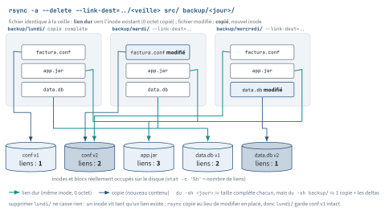

<!-- nav:début -->
[Accueil](../../README.md) › [Parcours](../../docs/parcours.md) › Partie I — Fondamentaux du shell et du système de fichiers › **Module 06**  
[← Module 05](../05-text-processing/README.md) · [Corrigé](corrige.md) · [Module 07 →](../07-bash-scripting/README.md)

<details><summary>Scripts du module (9)</summary>

Sur la VM indiquée en section « Mise en place », depuis `~/workbook/scripts/` (voir [chapitre 0](../../docs/00-mise-en-place.md)).

| Script | Rôle |
|---|---|
| [`setup_M06.sh`](../../scripts/setup/setup_M06.sh) | prépare le module |
| [`check_M06_01.sh`](../../scripts/check/check_M06_01.sh) | vérifie L6.1 |
| [`check_M06_02.sh`](../../scripts/check/check_M06_02.sh) | vérifie L6.2 |
| [`check_M06_03.sh`](../../scripts/check/check_M06_03.sh) | vérifie L6.3 |
| [`check_M06_04.sh`](../../scripts/check/check_M06_04.sh) | vérifie L6.4 |
| [`check_M06_05.sh`](../../scripts/check/check_M06_05.sh) | vérifie D6 |
| [`break_M06_01.sh`](../../scripts/break/break_M06_01.sh) | installe la panne BF6.1 |
| [`break_M06_02.sh`](../../scripts/break/break_M06_02.sh) | installe la panne BF6.2 |
| [`break_M06_03.sh`](../../scripts/break/break_M06_03.sh) | installe la panne BF6.3 |

</details>
<!-- nav:fin -->

# Module 06 — Vim, archives et transfert de fichiers

## 6.0 Objectifs et compétences

> [!NOTE]
> **Objectifs**
>
> À la fin de ce module, je sais :
>
> * survivre dans `vim` sur une machine sans interface graphique : entrer et sortir
>   des modes, quitter sans écrire, écrire sans quitter, et rouvrir un fichier
>   laissé en plan par une session tuée ;
> * me déplacer au mot, à la ligne, à l'écran, au fichier, par recherche et par
>   marque, sans jamais toucher les flèches ;
> * composer opérateur + mouvement + compteur (`d2w`, `ci"`, `ya{`, `dap`),
>   rejouer une modification avec `.` et défaire proprement avec `u` / `Ctrl-R` ;
> * traiter un fichier de 2 000 lignes en une commande : plages, `:%s///gc`,
>   `:g/motif/d`, `:v/motif/d`, `:g/motif/normal ...`, visuel bloc ;
> * déplacer du texte entre fichiers avec les registres, injecter un fichier ou la
>   sortie d'une commande dans le tampon, et enregistrer un fichier root ouvert
>   sans `sudo` ;
> * configurer un `~/.vimrc` de serveur (numéros, recherche, `paste`, `list`) et
>   expliquer chaque ligne à un collègue ;
> * construire et vérifier une archive `tar` qui préserve droits, propriétaires et
>   liens, avec exclusions, `-C` et `--strip-components` ;
> * choisir un compresseur (`gzip`, `bzip2`, `xz`, `zstd`) sur des critères de
>   temps et de taux, et compresser en flux sans fichier intermédiaire ;
> * synchroniser une arborescence avec `rsync` (`-a`, `--delete`, `--exclude`,
>   `--dry-run`, `--link-dest`) en maîtrisant l'effet de la barre oblique finale ;
> * vérifier l'intégrité d'un transfert (`sha256sum -c`, `gzip -t`), découper et
>   reconstituer un gros fichier, et tester une restauration.
>
> **Temps estimé** : 5 h
>
> **Prérequis** : modules 01 (shell, redirections), 02 (arborescence, `find`) et
> 03 (droits, propriétaires).

---

## 6.1 Mise en place

VM concernées : **`lab-adm` (10.10.10.10)** pour l'essentiel, et **`lab-web`
(10.10.10.11)** comme destination de transfert en L6.4 et D6.

```bash
# depuis le shell Proxmox, avant de commencer
qm snapshot 9001 avant-lab06
qm snapshot 9002 avant-lab06
```

Paquets nécessaires sur `lab-adm` :

```bash
sudo apt update
sudo apt install -y vim tar gzip bzip2 xz-utils zstd zip unzip cpio \
                    rsync openssh-client pv tree
```

> [!IMPORTANT]
> **Variante Rocky / RHEL**
>
> Sous Rocky 9 : `sudo dnf install -y vim-enhanced tar gzip bzip2 xz zstd zip \
> unzip cpio rsync openssh-clients pv tree`. Attention, le paquet minimal `vim`
> de Rocky installe `vim-minimal` (la commande `vi`, version réduite, sans coloration syntaxique) : c'est **`vim-enhanced`** qu'il te faut.

Préparation du terrain de jeu (idempotent, mais il **réécrit** les fichiers
d'édition : relance-le si tu as massacré un fichier) :

```bash
sudo bash ~/workbook/scripts/setup/setup_M06.sh
```

Il crée `~/lab06/` avec des fichiers à éditer, une arborescence applicative à
archiver (journaux, secrets en root, `node_modules` à exclure, un lien
symbolique), une archive de référence et sa copie tronquée.

> [!CAUTION]
> **Attention**
>
> `rsync --delete` et `tar -x` écrasent sans demander. Tous les exercices de ce
> module travaillent sous `~/lab06/` ou dans `/tmp`. Le jour où tu tapes une de
> ces commandes ailleurs, `--dry-run` d'abord, toujours.

---

## 6.2 Rappel express

### Vim : modes et survie

| Touche | Effet |
|---|---|
| `Esc` | retour en mode normal, depuis n'importe où |
| `i` `a` `I` `A` `o` `O` | insertion avant/après curseur, début/fin de ligne, ligne dessous/dessus |
| `:w` `:q` `:wq` `:x` `ZZ` | écrire, quitter, les deux, les deux (si modifié), les deux |
| `:q!` `ZQ` | quitter **sans** écrire, les modifications sont perdues |
| `u` / `Ctrl-R` | annule / refait ; `U` annule toute la ligne |
| `Ctrl-G` / `g Ctrl-G` | position dans le fichier / compte mots et caractères |

### Déplacements

| Touche | Où |
|---|---|
| `h j k l` | gauche, bas, haut, droite |
| `w` `b` `e` / `W` `B` `E` | mot suivant, précédent, fin de mot (majuscule = séparé par des blancs) |
| `0` `^` `$` | colonne 0, premier caractère non blanc, fin de ligne |
| `f;` `t;` `F;` `T;` puis `;` `,` | jusqu'au caractère, avant, vers l'arrière ; répéter, répéter en arrière |
| `gg` `G` `:N` `NG` | début, fin, ligne N |
| `Ctrl-F` `Ctrl-B` `Ctrl-D` `Ctrl-U` | page suivante, précédente, demi-page |
| `H` `M` `L` / `zz` `zt` | haut, milieu, bas de l'écran / recentre la ligne |
| `%` | saute à la parenthèse, accolade ou crochet apparié |
| `/motif` `?motif` `n` `N` `*` | recherche avant, arrière, suivant, précédent, mot sous le curseur |
| `ma` puis `` `a `` / `'a` | pose la marque `a` / y revient (colonne exacte / début de ligne) |
| '`/`Ctrl-OCtrl-I' | position précédente / recule et avance dans la liste des sauts |

### Opérateurs, objets texte, répétition

```text
  [compteur] opérateur [compteur] mouvement-ou-objet
     3           d                  w          -> 3dw (= d3w) : 3 mots
```

| Opérateur | Objet texte | Exemple |
|---|---|---|
| `d` supprime | `iw` / `aw` mot | `daw` supprime le mot et son espace |
| `c` change (supprime + insertion) | `i"` / `a"` guillemets | `ci"` remplace l'intérieur des guillemets |
| `y` copie | `i{` / `a{` bloc accolades | `ya{` copie le bloc, accolades comprises |
| `>` `<` indente | `ip` / `ap` paragraphe | `dap` supprime le paragraphe et sa ligne vide |
| `gu` `gU` casse | `it` / `at` balise | `dd` `cc` `yy` = ligne entière |

`.` rejoue la **dernière modification**, pas la dernière touche. `5.` la rejoue
avec un compteur de 5. C'est le multiplicateur le plus rentable de vim.

### Mode visuel

`v` caractère, `V` ligne, `Ctrl-V` **bloc rectangulaire**. Une fois la sélection
faite, un opérateur s'applique (`d`, `y`, `>`, `u`, `:`).

```text
Commenter 30 lignes :   Ctrl-V  29j  I  #  Esc
Décommenter :           Ctrl-V  29j  x     (l x si tu avais inséré « # »)
Ajouter en fin de bloc : Ctrl-V  29j  $  A  ;  Esc
```

Le `Esc` final est ce qui propage l'insertion sur toutes les lignes du bloc.
Sans lui, une seule ligne est modifiée.

### Commandes ex : plages et boucles

| Commande | Effet |
|---|---|
| `:%s/x/y/g` | remplace partout, toutes occurrences par ligne |
| `:%s/x/y/gc` | idem, avec confirmation (`y` `n` `a` `q` `l`) |
| `:10,42s/x/y/` | limite la plage aux lignes 10 à 42 |
| `:.,$s/x/y/` | de la ligne courante à la fin ; `'<,'>` = sélection visuelle |
| `:%s#/opt/#/srv/#g` | autre délimiteur : plus de `\/` à échapper |
| `:g/motif/d` | supprime **toutes** les lignes contenant le motif |
| `:v/motif/d` (= `:g!/`) | supprime toutes celles qui **ne** le contiennent pas |
| `:g/motif/normal A;` | exécute une commande normale sur chaque ligne trouvée |
| `:g/^$/d` | supprime les lignes vides ; `:sort u` trie et dédoublonne |

Drapeaux utiles dans un motif : `\<mot\>` limites de mot, `\c` ignore la casse,
`\(...\)` capture, rejouée par `\1` dans le remplacement.

### Registres, fichiers, fenêtres

| Commande | Effet |
|---|---|
| `"ayy` / `"ap` | copie / colle via le registre nommé `a` (`"A` ajoute) |
| `:reg` | liste les registres; `"0` dernier yank, `""` dernier yank ou effacement |
| `:r fichier` / `:r !cmd` | insère un fichier / la sortie d'une commande sous le curseur |
| `:e fichier` / `:e!` | ouvre un autre fichier / recharge en jetant les modifications |
| `:ls` `:bn` `:bp` `:b 3` | liste les tampons, suivant, précédent, n° 3 |
| `:sp` `:vs` `Ctrl-W w` `Ctrl-W q` | split horizontal, vertical, fenêtre suivante, fermer |
| `:tabe f` `gt` `gT` | onglets |
| `:w !sudo tee % > /dev/null` | écrit un fichier root ouvert sans `sudo` |

### `~/.vimrc` minimal de serveur

```vim
syntax on
set number            " numéros de ligne
set hlsearch incsearch " surligne et suit la recherche
set ignorecase smartcase " insensible sauf si tu tapes une majuscule
set expandtab tabstop=2 shiftwidth=2   " YAML : jamais de tabulation
set list listchars=tab:»·,trail:·      " rend visibles tabs et espaces finaux
set backupdir=~/.vim/backup//
set undofile undodir=~/.vim/undo//
```

`:set paste` désactive `autoindent` et les abréviations le temps d'un
copier-coller souris ; `:set nopaste` remet tout. Sans lui, un collage indenté
part en escalier.

### Fichiers `.swp`

Vim écrit `.fichier.swp` dans le répertoire du fichier dès l'ouverture et y
journalise les modifications non enregistrées. Sortie propre : il l'efface.
Session tuée : il reste. À la réouverture, `E325: ATTENTION`.

```bash
vim -r fichier        # récupère depuis le swap, puis :w sous un autre nom
vim -r                # liste les swaps trouvés
```

### Autres éditeurs

`nano` suffit pour trois lignes (`Ctrl-O` écrire, `Ctrl-X` quitter). La variable
`EDITOR` (ou `VISUAL`) décide de ce que lancent `visudo`,
`systemctl edit nginx.service`, `crontab -e` et `git commit`.

```bash
export EDITOR=vim         # dans ~/.bashrc
sudo EDITOR=nano visudo   # ponctuellement
```

### `tar` : les options qui comptent

| Option | Effet |
|---|---|
| `-c` `-x` `-t` | créer, extraire, lister |
| `-f fichier` | nom de l'archive (`-` = stdin/stdout) |
| `-v` / `-z` `-j` `-J` | verbeux / gzip, bzip2, xz (`--zstd` pour zstd) |
| `-C rep` | se place dans `rep` **avant** d'agir (change ce qui est stocké) |
| `--strip-components=N` | retire N niveaux de chemin à l'extraction |
| `--exclude='motif'` | exclut (répétable, `--exclude-from=fichier`) |
| `-p` `--numeric-owner` | conserve les modes / stocke les UID-GID numériques |
| `-h` | suit les liens symboliques au lieu de les archiver tels quels |
| `--one-file-system` | ne franchit pas les points de montage |

Les chemins sont stockés **relatifs** : `tar` retire le `/` initial et prévient
(`Removing leading '/' from member names`). D'où la règle
`tar -czf x.tgz -C /srv factura` plutôt que `tar -czf x.tgz /srv/factura`.

### Compresseurs

| Outil | Taux | Vitesse | Emploi typique |
|---|---|---|---|
| `gzip` (`-1`..`-9`) | moyen | rapide | par défaut, lisible partout |
| `bzip2` | bon | lent | hérité, à éviter aujourd'hui |
| `xz` (`-T0`) | excellent | très lent | archivage long terme, images |
| `zstd` (`-1`..`-19`, `-T0`) | bon à excellent | très rapide | sauvegardes quotidiennes |

Tous lisent stdin et écrivent stdout avec `-c` (et `-d` pour décompresser) :

```bash
pg_dump factura | zstd -19 -T0 > dump.sql.zst     # rien sur disque en clair
zstd -dc dump.sql.zst | psql factura
tar -cf - -C /srv factura | ssh mathieu@10.10.10.11 'tar -xf - -C /srv'
```

### `rsync`, `scp`, `sftp`

| Option | Effet |
|---|---|
| `-a` | archive : récursif + droits + temps + liens + propriétaires (avec root) |
| `-v` `--progress` / `-P` | verbeux, progression / `--partial --progress` |
| `-z` | compresse **pendant le transfert** (inutile en réseau local rapide) |
| `--delete` | efface à la destination ce qui n'existe plus à la source |
| `--exclude='motif'` | répétable ; `--exclude-from=fichier` |
| `-n` / `--dry-run` | simule, ne touche à rien. À passer avant chaque `--delete` |
| `--link-dest=REP` | les fichiers inchangés deviennent des liens durs vers `REP` |

```text
rsync -a /src  /dst/   ->  /dst/src/...   (copie le RÉPERTOIRE)
rsync -a /src/ /dst/   ->  /dst/...       (copie son CONTENU)
```

<p align="center"></p>

*Figure — Trois sauvegardes `rsync --link-dest` : les fichiers inchangés partagent leurs inodes par liens durs, seuls les fichiers modifiés sont copiés.*

Depuis OpenSSH 9.0, `scp` utilise le protocole SFTP en dessous (l'ancien protocole scp est déprécié), mais il ne sait toujours pas
reprendre un transfert ni comparer deux arborescences. Pour un fichier ponctuel : `scp` ou
`sftp` ; pour une arborescence ou un lien instable : `rsync -aP`, qui reprend où
il s'est arrêté.

### Découpe et intégrité

```bash
split -b 500M archive.tar.zst archive.part.   # -> archive.part.aa, .ab...
cat archive.part.* > archive.tar.zst
sha256sum archive.tar.zst > archive.tar.zst.sha256
sha256sum -c archive.tar.zst.sha256           # "OK" ou "FAILED"
gzip -t archive.tar.gz ; zstd -t archive.tar.zst ; tar -tzf a.tgz >/dev/null
```

---

## 6.3 Quiz — QCM

<a id="q6-1"></a>**[Q6.1](corrige.md#q6-1)** — Tu ouvres un fichier de production, tu tapes sans réfléchir et tu te
retrouves avec du texte parasite. Tu veux sortir en étant **certain** de ne rien
avoir écrit sur le disque. Quelle séquence ?

a) `:q`
b) `Esc` puis `:q!`
c) `ZZ`
d) `Ctrl-C` puis `:quit`

<a id="q6-2"></a>**[Q6.2](corrige.md#q6-2)** — Le curseur est sur le premier caractère non blanc de cette ligne, donc sur le `s` de
`server_name` :

```nginx
    server_name "ancien-frontal.example.org";
```

Que fait `ci"` ?

a) rien, le curseur n'est pas entre les guillemets
b) supprime le contenu entre guillemets et passe en insertion
c) supprime la ligne entière et passe en insertion
d) supprime les guillemets eux-mêmes et leur contenu

<a id="q6-3"></a>**[Q6.3](corrige.md#q6-3)** — Dans `deploy.sh`, tu veux migrer `/opt/factura` vers `/srv/factura`.
Tu tapes `:%s/opt/srv/g`. Quel est le problème ?

a) aucun, c'est la bonne commande
b) `/` doit être échappé, la commande est refusée
c) toute occurrence de la chaîne `opt` est touchée, y compris dans
   `options` ou `optimisation`
d) `:%` ne fonctionne pas sur un fichier exécutable

<a id="q6-4"></a>**[Q6.4](corrige.md#q6-4)** — Sur `app.log`, quelle commande ne garde **que** les lignes contenant
`ERROR` ? **Deux réponses correctes.**

a) `:g/ERROR/d`
b) `:v/ERROR/d`
c) `:g!/ERROR/d`
d) `:%s/^\(.*ERROR.*\)\@!.*$//`

<a id="q6-5"></a>**[Q6.5](corrige.md#q6-5)** — Tu viens d'exécuter `ci"nouveau.example.org` puis `Esc` sur la ligne
12. Tu descends de trois lignes avec `3j` et tu tapes `.`. Que se passe-t-il ?

a) rien, `.` ne rejoue que les commandes ex
b) vim rejoue `ci"nouveau.example.org` sur la ligne courante
c) vim rejoue `3j`
d) vim rejoue la totalité `3j` + `ci"...`

<a id="q6-6"></a>**[Q6.6](corrige.md#q6-6)** — Tu as ouvert `/etc/factura/frontal.conf` (root:root 644) sans `sudo`,
tu as fait vingt minutes de modifications, et `:w` répond
`E45: 'readonly' option is set`. Que fais-tu **sans perdre ton travail** ?

a) `:w!`, qui force l'écriture
b) `:set noreadonly` puis `:w`
c) `:w !sudo tee % > /dev/null` puis `:e!`
d) `:q!` puis on recommence avec `sudo vim`

<a id="q6-7"></a>**[Q6.7](corrige.md#q6-7)** — Tu colles depuis ton poste, à la souris, un bloc YAML dans vim et il
arrive en escalier, chaque ligne décalée un peu plus que la précédente. Quelle
est la cause et le remède ?

a) le terminal envoie des tabulations : `set expandtab`
b) `autoindent`/`smartindent` ré-indente chaque ligne reçue comme si tu la
   tapais : `:set paste`, coller, `:set nopaste`
c) le fichier a des fins de ligne Windows : `set fileformat=unix`
d) le presse-papier X n'est pas partagé : utiliser `"+p`

<a id="q6-8"></a>**[Q6.8](corrige.md#q6-8)** — En ouvrant un fichier, vim affiche
`E325: ATTENTION / Found a swap file by the name ".factura.conf.swp"`.
**Deux réponses correctes.**

a) une autre session vim édite peut-être ce fichier en ce moment
b) le fichier sur disque est corrompu
c) une session précédente a été tuée et le swap contient des modifications
   jamais enregistrées
d) il faut toujours répondre `Delete it` : le swap ne sert à rien

<a id="q6-9"></a>**[Q6.9](corrige.md#q6-9)** — Tu veux préfixer d'un `#` les 30 lignes suivantes. Tu tapes
`Ctrl-V`, `29j`, `I`, `#`. Que manque-t-il pour que les 30 lignes soient
commentées ?

a) rien, c'est déjà fait
b) appuyer sur `Esc`
c) utiliser `i` au lieu de `I`
d) terminer par `:w`

<a id="q6-10"></a>**[Q6.10](corrige.md#q6-10)** — Sur `lab-adm` tu fais :

```bash
tar -czf /tmp/srv.tgz /srv/factura
```

`tar` affiche `Removing leading '/' from member names`. Tu copies l'archive sur
`lab-web` et tu l'extrais depuis `/tmp`. Où atterrissent les fichiers ?

a) dans `/srv/factura/` sur `lab-web`, les chemins absolus sont conservés
b) dans `/tmp/srv/factura/`
c) l'extraction échoue : chemins absolus interdits
d) dans le répertoire home de l'utilisateur

<a id="q6-11"></a>**[Q6.11](corrige.md#q6-11)** — Un collègue extrait en tant que `mathieu` une archive contenant des
fichiers appartenant à `root:root`. Après extraction, ils appartiennent à
`mathieu:mathieu`. Pourquoi ? **Deux réponses correctes.**

a) l'archive ne contient pas les propriétaires
b) seul root peut donner un fichier à un autre utilisateur, `tar` retombe donc
   sur l'utilisateur courant
c) il manquait `--same-owner`, actif par défaut uniquement pour root
d) `tar` a besoin de `-p` pour stocker les propriétaires à la création

<a id="q6-12"></a>**[Q6.12](corrige.md#q6-12)** — La sauvegarde nocturne se termine en renvoyant 1, avec
`tar: /srv/factura/logs/access.log: file changed as we read it`. Que conclus-tu ?

a) l'archive est inutilisable, il faut la jeter
b) l'archive existe mais au moins un fichier y est incohérent : il a été écrit
   pendant la lecture
c) le disque est plein
d) `tar` a été interrompu par un signal

<a id="q6-13"></a>**[Q6.13](corrige.md#q6-13)** — Quelle différence entre ces deux commandes ?

```bash
rsync -a ~/lab06/arbo/factura  ~/lab06/depot/
rsync -a ~/lab06/arbo/factura/ ~/lab06/depot/
```

a) aucune, `rsync` normalise les chemins
b) la première crée `~/lab06/depot/factura/`, la seconde déverse le contenu
   directement dans `~/lab06/depot/`
c) la première déverse le contenu, la seconde crée le sous-répertoire
d) la seconde est refusée, un chemin source ne se termine pas par `/`

<a id="q6-14"></a>**[Q6.14](corrige.md#q6-14)** — Tu dois synchroniser `lab-adm:~/site/` vers `lab-web:/var/www/site/`
en supprimant à la destination ce qui n'existe plus à la source. Quelle commande
tapes-tu **en premier** ?

a) `rsync -a --delete ~/site/ mathieu@10.10.10.11:/var/www/site/`
b) `rsync -an --delete ~/site/ mathieu@10.10.10.11:/var/www/site/`
c) `rsync -a --delete mathieu@10.10.10.11:/var/www/site/ ~/site/`
d) `scp -r ~/site/* mathieu@10.10.10.11:/var/www/site/`

<a id="q6-15"></a>**[Q6.15](corrige.md#q6-15)** — Sauvegarde du lundi : 10 Go. Mardi, un seul fichier de 100 Mo a
changé, et tu lances :

```bash
rsync -a --delete --link-dest=../lundi ~/src/ ~/backup/mardi/
```

Que voit-on ?

a) `~/backup/mardi/` fait 10 Go, il y a deux copies complètes
b) `du -sh ~/backup/mardi` affiche environ 10 Go mais l'espace réellement
   consommé en plus est d'environ 100 Mo
c) `~/backup/mardi/` ne contient que le fichier modifié
d) les fichiers de `mardi` sont des liens symboliques vers `lundi`

<a id="q6-16"></a>**[Q6.16](corrige.md#q6-16)** — Tu as découpé une archive avec `split -b 500M sauve.tar.zst part.`
et transféré les morceaux. Comment vérifies-tu, à l'arrivée, que tout est
correct ? **Deux réponses correctes.**

a) `cat part.* > sauve.tar.zst` puis `sha256sum -c sauve.tar.zst.sha256`
b) comparer la taille totale des morceaux avec celle de l'original
c) `zstd -t sauve.tar.zst` après reconstitution
d) `tar -tf part.aa` doit lister le contenu

<a id="q6-17"></a>**[Q6.17](corrige.md#q6-17)** — Tu dois archiver 40 Go de journaux textuels sur un serveur à 8 cœurs
peu chargé, avec pour contrainte « le meilleur taux possible, la durée n'a pas
d'importance ». Quel compresseur ?

a) `gzip -9`
b) `bzip2 -9`
c) `xz -9 -T0`
d) `zstd -1`

<a id="q6-18"></a>**[Q6.18](corrige.md#q6-18)** — Tu dois envoyer une arborescence à un collègue sous Windows, qui
doit pouvoir l'ouvrir d'un double-clic. Quelle est la limite à lui signaler ?

a) `zip` ne gère pas les répertoires
b) `zip` ne conserve ni les propriétaires, ni les liens symboliques, et ses
   permissions ne sont pas restituées par l'explorateur Windows
c) `zip` ne compresse pas, il ne fait qu'assembler
d) `unzip` n'existe pas sous Linux, il faudra `tar`

---

## 6.4 Quiz — questions ouvertes

<a id="qo6-1"></a>**[QO6.1](corrige.md#qo6-1)** — *On te demande en entretien* : « Pourquoi imposer `vim` à une équipe
qui ne jure que par VS Code ? » Réponds en trois arguments concrets et
vérifiables, liés à l'exploitation de serveurs (pas au confort personnel), et
cite deux situations où aucun autre éditeur n'est disponible.

<a id="qo6-2"></a>**[QO6.2](corrige.md#qo6-2)** — Explique le mécanisme de `:g/motif/normal A;` : dans quel ordre vim
parcourt le fichier, ce qu'il marque avant d'agir, et pourquoi
`:g/DEBUG/d` ne « saute » pas une ligne sur deux alors que la suppression décale
tout le reste du fichier.

<a id="qo6-3"></a>**[QO6.3](corrige.md#qo6-3)** — Un collègue te dit : « impossible d'éditer `/etc/nginx/nginx.conf`,
vim m'affiche un pavé rouge à chaque ouverture ». Décris le fichier en cause,
d'où il vient, les trois questions à te poser avant de choisir une option du
menu, et la procédure complète pour récupérer d'éventuelles modifications
perdues.

<a id="qo6-4"></a>**[QO6.4](corrige.md#qo6-4)** — Explique pourquoi `tar -czf sauvegarde.tgz /srv/factura` sur un
serveur en production peut produire une archive qui **ment**. Détaille le
mécanisme (que lit `tar`, dans quel ordre, que fait l'application pendant ce
temps), puis propose trois façons d'obtenir une sauvegarde cohérente, avec leurs
inconvénients respectifs.

<a id="qo6-5"></a>**[QO6.5](corrige.md#qo6-5)** — *On te demande en entretien* : « Tu dois transférer 400 Go de
données entre deux serveurs, sur une liaison instable qui coupe toutes les
vingt minutes. `scp`, `sftp` ou `rsync` ? Justifie, et donne la commande. »

<a id="qo6-6"></a>**[QO6.6](corrige.md#qo6-6)** — Explique la règle de la barre oblique finale de `rsync` en donnant
un modèle mental qui fonctionne à tous les coups, puis décris un incident
plausible causé par son oubli combiné à `--delete`, et comment tu l'aurais
évité.

<a id="qo6-7"></a>**[QO6.7](corrige.md#qo6-7)** — Compare `--link-dest` de `rsync` et une simple copie complète
quotidienne : mécanisme sous-jacent, occupation disque, temps de restauration,
et un cas où `--link-dest` te joue un mauvais tour (pense à ce que voit `du`, et
à ce qui arrive si tu modifies un fichier dans une sauvegarde ancienne).

<a id="qo6-8"></a>**[QO6.8](corrige.md#qo6-8)** — Tu prends en charge un serveur applicatif (code déployé, une base
PostgreSQL, des fichiers déposés par les utilisateurs, de la configuration dans
`/etc`, des journaux). Établis la liste de ce que tu sauvegardes et de ce que tu
**ne** sauvegardes pas, avec une justification par ligne, puis une règle de
rotation, et explique la phrase : « une sauvegarde jamais restaurée n'existe
pas ».

---

## 6.5 Exercices guidés ★

Les exercices E6.1 à E6.10 se font dans `~/lab06/edition/`. Si tu abîmes un
fichier au point de ne plus pouvoir continuer, relance le script de setup.

<a id="e6-1"></a>**[E6.1](corrige.md#e6-1)** — Ouvre `notes.txt`. Va directement à la ligne 87, pose-y la marque `a`,
saute à la fin du fichier, reviens à la marque, puis reviens à ta position
précédente — sans flèches ni souris. Note la différence entre `` `a `` et `'a`.
Trouve ensuite les trois lignes contenant `INCIDENT` par la seule recherche.
Enfin, sur la ligne 42, supprime les trois mots qui suivent le curseur en une
commande, annule, refais l'annulation, puis supprime tout depuis le curseur
jusqu'au premier tiret cadratin inclus, toujours en une commande.

<a id="e6-2"></a>**[E6.2](corrige.md#e6-2)** — Dans `factura.conf`, remplace la valeur de `server_name` du premier
bloc par `factura.lab.local` **sans retaper les guillemets** et sans sélection
souris. Fais ensuite la même modification sur le second bloc `server` en
rejouant la commande précédente plutôt qu'en la retapant.

<a id="e6-3"></a>**[E6.3](corrige.md#e6-3)** — Dans `deploy.sh`, migre `/opt/factura` vers `/srv/factura` partout,
avec confirmation occurrence par occurrence, **sauf** dans le bloc de
commentaires historiques (lignes 12 à 15) qui doit rester intact. Vérifie
ensuite qu'il ne reste aucun `/opt/factura` hors de ce bloc.

<a id="e6-4"></a>**[E6.4](corrige.md#e6-4)** — Deux usages du visuel bloc, à la suite :

1. dans `factura.conf`, commente d'un `#` les lignes 39 à 71 (le bloc `server`
   hérité) en un seul geste, enregistre, puis décommente tout aussi vite ;
2. dans `inventaire.csv`, ajoute `;actif` en fin de toutes les lignes **sauf**
   l'en-tête, auquel tu ajoutes `;etat`.

Pour le point 2, donne aussi la variante en commande ex, et dis laquelle des
deux survit à des lignes de longueurs très différentes.

<a id="e6-5"></a>**[E6.5](corrige.md#e6-5)** — Dans `app.log` : supprime toutes les lignes `DEBUG`, puis ajoute
`  <-- a traiter` à la fin de chaque ligne contenant `ERROR`, en une seule
commande. Combien de lignes reste-t-il ?

<a id="e6-6"></a>**[E6.6](corrige.md#e6-6)** — Copie les lignes 10 à 34 de `factura.conf` dans le registre `v`, ouvre
`~/lab06/edition/vhost-neuf.conf` **depuis la même session vim**, colle-les, et
reviens au premier fichier sans fermer le second. Affiche la liste des tampons
ouverts, puis affiche les deux fichiers côte à côte.

<a id="e6-7"></a>**[E6.7](corrige.md#e6-7)** — Dans `notes.txt`, insère sous la ligne 1 le contenu de
`/etc/os-release`, puis, juste en dessous, la sortie de `date -Is` et celle de
`ip -br a`. Sans quitter vim et sans fichier temporaire. Attention à ce que vim
fait des caractères `%` et `#` dans une commande `:r !`.

<a id="e6-8"></a>**[E6.8](corrige.md#e6-8)** — Ouvre `/etc/factura/frontal.conf` sans `sudo`, passe `log_level` à
`debug` et `workers` à `4`, puis enregistre sans quitter vim, sans perdre tes
modifications et sans relancer l'éditeur. Vérifie ensuite que le tampon et le
fichier sur disque disent la même chose.

<a id="e6-9"></a>**[E6.9](corrige.md#e6-9)** — Provoque puis répare un fichier `.swp` : ouvre `notes.txt`, ajoute une
ligne `sentinelle` à la fin **sans enregistrer**, et tue vim depuis un autre
terminal (`pkill -9 vim`). Rouvre le fichier, lis le message, récupère la ligne
perdue, puis nettoie le swap. Où était-il stocké exactement, et sous quel nom ?

<a id="e6-10"></a>**[E6.10](corrige.md#e6-10)** — Écris un `~/.vimrc` qui active : numéros de ligne, coloration
syntaxique, recherche surlignée et incrémentale, insensible à la casse sauf
présence d'une majuscule, indentation à 2 espaces sans tabulation, et
visualisation des espaces en fin de ligne. Colle ensuite le contenu de
`snippet.yaml` à la souris dans un fichier neuf : constate l'escalier, corrige,
recommence. Explique quelle ligne de ton `.vimrc` en était responsable.

---

Les exercices suivants portent sur les archives. Travaille dans `~/lab06/`.

<a id="e6-11"></a>**[E6.11](corrige.md#e6-11)** — Aller-retour complet avec `tar` :

1. produis `~/lab06/archives/app.tar.gz` contenant l'arborescence `factura`
   (donc `factura/app/...` dans l'archive, **pas**
   `home/mathieu/lab06/arbo/factura/...`), en excluant `node_modules`,
   `var/cache` et tous les `*.log` ; liste le contenu sans rien extraire et
   compte les entrées ;
2. extrais de `~/lab06/archives/livraison-2026-09-12.tar.gz` le seul répertoire
   `factura/conf`, dans `~/lab06/restauration/`, de façon à obtenir directement
   `~/lab06/restauration/conf/` (sans le niveau `factura/`).

<a id="e6-12"></a>**[E6.12](corrige.md#e6-12)** — Compare `gzip -6`, `gzip -9`, `bzip2 -9`, `xz -9` et `zstd -19` sur
`~/lab06/arbo/factura/logs/` : pour chacun, relève le temps écoulé et la taille
obtenue, et présente le résultat sous forme de tableau. Conclus en une phrase
pour un usage « sauvegarde quotidienne » et une pour « archivage à 10 ans ».

<a id="e6-13"></a>**[E6.13](corrige.md#e6-13)** — Sauvegarde le répertoire `~/lab06/arbo/factura/conf`, secrets
compris, dans une archive qui préserve modes et propriétaires **numériques**, et
restaure-la dans `~/lab06/restauration/conf-test/` en vérifiant que `api.token`
retrouve son mode `640`. Que faut-il pour que le propriétaire `root` soit
réellement restitué ?

<a id="e6-14"></a>**[E6.14](corrige.md#e6-14)** — Sans jamais écrire de fichier intermédiaire sur le disque : envoie le
contenu de `~/lab06/arbo/factura/app` vers `~/lab06/depot/` en passant par un
tube `tar`. Puis fais la même chose vers `lab-web` à travers SSH. Enfin,
compresse un flux de données produit par une commande (par exemple
`tar -cf - app`) sans jamais matérialiser la version non compressée.

<a id="e6-15"></a>**[E6.15](corrige.md#e6-15)** — Vérifie l'intégrité de `~/lab06/archives/livraison-recue.tar.gz` avec
trois outils différents, et dis pour chacun ce qu'il prouve exactement. Puis
découpe l'archive saine en morceaux de 1 Mio, reconstitue-la dans
`~/lab06/restauration/` et prouve que la copie est identique à l'originale.

<a id="e6-16"></a>**[E6.16](corrige.md#e6-16)** — Synchronise `~/lab06/arbo/factura/` vers `~/lab06/depot/` en
excluant `node_modules` et `var/cache`, avec compression et progression.
Relance la commande : que se passe-t-il, et pourquoi le second passage est-il
quasi instantané ? Supprime ensuite un fichier à la source et fais en sorte que
la destination reflète la suppression, **après** avoir simulé l'opération.
Montre enfin ce que produit la même commande sans la barre oblique finale.

---


## 6.6 Labs ★★

### <a id="l6-1"></a>**[L6.1](corrige.md#l6-1)** — Reprendre un vhost hérité, au clavier uniquement

> **Contexte**
>
> La migration du frontal `factura` est bloquée : le fichier de vhost récupéré de
> l'ancienne plateforme mélange la configuration courante et un bloc mort de 2019.
> Le collègue qui s'en occupait travaillait à la souris dans un éditeur graphique
> et a rendu un fichier à moitié fait. On te demande de le remettre d'aplomb sur
> `lab-adm`, en SSH, donc dans `vim`.

Fichier de travail : `~/lab06/edition/factura.conf`.

1. Remplace la valeur de `server_name` du premier bloc `server` par
   `factura.lab.local`, sans retaper les guillemets.
2. Migre tous les chemins commençant par `/opt/` en `/srv/`, **uniquement**
   dans la partie active du fichier (lignes 1 à 34). Le bloc hérité, qui pointe
   vers `/opt/legacy`, doit garder ses chemins intacts : c'est une archive.
3. Commente intégralement le bloc hérité (lignes 39 à 71) : un `#` en tête de
   chaque ligne, posé en une seule opération.
4. Insère en tête de fichier, sous le commentaire existant, une ligne de la
   forme `# revu le 2026-09-18 par mathieu sur lab-adm`, dont la date et le nom
   d'hôte sont produits par une commande, pas tapés à la main.
5. Ajoute, dans le premier bloc `server` et juste après `index index.html;`,
   la ligne `client_max_body_size 32m;`.
6. Supprime toutes les lignes vides en double (deux lignes vides consécutives
   ne doivent jamais subsister) et enregistre.
7. Reporte le résultat dans `/etc/factura/frontal.conf.nouveau` **sans quitter
   vim ni relancer l'éditeur sous `sudo`**.

> [!TIP]
> **Astuce**
>
> Pour l'étape 2, une plage suffit : `:1,34s#...#...#g`. Pour l'étape 4, `:r !`
> insère la sortie d'une commande **sous** la ligne courante, donc `:2r !…` la
> place sous la ligne 2. Piège : sur la ligne de commande de vim, `%` et `#`
> désignent le fichier courant et le fichier alternatif — dans un `:r !`, il faut
> les écrire `\%` et `\#`, sinon la commande shell reçoit un nom de fichier à la
> place, ou échoue avec `E194`.

> [!TIP]
> **Critère de succès**
>
> Critère de succès : le premier bloc ne contient plus aucun `/opt`, le bloc
> hérité est intégralement commenté et inchangé par ailleurs, la ligne de revue
> est présente avec une vraie date, et `/etc/factura/frontal.conf.nouveau` existe
> avec le même contenu.
>
> ```bash
> bash check_M06_01.sh
> ```

---

### <a id="l6-2"></a>**[L6.2](corrige.md#l6-2)** — Ticket INC-4488 : extraire un rapport d'incident d'un journal

> **Contexte**
>
> Le développeur d'astreinte demande un extrait exploitable du journal applicatif
> de la nuit : il veut les erreurs et les avertissements, sans le bruit de debug,
> triés, dédoublonnés sur le message, et annotés. Le fichier fait 140 lignes ici,
> il en fera 2 millions en production : la méthode doit tenir à l'échelle, donc
> pas de traitement ligne à ligne à la main.

Travaille sur une copie : `cp ~/lab06/edition/app.log ~/lab06/edition/inc-4488.log`
puis ouvre `inc-4488.log` dans vim. **Tout doit se faire dans vim**, sans
`grep`, `sed` ni `awk`.

1. Supprime toutes les lignes `DEBUG`.
2. Supprime toutes les lignes qui ne contiennent ni `ERROR` ni `WARN`.
3. Sur chaque ligne `ERROR`, ajoute en fin de ligne `  [INC-4488]`.
4. Remplace l'horodatage complet `2026-09-17T04:MM:SS` par la seule heure
   `04:MM`, sur toutes les lignes, en une commande utilisant une capture.
5. Supprime la mention `worker=N ` (le numéro varie) de toutes les lignes.
6. Trie le fichier et supprime les doublons stricts.
7. Insère en première ligne un en-tête
   `# INC-4488 — extrait genere le <date ISO> sur <hostname>`, dont la date et
   le nom d'hôte proviennent d'une commande.
8. Enregistre sous `~/lab06/edition/inc-4488.log` et note, en commentaire de fin
   de fichier, la liste des commandes ex que tu as utilisées.

> [!TIP]
> **Astuce**
>
> Étape 4 : `:%s/2026-09-17T04:\([0-9]\{2\}\):[0-9]\{2\}/04:\1/`. Les parenthèses de
> capture s'échappent dans la syntaxe par défaut de vim (`\(` … `\)`), sauf si tu
> passes par `\v` (`very magic`) : `:%s/\v2026-09-17T04:(\d{2}):\d{2}/ 04:\1/`.

> [!TIP]
> **Critère de succès**
>
> Critère de succès : plus aucune ligne `DEBUG` ou `INFO`, toutes les lignes
> `ERROR` annotées, aucun `worker=`, fichier trié sans doublon, en-tête daté en
> première ligne.
>
> ```bash
> bash check_M06_02.sh
> ```

---

### <a id="l6-3"></a>**[L6.3](corrige.md#l6-3)** — Archiver le serveur applicatif avant migration

> **Contexte**
>
> `factura` change de serveur ce week-end. On te demande une archive de référence
> de l'application : complète, restaurable à l'identique (modes et propriétaires
> compris), sans le bruit qui se régénère, vérifiable par la personne qui la
> recevra, et découpée pour tenir sur des supports de 2 Mio. Et surtout : on te
> demande de **prouver** qu'elle se restaure.

Source : `~/lab06/arbo/factura`. Travaille dans `~/lab06/archives/`.

1. Fabrique `factura-<AAAAMMJJ>.tar.gz` qui contient `factura/...` à la racine
   de l'archive (jamais de chemin absolu), en excluant `node_modules/`,
   `var/cache/` et les `*.log`, et qui préserve modes et propriétaires
   numériques. Les secrets appartenant à `root` doivent être **dans** l'archive.
2. Vérifie sans extraire : liste le contenu, compte les entrées, et confirme que
   `conf/secrets/api.token` est bien en `640` et porte l'UID 0. Confirme
   aussi qu'aucun chemin exclu n'a été embarqué.
3. Produis `factura-<AAAAMMJJ>.tar.gz.sha256` au format attendu par
   `sha256sum -c`, puis vérifie-le.
4. Découpe l'archive en morceaux de 2 Mio nommés `factura-<AAAAMMJJ>.part.XX`,
   et écris la procédure de reconstitution dans
   `~/lab06/archives/RESTAURATION.md`.
5. Reconstitue l'archive à partir des seuls morceaux, dans
   `~/lab06/restauration/`, et prouve par la somme de contrôle qu'elle est
   identique à l'originale.
6. Restaure-la dans `~/lab06/restauration/test/` et compare l'arborescence
   restaurée à la source avec `diff -r` : la seule différence acceptable est
   l'absence des éléments volontairement exclus. Explique pourquoi le
   propriétaire `root` du fichier de secrets n'a pas été restitué si tu as
   extrait sans `sudo`.
7. Complète `RESTAURATION.md` : commande de restauration exacte, vérification
   d'intégrité, et la liste de ce qui n'est **pas** dans l'archive.

> [!CAUTION]
> **Attention**
>
> L'étape 1 lit un répertoire pendant que rien ne l'écrit : c'est le cas facile.
> Note dans `RESTAURATION.md`, en deux lignes, ce qui changerait si l'application
> écrivait pendant l'archivage.

> [!TIP]
> **Critère de succès**
>
> Critère de succès : archive présente et conforme, somme vérifiée, morceaux de
> 2 Mio reconstituables, restauration comparée à la source, `RESTAURATION.md`
> rédigé.
>
> ```bash
> bash check_M06_03.sh
> ```

---

### <a id="l6-4"></a>**[L6.4](corrige.md#l6-4)** — Sauvegardes incrémentales et transfert vers `lab-web`

> **Contexte**
>
> L'équipe veut garder sept jours de sauvegardes de `factura` sans multiplier
> l'espace disque par sept, et disposer d'une copie hors machine sur `lab-web`.
> La planification horaire ne fait pas partie de ta mission : tu livres la
> mécanique, elle sera déclenchée plus tard.

Racine des sauvegardes : `~/lab06/backup/`. Source : `~/lab06/arbo/factura/`.

1. Crée la sauvegarde du jour dans `~/lab06/backup/<AAAA-MM-JJ>/` avec `rsync`,
   en excluant `node_modules/` et `var/cache/`, et en simulant d'abord
   l'opération. Relève la taille occupée.
2. Modifie un seul fichier de la source (par exemple
   `arbo/factura/conf/factura.conf`) et crée une seconde sauvegarde, datée du
   lendemain, qui **partage** avec la première tous les fichiers inchangés.
3. Prouve le partage : compare `du -sh` de chaque répertoire, `du -sh` des deux
   ensemble, et le nombre de liens durs d'un fichier inchangé
   (`stat -c '%h %n'`). Explique l'écart entre les trois chiffres.
4. Vérifie que la seconde sauvegarde contient bien la **nouvelle** version du
   fichier modifié et la première l'**ancienne**.
5. Supprime un fichier de la source, relance une troisième sauvegarde, et
   montre que la nouvelle ne le contient plus alors que les précédentes le
   conservent toujours.
6. Envoie la sauvegarde du jour vers `mathieu@10.10.10.11:~/backup-factura/`
   avec reprise sur coupure et progression. Coupe volontairement le transfert
   (`Ctrl-C`) et relance : montre qu'il reprend au lieu de tout renvoyer.
7. Compare, en trois lignes écrites dans `~/lab06/backup/NOTES.md`, ce que
   t'auraient donné `scp -r` et `sftp` pour ce même besoin.

> [!TIP]
> **Astuce**
>
> `--link-dest` attend un chemin **relatif au répertoire de destination** ou un
> chemin absolu. Depuis `~/lab06/backup/2026-09-19/`, la veille est
> `--link-dest=../2026-09-18`.

> [!TIP]
> **Critère de succès**
>
> Critère de succès : au moins trois répertoires de sauvegarde datés, fichiers
> inchangés partagés en liens durs, versions distinctes du fichier modifié,
> fichier supprimé absent de la dernière seulement, `NOTES.md` rédigé.
>
> ```bash
> bash check_M06_04.sh
> ```

---

## 6.7 Break & Fix ★★★

> [!CAUTION]
> **Attention**
>
> Avant chaque Break & Fix : `qm snapshot 9001 avant-bf06`. Le snapshot de secours
> reste `snap-clean` (`qm rollback 9001 snap-clean`), mais l'utiliser vaut échec
> de l'exercice : l'objectif est de réparer, pas de rembobiner.

### <a id="bf6-1"></a>**[BF6.1](corrige.md#bf6-1)** — « vim refuse d'ouvrir le fichier de conf »

```bash
sudo bash break_M06_01.sh
```

**Symptôme utilisateur** : à l'ouverture de `/etc/factura/frontal.conf`, vim
affiche un pavé `E325: ATTENTION`, propose un menu, et quelle que soit la
réponse le fichier semble ne pas contenir la dernière modification du collègue,
qui jure l'avoir faite. Par-dessus, si tu l'ouvres sans `sudo`, `:w` répond `E45`.

**Interdit** : supprimer le fichier `.swp` avant d'en avoir extrait le contenu,
réécrire la configuration de mémoire.

**Objectif** : retrouver la modification perdue, la réintégrer dans le fichier
sur disque, nettoyer proprement, et expliquer pourquoi le message parlait aussi
d'un « processus encore actif ».

### <a id="bf6-2"></a>**[BF6.2](corrige.md#bf6-2)** — « la sauvegarde nocturne grossit sans fin »

```bash
sudo bash break_M06_02.sh
```

**Symptôme utilisateur** : le script `/usr/local/bin/factura-backup.sh`, qui
mettait 20 secondes, en met plusieurs minutes, remplit `/srv`, se termine en
renvoyant 1 avec `tar: ... file changed as we read it`, et l'archive produite
contient un fichier `.tar.gz` de taille aberrante.

**Interdit** : augmenter la taille du disque, supprimer les données de
`/srv/factura`.

**Objectif** : identifier la cause exacte en lisant le script et la sortie de
`tar -tzf`, corriger le script pour que l'archive soit complète, saine et
produite en temps normal, et expliquer ce que signifie précisément le code
retour 1 de `tar`.

### <a id="bf6-3"></a>**[BF6.3](corrige.md#bf6-3)** — « la synchro du site a tout cassé »

```bash
sudo bash break_M06_03.sh
```

**Symptôme utilisateur** : après la synchronisation de nuit, le site répond 404.
Dans `/var/www/factura/` on trouve maintenant un répertoire `factura-site/` qui
contient tout le site, et les fichiers qui étaient à la racine ont disparu. La
commande utilisée est journalisée dans `/var/log/factura-sync.log`, et la source
de vérité est `/srv/factura-site/`.

**Interdit** : restaurer depuis une sauvegarde, réinstaller le site.

**Objectif** : lire la commande fautive, expliquer en une phrase pourquoi elle a
produit ce résultat, remettre l'arborescence en état, corriger la commande, et
donner la précaution qui aurait rendu l'incident impossible.

---

## 6.8 Défi du module ★★★

<a id="d6"></a>**[D6](corrige.md#d6) — Chaîne de sauvegarde et de restauration de `factura`**

> **Contexte**
>
> On te confie la sauvegarde du serveur applicatif. Livrable : un script unique,
> utilisable à la main aujourd'hui et déclenchable par un planificateur demain,
> plus la procédure de restauration qui va avec. Le jury de recette te demandera
> de restaurer devant lui, sur un répertoire vide, en moins de cinq minutes.

Cahier des charges :

1. Écris `~/bin/factura-backup.sh`, en bash, commençant par
   `#!/usr/bin/env bash` et `set -euo pipefail`, idempotent, sans dépendance
   autre que les paquets du §6.1. **Écris-le dans vim**, c'est le module.
2. Modes d'appel :
   * `factura-backup.sh sauver` : archive `~/lab06/arbo/factura` dans
     `~/lab06/backup/archives/factura-<AAAA-MM-JJ>.tar.gz`, exclut
     `node_modules/`, `var/cache/` et `*.log`, préserve modes et propriétaires
     numériques, et produit le fichier `.sha256` associé ;
   * `factura-backup.sh miroir` : synchronise `~/lab06/arbo/factura/` vers
     `~/lab06/backup/<AAAA-MM-JJ>/` avec `--link-dest` sur la sauvegarde la plus
     récente, mêmes exclusions ;
   * `factura-backup.sh restaurer <archive> <cible>` : vérifie la somme de
     contrôle **avant** d'extraire, refuse d'écrire dans un répertoire non vide
     sans `--force`, extrait, et affiche un compte rendu ;
   * `factura-backup.sh verifier` : contrôle toutes les archives présentes
     (`sha256sum -c` + `gzip -t`) et sort en 1 à la première anomalie.
3. Options globales : `-n` / `--dry-run` (affiche ce qui serait fait, ne touche
   à rien, y compris pour `rsync`), `-v` (verbeux), `-h` (aide).
4. Rotation : `sauver` conserve les **7** archives les plus récentes et supprime
   les autres ; `miroir` conserve les 7 répertoires datés les plus récents. La
   rotation n'efface jamais la sauvegarde la plus récente, même en cas
   d'anomalie de date.
5. Journalisation : chaque exécution écrit une ligne horodatée dans
   `~/lab06/backup/backup.log` (mode, durée, taille produite, code retour). Le
   compte rendu lisible part sur stdout, les diagnostics sur stderr.
6. Livre `~/lab06/backup/PROCEDURE.md` : ce qui est sauvegardé et ce qui ne
   l'est pas (avec justification), la commande de restauration complète, la
   procédure de vérification d'intégrité, et le résultat daté de **ton** test de
   restauration réel.
7. Livre également ton `~/.vimrc` commenté : une ligne de commentaire par
   réglage, expliquant à quoi il sert en exploitation.

Temps visé : 60 à 90 minutes.

> [!TIP]
> **Critère de succès**
>
> ```bash
> bash check_M06_05.sh
> ```

---

## 6.9 Auto-évaluation

| Compétence | Acquis | À revoir |
|---|---|---|
| Entrer, sortir, sauver, abandonner dans vim sans hésiter | ☐ | ☐ |
| Me déplacer par mot, recherche, marque et `%` | ☐ | ☐ |
| Composer opérateur + objet texte, rejouer avec `.` | ☐ | ☐ |
| Modifier 30 lignes d'un coup en visuel bloc | ☐ | ☐ |
| Écrire une substitution avec plage, capture et confirmation | ☐ | ☐ |
| Utiliser `:g` / `:v` / `:g/…/normal` sur un gros fichier | ☐ | ☐ |
| Registres, `:r`, `:r !`, et `:w !sudo tee %` | ☐ | ☐ |
| Diagnostiquer et récupérer un fichier `.swp` | ☐ | ☐ |
| Construire un `tar` propre : `-C`, exclusions, `-p`, chemins | ☐ | ☐ |
| Choisir un compresseur et compresser en flux | ☐ | ☐ |
| `rsync` : barre oblique, `--delete`, `--dry-run`, `--link-dest` | ☐ | ☐ |
| Vérifier une archive et tester une restauration | ☐ | ☐ |

Pour aller plus loin :

* Fais `vimtutor` en entier une fois (30 minutes), même si tu crois savoir :
  il couvre les objets texte et `.`, que la plupart des gens n'utilisent jamais.
* Lis `man 1 tar` à la section **EXAMPLES** puis `man 1 rsync` à la section
  **ANCHORING INCLUDE/EXCLUDE PATTERNS** : les règles de motifs de `rsync` ne
  sont pas celles du shell, et c'est la source d'erreur numéro un.
* Compare `restic` ou `borg` avec ta chaîne `tar` + `rsync --link-dest` :
  déduplication au bloc, chiffrement, et ce que tu perds en simplicité.

<!-- nav:début -->
---

[← Module 05](../05-text-processing/README.md) · [Corrigé](corrige.md) · [Module 07 →](../07-bash-scripting/README.md) · [Parcours](../../docs/parcours.md) · [Accueil](../../README.md)
<!-- nav:fin -->
