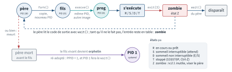
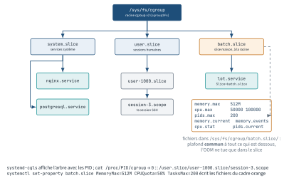
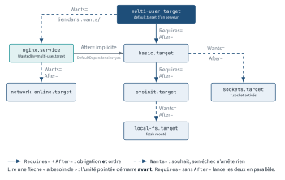

<!-- nav:début -->
[Accueil](../../README.md) › [Parcours](../../docs/parcours.md) › Partie II — Administration système › **Module 08**  
[← Module 07](../07-bash-scripting/README.md) · [Corrigé](corrige.md) · [Module 09 →](../09-noyau-demarrage/README.md)

<details><summary>Scripts du module (12)</summary>

Sur la VM indiquée en section « Mise en place », depuis `~/workbook/scripts/` (voir [chapitre 0](../../docs/00-mise-en-place.md)).

| Script | Rôle |
|---|---|
| [`setup_M08.sh`](../../scripts/setup/setup_M08.sh) | prépare le module |
| [`check_M08_01.sh`](../../scripts/check/check_M08_01.sh) | vérification |
| [`check_M08_02.sh`](../../scripts/check/check_M08_02.sh) | vérification |
| [`check_M08_03.sh`](../../scripts/check/check_M08_03.sh) | vérification |
| [`check_M08_04.sh`](../../scripts/check/check_M08_04.sh) | vérification |
| [`check_M08_05.sh`](../../scripts/check/check_M08_05.sh) | vérification |
| [`check_M08_06.sh`](../../scripts/check/check_M08_06.sh) | vérification |
| [`check_M08_07.sh`](../../scripts/check/check_M08_07.sh) | vérification |
| [`break_M08_01.sh`](../../scripts/break/break_M08_01.sh) | installe une panne |
| [`break_M08_02.sh`](../../scripts/break/break_M08_02.sh) | installe une panne |
| [`break_M08_03.sh`](../../scripts/break/break_M08_03.sh) | installe une panne |
| [`break_M08_04.sh`](../../scripts/break/break_M08_04.sh) | installe une panne |

</details>
<!-- nav:fin -->

# Module 08 — Processus, signaux et systemd

## 8.0 Objectifs et compétences

> [!NOTE]
> **Objectifs**
>
> À la fin de ce module, je sais :
>
> * décrire le cycle de vie d'un processus (`fork`/`exec`, PID/PPID, sortie et
>   récupération), reconnaître un orphelin, un zombie, un processus en `D`, et
>   dire dans chaque cas ce qu'il faut faire — y compris « rien » ;
> * extraire d'un système en production la bonne information avec `ps -o`,
>   `pstree`, `top`, `htop` et `/proc/PID`, et lire chaque colonne sans
>   approximation (`VSZ` contre `RSS`, `PR`/`NI`, `wa`, `st`) ;
> * arbitrer des ressources : `nice`/`renice`, `ionice`, et poser une limite
>   réelle avec cgroups v2 via une unité systemd ;
> * lire l'arbre des cgroups v2 (`systemd-cgls`, `systemd-cgtop`,
>   `/sys/fs/cgroup/<slice>/memory.current`, `cpu.stat`, `pids.current`,
>   `memory.events`), confiner une commande à la volée avec `systemd-run
>   --scope -p MemoryMax= -p CPUQuota=`, et regrouper des services dans un
>   slice dont l'OOM killer ne touche que le contenu ;
> * cibler des processus sans erreur : `pgrep -f`/`-u`/`-a`/`-x`, `pkill` plutôt
>   que `killall`, `top` interactif (`P`, `M`, `1`, `c`, `k`, `u`), `ps` trié
>   par `%cpu`, `%mem` ou `etimes`, `/proc/PID/status` (`VmRSS` contre
>   `VmSize`, `Threads`, `State`), et distinguer la consommation d'un processus
>   de celle de ses threads (`ps -L`, `top -H`) ;
> * choisir le bon signal, expliquer ce que fait un service correctement écrit à
>   la réception d'un `SIGTERM`, et justifier pourquoi un `kill -9` est un aveu
>   d'échec ;
> * maîtriser les jobs du shell (`&`, `Ctrl-Z`, `bg`, `fg`, `disown`, `nohup`,
>   `setsid`), expliquer pourquoi un processus meurt à la fermeture du SSH, et
>   lancer une opération longue qui survit — par `tmux` ou par `systemd-run` ;
> * diagnostiquer une limite de descripteurs (`ulimit -n`, `/proc/PID/limits`) et
>   savoir pourquoi `limits.conf` ne s'applique pas à un service ;
> * prouver qu'un OOM killer est passé et régler `oom_score_adj` / `MemoryMax` ;
> * écrire, activer et durcir une unité `.service` de zéro : bon `Type=`,
>   `Restart=`, `EnvironmentFile=`, `User=`, isolation (`ProtectSystem`,
>   `NoNewPrivileges`, `DynamicUser`…), et mesurer le résultat avec
>   `systemd-analyze security` ;
> * modifier une unité fournie par un paquet **sans y toucher**, par drop-in, et
>   énoncer la règle de précédence entre `/usr/lib` et `/etc` ;
> * dérouler une méthode de diagnostic complète sur un service qui refuse de
>   démarrer, et lire un `systemctl status` ligne par ligne.
>
> **Temps estimé** : 7 h
>
> **Prérequis** : modules 01 (shell, redirections), 03 (permissions, comptes de
> service). Les journaux sont vus en profondeur au module 16 : ici, `journalctl`
> sert uniquement à lire une erreur.

---

## 8.1 Mise en place

VM concernées : **`lab-web` (10.10.10.11)** pour tout le module,
**`lab-adm` (10.10.10.10)** pour les exercices SSH/tmux (E8.11 et L8.5), et
**`lab-rhel` (10.10.10.13)** pour une comparaison ponctuelle.

```bash
# depuis le shell Proxmox, avant de commencer
qm snapshot 9002 avant-lab08
```

Paquets nécessaires sur `lab-web` :

```bash
sudo apt update
sudo apt install -y htop tmux psmisc procps lsof python3 curl \
  sysstat iproute2
```

`psmisc` fournit `pstree`, `killall` et `fuser` ; `procps` fournit `ps`, `top`,
`pgrep`/`pkill`, `sysctl` ; `iproute2` fournit `ss`.

> [!IMPORTANT]
> **Variante Rocky / RHEL**
>
> Sous Rocky 9 : `sudo dnf install -y htop tmux psmisc procps-ng lsof python3
> curl sysstat iproute`. Attention à deux écarts qui reviennent dans le module :
> `systemd-oomd` n'y est pas activé par défaut ( sur Ubuntu 24.04, il l'est), et `systemd-analyze security`
> y affiche des scores légèrement différents parce que SELinux est comptabilisé
> (module 18).

Préparation du terrain (idempotent, à relancer sans crainte) :

```bash
sudo bash ~/workbook/scripts/setup/setup_M08.sh
```

Il installe une petite application à **servicifier** — c'est le fil rouge du
module :

| Chemin | Rôle |
|---|---|
| `/opt/factura/bin/factura-api.py` | serveur HTTP, port 8080, routes `/sante` et `/charge?n=N` |
| `/opt/factura/bin/factura-collecte.sh` | traitement ponctuel qui prend une mesure et sort |
| `/opt/factura/bin/factura-legacy.sh` | démon « à l'ancienne » qui se détache seul et écrit un PID |
| `/opt/factura/bin/factura-charge.sh` | occupe `n` cœurs jusqu'à `SIGTERM` |

Trois autres outils servent aux démonstrations : `factura-gourmand.py` (mange la
RAM), `factura-zombie.py` (fabrique un `Z`), et le fichier d'environnement
`/etc/factura/api.env`. Le compte de service `factura` est créé, sans shell.

Le script **ne crée aucune unité systemd** : les écrire est le travail du module.

> [!CAUTION]
> **Attention**
>
> Les labs de la partie B écrivent dans `/etc/systemd/system/`, activent des
> services au démarrage et masquent des unités. Prends le snapshot. Le Break & Fix
> BF8.3 laisse la machine dans un état où un service refuse de démarrer tant que
> tu n'as pas trouvé pourquoi.

---

## 8.2 Rappel express

### Cycle de vie et états

Un processus naît d'un `fork()` (copie du père, nouveau PID) suivi d'un
`execve()` (remplacement de l'image mémoire). Il meurt avec `exit(code)` ; son
père doit appeler `wait()` pour récupérer ce code. Entre les deux : zombie.

```text
père --fork()--> fils (copie)  --execve()--> autre programme
                    |
                  exit(3)  -->  ZOMBIE  --wait() du père-->  disparaît
                    |
       si le père meurt avant : ORPHELIN --> ré-adopté par PID 1
```

<p align="center"></p>

*Figure — Cycle de vie d'un processus : fork, exec, exit, zombie tant que le père n'a pas fait `wait()`, orphelin ré-adopté par PID 1.*

| État `ps` | Signification | Ce qu'on en fait |
|---|---|---|
| `R` | en cours ou prêt à tourner | normal |
| `S` | sommeil interruptible (attend un événement) | l'état de 95 % des processus |
| `D` | sommeil **non** interruptible (I/O noyau) | ne se tue pas, même en `-9` |
| `Z` | zombie : mort, code de retour non récupéré | tuer le **père**, pas le zombie |
| `T` | stoppé (`SIGSTOP`, `Ctrl-Z`) | `kill -CONT` pour reprendre |

Suffixes utiles : `<` nice négatif, `N` nice positif, `s` chef de session,
`l` multi-thread, `+` groupe de premier plan.

### Observer

```bash
ps aux                       # style BSD : USER PID %CPU %MEM VSZ RSS STAT
ps -ef                       # style UNIX : UID PID PPID C STIME TTY CMD
ps -eo pid,ppid,user,stat,ni,rss,etimes,args --sort=-rss | head
ps -o pid,ppid,stat,wchan:20,args -p 1234
pstree -paus 1234            # ascendance + PID + arguments
top -o %MEM  /  htop -F nginx
cat /proc/1234/{cmdline,environ} | tr '\0' '\n'
ls -l /proc/1234/{exe,cwd} ; ls /proc/1234/fd | wc -l
cat /proc/1234/limits ; cat /proc/1234/oom_score_adj
```

`ps -ef` liste tout, `ps aux` aussi ; la différence est le **format**, pas le
périmètre. `VSZ` = espace d'adressage réservé (mensonger), `RSS` = pages
réellement en RAM (mais comptées plusieurs fois si partagées).

```bash
ps -eo pid,user,pcpu,pmem,etimes,args --sort=-pcpu | head    # gros CPU
ps -eo pid,user,pcpu,pmem,etimes,args --sort=-pmem | head    # grosse RAM
ps -eo pid,etimes,args --sort=-etimes | head                 # plus anciens
ps -L -o pid,lwp,pcpu,stat,comm -p 1234      # une ligne par THREAD (LWP)
top -H -p 1234                               # threads dans top
grep -E '^(State|VmSize|VmRSS|Threads)' /proc/1234/status
```

`ps -o pcpu` est une moyenne **depuis le lancement** (temps CPU / `etimes`),
pas l'instantané de `top`. Le `%CPU` d'un processus est la **somme** de ses
threads : 380 % sur 4 vCPU = quatre threads à plein. `VmSize` = `VSZ`,
`VmRSS` = `RSS` ; `Threads` dit s'il y a lieu de regarder `-L`.

| `top` | Effet |
|---|---|
| `P` / `M` | trier par CPU / par mémoire (`T` : temps cumulé) |
| `1` | un compteur par cœur au lieu de la moyenne |
| `c` | ligne de commande complète au lieu du nom |
| `u` puis nom | ne montrer qu'un utilisateur |
| `H` | afficher les threads ; `k` : envoyer un signal ; `r` : renice |
| `E` / `e` | changer l'unité du résumé / de la liste (Kio → Mio → Gio) |

### Signaux

| Signal | N° | Attrapable | Usage |
|---|---|---|---|
| `SIGHUP` | 1 | oui | terminal fermé ; par convention : **recharge la conf** |
| `SIGINT` | 2 | oui | `Ctrl-C`, arrêt interactif |
| `SIGQUIT` | 3 | oui | `Ctrl-\`, arrêt + core dump |
| `SIGKILL` | 9 | **non** | exécution immédiate par le noyau, aucun ménage |
| `SIGTERM` | 15 | oui | demande polie d'arrêt — le défaut de `kill` |
| `SIGSTOP` | 19 | **non** | gèle le processus ; `SIGCONT` (18) le relance |
| `SIGTSTP` | 20 | oui | `Ctrl-Z` (version attrapable de `STOP`) |

```bash
kill -TERM 1234 ; kill -l              # jamais "kill -9" en premier réflexe
pgrep -a -f 'factura-api'              # chercher : -f = ligne complète
pgrep -u factura -a ; pgrep -x sshd    # par utilisateur ; nom exact
pkill -f 'factura-api' ; pkill -u factura -HUP -f 'factura-api'
killall factura-api.py                 # nom exact du binaire, pas un motif
kill %1                                # par numéro de job du shell
```

`killall` compare le **nom du processus** (`/proc/PID/comm`, 15 caractères
max) : un script lancé par `python3 script.py` s'appelle `python3`, et
`killall script.py` répond `no process found`. `pgrep`/`pkill` sans `-f`
ont la même limite, mais `-f` compare la ligne de commande entière, `-u`
borne à un utilisateur et `-a` affiche ce qu'on va toucher : `pgrep -a`
d'abord, `pkill` ensuite, `killall` jamais dans un script (sur d'autres
Unix, `killall` tue **tout**).

### Jobs et survie à la déconnexion

```bash
cmd &        jobs -l        fg %1        bg %1        Ctrl-Z
nohup cmd &          # ignore SIGHUP, stdout -> nohup.out
setsid cmd           # nouvelle session : plus de terminal de contrôle
disown -h %1         # retire le job de la liste des destinataires du HUP
tmux new -s migration ; Ctrl-b d ; tmux attach -t migration
systemd-run --unit=migration --property=Type=oneshot /chemin/script.sh
```

Fermer le SSH ferme le pseudo-terminal : le noyau envoie `SIGHUP` au chef de
session (ton shell), qui le relaie à tous ses jobs. D'où les trois parades.

### Priorités et limites

```bash
nice -n 10 cmd ; renice -n 5 -p 1234 ; renice -n 5 -u factura
ionice -c3 -p 1234                     # classe idle (si l'ordonnanceur suit)
ulimit -n ; ulimit -Hn ; ulimit -Sn 4096
systemd-cgls ; systemd-cgtop
```

Nice va de `-20` (prioritaire) à `19`. **Seul root peut descendre**, et on ne
remonte jamais un nice une fois baissé sans privilège.

### cgroups v2 en pratique

Un cgroup est un répertoire sous `/sys/fs/cgroup` ; systemd y range chaque
service (`.service`), chaque session (`.scope`) et chaque groupe (`.slice`).
Ubuntu 24.04 et Rocky 9 sont en v2 pur (`stat -fc %T /sys/fs/cgroup` →
`cgroup2fs`).

```text
/sys/fs/cgroup/
├── system.slice/            services : nginx.service, factura-api.service
├── factura.slice/           un slice maison (à la racine), ses limites
│   └── factura-api.service/     rattaché par Slice=factura.slice
├── user.slice/user-1000.slice/session-3.scope/   ta session SSH
└── machine.slice/           VM et conteneurs
```

<p align="center"></p>

*Figure — Hiérarchie cgroup v2 : un répertoire par unité, un plafond commun par slice.*

```bash
systemd-cgls                                  # l'arbre, avec les PID
systemd-cgls /system.slice/factura-api.service
systemd-cgtop -1 ; systemd-cgtop --order=memory   # top par cgroup
cat /proc/1234/cgroup                         # 0::/system.slice/…
C=/sys/fs/cgroup/system.slice/factura-api.service
cat $C/memory.current $C/memory.max $C/memory.peak
cat $C/cpu.stat            # usage_usec, nr_throttled, throttled_usec
cat $C/pids.current $C/pids.max
cat $C/memory.events       # low high max oom oom_kill
systemd-run --scope -p MemoryMax=200M -p MemorySwapMax=0 \
  -p CPUQuota=50% commande           # scope : reste dans ton terminal
systemd-run --unit=lot -p MemoryMax=200M --slice=factura.slice commande
systemctl set-property factura.slice MemoryMax=512M       # à chaud, persistant
systemctl set-property --runtime factura-api CPUQuota=25%  # jusqu'au reboot
systemctl show -p MemoryMax,CPUQuotaPerSecUSec,TasksMax factura-api
```

| Fichier | Lecture |
|---|---|
| `memory.current` / `memory.max` / `memory.peak` | usage, plafond (`max` = aucun), pic (noyau ≥ 5.19 : absent sur Rocky 9) |
| `memory.events` : `max`, `oom_kill` | fois où le plafond a été touché ; processus tués |
| `cpu.max` : `50000 100000` | 50 ms par période de 100 ms = un demi-cœur |
| `cpu.stat` : `nr_throttled` | le quota a bridé (la latence vient de là) |
| `pids.current` / `pids.max` | processus + threads, `fork: Resource temporarily unavailable` |

Un `.slice` regroupe des unités et leur impose un plafond **commun**
(`Slice=factura.slice` dans chaque service). Le tiret fait la hiérarchie :
`system-factura.slice` serait enfant de `system.slice`, `factura.slice` est
enfant de la racine : l'OOM killer déclenché dans un
slice ne tue **que** dedans, le reste de la machine ne voit rien. Un
`--scope` confine une commande lancée depuis ton shell sans la détacher ;
une unité transitoire (`--unit`) la détache et la journalise.

### systemd — l'essentiel

```bash
systemctl status nginx          # lecture ligne à ligne, voir 8.5
systemctl start|stop|restart|reload|reload-or-restart nginx
systemctl enable --now nginx    # lien dans multi-user.target.wants + start
systemctl disable --now nginx
systemctl mask nginx            # lien vers /dev/null : start IMPOSSIBLE
systemctl cat nginx             # unité réelle + TOUS les drop-ins appliqués
systemctl edit nginx            # crée .../nginx.service.d/override.conf
systemctl show -p Restart,LimitNOFILE nginx     # valeur effective
systemctl daemon-reload         # après toute écriture manuelle d'unité
systemctl list-units --type=service --state=failed
systemctl list-unit-files --state=masked
systemctl list-dependencies --reverse nginx.service
systemd-analyze verify /etc/systemd/system/factura-api.service
systemd-analyze security factura-api.service
systemd-analyze blame ; systemd-analyze critical-chain
```

| Directive | Effet |
|---|---|
| `Wants=` | démarre l'autre si possible ; son échec n'empêche rien |
| `Requires=` | l'autre doit démarrer, et son arrêt entraîne le nôtre |
| `BindsTo=` | comme `Requires` + suit toute disparition (matériel, montage) |
| `After=` / `Before=` | **ordre seulement**, aucune obligation de présence |

`Requires=` sans `After=` lance les deux **en parallèle** : c'est la panne la
plus fréquente des unités maison.

<p align="center"></p>

*Figure — Graphe de dépendances autour de `multi-user.target` : `Wants=` en pointillé, `Requires=`/`After=` en trait plein.*

| `Type=` | systemd considère le service démarré… |
|---|---|
| `simple` | dès le `fork()` — ne détecte même pas un binaire absent |
| `exec` | après un `execve()` réussi — préférer à `simple` |
| `forking` | quand le processus **initial** sort; `PIDFile=` très recommandé |
| `oneshot` | quand le processus a **fini** ; avec `RemainAfterExit=yes` |
| `notify` | quand l'application envoie `READY=1` (`sd_notify`) |

Codes de sortie systemd les plus utiles (`systemctl status`) :
`203/EXEC` binaire introuvable ou non exécutable, `200/CHDIR`
`WorkingDirectory=` inexistant, `217/USER` `User=` inconnu, `216/GROUP`,
`226/NAMESPACE` isolation impossible (conflit `ProtectSystem`/`ReadWritePaths`).

---

## 8.3 Quiz — QCM

<a id="q8-1"></a>**[Q8.1](corrige.md#q8-1)** — `ps aux` affiche sur `lab-web` :

```text
USER   PID %CPU %MEM    VSZ   RSS TTY  STAT START TIME COMMAND
root  2411  0.0  0.0      0     0 ?    Z    09:12 0:00 [factura-col] <defunct>
```

Quelle action fait disparaître cette entrée ?

a) `kill -9 2411`
b) `kill -CONT 2411`
c) faire en sorte que le père de 2411 appelle `wait()`, ou tuer ce père
d) `echo 3 > /proc/sys/vm/drop_caches`

<a id="q8-2"></a>**[Q8.2](corrige.md#q8-2)** — Un processus de sauvegarde est en état `D` depuis 20 minutes sur un
montage NFS injoignable. **Deux réponses correctes.**

a) `kill -9` ne le tuera pas tant que l'appel système n'est pas revenu
b) il compte dans la charge moyenne (`load average`) affichée par `uptime`
c) `renice -n 19` le débloquera en libérant du CPU
d) c'est un zombie : son père ne l'a pas récupéré

<a id="q8-3"></a>**[Q8.3](corrige.md#q8-3)** — Tu lances `./migration.sh &` dans une session SSH, puis tu fermes
la fenêtre du terminal. Que se passe-t-il par défaut sur Ubuntu 24.04 ?

a) rien, un job en arrière-plan est déjà détaché du terminal
b) le pseudo-terminal est fermé, `SIGHUP` part vers le chef de session, bash le
   relaie à ses jobs et le script meurt
c) le script est ré-adopté par systemd et continue
d) le script passe en état `T` et reprendra à la prochaine connexion

<a id="q8-4"></a>**[Q8.4](corrige.md#q8-4)** — Parmi ces commandes, lesquelles permettent au script de survivre à la
fermeture du SSH ? **Trois réponses correctes.**

a) `nohup ./migration.sh &`
b) `./migration.sh & disown -h %1`
c) `systemd-run --unit=migration /chemin/migration.sh`
d) `renice -n -5 -p $!`

<a id="q8-5"></a>**[Q8.5](corrige.md#q8-5)** — Une unité maison contient :

```ini
[Service]
Type=simple
ExecStart=/opt/factura/bin/factura-api.pyy
```

(noter la faute de frappe). Que montre `systemctl start factura-api` ?

a) la commande échoue immédiatement avec « Unit not found »
b) la commande **rend la main sans erreur**, et le service passe en `failed`
   juste après avec `status=203/EXEC`
c) systemd refuse de charger l'unité au `daemon-reload`
d) le service reste en `activating` pendant 90 s puis échoue en timeout

<a id="q8-6"></a>**[Q8.6](corrige.md#q8-6)** — Même unité, mais `Type=exec` au lieu de `Type=simple`. Qu'est-ce qui
change ?

a) rien, `exec` est un alias de `simple`
b) `systemctl start` échoue tout de suite en rapportant l'erreur `203/EXEC`
c) systemd attend la sortie du processus avant de rendre la main
d) systemd exige en plus un `PIDFile=`

<a id="q8-7"></a>**[Q8.7](corrige.md#q8-7)** — `factura-legacy.sh` se détache lui-même en tâche de fond et son
processus initial sort en 0. L'unité déclare `Type=simple`. Symptôme ?

a) le service part en timeout au bout de 90 s
b) systemd voit le processus principal sortir aussitôt, considère le service
   terminé et tue le reste du cgroup ; le démon ne survit pas
c) tout fonctionne, `Type=` n'a d'incidence que sur les journaux
d) `systemctl status` affiche `active (exited)` et le démon tourne

<a id="q8-8"></a>**[Q8.8](corrige.md#q8-8)** — Le service `factura-api` tourne déjà. Tu viens de modifier son `ExecStart=` dans `/etc/systemd/system/factura-api.service` 
avec `vim`, puis tu tapes `systemctl restart factura-api` : l'ancienne commande est relancée. Que manque-t-il ?

a) rien
b) `systemctl daemon-reload`
c) `systemctl enable factura-api`
d) `systemctl reset-failed`

<a id="q8-9"></a>**[Q8.9](corrige.md#q8-9)** — Tu modifies une unité avec `systemctl edit factura-api`. Après avoir
enregistré, faut-il lancer `systemctl daemon-reload` ?

a) oui, toujours
b) non : `systemctl edit` recharge la configuration tout seul ; en revanche il
   faut redémarrer le service pour que la nouvelle valeur s'applique
c) non, et le service est redémarré automatiquement
d) seulement si on a utilisé `--full`

<a id="q8-10"></a>**[Q8.10](corrige.md#q8-10)** — Différence entre `systemctl disable nginx` et `systemctl mask nginx` ?

a) aucune, `mask` est un alias moderne
b) `disable` retire le lien d'activation au démarrage ; `mask` pointe l'unité
   vers `/dev/null`, ce qui rend tout démarrage impossible, y compris manuel et
   y compris par dépendance d'un autre service
c) `mask` supprime le fichier d'unité livré par le paquet
d) `disable` arrête le service en cours, `mask` non

<a id="q8-11"></a>**[Q8.11](corrige.md#q8-11)** — Un drop-in `/etc/systemd/system/factura-api.service.d/10-port.conf`
contient uniquement :

```ini
[Service]
ExecStart=/opt/factura/bin/factura-api.py --port 9090
```

L'unité de base a déjà un `ExecStart=`. Que se passe-t-il ?

a) le nouveau `ExecStart=` remplace l'ancien
b) le service échoue : `Service has more than one ExecStart= setting`, parce
   que `ExecStart=` est une directive de type liste ; il faut la vider d'abord
   avec une ligne `ExecStart=` seule
c) les deux commandes sont lancées, dans l'ordre
d) les drop-ins ne peuvent pas contenir de `ExecStart=`

<a id="q8-12"></a>**[Q8.12](corrige.md#q8-12)** — Une application Java tombe à 1024 descripteurs ouverts alors que
`/etc/security/limits.conf` contient `* - nofile 65536`. Pourquoi ?

a) `limits.conf` exige un redémarrage complet de la machine
b) `limits.conf` est appliqué par `pam_limits` aux **sessions** (login, SSH,
   `su`) ; un service lancé par systemd n'ouvre pas de session PAM et hérite du
   `DefaultLimitNOFILE` de systemd — il faut `LimitNOFILE=` dans l'unité
c) la limite `nofile` est plafonnée à 1024 par le noyau
d) il faut écrire `* hard nofile 65536` et rien d'autre

<a id="q8-13"></a>**[Q8.13](corrige.md#q8-13)** — Une unité déclare `Restart=always`, `RestartSec=1s`, et son
`EnvironmentFile=` pointe vers un fichier supprimé. Que montre `systemctl status`
au bout d'une minute ?

a) le service boucle indéfiniment, une fois par seconde
b) le service est `failed` avec `Result: start-limit-hit` : après 5 tentatives
   en 10 s, systemd refuse de le relancer ; il faut `systemctl reset-failed`
c) systemd désactive l'unité définitivement
d) le service reste `activating (auto-restart)` sans jamais s'arrêter

<a id="q8-14"></a>**[Q8.14](corrige.md#q8-14)** — Tu exécutes `systemctl status factura-collecte` sur un service
`Type=oneshot` avec `RemainAfterExit=yes` dont le traitement s'est bien terminé.
Qu'affiche la ligne `Active:` ?

a) `active (running)`
b) `active (exited)`
c) `inactive (dead)`
d) `failed (exited)`

<a id="q8-15"></a>**[Q8.15](corrige.md#q8-15)** — Sur `lab-web`, `systemctl status rsyslog` affiche :

```text
Loaded: loaded (/usr/lib/systemd/system/rsyslog.service; disabled;
                preset: enabled)
Active: active (running) since Fri 2026-09-18 09:02:11 CEST; 2h 4min ago
```

Que peut-on en conclure ? **Deux réponses correctes.**

a) le service tourne actuellement
b) il ne redémarrera pas au prochain boot
c) l'unité est masquée
d) l'unité a été écrite à la main dans `/etc/systemd/system`

<a id="q8-16"></a>**[Q8.16](corrige.md#q8-16)** — Une unité contient `Requires=postgresql.service` mais aucun
`After=`. Quel est le comportement au démarrage ?

a) systemd ordonne automatiquement : PostgreSQL d'abord
b) les deux unités sont lancées **en parallèle** ; le service peut donc démarrer
   avant que la base n'accepte les connexions
c) systemd refuse de charger l'unité
d) `Requires=` implique `After=` depuis systemd 250

<a id="q8-17"></a>**[Q8.17](corrige.md#q8-17)** — Tu ajoutes `ProtectSystem=strict` à `factura-api.service`. Le service
démarre puis s'arrête avec une erreur d'écriture sur `/var/log/factura/api.log`.
Quelles corrections sont valables ? **Deux réponses correctes.**

a) `ReadWritePaths=/var/log/factura`
b) `LogsDirectory=factura`, qui crée `/var/log/factura` et l'ouvre en écriture
c) `ProtectHome=no`
d) `PrivateTmp=no`

<a id="q8-18"></a>**[Q8.18](corrige.md#q8-18)** — Le journal du noyau contient :

```text
Out of memory: Killed process 3412 (python3) total-vm:2489312kB,
anon-rss:2101248kB, file-rss:0kB, shmem-rss:0kB, UID:998 pgtables:4212kB
```

Quelle affirmation est exacte ?

a) le processus a reçu un `SIGTERM` et a pu fermer proprement ses fichiers
b) le noyau a envoyé un `SIGKILL` : aucun code de nettoyage n'a tourné, et
   `oom_score_adj` permet d'influencer le choix de la prochaine victime
c) c'est systemd qui a tué le processus à cause de `MemoryMax=`
d) le processus est passé en `Z` faute de mémoire pour le récupérer

<a id="q8-19"></a>**[Q8.19](corrige.md#q8-19)** — `factura-api.py` tourne, lancé par `python3
/opt/factura/bin/factura-api.py`. Tu tapes `killall factura-api.py` et
obtiens `factura-api.py: no process found`. Pourquoi, et quelle commande
fait le travail ? **Deux réponses correctes.**

a) `killall` n'a pas les droits : il faut `sudo`
b) `killall` compare le nom du processus (`/proc/PID/comm`), qui vaut ici
   `python3` ; le nom du script n'est qu'un argument
c) `pkill -f factura-api.py` cible la ligne de commande complète, et
   `pgrep -a -f factura-api.py` montre avant ce qui sera touché
d) `killall python3` est la bonne réponse : il ne tuera que ce script

<a id="q8-20"></a>**[Q8.20](corrige.md#q8-20)** — `systemctl status factura-lots` affiche `Result: oom-kill` et
`/sys/fs/cgroup/batch.slice/memory.events` contient `oom_kill 3`.
`free -m` montre 1,4 Go de disponible et `dmesg` ne contient **aucune**
ligne `Out of memory: Killed process` mais trois lignes `Memory cgroup out
of memory`. Que s'est-il passé ?

a) la machine a manqué de mémoire trois fois ; il faut ajouter du swap
b) le slice `batch.slice` a atteint son `MemoryMax=` : l'OOM killer a
   frappé **dans ce cgroup uniquement**, trois fois, sans que le reste de
   la machine soit concerné — c'est exactement le rôle du slice
c) `systemd-oomd` a tué le service à cause de la pression mémoire globale
d) le service a fait `exit(137)` de lui-même

<a id="q8-21"></a>**[Q8.21](corrige.md#q8-21)** — `factura-charge.sh 2` (deux processus qui brûlent chacun un
cœur) est lancé par `systemd-run - -scope -p CPUQuota=50%`. `lab-web` a deux
vCPU. Que montre `top` et pourquoi ?

a) chaque processus à 50 % : le quota s'applique par processus
b) les deux à 100 % : `CPUQuota` ne s'applique qu'aux services, pas aux
   scopes
c) environ 25 % chacun, 50 % au total : `CPUQuota=50%` = `cpu.max 50000
   100000` = un demi-cœur pour **tout le cgroup**, réparti entre ses
   processus ; `cpu.stat` montre `nr_throttled` qui grimpe
d) les deux à 100 % pendant 50 % du temps, puis rien : le quota est temporel

---

## 8.4 Quiz — questions ouvertes

<a id="qo8-1"></a>**[QO8.1](corrige.md#qo8-1)** — Décris précisément la naissance et la mort d'un processus sous Linux :
qui appelle `fork()`, qui appelle `execve()`, ce que devient le code de retour,
et ce qu'est exactement une entrée `<defunct>`. Explique ensuite pourquoi un
zombie ne consomme presque aucune ressource mais reste un vrai problème.

<a id="qo8-2"></a>**[QO8.2](corrige.md#qo8-2)** — *On te demande en entretien* : « Un service ne répond plus. Tu tapes
`kill -9`. Pourquoi mon collègue senior fait-il la grimace ? » Réponds en
expliquant ce que `SIGTERM` déclenche dans une application correctement écrite,
ce que `SIGKILL` empêche, et ce que systemd fait exactement quand tu tapes
`systemctl stop`.

<a id="qo8-3"></a>**[QO8.3](corrige.md#qo8-3)** — *On te demande en entretien* : « Explique-moi la différence entre
`Wants=`, `Requires=`, `BindsTo=` et `After=`. Donne-moi un cas réel où le choix
change le comportement en production. »

<a id="qo8-4"></a>**[QO8.4](corrige.md#qo8-4)** — Un collègue a écrit une unité pour un démon qui se détache tout seul
en tâche de fond. Il a mis `Type=simple`. Explique ce qui se passera, puis donne
la matrice de décision complète : pour chacun des cinq `Type=`, quel type
d'application, et comment systemd sait que le démarrage est terminé.

<a id="qo8-5"></a>**[QO8.5](corrige.md#qo8-5)** — Décris ta méthode complète de diagnostic d'un service qui refuse de
démarrer, dans l'ordre, avec pour chaque étape la commande et **ce que tu
cherches dans la sortie**. Ta méthode doit couvrir au moins : unité introuvable,
unité masquée, binaire absent, `User=` inexistant, `EnvironmentFile=` manquant,
port déjà pris, isolation trop stricte.

<a id="qo8-6"></a>**[QO8.6](corrige.md#qo8-6)** — Compare les trois façons de faire survivre une opération longue à la
fermeture d'une session SSH : `nohup`/`disown`, `tmux`, `systemd-run`. Pour
chacune : ce qui survit exactement, où partent les sorties, si on peut
« revenir dedans », et dans quel cas d'exploitation tu la choisis.

<a id="qo8-7"></a>**[QO8.7](corrige.md#qo8-7)** — Une application tombe à 1024 descripteurs ouverts. Déroule ton
diagnostic : comment tu confirmes la limite effective du processus en cours,
comment tu vois combien il en consomme, et où tu poses la nouvelle limite selon
que l'application est lancée par SSH, par cron ou par systemd. Explique pourquoi
`ulimit -n 65536` tapé dans ton shell ne change rien au service.

<a id="qo8-8"></a>**[QO8.8](corrige.md#qo8-8)** — Explique ce que protège concrètement chacune de ces directives, et
donne pour chacune un exemple d'attaque ou d'incident qu'elle empêche :
`NoNewPrivileges`, `ProtectSystem=strict`, `PrivateTmp`, `DynamicUser`,
`CapabilityBoundingSet=`. Dis ensuite ce que mesure `systemd-analyze security` et
pourquoi le score seul ne suffit pas.

<a id="qo8-9"></a>**[QO8.9](corrige.md#qo8-9)** — Un service met 45 secondes à s'arrêter à chaque `systemctl restart`,
et le boot de la machine est passé de 12 à 70 secondes. Explique le lien possible
entre les deux, les directives en cause, et la démarche pour trancher (quelles
commandes, quelles valeurs par défaut).

<a id="qo8-10"></a>**[QO8.10](corrige.md#qo8-10)** — *On te demande en entretien* : « Un traitement batch met la
machine à genoux chaque nuit et emporte l'API avec lui. Comment tu le
contiens sans le mettre dans un conteneur ? » Décris la solution avec les
cgroups v2 de systemd : slice ou scope ou unité transitoire (et quand
choisir l'un ou l'autre), les directives à poser (mémoire, swap, CPU,
tâches), les fichiers de `/sys/fs/cgroup` que tu lis pour prouver que la
limite agit, ce que fait l'OOM killer d'un cgroup par rapport à l'OOM killer
global, et où tu retrouves la trace. Termine par le rôle de `systemd-oomd`
sur Ubuntu 24.04 et ce qu'il change à ton diagnostic.

---

## 8.5 Exercices guidés ★

<a id="e8-1"></a>**[E8.1](corrige.md#e8-1)** — Affiche les 10 processus les plus gourmands en mémoire **résidente**
de `lab-web`, avec PID, PPID, utilisateur, état, nice, RSS en Ko et ligne de
commande complète, triés du plus gros au plus petit. Une seule commande, sans
`sort` externe.

<a id="e8-2"></a>**[E8.2](corrige.md#e8-2)** — Trouve le PID du processus qui écoute sur le port 8080, puis affiche,
uniquement à partir de `/proc` : sa ligne de commande complète lisible, son
répertoire courant, le binaire réellement exécuté, et son nombre de descripteurs
ouverts.

<a id="e8-3"></a>**[E8.3](corrige.md#e8-3)** — Affiche l'ascendance complète du processus `sshd` qui porte ta
session, depuis le PID 1, avec les PID et les arguments. Puis explique en une
ligne ce que l'arbre te dit sur l'utilisateur qui a lancé ta session.

<a id="e8-4"></a>**[E8.4](corrige.md#e8-4)** — Compte les processus de la machine **par état** (`R`, `S`, `D`, `Z`,
`T`…), et affiche le résultat trié par nombre décroissant.

<a id="e8-5"></a>**[E8.5](corrige.md#e8-5)** — Fabrique un zombie avec `/opt/factura/bin/factura-zombie.py 120`,
prouve qu'il est en état `Z`, montre que `kill -9` ne le fait pas disparaître,
puis fais-le disparaître pour de bon. Explique en une ligne ce qui s'est passé.

<a id="e8-6"></a>**[E8.6](corrige.md#e8-6)** — Lance `/opt/factura/bin/factura-charge.sh 2`, repère les deux
processus qui brûlent du CPU, abaisse leur priorité à `nice 15` **sans les
relancer**, et vérifie le changement dans `top` (quelle colonne ?). Puis essaie
de revenir à `nice 0` en tant que `mathieu` et explique le refus.

<a id="e8-7"></a>**[E8.7](corrige.md#e8-7)** — Mets le même processus de charge en classe d'E/S « idle » et vérifie
la classe appliquée. Indique ensuite quel ordonnanceur de bloc est actif sur
`/dev/sda` et ce que ça change pour `ionice`.

<a id="e8-8"></a>**[E8.8](corrige.md#e8-8)** — Démarre `factura-api.py` à la main sur le port 8080, envoie-lui
successivement un `SIGHUP` puis un `SIGTERM`, et montre dans
`/var/log/factura/api.log` la trace laissée par chacun. Recommence en lançant
l'application avec `FACTURA_SOURD=1` et explique ce qui change.

<a id="e8-9"></a>**[E8.9](corrige.md#e8-9)** — Sans connaître le PID, envoie un `SIGHUP` à tous les processus dont la
ligne de commande contient `factura-api`, mais **uniquement** ceux appartenant à
l'utilisateur `factura`. Donne aussi la commande qui te montre ce que tu vas
tuer avant de le faire.

<a id="e8-10"></a>**[E8.10](corrige.md#e8-10)** — Lance `sleep 600` au premier plan, suspends-le, remets-le en arrière-
plan, liste les jobs avec leur PID, puis ramène-le au premier plan et termine-le
par son numéro de job. Enfin, relance-le et détache-le complètement du shell de
façon qu'il survive à un `exit`.

<a id="e8-11"></a>**[E8.11](corrige.md#e8-11)** — Depuis `lab-adm`, ouvre une session SSH sur `lab-web`, démarre dans
`tmux` une session nommée `migration` qui exécute
`/opt/factura/bin/factura-charge.sh 1`, détache-toi, coupe la session SSH,
reconnecte-toi et reprends la main sur le processus. Vérifie son PPID avant et
après.

<a id="e8-12"></a>**[E8.12](corrige.md#e8-12)** — Affiche la limite de descripteurs **effective** du processus
`factura-api` en cours d'exécution (souple et stricte), puis compare-la à ce que
donne `ulimit -n` dans ton shell. Compte les descripteurs réellement ouverts par
ce processus.

<a id="e8-13"></a>**[E8.13](corrige.md#e8-13)** — Rends `factura-gourmand.py` prioritaire pour l'OOM killer (il doit
être tué en premier), vérifie la valeur appliquée, puis montre la commande qui
prouve après coup qu'un OOM killer est passé sur la machine.

<a id="e8-14"></a>**[E8.14](corrige.md#e8-14)** — Liste toutes les unités `.service` en échec, puis toutes les unités
masquées de la machine, puis les unités activées au démarrage dont le nom
contient `ssh`. Trois commandes distinctes.

<a id="e8-15"></a>**[E8.15](corrige.md#e8-15)** — Sans ouvrir de fichier avec un éditeur, affiche la définition
complète et réellement appliquée de `ssh.service` (drop-ins compris), puis la
valeur effective de `Restart=`, `RestartSec=` et `LimitNOFILE=` pour cette unité.

<a id="e8-16"></a>**[E8.16](corrige.md#e8-16)** — Affiche tout ce qui dépend de `network-online.target`, puis tout ce
dont `ssh.service` dépend, en te limitant au premier niveau. Enfin, montre les
10 unités les plus lentes au dernier démarrage et la chaîne critique du boot.

<a id="e8-17"></a>**[E8.17](corrige.md#e8-17)** — Lance `factura-api.py` à la main (`python3
/opt/factura/bin/factura-api.py &`). Montre que `killall factura-api.py`
échoue et explique-le en lisant `/proc/PID/comm` et `/proc/PID/cmdline`.
Donne ensuite, en une commande chacune : la liste (PID + commande) de tous
les processus dont la ligne de commande contient `factura`, ceux qui
appartiennent à l'utilisateur `factura`, le processus dont le nom est
**exactement** `sshd`, et le plus ancien processus contenant `factura`. Puis
arrête l'API par `pkill` en vérifiant **avant** ce que tu vas tuer.

<a id="e8-18"></a>**[E8.18](corrige.md#e8-18)** — Lance `/opt/factura/bin/factura-charge.sh 2` et
`/opt/factura/bin/factura-gourmand.py 20 2` (arrête ce dernier avant
600 Mo). Dans `top` interactif, et sans quitter : trie par CPU puis par
mémoire, affiche un compteur par cœur, la ligne de commande complète, ne
montre que les processus de `mathieu`, puis envoie `SIGTERM` au gourmand
depuis `top`. Reproduis chacune des trois vues (CPU, mémoire, ancienneté)
avec une commande `ps` non interactive, avec les colonnes `pid`, `user`,
`%cpu`, `%mem`, `etimes` et `args`. Explique pourquoi `%cpu` de `ps` et
`%CPU` de `top` ne donnent pas la même valeur pour la charge.

<a id="e8-19"></a>**[E8.19](corrige.md#e8-19)** — Relance `factura-gourmand.py 20 2`. Dans `/proc/PID/status`,
relève `State`, `VmSize`, `VmRSS` et `Threads`, puis observe `VmRSS` toutes
les deux secondes pendant dix secondes et explique l'écart avec `VmSize`.
Lance ensuite un processus à trois threads occupés :

```bash
python3 -c 'import threading
def b():
    while True: pass
for _ in range(3): threading.Thread(target=b).start()' &
```

et montre : le nombre de threads dans `status`, la vue par thread avec
`ps -L` et avec `top -H`, le `%CPU` total du processus et celui de chaque
thread. Explique pourquoi le total ne dépasse pas 100 % alors qu'il y a
trois threads et deux vCPU.

<a id="e8-20"></a>**[E8.20](corrige.md#e8-20)** — Exécute `factura-gourmand.py 50 0.5` dans un **scope** limité à
200 Mo sans swap et à un demi-cœur. Pendant qu'il tourne, retrouve son
cgroup avec `systemd-cgls`, observe-le dans `systemd-cgtop`, lis
`memory.current`, `pids.current` et `cpu.stat` dans le répertoire du cgroup,
puis prouve après sa mort : `oom_kill 1` dans `memory.events` (attention :
le scope disparaît, réfléchis à quand lire le fichier), la ligne du noyau,
et l'état de l'unité `.scope` dans `systemctl`. Compare avec l'équivalent
en unité transitoire (`--unit`) : où partent les sorties, où va la trace.

<a id="e8-21"></a>**[E8.21](corrige.md#e8-21)** — Crée un slice `factura.slice` avec `MemoryMax=300M`,
`MemorySwapMax=0`, `CPUQuota=100%` et `TasksMax=64`. Lance dedans deux
unités transitoires : `factura-charge.sh 2` et `factura-api.py` (port 8080
libre). Montre dans `systemd-cgls` la hiérarchie obtenue, la somme CPU des
deux unités dans `systemd-cgtop`, et les fichiers `cpu.max`, `memory.max`,
`pids.max` **du slice** et **d'une unité** (qui hérite quoi ?). Abaisse à
chaud `CPUQuota` du slice à 50 % sans redémarrer quoi que ce soit, prouve
l'effet dans `top`, puis montre où systemd a écrit la modification et
comment la rendre temporaire.

---

## 8.6 Labs ★★

### <a id="l8-1"></a>**[L8.1](corrige.md#l8-1)** — Ticket INC-3187 : « lab-web rame, personne ne sait pourquoi »

> **Contexte**
>
> Le support remonte que l'API met plusieurs secondes à répondre depuis ce matin.
> Le monitoring n'est pas encore branché sur cette VM (module 16). On te demande un
> diagnostic de premier niveau et une mesure de mitigation immédiate, sans
> redémarrer quoi que ce soit.

Prépare le terrain :

```bash
/opt/factura/bin/factura-charge.sh 2 &
nohup /opt/factura/bin/factura-gourmand.py 60 1 >/tmp/gourmand.log 2>&1 &
```

1. Relève la charge moyenne sur 1, 5 et 15 minutes et le nombre de cœurs de la
   VM. Dis si la charge est « haute » et justifie par rapport au nombre de cœurs.
2. Dans `top`, identifie séparément : le temps CPU utilisateur, système, `wa`
   (attente d'E/S) et `st` (vol par l'hyperviseur). Note lequel domine.
3. Classe les processus par consommation CPU puis par RSS. Distingue ce qui
   consomme du CPU de ce qui consomme de la mémoire — ce n'est pas le même
   coupable.
4. Explique l'écart entre `VSZ` et `RSS` pour `factura-gourmand.py`, chiffres à
   l'appui.
5. Mitige **sans tuer** : abaisse la priorité CPU des processus de charge, et
   place le processus gourmand en tête de liste de l'OOM killer.
6. Compte les processus par état. S'il y a un `D`, dis ce que tu regarderais
   ensuite (deux commandes suffisent).
7. Rédige `~/lab08/rapports/inc-3187.md` : symptôme, mesures relevées avec les
   commandes, coupables identifiés, mitigation appliquée, action de fond
   recommandée (au moins une limite systemd chiffrée).

> [!TIP]
> **Critère de succès**
>
> Critère de succès : les processus de charge tournent avec un nice strictement
> positif, `factura-gourmand.py` a un `oom_score_adj` supérieur à 500, et le
> rapport existe avec au moins 12 lignes.
>
> ```bash
> bash check_M08_01.sh
> ```

---

### <a id="l8-2"></a>**[L8.2](corrige.md#l8-2)** — Servicifier `factura-api`

> **Contexte**
>
> L'API tourne aujourd'hui dans un `tmux` lancé à la main par un développeur.
> Elle disparaît à chaque redémarrage de la VM et personne ne sait la relancer.
> On te demande d'en faire un vrai service systemd, propre, redémarrable et activé
> au boot.

Écris `/etc/systemd/system/factura-api.service` en respectant ce cahier des
charges. Garde une copie de travail dans `~/lab08/units/`.

1. Description parlante, et démarrage **après** que le réseau soit réellement
   configuré.
2. Le service tourne sous le compte `factura` (créé par le setup), groupe
   `factura`, répertoire de travail `/srv/factura`.
3. La configuration vient de `/etc/factura/api.env` — pas de valeur codée en dur
   dans l'unité.
4. Choisis un `Type=` qui **détecte une erreur de chemin sur le binaire** (teste
   ton choix en introduisant volontairement une faute de frappe, puis corrige).
5. `systemctl reload factura-api` doit recharger la configuration de
   l'application sans couper les connexions. L'application réagit à `SIGHUP`.
6. Redémarrage automatique en cas de sortie anormale, avec 5 s d'attente, mais
   **pas** en cas d'arrêt volontaire.
7. Un arrêt laisse au plus 20 s à l'application pour terminer proprement.
8. Le service démarre au boot.

Vérifications à mener toi-même :

* `systemctl is-enabled factura-api` répond `enabled` ;
* `curl -s http://127.0.0.1:8080/sante` répond ;
* `systemctl reload factura-api` laisse une trace dans
  `/var/log/factura/api.log` **sans** changer le PID principal ;
* `systemctl stop factura-api` produit une ligne « arret propre » dans le même
  journal.

> [!TIP]
> **Astuce**
>
> `systemd-analyze verify /etc/systemd/system/factura-api.service` relit ton unité
> et signale les directives inconnues ou mal orthographiées **avant** le premier
> démarrage. Prends l'habitude : une directive mal écrite est ignorée en silence
> par systemd, pas refusée.

> [!TIP]
> **Critère de succès**
>
> Critère de succès : le service est `active (running)`, activé au boot, tourne
> sous l'utilisateur `factura`, répond sur 8080, et `systemctl show` confirme
> `Restart=on-failure` et `TimeoutStopUSec=20s`.
>
> ```bash
> bash check_M08_02.sh
> ```

---

### <a id="l8-3"></a>**[L8.3](corrige.md#l8-3)** — Choisir le bon `Type=` : trois services, trois réponses

> **Contexte**
>
> Trois traitements de la même application doivent devenir des services. Ils n'ont
> rien à voir entre eux : un traitement ponctuel, un démon qui se détache seul, et
> l'API. Le développeur a proposé `Type=simple` pour les trois. On te demande de
> trancher et de **prouver** ton choix.

1. `factura-collecte.service` : lance
   `/opt/factura/bin/factura-collecte.sh`, qui prend une mesure puis **sort**.
   L'état du service doit rester visible comme « fait » après l'exécution, et
   `systemctl status` ne doit pas le montrer en échec. Le traitement ne doit pas
   démarrer si `/srv/factura/data` n'existe pas — utilise une directive dédiée,
   pas un test dans le script.
2. `factura-legacy.service` : lance `/opt/factura/bin/factura-legacy.sh`, qui se
   détache lui-même et écrit son PID dans `/run/factura/legacy.pid`. Le
   répertoire `/run/factura` doit être créé par systemd, pas par le script, et
   disparaître à l'arrêt du service.
3. Pour chacun des deux, commence **volontairement** par `Type=simple`, note le
   symptôme exact observé (`systemctl status` et `ps`), puis corrige. Consigne
   les deux symptômes.
4. Sur `factura-api.service`, teste `Type=notify` : l'application implémente déjà
   `sd_notify`. Démontre la différence avec `Type=exec` en ajoutant
   temporairement `FACTURA_DELAI_PRET=10` dans `/etc/factura/api.env` et en
   chronométrant `systemctl start`. Explique ce que ça change pour une unité
   tierce qui déclarerait `After=factura-api.service`.
5. Écris `~/lab08/rapports/types.md` : un tableau à trois colonnes
   (service, `Type=` retenu, preuve observée).

> [!TIP]
> **Critère de succès**
>
> Critère de succès : `factura-collecte` est `active (exited)`, `factura-legacy`
> est `active (running)` avec un PID principal égal au contenu de
> `/run/factura/legacy.pid`, et le rapport existe.
>
> ```bash
> bash check_M08_03.sh
> ```

---

### <a id="l8-4"></a>**[L8.4](corrige.md#l8-4)** — Durcir l'unité et modifier un paquet sans y toucher

> **Contexte**
>
> L'audit sécurité a rendu son rapport : « le service `factura-api` tourne avec un
> accès complet au système de fichiers ». Par ailleurs, l'équipe a besoin de monter
> la limite de descripteurs de `ssh.service` — sans modifier le fichier livré par
> le paquet, qui sera écrasé à la prochaine mise à jour.

Partie 1 — durcissement de `factura-api.service` :

1. Relève le score de départ : `systemd-analyze security factura-api.service`.
   Note-le.
2. Durcis l'unité pour atteindre un score **inférieur à 3.0**, en couvrant au
   minimum : pas d'élévation de privilèges possible, système de fichiers en
   lecture seule, `/home` et `/root` inaccessibles, `/tmp` privé, aucune
   capability conservée, familles de sockets restreintes aux familles réellement
   utilisées.
3. Le service doit **continuer à fonctionner** : il écrit dans
   `/var/log/factura/` et dans `/srv/factura/data`. Trouve la bonne façon de
   rouvrir ces deux chemins — l'une des deux se fait par une directive qui crée
   le répertoire elle-même.
4. Ajoute des limites de ressources chiffrées : 65 536 descripteurs, 256 Mo de
   mémoire maximum, 50 % d'un cœur, 64 tâches maximum. Vérifie que les valeurs
   sont bien appliquées côté cgroup.
5. Prouve le durcissement : montre que le service ne peut plus écrire dans
   `/etc` et que son `/tmp` n'est pas le tien.
6. Teste une variante avec `DynamicUser=yes` dans
   `~/lab08/units/factura-api-dyn.service` (sans l'activer) et note en deux
   lignes ce que ça implique pour les fichiers déjà possédés par `factura`.

Partie 2 — override d'une unité de paquet :

7. Sans éditer `/usr/lib/systemd/system/ssh.service`, porte `LimitNOFILE` à
   16384 pour `ssh.service` et ajoute une description personnalisée.
8. Montre le chemin exact du fichier créé, puis la définition complète réellement
   appliquée (unité de base **plus** drop-ins).
9. Explique par écrit, dans `~/lab08/rapports/override.md`, la règle de
   précédence entre `/usr/lib/systemd/system`, `/run/systemd/system` et
   `/etc/systemd/system`, et la différence entre `systemctl edit` et
   `systemctl edit --full`.
10. Annule proprement l'override et prouve que la valeur d'origine est revenue.

> [!CAUTION]
> **Attention**
>
> L'étape 7 touche à `ssh.service`. Garde une seconde session SSH ouverte pendant
> toute la manipulation, et ne fais **jamais** un `systemctl restart ssh` sans
> avoir validé la configuration : une erreur t'enferme dehors.

> [!TIP]
> **Critère de succès**
>
> Critère de succès : score `systemd-analyze security` inférieur à 3.0, service
> toujours fonctionnel sur 8080, `MemoryMax` et `LimitNOFILE` effectifs, drop-in
> `ssh.service` présent puis retiré, rapport rédigé.
>
> ```bash
> bash check_M08_04.sh
> ```

---

### <a id="l8-5"></a>**[L8.5](corrige.md#l8-5)** — Une migration de 40 minutes en SSH depuis un train

> **Contexte**
>
> Tu dois lancer sur `lab-web` une migration de données qui dure environ 40
> minutes. Tu es en 4G, la connexion tombe toutes les dix minutes. Le script
> n'est pas idempotent : s'il est interrompu au milieu, il faut tout reprendre.
> On te demande de le lancer de trois façons différentes, de les comparer, et de
> retenir la bonne.

Le « script de migration » sera `/opt/factura/bin/factura-charge.sh 1`, que tu
laisseras tourner quelques minutes.

1. Lance-le d'abord naïvement avec `&` depuis `lab-adm` via SSH. Relève son PID
   et son PPID. Coupe brutalement la session (`pkill -f 'ssh mathieu@10.10.10.11'`
   depuis un autre terminal de `lab-adm`, ou ferme la fenêtre). Reconnecte-toi :
   le processus a-t-il survécu ? Explique le mécanisme exact, en nommant le
   signal et son destinataire.
2. Recommence avec `nohup ... &`. Vérifie la survie, note le nouveau PPID, et dis
   où sont passées les sorties standard et d'erreur.
3. Recommence dans `tmux`, session nommée `migration`. Détache-toi, coupe le SSH,
   reconnecte-toi, reprends la main, et montre la sortie du script en direct.
4. Recommence avec `systemd-run`, en unité transitoire nommée `migration`.
   Montre : son état avec `systemctl status`, son cgroup, et comment la
   supprimer une fois finie.
5. Pour chacune des quatre méthodes, remplis un tableau à quatre colonnes :
   survit au `SIGHUP` ? sorties visibles où ? peut-on reprendre la main ?
   que voit-on depuis un autre compte ? Écris-le dans
   `~/lab08/rapports/operations-longues.md`.
6. Conclusion argumentée : laquelle retiens-tu pour une migration de production
   qui doit laisser une trace auditable, et pourquoi.

> [!TIP]
> **Astuce**
>
> Pour l'étape 4, `systemd-run --unit=migration --property=CPUQuota=50% ...` crée
> une unité transitoire : elle apparaît dans `systemctl list-units`, ses sorties
> partent au journal, elle a son propre cgroup, et elle disparaît toute seule.
> C'est le moyen le plus proche d'un « vrai » service pour une opération
> ponctuelle.

> [!TIP]
> **Critère de succès**
>
> Critère de succès : le rapport existe et compare les quatre méthodes, et une
> session `tmux` nommée `migration` a bien été créée et détachée sur `lab-web`.
>
> ```bash
> bash check_M08_05.sh
> ```

---

### <a id="l8-6"></a>**[L8.6](corrige.md#l8-6)** — Contenir le batch de nuit dans un slice

> **Contexte**
>
> Ticket INC-3244 : « chaque nuit vers 2 h, l'API `factura-api` disparaît
> pendant dix minutes ». Le journal du noyau montre `Out of memory: Killed
> process … (python3)` — et la victime n'est pas le batch, c'est l'API. Le
> batch (`factura-gourmand.py`, un import qui charge tout en mémoire) doit
> continuer à tourner, mais il ne doit plus jamais emporter autre chose que
> lui-même. Interdit : toucher au code du batch, ajouter de la RAM.

Prérequis : `factura-api.service` en place (L8.2) et actif ; sinon lance
l'API à la main dans une unité transitoire (`systemd-run --unit=factura-api
-p User=factura /opt/factura/bin/factura-api.py`).

1. Reproduis le symptôme **de façon contrôlée** : lance
   `factura-gourmand.py 100 0.2` sans limite dans une unité transitoire
   `batch-nu`, et observe dans un second terminal `free -m`, `vmstat 1`
   et `curl -m1 http://127.0.0.1:8080/sante`. Note ce que tue l'OOM killer
   global (`journalctl -k`) et pourquoi ce n'est pas forcément le batch
   (`oom_score` des deux processus **avant** l'incident). Arrête tout et
   vérifie que l'API est revenue.
2. Écris `/etc/systemd/system/batch.slice` : `MemoryMax=300M`,
   `MemorySwapMax=0`, `CPUQuota=50%`, `TasksMax=32`, avec une `Description=`.
   Recharge, et prouve que le slice existe avec ses valeurs
   (`systemctl show`). Explique pourquoi il n'apparaît pas encore dans
   `systemd-cgls`.
3. Écris `/etc/systemd/system/factura-lots.service` : lance
   `factura-gourmand.py 20 1` sous le compte `factura`, dans le slice, avec
   `Restart=on-failure`, `RestartSec=10s`, un `StartLimitBurst` qui laisse
   au plus trois relances en cinq minutes, sorties dans le journal. Démarre-
   le et regarde-le vivre : `systemd-cgtop`, puis, dans le répertoire du
   cgroup de l'unité, `memory.current` toutes les secondes,
   `memory.events` et `pids.current`.
4. Quand il meurt : relève dans l'ordre `systemctl status factura-lots`
   (`Result:`), `memory.events` du **slice** (`oom_kill`), `journalctl -k`
   (quelle ligne, quel cgroup nommé), `journalctl -u factura-lots`. Prouve
   que l'API n'a rien vu : `/sante` répond, `free -m` est stable, aucune
   ligne `Out of memory: Killed` globale. Laisse le service épuiser ses
   relances et note l'état final.
5. Ajoute `factura-charge.sh 2` dans le même slice (unité transitoire
   `lots-cpu`) et prouve avec `top` (touche `1`) et `cpu.stat` du slice que
   la charge plafonne à un demi-cœur, quel que soit le nombre de processus.
   Relève `nr_throttled`.
6. Le chef de projet veut « un peu plus de marge » : passe `MemoryMax` du
   slice à 400M **à chaud**, montre le fichier créé par systemd, puis
   relance `factura-lots` et vérifie qu'il va plus loin avant de mourir
   (`memory.peak` ou ta lecture périodique).
7. Rédige `~/lab08/rapports/inc-3244.md` : cause, correctif (les deux
   unités), preuve que l'OOM est confiné, valeurs retenues et comment les
   changer, ce qui reste à faire côté développeurs.

> [!TIP]
> **Astuce**
>
> `systemd-run -p MemoryMax=300M -p MemorySwapMax=0 --unit=test commande` te
> laisse tester une limite avant de l'écrire dans une unité. Et `watch -n1
> cat /sys/fs/cgroup/batch.slice/memory.current` remplace
> avantageusement `top` pour regarder une limite se faire toucher.

> [!TIP]
> **Critère de succès**
>
> Critère de succès : `batch.slice` chargé avec `MemoryMax` ≤ 400 Mo et
> un `CPUQuota`, `factura-lots.service` rattaché au slice avec `Restart=`,
> au moins un `oom_kill` compté dans le slice, aucune ligne d'OOM global dans
> le journal du noyau, `factura-api` toujours actif, rapport rédigé.
>
> ```bash
> sudo bash check_M08_07.sh
> ```

---

## 8.7 Break & Fix ★★★

> [!CAUTION]
> **Attention**
>
> Avant chaque Break & Fix : `qm snapshot 9002 avant-bf08`. Le snapshot de secours
> reste `snap-clean` (`qm rollback 9002 snap-clean`), mais l'utiliser vaut échec
> de l'exercice : l'objectif est de réparer, pas de rembobiner.

### <a id="bf8-1"></a>**[BF8.1](corrige.md#bf8-1)** — « Le service met 90 secondes à démarrer, puis échoue »

```bash
sudo bash break_M08_01.sh
```

**Symptôme utilisateur** : `sudo systemctl start factura-import` reste bloqué
une minute et demie, puis rend la main avec
`Job for factura-import.service failed`. Pourtant, pendant l'attente, l'API
répond bel et bien sur son port. Le service finit en `failed`.

**Interdit** : modifier le script `/opt/factura/bin/factura-api.py`, augmenter
les timeouts, ou passer `Restart=` à `always` pour « masquer » le problème.

**Objectif** : identifier ce que systemd attend exactement, corriger l'unité pour
que `systemctl start` rende la main en moins de deux secondes, et expliquer
pourquoi le service était pourtant fonctionnel pendant les 90 secondes.

### <a id="bf8-2"></a>**[BF8.2](corrige.md#bf8-2)** — « Le service redémarre en boucle puis abandonne »

```bash
sudo bash break_M08_02.sh
```

**Symptôme utilisateur** : `factura-collecte.service` apparaît un instant en
`activating`, disparaît, revient, et au bout d'une dizaine de secondes reste
définitivement en `failed`. Un `systemctl restart` ne change rien : le service
repart aussitôt en échec, et le message parle de « start request repeated too
quickly ». Le collègue affirme n'avoir « rien touché ».

**Interdit** : réinstaller quoi que ce soit, relancer `setup_M08.sh`, augmenter
`StartLimitBurst`.

**Objectif** : trouver la cause racine (elle n'est pas dans l'unité elle-même),
remettre le service en marche, expliquer précisément le message
« start request repeated too quickly » et pourquoi un simple `restart` ne
suffisait plus. Proposer enfin la modification d'une seule ligne de l'unité qui
aurait transformé cette panne bloquante en simple avertissement.

### <a id="bf8-3"></a>**[BF8.3](corrige.md#bf8-3)** — « Ce service refuse de démarrer et il n'y a aucune erreur »

```bash
sudo bash break_M08_03.sh
```

**Symptôme utilisateur** : `sudo systemctl start factura-rapports` échoue
instantanément. `systemctl status factura-rapports` ne montre aucune trace
d'exécution : pas de PID, pas de code de sortie, rien dans les journaux
applicatifs. Le fichier d'unité existe pourtant, et il est correct : un collègue
l'a relu deux fois. Un autre service de la machine, pourtant identique dans sa
structure, démarre sans problème.

**Interdit** : recréer ou éditer le fichier d'unité, réinstaller le paquet,
redémarrer la machine.

**Objectif** : trouver pourquoi le démarrage est refusé, le prouver par une
commande qui liste l'état de toutes les unités de ce type sur la machine,
rétablir le service, et expliquer la différence entre l'état trouvé et un simple
`disable`.

### <a id="bf8-4"></a>**[BF8.4](corrige.md#bf8-4)** — « L'API plante dès qu'il y a du monde »

```bash
sudo bash break_M08_04.sh
```

**Symptôme utilisateur** : `factura-api` démarre normalement et répond à
`curl http://127.0.0.1:8080/sante`. Mais dès qu'on lui envoie de la charge —
`curl 'http://127.0.0.1:8080/charge?n=200'` — il répond une erreur 500 contenant
`Too many open files`. Le développeur jure que ça marche sur son poste, et
`ulimit -n` sur la machine affiche bien une valeur confortable. Le fichier
`/etc/systemd/system/factura-api.service` n'a pas été modifié — il est identique
à celui du dépôt Git de l'équipe.

**Interdit** : modifier `/etc/systemd/system/factura-api.service`,
modifier `/etc/security/limits.conf`.

**Objectif** : trouver d'où vient la limite réellement appliquée, la corriger
durablement, et expliquer en une phrase pourquoi le contenu du fichier d'unité
ne suffisait pas à répondre à la question « quelle est la configuration de ce
service ».

---

## 8.8 Défi du module ★★★

<a id="d8"></a>**[D8](corrige.md#d8) — Livrer `factura-api` comme un service de production**

> **Contexte**
>
> L'API passe en production la semaine prochaine. On te demande le dossier
> complet : l'unité, son durcissement, ses limites, sa procédure d'exploitation, et
> un script qui vérifie qu'une machine est conforme. Le livrable doit être
> reprenable par un collègue qui n'a pas fait le module.

Cahier des charges :

1. **L'unité** `/etc/systemd/system/factura-api.service`, avec une copie
   versionnée dans `~/lab08/units/factura-api.service`. Elle doit :
   * démarrer après le réseau réellement disponible, sous le compte `factura` ;
   * lire sa configuration depuis `/etc/factura/api.env`, avec un
     `EnvironmentFile=` **tolérant à l'absence du fichier** pour ne pas
     transformer un oubli en boucle d'échec (justifie ce choix dans le runbook) ;
   * utiliser le `Type=` qui détecte une erreur de démarrage, supporter
     `systemctl reload`, redémarrer sur échec avec une temporisation, et se
     laisser 20 s pour s'arrêter proprement ;
   * obtenir un score `systemd-analyze security` **strictement inférieur à 2.5** ;
   * poser `LimitNOFILE=65536`, `MemoryMax=256M`, `CPUQuota=50%`, `TasksMax=64`.
2. **Un drop-in d'environnement**
   `/etc/systemd/system/factura-api.service.d/10-preprod.conf` qui, sur cette
   machine seulement, remplace le port par 8081 et abaisse `MemoryMax` à 128 Mo,
   sans toucher à l'unité de base.
3. **Le runbook** `~/lab08/rapports/runbook-factura-api.md`, au minimum :
   * démarrer / arrêter / recharger, et la différence entre `reload` et
     `restart` pour ce service précis ;
   * les cinq premières commandes à taper quand le service ne démarre pas, avec
     ce qu'on cherche dans chaque sortie ;
   * le tableau des codes de sortie systemd rencontrés et leur signification ;
   * la procédure pour changer le port en production, du fichier à modifier
     jusqu'à la commande de rechargement, en moins de cinq lignes ;
   * la conduite à tenir si le service ne s'arrête pas (qui envoie quoi, au bout
     de combien de temps, et quel est le risque du `SIGKILL` final).
4. **Le script de conformité** `~/lab08/bin/verif-factura.sh`, en bash,
   `#!/usr/bin/env bash` et `set -euo pipefail`, sans argument, sans `sudo` autre
   que ceux qu'il appelle lui-même. Il vérifie et affiche une ligne `[ OK ]` ou
   `[FAIL]` par point :
   * l'unité existe, est chargée, activée au boot et active ;
   * `Type=`, `Restart=`, `User=` et `TimeoutStopUSec=` ont les valeurs attendues
     (interrogées avec `systemctl show`, pas en lisant le fichier) ;
   * `LimitNOFILE` effectif du processus en cours vaut au moins 65536
     (lu dans `/proc/PID/limits`) ;
   * `MemoryMax` effectif est celui attendu ;
   * l'API répond sur son port et le port lu correspond au drop-in ;
   * aucun drop-in inattendu n'est présent (compare la liste des fichiers
     appliqués à une liste attendue) ;
   * le score `systemd-analyze security` est sous le seuil.
   Le script sort en 0 si tout passe, 1 sinon, et n'écrit sur stderr que ses
   messages de diagnostic.
5. **La preuve** : lance ton script, colle sa sortie dans le runbook, et fais en
   sorte qu'il sorte en 0.

Temps visé : 60 à 90 minutes.

> [!TIP]
> **Critère de succès**
>
> ```bash
> bash check_M08_06.sh
> ```

---

## 8.9 Auto-évaluation

| Compétence | Acquis | À revoir |
|---|---|---|
| Expliquer `fork`/`exec`, orphelin, zombie, et quoi faire de chacun | ☐ | ☐ |
| Lire `ps aux`, `ps -ef`, `top` colonne par colonne | ☐ | ☐ |
| Construire un `ps -o` trié et exploiter `/proc/PID` | ☐ | ☐ |
| Reconnaître un `D` bloquant et savoir qu'il ne se tue pas | ☐ | ☐ |
| Choisir le bon signal, justifier le refus du `kill -9` | ☐ | ☐ |
| Maîtriser jobs, `nohup`, `disown`, `setsid`, `tmux` | ☐ | ☐ |
| Diagnostiquer une limite `nofile` et la poser au bon endroit | ☐ | ☐ |
| Prouver le passage d'un OOM killer et régler `oom_score_adj` | ☐ | ☐ |
| Écrire une unité `.service` complète et choisir le bon `Type=` | ☐ | ☐ |
| Expliquer `Wants`/`Requires`/`BindsTo`/`After` et leurs effets | ☐ | ☐ |
| Durcir une unité et mesurer avec `systemd-analyze security` | ☐ | ☐ |
| Modifier une unité de paquet par drop-in, connaître la précédence | ☐ | ☐ |
| Dérouler la méthode complète sur un service qui ne démarre pas | ☐ | ☐ |
| Cibler des processus avec `pgrep`/`pkill` et savoir pourquoi `killall` rate | ☐ | ☐ |
| Piloter `top` interactif, trier `ps`, lire `/proc/PID/status` et les threads | ☐ | ☐ |
| Confiner une commande avec `systemd-run --scope` et lire son cgroup | ☐ | ☐ |
| Créer un slice, y rattacher des services, prouver un OOM confiné | ☐ | ☐ |

Pour aller plus loin :

* Lis `man systemd.exec` en entier une fois : c'est la page qui contient toutes
  les directives d'isolation, et c'est la référence que tu rouvriras le plus
  souvent de toute ta carrière.
* Compare `systemd-analyze security` sur `ssh.service`, `nginx.service` et
  `systemd-resolved.service` de ta machine : regarde ce que les éditeurs
  considèrent comme acceptable, et pourquoi `systemd-resolved` est si bas.
* Lis le fichier `/proc/PID/status` d'un processus de ton choix en entier, et
  cherche à quoi correspondent `Threads`, `voluntary_ctxt_switches` et
  `nonvoluntary_ctxt_switches`. C'est la base du diagnostic de contention.

<!-- nav:début -->
---

[← Module 07](../07-bash-scripting/README.md) · [Corrigé](corrige.md) · [Module 09 →](../09-noyau-demarrage/README.md) · [Parcours](../../docs/parcours.md) · [Accueil](../../README.md)
<!-- nav:fin -->
