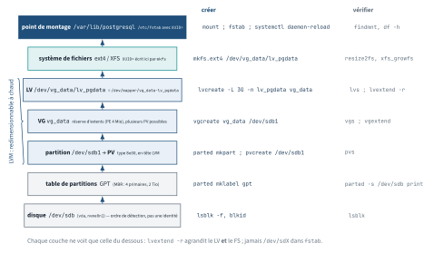
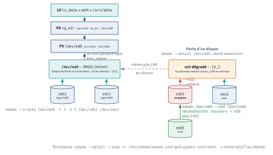
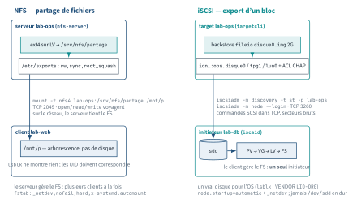

<!-- nav:début -->
[Accueil](../../README.md) › [Parcours](../../docs/parcours.md) › Partie II — Administration système › **Module 11**  
[← Module 10](../10-paquets/README.md) · [Corrigé](corrige.md) · [Module 12 →](../12-reseau/README.md)

<details><summary>Scripts du module (16)</summary>

Sur la VM indiquée en section « Mise en place », depuis `~/workbook/scripts/` (voir [chapitre 0](../../docs/00-mise-en-place.md)).

| Script | Rôle |
|---|---|
| [`setup_M11.sh`](../../scripts/setup/setup_M11.sh) | prépare le module |
| [`check_M11_01.sh`](../../scripts/check/check_M11_01.sh) | vérifie L11.1 |
| [`check_M11_02.sh`](../../scripts/check/check_M11_02.sh) | vérifie L11.2 |
| [`check_M11_03.sh`](../../scripts/check/check_M11_03.sh) | vérifie L11.3 |
| [`check_M11_04.sh`](../../scripts/check/check_M11_04.sh) | vérifie L11.4 |
| [`check_M11_05.sh`](../../scripts/check/check_M11_05.sh) | vérifie L11.5 |
| [`check_M11_06.sh`](../../scripts/check/check_M11_06.sh) | vérifie D11 |
| [`check_M11_07.sh`](../../scripts/check/check_M11_07.sh) | vérifie L11.6 |
| [`check_M11_08.sh`](../../scripts/check/check_M11_08.sh) | vérifie L11.7 |
| [`check_M11_09.sh`](../../scripts/check/check_M11_09.sh) | vérifie L11.8 |
| [`break_M11_01.sh`](../../scripts/break/break_M11_01.sh) | installe la panne BF11.1 |
| [`break_M11_02.sh`](../../scripts/break/break_M11_02.sh) | installe la panne BF11.2 |
| [`break_M11_03.sh`](../../scripts/break/break_M11_03.sh) | installe la panne BF11.3 |
| [`break_M11_04.sh`](../../scripts/break/break_M11_04.sh) | installe la panne BF11.4 |
| [`break_M11_05.sh`](../../scripts/break/break_M11_05.sh) | installe la panne BF11.5 |
| [`break_M11_06.sh`](../../scripts/break/break_M11_06.sh) | installe la panne BF11.6 |

</details>
<!-- nav:fin -->

# Module 11 — Stockage : partitions, LVM, RAID, NFS et iSCSI

## 11.0 Objectifs et compétences

> [!NOTE]
> **Objectifs**
>
> À la fin de ce module, je sais :
>
> * nommer et identifier un périphérique bloc (`sda`, `nvme0n1`, `vda`, `dm-0`) avec
>   `lsblk`, `blkid` et `/dev/disk/by-*`, et expliquer pourquoi on monte par UUID
>   et jamais par `/dev/sdX` ;
> * choisir entre MBR et GPT, partitionner avec `fdisk`, `parted` ou `sgdisk`, poser
>   le bon type de partition et faire relire la table au noyau sans redémarrer ;
> * choisir entre ext4, XFS, btrfs et tmpfs sur des critères techniques, formater
>   avec les bonnes options, et savoir quoi faire quand un `fsck` se déclenche ;
> * écrire une ligne d'`/etc/fstab` champ par champ, justifier chaque option
>   (`noatime`, `nodev`, `nosuid`, `noexec`, `ro`, `nofail`, `x-systemd.automount`),
>   et **vérifier avant de redémarrer** ;
> * diagnostiquer un `target is busy` avec `fuser -vm` et `lsof`, et choisir entre
>   démontage normal, paresseux et forcé ;
> * construire une pile LVM complète (PV → VG → LV), l'étendre **à chaud**, déplacer
>   des extents avec `pvmove`, réduire un volume sans le détruire ;
> * prendre un snapshot LVM pour une sauvegarde cohérente, le monter, le fusionner,
>   et expliquer ce qui se passe exactement quand il déborde ;
> * faire croître un disque de VM Proxmox de bout en bout :
>   `growpart` → `pvresize` → `lvextend` → `resize2fs`, sans interruption de service ;
> * construire un RAID1 puis un RAID5 avec `mdadm`, lire `/proc/mdstat` et
>   `mdadm --detail`, simuler la perte d'un disque, le remplacer et suivre la
>   reconstruction, rendre le tableau persistant (`mdadm.conf` + initramfs) et
>   poser LVM par-dessus ;
> * exploiter un XFS : `xfs_growfs`, `xfs_repair`, quotas de projet, et expliquer
>   pourquoi il ne se réduit pas ; argumenter un choix ext4 / XFS ;
> * chiffrer un volume avec LUKS + `/etc/crypttab` ;
> * exporter un répertoire en NFS (`/etc/exports`, `exportfs -ra`, `showmount -e`),
>   le monter côté client avec `_netdev`, `nofail`, `hard`, et diagnostiquer un
>   `stale file handle` ou un processus bloqué en état `D` ;
> * publier un disque en iSCSI avec `targetcli` (backstore fileio, ACL par IQN,
>   CHAP), l'attacher avec `iscsiadm`, mettre LVM dessus et le faire revenir au
>   démarrage ;
> * choisir un ordonnanceur d'E/S (`none`, `mq-deadline`, `bfq`), lancer un test
>   `fio` en lecture aléatoire et l'interpréter, et lire un `iostat -xz` pour dire
>   si le stockage est le goulot d'étranglement.
>
> **Temps estimé** : 12 h (le module est long, il se découpe bien en trois séances)
>
> **Prérequis** : module 02 (FHS, inodes, `du`/`df`), module 03 (permissions),
> module 08 (unités systemd). `du` et `df` ne sont pas réexpliqués ici.

---

## 11.1 Mise en place

VM concernée : **`lab-db` (10.10.10.12)**, VMID **9003**. Elle possède deux disques
supplémentaires **vierges** de 5 Go : `/dev/sdb` et `/dev/sdc`. C'est le terrain de
jeu du module. Le disque système reste `/dev/sda`, on n'y touche qu'au lab L11.4.

Le lab L11.5 utilise aussi `lab-adm` (10.10.10.10) comme serveur NFS.
Les labs L11.7 et L11.8 font de **`lab-ops` (10.10.10.14)** un serveur NFS puis
une cible iSCSI ; `lab-db` et `lab-web` (10.10.10.11) sont les clients.

> [!CAUTION]
> **Attention**
>
> Ce module écrit dans des tables de partitions et formate des volumes. Une faute de
> frappe sur le nom du disque détruit le système. **Snapshot obligatoire avant de
> commencer**, et un nouveau snapshot avant chaque Break & Fix :
>
> ```bash
> # depuis le shell Proxmox
> qm snapshot 9003 avant-lab11
> ```
>
> Pour repartir propre : `qm rollback 9003 snap-clean`.
> Règle de survie : avant chaque commande destructrice, relis le nom du périphérique
> à voix haute et compare-le avec la sortie de `lsblk`.

Paquets nécessaires sur `lab-db` :

```bash
sudo apt update
sudo apt install -y lvm2 xfsprogs btrfs-progs mdadm cryptsetup-bin \
  gdisk parted nfs-common open-iscsi sysstat fio cloud-guest-utils quota
```

Sur `lab-ops` (serveur NFS et cible iSCSI des labs L11.7 et L11.8) :

```bash
sudo apt install -y nfs-kernel-server targetcli-fb
```

> [!IMPORTANT]
> **Variante Rocky / RHEL**
>
> Sous Rocky 9 : `sudo dnf install -y lvm2 xfsprogs mdadm cryptsetup gdisk parted
> nfs-utils iscsi-initiator-utils targetcli sysstat fio cloud-utils-growpart quota`
> (`nfs-utils` couvre le client **et** le serveur, l'unité s'appelle
> `nfs-server.service` ; la cible iSCSI est `target.service`). `btrfs-progs` n'est pas fourni
> par Rocky 9 (Red Hat a retiré btrfs de RHEL) : la section btrfs se lit, ne se
> pratique pas. Sous Rocky, le système est déjà sur LVM par défaut et le VG s'appelle
> `rl` — adapte les noms dans les labs.

Préparation du terrain (idempotent, relançable) :

```bash
sudo bash ~/workbook/scripts/setup/setup_M11.sh
```

Il crée l'arborescence `/srv/factura`, un jeu de données à migrer, les scripts
d'écriture utilisés pour les tests de cohérence, et **il vérifie que `/dev/sdb` et
`/dev/sdc` existent**. S'ils sont absents (VM créée sans disques supplémentaires,
conteneur, machine de test), il fabrique deux images de 5 Go attachées en
*loop device* et te le dit clairement : tu travailleras alors sur `/dev/loopN`
et non sur `/dev/sdb`. Toutes les commandes du module restent identiques, seul
le nom du périphérique change. Le couple retenu est écrit dans `/etc/lab11.env` :

```bash
. /etc/lab11.env      # définit DISQUE1 et DISQUE2
echo "$DISQUE1 $DISQUE2"
```

Sur `lab-adm`, pour le lab L11.5 (NFS) :

```bash
sudo apt install -y nfs-kernel-server
sudo bash ~/workbook/scripts/setup/setup_M11.sh --nfs
```

Le setup **regarde le nom d'hôte** : lancé sur `lab-ops`, il installe (ou vérifie)
`nfs-kernel-server` et `targetcli-fb` et prépare `/srv/nfs` ; lancé sur `lab-db`, il
vérifie `nfs-common` et `open-iscsi` en plus des outils disque. Pour le RAID5 de
l'exercice E11.22, il faut un troisième disque : le setup fabrique alors une
troisième image de 5 Go en *loop device*, même si `sdb` et `sdc` sont réels
(`DISQUE3` dans `/etc/lab11.env`) :

```bash
sudo bash ~/workbook/scripts/setup/setup_M11.sh --raid5
```

---

## 11.2 Rappel express

### Nommer un disque

| Nom | Origine |
|---|---|
| `sda`, `sdb` | SCSI/SATA/USB — **ordre de détection**, pas une propriété du disque |
| `nvme0n1p2` | NVMe : contrôleur 0, namespace 1, partition 2 |
| `vda`, `xvda` | virtio (KVM/Proxmox), Xen |
| `dm-0`, `/dev/mapper/vg-lv` | device-mapper : LVM, LUKS, multipath |
| `md0` | RAID logiciel mdadm |

```bash
lsblk -f                        # vue synthétique la plus utile
lsblk -o NAME,SIZE,TYPE,FSTYPE,MOUNTPOINTS,UUID,VENDOR
blkid /dev/sdb1                 # UUID + TYPE, lus dans le superblock
ls -l /dev/disk/by-uuid/ /dev/disk/by-id/ /dev/disk/by-path/
```

`UUID=` est écrit dans le FS par `mkfs` et suit le volume partout ; `PARTUUID=`
vit dans la table GPT (survit au reformatage) ; `LABEL=` se duplique trop
facilement ; `/dev/vg/lv` est stable par construction. **Jamais `/dev/sdX` dans
`fstab`** : un disque ajouté ou un contrôleur plus rapide, et `sdb` devient `sdc`.

### Partitionner

MBR : 4 primaires, 2 Tio max, une table. GPT : 128 partitions, 8 Zio, copie de
secours en fin de disque. Types GPT : `8300` Linux, `8e00` LVM, `8200` swap,
`8309` LUKS, `fd00` RAID. Alignement à 1 MiB (`-a optimal`, secteur 2048).

```bash
sudo parted -s /dev/sdb mklabel gpt
sudo parted -s -a optimal /dev/sdb mkpart primaire 1MiB 100%
sudo sgdisk -n 1:0:0 -t 1:8e00 -c 1:donnees /dev/sdc   # idem, scriptable
sudo partprobe /dev/sdb            # fait relire la table au noyau
```

### Systèmes de fichiers : ext4 vs XFS

| Critère | ext4 | XFS |
|---|---|---|
| Agrandir | à chaud, `resize2fs` | à chaud, `xfs_growfs /point` |
| Réduire | hors ligne, `resize2fs` | **impossible** (recréer + restaurer) |
| Point fort | mûr, outillé, petits fichiers | gros fichiers, parallélisme, gros volumes |
| Réparation | `e2fsck -f` démonté | journal rejoué au montage ; `xfs_repair` démonté |
| Quotas | usr/grp (+ prj récents) | usr/grp/**prj** natifs, `xfs_quota` |

```bash
sudo mkfs.ext4 -L donnees -m 1 /dev/sdb1     # -m 1 : 1 % réservé au lieu de 5
sudo tune2fs -l /dev/sdb1 | head -30 ; sudo tune2fs -m 1 -c -1 -i 0 /dev/sdb1
sudo mkfs.xfs -L pgdata /dev/sdc1
sudo xfs_info /srv/factura/journaux          # XFS : sur le POINT DE MONTAGE
sudo xfs_growfs /srv/factura/journaux        # après lvextend, FS monté
sudo xfs_repair -n /dev/sdc1                 # -n : diagnostic seul, démonté
sudo xfs_repair -L /dev/sdc1     # -L : vide le journal, dernier recours
```

Quotas de projet XFS (montage avec `prjquota`) : `/etc/projects` (`10:/chemin`),
`/etc/projid` (`app1:10`), puis
`xfs_quota -x -c 'project -s app1' -c 'limit -p bhard=200m app1' /point` et
`xfs_quota -x -c 'report -p' /point`. XFS ne se réduit pas parce que les numéros
d'inodes encodent leur position physique (groupe d'allocation + bloc) : couper la
fin du volume renumérote tout. Un snapshot LVM d'un XFS se monte avec `-o nouuid` (même UUID que l'origine).

### Monter

```bash
sudo mount -o noatime /dev/sdb1 /srv/factura/db ; findmnt /srv/factura/db
sudo mount -o remount,ro /srv/factura/db ; sudo umount /srv/factura/db
sudo fuser -vm /srv/factura/db ; sudo lsof /srv/factura/db   # target is busy
sudo umount -l /srv/factura/db     # paresseux : détache, libère au dernier fd
```

| Option | Effet |
|---|---|
| `defaults` | `rw,suid,dev,exec,auto,nouser,async` |
| `noatime` | n'écrit plus les dates d'accès |
| `nodev,nosuid,noexec` | durcissement d'un volume de données |
| `nofail` | ne bloque pas le boot si le volume manque |
| `x-systemd.automount` | monte à la première utilisation |
| `_netdev` | attend le réseau (NFS, iSCSI) |

```text
UUID=8f3c-...  /srv/factura/db  ext4  defaults,noatime  0  2
1 source 2 cible 3 type 4 options 5 dump (0) 6 fsck : 1 pour /, 2, 0 = jamais
```

> [!TIP]
> **Astuce**
>
> Avant de redémarrer après `fstab` : `findmnt --verify --verbose`, `sudo mount -a`,
> `sudo systemctl daemon-reload`. Dix secondes, zéro soirée en console Proxmox.

### LVM et snapshots

```text
/dev/sdb1 /dev/sdc1 (PV) -> vg_data (VG, PE 4 Mio) -> lv_pgdata, lv_sauv (LV)
```

<p align="center"></p>

*Figure — La pile de stockage du disque au point de montage, et la commande qui agit à chaque couche.*

```bash
sudo pvcreate /dev/sdb1 /dev/sdc1 ; sudo vgcreate vg_data /dev/sdb1
sudo lvcreate -L 3G -n lv_pgdata vg_data
sudo lvcreate -l 100%FREE -n lv_sauv vg_data
sudo vgextend vg_data /dev/sdc1
sudo lvextend -L +2G -r /dev/vg_data/lv_pgdata   # -r : le FS suit (ext4 et XFS)
sudo pvmove /dev/sdb1 ; sudo vgreduce vg_data /dev/sdb1
sudo pvremove /dev/sdb1
pvs ; vgs ; lvs -o +devices
sudo lvcreate -s -L 1G -n snap_pg /dev/vg_data/lv_pgdata
sudo mount -o ro /dev/vg_data/snap_pg /mnt/snap       # XFS : -o ro,nouuid
sudo lvconvert --merge /dev/vg_data/snap_pg   # restaure, consomme le snapshot
sudo lvremove /dev/vg_data/snap_pg            # OU : abandonne le snapshot
lvs -o lv_name,attr,size,origin,data_percent   # swi-I-s--- : snapshot invalide
```

`-l 100%FREE` à l'extension échoue presque toujours : c'est `-l +100%FREE`.
**Réduire** : démonter → `e2fsck -f` → `resize2fs` cible → `lvreduce` même taille
(`lvreduce -r` enchaîne). Un snapshot est une copie sur écriture : sa taille
dimensionne le **volume de changements** ; plein, il devient invalide, l'origine
n'a rien.

### RAID logiciel mdadm

| Commande | Effet |
|---|---|
| `mdadm --create /dev/md0 -l 1 -n 2 /dev/sdb1 /dev/sdc1` | RAID1 (miroir) |
| `mdadm --create /dev/md1 -l 5 -n 3 /dev/sd{b,c,d}1` | RAID5 (n-1 disques utiles) |
| `cat /proc/mdstat` | `[UU]` sain, `[U_]` dégradé, `recovery = 42%` |
| `mdadm --detail /dev/md0` / `--examine /dev/sdb1` | état du tableau / d'un membre |
| `mdadm /dev/md0 --fail /dev/sdb1 --remove /dev/sdb1` | sortir un disque |
| `mdadm --zero-superblock /dev/sdb1` | oublie l'appartenance (disque « neuf ») |
| `mdadm /dev/md0 --add /dev/sdb1` | réintègre : reconstruction |
| `mdadm --detail --scan \| sudo tee -a /etc/mdadm/mdadm.conf` | persistance |
| `update-initramfs -u` (Rocky : `dracut -f`) | assemblage au boot, sinon `md127` |
| `mdadm --monitor --scan --oneshot` / `mdmonitor.service` | alerte (`MAILADDR`) |

Vitesse de reconstruction : `/proc/sys/dev/raid/speed_limit_min` et `_max`.
LVM par-dessus : `pvcreate /dev/md0`, le PV est stable quel que soit le disque
perdu. Membres en type `fd00` par convention, `--metadata=1.2` par défaut.

<p align="center"></p>

*Figure — Deux disques en miroir `md0` sous LVM ; perte d'un disque, ajout d'un disque neuf et reconstruction.*

### NFS

<p align="center"></p>

*Figure — NFS — partage de fichiers serveur lab-ops (`nfs-server`) ext4 sur LV → `/srv/nfs/partage /etc/exports` : `rw,sync,root_squash` client lab-web `/mnt/p` — arborescence, pas de disque `lsblk` ne montre rien; les UID doivent correspondre `mount -t nfs4 lab-ops:/srv/nfs/partage /mnt/p` TCP 2049 · `open/read/write` voyagent sur le réseau, le serveur tient le FS le serveur gère le FS : plusieurs clients à la fois `fstab` : `_netdev,nofail,hard,x-systemd.automount` iSCSI — export d'un bloc NFS partage des fichiers (le serveur tient le système de fichiers) ; iSCSI exporte un bloc (l'initiateur voit un disque et y met LVM).*

Serveur (`nfs-kernel-server`, `nfs-server.service`) :

```text
# /etc/exports
/srv/nfs/partage  10.10.10.0/24(rw,sync,no_subtree_check,root_squash)
/srv/nfs/depots   10.10.10.11(ro,sync,no_subtree_check)
```

```bash
sudo exportfs -ra ; sudo exportfs -v ; showmount -e 10.10.10.14
sudo mount -t nfs4 -o hard,timeo=600,retrans=2 \
  10.10.10.14:/srv/nfs/partage /mnt/p
nfsstat -m ; cat /proc/fs/nfsd/versions        # version négociée / servies
```

| Option d'export | Effet |
|---|---|
| `sync` / `async` | acquitte après écriture disque / avant (perte possible) |
| `no_subtree_check` | pas de vérification du sous-arbre : recommandé |
| `root_squash` (défaut) | root du client devient `nobody` (`anonuid=`, `anongid=`) |
| `no_root_squash` | root reste root : uniquement pour un client de confiance |

Client dans `fstab` : `10.10.10.14:/srv/nfs/partage /mnt/p nfs4
_netdev,nofail,hard,x-systemd.automount 0 0`. NFSv4 : un seul port (2049), état,
idmap par nom (`/etc/idmapd.conf`, `Domain=`) ; NFSv3 : `rpcbind` + `mountd`,
UID numériques. Pannes : `Stale file handle` = l'inode exporté a changé côté
serveur (remonte : `umount -l` puis `mount`) ; serveur parti avec `hard` =
processus en état `D`, insensible à `kill -9`, `umount -f -l` pour libérer ;
`soft` renvoie `EIO` et corrompt en silence — réservé à la lecture seule.

### iSCSI

Cible (`targetcli-fb`, unité `rtslib-fb-targetctl.service`, port TCP 3260) :

```bash
sudo targetcli
/backstores/fileio create disque0 /var/lib/iscsi/disque0.img 2G
/iscsi create iqn.2026-09.local.lab:ops.disque0
cd /iscsi/iqn.2026-09.local.lab:ops.disque0/tpg1
luns create /backstores/fileio/disque0
acls create iqn.2026-09.local.lab:db
acls/iqn.2026-09.local.lab:db set auth userid=lab-db password=Secr3tISCSI
set attribute authentication=1
saveconfig                         # /etc/rtslib-fb-target/saveconfig.json
exit
```

Initiateur (`open-iscsi`, `iscsid.service`, nom dans
`/etc/iscsi/initiatorname.iscsi`) :

```bash
sudo iscsiadm -m discovery -t sendtargets -p 10.10.10.14
sudo iscsiadm -m node -T iqn.2026-09.local.lab:ops.disque0 -p 10.10.10.14 \
  --op update -n node.session.auth.authmethod -v CHAP     # + username, password
sudo iscsiadm -m node -T iqn.2026-09.local.lab:ops.disque0 -p 10.10.10.14 \
  --login                                           # --logout pour détacher
sudo iscsiadm -m session ; lsblk -o NAME,SIZE,VENDOR   # VENDOR LIO-ORG
sudo iscsiadm -m node -T iqn.2026-09.local.lab:ops.disque0 -p 10.10.10.14 \
  --op update -n node.startup -v automatic          # relogin au démarrage
```

Le disque apparaît comme `/dev/sdX` : passe par LVM (`pvcreate /dev/sdd`) ou
`/dev/disk/by-path/ip-10.10.10.14:3260-iscsi-...-lun-0`, jamais par `sdd`.
`_netdev` obligatoire dans `fstab`. Multipath (`multipath-tools`) : deux portails
vers la même LUN, un seul `/dev/mapper/mpatha` — notion, hors lab.

### E/S bloc et performance

```bash
cat /sys/block/sdb/queue/scheduler          # [none] mq-deadline bfq
echo mq-deadline | sudo tee /sys/block/sdb/queue/scheduler
iostat -xz 2                # r/s + w/s = IOPS, r_await/w_await (ms), aqu-sz
sudo fio --name=rr --filename=/srv/factura/db/t.fio --size=1G --bs=4k \
  --rw=randread --ioengine=libaio --direct=1 --iodepth=32 --runtime=30 \
  --time_based --group_reporting
sudo blktrace -d /dev/sdb -w 5 -o - | blkparse -i -     # trace bloc, notion
```

`none` : SSD/NVMe et VM (l'hôte ordonnance déjà) ; `mq-deadline` : disques
rotatifs, latence bornée ; `bfq` : poste de travail, équité. Persistance par
règle udev (`ATTR{queue/scheduler}="none"`). Dans `fio`, lis `IOPS=`, `clat avg`
et `99.00th` : loi de Little, `iodepth ≈ IOPS × latence`. `%util` à 100 % sur un
NVMe ne veut rien dire ; ce qui compte est `await` rapproché des IOPS.

---

## 11.3 Quiz — QCM

<a id="q11-1"></a>**[Q11.1](corrige.md#q11-1)** — Tu remplaces une carte contrôleur sur un serveur physique. Au
redémarrage, `/dev/sdb` et `/dev/sdc` ont échangé leurs rôles. Quelles lignes de
`fstab` continuent de monter le bon volume ? **Deux réponses correctes.**

a) `/dev/sdb1 /srv/data ext4 defaults 0 2`
b) `UUID=3f1c-... /srv/data ext4 defaults 0 2`
c) `/dev/vg_data/lv_sauv /srv/sauv ext4 defaults 0 2`
d) `/dev/disk/by-path/pci-0000:00:10.0-scsi-0:0:1:0-part1 /srv/data ext4 defaults 0 2`

<a id="q11-2"></a>**[Q11.2](corrige.md#q11-2)** — `lsblk -f` affiche sur `lab-db` :

```console
NAME        FSTYPE      LABEL   UUID                                 MOUNTPOINTS
sdb
└─sdb1      LVM2_member         kXd9Fe-...
  └─vg_data-lv_pgdata
            ext4        pgdata  8f3c1a2b-...            /srv/factura/db
```

Quel identifiant mets-tu dans `fstab` pour ce montage ?

a) `UUID=kXd9Fe-...`
b) `UUID=8f3c1a2b-...`
c) `/dev/sdb1`
d) `PARTUUID=8f3c1a2b-...`

<a id="q11-3"></a>**[Q11.3](corrige.md#q11-3)** — Tu dois partitionner un disque de 4 Tio pour y stocker une seule
grosse partition de données. Quelle table de partitions ?

a) MBR, c'est plus compatible
b) GPT, car MBR plafonne à 2 Tio par partition et par disque
c) peu importe, le noyau Linux gère 4 Tio dans les deux cas
d) aucune : au-delà de 2 Tio il faut obligatoirement LVM

<a id="q11-4"></a>**[Q11.4](corrige.md#q11-4)** — Après `sudo sgdisk -n 1:0:0 -t 1:8e00 /dev/sdb`, la commande
`sudo pvcreate /dev/sdb1` répond `Device /dev/sdb1 not found`. Que fais-tu ?

a) tu recrées la partition, elle a échoué
b) `sudo partprobe /dev/sdb` pour faire relire la table au noyau
c) tu redémarres la machine
d) tu utilises `/dev/sdb` directement, le PV n'a pas besoin de partition

<a id="q11-5"></a>**[Q11.5](corrige.md#q11-5)** — Tu veux réduire de 500 Go un système de fichiers XFS monté sur un LV.
Quelle est la procédure ?

a) `umount`, `xfs_growfs -D`, puis `lvreduce`
b) `lvreduce -r -L -500G`, XFS gère
c) il n'y en a pas : XFS ne se réduit pas, il faut sauvegarder, recréer, restaurer
d) `xfs_repair -s` puis `lvreduce`

<a id="q11-6"></a>**[Q11.6](corrige.md#q11-6)** — Dans `/etc/fstab`, quel est le rôle du **sixième** champ ?

a) l'ordre de sauvegarde par `dump`
b) l'ordre de passage de `fsck` au démarrage : 1 pour la racine, 2 pour les autres, 0 = jamais
c) le nombre de tentatives de montage
d) les droits Unix du point de montage

<a id="q11-7"></a>**[Q11.7](corrige.md#q11-7)** — Tu ajoutes un volume de sauvegarde monté sur un NAS dans `fstab`.
Le NAS est parfois éteint. Quelles options mets-tu pour que la VM démarre quand
même ? **Deux réponses correctes.**

a) `nofail`
b) `noauto` seul
c) `x-systemd.automount`
d) `ro`

<a id="q11-8"></a>**[Q11.8](corrige.md#q11-8)** — `sudo umount /srv/factura/db` répond `target is busy`. Quelle
commande t'indique **qui** bloque ?

a) `df -h /srv/factura/db`
b) `sudo fuser -vm /srv/factura/db`
c) `sudo umount -f /srv/factura/db`
d) `mount | grep factura`

<a id="q11-9"></a>**[Q11.9](corrige.md#q11-9)** — Tu exécutes `sudo lvextend -l +100%FREE /dev/vg_data/lv_pgdata` puis
`df -h /srv/factura/db` : la taille affichée n'a pas bougé. Pourquoi ?

a) `lvextend` a échoué silencieusement
b) le LV est plus grand, mais le système de fichiers ne l'est pas encore : il manque `resize2fs` (ou `-r`)
c) il faut démonter et remonter le volume
d) `df` met jusqu'à 5 minutes à se rafraîchir

<a id="q11-10"></a>**[Q11.10](corrige.md#q11-10)** — Un snapshot LVM de 1 Go a été créé sur un LV de 20 Go il y a trois
jours. `lvs` affiche pour lui l'attribut `swi-I-s---`. Que s'est-il passé et quel
est l'impact ?

a) le snapshot est en cours de fusion, il faut attendre
b) le snapshot a débordé, il est invalide et inutilisable ; l'origine n'a rien
c) le snapshot a débordé et l'origine est corrompue
d) le snapshot est simplement inactif, `lvchange -ay` suffit

<a id="q11-11"></a>**[Q11.11](corrige.md#q11-11)** — Sur `lab-db`, `df -h /srv/factura/db` affiche 42 % d'utilisation, mais
toute écriture échoue avec `No space left on device`. Quelle est la cause la plus
probable ?

a) le volume est monté en lecture seule
b) les inodes sont épuisés (`df -i`)
c) un processus détient un fichier supprimé
d) le quota de l'utilisateur est atteint

<a id="q11-12"></a>**[Q11.12](corrige.md#q11-12)** — Tu agrandis le disque `scsi0` d'une VM de 30 à 60 Go dans l'interface
Proxmox. Dans la VM, `lsblk` montre bien `sda` à 60 Go mais `/` fait toujours 28 Go.
Quelle séquence complète le travail, dans l'ordre ?

a) `resize2fs` → `lvextend` → `pvresize` → `growpart`
b) `growpart /dev/sda 3` → `pvresize /dev/sda3` → `lvextend -l +100%FREE` → `resize2fs`
c) `partprobe` → `resize2fs` → `lvextend`
d) rien à faire, `systemd-growfs` s'en charge au prochain boot

<a id="q11-13"></a>**[Q11.13](corrige.md#q11-13)** — Après avoir créé un RAID1 avec `mdadm --create`, tu redémarres et le
tableau n'est plus assemblé : `/dev/md0` a disparu ou s'appelle `/dev/md127`.
Qu'a-t-on oublié ? **Deux réponses correctes.**

a) d'écrire la configuration dans `/etc/mdadm/mdadm.conf`
b) de lancer `sudo update-initramfs -u`
c) de formater le tableau en ext4
d) de marquer les partitions membres en type `fd00`

<a id="q11-14"></a>**[Q11.14](corrige.md#q11-14)** — `iostat -xz 2` donne, sur un SSD NVMe :

```console
Device  r/s     w/s    rkB/s    wkB/s  r_await  w_await  aqu-sz  %util
nvme0n1 8200.0  310.0  32800.0  1240.0    0.28     0.41   2.45   99.80
```

Que conclus-tu ?

a) le disque est saturé, il faut le remplacer
b) `%util` proche de 100 % n'a pas de sens sur un NVMe multi-files ; `await` sous 0,5 ms indique un disque très à l'aise
c) `aqu-sz` à 2,45 prouve une file d'attente critique
d) les 8200 lectures/s dépassent la capacité d'un NVMe

<a id="q11-15"></a>**[Q11.15](corrige.md#q11-15)** — Tu crées un fichier de swap avec `dd`, `mkswap` et `swapon` : tout
fonctionne. Après un redémarrage, `swapon --show` ne renvoie rien. Pourquoi ?

a) `mkswap` doit être relancé à chaque boot
b) il manque la ligne dans `/etc/fstab` (`/swapfile none swap sw 0 0`)
c) `vm.swappiness` est à 0
d) un fichier de swap ne survit jamais à un redémarrage, il faut une partition

<a id="q11-16"></a>**[Q11.16](corrige.md#q11-16)** — Dans `/etc/crypttab`, à quoi sert le troisième champ quand il vaut
`none` ?

a) le volume n'est pas chiffré
b) aucune clé n'est fournie : la phrase de passe sera demandée interactivement au démarrage
c) le volume est déverrouillé sans authentification
d) c'est le nom du fichier de configuration LUKS

<a id="q11-17"></a>**[Q11.17](corrige.md#q11-17)** — Tu montes dans `fstab`, sans l'option `_netdev` (et sans `nofail`), un volume ext4 posé sur un disque iSCSI.
Quel symptôme t'attends-tu à voir ?

a) le partage est monté en lecture seule
b) le montage échoue au démarrage parce que le réseau n'est pas encore prêt, et le boot part en mode maintenance
c) les droits Unix ne sont pas respectés
d) aucun, `_netdev` est cosmétique

<a id="q11-18"></a>**[Q11.18](corrige.md#q11-18)** — Un LV `lv_sauv` doit accueillir des millions de petits fichiers. Au
formatage, quelle option ext4 te préserve d'une pénurie d'inodes ?

a) `mkfs.ext4 -m 0`
b) `mkfs.ext4 -T largefile`
c) `mkfs.ext4 -i 8192` (ou `-N <nombre>`)
d) `mkfs.ext4 -O ^has_journal`

<a id="q11-19"></a>**[Q11.19](corrige.md#q11-19)** — `cat /proc/mdstat` sur `lab-db` affiche :

```console
md0 : active raid1 sdc1[1] sdb1[0](F)
      5237760 blocks super 1.2 [2/1] [_U]
```

Que lis-tu, et quelle est la **première** commande à lancer ?

a) le tableau est sain, `(F)` signifie *fresh* ; rien à faire
b) `sdb1` est marqué défaillant, le miroir tourne sur un seul disque ; `mdadm --detail /dev/md0` pour dater et qualifier la panne avant d'agir
c) le tableau est en cours de reconstruction ; attendre
d) `mdadm --create` pour recréer le tableau proprement

<a id="q11-20"></a>**[Q11.20](corrige.md#q11-20)** — Sur `lab-ops`, `/etc/exports` contient
`/srv/nfs/partage 10.10.10.0/24(rw,sync,no_subtree_check)`. Depuis `lab-db`,
`root` crée un fichier dans le partage monté : `ls -l` le montre appartenant à
`nobody:nogroup`. Pourquoi ?

a) le montage est en NFSv3, les noms d'utilisateurs ne passent pas
b) `root_squash` est actif par défaut : l'UID 0 du client est remplacé par `anonuid` (65534) côté serveur
c) le domaine `idmapd` diffère entre les deux machines
d) il manque `no_subtree_check`

<a id="q11-21"></a>**[Q11.21](corrige.md#q11-21)** — Sur `lab-db`, `iscsiadm -m discovery -t sendtargets -p 10.10.10.14`
liste bien la cible, mais `--login` répond
`iSCSI login failed due to authorization failure`. Quelles causes sont
plausibles ? **Deux réponses correctes.**

a) l'IQN de `/etc/iscsi/initiatorname.iscsi` n'a pas d'ACL sur la cible
b) le port 3260 est filtré sur `lab-ops`
c) les identifiants CHAP du nœud (`node.session.auth.*`) ne correspondent pas à ceux de l'ACL
d) le backstore fileio est plein

<a id="q11-22"></a>**[Q11.22](corrige.md#q11-22)** — `fio` en lecture aléatoire 4 k, `--iodepth=32`, rapporte
`IOPS=7980` et `clat (usec): avg=4005`. Pendant le test, `iostat -x` montre
`r_await` à 4,0 ms et `aqu-sz` à 31,8. Quelle conclusion est correcte ?

a) le disque est en panne : 4 ms de latence sur un test de 4 k c'est anormal
b) les chiffres sont cohérents entre eux (32 ≈ 7980 × 0,004) : le périphérique sert ~8 000 IOPS avec 32 requêtes en vol, la latence par requête est celle de la file, pas celle du support
c) `fio` et `iostat` se contredisent, l'un des deux est faux
d) il faut augmenter `iodepth` pour réduire la latence

---

## 11.4 Quiz — questions ouvertes

<a id="qo11-1"></a>**[QO11.1](corrige.md#qo11-1)** — *On te demande en entretien* : « Explique-moi la chaîne complète entre
un disque physique neuf et un répertoire utilisable par une application, en
nommant chaque couche et l'outil qui la crée. » Réponds en listant les couches dans
l'ordre, et indique à chacune ce qu'on gagne et ce qu'on perd à la sauter.

<a id="qo11-2"></a>**[QO11.2](corrige.md#qo11-2)** — Explique **précisément** pourquoi on ne met jamais `/dev/sdb1` dans
`/etc/fstab`, en décrivant le mécanisme d'attribution des noms `sdX` par le noyau.
Puis compare `UUID=`, `PARTUUID=` et `LABEL=` : dans quel cas chacun est le bon
choix, et lequel choisirais-tu pour une partition de swap non formatée ?

<a id="qo11-3"></a>**[QO11.3](corrige.md#qo11-3)** — Un snapshot LVM de 2 Go sur un LV de 200 Go. Décris ce qui se passe
**bloc par bloc** quand une application écrit sur l'origine après la création du
snapshot. Déduis-en comment on dimensionne un snapshot, et ce qui arrive quand il
déborde — pour le snapshot et pour l'origine.

<a id="qo11-4"></a>**[QO11.4](corrige.md#qo11-4)** — *On te demande en entretien* : « Le `/var` d'un serveur de production
est plein. Tu as un disque libre. Raconte-moi comment tu ajoutes 100 Go **sans
arrêter le service**, et dis-moi à quel moment exactement il y aurait eu une
coupure si le système n'avait pas été sur LVM. »

<a id="qo11-5"></a>**[QO11.5](corrige.md#qo11-5)** — Compare ext4 et XFS sur cinq critères techniques concrets
(agrandissement, réduction, comportement sur gros fichiers, réparation, coût
d'un `fsck`). Pour chacun des trois cas suivants, dis lequel tu choisis et
pourquoi : un volume de logs, un datastore PostgreSQL de 4 To, une partition `/`
de 20 Go sur une VM.

<a id="qo11-6"></a>**[QO11.6](corrige.md#qo11-6)** — Tu tapes `sudo umount /srv/sauvegardes` et tu obtiens `target is busy`.
Décris ta démarche de diagnostic complète, dans l'ordre, avec les commandes. Puis
explique la différence de mécanisme entre `umount -l` et `umount -f`, et le risque
propre à chacun.

<a id="qo11-7"></a>**[QO11.7](corrige.md#qo11-7)** — Un collègue propose de désactiver complètement le swap sur les serveurs
de bases de données, « parce qu'il y a 128 Go de RAM et que le swap ralentit tout ».
Donne les arguments pour et contre, explique ce que fait réellement
`vm.swappiness`, et dis ce que tu recommandes et pourquoi.

<a id="qo11-8"></a>**[QO11.8](corrige.md#qo11-8)** — Décris la procédure de récupération d'une machine Linux qui ne démarre
plus à cause d'une ligne fautive dans `/etc/fstab`. Tu n'as accès qu'à la console
Proxmox. Détaille : ce que tu vois à l'écran, comment tu obtiens un shell, pourquoi
la racine est en lecture seule à ce moment-là, et les commandes exactes de la
réparation. Termine par les deux options de `fstab` qui auraient évité l'incident.

<a id="qo11-9"></a>**[QO11.9](corrige.md#qo11-9)** — On te confie un serveur dont le stockage « rame ». Décris les
métriques que tu regardes dans `iostat -xz 2`, dans quel ordre, et ce que chacune
t'apprend. Explique pourquoi `%util` est trompeur sur un SSD et par quoi tu le
remplaces.

<a id="qo11-10"></a>**[QO11.10](corrige.md#qo11-10)** — Explique le rôle respectif de `/etc/crypttab` et de `/etc/fstab` pour
un volume LUKS monté au démarrage. Dans quel ordre systemd les traite-t-il, quel
nom apparaît dans chacun, et que se passe-t-il si tu mets l'UUID du système de
fichiers dans `crypttab` ?

<a id="qo11-11"></a>**[QO11.11](corrige.md#qo11-11)** — *On te demande en entretien* : « Le RAID, c'est de la sauvegarde ? »
Réponds en distinguant ce contre quoi un RAID1 protège et ce contre quoi il ne
protège pas. Puis explique ce qui se passe, étape par étape, quand un disque d'un
RAID1 mdadm meurt : ce que voit le noyau, ce qu'affiche `/proc/mdstat`, ce que fait
`mdmonitor`, et les commandes de remplacement dans l'ordre. Termine par la raison
pour laquelle on met LVM **au-dessus** du RAID et pas l'inverse.

<a id="qo11-12"></a>**[QO11.12](corrige.md#qo11-12)** — Compare NFS et iSCSI : ce que chacun présente au client (fichiers ou
blocs), qui tient le système de fichiers, ce qui se passe si deux clients montent
la même ressource en écriture, et les options de `fstab` indispensables dans les
deux cas. Donne un cas d'usage où NFS est le bon choix, un où iSCSI l'est, et
explique pourquoi un montage NFS `hard` dont le serveur disparaît produit des
processus en état `D` qu'aucun `kill -9` ne tue.

---

## 11.5 Exercices guidés ★

Sauf mention contraire, tout se passe sur `lab-db`. Charge d'abord les noms de
disques : `. /etc/lab11.env` (les exercices utilisent `/dev/sdb` et `/dev/sdc`,
remplace par `$DISQUE1` / `$DISQUE2` si ton setup a basculé en *loop device*).

<a id="e11-1"></a>**[E11.1](corrige.md#e11-1)** — Produis une vue unique qui montre, pour chaque périphérique bloc de la
machine : le nom, la taille, le type (disque/partition/lvm), le système de fichiers,
l'étiquette, l'UUID et le point de montage. Une seule commande.

<a id="e11-2"></a>**[E11.2](corrige.md#e11-2)** — Affiche le numéro de série du disque `/dev/sdb` sans installer d'outil
supplémentaire, en te servant uniquement de `/dev/disk/`.

<a id="e11-3"></a>**[E11.3](corrige.md#e11-3)** — Le fichier `/etc/fstab` de `lab-db` contient une ligne pour `/`.
Retrouve, à partir de son UUID, le nom de périphérique réel correspondant — dans
les deux sens (UUID → device, device → UUID), avec deux commandes différentes.

<a id="e11-4"></a>**[E11.4](corrige.md#e11-4)** — Crée sur `/dev/sdb` une table GPT et une partition unique occupant tout
le disque, alignée sur 1 MiB, de type « Linux LVM ». Vérifie que le noyau a bien vu
la nouvelle partition sans redémarrer.

<a id="e11-5"></a>**[E11.5](corrige.md#e11-5)** — Formate `/dev/sdb1` en ext4 avec l'étiquette `donnees`, en ne réservant
que 1 % de l'espace à root au lieu des 5 % par défaut. Calcule, pour un volume de
5 Go, combien d'octets tu viens de récupérer.

<a id="e11-6"></a>**[E11.6](corrige.md#e11-6)** — Sur un ext4 existant, affiche : la date du dernier `fsck`, le nombre de
montages depuis, le compteur maximal avant vérification forcée, et le nombre
d'inodes libres. Une seule commande suffit pour les trois premières.

<a id="e11-7"></a>**[E11.7](corrige.md#e11-7)** — Monte `/dev/sdb1` sur `/srv/factura/archives` avec : pas de mise à jour
des dates d'accès, interdiction d'exécuter un binaire, interdiction des fichiers
setuid et des fichiers de périphérique. Prouve ensuite que `noexec` fonctionne.

<a id="e11-8"></a>**[E11.8](corrige.md#e11-8)** — Ajoute ce montage dans `/etc/fstab` par son UUID, avec les mêmes
options, sans passage de `fsck` au démarrage. Vérifie ta ligne **sans redémarrer**
et sans démonter le volume déjà monté.

<a id="e11-9"></a>**[E11.9](corrige.md#e11-9)** — Crée un tmpfs de 256 Mio monté sur `/srv/factura/tmp`, accessible en
écriture uniquement par le groupe `factura`, sans exécution possible. Explique en
une ligne où sont réellement stockés les fichiers qu'on y écrit.

<a id="e11-10"></a>**[E11.10](corrige.md#e11-10)** — Un processus détient un fichier ouvert sur `/srv/factura/archives` et
empêche le démontage. Reproduis la situation volontairement (avec `sleep` et une
redirection), puis identifie le PID coupable de deux façons différentes.

<a id="e11-11"></a>**[E11.11](corrige.md#e11-11)** — Construis la pile LVM suivante : `/dev/sdb1` comme PV, un VG `vg_data`,
un LV `lv_pgdata` de 2 Go formaté en ext4 monté sur `/srv/factura/db`. Affiche
ensuite, en trois commandes, l'état des PV, des VG et des LV.

<a id="e11-12"></a>**[E11.12](corrige.md#e11-12)** — Étends `lv_pgdata` de 1 Go supplémentaire **pendant que le volume est
monté et utilisé**, système de fichiers compris, en une seule commande. Vérifie
avec `df -h` avant et après.

<a id="e11-13"></a>**[E11.13](corrige.md#e11-13)** — Ajoute `/dev/sdc1` au groupe `vg_data`, puis crée un LV `lv_sauv` qui
occupe **tout l'espace libre restant** du groupe. Attention à la différence entre
`-l 100%FREE` et `-l +100%FREE`.

<a id="e11-14"></a>**[E11.14](corrige.md#e11-14)** — Affiche pour chaque LV du groupe `vg_data` les périphériques physiques
qui l'hébergent réellement, puis déplace tous les extents de `/dev/sdb1` vers
`/dev/sdc1` sans démonter quoi que ce soit (si `lv_sauv` de E11.13 a pris tout l'espace de `sdc1`, libère d'abord de la place : `pvmove` a besoin d'extents libres sur la destination).

<a id="e11-15"></a>**[E11.15](corrige.md#e11-15)** — Prends un snapshot de 512 Mio de `lv_pgdata`, monte-le en lecture seule
sur `/mnt/snap`, et vérifie qu'un fichier créé sur l'origine **après** le snapshot
n'y apparaît pas.

<a id="e11-16"></a>**[E11.16](corrige.md#e11-16)** — Affiche le taux de remplissage de tous les snapshots du système en une
commande, formaté en trois colonnes : nom, origine, pourcentage utilisé.

<a id="e11-17"></a>**[E11.17](corrige.md#e11-17)** — Crée un fichier de swap de 1 Gio, active-le, rends-le permanent, et
règle `vm.swappiness` à 10 de façon persistante. Prouve que la valeur survit à un
`sysctl --system`.

<a id="e11-18"></a>**[E11.18](corrige.md#e11-18)** — Mesure le débit séquentiel en écriture de `/srv/factura/db` avec `dd`
en contournant le cache de page, puis les IOPS en lecture aléatoire 4 k avec `fio`.
Compare les deux chiffres et explique pourquoi ils ne mesurent pas la même chose.

<a id="e11-19"></a>**[E11.19](corrige.md#e11-19)** — Pendant que `fio` tourne, relève dans une seconde session les valeurs
de `r/s`, `r_await` et `%util` pour le périphérique concerné, et déduis-en les IOPS
et la latence moyenne.

<a id="e11-20"></a>**[E11.20](corrige.md#e11-20)** — Chiffre `/dev/sdc1` avec LUKS2, ouvre-le sous le nom `coffre`, formate
le volume résultant en ext4 et monte-le sur `/srv/coffre`. Affiche ensuite les
en-têtes LUKS pour retrouver l'UUID du conteneur chiffré.

<a id="e11-21"></a>**[E11.21](corrige.md#e11-21)** — Construis un RAID1 `/dev/md0` sur `/dev/sdb1` et `/dev/sdc1`
(partitions de type `fd00`). Suis la synchronisation initiale dans `/proc/mdstat`,
puis rends le tableau persistant : fichier de configuration **et** initramfs.
Vérifie que le nom `md0` (et non `md127`) est bien celui qui sera assemblé.

<a id="e11-22"></a>**[E11.22](corrige.md#e11-22)** — Avec le troisième disque fourni par `setup_M11.sh --raid5`, crée un
RAID5 `/dev/md1` sur trois membres. Compare la capacité utile annoncée par
`mdadm --detail` à la somme des trois disques, et explique la différence. Puis
lance `mdadm --examine` sur un membre et retrouve l'UUID du tableau.

<a id="e11-23"></a>**[E11.23](corrige.md#e11-23)** — Sur un LV `lv_journaux` de 1 Go formaté en XFS et monté avec
`prjquota` sur `/srv/factura/journaux`, crée un projet `app1` limité à 200 Mio
sur le sous-répertoire `app1`. Prouve la limite avec `dd`, affiche le rapport
des quotas, puis étends le LV de 512 Mio **système de fichiers compris** et
montre que `xfs_growfs` a bien travaillé.

<a id="e11-24"></a>**[E11.24](corrige.md#e11-24)** — Sur `lab-ops`, exporte `/srv/nfs/partage` en lecture-écriture pour
`10.10.10.0/24` avec les options `rw,sync,no_subtree_check` (et `root_squash`
explicite). Applique sans redémarrer le service et prouve, depuis `lab-db`, que
l'export est visible **sans** le monter. Puis, depuis `lab-db`, montre en une
commande la version NFS réellement négociée par un montage.

<a id="e11-25"></a>**[E11.25](corrige.md#e11-25)** — Sur `lab-db`, affiche l'ordonnanceur d'E/S actif de `/dev/sdb` et
la liste de ceux disponibles. Bascule-le sur `mq-deadline` à chaud, puis écris
la règle udev qui impose `none` à tout disque non rotatif au démarrage.
Vérifie la règle avec `udevadm test` sans redémarrer.

<a id="e11-26"></a>**[E11.26](corrige.md#e11-26)** — Lance un test `fio` de lecture aléatoire 4 k, `iodepth=32`, 30 s,
`--direct=1`, sur un fichier de 1 Go dans `/srv/factura/db`, et relève **trois**
nombres : les IOPS, la latence moyenne (`clat`) et le 99e percentile. Vérifie
avec la loi de Little que IOPS × latence moyenne ≈ profondeur de file, et
explique ce qu'indique un 99e percentile dix fois supérieur à la moyenne.

---

## 11.6 Labs ★★

### <a id="l11-1"></a>**[L11.1](corrige.md#l11-1)** — Deux disques neufs à mettre en service proprement

> **Contexte**
>
> Ticket INF-4102. `lab-db` vient de recevoir deux disques de 5 Go. L'équipe applicative
> demande un volume `/srv/factura/archives` pour des fichiers de dépôt déposés par un
> utilisateur peu fiable : pas question qu'un binaire posé là soit exécutable. Le
> volume doit revenir après un redémarrage, et la panne d'un disque de données ne doit
> **jamais** empêcher la VM de démarrer.

1. Dresse l'état des lieux : liste les périphériques bloc avec taille, type,
   système de fichiers et point de montage. Note ce qui distingue `sdb` et `sdc` du
   disque système.
2. Sur `/dev/sdb`, crée une table **GPT** et une partition unique de type
   « Linux filesystem », alignée sur 1 MiB, occupant tout le disque. Fais relire la
   table par le noyau sans redémarrer.
3. Formate-la en ext4, étiquette `archives`, réserve root ramenée à 1 %.
4. Monte-la temporairement sur `/srv/factura/archives` avec `noatime`, `nodev`,
   `nosuid`, `noexec`. Vérifie que les quatre options sont actives avec `findmnt`.
5. Prouve que `noexec` fait son travail : copie `/bin/true` dans le volume, rends-le
   exécutable, lance-le, et note le message exact.
6. Rends le montage permanent dans `/etc/fstab`, **par UUID**, avec l'option qui
   empêche un disque absent de bloquer le démarrage, et sans vérification `fsck`
   au boot.
7. Vérifie ta ligne sans redémarrer : contrôle de syntaxe, puis démontage et
   `mount -a`, puis relecture par systemd.
8. Refais l'opération sur `/dev/sdc` mais en **XFS**, étiquette `journaux`, monté
   sur `/srv/factura/journaux`. Compare la sortie de `tune2fs -l` (ext4) et de
   `xfs_info` (XFS) : note trois différences structurelles.
9. Redémarre la VM et vérifie que les deux volumes reviennent seuls.

> [!TIP]
> **Critère de succès**
>
> Critère de succès : après redémarrage, `/srv/factura/archives` et
> `/srv/factura/journaux` sont montés, référencés par UUID dans `fstab`, avec les
> options demandées, et `noexec` est effectif sur le premier.
>
> ```bash
>    sudo bash check_M11_01.sh
> ```

---

### <a id="l11-2"></a>**[L11.2](corrige.md#l11-2)** — Mettre la base sous LVM et l'étendre à chaud

> **Contexte**
>
> Ticket INF-4118. Le datastore de `factura-db` vit dans `/srv/factura/db`, sur une
> partition brute. Chaque agrandissement demande une fenêtre d'arrêt et l'équipe en a
> assez. On te demande de migrer sur LVM, puis de prouver qu'une extension se fait
> désormais sans coupure — et de démontrer aussi le geste inverse, la réduction, pour
> que l'équipe sache pourquoi on l'évite.

Repars de disques propres : démonte ce que L11.1 a monté et efface les signatures
(`sudo wipefs -a /dev/sdb1 /dev/sdc1`) — les entrées `fstab` de L11.1 sont à mettre
en commentaire le temps du lab.

1. Change le type des deux partitions en « Linux LVM » (`8e00`), puis crée un PV sur
   chacune. Affiche la taille utile du PV et compare-la à la taille de la partition :
   où sont passés les quelques Mio manquants ?
2. Crée le groupe `vg_data` sur `/dev/sdb1` seul. Relève la taille du PE (extent).
3. Crée `lv_pgdata` de 2 Go, formate-le en ext4, monte-le sur `/srv/factura/db`,
   et ajoute-le à `fstab` par son chemin `/dev/vg_data/lv_pgdata`. Justifie en une
   phrase pourquoi, ici, on n'utilise pas l'UUID.
4. Lance le générateur d'écritures fourni par le setup, qui remplit le volume en
   continu :

   ```bash
   sudo /opt/factura/bin/factura-ecritures.sh /srv/factura/db &
   ```

5. **Sans rien arrêter**, étends `lv_pgdata` à 2,5 Go, système de fichiers compris,
   en une seule commande. Vérifie avec `df -h` que l'espace est disponible et que le
   générateur n'a pas bronché (aucune ligne d'erreur dans sa sortie).
6. Le VG va devenir trop petit. Ajoute `/dev/sdc1` au groupe, puis étends
   `lv_pgdata` de 512 Mio en prenant ces extents **sur `/`**`dev/sdc1` **uniquement** (`lv_pgdata` fera alors 3 Go, à cheval sur les deux PV).
7. Le disque `sdb` doit partir en maintenance. Déplace **à chaud** tous ses extents
   vers `sdc`, retire-le du groupe, et supprime le PV. Vérifie à chaque étape que
   `/srv/factura/db` reste monté et accessible.
8. Réduction : crée un LV `lv_test` de 1,5 Go en ext4, monte-le sur `/mnt/test`,
   écris-y 200 Mio de données, puis réduis-le à 1 Go **sans perdre les données**.
   Note chaque commande dans l'ordre et explique ce qui casserait si on inversait
   deux étapes.
9. Rédige `~/lab11/rapports/inf-4118.md` : la pile obtenue (`pvs`, `vgs`,
   `lvs -o +devices`), le temps d'indisponibilité réel de chaque opération, et la
   procédure de réduction avec l'avertissement qui va bien.

> [!TIP]
> **Critère de succès**
>
> Critère de succès : `/srv/factura/db` est monté sur `/dev/vg_data/lv_pgdata`,
> le VG ne contient plus que `/dev/sdc1`, `lv_test` fait 1 Go et ses données sont
> intactes, et le rapport existe.
>
> ```bash
>    sudo bash check_M11_02.sh
> ```

---

### <a id="l11-3"></a>**[L11.3](corrige.md#l11-3)** — Une sauvegarde cohérente par snapshot LVM

> **Contexte**
>
> Ticket INF-4133. La sauvegarde nocturne de `factura-db` produit une archive
> inutilisable une nuit sur trois : elle est prise pendant que l'application écrit, et
> l'archive contient des fichiers à moitié écrits. On te demande une sauvegarde
> **cohérente** sans arrêter le service, et une procédure de restauration testée.

1. Assure-toi que le générateur d'écritures tourne sur `/srv/factura/db`. Prends une
   archive « naïve » avec `tar` pendant qu'il écrit et observe le message de `tar`
   sur au moins un fichier.
2. Crée un snapshot de `lv_pgdata` nommé `snap_pg`, dimensionné à 512 Mio.
   Explique dans ton rapport **pourquoi 512 Mio suffisent** alors que l'origine fait
   plusieurs gigaoctets.
3. Monte le snapshot en lecture seule sur `/mnt/snap`. Vérifie qu'un fichier créé
   sur l'origine après la création du snapshot n'y figure pas.
4. Produis l'archive `/srv/sauvegardes/factura-db-$(date +%F).tar.gz` **depuis le
   snapshot**, pas depuis l'origine. Compare le temps d'exécution et l'absence de
   messages d'erreur avec l'étape 1.
5. Surveille le remplissage du snapshot pendant la sauvegarde (`lvs` en boucle).
   Note la vitesse à laquelle il se remplit et calcule combien de temps il tiendrait.
6. Démonte et supprime le snapshot. Explique ce qui se passerait si tu l'oubliais
   pendant trois semaines.
7. Restauration : supprime volontairement `/srv/factura/db/comptes.dat`, recrée un
   snapshot, puis **fusionne** le snapshot dans l'origine pour revenir à l'état
   antérieur. Le volume étant monté, observe le message de `lvconvert` et déduis-en
   quand la fusion a réellement lieu.
8. Écris `/opt/factura/bin/sauvegarde-snapshot.sh` : script bash
   (`#!/usr/bin/env bash`, `set -euo pipefail`) qui crée le snapshot, le monte,
   archive, démonte, supprime le snapshot, et **nettoie proprement même en cas
   d'erreur** (`trap`). Il refuse de démarrer si un snapshot du même nom existe déjà.

> [!TIP]
> **Critère de succès**
>
> Critère de succès : une archive existe dans `/srv/sauvegardes/`, plus aucun snapshot
> ne traîne dans `vg_data`, `comptes.dat` est revenu, et
> `sauvegarde-snapshot.sh` s'exécute deux fois de suite sans laisser de résidu.
>
> ```bash
>    sudo bash check_M11_03.sh
> ```

---

### <a id="l11-4"></a>**[L11.4](corrige.md#l11-4)** — « Le disque de la VM est plein » : croissance de bout en bout

> **Contexte**
>
> Ticket INF-4150, celui que tu feras des dizaines de fois dans ta carrière.
> `lab-db` a 30 Go de disque système et `/` est à 92 %. On t'accorde 20 Go de plus sur
> le datastore Proxmox. Objectif : passer `/` à 50 Go **sans redémarrage**, et poser
> un fichier de swap au passage parce que la VM n'en a pas.

> [!CAUTION]
> **Attention**
>
> Cette manipulation touche le disque système. Snapshot Proxmox **obligatoire** avant
> de commencer : `qm snapshot 9003 avant-lab11-4`. Une inversion de numéro de
> partition dans `growpart` détruit la table de partitions.

1. Avant toute chose, relève et note : sortie de `lsblk`, de `df -h /`, de `pvs`,
   `vgs`, `lvs`, et le numéro de la partition qui porte le PV du VG système.
   Cette photo est ton filet de sécurité.
2. Côté hyperviseur, agrandis le disque :

   ```bash
   # shell Proxmox
   qm resize 9003 scsi0 +20G
   ```

3. Dans la VM, fais constater au noyau la nouvelle taille **sans redémarrer** et
   vérifie avec `lsblk` que `sda` fait bien 50 Go. Si le noyau ne voit rien, trouve
   la commande qui force une relecture de la géométrie du disque.
4. Agrandis la **partition** qui porte le PV avec `growpart`. Note pourquoi
   `fdisk` seul ne suffit pas ici et pourquoi `growpart` est l'outil correct.
5. Agrandis le **PV** pour qu'il occupe la nouvelle taille de la partition. Vérifie
   avec `pvs` que l'espace libre du VG a augmenté.
6. Étends le **LV** de `/` pour occuper tout le libre, système de fichiers compris,
   en une commande. Vérifie avec `df -h /` : le résultat doit être visible
   immédiatement, sans démontage.
7. Récapitule la chaîne des quatre couches traversées et, pour chacune, la commande
   utilisée et ce qui se serait passé si tu l'avais sautée.
8. Swap : crée un fichier de swap de 2 Gio avec les bons droits, active-le, rends-le
   permanent, et fixe `vm.swappiness` à 10 de manière persistante. Explique en deux
   lignes pourquoi 10 et pas 60 sur une machine de base de données.
9. Vérifie qu'un redémarrage ne casse rien : `findmnt --verify`, puis reboot, puis
   contrôle de `df -h /` et `swapon --show`.

> [!TIP]
> **Astuce**
>
> Si `growpart` te répond `NOCHANGE: partition 3 is size X. it cannot be grown`,
> regarde s'il existe une partition **après** celle que tu veux agrandir. Sur une
> image cloud Ubuntu, la partition 3 est en dernier ; sur une installation manuelle,
> une partition de swap peut la suivre et il faudra la supprimer avant.

> [!TIP]
> **Critère de succès**
>
> Critère de succès : `/` fait au moins 45 Go, le service n'a jamais été arrêté,
> un swap de 2 Gio est actif et permanent, `vm.swappiness` vaut 10 après reboot.
>
> ```bash
>    sudo bash check_M11_04.sh
> ```

---

### <a id="l11-5"></a>**[L11.5](corrige.md#l11-5)** — Coffre chiffré LUKS et partage NFS

> **Contexte**
>
> Ticket INF-4166. Deux demandes le même jour. La première : les sauvegardes de
> `factura` contiennent des données personnelles, elles doivent être chiffrées au
> repos sur le volume qui les héberge. La seconde : l'équipe dev veut lire les
> archives depuis `lab-adm` via un partage réseau, en lecture seule.

**Partie A — LUKS**

1. Libère une partition (ou crée un LV `lv_coffre` de 512 Mio dans `vg_data`) et
   chiffre-la avec LUKS2. Note la commande exacte et la confirmation demandée.
2. Ouvre le conteneur sous le nom `coffre`. Observe ce qui apparaît dans
   `/dev/mapper/` et dans `lsblk`.
3. Formate le volume déchiffré en ext4, monte-le sur `/srv/coffre`, écris un fichier
   témoin dedans.
4. Démonte, ferme le conteneur, et prouve que les données ne sont plus lisibles :
   `sudo blkid` sur le périphérique sous-jacent, et une tentative de montage direct.
5. Rends l'ouverture automatique au démarrage : renseigne `/etc/crypttab` (avec
   l'UUID **du conteneur LUKS**, pas celui du système de fichiers) et `/etc/fstab`
   (avec le nom `/dev/mapper/coffre`). Explique l'ordre dans lequel systemd traite
   les deux fichiers.
6. Ajoute une seconde phrase de passe dans un emplacement de clé libre, puis liste
   les emplacements occupés. Explique à quoi ça sert en exploitation réelle.
7. Redémarre : la VM doit demander la phrase de passe en console. Note ce qui se
   passe si personne ne la saisit, et l'option de `crypttab` qui évite de bloquer le
   boot indéfiniment.

**Partie B — NFS côté client**

8. Sur `lab-adm`, le setup en mode `--nfs` a exporté `/srv/exports/archives` en
   lecture seule pour `10.10.10.0/24`. Vérifie l'export depuis `lab-db` sans rien
   monter (`showmount -e 10.10.10.10`).
9. Monte-le à la main sur `/mnt/archives-adm` en NFSv4.2, en lecture seule, avec un
   montage `hard`. Vérifie le résultat avec `findmnt`.
10. Rends le montage permanent dans `fstab` avec les options qui conviennent à un
    volume réseau, dont celle qui dit à systemd d'attendre le réseau et celle qui
    évite de bloquer le boot si `lab-adm` est éteint.
11. Éteins temporairement le service NFS sur `lab-adm` et observe le comportement
    d'un `ls /mnt/archives-adm` avec `hard` : décris précisément ce que tu vois.
    Compare avec ce que donnerait `soft,timeo=50`.

> [!TIP]
> **Critère de succès**
>
> Critère de succès : `/srv/coffre` est monté via `/dev/mapper/coffre`, `crypttab`
> référence l'UUID LUKS, deux emplacements de clé sont occupés, et
> `/mnt/archives-adm` est monté en lecture seule avec `_netdev`.
>
> ```bash
> sudo bash check_M11_05.sh
> ```

---

### <a id="l11-6"></a>**[L11.6](corrige.md#l11-6)** — Miroir mdadm sous LVM : perdre un disque et survivre

> **Contexte**
>
> Ticket INF-4201. Le volume `/srv/factura/partage` doit résister à la perte d'un
> disque, et l'équipe veut la preuve que la panne a été simulée, détectée et
> réparée **sans coupure**. LVM par-dessus le miroir, pour garder les extensions à
> chaud. Repars de disques propres (`sudo wipefs -a /dev/sdb /dev/sdc` après avoir
> démonté et supprimé ce que L11.2 a laissé ; commente les lignes `fstab`
> correspondantes).

1. Crée sur chaque disque une table GPT et une partition unique de type `fd00`.
   Fais relire les tables au noyau.
2. Crée `/dev/md0` en RAID1 sur les deux partitions. Pendant la synchronisation
   initiale, affiche `/proc/mdstat` en boucle et relève la vitesse ; consulte
   `/proc/sys/dev/raid/speed_limit_min` et explique à quoi sert ce plafond bas.
3. Rends le tableau persistant : ajoute sa définition dans `/etc/mdadm/mdadm.conf`
   (une seule ligne `ARRAY`, pas de doublon si tu relances), régénère l'initramfs.
   Explique ce qui se serait passé au reboot sans ces deux étapes.
4. Renseigne `MAILADDR root` dans `mdadm.conf` et vérifie que `mdmonitor.service`
   tourne. Teste l'envoi avec `mdadm --monitor --scan --oneshot --test`.
5. Construis la pile LVM : PV sur `/dev/md0`, VG `vg_raid`, LV `lv_partage` de
   2 Go en ext4, monté sur `/srv/factura/partage`, ligne `fstab` par chemin LVM
   avec `nofail`. Lance le générateur d'écritures dessus.
6. **Panne** : marque `/dev/sdb1` défaillant, puis retire-le du tableau. Note
   ce qu'affichent `/proc/mdstat`, `mdadm --detail /dev/md0` (champs `State`,
   `Failed Devices`), `dmesg` et `journalctl -u mdmonitor`. Vérifie que le
   générateur n'a rien vu.
7. **Remplacement** : simule un disque neuf en effaçant le superblock RAID de
   `/dev/sdb1`, puis réintègre-le. Chronomètre la reconstruction dans
   `/proc/mdstat` et note la valeur de `/sys/block/md0/md/sync_action` pendant
   et après.
8. Vérifie que `mdadm --detail /dev/md0` est revenu à `clean`, `[UU]`, et que le
   `lvs -o +devices` montre toujours `/dev/md0` comme seul périphérique : LVM n'a
   jamais su qu'un disque avait disparu.
9. Rédige `~/lab11/rapports/inf-4201.md` : schéma de la pile, sortie de
   `mdadm --detail`, durée de la reconstruction, et la réponse à « pourquoi la
   colonne `Events` de `mdadm --examine` diffère entre les deux membres juste
   après la réintégration ».

> [!TIP]
> **Critère de succès**
>
> Critère de succès : `/dev/md0` est `clean` avec deux membres actifs, sa ligne
> `ARRAY` est dans `mdadm.conf`, `/srv/factura/partage` est monté depuis
> `vg_raid/lv_partage`, `mdmonitor.service` est actif et le rapport existe.
>
> ```bash
> sudo bash check_M11_07.sh
> ```

---

### <a id="l11-7"></a>**[L11.7](corrige.md#l11-7)** — Un serveur NFS pour deux clients

> **Contexte**
>
> Ticket INF-4215. L'équipe dev veut un répertoire partagé en écriture entre
> `lab-web` et `lab-db`, et un dépôt d'artefacts lisible uniquement par `lab-web`.
> `lab-ops` a de la place : il devient serveur NFS. Contrainte : aucun des clients
> ne doit rester bloqué au démarrage si `lab-ops` est éteint, et root d'un client
> ne doit jamais être root sur le partage.

**Sur `lab-ops`**

1. Installe `nfs-kernel-server` (déjà fait si le setup a tourné ici). Crée
   `/srv/nfs/partage` (groupe `factura`, GID 2000 créé au besoin, mode `2777` : setgid, et root « squashé » doit pouvoir y écrire) et
   `/srv/nfs/depots` (root, `755`) avec un fichier témoin dans chacun.
2. Écris `/etc/exports` : `partage` en `rw,sync,no_subtree_check,root_squash`
   pour `10.10.10.0/24` ; `depots` en `ro,sync,no_subtree_check` pour
   `10.10.10.11` seulement. Applique avec `exportfs -ra`, contrôle avec
   `exportfs -v` et note les options que le serveur a ajoutées toutes seules.
3. Affiche les versions NFS servies (`/proc/fs/nfsd/versions`) et les ports en
   écoute. Si `ufw` est actif, autorise 2049/tcp depuis le réseau de lab.

**Sur `lab-db` puis `lab-web`**

4. Vérifie la liste d'exports sans monter (`showmount -e 10.10.10.14`). Depuis
   `lab-db`, essaie de monter `depots` : note l'erreur exacte et explique-la.
5. Monte `partage` sur `/mnt/partage-ops` en NFSv4, `hard`. Affiche la version
   négociée avec `nfsstat -m` (ou `findmnt -o OPTIONS`).
6. En tant que `root`, crée un fichier dans le partage et regarde son
   propriétaire côté serveur. En tant que `mathieu`, recommence : compare, et
   explique la différence par `root_squash` et par les UID numériques.
7. Rends le montage permanent dans `fstab` avec `_netdev`, `nofail`, `hard`,
   `x-systemd.automount`. Vérifie avec `findmnt --verify` puis `mount -a`.
8. Provoque un `Stale file handle` : côté serveur, supprime puis recrée le
   répertoire exporté (`mv` puis `mkdir`) pendant que `lab-db` a un shell
   dedans. Observe l'erreur côté client, explique-la et remets le montage en
   état sans redémarrer.
9. Sur `lab-web`, refais les étapes 5 et 7 pour `partage` **et** monte `depots`
   en lecture seule sur `/mnt/depots-ops`. Un fichier créé depuis `lab-db` doit
   apparaître immédiatement sur `lab-web`.

> [!TIP]
> **Critère de succès**
>
> Critère de succès : sur `lab-ops`, les deux exports sont actifs avec les bonnes
> options ; sur `lab-db` et `lab-web`, `/mnt/partage-ops` est monté en NFSv4 `hard`
> avec `_netdev` et `nofail` dans `fstab` ; sur `lab-web`, `/mnt/depots-ops` est en
> lecture seule. Le script se lance sur chaque machine.
>
> ```bash
> sudo bash check_M11_08.sh
> ```

---

### <a id="l11-8"></a>**[L11.8](corrige.md#l11-8)** — Un disque réseau iSCSI, avec LVM et retour au démarrage

> **Contexte**
>
> Ticket INF-4230. `lab-db` a besoin d'un volume supplémentaire pour
> `/srv/factura/depots`, mais Proxmox n'a plus de disque à lui donner. `lab-ops`
> va lui **prêter un disque par le réseau** en iSCSI : un fichier de 2 Go côté
> serveur, un vrai périphérique bloc côté client. Sécurité minimale : ACL par IQN
> et CHAP. Le volume doit revenir seul après un redémarrage de `lab-db`.

**Sur `lab-ops` (cible)**

1. Installe `targetcli-fb`, active et démarre `rtslib-fb-targetctl.service`.
2. Dans `targetcli`, crée un backstore **fileio** `disque0` de 2 Go dans
   `/var/lib/iscsi/disque0.img`, puis la cible
   `iqn.2026-09.local.lab:ops.disque0`. Observe le portail créé par défaut et
   remplace-le par un portail sur `10.10.10.14` uniquement.
3. Ajoute la LUN, une ACL pour l'IQN de `lab-db` (`iqn.2026-09.local.lab:db`),
   des identifiants CHAP sur cette ACL, et exige l'authentification sur le TPG.
   `saveconfig`, puis vérifie que `/etc/rtslib-fb-target/saveconfig.json`
   contient bien ta configuration et que 3260/tcp écoute. Ouvre le port dans
   `ufw` si nécessaire.

**Sur `lab-db` (initiateur)**

4. Installe `open-iscsi`, fixe l'IQN de l'initiateur dans
   `/etc/iscsi/initiatorname.iscsi`, redémarre `iscsid`.
5. Découvre la cible. Tente un `--login` **sans** CHAP et note l'erreur. Renseigne
   ensuite les trois paramètres `node.session.auth.*` du nœud et connecte-toi.
6. Prouve que le disque est là : `iscsiadm -m session -P 3`, `lsblk` avec la
   colonne `VENDOR`, et le lien dans `/dev/disk/by-path/`. Note le nom `sdX`
   attribué et explique pourquoi tu ne l'utiliseras nulle part.
7. Construis PV → VG `vg_iscsi` → LV `lv_depots` (tout l'espace) en ext4, monte
   sur `/srv/factura/depots`, ligne `fstab` par chemin LVM avec `_netdev` et
   `nofail`.
8. Passe le nœud en `node.startup = automatic`, active `iscsid.service` et
   `open-iscsi.service`, puis redémarre `lab-db`. Le volume doit être monté au
   retour. Si ce n'est pas le cas, `journalctl -b -u open-iscsi` et
   `systemctl status srv-factura-depots.mount` te disent qui a attendu qui.
9. Côté `lab-ops`, coupe la cible (`systemctl stop rtslib-fb-targetctl`) pendant
   que `lab-db` écrit dans le volume : observe `dmesg` sur le client, le délai
   avant erreur (`node.session.timeo.replacement_timeout`), et ce qu'il advient
   du montage. Redémarre la cible et note si la session se rétablit seule.

> [!TIP]
> **Critère de succès**
>
> Critère de succès : la cible expose une LUN fileio avec ACL et CHAP ; sur
> `lab-db`, une session iSCSI est ouverte, `vg_iscsi/lv_depots` est monté sur
> `/srv/factura/depots` avec `_netdev`, et le nœud est en `automatic`. Le script se
> lance sur chaque machine.
>
> ```bash
>    sudo bash check_M11_09.sh
> ```

---

## 11.7 Break & Fix ★★★

> [!CAUTION]
> **Attention**
>
> Avant chaque Break & Fix : `qm snapshot 9003 avant-bf11-<n>`. Le snapshot de secours
> reste `snap-clean`, mais l'utiliser vaut échec : l'objectif est de réparer, pas de
> rembobiner. BF11.1 provoque un **échec de démarrage réel** : tu auras besoin de la
> console Proxmox (`Console` → `noVNC`), le SSH ne répondra pas. BF11.3 et BF11.4 supposent la pile `vg_data/lv_pgdata` de L11.2 montée sur `/srv/factura/db`, BF11.4 suppose aussi un volume monté sur `/srv/factura/archives` (celui de BF11.2 convient), BF11.5 le
> miroir de L11.6 en place, BF11.6 le montage `/mnt/partage-ops` de L11.7 sur
> `lab-db`.

### <a id="bf11-1"></a>**[BF11.1](corrige.md#bf11-1)** — « La VM ne démarre plus depuis la maintenance d'hier »

```bash
sudo bash break_M11_01.sh
sudo reboot
```

**Symptôme utilisateur** : `lab-db` ne répond plus en SSH. Dans la console Proxmox,
le démarrage s'arrête sur :

```console
[ *** ] A start job is running for /dev/disk/by-uuid/9c1f... (1min 30s)
[DEPEND] Dependency failed for /srv/factura/archives.
[DEPEND] Dependency failed for Local File Systems.
You are in emergency mode. After logging in, type "journalctl -xb" to view
system logs, "systemctl reboot" to reboot, or "exit" to continue bootup.
Give root password for maintenance (or press Control-D to continue):
```

**Interdit** : rollback de snapshot, démarrage sur une ISO de secours, suppression
pure et simple du fichier `/etc/fstab`.

**Objectif** : obtenir un shell, identifier la ligne fautive, comprendre **pourquoi
la racine est en lecture seule** à ce stade, réparer, redémarrer normalement, puis
modifier la ligne pour que ce type d'erreur ne puisse plus jamais empêcher le boot.
Explique aussi pourquoi le démarrage a attendu 1 min 30 s avant d'abandonner, et
comment on raccourcit cette attente.

### <a id="bf11-2"></a>**[BF11.2](corrige.md#bf11-2)** — « Plus une seule écriture ne passe, et le disque est à moitié vide »

```bash
sudo bash break_M11_02.sh
```

**Symptôme utilisateur** : l'application `factura` journalise
`OSError: [Errno 28] No space left on device` en écrivant dans
`/srv/factura/archives`. Mais `df -h` affiche 47 % d'utilisation sur ce volume, et
il reste plus de 500 Mio de libre. `touch /srv/factura/archives/test` échoue aussi.

**Interdit** : reformater le volume, supprimer les données existantes.

**Objectif** : identifier la ressource réellement épuisée, la prouver par une
commande, remettre le volume en état d'écriture **sans perdre de données**, puis
expliquer pourquoi l'extension du LV (`lvextend -r`) résout ou ne résout pas le
problème selon la façon dont le système de fichiers a été créé. Donne la commande
de formatage qui aurait évité l'incident.

### <a id="bf11-3"></a>**[BF11.3](corrige.md#bf11-3)** — « La sauvegarde de cette nuit est vide et le snapshot est bizarre »

```bash
sudo bash break_M11_03.sh
```

**Symptôme utilisateur** : le script de sauvegarde a tourné, l'archive produite fait
quelques kilo-octets. `mount /dev/vg_data/snap_pg /mnt/snap` échoue avec
`mount: /mnt/snap: can't read superblock on /dev/mapper/vg_data-snap_pg`. La base de
données, elle, fonctionne parfaitement.

**Interdit** : supprimer le volume d'origine, restaurer depuis une sauvegarde
externe.

**Objectif** : lire l'état du snapshot dans `lvs` et nommer précisément l'attribut
qui trahit le problème, expliquer le mécanisme de copie sur écriture qui a conduit
là, remettre le système en état de produire une sauvegarde valide, et proposer deux
protections : une sur le dimensionnement, une sur la surveillance.

### <a id="bf11-4"></a>**[BF11.4](corrige.md#bf11-4)** — « Impossible de démonter, et le volume refuse de s'étendre »

```bash
sudo bash break_M11_04.sh
```

**Symptôme utilisateur** : la maintenance prévue à 22 h est bloquée.
`sudo umount /srv/factura/archives` répond `target is busy` alors que le service
`factura` est arrêté. Et `sudo lvextend -L +512M -r /dev/vg_data/lv_pgdata` répond
`Insufficient free space: 128 extents needed, but only 0 available`, bien que le
groupe ait été dimensionné large.

**Interdit** : redémarrer la machine, `fuser -km` en aveugle sur le point de
montage.

**Objectif** : trouver les deux causes (ce ne sont pas les mêmes), démonter
proprement, libérer l'espace du groupe de volumes, réussir l'extension, et rédiger
en trois lignes la règle d'exploitation qui évite le second problème.

### <a id="bf11-5"></a>**[BF11.5](corrige.md#bf11-5)** — « Le serveur va très bien », dit tout le monde

```bash
sudo bash break_M11_05.sh
```

**Symptôme utilisateur** : aucun. `/srv/factura/partage` répond, les écritures
passent, personne ne s'est plaint. C'est en préparant un changement de disque
pour un autre serveur qu'un collègue te demande « au fait, tu as vérifié le
miroir de `lab-db` ? ». Tu regardes, et tu n'aimes pas ce que tu vois.

**Interdit** : `mdadm --create`, reformater, rollback.

**Objectif** : constater l'état réel du tableau, **dater** la panne à partir des
journaux, expliquer pourquoi personne n'a été prévenu alors que `mdmonitor`
était censé le faire, remettre le miroir en `[UU]` sans arrêter le service,
puis rétablir l'alerte et prouver qu'elle fonctionne.

### <a id="bf11-6"></a>**[BF11.6](corrige.md#bf11-6)** — « `ls` ne rend plus la main et la charge monte »

```bash
sudo bash break_M11_06.sh
```

**Symptôme utilisateur** : sur `lab-db`, `ls /mnt/partage-ops` ne revient
jamais, `df -h` non plus, et `uptime` affiche une charge qui grimpe alors que
le CPU est à zéro. `Ctrl-C` ne fait rien. Le serveur `lab-ops`, lui, répond au
`ping`.

**Interdit** : redémarrer `lab-db`, redémarrer `lab-ops`, passer le montage en
`soft`.

**Objectif** : identifier les processus bloqués et leur état, prouver que c'est
le montage NFS qui bloque et pas le disque local, trouver **pourquoi** le
serveur est injoignable pour NFS alors qu'il répond au `ping`, libérer les
processus sans redémarrer, remettre le partage en service, puis expliquer
pourquoi `kill -9` était sans effet et pourquoi on garde quand même `hard`.

---

## 11.8 Défi du module ★★★

<a id="d11"></a>**[D11](corrige.md#d11) — Un volume de sauvegarde redondant, chiffré et surveillé**

> **Contexte**
>
> La direction demande que les sauvegardes de `factura` survivent à la panne d'un
> disque, soient chiffrées au repos, et que l'exploitation soit prévenue avant que le
> volume ne se remplisse. Tu disposes des deux disques de `lab-db`. Livrable : une
> pile de stockage fonctionnelle, un script de sauvegarde et un script de supervision.

Repars d'un état propre (`qm rollback 9003 snap-clean` puis relance du setup), ou
libère toi-même `sdb` et `sdc`.

**Cahier des charges**

1. **RAID1** : un tableau `/dev/md0` en miroir sur `/dev/sdb1` et `/dev/sdc1`
   (partitions de type `fd00`). La configuration doit survivre à un redémarrage —
   `mdadm.conf` **et** initramfs.
2. **LVM par-dessus** : `/dev/md0` comme unique PV, un VG `vg_sauv`, un LV
   `lv_coffre` occupant 60 % du groupe. Dans les 40 % restants, recrée `lv_pgdata` (1 Go, ext4, monté sur `/srv/factura/db`, le jeu de données du setup recopié dedans) : c'est la base à sauvegarder. Le reste est laissé libre
   **volontairement** : explique dans le rapport à quoi il sert.
3. **LUKS** : `lv_coffre` chiffré en LUKS2, ouvert sous le nom `coffre`, formaté en
   ext4, monté sur `/srv/sauvegardes`. Ouverture au démarrage via `/etc/crypttab`,
   montage via `/etc/fstab`, avec les options de durcissement qui conviennent à un
   volume de données (`nodev,nosuid,noexec`).
4. **Script de sauvegarde** `/opt/factura/bin/sauvegarde.sh` :
   * `#!/usr/bin/env bash`, `set -euo pipefail`, idempotent, sans interaction ;
   * prend un snapshot LVM de `lv_pgdata` dimensionné à 10 % de l'origine ;
   * monte le snapshot en lecture seule, archive vers
     `/srv/sauvegardes/factura-db-AAAA-MM-JJ.tar.gz`, démonte, supprime le snapshot ;
   * `trap` de nettoyage : aucun snapshot ni montage résiduel, même en cas d'erreur
     ou d'interruption ;
   * refuse de s'exécuter si l'espace libre du VG est inférieur à la taille du
     snapshot demandée, avec un message explicite et un code de retour non nul ;
   * conserve 7 archives, supprime les plus anciennes ;
   * journalise dans `/var/log/factura/sauvegarde.log` avec horodatage.
5. **Script de supervision** `/opt/factura/bin/verif-stockage.sh`, exécutable par
   n'importe qui sans `sudo` autre que les lectures nécessaires, qui sort en 0 si
   tout va bien, 1 sinon, et signale :
   * un tableau mdadm dégradé (lecture de `/proc/mdstat`) ;
   * un LV dont le système de fichiers dépasse 85 % d'occupation en espace **ou en
     inodes** ;
   * un snapshot existant depuis plus de 24 h, ou rempli à plus de 70 % ;
   * un VG dont l'espace libre est inférieur à 10 % ;
   * une entrée de `fstab` dont la source n'existe pas
     (`findmnt --verify` est ton ami).
6. **Unité systemd** : un `factura-sauvegarde.timer` déclenche le script de
   sauvegarde chaque jour à 2 h 30, et `verif-stockage.timer` toutes les 15 minutes.
7. **Test de panne** : simule la perte d'un disque du miroir
   (`mdadm --fail` puis `--remove`), prouve que `/srv/sauvegardes` reste accessible,
   vérifie que le script de supervision le signale, puis réintègre le disque et
   observe la reconstruction dans `/proc/mdstat`.
8. **Rapport** `~/lab11/rapports/d11.md` : schéma texte de la pile complète (disque →
   partition → md → PV → VG → LV → LUKS → FS → point de montage), la sortie des
   commandes de vérification, le temps de reconstruction mesuré à l'étape 7, et la
   réponse argumentée à cette question : « pourquoi LUKS **au-dessus** de LVM et pas
   en dessous ? »

Temps visé : 90 minutes.

> [!TIP]
> **Critère de succès**
>
> ```bash
> sudo bash check_M11_06.sh
> ```

---

## 11.9 Auto-évaluation

| Compétence | Acquis | À revoir |
|---|---|---|
| Identifier un périphérique bloc et son UUID | ☐ | ☐ |
| Justifier le montage par UUID plutôt que par `/dev/sdX` | ☐ | ☐ |
| Partitionner en GPT, aligner, faire relire la table | ☐ | ☐ |
| Choisir ext4 / XFS / btrfs / tmpfs sur des critères techniques | ☐ | ☐ |
| Écrire et **vérifier** une ligne de `fstab` champ par champ | ☐ | ☐ |
| Diagnostiquer un `target is busy` | ☐ | ☐ |
| Construire une pile PV / VG / LV et l'étendre à chaud | ☐ | ☐ |
| Réduire un LV sans perdre de données | ☐ | ☐ |
| Prendre, monter, fusionner et dimensionner un snapshot LVM | ☐ | ☐ |
| Agrandir un disque de VM de bout en bout sans coupure | ☐ | ☐ |
| Créer un RAID1/RAID5 mdadm, le rendre persistant, remplacer un disque | ☐ | ☐ |
| Exploiter un XFS : `xfs_growfs`, `xfs_repair`, quotas de projet | ☐ | ☐ |
| Chiffrer un volume avec LUKS et le monter au démarrage | ☐ | ☐ |
| Exporter en NFS (`exports`, `exportfs`) et monter avec `_netdev`/`nofail` | ☐ | ☐ |
| Diagnostiquer un `stale file handle` et un processus NFS en état `D` | ☐ | ☐ |
| Publier et attacher un disque iSCSI (targetcli, iscsiadm, CHAP) | ☐ | ☐ |
| Choisir un ordonnanceur d'E/S et interpréter un `fio` / `iostat -xz` | ☐ | ☐ |
| Récupérer une machine bloquée par un `fstab` fautif | ☐ | ☐ |

Pour aller plus loin :

* Lis `man 5 fstab`, `man 8 mount` à la section **FILESYSTEM-INDEPENDENT MOUNT
  OPTIONS**, et `man 5 systemd.mount` : trois pages qui règlent 90 % des incidents
  de montage.
* Monte une pile LVM **thin** (`lvcreate --type thin-pool`, puis
  `lvcreate -V 100G -T vg/pool -n lv`) et provisionne 300 Go de volumes sur 50 Go
  réels. Puis remplis-les et observe ce qui se passe. C'est la seule façon de
  comprendre pourquoi on surveille `data_percent` d'un pool thin comme le lait sur
  le feu.
* Compare `btrfs subvolume snapshot` et `lvcreate -s` sur les mêmes données : coût
  en espace, en temps, granularité, et facilité de restauration.
* Monte un **multipath** iSCSI : deux portails sur `lab-ops` (deux IP sur la
  même interface suffisent), `multipath-tools` sur `lab-db`, et observe
  `multipath -ll` pendant que tu coupes l'un des deux chemins.
* Mets en place les quotas sur un volume ext4 (`usrquota,grpquota` dans `fstab`,
  `quotacheck -cug`, `edquota -u`) et l'équivalent XFS (`uquota`, `xfs_quota`).
  Note ce qui change dans la façon dont le quota est stocké.

<!-- nav:début -->
---

[← Module 10](../10-paquets/README.md) · [Corrigé](corrige.md) · [Module 12 →](../12-reseau/README.md) · [Parcours](../../docs/parcours.md) · [Accueil](../../README.md)
<!-- nav:fin -->
