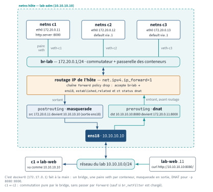
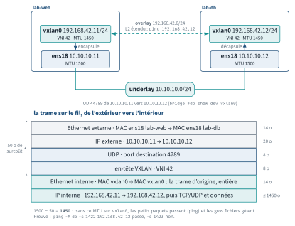
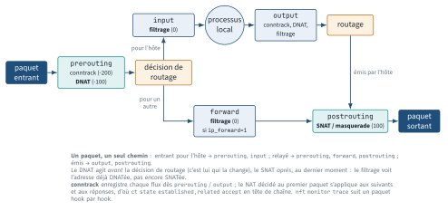
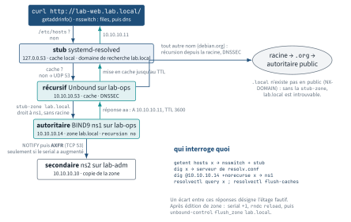

<!-- nav:début -->
[Accueil](../../README.md) › [Parcours](../../docs/parcours.md) › Partie II — Administration système › **Module 13**  
[← Module 12](../12-reseau/README.md) · [Corrigé](corrige.md) · [Module 14 →](../14-ssh/README.md)

<details><summary>Scripts du module (13)</summary>

Sur la VM indiquée en section « Mise en place », depuis `~/workbook/scripts/` (voir [chapitre 0](../../docs/00-mise-en-place.md)).

| Script | Rôle |
|---|---|
| [`setup_M13.sh`](../../scripts/setup/setup_M13.sh) | prépare le module |
| [`check_M13_01.sh`](../../scripts/check/check_M13_01.sh) | vérification |
| [`check_M13_02.sh`](../../scripts/check/check_M13_02.sh) | vérification |
| [`check_M13_03.sh`](../../scripts/check/check_M13_03.sh) | vérification |
| [`check_M13_04.sh`](../../scripts/check/check_M13_04.sh) | vérification |
| [`check_M13_05.sh`](../../scripts/check/check_M13_05.sh) | vérification |
| [`check_M13_06.sh`](../../scripts/check/check_M13_06.sh) | vérification |
| [`break_M13_01.sh`](../../scripts/break/break_M13_01.sh) | installe une panne |
| [`break_M13_02.sh`](../../scripts/break/break_M13_02.sh) | installe une panne |
| [`break_M13_03.sh`](../../scripts/break/break_M13_03.sh) | installe une panne |
| [`break_M13_04.sh`](../../scripts/break/break_M13_04.sh) | installe une panne |
| [`break_M13_05.sh`](../../scripts/break/break_M13_05.sh) | installe une panne |
| [`break_M13_06.sh`](../../scripts/break/break_M13_06.sh) | installe une panne |

</details>
<!-- nav:fin -->

# Module 13 — Réseau Linux avancé : netns, bridges, netfilter, DNS

## 13.0 Objectifs et compétences

> [!NOTE]
> **Objectifs**
>
> À la fin de ce module, je sais :
>
> * décrire le chemin d'un paquet dans le noyau (NIC → pilote → hooks netfilter →
>   décision de routage → socket) et dire, pour un symptôme donné, à quel étage
>   lire les compteurs (`ip -s link`, `ethtool -S`, `nstat`, `conntrack -S`) ;
> * construire à la main, avec `ip netns`, des paires veth et un bridge Linux, un
>   réseau de « conteneurs » routé et NATé, puis reconnaître exactement la même
>   construction dans `docker network inspect` et `nft list ruleset` ;
> * lire `ip route show table all` sans me perdre entre `local`, `main` et
>   `default`, expliquer `via`/`dev`/`src`/`metric`/`onlink`, et mettre en place
>   un routage par politique (`ip rule`, tables nommées, `fwmark`) qui répond par
>   l'interface d'arrivée quand une machine a deux passerelles ;
> * créer une sous-interface 802.1Q, la rendre persistante avec Netplan, la
>   raccorder à un `vmbr` Proxmox VLAN-aware, et prouver au `tcpdump -e` qu'une
>   trame porte bien son tag ;
> * monter un overlay VXLAN entre deux VM, un tunnel WireGuard entre deux autres,
>   choisir le MTU juste et expliquer en quoi flannel, Calico ou Cilium ne font
>   rien d'autre ;
> * agréger deux cartes en `bond0` (active-backup, LACP en notion), lire
>   `/proc/net/bonding/bond0` et observer une bascule pendant qu'on coupe une NIC
>   dans Proxmox ;
> * écrire un jeu de règles nftables complet — tables, chaînes de base sur les
>   cinq hooks, sets, maps, `counter`, `log` — et expliquer chaque verdict ;
> * expliquer conntrack (états, timeouts, `nf_conntrack_max`), pourquoi
>   `ct state established,related accept` est la règle la plus importante d'un
>   pare-feu, comment SNAT/masquerade et DNAT réécrivent un paquet, et pourquoi un
>   DNAT ne marche pas « de l'intérieur » sans hairpin ;
> * suivre un paquet précis dans netfilter avec `nft monitor trace` et lire ce que
>   Docker écrit dans `DOCKER-USER` ;
> * monter un résolveur récursif Unbound (validation DNSSEC, cache, statistiques),
>   une zone `lab.local` faisant autorité sous BIND9 avec sa zone inverse et un
>   secondaire alimenté par AXFR, puis migrer les VM du lab de `/etc/hosts` vers ce
>   DNS ; distinguer récursif, autoritaire, forwarder et cache ;
> * activer IPv6 (ULA) sur le lab, lire `ip -6 neigh` à la place de la table ARP
>   et tester un service en v6 ;
> * mesurer l'effet d'un overlay ou d'un tunnel sur le débit avec `iperf3`, et
>   simuler un réseau dégradé avec `tc netem`.
>
> Temps estimé : 14 h (module copieux, quatre séances : namespaces et routage /
> tunnels et bonding / netfilter / DNS)
> Prérequis : module 12 (iproute2, `dig`, `ss`, `tcpdump`, MTU), module 08
> (systemd). Les politiques de pare-feu (`ufw`, `firewalld`, `fail2ban`) sont au
> module 18 : ici on ouvre le capot de netfilter. Docker (module 22) et
> Kubernetes (module 26) s'appuieront directement sur tout ce module.

---

## 13.1 Mise en place

VM concernées :

* **`lab-adm` (10.10.10.10)** : namespaces, bridges, netfilter, policy routing —
  tout se passe dans des `netns`, le réseau réel de la VM n'est pas touché ;
  secondaire DNS au lab L13.4 ; extrémité WireGuard.
* **`lab-web` (10.10.10.11)** et **`lab-db` (10.10.10.12)** : VXLAN, bonding,
  mesures `iperf3`.
* **`lab-ops` (10.10.10.14)** : résolveur Unbound et serveur BIND9 faisant
  autorité ; autre extrémité WireGuard.
* **`lab-rhel` (10.10.10.13)** : blocs Rocky uniquement.

```bash
# depuis le shell Proxmox, avant de commencer
for v in 9001 9002 9003 9005; do qm snapshot $v avant-lab13; done
```

Paquets (Ubuntu 24.04) :

```bash
sudo apt update
sudo apt install -y iproute2 nftables conntrack tcpdump ethtool iperf3 \
  wireguard-tools bind9-dnsutils python3 mtr-tiny
# lab-ops uniquement
sudo apt install -y unbound bind9 bind9-utils
# lab-adm uniquement (secondaire DNS)
sudo apt install -y bind9 bind9-utils
```

> [!IMPORTANT]
> **Variante Rocky / RHEL**
>
> Sous Rocky 9 : `sudo dnf install -y iproute nftables conntrack-tools tcpdump \
> ethtool iperf3 wireguard-tools bind-utils unbound bind`. Le paquet BIND
> s'appelle `bind`, le service `named.service`, la configuration est dans
> `/etc/named.conf` et les zones dans `/var/named/`. `firewalld` est actif par
> défaut : les labs netfilter de ce module se font sur `lab-adm`, pas sur
> `lab-rhel`, pour ne pas mélanger deux gestionnaires de règles.

Script de préparation, idempotent, à lancer **sur chaque VM concernée** (il
détecte l'hôte) :

```bash
sudo bash ~/workbook/scripts/setup/setup_M13.sh
```

Il installe les paquets, prépare `~/lab13/` (squelettes de scripts, de fichiers
nftables, de zones BIND et de configuration Unbound, gabarits de rapports),
arrête le `dnsmasq` du module 12 sur `lab-adm` (il occupe `10.10.10.10:53`, que
le secondaire BIND va prendre) et pose sur `lab-ops` l'adresse de service du
résolveur, `10.10.10.53/24`, de façon volatile — tu la rendras persistante au
lab L13.4.

> [!CAUTION]
> **Attention**
>
> `ufw` ou une politique nftables déjà active (module 18) interférerait avec les
> labs netfilter : sur `lab-adm`, vérifie `sudo ufw status` (doit être
> `inactive`) et `sudo nft list ruleset` (doit être vide ou ne contenir que tes
> tables de ce module). Les labs VXLAN, bonding et WireGuard modifient des
> interfaces réelles : garde une console Proxmox ouverte (`qm terminal 9002`).

---

## 13.2 Rappel express

### Le chemin d'un paquet, et où lire les compteurs

```text
 fil  -> NIC (ring RX) -> pilote (NAPI, GRO) -> netfilter PREROUTING
      -> décision de routage
           |-- pour moi   -> INPUT   -> socket (file d'accept, buffer)
           `-- à relayer -> FORWARD -> POSTROUTING -> qdisc (tc) -> NIC (TX)
 processus -> socket -> routage -> OUTPUT -> POSTROUTING -> qdisc -> NIC
```

| Étage | Compteur | Commande |
|---|---|---|
| NIC / pilote | `rx_missed`, `rx_dropped`, ring plein | `ethtool -S ens18`, `ethtool -g` |
| interface | `RX errors/dropped`, `TX carrier` | `ip -s -s link show ens18` |
| IP / TCP / UDP | `InDiscards`, `RetransSegs`, `InErrors` | `nstat -az`, `/proc/net/snmp` |
| conntrack | `drop`, `insert_failed`, `early_drop` | `conntrack -S` |
| pare-feu | `counter packets N` | `nft list ruleset` |
| socket | `Recv-Q`, `Send-Q`, file d'accept | `ss -tlnp`, `ss -tmi` |

`ethtool -k ens18` liste les *offloads* (TSO, GSO, GRO, checksum) : quand
`tcpdump` montre des « paquets » de 64 ko ou des sommes de contrôle fausses,
c'est l'offload, pas le réseau. `ethtool -K ens18 gro off` pour tester.
`ethtool ens18` donne vitesse et duplex (souvent `Unknown!` sur virtio, c'est
normal).

Files d'attente de sortie : `tc qdisc show dev ens18` (`fq_codel` par défaut).
Simuler un réseau dégradé — indispensable en lab :

```bash
sudo tc qdisc add dev ens18 root netem delay 100ms 20ms loss 5%
sudo tc qdisc change dev ens18 root netem delay 300ms   # modifier
sudo tc -s qdisc show dev ens18                          # compteurs
sudo tc qdisc del dev ens18 root                         # retirer
sudo tc qdisc add dev ens18 root tbf rate 10mbit burst 32kbit latency 400ms
```

### Namespaces réseau, veth, bridge

Un netns isole : interfaces, adresses, routes, règles `ip rule`, table de
voisinage, jeu de règles netfilter, conntrack, sockets, `/proc/sys/net/*`.
Chaque netns a son propre `lo`, **down par défaut**.

```bash
ip netns add bleu                    # crée /run/netns/bleu
ip netns list
ip -n bleu link                      # -n = -netns : exécute la commande dedans
ip netns exec bleu bash              # shell dans le netns
nsenter --net=/run/netns/bleu ss -tlnp
ip netns identify $$ ; ip netns pids bleu
ip netns del bleu                    # détruit tout ce qu'il contient
```

Paire veth = câble virtuel à deux bouts ; bridge = commutateur virtuel :

```bash
ip link add v-bleu type veth peer name v-rouge
ip link set v-bleu netns bleu ; ip link set v-rouge netns rouge
ip -n bleu addr add 10.0.0.1/24 dev v-bleu ; ip -n bleu link set v-bleu up
ip -n bleu link set lo up
ip link add br-lab type bridge ; ip link set br-lab up
ip link add veth-c1 type veth peer name eth0 netns c1   # un bout direct dans c1
ip link set veth-c1 master br-lab up
bridge link show                     # ports du bridge, état STP
bridge fdb show br br-lab            # table MAC -> port (la CAM du switch)
ip link set br-lab type bridge stp_state 1              # STP, notion
```

Le bridge lui-même peut porter une adresse : c'est alors la passerelle des
netns raccordés (exactement `docker0` / `172.17.0.1`). Pour relayer vers
l'extérieur : `sysctl -w net.ipv4.ip_forward=1` + `masquerade`. Si le module
`br_netfilter` est chargé (Docker, Kubernetes), le trafic **entre ports d'un
même bridge** passe aussi par la chaîne `forward` de netfilter
(`net.bridge.bridge-nf-call-iptables=1`) : sans lui, non.

<p align="center"></p>

*Figure — Le mini-Docker du lab L13.1 : trois netns reliés par des paires veth à `br-lab` 172.20.0.1/24, `ip_forward`, masquerade en sortie par `ens18` et DNAT du port 8080 vers c1.*

### Routage en profondeur

```bash
ip route show table all         # main + local + tables nommées
ip route show table local       # routes local/broadcast posées par le noyau
ip rule                         # 0 local, 32766 main, 32767 default
ip route get 10.10.30.5 from 10.10.12.2 iif eth2   # simule un paquet relayé
ip route add 10.10.30.0/24 via 10.10.10.99 dev ens18 onlink   # gw hors LAN
ip route add default nexthop via 10.10.10.1 weight 1 \
                     nexthop via 10.10.11.1 weight 1        # ECMP (notion)
```

| Champ | Sens |
|---|---|
| `via X` | prochain saut (doit être joignable en L2, sauf `onlink`) |
| `dev X` | interface de sortie ; seul → route directe (`scope link`) |
| `src X` | adresse source **préférée** pour le trafic local |
| `metric N` | priorité entre routes identiques, plus bas gagne |
| `proto kernel/static/dhcp/bird` | qui a posé la route |

Policy routing : `ip rule` choisit la **table**, la table choisit la route.

```bash
echo "200 gw2" | sudo tee /etc/iproute2/rt_tables.d/lab.conf   # nom de table
ip route add default via 10.10.12.1 dev eth2 table gw2
ip rule add from 10.10.12.2 table gw2 priority 100     # routage par source
ip rule add fwmark 0x2 table gw2 priority 110          # par marque netfilter
ip route show table gw2 ; ip rule show ; ip route flush cache
```

Cas réel : deux interfaces, deux passerelles. Sans règle, la **réponse** sort
toujours par la route par défaut, donc par la mauvaise carte pour la moitié des
clients : « ça ping mais la connexion tombe », ou `rp_filter` jette tout.

### VLAN 802.1Q

```bash
ip link add link ens18 name ens18.10 type vlan id 10
ip -d link show ens18.10                # "vlan protocol 802.1Q id 10"
tcpdump -i ens18 -nn -e vlan 10         # -e : en-tête Ethernet, tag visible
```

```yaml
# Netplan
  vlans:
    ens18.10: {id: 10, link: ens18, addresses: [10.10.20.10/24]}
```

Trunk = lien qui transporte plusieurs VLAN tagués ; access = un seul VLAN,
non tagué. Proxmox : `bridge-vlan-aware yes` sur `vmbr1`, puis soit la VM tague
elle-même (trunk vers la VM), soit `qm set 9001 --net0 virtio,bridge=vmbr1,tag=10`
et la VM ne voit rien du VLAN (access).

### Tunnels et overlays

| Type | Surcoût | MTU utile | Commande de création |
|---|---|---|---|
| VXLAN (UDP 4789) | 50 o | 1450 | `ip link add vxlan0 type vxlan id 42 ...` |
| GRE (proto 47) | 24 o | 1476 | `ip tunnel add gre1 mode gre ...` |
| IPIP (proto 4) | 20 o | 1480 | `ip tunnel add ipip1 mode ipip ...` |
| WireGuard (UDP) | 60-80 o | 1420 | `wg-quick up wg0` |

```bash
ip link add vxlan0 type vxlan id 42 local 10.10.10.11 remote 10.10.10.12 \
   dstport 4789 dev ens18
ip link set vxlan0 mtu 1450 up ; ip addr add 192.168.42.11/24 dev vxlan0
ip link add vxlan1 type vxlan id 43 group 239.1.1.1 dstport 4789 dev ens18
bridge fdb show dev vxlan0            # 00:00:00:00:00:00 dst 10.10.10.12
ip -d link show vxlan0
```

<p align="center"></p>

*Figure — lab-web lab-db vxlan0 192.168.42.11/24 VNI 42 · MTU 1450 ens18 10.10.10.11 MTU 1500 vxlan0 192.168.42.12/24 VNI 42 · MTU 1450 ens18 10.10.10.12 MTU 1500 encapsule décapsule overlay 192.168.42.0/24 L2 étendu : `ping 192.168.42.12` underlay 10.10.10.0/24 UDP 4789 de 10.10.10.11 vers 10.10.10.12 (`bridge fdb show dev vxlan0`) la trame sur le fil, de l'extérieur vers l'intérieur lab-web et lab-db sur l'underlay 10.10.10.0/24, `vxlan0` (VNI 42, UDP 4789) formant l'overlay 192.168.42.0/24, et la pile d'encapsulation qui explique le MTU 1450.*

VXLAN encapsule une **trame Ethernet** complète dans UDP : c'est un L2 étendu
sur un réseau L3. flannel (backend `vxlan`) crée exactement un `flannel.1`
de ce type sur chaque nœud Kubernetes ; Calico utilise IPIP ou VXLAN ; Cilium
VXLAN ou Geneve. WireGuard : une clé par pair, `AllowedIPs` sert à la fois de
filtre et de table de routage (« cryptokey routing »).

```ini
# /etc/wireguard/wg0.conf (lab-adm)
[Interface]
Address = 10.99.0.1/24
ListenPort = 51820
PrivateKey = <wg genkey>
[Peer]
PublicKey = <clé publique de lab-ops>
AllowedIPs = 10.99.0.2/32
Endpoint = 10.10.10.14:51820
PersistentKeepalive = 25
```

`wg genkey | tee priv | wg pubkey > pub`, `wg show`, `systemctl enable --now
wg-quick@wg0`.

### Bonding

| Mode | Numéro | Switch requis | Usage |
|---|---|---|---|
| `active-backup` | 1 | non | tolérance de panne simple |
| `802.3ad` (LACP) | 4 | oui, LACP | agrégation + tolérance |
| `balance-xor` / `balance-rr` | 2 / 0 | config statique | rare |
| `balance-tlb` / `balance-alb` | 5 / 6 | non | équilibrage sans switch |

```bash
ip link add bond0 type bond mode active-backup miimon 100
ip link set ens19 down ; ip link set ens19 master bond0   # idem ens20
cat /proc/net/bonding/bond0            # état, esclave actif, compteurs
cat /sys/class/net/bond0/bonding/active_slave
```

```yaml
# Netplan
  bonds:
    bond0:
      interfaces: [ens19, ens20]
      addresses: [172.31.0.12/24]
      parameters:
        mode: active-backup
        primary: ens19
        mii-monitor-interval: 100
```

Proxmox coupe une NIC sans toucher à la VM :
`qm set 9003 --net1 "$(qm config 9003 | awk '/^net1:/{print $2}'),link_down=1"`.
Bridge Linux natif (`vmbr0`) suffit à Proxmox ; Open vSwitch (`ovs-vsctl`)
apporte OpenFlow, VXLAN intégré, mirroring — c'est ce que pilote OpenStack.

### Netfilter : hooks, nftables, conntrack, NAT

Cinq hooks : `prerouting`, `input`, `forward`, `output`, `postrouting`. Une
**chaîne de base** s'accroche à un hook avec un type et une priorité ; les
chaînes régulières sont appelées par `jump`/`goto`.

<p align="center"></p>

*Figure — Le chemin d'un paquet dans netfilter : DNAT avant la décision de routage, filtrage en `input` ou `forward`, SNAT/masquerade en `postrouting`, conntrack qui suit tout le flux.*

```bash
nft list ruleset ; nft -a list ruleset            # -a : handles
nft add table inet filter
nft add chain inet filter input \
  '{ type filter hook input priority 0; policy drop; }'
nft add rule inet filter input ct state established,related accept
nft add rule inet filter input ct state invalid drop
nft add rule inet filter input iif lo accept
nft add rule inet filter input tcp dport { 22, 80 } counter accept
nft add rule inet filter input log prefix '"in-drop: "' counter drop
nft add set inet filter admin '{ type ipv4_addr; elements = { 10.10.10.10 } }'
nft add rule inet filter input ip saddr @admin accept
nft delete rule inet filter input handle 7
nft -f /etc/nftables.conf ; nft flush ruleset
nft add rule inet filter input tcp dport 8080 meta nftrace set 1
nft monitor trace                                 # suit le paquet hook par hook
```

Priorités : `raw -300`, `mangle -150`, `dstnat -100`, `filter 0`,
`security 50`, `srcnat 100` ; conntrack s'insère à `-200`. Types : `filter`,
`route` (output, re-décision de routage après marquage), `nat`.
Verdicts : `accept`, `drop`, `reject [with ...]`, `jump`, `goto`, `return`,
`continue`. `iptables-nft` écrit dans le même noyau ; `iptables-translate -A
INPUT ...` donne la syntaxe `nft`.

conntrack : table de flux (`conntrack -L`, `-E` en direct, `-S` stats,
`-F` vide). États : `new` (premier paquet), `established` (vu dans les deux
sens), `related` (ICMP d'erreur, FTP-data), `invalid` (hors machine à états),
`untracked`. Timeouts : TCP établi 5 jours, UDP 30 s (`nf_conntrack_udp_
timeout`), `time_wait` 120 s. `nf_conntrack_max` (65 536 typique) atteint →
`dmesg` : `nf_conntrack: table full, dropping packet` — les **nouvelles**
connexions échouent, les anciennes continuent.

NAT (table `ip nat`, chaînes de type `nat`) :

```bash
nft add table ip nat
nft add chain ip nat postrouting '{ type nat hook postrouting priority 100; }'
nft add rule ip nat postrouting ip saddr 172.20.0.0/24 oifname "ens18" \
    masquerade
nft add chain ip nat prerouting '{ type nat hook prerouting priority -100; }'
nft add rule ip nat prerouting iifname "ens18" tcp dport 8080 \
    dnat to 172.20.0.11:8000
nft add chain ip nat output '{ type nat hook output priority -100; }'  # local
```

Le NAT est décidé sur le **premier** paquet du flux et mémorisé dans
conntrack ; les suivants (et les retours) sont réécrits sans repasser par les
règles. D'où : sans conntrack, pas de NAT ; `conntrack -F` sur un routeur NAT
coupe les sessions. Un DNAT en `prerouting` ne voit **pas** les paquets émis
par la machine elle-même (ils passent par `output`); et pour un client situé
sur le même segment que la cible, il faut en plus un SNAT de retour (hairpin), sinon la réponse court-circuite le routeur.

Docker : chaînes `DOCKER`, `DOCKER-USER`, `DOCKER-ISOLATION-STAGE-1/2` dans
`filter`, `DOCKER` dans `nat`. Seule `DOCKER-USER` est réservée à
l'administrateur et survit aux redémarrages du démon.

### DNS côté serveur

| Rôle | Ce qu'il fait | Logiciel typique |
|---|---|---|
| autoritaire | répond `aa` pour **ses** zones, ne résout rien d'autre | BIND9, NSD, Knot |
| récursif | part de la racine, suit les délégations, cache, valide DNSSEC | Unbound, BIND9 |
| forwarder | relaie tout à un autre récursif, cache | dnsmasq, resolved |
| stub | `127.0.0.53`, cache local, transmet à un serveur | systemd-resolved |

CoreDNS (Kubernetes) est un autoritaire pour `cluster.local` **et** un forwarder
pour le reste : un serveur, deux rôles, comme Unbound + stub-zone ici.

<p align="center"></p>

*Figure — Le chemin réel de `curl lab-web.lab.local` : stub `systemd-resolved`, récursif Unbound (cache, `stub-zone`), autoritaire BIND9 ns1 et son secondaire par AXFR ; `.local` n'existe pas en public.*

Unbound (`/etc/unbound/unbound.conf.d/*.conf`) : `interface:`,
`access-control:`, `stub-zone:` (délègue une zone à un autoritaire),
`forward-zone:` (relaie, `forward-tls-upstream: yes` pour DoT),
`domain-insecure:` (zone privée non signée), `unbound-checkconf`,
`unbound-control stats | flush_zone lab.local | dump_cache | reload`.

BIND9 (`/etc/bind/named.conf.{options,local}`, zones dans `/etc/bind/zones/`,
secondaires écrits dans `/var/cache/bind/`) :

```text
zone "lab.local" { type primary; file "/etc/bind/zones/db.lab.local";
                   allow-transfer { 10.10.10.10; };
                   also-notify { 10.10.10.10; }; };
zone "lab.local" { type secondary; primaries { 10.10.10.14; };
                   file "db.lab.local"; };
```

Fichier de zone : `$TTL`, `$ORIGIN`, `SOA` (serial, refresh, retry, expire,
TTL négatif), `NS`, `A`/`AAAA`, `CNAME` (jamais à l'apex, jamais cible d'un
`MX`), `MX prio cible`, `TXT`, `SRV prio poids port cible`, `PTR` dans
`10.10.10.in-addr.arpa`. **Le serial doit augmenter** à chaque modification,
sinon les secondaires ne transfèrent rien. `named-checkconf -z`,
`named-checkzone lab.local db.lab.local`, `rndc reload`, `rndc retransfer
lab.local`, `rndc querylog on`, `dig @10.10.10.14 lab.local AXFR`,
`dig +norecurse @10.10.10.14 x`, `dig +trace x`, `dig +dnssec x` (flag `ad`).

Côté client : `resolvectl dns ens18 10.10.10.53` + `resolvectl domain ens18
lab.local` (volatile) ou Netplan `nameservers:`. `.local` est réservé à mDNS
(RFC 6762) : `systemd-resolved` ne l'envoie au DNS unicast que si `lab.local`
est déclaré en domaine de recherche.

### IPv6 pratique

`fe80::/10` link-local automatique ; ULA `fd00::/8` pour le privé ; SLAAC =
l'hôte fabrique son adresse depuis le préfixe annoncé par le routeur (RA),
DHCPv6 = attribution centralisée (sans passerelle : elle vient toujours du RA).
`ip -6 addr`, `ip -6 route`, `ip -6 neigh` (ND remplace ARP : `REACHABLE`,
`STALE`), `ping -6`, `ss -6`, `sysctl net.ipv6.conf.ens18.accept_ra`.
Netplan : `addresses: [10.10.10.10/24, 'fd00:10:10:10::10/64']`.

### Diagnostic avancé

```bash
tcpdump -i any -nn -e vlan                # tags et MAC visibles
tcpdump -i ens18 -nn 'udp port 4789'      # trafic VXLAN encapsulé
ss -K dst 10.10.10.99                     # tue des connexions
nstat -az | grep -E 'TcpRetransSegs|TcpExtListenDrops|IpInDiscards'
awk '/^Tcp:/' /proc/net/snmp
mtr --tcp -P 443 -rwc 10 www.ubuntu.com   # traceroute TCP, rapport
iperf3 -c 192.168.42.12 -t 10             # débit via l'overlay
dropwatch -l kas                          # où le noyau jette (notion)
```

### Pièges classiques

* `lo` est down dans un netns neuf : `ip -n X link set lo up`, sinon pas de
  `127.0.0.1`.
* Bridge sans `ip link set ... up`, veth avec un seul bout monté : `NO-CARRIER`.
* `ip_forward=0` : le routeur reçoit, ne relaie rien, aucune erreur.
* Chaîne `forward` en `policy drop` sans `established,related` : le SYN passe,
  le SYN-ACK est jeté.
* MTU 1500 sur un VXLAN : petits paquets OK, gros paquets jetés ou fragmentés.
* Serial SOA non incrémenté : le secondaire ne transfère jamais, sans erreur.
* Unbound qui interroge un forwarder mort : `SERVFAIL` après 2-3 s, `lab.local`
  (stub-zone) continue de répondre — c'est l'indice.

---

## 13.3 Quiz — QCM

<a id="q13-1"></a>**[Q13.1](corrige.md#q13-1)** — Sur `lab-adm`, tu viens de créer un namespace :

```bash
sudo ip netns add c1
sudo ip netns exec c1 ping -c1 127.0.0.1
```

Le `ping` répond `connect: Network is unreachable`. Pourquoi ?

a) le namespace n'a pas de table de routage tant qu'on n'a pas ajouté une route
b) `lo` existe dans le nouveau netns mais est `DOWN` : il faut le monter
c) ICMP est bloqué par défaut dans un netns
d) `ping` doit être lancé avec `nsenter`, pas `ip netns exec`

<a id="q13-2"></a>**[Q13.2](corrige.md#q13-2)** — `sudo ip -n c1 link` affiche :

```text
1: lo: <LOOPBACK,UP,LOWER_UP> mtu 65536 ...
5: eth0@if6: <BROADCAST,MULTICAST,UP,LOWER_UP> mtu 1500 ...
```

Que signifie `@if6` ?

a) `eth0` est une sous-interface VLAN d'index 6
b) `eth0` est un bout de veth dont le pair a l'index 6 dans un autre namespace
c) `eth0` est esclave du bond d'index 6
d) l'interface a 6 files d'attente

<a id="q13-3"></a>**[Q13.3](corrige.md#q13-3)** — Trois netns sont raccordés au bridge `br-lab` (`172.20.0.1/24`),
`ip_forward=1`, et la règle `masquerade` est en place. Depuis `c1`,
`ping 172.20.0.12` fonctionne, `ping 10.10.10.11` fonctionne, mais
`ping 172.20.0.1` **ne répond pas**. Que peux-tu affirmer ?

a) le bridge est `DOWN`, sinon rien ne passerait
b) le trafic vers l'adresse du bridge est du trafic `input` du netns racine :
   une règle de pare-feu `input` de `lab-adm` le jette, alors que `forward`
   laisse passer
c) `masquerade` réécrit aussi les paquets vers `172.20.0.1`
d) il manque une route vers `172.20.0.1` dans `c1`

<a id="q13-4"></a>**[Q13.4](corrige.md#q13-4)** — `ip rule` affiche :

```text
0:      from all lookup local
100:    from 10.10.12.2 lookup gw2
32766:  from all lookup main
32767:  from all lookup default
```

Un paquet part de `10.10.12.2` vers `10.10.12.50`, qui est sur le segment
directement connecté de `eth2`. La table `gw2` ne contient que
`default via 10.10.12.1 dev eth2`. Par où sort le paquet ?

a) via `10.10.12.1`, la table `gw2` est consultée en premier et sa route par
   défaut matche
b) directement par `eth2` sans passerelle : `local` ne matche pas, `gw2` n'a pas
   de route plus spécifique... donc `main` est consultée ensuite
c) le paquet est rejeté : une règle qui matche et une table sans route directe
   donnent `Network is unreachable`
d) le paquet est jeté par `rp_filter`, puisque source et table ne concordent pas

<a id="q13-5"></a>**[Q13.5](corrige.md#q13-5)** — Dans nftables, quelle est la différence entre une chaîne de base et
une chaîne régulière ? **Deux réponses correctes.**

a) une chaîne de base déclare `type ... hook ... priority ...` et reçoit les
   paquets directement du noyau
b) une chaîne régulière n'est traversée que sur `jump` ou `goto`
c) une chaîne de base ne peut contenir que des verdicts `accept`/`drop`
d) une chaîne régulière est réservée à la table `nat`

<a id="q13-6"></a>**[Q13.6](corrige.md#q13-6)** — Une chaîne `forward` avec `policy drop` contient uniquement
`iifname "br-lab" oifname "ens18" accept`. Depuis un netns derrière `br-lab`,
`curl http://10.10.10.11/` reste bloqué puis expire. `tcpdump -i ens18` sur
`lab-adm` montre le `SYN` sortant et le `SYN-ACK` entrant. Quelle est la cause ?

a) il manque `masquerade`
b) le `SYN-ACK` entre par `ens18` vers `br-lab` : aucune règle ne l'accepte, il
   faut `ct state established,related accept`
c) le serveur web refuse l'IP source privée
d) `ip_forward` est à 0

<a id="q13-7"></a>**[Q13.7](corrige.md#q13-7)** — `sudo conntrack -L` affiche cette ligne :

```text
tcp 6 431999 ESTABLISHED src=172.20.0.11 dst=10.10.10.11 sport=40312 dport=80 \
  src=10.10.10.11 dst=10.10.10.10 sport=80 dport=40312 [ASSURED] mark=0 use=1
```

Que peux-tu lire ? **Deux réponses correctes.**

a) le flux est NATé : le tuple de retour attend une réponse vers `10.10.10.10`,
   pas vers `172.20.0.11`
b) le flux expire dans 431 999 s, soit environ 5 jours, s'il reste silencieux
c) le flux est en `TIME-WAIT`
d) `[ASSURED]` signifie que le paquet a été accepté par le pare-feu

<a id="q13-8"></a>**[Q13.8](corrige.md#q13-8)** — `dmesg` sur un routeur NAT : `nf_conntrack: table full, dropping
packet`. Les sessions SSH déjà ouvertes fonctionnent, les nouvelles échouent.
Quelle action est **correcte et immédiate** ?

a) `conntrack -F` : ça vide la table, les sessions existantes se rétablissent
   toutes seules
b) augmenter `net.netfilter.nf_conntrack_max` (et `nf_conntrack_buckets`),
   puis chercher qui remplit la table avec `conntrack -L | awk` par source
c) redémarrer le service réseau
d) désactiver conntrack en supprimant toutes les règles `ct`

<a id="q13-9"></a>**[Q13.9](corrige.md#q13-9)** — Règle `dnat to 172.20.0.11:8000` sur `tcp dport 8080` dans une
chaîne `prerouting`. Depuis `lab-web`, `curl http://10.10.10.10:8080/`
fonctionne. Depuis `lab-adm` lui-même, `curl http://10.10.10.10:8080/` renvoie
`Connection refused`. Pourquoi ?

a) le port 8080 est fermé pour les connexions locales
b) les paquets émis localement ne traversent pas `prerouting` mais `output` :
   il faut une chaîne `type nat hook output` avec le même DNAT
c) le DNAT ne s'applique qu'aux adresses sources externes
d) `curl` utilise `127.0.0.1` et non `10.10.10.10`

<a id="q13-10"></a>**[Q13.10](corrige.md#q13-10)** — Deux VM montent un VXLAN (`id 42`, `dstport 4789`) au-dessus
d'`ens18` (MTU 1500). L'admin a laissé `vxlan0` en MTU 1500. Quel est le
symptôme le plus probable ?

a) l'interface refuse de monter
b) `ping` passe, `ssh` ouvre une session, mais `scp` d'un gros fichier gèle ou
   plafonne : les trames de 1500 o deviennent 1550 o et sont fragmentées ou jetées
c) aucun : le noyau ajuste le MTU automatiquement
d) les deux extrémités ne voient pas la même VNI

<a id="q13-11"></a>**[Q13.11](corrige.md#q13-11)** — Dans un fichier `wg0.conf`, à quoi sert `AllowedIPs` côté client ?
**Deux réponses correctes.**

a) c'est le filtre des sources acceptées **depuis** ce pair
b) c'est la liste des destinations routées **vers** ce pair (cryptokey routing)
c) c'est l'adresse de l'interface locale
d) c'est la liste des serveurs DNS poussés par le pair

<a id="q13-12"></a>**[Q13.12](corrige.md#q13-12)** — `cat /proc/net/bonding/bond0` :

```text
Bonding Mode: fault-tolerance (active-backup)
Currently Active Slave: ens20
MII Status: up
Slave Interface: ens19
MII Status: down
Link Failure Count: 1
Slave Interface: ens20
MII Status: up
```

Que s'est-il passé ?

a) `ens20` n'a jamais été esclave, il vient d'être ajouté
b) `ens19`, esclave primaire, a perdu sa porteuse une fois ; le bond a basculé
   sur `ens20` et le trafic continue
c) le bond est en panne, aucun esclave n'est actif
d) le mode LACP a échoué à négocier

<a id="q13-13"></a>**[Q13.13](corrige.md#q13-13)** — Sur `lab-adm`, `tcpdump -i ens18 -nn -e vlan 10` ne montre que les requêtes ARP sortantes, jamais de réponse,
alors que `ip -d link show ens18.10` prouve que la sous-interface existe;
`ping` sur ce VLAN ne répond pas. Que vérifies-tu en priorité côté Proxmox ?

a) que la VM a au moins 2 vCPU
b) que `vmbr1` est `bridge-vlan-aware yes` et que le port de la VM n'est pas
   déjà en mode access (`tag=`), sinon les trames taguées sont jetées ou
   retaguées par le bridge
c) que le MTU de `vmbr1` est 9000
d) que `tcpdump` a été lancé avec `-i any`

<a id="q13-14"></a>**[Q13.14](corrige.md#q13-14)** — `dig @10.10.10.14 lab-web.lab.local` répond avec les flags
`qr aa rd` et `dig @10.10.10.14 www.ubuntu.com` répond `status: REFUSED`.
Quel rôle joue `10.10.10.14` ?

a) un résolveur récursif mal configuré
b) un serveur faisant autorité pour `lab.local`, avec `recursion no`
c) un forwarder vers un amont mort
d) un serveur qui bloque `dig`

<a id="q13-15"></a>**[Q13.15](corrige.md#q13-15)** — Tu ajoutes un enregistrement `A` dans `db.lab.local` sur le
primaire, `rndc reload`, et `dig @10.10.10.14` le renvoie. Trente minutes plus
tard, `dig @10.10.10.10` (secondaire) ne le connaît toujours pas, sans aucune
erreur dans ses journaux. Cause la plus probable ?

a) le secondaire n'a pas `allow-transfer`
b) le serial du `SOA` n'a pas été incrémenté : le secondaire compare les
   serials et conclut qu'il est à jour
c) le TTL de l'enregistrement est trop long
d) le port 53 UDP est filtré entre les deux (AXFR passe en UDP)

<a id="q13-16"></a>**[Q13.16](corrige.md#q13-16)** — Sur `lab-ops`, Unbound écoute sur `10.10.10.53` et BIND9 sur
`10.10.10.14`, tous deux sur le port 53, plus `systemd-resolved` sur
`127.0.0.53`. Ça fonctionne. Pourquoi n'y a-t-il pas de conflit ?

a) parce qu'ils utilisent `SO_REUSEPORT`
b) parce que chacun se lie à une adresse **précise** et non à `0.0.0.0` : trois
   sockets `addr:53` distincts peuvent coexister
c) parce que BIND9 écoute en TCP et Unbound en UDP
d) parce que `systemd-resolved` se désactive quand un autre serveur DNS est
   installé

<a id="q13-17"></a>**[Q13.17](corrige.md#q13-17)** — `ip -6 neigh show dev ens18` affiche `fd00:10:10:10::11 lladdr
bc:24:11:aa:bb:cc STALE`. Que signifie `STALE` ?

a) le voisin est injoignable, l'entrée est en échec
b) l'entrée est connue mais non confirmée récemment ; elle sera re-vérifiée
   au prochain paquet envoyé (Neighbor Unreachability Detection)
c) l'adresse a changé de MAC
d) l'entrée est statique, posée à la main

<a id="q13-18"></a>**[Q13.18](corrige.md#q13-18)** — Sur `lab-ops` où tourne Docker, `iptables -S FORWARD` montre
`-A FORWARD -j DOCKER-USER` en première position. Tu veux interdire à
`10.10.10.0/24` d'atteindre les ports publiés des conteneurs. Où mets-tu la
règle pour qu'elle survive à un `systemctl restart docker` ?

a) dans `DOCKER`, avant les règles générées
b) dans `DOCKER-USER`, la seule chaîne que Docker ne réécrit pas
c) dans `INPUT`, les ports publiés sont du trafic local
d) dans `/etc/docker/daemon.json` avec `"iptables": false`

---

## 13.4 Quiz — questions ouvertes

<a id="qo13-1"></a>**[QO13.1](corrige.md#qo13-1)** — *On te demande en entretien* : « Explique-moi ce que fait Docker
quand je lance `docker run -p 8080:80 nginx`, côté réseau, sans parler de
Docker. » Donne la séquence exacte d'objets noyau créés (namespace, veth,
bridge, routes, règles netfilter) et, pour chacun, la commande `ip`/`nft` qui
le reproduit à la main.

<a id="qo13-2"></a>**[QO13.2](corrige.md#qo13-2)** — Décris le chemin d'un paquet TCP qui arrive sur `ens18` de
`lab-adm` à destination d'un netns derrière `br-lab` via un DNAT : à quel
hook la destination est-elle réécrite, où la décision de routage est-elle
prise, quelle chaîne le paquet traverse ensuite, comment le paquet de retour
retrouve son adresse publique, et à quel moment conntrack intervient.

<a id="qo13-3"></a>**[QO13.3](corrige.md#qo13-3)** — Une machine a deux interfaces sur deux réseaux, chacune avec sa
passerelle. Les clients du réseau B se plaignent : le `ping` passe mais toute
connexion TCP échoue ou se coupe. Explique le mécanisme (route asymétrique,
`rp_filter`, pare-feu stateful en face), puis donne la configuration `ip rule` +
+ table dédiée qui corrige, et la commande qui **prouve** la correction sans
envoyer un seul paquet.

<a id="qo13-4"></a>**[QO13.4](corrige.md#qo13-4)** — Compare `ct state established,related accept` en tête de chaîne
avec une approche « sans état » qui autoriserait `tcp sport 80` en entrée.
Explique ce que conntrack apporte, ce que `related` couvre concrètement, ce que
`invalid` désigne, et pourquoi un routeur qui perd sa table conntrack (`conntrack
-F`, reboot) coupe les sessions NATées mais pas les sessions non NATées.

<a id="qo13-5"></a>**[QO13.5](corrige.md#qo13-5)** — *On te demande en entretien* : « Un DNAT de port fonctionne depuis
l'extérieur mais pas depuis le LAN interne où se trouve le serveur cible. »
Explique le problème du hairpin NAT : trajet du SYN, trajet du SYN-ACK, pourquoi
le client reçoit une réponse d'une adresse qu'il ne connaît pas, et les deux
solutions (SNAT de retour ou split-horizon DNS).

<a id="qo13-6"></a>**[QO13.6](corrige.md#qo13-6)** — VXLAN, GRE, IPIP, WireGuard : pour chacun, ce qui est encapsulé
(trame ou paquet), le protocole porteur, le surcoût, si c'est chiffré, et un cas
d'usage typique. Termine par le lien avec Kubernetes : que fait précisément
`flannel.1` sur un nœud, et pourquoi le MTU des pods est 1450.

<a id="qo13-7"></a>**[QO13.7](corrige.md#qo13-7)** — Explique la différence entre un serveur DNS **autoritaire**, un
**récursif**, un **forwarder** et un **cache**. Dans le lab, qui répond quand
`lab-web` demande `www.ubuntu.com`, et qui répond pour `lab-db.lab.local` ?
Donne pour chaque cas la séquence complète des serveurs interrogés et les flags
`dig` qui le prouvent.

<a id="qo13-8"></a>**[QO13.8](corrige.md#qo13-8)** — Un transfert de zone : décris le mécanisme complet entre primaire
et secondaire (NOTIFY, SOA, comparaison de serial, AXFR/IXFR, refresh/retry/
expire), ce que devient la zone sur le secondaire si le primaire disparaît deux
semaines, et les trois erreurs de configuration qui empêchent silencieusement le
transfert.

<a id="qo13-9"></a>**[QO13.9](corrige.md#qo13-9)** — Un collègue propose de « désactiver IPv6 partout, on ne s'en sert
pas ». Explique ce qu'un hôte Linux fait en IPv6 sans aucune configuration
(link-local, ND, RA), en quoi c'est utile à Kubernetes et Docker, ce qui casse
réellement quand on met `disable_ipv6=1`, et ce que tu proposes à la place
(ULA, filtrage, `accept_ra`).

<a id="qo13-10"></a>**[QO13.10](corrige.md#qo13-10)** — `iperf3` donne 9,4 Gbit/s en direct entre `lab-web` et `lab-db`,
5,1 Gbit/s à travers le VXLAN et 1,8 Gbit/s à travers WireGuard. Explique d'où
vient chaque écart (encapsulation, perte des offloads, chiffrement, MTU,
copies mémoire), quel compteur ou outil le confirmerait, et ce qu'on peut
régler sans changer de technologie.

---

## 13.5 Exercices guidés ★

Sauf mention contraire, les exercices se font sur `lab-adm`, dans des netns :
rien de ce que tu fais ici ne touche `ens18`.

<a id="e13-1"></a>**[E13.1](corrige.md#e13-1)** — Affiche, pour `ens18`, les compteurs détaillés d'erreurs et de
pertes (avec les sous-compteurs `rx_missed`, `rx_over`), la liste des offloads
actifs, la taille des anneaux RX/TX et le nombre de files. Dis lequel de ces
quatre affichages est vide ou « inconnu » sur une VM virtio et pourquoi.

<a id="e13-2"></a>**[E13.2](corrige.md#e13-2)** — Ajoute 200 ms de latence et 10 % de perte sur `lo` de `lab-adm`,
prouve l'effet avec `ping 127.0.0.1` (latence **aller-retour** observée :
explique la valeur), puis retire la dégradation et prouve qu'elle a disparu.

<a id="e13-3"></a>**[E13.3](corrige.md#e13-3)** — Crée deux netns `bleu` et `rouge` reliés par une paire veth en
`10.0.0.1/24` et `10.0.0.2/24`. Fais-les se répondre en `ping`. Puis, depuis
`bleu`, liste ses interfaces, ses routes, ses règles nftables et ses sockets :
prouve que chacun de ces quatre éléments est distinct de ceux du netns racine.

<a id="e13-4"></a>**[E13.4](corrige.md#e13-4)** — Sans `ip netns exec`, entre dans le netns `bleu` avec `nsenter` et
lance un `python3 -m http.server 8000` dedans, en arrière-plan. Depuis `rouge`,
récupère la page. Depuis le netns racine, prouve avec `ss` que le port 8000
n'est **pas** visible, puis trouve le PID du serveur et retrouve son namespace
via `/proc/<pid>/ns/net`.

<a id="e13-5"></a>**[E13.5](corrige.md#e13-5)** — Crée un bridge `br-lab` (`172.20.0.1/24`) et raccorde-lui trois
netns `c1`, `c2`, `c3` (`172.20.0.11` à `.13`), chacun avec `lo` monté et une
route par défaut via le bridge. Affiche la table de transfert du bridge après
un `ping` entre `c1` et `c2` : quelles MAC apparaissent, sur quels ports, et
avec quel drapeau ?

<a id="e13-6"></a>**[E13.6](corrige.md#e13-6)** — Depuis `c1`, joins `10.10.10.11` (lab-web) : identifie chaque
élément manquant (forwarding, NAT) en lisant les symptômes, ajoute-les
**dans l'ordre**, et capture sur `ens18` le paquet sortant pour montrer
l'adresse source réécrite. Puis affiche l'entrée conntrack correspondante et
explique ses deux tuples.

<a id="e13-7"></a>**[E13.7](corrige.md#e13-7)** — Affiche toutes les tables de routage de `lab-adm`, puis uniquement
la table `local`. Explique trois lignes de cette table (une `local`, une
`broadcast`, celle de `127.0.0.0/8`). Puis ajoute une route vers
`10.10.30.0/24` via `10.10.10.99` **alors que `10.10.10.99` n'existe pas**, et
une seconde via `192.0.2.1`, d'abord sans puis avec `onlink`. Lesquelles sont acceptées, laquelle est
refusée, et pourquoi ?

<a id="e13-8"></a>**[E13.8](corrige.md#e13-8)** — Crée une table nommée `secours` (numéro 150), mets-y une route par
défaut via `172.20.0.13` (le netns `c3`, qui jouera le routeur), et une règle
qui envoie dans cette table tout ce qui porte la marque `0x5`. Marque avec
`nft` les paquets vers `198.51.100.0/24`. Prouve avec `ip route get` que
`198.51.100.7` sort bien par `br-lab` via `c3` et que `9.9.9.9` sort toujours
par `ens18`. Nettoie.

<a id="e13-9"></a>**[E13.9](corrige.md#e13-9)** — Crée sur `lab-adm` une sous-interface VLAN 20 sur `ens18` avec
l'adresse `10.10.20.10/24`, affiche ses détails (`-d`), lance `ping
10.10.20.99` et capture la trame ARP sortante en montrant le tag 802.1Q dans la
sortie `tcpdump`. Écris ensuite le bloc Netplan équivalent (sans l'appliquer)
et supprime la sous-interface.

<a id="e13-10"></a>**[E13.10](corrige.md#e13-10)** — Sur `lab-web` et `lab-db`, monte un VXLAN point à point (VNI 42,
`192.168.42.11/24` et `.12/24`, MTU correct). Prouve le fonctionnement au
`ping`, affiche l'entrée `fdb` qui porte l'adresse du pair, et capture sur
`ens18` un paquet encapsulé en montrant : IP externe, port UDP 4789, VNI, et la
trame interne. Puis démontre le MTU : trouve le plus grand `ping -M do` qui
passe sur `vxlan0`.

<a id="e13-11"></a>**[E13.11](corrige.md#e13-11)** — Écris un jeu de règles nftables **stateful** minimal pour
`lab-adm` dans `~/lab13/nft/input.nft` : politique `drop` en entrée, loopback
accepté, `established,related` accepté, `invalid` jeté, SSH accepté depuis un
set `admin` contenant `10.10.10.0/24`, ICMP echo limité à 10/s, tout le reste
journalisé (préfixe `in-drop: `, 5/min) puis jeté. Charge-le avec `nft -f`
depuis une session SSH sans la perdre, provoque une entrée de journal, et
affiche-la. Vide ensuite le jeu de règles.

<a id="e13-12"></a>**[E13.12](corrige.md#e13-12)** — Traduis avec `iptables-translate` ces trois règles d'un vieux
runbook, explique ce que chaque ligne `nft` produite ajoute par rapport à
l'originale (`counter`, famille, chaîne), et dis pourquoi une règle chargée via
`iptables` et une autre via `nft` sur la même machine peuvent se contredire.

```bash
iptables -A INPUT -m conntrack --ctstate ESTABLISHED,RELATED -j ACCEPT
iptables -t nat -A POSTROUTING -s 172.17.0.0/16 ! -o docker0 -j MASQUERADE
iptables -t nat -A PREROUTING -p tcp --dport 8080 -j DNAT --to 172.17.0.2:80
```

<a id="e13-13"></a>**[E13.13](corrige.md#e13-13)** — Active `nftrace` sur les paquets TCP à destination du port 8080
entrant sur `lab-adm`, lance `nft monitor trace` dans un terminal et un
`curl http://10.10.10.10:8080/` depuis `lab-web` dans un autre (le DNAT de
l'exercice E13.6 ou du lab L13.1 doit être en place). Reproduis dans ta réponse
la séquence des chaînes traversées et le verdict de chacune, puis retire la
règle de trace.

<a id="e13-14"></a>**[E13.14](corrige.md#e13-14)** — Sur `lab-ops`, sans toucher à la configuration d'Unbound, prouve
qu'il fait de la récursion complète et non du forwarding (deux indices : sa
liste de serveurs interrogés et une capture), affiche ses statistiques de cache
(`hits` vs `misses`) avant et après deux résolutions identiques, et vide le
cache pour un seul domaine.

<a id="e13-15"></a>**[E13.15](corrige.md#e13-15)** — Sur le primaire BIND9, ajoute un enregistrement `SRV` pour
`_ldap._tcp.lab.local` (priorité 10, poids 50, port 389, cible `lab-adm`), un
`TXT` `"v=spf1 mx -all"` à l'apex, valide la zone **avant** de recharger,
recharge, et prouve avec `dig` que le secondaire a reçu la modification (serial
identique des deux côtés). Note le temps écoulé entre le `reload` et la mise à
jour du secondaire.

<a id="e13-16"></a>**[E13.16](corrige.md#e13-16)** — Attribue à `lab-adm` et `lab-web` des adresses ULA
`fd00:10:10:10::10/64` et `::11/64` (à chaud d'abord), fais-les se joindre en
v6, affiche la table de voisinage v6 et compare-la à `ip neigh` v4 (états,
adresse link-local du voisin). Ouvre un `python3 -m http.server` en écoute v6
uniquement sur `lab-web` et interroge-le en `curl -6`. Écris le bloc Netplan
qui rendrait l'adresse persistante.

---

## 13.6 Labs ★★

### <a id="l13-1"></a>**[L13.1](corrige.md#l13-1)** — Mini-Docker à la main : trois netns, un bridge, NAT et publication de port

> **Contexte**
>
> L'équipe plateforme veut que chaque admin comprenne ce que Docker fabrique
> avant d'ouvrir un ticket « le port publié ne répond pas ». On te demande de
> reconstruire, sans Docker, le réseau `bridge` par défaut : trois « conteneurs »
> isolés, une passerelle, la sortie vers le lab en NAT et la publication d'un
> port. Le tout doit être livré sous forme de script rejouable et de jeu de
> règles nftables lisible.

Travaille sur `lab-adm`. Livrables : `~/lab13/bin/minidocker.sh` (`up`,
`down`, `status`) et `~/lab13/nft/minidocker.nft`. Le squelette existe déjà.

1. `up` crée le bridge `br-lab` (`172.20.0.1/24`, monté), puis les netns
   `c1`, `c2`, `c3` avec une veth chacun (bout côté conteneur nommé `eth0`),
   adresses `172.20.0.11/24` à `.13/24`, `lo` monté, route par défaut via le
   bridge. Le script doit être **idempotent** : le relancer ne doit ni échouer
   ni dupliquer quoi que ce soit.
2. Prouve l'isolation : depuis `c1`, `ping 172.20.0.12` fonctionne et
   `ping 10.10.10.11` échoue. Note l'erreur exacte et à quel étage elle est
   produite.
3. Active le forwarding et écris `minidocker.nft` : table `ip nat` avec
   `masquerade` pour `172.20.0.0/24` en sortie par `ens18` ; table `inet filter`
   avec une chaîne `forward` en `policy drop` qui accepte `established,related`,
   jette `invalid`, accepte tout ce qui part de `br-lab` vers `ens18`, et
   journalise (`fwd-drop: `) le reste. Charge-le avec `nft -f`. Depuis `c1`,
   `curl http://10.10.10.11/` doit répondre.
4. Lance dans `c1` un serveur `python3 -m http.server 8000` qui sert
   `~/lab13/www/` (le setup y a mis une page). Publie-le : DNAT de
   `10.10.10.10:8080` vers `172.20.0.11:8000` dans `prerouting`, et la règle
   `forward` qui autorise **uniquement** le trafic DNATé (`ct status dnat`).
   Depuis `lab-web`, `curl http://10.10.10.10:8080/` doit répondre.
5. Depuis `lab-adm` lui-même, `curl http://10.10.10.10:8080/` échoue. Explique
   dans `~/lab13/rapports/minidocker.md` pourquoi, ajoute la chaîne `output`
   de type `nat` qui corrige, et re-teste. Puis le cas hairpin : depuis `c2`,
   `curl http://10.10.10.10:8080/` — explique ce qui se passe au niveau des
   adresses source/destination, et corrige avec le `snat` de retour approprié.
6. Suis un paquet : `nftrace` sur `tcp dport 8080`, `nft monitor trace`, un
   `curl` depuis `lab-web`. Colle la trace dans le rapport avec, pour chaque
   ligne, la chaîne, le hook et le verdict.
7. Compteurs : ajoute `counter` sur la règle DNAT et sur la règle de
   `masquerade`, génère du trafic, relève les compteurs. Puis, avec
   `conntrack -L`, retrouve l'entrée du flux publié et commente ses deux tuples
   dans le rapport.
8. `status` affiche : les netns, les ports du bridge, la table `fdb`, le
   `ip_forward`, les règles nat avec compteurs. `down` détruit **tout** (netns,
   bridge, tables nftables, `ip_forward` remis à sa valeur d'origine) et laisse
   `nft list ruleset` vide.
9. Compare avec Docker : lis sur `lab-ops` (si le module 22 est fait) ou dans
   `~/lab13/docs/docker-network-inspect.json` (fourni) la sortie de
   `docker network inspect bridge`, et fais correspondre chaque champ
   (`Subnet`, `Gateway`, `com.docker.network.bridge.name`, `IPv4Address`) à un
   objet que tu as créé. Trois lignes dans le rapport.

> [!TIP]
> **Astuce**
>
> Pour un script idempotent : `[ -e /run/netns/c1 ] || ip netns add c1` (pas `ip netns list | grep -x c1` : dès qu'un pair veth y est déplacé, la ligne devient `c1 (id: 0)`),
> `ip link show br-lab >/dev/null 2>&1 || ip link add br-lab type bridge`.
> Et `nft -f` avec `flush table ip nat` en tête de fichier remplace la table
> d'un bloc, atomiquement.

> [!TIP]
> **Critère de succès**
>
> Critère de succès : `curl http://10.10.10.10:8080/` répond depuis `lab-web`,
> depuis `lab-adm` et depuis `c2` ; `c1` sort vers `10.10.10.11` en NAT ;
> `minidocker.sh down` ne laisse rien derrière lui.
>
> ```bash
> bash check_M13_01.sh
> ```

---

### <a id="l13-2"></a>**[L13.2](corrige.md#l13-2)** — Deux passerelles, une réponse par la bonne porte : policy routing

> **Contexte**
>
> Ticket INC-4120 : un serveur de fichiers branché sur le LAN bureautique
> **et** sur le LAN de production « répond au ping des deux côtés mais les
> transferts depuis la production se coupent au bout de quelques secondes ». Le
> réseau prod est derrière un pare-feu stateful. On te demande de reproduire la
> panne en maquette, de l'expliquer, et de livrer la configuration corrigée.

Maquette dans des netns sur `lab-adm` (variante réelle en fin de lab) :

```text
 c-bur (192.168.1.10) --- gw1 (192.168.1.1 | 10.10.11.1) --- eth1 10.10.11.2 \
                                                                            dual
 c-prod (192.168.2.10) -- gw2 (192.168.2.1 | 10.10.12.1) --- eth2 10.10.12.2 /
```

1. Construis les cinq netns et les quatre paires veth. `gw1` et `gw2` relaient
   (`ip_forward` **dans le netns**), `c-bur` et `c-prod` ont leur passerelle
   respective, `dual` a une route par défaut via `gw1` **seulement**.
   `gw1` ne connaît pas `192.168.2.0/24`, `gw2` ne connaît pas `192.168.1.0/24`
   (c'est le point).
2. Reproduis la panne : depuis `c-prod`, `ping 10.10.12.2` puis
   `ping 10.10.11.2`. L'un des deux échoue. Trace le trajet aller (paquet relayé : `ip -n gw2 route get ... from ... iif ...`) et le trajet
   retour ( paquet émis par `dual` : `ip -n dual route get ... from ...`) du paquet qui échoue,
   et fais une capture dans `gw1`. Écris dans `~/lab13/rapports/policy-routing.md`
   où le paquet meurt et pourquoi aucun message d'erreur ne revient.
3. Rends la panne « intermittente » comme dans le ticket : relie `gw1` et
   `gw2` par une veth de transit (`10.10.99.0/30`) et donne à chacune la route
   vers le réseau de l'autre. Le `ping` passe maintenant, mais `dual` répond
   toujours par la mauvaise interface (chemin asymétrique). Ajoute dans `gw1`
   un pare-feu stateful (`forward` : `established,related accept`, ICMP
   accepté sans état, `iifname "lan"` accept, reste `drop`) et montre que le
   TCP (`nc -l 9000` dans `dual`, `nc -zv` depuis `c-prod`) ne s'établit plus
   alors que le `ping` passe. Explique avec les états conntrack.
4. Corrige proprement : table nommée `prod` dans `/etc/iproute2/rt_tables.d/`,
   route par défaut via `10.10.12.1` dans cette table, **plus la route
   directement connectée** `10.10.12.0/24`, règle `from 10.10.12.2`. Prouve
   avec `ip route get` (avec `from`) que la réponse à `c-prod` sort par
   `eth2`, puis que le TCP s'établit.
5. Variante par marque : remplace la règle par source par une règle `fwmark`
   posée avec `nft` en `prerouting` (marque de connexion restaurée avec
   `ct mark`), et montre qu'elle donne le même résultat. Note dans le rapport
   quand on préfère la marque à la source.
6. `rp_filter` : mets `net.ipv4.conf.all.rp_filter=1` (strict) dans `dual`
   **sans** la règle de policy routing et observe ce que devient le trafic
   arrivant par `eth2`. Explique la différence entre `1` (strict) et `2`
   (loose), et laquelle un routeur multi-liens doit utiliser.
7. Variante réelle (optionnelle, si tu peux modifier les VM) : ajoute une
   seconde NIC à `lab-web` sur `vmbr1` (`qm set 9002 --net1 virtio,bridge=vmbr1`),
   adresse `10.10.11.11/24`, et écris le bloc Netplan `routing-policy:` qui
   applique la même logique de façon persistante.

> [!TIP]
> **Critère de succès**
>
> Critère de succès : `ping` et TCP fonctionnent depuis `c-prod` vers
> `10.10.12.2`, la table nommée existe, `ip -n dual rule` montre la règle, et le
> rapport explique la route asymétrique.
>
> ```bash
> bash check_M13_02.sh
> ```

---

### <a id="l13-3"></a>**[L13.3](corrige.md#l13-3)** — Overlay et tunnel : VXLAN lab-web ↔ lab-db, WireGuard lab-adm ↔ lab-ops, mesures

> **Contexte**
>
> Avant de choisir le CNI d'un futur cluster Kubernetes, l'architecte veut des
> chiffres : « combien coûte un overlay VXLAN, combien coûte un tunnel chiffré,
> sur notre matériel ». On te demande deux tunnels fonctionnels, des mesures
> `iperf3` comparables et une note d'une page.

Livrable : `~/lab13/rapports/overlay.md`.

1. **VXLAN unicast** entre `lab-web` et `lab-db` : VNI 42, port 4789, sur
   `ens18`, adresses `192.168.42.11/24` et `.12/24`. Choisis le MTU et justifie
   le calcul dans le rapport. Prouve la connectivité et montre l'entrée `fdb`
   du pair.
2. Rends-le persistant sur les deux VM avec Netplan (`tunnels:` mode `vxlan`,
   clés `id`, `local`, `remote`, `port`, `mtu`) et vérifie après
   `netplan apply` que l'interface est identique à celle créée à la main.
3. **VXLAN multicast** (démonstration) : crée `vxlan1` VNI 43 avec le groupe
   `239.1.1.1` sur les deux VM, adresses `192.168.43.x/24`, et montre avec
   `bridge fdb show dev vxlan1` et une capture la différence avec le mode
   unicast (à qui part le premier paquet quand la MAC est inconnue ?).
   Supprime `vxlan1` ensuite.
4. **WireGuard** entre `lab-adm` (`10.99.0.1/24`) et `lab-ops`
   (`10.99.0.2/24`), port 51820, clés générées sur chaque machine, service
   `wg-quick@wg0` activé. Prouve avec `wg show` la poignée de main et les
   compteurs, et note le MTU choisi par `wg-quick`.
5. **Mesures** : `iperf3 -s` sur `lab-db` et sur `lab-ops`. Depuis `lab-web`,
   mesure 10 s en TCP : direct (`10.10.10.12`), via VXLAN (`192.168.42.12`).
   Depuis `lab-adm` : direct (`10.10.10.14`), via WireGuard (`10.99.0.2`).
   Chaque mesure trois fois, reporte débit et `Retr`. Ajoute une mesure UDP
   `-u -b 0` sur le VXLAN et commente les pertes.
6. Pendant une mesure VXLAN, relève `top` (colonne `si`, softirq) et
   `ethtool -S ens18` avant/après sur `lab-web` : d'où vient le coût ?
7. Casse volontairement le MTU : passe `vxlan0` à 1500 sur `lab-web`
   seulement. Refais `ping -M do -s 1472` sur le tunnel, puis un `iperf3`.
   Observe avec `tcpdump -i ens18 'udp port 4789'` sur `lab-db` ce qui arrive
   réellement (taille, fragments). Remets 1450.
8. Réseau dégradé : sur `lab-db`, `tc netem` 50 ms / 1 % de perte sur `ens18`,
   refais les mesures VXLAN, et reporte. Retire le `netem`.
9. Conclus dans le rapport : coût relatif de chaque technologie, le lien avec
   flannel/Calico/Cilium (quel mode correspond à quoi), et la recommandation
   que tu ferais à l'architecte.

> [!CAUTION]
> **Attention**
>
> `tc netem` sur `ens18` ralentit aussi ta session SSH. `netplan apply` avec un
> bloc `tunnels:` erroné peut faire tomber `ens18` : `netplan try`, console
> Proxmox ouverte.

> [!TIP]
> **Critère de succès**
>
> Critère de succès : `vxlan0` (VNI 42, MTU 1450) répond des deux côtés,
> `wg0` a un pair avec un `latest handshake` récent, le rapport contient au
> moins quatre lignes de mesures avec débit et `Retr`.
>
> ```bash
> bash check_M13_03.sh
> ```

---

### <a id="l13-4"></a>**[L13.4](corrige.md#l13-4)** — Le DNS du lab : Unbound récursif, BIND9 autoritaire, zone inverse, secondaire, migration des VM

> **Contexte**
>
> Le lab résout ses noms par `/etc/hosts` copié à la main sur chaque VM, et un
> `dnsmasq` de fortune. Avant l'arrivée de Kubernetes (dont CoreDNS attendra un
> résolveur propre en amont), on te demande une infrastructure DNS conforme :
> un résolveur récursif validant, une zone `lab.local` faisant autorité avec sa
> zone inverse, un secondaire, et la bascule de toutes les VM.

Adressage retenu : résolveur Unbound sur **`10.10.10.53`** (adresse de service
ajoutée à `lab-ops`), BIND9 primaire `ns1` sur **`10.10.10.14`**, BIND9
secondaire `ns2` sur **`10.10.10.10`** (`lab-adm`). Squelettes dans
`~/lab13/dns/`.

1. Sur `lab-ops`, rends persistante l'adresse `10.10.10.53/24` sur `ens18`
   (Netplan, `netplan try`). Explique en une ligne dans
   `~/lab13/rapports/dns.md` pourquoi une adresse de service séparée est une
   bonne idée pour un résolveur.
2. **BIND9 primaire** sur `lab-ops` : `named.conf.options` (écoute sur
   `10.10.10.14` uniquement, pas d'IPv6, `recursion no`, requêtes autorisées
   pour tous, transferts refusés par défaut), `named.conf.local` avec les zones
   `lab.local` et `10.10.10.in-addr.arpa` (transfert et notification vers
   `10.10.10.10`). Fichier `db.lab.local` : SOA (`ns1`, `hostmaster`, serial au
   format `AAAAMMJJnn`), NS `ns1` et `ns2`, A des sept VM, AAAA ULA
   `fd00:10:10:10::<octet>`, `www` en CNAME de `lab-web`, `MX 10 mail` avec
   `mail` en A, TXT SPF, SRV `_http._tcp`. Zone inverse avec les sept PTR.
   Valide avec `named-checkconf -z` et `named-checkzone` **avant** de démarrer.
3. Prouve l'autorité : `dig @10.10.10.14 lab-web.lab.local` (flag `aa`),
   `dig @10.10.10.14 -x 10.10.10.11`, `dig @10.10.10.14 www.ubuntu.com` (que
   répond-il, et pourquoi c'est correct ?).
4. **Secondaire** sur `lab-adm` : BIND9 en `type secondary`, écoute sur
   `10.10.10.10`, fichiers dans `/var/cache/bind/`. Force le premier transfert,
   montre dans le journal la ligne `transfer of 'lab.local/IN' ... Transfer
   completed`, et compare les serials avec `dig +short SOA` sur les deux
   serveurs. Fais ensuite un `dig @10.10.10.14 lab.local AXFR` depuis
   `lab-adm`, puis le même depuis `lab-web` : l'un doit réussir, l'autre être
   refusé.
5. **Unbound** sur `lab-ops` : écoute sur `127.0.0.1` et `10.10.10.53`, accès
   pour `10.10.10.0/24`, récursion complète (pas de forwarder), validation
   DNSSEC active, `stub-zone` vers `ns1` puis `ns2` pour `lab.local` et pour
   la zone inverse (n'oublie pas `local-zone: "10.in-addr.arpa." nodefault`),
   `domain-insecure` pour ces deux zones, `prefetch`, `qname-minimisation`.
   `unbound-checkconf`, démarrage, puis : `dig @10.10.10.53 www.ubuntu.com`
   (flag `ad` ?), `dig @10.10.10.53 lab-db.lab.local`, `dig @10.10.10.53 -x
   10.10.10.12`, `dig @10.10.10.53 +dnssec dnssec-failed.org` (que se passe-t-il
   et pourquoi c'est le comportement voulu ?).
6. Cache : deux `dig` successifs sur le même nom public, TTL décroissant ;
   `unbound-control stats_noreset | grep -E 'cachehits|cachemiss'` ; puis
   `unbound-control flush_zone ubuntu.com` et re-mesure.
7. **Migration des VM** : sur `lab-adm`, `lab-web`, `lab-db`, `lab-ops`,
   `lab-git`, Netplan `nameservers: {addresses: [10.10.10.53], search:
   [lab.local]}`, `netplan try`, puis `resolvectl status` doit montrer
   `10.10.10.53` et `lab.local` comme domaine. Retire de `/etc/hosts` toutes
   les lignes `lab.local` sauf celle de la machine elle-même. Prouve sur chaque
   VM que `getent hosts lab-db` et `dig +short lab-db.lab.local` concordent.
   Sur `lab-rhel`, fais l'équivalent avec `nmcli`.
8. Journalisation : active la journalisation des requêtes sur BIND9
   (`rndc querylog` **et** un canal de journal fichier dans `named.conf`), et
   `log-queries` côté Unbound. Génère trois requêtes, montre les lignes
   produites de chaque côté, puis désactive la journalisation des requêtes en
   expliquant pourquoi on ne la laisse pas en production.
9. `dig +trace lab-web.lab.local` depuis `lab-web` : que se passe-t-il, et
   pourquoi est-ce différent de `dig +trace www.ubuntu.com` ? Puis `dig
   +norecurse @10.10.10.53 www.debian.org` : réponse pleine ou vide selon le
   cache — explique.
10. Fais évoluer la zone : ajoute `grafana.lab.local` en CNAME de `lab-ops`,
    incrémente le serial, recharge, chronomètre l'arrivée sur le secondaire,
    puis vérifie qu'Unbound sert la nouvelle entrée (et sinon, quelle commande
    règle le problème sans redémarrer ?).
11. Notion : dans le rapport, décris en cinq lignes comment tu ferais du
    split-horizon (`view` BIND9 ou `local-data` Unbound) pour que `www.lab.local`
    donne une adresse différente depuis `10.10.10.0/24` et depuis ailleurs, et
    en trois lignes ce que changerait un forwarder DoT (`forward-tls-upstream`)
    vers `9.9.9.9@853`.

> [!TIP]
> **Astuce**
>
> Chaque zone a un nom canonique qui se termine par un point. Oublier le point
> final derrière `ns1.lab.local` dans le SOA donne `ns1.lab.local.lab.local.` —
> `named-checkzone` ne le signalera pas, `dig NS` si.

> [!TIP]
> **Critère de succès**
>
> Critère de succès : depuis n'importe quelle VM, `dig +short lab-db.lab.local`
> répond `10.10.10.12`, `dig +short -x 10.10.10.12` répond `lab-db.lab.local.`,
> `dig @10.10.10.10 +short SOA lab.local` donne le même serial que sur
> `10.10.10.14`, `resolvectl status` pointe sur `10.10.10.53`, et `dig
> @10.10.10.53 www.ubuntu.com` porte le flag `ad`.
>
> ```bash
> bash check_M13_04.sh
> ```

---

### <a id="l13-5"></a>**[L13.5](corrige.md#l13-5)** — Bonding actif/passif avec bascule observée

> **Contexte**
>
> Le nouveau serveur de base de données sera livré avec deux cartes réseau vers
> deux commutateurs différents. La direction veut une preuve, avant la mise en
> production, qu'une carte peut tomber sans interrompre le service. Tu maquettes
> sur `lab-db` avec deux NIC virtuelles et tu produis le compte rendu de test.

Livrable : `~/lab13/rapports/bonding.md`.

1. Depuis le shell Proxmox, ajoute deux cartes à `lab-db` et une à `lab-web`,
   toutes sur `vmbr1` :

   ```bash
   qm set 9003 --net1 virtio,bridge=vmbr1 --net2 virtio,bridge=vmbr1
   qm set 9002 --net1 virtio,bridge=vmbr1
   ```

   Vérifie sur les VM les noms attribués (`ens19`, `ens20` en principe) et note
   leurs MAC.
2. Sur `lab-db`, crée `bond0` **à chaud** en `active-backup`, `miimon 100`,
   esclaves `ens19` (primaire) et `ens20`, adresse `172.31.0.12/24`. Sur
   `lab-web`, `ens19` en `172.31.0.11/24`. Prouve la connectivité.
3. Lis `/proc/net/bonding/bond0` : mode, esclave actif, MAC de chaque esclave
   et MAC du bond, `Link Failure Count`. Explique pourquoi les deux esclaves
   affichent la **même** MAC en active-backup et ce que ça implique pour les
   commutateurs.
4. Bascule : lance un `ping -i 0.2 172.31.0.12` depuis `lab-web`, puis coupe
   la NIC active depuis Proxmox (`link_down=1` sur `net1` de 9003). Relève :
   nombre de paquets perdus, nouvel esclave actif, `Link Failure Count`,
   ligne `journalctl -k` du noyau. Rétablis la NIC : le bond revient-il sur
   `ens19` ? Pourquoi (paramètre `primary`, `primary_reselect`) ?
5. Rends la configuration persistante avec Netplan (`bonds:` avec `parameters`
   `mode`, `primary`, `mii-monitor-interval`), applique avec `netplan try`,
   et vérifie après redémarrage de `lab-db`.
6. Refais la bascule (étape 4) avec la configuration persistante et un
   `iperf3` en cours au lieu du `ping` : combien de temps le transfert
   s'interrompt-il ? Y a-t-il des retransmissions ?
7. Notion LACP : dans le rapport, écris le bloc Netplan équivalent en
   `802.3ad` (`lacp-rate`, `transmit-hash-policy`), et explique en cinq lignes
   ce que le commutateur doit fournir en face, et pourquoi on ne peut pas le
   tester sur `vmbr1`.
8. Nettoyage : retire les NIC ajoutées (`qm set 9003 --delete net1 --delete
   net2`, idem `lab-web`) et les blocs Netplan correspondants.

> [!IMPORTANT]
> **Variante Rocky / RHEL**
>
> Sous Rocky 9 : `nmcli con add type bond ifname bond0 mode active-backup \
> miimon 100 primary ens19`, puis `nmcli con add type ethernet ifname ens19 \
> master bond0` (idem `ens20`), `nmcli con up bond0`. `teamd`/`nmcli type team`
> est déprécié en RHEL 9 : on utilise le bonding noyau.

> [!TIP]
> **Critère de succès**
>
> Critère de succès : `bond0` existe en `active-backup` avec deux esclaves,
> la bascule a été observée (rapport avec le nombre de paquets perdus et
> l'extrait de `/proc/net/bonding/bond0` avant/après), la configuration est
> persistante.
>
> ```bash
> bash check_M13_05.sh
> ```

---

## 13.7 Break & Fix ★★★

> [!CAUTION]
> **Attention**
>
> Avant chaque Break & Fix : `qm snapshot <vmid> avant-bf13`. Le snapshot de
> secours reste `snap-clean`, mais y revenir vaut échec : l'objectif est de
> diagnostiquer. Chaque panne suppose le lab correspondant en place (L13.1 pour
> BF13.1 à BF13.3, L13.3 pour BF13.4, L13.4 pour BF13.5 et BF13.6). Les scripts
> sauvegardent ce qu'ils cassent dans `/root/.breakfix-backup/`.

### <a id="bf13-1"></a>**[BF13.1](corrige.md#bf13-1)** — « Les conteneurs ne sortent plus, mais ils se parlent »

```bash
# sur lab-adm, L13.1 en place
sudo bash break_M13_01.sh
```

**Symptôme utilisateur** : depuis `c1`, `ping 172.20.0.12` et `ping 172.20.0.1`
répondent, `ping 10.10.10.11` reste muet (pas d'erreur, juste rien). Depuis
`lab-web`, `curl http://10.10.10.10:8080/` expire. `nft list ruleset` est
strictement identique à ce que tu as livré. Le collègue a « juste appliqué le
durcissement sysctl standard ».

**Interdit** : relancer `minidocker.sh down/up`, recharger le jeu de règles.

**Objectif** : rétablir la sortie, de façon durable (un `sysctl --system` ne
doit pas refaire tomber la panne), et expliquer pourquoi le paquet disparaît
sans aucun message et à quel endroit précis du chemin décrit en §13.2.

### <a id="bf13-2"></a>**[BF13.2](corrige.md#bf13-2)** — « Le routeur accepte une connexion sur trois »

```bash
# sur lab-adm, L13.1 en place
sudo bash break_M13_02.sh
```

**Symptôme utilisateur** : depuis `lab-web`, `curl http://10.10.10.10:8080/`
réussit parfois, expire souvent. Les sessions SSH déjà ouvertes sur `lab-adm`
fonctionnent parfaitement ; en ouvrir une nouvelle échoue une fois sur deux.
Depuis `c1`, `curl http://10.10.10.11/` : idem. La charge CPU est nulle.

**Interdit** : redémarrer, vider la table conntrack (`conntrack -F`) sans avoir
d'abord établi et écrit la cause.

**Objectif** : trouver le message du noyau qui nomme la panne, identifier ce
qui remplit la table et avec quelle durée de vie, corriger de façon persistante
(dimensionnement **et** durée de vie), et expliquer pourquoi les sessions
existantes n'étaient pas affectées.

### <a id="bf13-3"></a>**[BF13.3](corrige.md#bf13-3)** — « Le SYN part, la réponse ne revient jamais »

```bash
# sur lab-adm, L13.1 en place
sudo bash break_M13_03.sh
```

**Symptôme utilisateur** : depuis `c1`, `curl http://10.10.10.11/` expire.
`tcpdump -i ens18 host 10.10.10.11` sur `lab-adm` montre le `SYN` partir avec
la bonne adresse source et le `SYN-ACK` **revenir**. `ip_forward` vaut 1, le
`masquerade` est là, `ping 10.10.10.11` depuis `c1` fonctionne. Depuis
`lab-web`, le port 8080 publié expire aussi, alors que `tcpdump -i veth-c1`
montre le `SYN` arriver dans `c1`.

**Interdit** : `nft flush ruleset`, recharger `minidocker.nft` tel quel.

**Objectif** : trouver, avec les compteurs et le journal du noyau, la règle
(ou l'absence de règle) qui jette le paquet de retour, expliquer pourquoi
`ping` passe quand même, corriger en une seule commande `nft`, puis corriger le
fichier pour que ça ne se reproduise pas.

### <a id="bf13-4"></a>**[BF13.4](corrige.md#bf13-4)** — « Le tunnel marche, sauf pour les vrais fichiers »

```bash
# sur lab-web PUIS sur lab-db (le script détecte l'hôte), L13.3 en place
sudo bash break_M13_04.sh
```

**Symptôme utilisateur** : `ping 192.168.42.12` depuis `lab-web` répond,
`ssh` par le tunnel ouvre une session, mais `scp` d'un fichier de 50 Mo
depuis `lab-web` vers `lab-db` se fige à 0 %, et `iperf3 -c 192.168.42.12`
affiche `0.00 bits/sec`. Dans l'autre sens (`lab-db` → `lab-web`), tout
fonctionne. Aucun message d'erreur nulle part.

**Interdit** : supprimer et recréer `vxlan0`, redémarrer une VM.

**Objectif** : prouver avec `ping -M do -s` et une capture sur `ens18` de
`lab-db` ce qui arrive aux gros paquets, trouver les **deux** anomalies (une
par machine), corriger, et expliquer pourquoi `ping` sans option ne voit rien
et pourquoi aucune ICMP « fragmentation needed » n'est revenue.

### <a id="bf13-5"></a>**[BF13.5](corrige.md#bf13-5)** — « Le secondaire DNS vit dans le passé »

```bash
# sur lab-ops, L13.4 en place
sudo bash break_M13_05.sh
```

**Symptôme utilisateur** : l'équipe a ajouté `monitoring.lab.local` hier.
`dig @10.10.10.14 monitoring.lab.local` répond bien. `dig @10.10.10.10
monitoring.lab.local` répond `NXDOMAIN`. `dig @10.10.10.53` répond
**parfois** l'un, parfois l'autre. `named-checkzone` est content sur le
primaire, `rndc status` est sain des deux côtés, aucun message d'erreur dans les
journaux de `lab-adm`.

**Interdit** : `rndc retransfer` avant d'avoir écrit la cause, éditer la zone
sur le secondaire.

**Objectif** : identifier la cause en comparant une seule valeur des deux
côtés, corriger sur le primaire, faire converger le secondaire sans le
redémarrer, et expliquer le « parfois » côté résolveur.

### <a id="bf13-6"></a>**[BF13.6](corrige.md#bf13-6)** — « Le DNS ne marche plus, sauf pour le lab »

```bash
# sur lab-ops, L13.4 en place
sudo bash break_M13_06.sh
```

**Symptôme utilisateur** : sur toutes les VM, `ping lab-db` fonctionne,
`ssh lab-web.lab.local` fonctionne, mais `apt update` échoue et `dig
www.ubuntu.com` renvoie `SERVFAIL` après deux ou trois secondes. `ping 9.9.9.9`
répond. Unbound est `active (running)`, `unbound-checkconf` ne signale rien.

**Interdit** : mettre `9.9.9.9` dans Netplan des VM pour contourner,
réinstaller Unbound.

**Objectif** : expliquer pourquoi `lab.local` continue de fonctionner alors que
le reste échoue (c'est l'indice principal), trouver ce qui a été changé dans la
configuration, prouver le diagnostic avec `unbound-control` et une capture,
remettre la récursion complète, et dire pourquoi le délai est de 2-3 s et non
de 30 s.

---

## 13.8 Défi du module ★★★

<a id="d13"></a>**[D13](corrige.md#d13) — `minicloud.sh` : deux locataires, un routeur, un DNS**

> **Contexte**
>
> Pour la formation interne, on te demande une maquette rejouable d'un « cloud »
> minimal sur une seule VM (`lab-adm`) : deux locataires isolés, chacun sur son
> propre bridge, un routeur central en namespace qui fait le NAT vers le lab,
> une publication de ports pilotée par une map nftables, et des noms DNS pour
> chaque instance servis par l'infrastructure du lab L13.4. Livrable : un script,
> un jeu de règles, un fragment de zone, un rapport de validation.

Cahier des charges :

1. `~/lab13/bin/minicloud.sh up|down|status|test`, bash, `set -euo pipefail`,
   idempotent, exécutable avec `sudo`, sans dépendance hors des paquets du
   §13.1.
2. Topologie créée par `up` :
   * bridge `br-t1` (`10.100.1.0/24`) avec deux netns `t1-web` (`.11`) et
     `t1-db` (`.12`) ; bridge `br-t2` (`10.100.2.0/24`) avec `t2-web` (`.11`)
     et `t2-db` (`.12`) ;
   * un netns `rtr` raccordé aux deux bridges (`10.100.1.1` et `10.100.2.1`)
     et au netns racine par une veth de transit (`10.100.0.2/30` côté `rtr`,
     `10.100.0.1/30` côté racine) ; `rtr` relaie et fait le `masquerade` vers
     le transit ; le netns racine relaie et fait le `masquerade` vers `ens18` ;
   * **isolation** : `t1-*` ne doit pas joindre `t2-*` (règle `forward` dans
     `rtr`), mais chaque locataire sort vers le lab ;
   * publication : une **map** nftables dans le netns racine
     `{ 8081 : 10.100.1.11 . 8000, 8082 : 10.100.2.11 . 8000 }` utilisée par une
     seule règle `dnat`, avec la route de retour correspondante ; `t1-web` et
     `t2-web` lancent chacun un `python3 -m http.server 8000` servant une page
     qui contient leur nom ;
   * un `tc netem` de 30 ms sur le lien de `t2-db`, pour « simuler la zone
     distante ».
3. `status` affiche en tableau : netns, adresses, ports de bridge, règles nat
   avec compteurs, entrées conntrack en cours.
4. `test` déroule et note OK/KO : `t1-web` → `t1-db` (ping), `t1-web` → `t2-db`
   (doit échouer), `t1-web` → `10.10.10.11` (NAT), `lab-web` → `10.10.10.10:8081`
   et `:8082` (les deux pages), latence `t2-web` → `t2-db` supérieure à 30 ms,
   et `ip route get` depuis `rtr` pour une destination du lab.
5. DNS : `up` génère `~/lab13/dns/minicloud.zone.inc` avec les A de
   `t1-web.cloud.lab.local` etc., et l'énoncé explique comment l'inclure
   (`$INCLUDE`) dans la zone du lab L13.4 avec un serial incrémenté ; `test`
   vérifie `dig +short t1-web.cloud.lab.local @10.10.10.53`.
6. `down` détruit tout, remet `ip_forward` à sa valeur initiale, laisse
   `nft list ruleset` sans aucune table `minicloud`.
7. Rapport `~/lab13/rapports/minicloud.md` : schéma texte de la topologie, sortie
   de `test`, trace `nft monitor trace` d'un paquet publié (`8082`) traversant
   **les deux** étages de NAT (racine puis `rtr`), et cinq lignes sur ce que
   ce montage a en commun avec un réseau OpenStack (routeur en namespace,
   `qrouter-*`) et avec Kubernetes (un bridge par nœud, NAT en sortie, Service
   NodePort = DNAT).

Temps visé : 90 minutes.

> [!TIP]
> **Astuce**
>
> Le double NAT se déboguera à coups de `conntrack -L` **dans chaque netns**
> (`ip netns exec rtr conntrack -L`) : chaque namespace a sa propre table.
> Construis d'abord un locataire et la publication, teste, puis généralise.

> [!TIP]
> **Critère de succès**
>
> ```bash
> bash check_M13_06.sh
> ```

---

## 13.9 Auto-évaluation

| Compétence | Acquis | À revoir |
|---|---|---|
| Décrire le chemin d'un paquet et lire les compteurs à chaque étage | ☐ | ☐ |
| Créer netns, veth, bridge et expliquer ce qu'un netns isole | ☐ | ☐ |
| Reconstruire le réseau `bridge` de Docker à la main | ☐ | ☐ |
| Lire `ip route show table all` et poser une route `onlink`/`src`/`metric` | ☐ | ☐ |
| Mettre en place un policy routing (source, `fwmark`) | ☐ | ☐ |
| Créer un VLAN 802.1Q, le persister, le voir au `tcpdump -e` | ☐ | ☐ |
| Monter un VXLAN et un WireGuard avec le bon MTU | ☐ | ☐ |
| Configurer un bond `active-backup` et observer une bascule | ☐ | ☐ |
| Écrire un jeu nftables stateful avec sets, counter, log | ☐ | ☐ |
| Expliquer conntrack, SNAT/DNAT, hairpin, `nft monitor trace` | ☐ | ☐ |
| Monter Unbound récursif avec DNSSEC et stub-zone | ☐ | ☐ |
| Écrire une zone BIND9 (directe, inverse), un secondaire AXFR | ☐ | ☐ |
| Activer IPv6 ULA et lire `ip -6 neigh` | ☐ | ☐ |
| Mesurer un overlay avec `iperf3`, dégrader avec `tc netem` | ☐ | ☐ |

Pour aller plus loin :

* Installe `frr` sur deux netns et fais-les échanger des routes en OSPF : le
  routage dynamique est ce qui remplace tes `ip route add` dès qu'il y a plus
  de trois routeurs (et c'est ce que fait Calico en mode BGP).
* Lis `nft list ruleset` sur un nœud Kubernetes avec kube-proxy en mode
  `nftables` : tu y retrouveras des maps de Services exactement comme celle du
  défi.
* Remplace Unbound par CoreDNS (binaire unique, `Corefile` avec `forward` et
  un plugin `file` pour `lab.local`) : c'est le même exercice avec un autre
  outil, et celui que tu retrouveras au module 26.

<!-- nav:début -->
---

[← Module 12](../12-reseau/README.md) · [Corrigé](corrige.md) · [Module 14 →](../14-ssh/README.md) · [Parcours](../../docs/parcours.md) · [Accueil](../../README.md)
<!-- nav:fin -->
