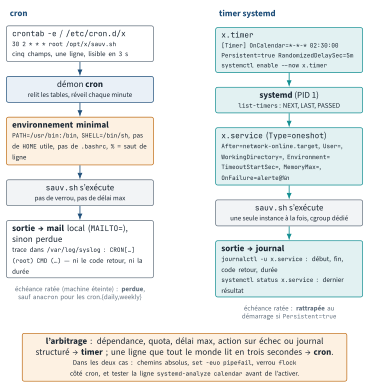

<!-- nav:début -->
[Accueil](../../README.md) › [Parcours](../../docs/parcours.md) › Partie III — Exploitation, sécurité et incidents › **Module 17**  
[← Module 16](../16-logs-monitoring/README.md) · [Corrigé](corrige.md) · [Module 18 →](../18-securite/README.md)

<details><summary>Scripts du module (11)</summary>

Sur la VM indiquée en section « Mise en place », depuis `~/workbook/scripts/` (voir [chapitre 0](../../docs/00-mise-en-place.md)).

| Script | Rôle |
|---|---|
| [`setup_M17.sh`](../../scripts/setup/setup_M17.sh) | prépare le module |
| [`check_M17_01.sh`](../../scripts/check/check_M17_01.sh) | vérification |
| [`check_M17_02.sh`](../../scripts/check/check_M17_02.sh) | vérification |
| [`check_M17_03.sh`](../../scripts/check/check_M17_03.sh) | vérification |
| [`check_M17_04.sh`](../../scripts/check/check_M17_04.sh) | vérification |
| [`check_M17_05.sh`](../../scripts/check/check_M17_05.sh) | vérification |
| [`check_M17_06.sh`](../../scripts/check/check_M17_06.sh) | vérification |
| [`break_M17_01.sh`](../../scripts/break/break_M17_01.sh) | installe une panne |
| [`break_M17_02.sh`](../../scripts/break/break_M17_02.sh) | installe une panne |
| [`break_M17_03.sh`](../../scripts/break/break_M17_03.sh) | installe une panne |
| [`break_M17_04.sh`](../../scripts/break/break_M17_04.sh) | installe une panne |

</details>
<!-- nav:fin -->

# Module 17 — Planification : cron, at et timers systemd

## 17.0 Objectifs et compétences

> [!NOTE]
> **Objectifs**
>
> À la fin de ce module, je sais :
>
> * lire et écrire une expression cron à cinq champs, y compris listes, plages et
>   pas, et expliquer la règle du **OU** entre jour du mois et jour de semaine ;
> * choisir le bon emplacement pour une tâche (crontab utilisateur, `/etc/crontab`,
>   `/etc/cron.d`, `cron.daily`) et respecter la contrainte de nommage de
>   `run-parts` ;
> * décrire l'environnement réel d'un job cron, le reproduire avec `env -i`, et
>   diagnostiquer en moins de cinq minutes un « ça marche dans mon shell mais pas
>   en cron » ;
> * garantir qu'un job ne s'exécute jamais deux fois en parallèle avec `flock`, et
>   expliquer ce qu'est un verrou consultatif ;
> * diriger la sortie d'une tâche planifiée vers un fichier ou vers le journal
>   système, et retrouver ses traces avec `journalctl` ;
> * écrire une paire `.service` / `.timer`, valider son expression avec
>   `systemd-analyze calendar` et son unité avec `systemd-analyze verify` ;
> * choisir entre `OnCalendar`, `OnBootSec`, `OnUnitActiveSec`, et régler
>   `Persistent=`, `AccuracySec=` et `RandomizedDelaySec=` en connaissance de cause ;
> * arbitrer cron contre timer systemd sur des critères explicites (dépendances,
>   journalisation, contrôle de ressources, gestion d'échec) ;
> * prédire ce que fait un job planifié à 2 h 30 le jour du changement d'heure, et
>   configurer un serveur pour que la question ne se pose plus ;
> * mettre en place une supervision qui détecte qu'une tâche **n'a pas** tourné,
>   pas seulement qu'elle a échoué.
>
> **Temps estimé** : 5 h
>
> **Prérequis** : module 07 (scripting bash, codes retour, redirections) et module 08
> (unités systemd, `systemctl`, `journalctl`). Le module reste utilisable seul :
> les notions systemd nécessaires sont rappelées en 17.2.

---

## 17.1 Mise en place

VM concernées : **`lab-web` (10.10.10.11)** pour l'essentiel du module,
**`lab-rhel` (10.10.10.13)** pour les variantes Rocky en E17.7 et QO17.4.
Les exercices se font avec l'utilisateur `mathieu`, les labs et Break & Fix
demandent `sudo`.

```bash
# depuis le shell Proxmox, avant de commencer
qm snapshot 9002 avant-lab17
qm snapshot 9004 avant-lab17
```

Paquets nécessaires sur `lab-web` :

```bash
sudo apt update
sudo apt install -y cron anacron at util-linux moreutils openssl
sudo systemctl enable --now cron.service atd.service
```

> [!IMPORTANT]
> **Variante Rocky / RHEL**
>
> Sous Rocky 9 : `sudo dnf install -y cronie cronie-anacron at util-linux openssl`
> puis `sudo systemctl enable --now crond.service atd.service`. Le service ne
> s'appelle pas `cron` mais **`crond`**, le paquet `cronie` remplace `cron`, et
> `moreutils` (qui fournit `ts`) vient d'EPEL : `sudo dnf install -y epel-release`
> d'abord, ou passe-t'en, il ne sert qu'en E17.8.

Préparation du terrain de jeu (idempotent, relançable) :

```bash
sudo bash ~/workbook/scripts/setup/setup_M17.sh
```

Il installe l'application fictive `factura` sous `/opt/factura/bin`, ses données
dans `/srv/factura`, son journal dans `/var/log/factura`, un certificat TLS de
démonstration qui expire bientôt, et ton bac à sable `~/lab17/`.
Il ne crée **aucune** entrée de crontab et **aucune** unité systemd : les écrire
est tout le travail du module.

> [!CAUTION]
> **Attention**
>
> Plusieurs exercices posent des tâches qui tournent à la minute. Avant de quitter
> le module, purge-les : `crontab -r` efface ta crontab utilisateur **sans
> confirmation** et sans sauvegarde. Prends l'habitude de `crontab -l > sauv.cron`
> avant tout `crontab -r`.

---

## 17.2 Rappel express

### Les cinq champs

```text
┌─ minute        0-59
│ ┌─ heure       0-23
│ │ ┌─ jour du mois   1-31
│ │ │ ┌─ mois         1-12  ou jan,feb,…
│ │ │ │ ┌─ jour de semaine 0-7 (0 et 7 = dimanche) ou sun,mon,…
│ │ │ │ │
* * * * *  commande
```

| Écriture | Sens |
|---|---|
| `*/5` | toutes les 5 unités **à partir de 0** (0,5,10…) |
| `1-5` | plage, bornes incluses |
| `0,30` | liste |
| `9-17/2` | pas à l'intérieur d'une plage (9,11,13,15,17) |
| `@reboot` | au démarrage du démon cron |
| `@daily` `@hourly` `@weekly` `@monthly` `@yearly` | raccourcis |

**La règle qui piège tout le monde** : si le champ jour du mois **et** le champ
jour de semaine sont tous deux différents de `*`, cron applique un **OU**, pas un
ET. `0 0 1,15 * 3` s'exécute le 1er, le 15 **et** tous les mercredis.

### Où poser une tâche

| Emplacement | Champ utilisateur | Édition |
|---|---|---|
| crontab de l'utilisateur | non | `crontab -e` |
| `/etc/crontab` | **oui** | éditeur, relu automatiquement |
| `/etc/cron.d/nom` | **oui** | éditeur, relu automatiquement |
| `/etc/cron.{hourly,daily,weekly,monthly}` | — (scripts) | dépôt de script |

`crontab -l` liste, `crontab -e` édite (validation syntaxique à l'écriture),
`crontab -r` **supprime tout**, `crontab -u factura -l` cible un autre compte.
Une ligne de `/etc/cron.d` sans champ utilisateur fait ignorer **tout le fichier**, en silence : la
seule trace est une erreur dans le journal.

Les répertoires `cron.daily` & co sont parcourus par **`run-parts`**, qui ignore
tout nom contenant un point. `purge-tmp.sh` n'est **jamais** exécuté,
`purge-tmp` l'est. Vérifie toujours avec `run-parts --test /etc/cron.daily`.

### L'environnement d'un job cron

| Variable | Valeur typique en cron | En session interactive |
|---|---|---|
| `PATH` | `/usr/bin:/bin` | une dizaine de répertoires |
| `SHELL` | `/bin/sh` (→ `dash`) | `/bin/bash` |
| `HOME` | home de l'utilisateur | idem |
| `MAILTO` | non définie → mail au propriétaire | — |

Aucun fichier de démarrage n'est lu : ni `/etc/profile`, ni `~/.profile`, ni
`~/.bashrc`. Les variables posées par ton `.bashrc`, tes alias et tes fonctions
n'existent pas. Pour reproduire à l'identique :

```bash
env -i PATH=/usr/bin:/bin HOME="$HOME" SHELL=/bin/sh \
  /bin/sh -c '/opt/factura/bin/factura-sauvegarde.sh'
```

### Le piège du `%`

Dans le champ commande d'une crontab, `%` **n'est pas un caractère ordinaire** :
le premier `%` marque la fin de la commande, les suivants deviennent des sauts de
ligne et le tout est envoyé sur l'entrée standard de la commande.

```cron
# CASSÉ : la commande s'arrête après « date + »
0 2 * * * tar czf /srv/sauv-$(date +%F).tgz /srv/factura
# CORRECT
0 2 * * * tar czf /srv/sauv-$(date +\%F).tgz /srv/factura
```

Le comportement est identique dans `/etc/crontab` et `/etc/cron.d`. Il n'existe
pas à l'intérieur d'un script appelé par cron : la parade la plus robuste est de
ne jamais écrire de `%` dans une crontab, donc d'appeler un script.

Deuxième contrainte de format, moins connue : **cron ne connaît pas la
continuation de ligne par `\`**. Une tâche tient sur une seule ligne physique,
quelle qu'en soit la longueur. Un `\` en fin de ligne est passé tel quel au
shell et casse la commande.

### Sortie, journal, verrou

```bash
# tout dans un fichier, erreurs comprises
0 2 * * * /opt/factura/bin/sauv.sh >> /var/log/factura/sauv.log 2>&1
# tout dans le journal système, avec une étiquette
0 2 * * * /opt/factura/bin/sauv.sh 2>&1 | logger -t factura-sauv
# jamais deux instances en parallèle (échec immédiat si déjà verrouillé)
0 * * * * flock -n /var/lock/factura-sauv.lock /opt/factura/bin/sauv.sh
```

`journalctl -u cron.service`, `journalctl -t CRON`, `journalctl -t factura-sauv`.
`> /dev/null 2>&1` sur un job de production est une faute : tu détruis la seule
trace de l'échec. Si tu ne veux pas de mail, écris `MAILTO=""` en tête de crontab
et journalise ailleurs.

### Timers systemd

Une tâche = **deux** unités : `x.service` (quoi faire) et `x.timer` (quand).
On active et on surveille le **timer**, jamais le service.

| Directive `[Timer]` | Rôle |
|---|---|
| `OnCalendar=` | date/heure absolue, syntaxe calendrier |
| `OnBootSec=` | délai après le démarrage de la machine |
| `OnUnitActiveSec=` | délai après le **démarrage** de la dernière exécution |
| `OnUnitInactiveSec=` | délai après la **fin** de la dernière exécution |
| `Persistent=true` | rattrape l'échéance ratée machine éteinte |
| `AccuracySec=` | fenêtre de regroupement (défaut **1 min**) |
| `RandomizedDelaySec=` | décalage aléatoire, pour étaler une flotte |
| `Unit=` | service à déclencher (défaut : même nom, `.service`) |

Syntaxe `OnCalendar` : `JOURS AAAA-MM-JJ HH:MM:SS [FUSEAU]`, avec `*` joker,
`,` liste, `..` plage, `/` pas, `~` compté depuis la fin du mois.

```bash
systemd-analyze calendar --iterations=3 "Mon..Fri *-*-* 09:00:00"
systemd-analyze calendar "*-*~01 23:00:00"     # dernier jour du mois
systemd-analyze verify ./factura-sauv.timer
systemctl enable --now factura-sauv.timer
systemctl list-timers --all
systemctl status factura-sauv.service          # dernier résultat
systemd-run --on-active=90 --unit=ponctuel /opt/factura/bin/sauv.sh
```

### cron ou timer : l'arbitrage en une ligne

Besoin d'une dépendance (`After=network-online.target`), d'un quota de mémoire ou
de CPU, d'un délai maximum d'exécution, d'une action automatique en cas d'échec,
ou d'un journal structuré ? **Timer.** Une ligne dans un fichier texte que
n'importe qui doit pouvoir lire en trois secondes ? **cron.**

<p align="center"></p>

*Figure — La même tâche des deux côtés : cron (une ligne, environnement minimal, sortie par mail, échéance ratée perdue) et timer systemd (`.timer` + `.service`, dépendances, quotas, journal, `Persistent=`).*

---

## 17.3 Quiz — QCM

<a id="q17-1"></a>**[Q17.1](corrige.md#q17-1)** — Que planifie cette ligne ?

```cron
*/10 8-18 * * 1-5 /opt/factura/bin/collecte.sh
```

a) toutes les 10 minutes, en continu, du lundi au vendredi
b) toutes les 10 minutes entre 08:00 et 18:50, du lundi au vendredi
c) toutes les 10 minutes entre 08:00 et 18:00 précises, du lundi au vendredi
d) à la 10ᵉ minute de chaque heure entre 8 h et 18 h, du lundi au vendredi

<a id="q17-2"></a>**[Q17.2](corrige.md#q17-2)** — Une astreinte t'appelle : un job de facturation tourne beaucoup plus
souvent que prévu.

```cron
0 3 1,15 * 5 /opt/factura/bin/factura-clotures.sh
```

Le dev affirme : « c'est le 1er et le 15 du mois, seulement si c'est un
vendredi ». Que fait réellement cron ?

a) exactement ce que dit le dev
b) le 1er, le 15, **et** tous les vendredis
c) tous les vendredis uniquement, le champ jour du mois est ignoré
d) le 1er et le 15 uniquement, le champ jour de semaine est ignoré

<a id="q17-3"></a>**[Q17.3](corrige.md#q17-3)** — Cette ligne est dans la crontab de `mathieu` :

```cron
30 2 * * * tar czf /srv/sauv/f-$(date +%F).tgz /srv/factura/data
```

Que se passe-t-il à 02:30 ?

a) l'archive est créée avec la date du jour dans son nom
b) le shell reçoit `tar czf /srv/sauv/f-$(date +` et s'arrête sur
   `Syntax error: end of file unexpected (expecting ")")`
c) cron refuse la ligne à l'installation avec `errors in crontab file`
d) l'archive est créée mais nommée littéralement `f-%F.tgz`

<a id="q17-4"></a>**[Q17.4](corrige.md#q17-4)** — Tu déposes ce fichier en `/etc/cron.d/factura-collecte` :

```cron
*/15 * * * * /opt/factura/bin/collecte.sh >> /var/log/factura/c.log 2>&1
```

Rien ne se passe. Pourquoi ?

a) les fichiers de `/etc/cron.d` doivent être exécutables
b) il manque le champ utilisateur entre les 5 champs de temps et la commande
c) il faut relancer `cron.service` après toute modification de `/etc/cron.d`
d) le nom du fichier contient un tiret, `run-parts` l'ignore

<a id="q17-5"></a>**[Q17.5](corrige.md#q17-5)** — Un collègue place son script de purge dans `/etc/cron.daily/` sous le
nom `purge-tmp.sh`, avec les droits `0755`. Il ne tourne jamais.
**Deux réponses correctes.**

a) `run-parts` ignore les noms contenant un point
b) le script doit appartenir à root, c'est le seul critère
c) `run-parts --test /etc/cron.daily` ne le liste pas, ce qui le prouve
d) `/etc/cron.daily` n'accepte que des liens symboliques

<a id="q17-6"></a>**[Q17.6](corrige.md#q17-6)** — Un script lancé à la main fonctionne, en cron il échoue avec
`docker: command not found`. `which docker` répond `/usr/local/bin/docker` en session (binaire installé à la main).
Quelle est la cause la plus probable ?

a) l'utilisateur n'a pas les droits sur le socket Docker en cron
b) `/usr/local/bin` n'est pas dans le `PATH` de cron
c) `/usr/bin/docker` est en fait une fonction ou un alias défini dans `~/.bashrc`
d) cron refuse d'exécuter les binaires en `setgid`

<a id="q17-7"></a>**[Q17.7](corrige.md#q17-7)** — Tu poses temporairement ce job pour enquêter :

```cron
* * * * * env > /tmp/cronenv.txt 2>&1
```

Une minute plus tard, `/tmp/cronenv.txt` contient :

```text
SHELL=/bin/sh
PWD=/home/mathieu
LOGNAME=mathieu
HOME=/home/mathieu
PATH=/usr/bin:/bin
```

Ton script utilise `nft list ruleset` et `[[ -f "$f" ]]`. Quels problèmes prévois-tu ?
**Deux réponses correctes.**

a) `nft` est dans `/usr/sbin`, absent du `PATH` de cron
b) `[[ ]]` n'existe pas dans `dash`, qui est le `/bin/sh` d'Ubuntu
c) `PWD` est faux, cron démarre toujours dans `/`
d) `LOGNAME` doit être exporté à la main, sinon `sudo` échoue

<a id="q17-8"></a>**[Q17.8](corrige.md#q17-8)** — Sur `lab-web`, aucun serveur de messagerie n'est installé. Un job cron
produit trois lignes sur stdout à chaque exécution. Où vont-elles ?

a) dans `/var/mail/mathieu`
b) nulle part, avec une ligne `(CRON) info (No MTA installed, discarding output)`
   dans le journal
c) dans `/var/log/syslog` telles quelles
d) sur la console de `tty1`

<a id="q17-9"></a>**[Q17.9](corrige.md#q17-9)** — Que fait exactement cette ligne si une instance tourne déjà ?

```cron
*/5 * * * * flock -n /var/lock/collecte.lock /opt/factura/bin/collecte.sh
```

a) la nouvelle instance attend la fin de la précédente puis démarre
b) `flock` sort immédiatement en code 1 sans lancer le script
c) `flock` tue l'instance en cours puis démarre la nouvelle
d) `flock` échoue car le fichier `/var/lock/collecte.lock` n'existe pas encore

<a id="q17-10"></a>**[Q17.10](corrige.md#q17-10)** — `lab-web` est un portable de développeur, éteint chaque soir à 18 h et
rallumé à 9 h. `/etc/crontab` contient la ligne standard d'Ubuntu qui lance
`run-parts /etc/cron.daily` à 06:25. `anacron` est installé.
Que se passe-t-il pour les scripts de `cron.daily` ?

a) ils ne tournent jamais, la machine est éteinte à 06:25
b) cron les rattrape au démarrage suivant, il garde une trace des échéances ratées
c) la ligne de `/etc/crontab` ne fait rien car `anacron` est présent, et c'est
   `anacron` qui les lance peu après le démarrage
d) ils tournent deux fois : une fois par cron, une fois par anacron

<a id="q17-11"></a>**[Q17.11](corrige.md#q17-11)** — Tu valides une expression avant de la mettre en production :

```console
$ systemd-analyze calendar --iterations=2 "*-*-* 02:30:00"
  Normalized form: *-*-* 02:30:00
      Next elapse: Sat 2026-03-28 02:30:00 CET
         (in UTC): Sat 2026-03-28 01:30:00 UTC
     Iteration #2: Mon 2026-03-30 02:30:00 CEST
         (in UTC): Mon 2026-03-30 00:30:00 UTC
```

Le serveur est en `Europe/Paris`. Qu'apprends-tu ?

a) rien d'anormal, deux exécutions consécutives à 24 h d'intervalle
b) l'exécution du dimanche 29 mars est **sautée** : 02:30 n'existe pas ce jour-là
c) l'exécution du 29 mars aura lieu deux fois
d) systemd a basculé le timer en UTC tout seul

<a id="q17-12"></a>**[Q17.12](corrige.md#q17-12)** — Un timer `factura-rapport.timer` a `OnCalendar=*-*-* 04:00:00` sans
autre directive. La machine est éteinte de 02 h à 08 h pour maintenance.
Que faut-il ajouter pour que le rapport soit produit au redémarrage ?

a) `OnBootSec=5min`
b) `Persistent=true`
c) `RemainAfterElapse=true`
d) `AccuracySec=1h`

<a id="q17-13"></a>**[Q17.13](corrige.md#q17-13)** — Tu as écrit `factura-sauv.service` et `factura-sauv.timer`. Le
service contient, recopié d'un exemple trouvé en ligne, une section
`[Install]` avec `WantedBy=multi-user.target`. Tu lances
`sudo systemctl enable --now factura-sauv.service`. Que se passe-t-il ?

a) le timer est activé, la tâche sera planifiée
b) le service est lancé immédiatement **et** au prochain démarrage à chaque fois,
   la planification n'existe pas
c) systemd active automatiquement le timer du même nom
d) `enable` échoue car un service déclenché par timer n'a pas de section
   `[Install]`

<a id="q17-14"></a>**[Q17.14](corrige.md#q17-14)** — Trois cents machines ont le même timer `OnCalendar=*-*-* 03:00:00`
qui interroge un dépôt interne. Le dépôt sature chaque nuit à 03:00.
Quelle directive règle le problème sans toucher aux 300 expressions ?

a) `AccuracySec=1h`
b) `RandomizedDelaySec=30min`
c) `OnUnitActiveSec=1d`
d) `Persistent=true`

<a id="q17-15"></a>**[Q17.15](corrige.md#q17-15)** — `factura-collecte.timer` a `OnCalendar=*:0/5` (toutes les 5 minutes).
Une collecte prend parfois 12 minutes. Que se passe-t-il ?

a) trois collectes tournent en parallèle et se marchent dessus
b) systemd refuse de démarrer le service tant qu'il est actif : les échéances
   intermédiaires ne produisent aucune nouvelle instance
c) systemd tue la collecte en cours et en démarre une nouvelle
d) le timer passe en `failed`

<a id="q17-16"></a>**[Q17.16](corrige.md#q17-16)** — Un serveur est en `Europe/Paris`. Un job cron tourne à `30 2 * * *`.
Que se passe-t-il le dimanche 25 octobre 2026, jour du retour à l'heure d'hiver
(à 03:00 CEST il est de nouveau 02:00 CET) ?

a) rien de particulier, une seule exécution
b) le job s'exécute deux fois, à 02:30 CEST puis à 02:30 CET
c) le job est sauté
d) cron déplace le job à 03:30

<a id="q17-17"></a>**[Q17.17](corrige.md#q17-17)** — Tu veux savoir si `factura-sauv.service`, déclenché par un timer, a
réussi cette nuit, et récupérer ses messages. **Deux réponses correctes.**

a) `systemctl status factura-sauv.service`
b) `journalctl -u factura-sauv.service --since yesterday`
c) `systemctl status factura-sauv.timer` affiche la sortie du script
d) `systemctl list-timers` affiche le code retour de la dernière exécution

<a id="q17-18"></a>**[Q17.18](corrige.md#q17-18)** — Tu dois relancer un import **une seule fois**, dans 40 minutes, sur
`lab-web`. Tu n'as pas le droit de modifier une crontab. Quelles solutions
fonctionnent ? **Deux réponses correctes.**

a) `echo /opt/factura/bin/import.sh | at now + 40 minutes`
b) `systemd-run --on-active=40min /opt/factura/bin/import.sh`
c) `sleep 2400 && /opt/factura/bin/import.sh &` depuis ta session SSH
d) `crontab -e` avec une ligne `@reboot`

---

## 17.4 Quiz — questions ouvertes

<a id="qo17-1"></a>**[QO17.1](corrige.md#qo17-1)** — Explique le mécanisme exact qui fait que
`0 3 1,15 * 5 commande` s'exécute plus souvent qu'un ET logique ne le laisserait
croire. Donne la règle générale (quand est-ce un ET, quand est-ce un OU), puis
écris deux expressions : l'une qui s'exécute le 1er du mois **seulement si**
c'est un vendredi, l'autre qui s'exécute le premier vendredi du mois.

<a id="qo17-2"></a>**[QO17.2](corrige.md#qo17-2)** — *On te demande en entretien* : « Un dev me dit que son script marche
quand il le lance à la main mais échoue en cron. Décris-moi ta démarche, dans
l'ordre, en nommant les commandes. » Réponds en cinq étapes maximum, et cite la
commande qui permet de **reproduire** l'environnement de cron sans attendre la
prochaine exécution.

<a id="qo17-3"></a>**[QO17.3](corrige.md#qo17-3)** — *On te demande en entretien* : « On migre nos tâches planifiées vers
systemd. Qu'est-ce que ça nous apporte concrètement, et dans quels cas
garderiez-vous cron ? » Structure ta réponse autour de quatre critères
techniques, pas autour de « c'est plus moderne ».

<a id="qo17-4"></a>**[QO17.4](corrige.md#qo17-4)** — `Persistent=true` d'un timer systemd et `anacron` résolvent le même
problème. Explique **où** chacun stocke son état, à quel moment il décide de
rattraper, et cite un cas où l'un fait quelque chose que l'autre ne sait pas
faire.

<a id="qo17-5"></a>**[QO17.5](corrige.md#qo17-5)** — Explique le mécanisme de `flock -n /var/lock/x.lock cmd` :
sur quoi porte réellement le verrou, pourquoi on parle de verrou **consultatif**,
qui libère le verrou si le script est tué par `kill -9`, et pourquoi
`if [ -f /var/run/x.pid ]` est une mauvaise réimplémentation du même besoin.

<a id="qo17-6"></a>**[QO17.6](corrige.md#qo17-6)** — Un job de facturation tourne à 02:30 sur un serveur réglé en
`Europe/Paris`. Décris précisément ce qui se passe le jour du passage à l'heure
d'été et le jour du retour à l'heure d'hiver, pour cron **et** pour un timer
systemd. Quelle configuration recommandes-tu sur un serveur de production, et
comment gères-tu le cas d'un rapport qui doit être daté en heure locale ?

<a id="qo17-7"></a>**[QO17.7](corrige.md#qo17-7)** — Une sauvegarde nocturne a cessé de tourner il y a onze jours.
Personne ne s'en est aperçu : aucune alerte, aucun mail, aucun `failed`.
Explique pourquoi la supervision classique « alerter quand le job échoue » ne
peut structurellement pas détecter ce cas, puis décris deux mécanismes concrets
qui le détectent, dont un implémentable sans outil externe.

<a id="qo17-8"></a>**[QO17.8](corrige.md#qo17-8)** — Un runbook d'équipe recommande de terminer toutes les lignes de
crontab par `> /dev/null 2>&1` « pour ne pas polluer la boîte mail de root ».
Explique pourquoi c'est une mauvaise pratique, ce qu'on perd exactement, et
propose trois écritures alternatives selon que la sortie doit finir dans un
fichier, dans le journal système, ou nulle part mais avec trace de l'échec.

---

## 17.5 Exercices guidés ★

<a id="e17-1"></a>**[E17.1](corrige.md#e17-1)** — Traduis ces quatre expressions en une phrase chacune, sans rien
exécuter, puis vérifie-toi avec `systemd-analyze calendar` sur l'équivalent
systemd :

```cron
0 */4 * * *
15 3 * * 0
*/5 9-17 * * 1-5
0 0 1 1,4,7,10 *
```

<a id="e17-2"></a>**[E17.2](corrige.md#e17-2)** — Écris les expressions cron correspondant à ces trois besoins :
toutes les 10 minutes entre 08:00 et 20:00 du lundi au vendredi ; à 23:45 le
dernier jour de chaque trimestre civil ; toutes les deux heures les nuits de
week-end (de 00:00 à 06:00, samedi et dimanche).

<a id="e17-3"></a>**[E17.3](corrige.md#e17-3)** — Pose dans ta crontab utilisateur un job qui, chaque minute, ajoute
dans `~/lab17/logs/horodatage.log` une ligne contenant la date au format
`2026-09-18 22:14:01` obtenue avec `date`. Attends deux minutes, vérifie le
fichier, puis retire le job.

<a id="e17-4"></a>**[E17.4](corrige.md#e17-4)** — Capture l'environnement **réel** d'un job cron dans
`~/lab17/logs/cron-env.txt`, puis produis dans `~/lab17/logs/shell-env.txt`
l'environnement de ta session interactive. Affiche uniquement les variables qui
diffèrent, triées.

<a id="e17-5"></a>**[E17.5](corrige.md#e17-5)** — À partir de la capture précédente, rejoue `~/lab17/bin/rapport.sh`
(fourni par le setup) dans un environnement reproduisant exactement celui de
cron, avec `env -i`. Obtiens le même message d'erreur qu'en cron, sans attendre.

<a id="e17-6"></a>**[E17.6](corrige.md#e17-6)** — Le script `/opt/factura/bin/factura-collecte.sh` doit tourner toutes
les 15 minutes **en tant que l'utilisateur `factura`**, et tu veux que la tâche
soit livrable par ton gestionnaire de configuration (donc un fichier, pas une
crontab utilisateur). Écris le fichier qui convient et prouve qu'il est pris en
compte.

<a id="e17-7"></a>**[E17.7](corrige.md#e17-7)** — Dépose un script de purge dans `/etc/cron.daily/` de telle sorte qu'il
soit réellement exécuté. Prouve-le sans attendre le lendemain, avec une seule
commande de `run-parts`, puis exécute-le pour de bon avec la même commande.

> [!IMPORTANT]
> **Variante Rocky / RHEL**
>
> Sous Rocky 9, `/etc/cron.daily` n'est pas lancé par une ligne de `/etc/crontab`
> mais par `/etc/cron.hourly/0anacron`, lui-même déclenché par `/etc/cron.d/0hourly`.
> Regarde ces deux fichiers et note la différence de chaîne d'appel.

<a id="e17-8"></a>**[E17.8](corrige.md#e17-8)** — Fais en sorte que la sortie de `/opt/factura/bin/factura-rapport.sh`,
stdout **et** stderr, parte dans le journal système sous l'étiquette
`factura-rapport`, avec le niveau `info` pour stdout. Retrouve les lignes des dix
dernières minutes avec `journalctl`.

<a id="e17-9"></a>**[E17.9](corrige.md#e17-9)** — Lance `/opt/factura/bin/factura-lent.sh 60` sous `flock`, puis, dans
un second terminal, tente une deuxième exécution sous le même verrou. Note le
code retour de la seconde. Recommence en faisant attendre la seconde au lieu de
la refuser, avec un délai maximum de 5 secondes.

<a id="e17-10"></a>**[E17.10](corrige.md#e17-10)** — Planifie l'exécution unique de `/opt/factura/bin/factura-rapport.sh`
dans trois minutes avec `at`. Avant qu'elle ne se déclenche : liste la file,
affiche le **contenu exact** du job tel qu'`at` l'a mémorisé (environnement
compris), puis annule-le. Explique en une phrase ce que `at` a fait de ton
environnement.

<a id="e17-11"></a>**[E17.11](corrige.md#e17-11)** — Obtiens le même résultat que E17.10 sans `at` et sans crontab, avec
une unité transitoire systemd nommée `rapport-ponctuel`. Vérifie qu'elle apparaît
dans `systemctl list-timers`, puis annule-la proprement.

<a id="e17-12"></a>**[E17.12](corrige.md#e17-12)** — Écris dans `~/lab17/unites/` la paire `factura-rapport.service` +
`factura-rapport.timer` qui déclenche le rapport tous les jours à 06:15.
Avant toute installation : valide l'expression calendaire et valide les deux
fichiers d'unité. Note la sortie des deux commandes de validation.

<a id="e17-13"></a>**[E17.13](corrige.md#e17-13)** — Écris un timer qui déclenche `factura-collecte.service`
2 minutes après le démarrage de la machine, puis toutes les 30 minutes **à partir
de la fin** de l'exécution précédente. Explique en une ligne pourquoi ce n'est pas
`OnUnitActiveSec=30min`.

<a id="e17-14"></a>**[E17.14](corrige.md#e17-14)** — Prouve l'effet de `Persistent=true` sans éteindre la VM : trouve où
systemd stocke l'horodatage de dernière exécution du timer, falsifie-le pour
simuler une échéance ratée, redémarre le timer et observe le déclenchement
immédiat.

<a id="e17-15"></a>**[E17.15](corrige.md#e17-15)** — Affiche tous les timers de la machine, y compris inactifs, triés par
prochaine échéance. Identifie celui dont la dernière exécution est la plus
ancienne et donne la commande qui affiche son dernier code retour.

<a id="e17-16"></a>**[E17.16](corrige.md#e17-16)** — Ton entreprise exploite des serveurs à Paris, Montréal et Singapour
avec une clôture comptable qui doit partir à 22:00 UTC partout. Donne le réglage
système à appliquer, l'expression `OnCalendar` à utiliser, et prouve avec
`systemd-analyze calendar` que l'échéance est bien la même heure absolue pour un
serveur réglé en `Europe/Paris`.

---

## 17.6 Labs ★★

### <a id="l17-1"></a>**[L17.1](corrige.md#l17-1)** — Inventaire des tâches planifiées d'un serveur hérité

> **Contexte**
>
> Tu reprends l'exploitation de `lab-web`, montée par un prestataire parti sans
> documentation. Trois incidents en un mois viennent de « scripts qui tournent la
> nuit » que personne ne sait localiser. Le responsable te demande un inventaire
> exhaustif avant toute modification. Le script de setup a semé des tâches un peu
> partout : c'est le terrain.

1. Recense **toutes** les crontabs utilisateurs de la machine, y compris celles
   des comptes système, sans lire directement les fichiers du spool (un
   utilisateur peut avoir une crontab et pas de shell).
2. Recense les tâches système : `/etc/crontab`, `/etc/cron.d/`, et les quatre
   répertoires `cron.*`. Pour ces derniers, liste ce que `run-parts` exécuterait
   réellement et signale les scripts qui **ne seront jamais lancés**.
3. Recense les tâches `at` en attente, tous utilisateurs confondus.
4. Recense les timers systemd, y compris ceux qui ne sont pas actifs, avec pour
   chacun l'unité déclenchée et la date de dernière exécution.
5. Produis `~/lab17/rapports/inventaire.md` avec un tableau à quatre colonnes :
   source, planification, commande, utilisateur d'exécution.
6. Ajoute une section « Anomalies » qui signale au minimum : un script de
   `cron.*` invisible pour `run-parts`, une tâche dont toute la sortie part dans
   `/dev/null`, une entrée de `/etc/cron.d` mal formée, et un timer activé dont
   le service associé n'existe pas.

> [!TIP]
> **Astuce**
>
> `getent passwd | cut -d: -f1` te donne la liste des comptes ;
> `sudo crontab -u "$u" -l` la crontab de chacun (code retour 1 quand il n'y en a
> pas). Pour les jobs `at` des autres utilisateurs, regarde `/var/spool/cron/atjobs`.

> [!TIP]
> **Critère de succès**
>
> Critère de succès : `~/lab17/rapports/inventaire.md` contient les quatre sources
> de planification, le tableau réglementaire et les quatre anomalies.
>
> ```bash
> bash check_M17_01.sh
> ```

---

### <a id="l17-2"></a>**[L17.2](corrige.md#l17-2)** — Une sauvegarde nocturne en cron, faite proprement

> **Contexte**
>
> Ticket EXP-1180. La sauvegarde de `factura` doit tourner chaque nuit à 02:30.
> La version précédente était une ligne de crontab de 180 caractères qui appelait
> `tar` directement ; elle a produit une archive corrompue le mois dernier parce
> que deux exécutions se sont chevauchées après un incident réseau. On te demande
> de la refaire dans les règles.

Tu travailles sur `lab-web`, en root.

1. Écris `/opt/factura/bin/factura-sauvegarde-nuit.sh` (bash, `set -euo pipefail`)
   qui archive `/srv/factura/data` vers `/srv/factura/backups/` sous un nom
   horodaté, conserve les 7 dernières archives et supprime les plus anciennes.
   Le script définit lui-même son `PATH` et ne dépend d'aucune variable héritée.
2. Le script journalise chaque étape avec un horodatage sur stdout, et les
   erreurs sur stderr. Il sort en 0 si tout va bien, en 1 sur erreur d'archivage,
   en 2 si le répertoire source est vide ou absent.
3. Installe la tâche dans `/etc/cron.d/factura-sauvegarde`, exécutée par
   l'utilisateur `factura`, à 02:30 tous les jours. Aucune ligne de la crontab ne
   doit contenir de `%` et doit tenir sur **une seule ligne physique**.
4. Garantis qu'une seconde exécution ne peut jamais démarrer tant que la première
   tourne : la seconde doit échouer immédiatement, pas attendre, et laisser une
   trace explicite.
5. Toute la sortie (stdout et stderr) part dans le journal système sous
   l'étiquette `factura-sauv`. Rien ne doit partir par mail :
   positionne-le explicitement.
6. Vérifie sans attendre 02:30 : exécute la commande **exactement** telle que cron
   l'exécutera, c'est-à-dire dans l'environnement de cron, sous l'utilisateur
   `factura`. Puis prouve le point 4 en lançant deux exécutions simultanées.

> [!TIP]
> **Critère de succès**
>
> Critère de succès : `/etc/cron.d/factura-sauvegarde` est syntaxiquement valide et
> nomme l'utilisateur `factura` ; une exécution manuelle produit une archive et des
> lignes dans `journalctl -t factura-sauv` ; deux exécutions simultanées n'en
> produisent qu'une seule archive.
>
> ```bash
> sudo bash check_M17_02.sh
> ```

---

### <a id="l17-3"></a>**[L17.3](corrige.md#l17-3)** — Migrer la même tâche vers un timer systemd

> **Contexte**
>
> Le ticket EXP-1180 a une suite. La sauvegarde s'exécute maintenant, mais
> l'exploitation demande trois choses que cron ne sait pas faire : qu'elle ne
> démarre pas avant que le stockage réseau soit monté, qu'elle ne puisse pas
> consommer plus de la moitié d'un cœur ni plus de 512 Mo, et qu'elle soit tuée si
> elle dépasse 30 minutes. On te demande la version systemd, sans supprimer la
> version cron tant que la nouvelle n'a pas tourné une fois.

1. Écris `/etc/systemd/system/factura-sauv.service` : `Type=oneshot`, exécuté
   sous l'utilisateur `factura`, qui appelle le script de L17.2.
2. Ajoute les contraintes demandées : dépendance d'ordre sur
   `srv-factura.mount` (le setup l'a créé), quota CPU à 50 %, mémoire plafonnée à
   512 Mo, exécution tuée au-delà de 30 minutes.
3. Écris `/etc/systemd/system/factura-sauv.timer` : tous les jours à 02:30, avec
   rattrapage si la machine était éteinte, et un décalage aléatoire d'au plus
   10 minutes pour ne pas taper en même temps que les autres serveurs.
4. **Avant** d'installer : valide l'expression calendaire et les deux unités, et
   note les sorties dans `~/lab17/rapports/validation.txt`.
5. Active et démarre le timer. Vérifie qu'il apparaît dans la liste, avec la
   bonne prochaine échéance. Déclenche une exécution manuelle et vérifie le
   résultat et les journaux.
6. Neutralise la version cron **sans la supprimer**, de façon réversible et
   visible pour le collègue qui reprendra le dossier.
7. Réponds par écrit dans `~/lab17/rapports/validation.txt` : que se passe-t-il si
   le timer se déclenche alors que le service précédent tourne encore ? Vérifie
   ta réponse expérimentalement.

> [!TIP]
> **Critère de succès**
>
> Critère de succès : `factura-sauv.timer` est `enabled` et `active`,
> `systemd-analyze verify` passe sur les deux unités, les trois contraintes de
> ressources sont visibles dans `systemctl show`, et une exécution manuelle produit
> une archive.
>
> ```bash
> sudo bash check_M17_03.sh
> ```

---

### <a id="l17-4"></a>**[L17.4](corrige.md#l17-4)** — Vérification de certificat avec alerte automatique en cas d'échec

> **Contexte**
>
> L'an dernier, le certificat du portail client a expiré un samedi. La supervision
> ne surveillait que la disponibilité HTTP, qui était verte jusqu'à l'expiration.
> On te demande une vérification quotidienne qui, **en cas d'échec**, déclenche
> automatiquement une action d'alerte — sans écrire un seul `if` dans le script de
> notification.

Le setup a posé `/etc/factura/tls/portail.crt`, qui expire dans quelques jours.

1. Écris `/opt/factura/bin/factura-cert-check.sh` qui prend en argument un chemin
   de certificat et un nombre de jours, et sort en 0 si le certificat est valide
   au-delà de ce seuil, en 1 sinon, avec un message clair dans les deux cas.
   Utilise `openssl x509 -checkend`.
2. Écris `factura-cert.service` et `factura-cert.timer` (quotidien à 07:00,
   tolérance d'une heure pour ne pas réveiller la machine inutilement).
3. Écris une **unité modèle** `factura-alerte@.service` qui reçoit en paramètre
   le nom de l'unité en échec et écrit une alerte formatée dans
   `/var/log/factura/alertes.log`, avec la date, le nom de l'unité, son dernier
   code retour et les dix dernières lignes de son journal.
4. Relie les deux : l'échec de `factura-cert.service` doit déclencher
   `factura-alerte@factura-cert.service` automatiquement.
5. Teste **le chemin d'échec** : fais échouer volontairement la vérification
   (seuil à 3650 jours suffit) et vérifie que l'alerte est bien écrite.
6. Explique dans `~/lab17/rapports/alerte.md` pourquoi `OnFailure=` ne se
   déclenche pas quand tu lances le script à la main hors systemd, et ce qui se
   passerait si l'unité d'alerte échouait elle-même.

> [!TIP]
> **Astuce**
>
> Le spécificateur `%n` vaut le nom complet de l'unité, `%i` la partie après le `@`
> dans une unité modèle. `OnFailure=` accepte `factura-alerte@%n.service`.

> [!TIP]
> **Critère de succès**
>
> Critère de succès : `/var/log/factura/alertes.log` contient une alerte nommant
> `factura-cert.service`, produite par systemd et non par un appel manuel.
>
> ```bash
> sudo bash check_M17_04.sh
> ```

---

### <a id="l17-5"></a>**[L17.5](corrige.md#l17-5)** — Savoir qu'un job n'a **pas** tourné

> **Contexte**
>
> Post-mortem de l'incident du mois dernier : la sauvegarde s'est arrêtée onze jours
> avant qu'on ne s'en aperçoive, parce qu'elle ne s'est pas arrêtée en erreur —
> elle ne s'est simplement plus déclenchée. On te demande un mécanisme de type
> « homme mort » : c'est l'**absence** de signal qui déclenche l'alerte.

1. Modifie la sauvegarde de L17.2 pour qu'elle touche un fichier témoin
   `/var/lib/factura/derniere-sauvegarde` **uniquement** en cas de succès
   (pas au démarrage du script, pas en cas d'échec).
2. Écris `/opt/factura/bin/factura-veille.sh` qui sort en 1 si le témoin est
   absent ou plus vieux que N heures (N en argument, 26 par défaut), avec un
   message indiquant l'âge réel en heures.
3. Planifie cette veille toutes les heures avec un timer systemd, et branche son
   échec sur l'unité d'alerte de L17.4.
4. Éprouve le dispositif : rends le témoin vieux de 40 heures, force l'exécution
   du timer de veille, et vérifie que l'alerte apparaît. Remets ensuite le témoin
   à l'heure et vérifie que l'alerte cesse.
5. Écris dans `~/lab17/rapports/veille.md` la réponse à cette question : ton
   dispositif détecte-t-il le cas où la machine entière est éteinte ? Justifie,
   puis décris en trois lignes le principe d'un service externe de type
   *healthcheck* (ping sortant périodique, alerte si le ping manque) et ce qu'il
   apporte de plus.
6. Ajoute une protection contre le faux positif au démarrage : après un
   redémarrage, la veille ne doit pas alerter dans les 10 premières minutes.

> [!TIP]
> **Critère de succès**
>
> Critère de succès : le timer de veille est actif, une antidatation du témoin
> produit une alerte dans `/var/log/factura/alertes.log`, et `veille.md` traite le
> cas machine éteinte.
>
> ```bash
> sudo bash check_M17_05.sh
> ```

---

## 17.7 Break & Fix ★★★

> [!CAUTION]
> **Attention**
>
> Avant chaque Break & Fix : `qm snapshot 9002 avant-bf17`. Le snapshot de secours
> reste `snap-clean` (`qm rollback 9002 snap-clean`), mais l'utiliser vaut échec de
> l'exercice : l'objectif est de diagnostiquer, pas de rembobiner.

### <a id="bf17-1"></a>**[BF17.1](corrige.md#bf17-1)** — « La collecte de nuit ne produit plus rien »

```bash
sudo bash break_M17_01.sh
```

**Symptôme utilisateur** : `/var/log/factura/collecte.log` ne contient plus une
seule ligne depuis hier soir. Le script `/opt/factura/bin/factura-collecte.sh`
fonctionne parfaitement quand on le lance à la main, même sous l'utilisateur
`factura` avec `sudo -u factura`. La tâche est bien présente dans la crontab et
`cron.service` est `active (running)`.

**Interdit** : modifier le script `/opt/factura/bin/factura-collecte.sh`,
installer un paquet, ajouter un `source /etc/profile` dans la crontab.

**Objectif** : identifier la cause exacte à partir du journal, la corriger à
l'endroit qui convient, et expliquer pourquoi `sudo -u factura` ne reproduisait
pas le problème.

### <a id="bf17-2"></a>**[BF17.2](corrige.md#bf17-2)** — « Le rapport hebdo n'arrive plus, mais rien n'est en erreur »

```bash
sudo bash break_M17_02.sh
```

**Symptôme utilisateur** : la direction n'a pas reçu le rapport hebdomadaire
depuis trois semaines. `systemctl status factura-hebdo.service` affiche
`inactive (dead)` sans la moindre erreur, `systemctl is-failed` répond `active`…
non, `inactive`. Aucune unité n'est en `failed` sur la machine. Le journal ne
contient rien d'anormal. Le script produit bien le rapport quand on le lance.

**Interdit** : recréer les unités à partir de zéro, `systemctl reset-failed` en
guise de réparation.

**Objectif** : prouver en une commande que la tâche n'est plus planifiée, trouver
ce qui l'a désactivée, remettre en service, et proposer la supervision qui aurait
levé l'alerte au bout de 24 h au lieu de trois semaines.

### <a id="bf17-3"></a>**[BF17.3](corrige.md#bf17-3)** — « Le compteur de factures est incohérent une nuit sur trois »

```bash
sudo bash break_M17_03.sh
```

**Symptôme utilisateur** : le fichier `/srv/factura/etat/compteur.txt` doit
contenir le cumul des factures traitées. Environ une nuit sur trois, sa valeur est
inférieure à celle de la veille, ou le fichier contient deux nombres collés, ou il
est vide. Le script de traitement n'a jamais changé et son code retour est
toujours 0.

**Interdit** : réécrire le script de traitement, ajouter une base de données.

**Objectif** : reproduire le phénomène à la demande, nommer précisément le
mécanisme en cause, corriger la planification pour qu'il ne puisse plus se
produire, et dire quelle protection tu appliquerais si le même script devait
tourner sur trois serveurs partageant le même fichier.

### <a id="bf17-4"></a>**[BF17.4](corrige.md#bf17-4)** — « L'archivage ne produit plus rien depuis la simplification »

```bash
sudo bash break_M17_04.sh
```

**Symptôme utilisateur** : un collègue a « simplifié » l'archivage la semaine
dernière en remplaçant l'appel au script par la commande `tar` directement dans
la planification. Depuis, plus aucune archive n'apparaît dans
`/srv/factura/backups`, alors que celle de la veille du changement est toujours
là. La commande, copiée-collée dans un shell, fonctionne parfaitement. Le journal
contient, toutes les deux minutes, la ligne `CMD` de cron pour la tâche, suivie immédiatement de `(CRON) info (No MTA installed, discarding output)` — et rien sous l'étiquette `factura-archivage`.

**Interdit** : déplacer la commande dans un script (ce sera la conclusion, pas le
diagnostic — il faut d'abord expliquer et corriger **dans la crontab**).

**Objectif** : citer la ligne exacte qui pose problème, expliquer le mécanisme
caractère par caractère, la corriger en restant dans la crontab, puis énoncer la
règle générale qui évite définitivement cette famille de pannes.

---

## 17.8 Défi du module ★★★

<a id="d17"></a>**[D17](corrige.md#d17) — Refonte et audit de la planification d'un hôte**

> **Contexte**
>
> `lab-web` part en production. La règle interne est désormais : toute tâche
> planifiée récurrente est un timer systemd, journalisée, verrouillée contre les
> chevauchements, supervisée par un témoin de fraîcheur, et auditée par un script
> exécutable sur n'importe quel hôte du parc. Livrables : un script d'audit, un
> jeu d'unités, un rapport.

Cahier des charges :

1. Écris `~/bin/audit-planif.sh`, en bash, `#!/usr/bin/env bash` et
   `set -euo pipefail`, exécutable sur `lab-web` et `lab-rhel` sans modification
   (le service cron ne porte pas le même nom des deux côtés).
2. Le script produit sur **stdout** un rapport Markdown listant, pour chaque
   tâche planifiée de la machine : sa source, sa planification en clair, la
   commande, l'utilisateur d'exécution, et la date de dernière exécution connue
   quand elle est disponible. Toute la trace de diagnostic part sur **stderr** :
   `audit-planif.sh > rapport.md` doit produire un Markdown propre.
3. Le script signale en section « Anomalies » au moins ces sept cas :
   * une ligne de crontab contenant un `%` non échappé ;
   * une ligne dont la sortie est entièrement envoyée vers `/dev/null` ;
   * un script de `/etc/cron.{hourly,daily,weekly,monthly}` que `run-parts`
     n'exécutera jamais ;
   * une entrée de `/etc/cron.d` sans champ utilisateur ;
   * un timer activé dont l'unité déclenchée n'existe pas ;
   * un timer dont la dernière exécution remonte à plus de deux fois son
     intervalle nominal ;
   * une tâche récurrente de moins de 15 minutes d'intervalle sans verrou
     (`flock`, `run-one`, ou `Type=oneshot` avec un service unique).
4. Le script sort en 0 si aucune anomalie, en 1 sinon.
5. Convertis les tâches restantes de `lab-web` en timers systemd conformes à la
   règle interne, jusqu'à ce que `audit-planif.sh` sorte en 0. Les tâches qui
   doivent rester en cron (s'il y en a) sont listées et justifiées dans le
   rapport.
6. Livre `~/lab17/rapports/audit-lab-web.md`, généré par le script, et
   `~/lab17/rapports/decisions.md` : pour chaque tâche migrée, une ligne
   indiquant ce que le timer apporte par rapport à la ligne de cron d'origine.

Temps visé : 60 à 90 minutes.

> [!TIP]
> **Critère de succès**
>
> ```bash
> sudo bash check_M17_06.sh
> ```

---

## 17.9 Auto-évaluation

| Compétence | Acquis | À revoir |
|---|---|---|
| Lire et écrire une expression cron à 5 champs | ☐ | ☐ |
| Expliquer la règle du OU entre jour du mois et jour de semaine | ☐ | ☐ |
| Choisir entre crontab, `/etc/cron.d` et `cron.daily` | ☐ | ☐ |
| Reproduire l'environnement de cron avec `env -i` | ☐ | ☐ |
| Diagnostiquer un `command not found` en cron | ☐ | ☐ |
| Échapper correctement un `%` dans une crontab | ☐ | ☐ |
| Journaliser une tâche et retrouver ses traces | ☐ | ☐ |
| Empêcher deux exécutions simultanées avec `flock` | ☐ | ☐ |
| Écrire et valider une paire `.service` / `.timer` | ☐ | ☐ |
| Régler `Persistent`, `AccuracySec`, `RandomizedDelaySec` | ☐ | ☐ |
| Arbitrer cron contre timer sur des critères techniques | ☐ | ☐ |
| Prédire le comportement d'un job au changement d'heure | ☐ | ☐ |
| Détecter qu'une tâche n'a pas tourné | ☐ | ☐ |

Pour aller plus loin :

* Lis `man 5 crontab` en entier (six pages) puis `man 7 systemd.time` à la
  section **CALENDAR EVENTS**. Tout le module tient dans ces deux pages.
* Compare `flock` et `run-one` (paquet `run-one` sur Ubuntu) : lis le script
  `/usr/bin/run-one`, il fait vingt lignes et repose sur `flock`. Demande-toi
  quel est l'intérêt de `run-this-one` et de `keep-one-running`.
* Mets en place un *healthcheck* sortant sur ta sauvegarde : un `curl -fsS -m 10`
  vers un service de dead man's switch en fin de script, et coupe volontairement
  la tâche pour voir au bout de combien de temps l'alerte tombe.

<!-- nav:début -->
---

[← Module 16](../16-logs-monitoring/README.md) · [Corrigé](corrige.md) · [Module 18 →](../18-securite/README.md) · [Parcours](../../docs/parcours.md) · [Accueil](../../README.md)
<!-- nav:fin -->
