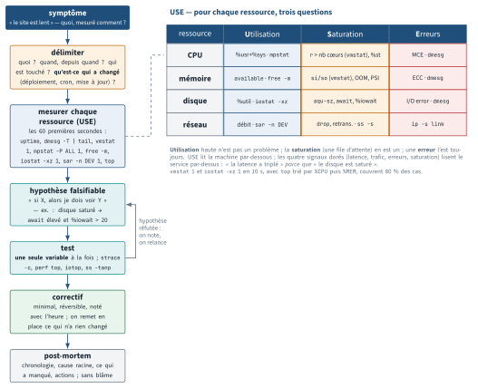

<!-- nav:début -->
[Accueil](../../README.md) › [Parcours](../../docs/parcours.md) › Partie III — Exploitation, sécurité et incidents › **Module 19**  
[← Module 18](../18-securite/README.md) · [Corrigé](corrige.md) · [Projet A →](../../projets/P1-factura/README.md)

<details><summary>Scripts du module (17)</summary>

Sur la VM indiquée en section « Mise en place », depuis `~/workbook/scripts/` (voir [chapitre 0](../../docs/00-mise-en-place.md)).

| Script | Rôle |
|---|---|
| [`setup_M19.sh`](../../scripts/setup/setup_M19.sh) | prépare le module |
| [`setup_M19_perf.sh`](../../scripts/setup/setup_M19_perf.sh) | prépare le module |
| [`check_M19_01.sh`](../../scripts/check/check_M19_01.sh) | vérification |
| [`check_M19_02.sh`](../../scripts/check/check_M19_02.sh) | vérification |
| [`check_M19_03.sh`](../../scripts/check/check_M19_03.sh) | vérification |
| [`check_M19_04.sh`](../../scripts/check/check_M19_04.sh) | vérification |
| [`check_M19_05.sh`](../../scripts/check/check_M19_05.sh) | vérification |
| [`check_M19_06.sh`](../../scripts/check/check_M19_06.sh) | vérification |
| [`check_M19_07.sh`](../../scripts/check/check_M19_07.sh) | vérification |
| [`break_M19_01.sh`](../../scripts/break/break_M19_01.sh) | installe une panne |
| [`break_M19_02.sh`](../../scripts/break/break_M19_02.sh) | installe une panne |
| [`break_M19_03.sh`](../../scripts/break/break_M19_03.sh) | installe une panne |
| [`break_M19_04.sh`](../../scripts/break/break_M19_04.sh) | installe une panne |
| [`break_M19_05.sh`](../../scripts/break/break_M19_05.sh) | installe une panne |
| [`break_M19_06.sh`](../../scripts/break/break_M19_06.sh) | installe une panne |
| [`break_M19_07.sh`](../../scripts/break/break_M19_07.sh) | installe une panne |
| [`break_M19_08.sh`](../../scripts/break/break_M19_08.sh) | installe une panne |

</details>
<!-- nav:fin -->

# Module 19 — Dépannage, performance et gestion d'incident

## 19.0 Objectifs et compétences

> [!NOTE]
> **Objectifs**
>
> À la fin de ce module, je sais :
>
> * conduire un diagnostic **méthodique** : formuler le symptôme, délimiter le
>   périmètre, poser une hypothèse falsifiable, la tester, conclure — et ne changer
>   qu'une chose à la fois en gardant une trace de ce que j'ai fait ;
> * appliquer la méthode **USE** (Utilization, Saturation, Errors) et les **quatre
>   signaux dorés** à une machine et à un service, et dire quelle métrique manque ;
> * dérouler la **checklist des 60 premières secondes** sur un serveur malade et
>   extraire de chaque sortie l'information qui oriente la suite ;
> * distinguer charge élevée, CPU saturé, attente d'E/S (`%wa`) et vol de CPU
>   (`%st`) sur une VM Proxmox, et remonter jusqu'au processus responsable ;
> * diagnostiquer une fuite mémoire, un thrash de swap et un passage de l'OOM
>   killer en lisant la trace de `dmesg` et en expliquant le score retenu ;
> * traiter un disque plein dont l'espace est retenu par un **fichier supprimé
>   encore ouvert**, un épuisement d'inodes, un disque lent (`await`, `%util`) et
>   un système de fichiers repassé en lecture seule après erreur d'E/S ;
> * instruire un service qui ne démarre pas, démarre sans répondre, répond
>   lentement ou redémarre en boucle, avec `strace`, `lsof`, `/proc/PID/*` et
>   `gdb` quand il le faut, en connaissant le coût de chaque outil ;
> * remonter une machine qui ne redémarre plus (GRUB, initramfs, `fstab`, mode
>   `emergency`, `chroot` depuis un live) et analyser un boot lent ;
> * mesurer avant d'optimiser : établir une baseline, comparer avant/après, et
>   refuser toute optimisation non mesurée ;
> * lire chaque outil de mesure **colonne par colonne** : `vmstat` (`r`, `b`,
>   `si`, `so`, `wa`), `iostat -xz` (`r/s`, `w/s`, `rkB/s`, `await`, `aqu-sz`,
>   `%util`), `free`, `/proc/meminfo`, `slabtop`, `mpstat -P ALL`,
>   `pidstat -d -r -u`, `iotop -oPa`, `sar` historique, et les indicateurs PSI
>   de `/proc/pressure/*` ;
> * profiler un processus CPU avec `perf top`, `perf record -g` / `perf
>   report`, `perf trace`, `ltrace` et `/proc/PID/wchan`, et prouver un gain
>   par une mesure avant/après ;
> * tenir un incident de bout en bout : rôles, communication, arbitrage entre
>   rétablir et comprendre, **préservation des preuves**, post-mortem blameless,
>   cinq pourquoi, runbook et escalade.
>
> **Temps estimé** : 11 h (le module de synthèse de toute la partie système)
>
> **Prérequis** : l'ensemble de la partie système, en particulier le module 08
> (processus, signaux, systemd), le module des journaux, celui du stockage et le
> module 12 (réseau). Ce module n'enseigne presque rien de neuf : il apprend à
> s'en servir sous pression.

---

## 19.1 Mise en place

VM principale : **`lab-web` (10.10.10.11)**. VM secondaire : **`lab-ops`
(10.10.10.14)**, d'où tu joues le rôle du client et du générateur de charge.
Quelques exercices touchent `lab-db` (10.10.10.12) pour les disques.

```bash
# depuis le shell Proxmox, AVANT toute chose
qm snapshot 9002 avant-lab19
qm snapshot 9005 avant-lab19
```

Outillage à installer sur `lab-web` :

```bash
sudo apt update
sudo apt install -y sysstat procps psmisc lsof strace ltrace gdb \
  tcpdump iproute2 smartmontools conntrack dnsutils curl iotop time \
  linux-tools-common linux-tools-generic stress-ng fio
```

`perf` doit correspondre au noyau qui tourne : `linux-tools-generic` suit le
méta-paquet, mais après une mise à jour de noyau sans redémarrage, ou avec
un noyau HWE, il faut `sudo apt install -y linux-tools-$(uname -r)`. Test :
`perf --version` puis `sudo perf stat -e task-clock true`.

Active la collecte historique de `sar` (sans elle, tu n'as aucun « avant ») :

```bash
sudo sed -i 's/^ENABLED=.*/ENABLED="true"/' /etc/default/sysstat
sudo systemctl enable --now sysstat
```

> [!IMPORTANT]
> **Variante Rocky / RHEL**
>
> Sous Rocky 9 : `sudo dnf install -y sysstat procps-ng psmisc lsof strace ltrace
> gdb tcpdump iproute smartmontools conntrack-tools bind-utils curl perf
> stress-ng fio`. La collecte `sar` est pilotée par
> `sysstat-collect.timer` et `sysstat-summary.timer` :
> `sudo systemctl enable --now sysstat-collect.timer`. Les données vivent dans
> `/var/log/sa/` (Ubuntu : `/var/log/sysstat/`).

Préparation du terrain (idempotent) :

```bash
sudo bash ~/workbook/scripts/setup/setup_M19.sh
```

Il installe l'application de démonstration **`vitrine`** (`vitrine-api.service`,
port 8080), son volume de données sur un disque dédié (image loop montée sur
`/srv/vitrine/data`), un générateur de charge, et le bac à sable
`~/lab19/` avec ses modèles de post-mortem et de runbook.

Vérifie que tout répond avant d'aller plus loin :

```bash
systemctl is-active vitrine-api.service
curl -s http://10.10.10.11:8080/sante
```

> [!CAUTION]
> **Attention**
>
> Ce module casse **volontairement et lourdement** `lab-web` : mémoire saturée,
> disque plein, système de fichiers en lecture seule, ports épuisés. Le snapshot
> `avant-lab19` n'est pas une formalité. Ne joue jamais ces scripts sur une
> machine qui sert à autre chose.

> [!TIP]
> **Astuce**
>
> Garde deux sessions SSH ouvertes sur `lab-web` en permanence pendant les Break &
> Fix. Quand une machine part en swap ou épuise ses descripteurs, ouvrir une
> nouvelle session devient impossible — celle qui est déjà ouverte, elle, tient.
> C'est la première règle de survie de l'astreinte.

---

## 19.2 Rappel express

### La boucle de diagnostic

```text
symptôme  ->  délimitation  ->  hypothèse  ->  test  ->  conclusion
   |               |              |            |            |
"quoi,        quand ? qui ?   falsifiable  une seule    on note,
 mesuré       depuis quand ?  "si X alors  variable     on relance
 comment ?"   qu'est-ce qui    je dois      à la fois   la boucle
              a changé ?       voir Y"
```

Trois règles non négociables : **une seule modification à la fois** (sinon on ne
sait plus ce qui a corrigé), **on note tout** (heure, commande, résultat), et
**on remet en place** ce qu'on a changé pour rien.

<p align="center"></p>

*Figure — La boucle de diagnostic, du symptôme au post-mortem, et la grille USE (Utilisation, Saturation, Erreurs) par ressource avec l'outil qui la mesure.*

### USE et les quatre signaux dorés

| Méthode | Pour quoi | Les axes |
|---|---|---|
| USE | chaque **ressource** (CPU, RAM, disque, réseau) | Utilization, Saturation, Errors |
| Signaux dorés | chaque **service** vu du client | latence, trafic, erreurs, saturation |

USE regarde la machine du dessous, les signaux dorés regardent l'utilisateur du
dessus. Un incident se lit toujours des deux côtés : « la latence a triplé »
(doré) *parce que* « le disque est saturé » (USE).

| Ressource | Utilisation | Saturation | Erreurs |
|---|---|---|---|
| CPU | `%usr+%sys` (`mpstat`) | `runq-sz` (`sar -q`), `%st` | MCE (`dmesg`) |
| RAM | `available` (`free -m`) | `si/so` (`vmstat`), OOM | ECC (`dmesg`) |
| Disque | `%util` (`iostat -xz`) | `aqu-sz`, `await` | erreurs I/O (`dmesg`) |
| Réseau | débit (`sar -n DEV`) | `drop`, backlog (`ss -s`) | `netstat -s`, `ip -s l` |

### Les 60 premières secondes

```bash
uptime                 # 3 charges : la tendance, pas la valeur
dmesg -T | tail -40    # OOM, erreurs I/O, reset de lien, MCE
vmstat 1 5             # r, b, si/so, us/sy/id/wa/st
mpstat -P ALL 1 3      # un coeur saturé ou tous ? %st ?
pidstat 1 3            # QUI consomme (CPU par processus)
iostat -xz 1 3         # await, %util, r/s w/s par disque
free -m                # available, pas free ; swap utilisé
sar -n DEV 1 3         # débit par interface
ss -s                  # sockets, time-wait, orphelines
top -b -n1 | head -20  # vue d'ensemble, RES et %CPU
```

Ce qu'on cherche : `uptime` → ça monte ou ça descend. `vmstat` → colonne `b`
(bloqués) et `si/so` (swap **actif**, pas juste utilisé). `%wa` élevé →
descends au disque. `%st` élevé → le problème est chez l'hyperviseur, pas chez
toi. `available` proche de 0 → mémoire, sinon la RAM n'est pas le sujet.

### Mémoire — lire `free -m` correctement

| Colonne | Signification |
|---|---|
| `free` | RAM **jamais utilisée**. Une valeur basse est normale et saine. |
| `buff/cache` | cache de pages, récupérable instantanément |
| `available` | ce qu'une nouvelle application peut réellement obtenir |
| `si` / `so` (vmstat) | pages lues / écrites **dans le swap**, par seconde |

Seuls `available` et `si/so` comptent. Du swap **utilisé** n'est pas un problème ;
du swap **en mouvement** (`si`/`so` non nuls en continu) est un thrash.

Les huit lignes utiles de `/proc/meminfo` (en Kio) :

| Ligne | Lecture |
|---|---|
| `MemTotal` / `MemAvailable` | la seule paire qui compte : `available` de `free` |
| `Cached` + `Buffers` | cache de pages et métadonnées : récupérables |
| `AnonPages` | mémoire des processus (tas, piles) : **pas** récupérable sans swap |
| `Shmem` | tmpfs et mémoire partagée : compté dans `Cached` mais **pas** récupérable |
| `Dirty` | pages modifiées pas encore écrites : un `sync` lent se lit ici |
| `Slab` (`SReclaimable` / `SUnreclaim`) | caches du noyau (dentries, inodes) ; `slabtop -o -s c` dit lequel |
| `SwapTotal` − `SwapFree` | swap occupé (pas grave) ; `vmstat` dit s'il bouge |
| `Committed_AS` vs `CommitLimit` | ce que les processus ont demandé : > `MemTotal` annonce un OOM |

### `vmstat 1` colonne par colonne

```text
procs -----------memory---------- ---swap-- -----io---- -system-- ------cpu-----
 r  b   swpd   free   buff  cache   si   so    bi    bo   in   cs us sy id wa st
 7  0 118240  81216  10496 402688    0    0     8   112  980 1840 91  6  3  0  0
```

| Colonne | Signification | Seuil d'alerte |
|---|---|---|
| `r` | processus **prêts** à tourner (file d'attente CPU) | > nombre de vCPU en continu |
| `b` | processus **bloqués** en E/S ininterruptible (état `D`) | > 0 en continu : disque |
| `si` / `so` | Kio/s lus / écrits **dans le swap** | non nuls plusieurs secondes : thrash |
| `bi` / `bo` | blocs lus / écrits sur les disques | à comparer à la baseline |
| `wa` | % CPU **inactif en attente d'E/S** | > 10-20 % : descends au disque |
| `st` | % CPU **volé** par l'hyperviseur | > 5 % : le problème est sur Proxmox |

La première ligne de `vmstat` est une moyenne **depuis le boot** : on la
jette et on lit à partir de la deuxième. Sur Ubuntu 24.04 (procps 4), une dernière colonne `gu` (temps passé à exécuter des invités KVM) suit `st`.

### `iostat -xz 1` colonne par colonne

```text
Device  r/s  rkB/s r_await rareq-sz   w/s   wkB/s w_await wareq-sz aqu-sz %util
sda     2.0   32.0    0.40     16.0 180.0 23040.0  480.20    128.0   12.8  99.9
```

| Colonne | Signification | Ce qu'on en tire |
|---|---|---|
| `r/s` `w/s` | requêtes lues / écrites par seconde (IOPS) | à comparer aux IOPS que peut fournir le disque |
| `rkB/s` `wkB/s` | débit | 23 Mo/s d'écriture sur un disque virtuel Proxmox : normal ou pas ? baseline |
| `r_await` `w_await` | latence **moyenne** d'une requête, file d'attente incluse (ms) | > 10 ms sur SSD, > 30 ms sur HDD : saturation |
| `rareq-sz` `wareq-sz` | taille moyenne d'une requête (Kio) | petit = aléatoire (base de données), gros = séquentiel |
| `aqu-sz` | longueur moyenne de la file | > 1 durablement : les requêtes attendent |
| `%util` | % du temps où le disque avait au moins une requête | 100 % sur un SSD/NVMe ne dit pas grand-chose ; `await` et `aqu-sz` tranchent |

`-x` = colonnes étendues, `-z` = masquer les disques inactifs, `-p sda` =
détail par partition. Comme pour `vmstat`, première ligne = depuis le boot.

### Voir par processus, voir dans le temps

```bash
sudo iotop -oPa           # -o : seulement ceux qui font des E/S ;
                          # -P : processus, pas threads ; -a : cumul
pidstat -d -r -u 1 5      # par processus : E/S (kB_rd/s kB_wr/s), mémoire
                          # (RSS, majflt/s), CPU (%usr %system) — chaque seconde
mpstat -P ALL 1 3         # par cœur : un seul cœur à 100 % = mono-thread
sar -u -r -b -n DEV -f /var/log/sysstat/sa$(date -d yesterday +%d)
                          # CPU, mémoire, E/S, réseau : hier, toutes les 10 min
sar -q -s 02:00:00 -e 03:00:00           # charge et runq entre 2 h et 3 h
```

`sar` n'a d'historique que si `ENABLED="true"` dans `/etc/default/sysstat`
et `sysstat.service` actif (collecte par `sysstat-collect.timer`, toutes les
10 min). Rocky : `/var/log/sa/saJJ`.

### PSI — la métrique moderne de saturation

```bash
cat /proc/pressure/cpu /proc/pressure/memory /proc/pressure/io
# some avg10=12.40 avg60=8.10 avg300=3.05 total=98213345
# full avg10=0.00  avg60=0.30 avg300=0.10 total=1204431
```

`some` = % du temps où **au moins une** tâche a attendu la ressource ;
`full` = % du temps où **toutes** les tâches attendaient (la machine ne fait
rien d'utile). `avg10/60/300` = fenêtres glissantes en secondes. Un
`memory full` > 0 durable = thrash ; un `io some` élevé = disque saturé ;
`cpu some` = file d'attente CPU. Existe aussi par cgroup
(`/ sys/fs/cgroup/system.slice/<unité>/memory.pressure`, `cpu.pressure`, `io.pressure`) : `systemd-oomd` lit `memory.pressure`.
Plus lisible que la charge moyenne : la charge mélange CPU et E/S, PSI les
sépare.

### Disque plein — les trois causes

| Symptôme | Cause | Commande qui tranche |
|---|---|---|
| `df` plein, `du` d'accord | vrais fichiers | `du -xh --max-depth=1 /` |
| `df` plein, `du` bien plus bas | fichier supprimé encore ouvert | `lsof +L1` |
| `No space left` mais `df` OK | inodes épuisés | `df -i` |

### Observation fine d'un processus

| Commande | Ce qu'elle montre | Coût |
|---|---|---|
| `strace -p PID -f -T` | appels système, durées | x10 à x100 |
| `strace -c -p PID` | compteurs agrégés | fort mais borné |
| `ltrace -p PID` | appels de bibliothèque | énorme, instable |
| `lsof -p PID` | fichiers, sockets, fd ouverts | négligeable |
| `cat /proc/PID/stack` | pile **noyau** (root) | nul |
| `gdb -p PID -batch -ex 'thread apply all bt'` | piles utilisateur | fige le processus |

`/proc/PID/` : `status` (état, RSS, threads, `voluntary_ctxt_switches`),
`limits` (les `RLIMIT_*` réellement appliqués), `fd/` (un lien par descripteur),
`stack`, `environ` (`tr '\0' '\n' < /proc/PID/environ`), `wchan`, `io`.
`wchan` donne la **fonction noyau** dans laquelle le processus dort
(`ps -o pid,wchan:24,args`) : `0` = il tourne, `do_wait` = attend un fils,
`ep_poll`/`poll_schedule_timeout` = attend des E/S réseau, `io_schedule` ou
`wait_on_page_bit` = attend le disque, `nfs_wait_bit` = NFS bloqué.

### `perf` : où part le CPU

```bash
sudo perf top -p PID                    # en direct, fonction par fonction
sudo perf record -F 99 -g -p PID -- sleep 10     # échantillonne 10 s, piles
sudo perf record -F 99 -g -- python3 script.py   # ou lance la commande
sudo perf report --stdio --no-children | head -40
sudo perf report                        # interactif : Entrée déplie la pile
sudo timeout -s INT 5 perf trace -p PID     # strace sans ptrace : coût faible
sudo timeout -s INT 5 perf trace -s -p PID  # résumé par appel système
sudo perf stat -e task-clock,context-switches,page-faults python3 script.py
timeout -s INT 5 ltrace -c -p PID       # appels de BIBLIOTHÈQUE (libc, ssl)
```

`-F 99` = 99 échantillons par seconde (pas 100, pour ne pas tomber en phase
avec un timer). `-g` capture la pile d'appels : sans lui, on sait *quelle*
fonction, pas *qui l'appelle*. Pour Python 3.12+, `python3 -X perf script.py`
fait apparaître les fonctions Python (`py::nom:/chemin`) au lieu de
`_PyEval_EvalFrameDefault`. `perf trace` fait le travail de `strace` sans
arrêter le processus à chaque appel.

### Ce qui coûte, ce qui ne coûte rien

`strace` arrête le processus à chaque appel système (`ptrace`) : sur un serveur
chargé, ça peut multiplier la latence par 50. On l'attache **quelques secondes**,
jamais « pour voir ». `perf top` échantillonne : coût de quelques pour cent,
c'est l'outil de la production. `lsof`, `ss`, `/proc` sont gratuits.

### Pièges classiques

* charge de 40 avec 2 % de CPU : sous Linux la charge compte aussi les
  processus en `D` (E/S ininterruptibles) — c'est un problème de disque ;
* « j'ai redémarré le service, ça remarche » : tu viens de détruire les preuves ;
* optimiser un `sysctl` lu sur un blog sans baseline : tu ne sauras jamais si ça
  a aidé, et tu auras une machine qui diverge du reste du parc ;
* `systemctl restart` sur un service en boucle : `start request repeated too
  quickly` vient de `StartLimitBurst`, pas d'une erreur de l'application.

---

## 19.3 Quiz — QCM

<a id="q19-1"></a>**[Q19.1](corrige.md#q19-1)** — Sur `lab-web`, `uptime` affiche `load average: 38.12, 36.40, 22.05`
et `mpstat -P ALL 1 3` donne un `%idle` moyen de 96 %. Que conclus-tu ?

a) la charge est mal calculée sur les VM, il faut l'ignorer
b) les processus sont majoritairement en état `D`, attente d'E/S : regarde le
   disque ou un montage réseau
c) le CPU est saturé mais `mpstat` ne compte pas le temps noyau
d) il y a trop de processus en état `Z`

<a id="q19-2"></a>**[Q19.2](corrige.md#q19-2)** — `vmstat 1` sur une machine qui rame :

```text
 r  b   swpd   free   buff  cache   si   so    bi    bo   us sy id wa st
 1  7 512000  48120   1204  98340  312  980  2240  1180   4  9  2 85  0
```

Quel est le diagnostic le plus probable ? **Deux réponses correctes.**

a) la machine est en thrash de swap : `si` et `so` sont actifs en continu
b) le CPU est saturé par du calcul utilisateur
c) sept processus sont bloqués en attente d'E/S, cohérent avec `wa` à 85
d) la mémoire est saine, `free` est simplement bas

<a id="q19-3"></a>**[Q19.3](corrige.md#q19-3)** — `mpstat -P ALL 1` sur une VM Proxmox affiche `%st` à 24 %.
Que signifie cette colonne, et qui doit agir ?

a) le temps passé en appels système : c'est l'application qui doit être corrigée
b) le temps où la VM voulait du CPU mais où l'hyperviseur l'a donné à quelqu'un
   d'autre : l'action est sur l'hôte Proxmox (surallocation de vCPU)
c) le temps de vol de cache L3 par les autres VM : il faut épingler les vCPU
d) le temps d'attente disque de l'hôte : il faut changer le stockage

<a id="q19-4"></a>**[Q19.4](corrige.md#q19-4)** — `free -m` affiche `total 3924`, `used 1184`, `free 118`,
`buff/cache 2860`, `available 2740`. Faut-il ajouter de la RAM ?

a) oui, `free` est à 118 Mo
b) oui, `buff/cache` occupe plus de 70 % de la RAM
c) non, `available` est à 2740 Mo : le cache sera rendu à la demande
d) impossible à dire sans `vmstat`

<a id="q19-5"></a>**[Q19.5](corrige.md#q19-5)** — Dans `dmesg -T`, tu lis :

```text
[Fri Sep 18 14:22:07 2026] vitrine-api invoked oom-killer:
  gfp_mask=0x140cca, order=0, oom_score_adj=0
[Fri Sep 18 14:22:07 2026] Out of memory: Killed process 2244 (vitrine-api)
  total-vm:3820140kB, anon-rss:3612880kB, file-rss:0kB, shmem-rss:0kB
```

Que t'apprend la première ligne ? **Deux réponses correctes.**

a) `vitrine-api` a demandé la mémoire qui a déclenché l'OOM killer
b) `vitrine-api` est forcément la victime désignée
c) la victime est le processus 2244, ici le même, mais ce n'est pas garanti
d) `oom_score_adj=0` signifie que le processus était protégé

<a id="q19-6"></a>**[Q19.6](corrige.md#q19-6)** — `df -h /var` affiche 100 % utilisé, `du -xsh /var` affiche 3,2 Go
sur une partition de 20 Go. Quelle commande tranche ?

a) `du -x --max-depth=1 /var | sort -h`
b) `lsof +L1`
c) `df -i /var`
d) `find /var -size +1G`

<a id="q19-7"></a>**[Q19.7](corrige.md#q19-7)** — Tu as trouvé le coupable : `nginx` garde ouvert
`/var/log/nginx/access.log (deleted)` de 16 Go. Interdiction de redémarrer
`nginx` en pleine journée. Comment récupères-tu l'espace ? **Deux réponses.**

a) `rm` du fichier : il est déjà supprimé, c'est sans effet
b) `truncate -s 0 /proc/<pid>/fd/<n>` où `n` est le descripteur repéré par `lsof`
c) `: > /proc/<pid>/fd/<n>` depuis un shell root
d) `echo 3 > /proc/sys/vm/drop_caches`

<a id="q19-8"></a>**[Q19.8](corrige.md#q19-8)** — `iostat -xz 1` donne pour `sdb` : `r_await 0.4`, `w_await 480.2`,
`aqu-sz 12.8`, `%util 99.9`. Interprétation ?

a) le disque est en panne, il faut le remplacer immédiatement
b) le disque est saturé en écriture : file d'attente longue et latence
   d'écriture d'une demi-seconde
c) `%util` à 100 % prouve la saturation sur tous les types de stockage
d) le problème est le contrôleur, pas le disque

<a id="q19-9"></a>**[Q19.9](corrige.md#q19-9)** — Un service web log `Cannot assign requested address` sur ses appels
sortants vers l'API interne, alors que le réseau fonctionne. Cause la plus
probable ?

a) le DNS ne résout plus
b) la plage de ports éphémères est épuisée (beaucoup de sockets en `TIME_WAIT`)
c) le pare-feu bloque les connexions sortantes
d) la MTU est mal réglée

<a id="q19-10"></a>**[Q19.10](corrige.md#q19-10)** — `dmesg` affiche `nf_conntrack: table full, dropping packet`. Quel
est l'effet observé côté utilisateur et la première mesure ?

a) tout tombe d'un coup ; il faut redémarrer le réseau
b) des connexions **nouvelles** échouent ou traînent pendant que les anciennes
   passent ; on mesure `conntrack -C` contre `nf_conntrack_max`
c) la latence augmente uniformément ; on augmente la MTU
d) seuls les paquets UDP sont perdus ; on désactive le pare-feu

<a id="q19-11"></a>**[Q19.11](corrige.md#q19-11)** — `systemctl status vitrine-api` affiche
`Failed with result 'start-limit-hit'` et
`start request repeated too quickly`. Que fais-tu **en premier** ?

a) `systemctl reset-failed vitrine-api` puis `start`, et si ça reboucle je
   remonte au vrai crash dans `journalctl -u vitrine-api`
b) j'augmente `StartLimitBurst` pour que ça passe
c) je passe `Restart=no` et je considère l'incident clos
d) je réinstalle le paquet

<a id="q19-12"></a>**[Q19.12](corrige.md#q19-12)** — Tu dois savoir pourquoi un processus est bloqué depuis 10 minutes
sans consommer de CPU. Quelle séquence est la plus pertinente, et la moins
risquée pour la production ?

a) `strace -p PID` puis `ltrace -p PID` en continu
b) `cat /proc/PID/status` (état), `/proc/PID/wchan`, `/proc/PID/stack`, puis
   `strace -p PID` quelques secondes
c) `kill -QUIT PID` pour obtenir un core dump
d) `gdb -p PID` interactif en premier, c'est le plus complet

<a id="q19-13"></a>**[Q19.13](corrige.md#q19-13)** — Le service démarre puis `curl http://127.0.0.1:8080/` répond
`Connection refused`, alors que `systemctl is-active` dit `active (running)`.
Quelle commande t'oriente le plus vite ? **Deux réponses.**

a) `ss -tulpn | grep 8080`
b) `journalctl -u vitrine-api -n 50 --no-pager`
c) `ping 127.0.0.1`
d) `systemctl cat vitrine-api`

<a id="q19-14"></a>**[Q19.14](corrige.md#q19-14)** — Une application ouvre de plus en plus de connexions et finit par
logguer `Too many open files`. Où lis-tu la limite **réellement appliquée** au
processus en cours d'exécution ?

a) `ulimit -n` dans ton shell
b) `/etc/security/limits.conf`
c) `cat /proc/<pid>/limits`
d) `sysctl fs.file-max`

<a id="q19-15"></a>**[Q19.15](corrige.md#q19-15)** — Après une coupure d'alimentation, `lab-db` s'arrête au démarrage sur
`You are in emergency mode` et le journal mentionne
`Failed to mount /srv/data`. Une entrée de `fstab` pointe un disque retiré.
Quelle correction évite que le problème se reproduise ?

a) supprimer définitivement la ligne de `fstab`
b) ajouter `nofail` (et un `x-systemd.device-timeout=` court) à l'entrée
c) passer le montage en `noauto` et monter à la main après chaque boot
d) désactiver `systemd-fsck-root.service`

<a id="q19-16"></a>**[Q19.16](corrige.md#q19-16)** — `systemd-analyze blame` place `cloud-init.service` en tête avec
32 s. Que peux-tu en conclure ?

a) c'est lui qui a rallongé le boot de 32 s
b) rien directement : il a duré 32 s, mais seul `systemd-analyze
   critical-chain` dit s'il était sur le chemin critique
c) il faut le désactiver
d) le boot a duré au moins 32 s multipliés par le nombre d'unités

<a id="q19-17"></a>**[Q19.17](corrige.md#q19-17)** — Le site est tombé. Le responsable d'astreinte demande un
redémarrage immédiat du serveur. Que fais-tu avant ? **Trois réponses.**

a) je copie les journaux de la fenêtre de l'incident hors de la machine
b) je capture `ps auxf`, `ss -tanp`, `free -m`, `dmesg -T` dans un fichier
c) je lance un `strace` de 30 minutes pour être sûr
d) j'annonce l'heure du redémarrage et j'horodate la décision

<a id="q19-18"></a>**[Q19.18](corrige.md#q19-18)** — Dans un post-mortem blameless, laquelle de ces formulations est
acceptable ?

a) « Mathieu a poussé une conf non testée »
b) « Un changement de configuration est parti en production sans passage par la
    validation automatique, qui n'était pas obligatoire sur cette branche »
c) « L'équipe réseau n'a pas fait son travail »
d) « Erreur humaine, rappel des consignes effectué »

<a id="q19-19"></a>**[Q19.19](corrige.md#q19-19)** — `iostat -xz 1` sur `lab-db` pendant une sauvegarde :

```text
Device   r/s   rkB/s  r_await  w/s    wkB/s  w_await  aqu-sz  %util
sdb     1.0    16.0    0.50   95.0  97280.0   3.20     0.31   98.0
```

`%util` est à 98 %. Le disque est-il saturé ?

a) oui : 98 % d'utilisation, il faut arrêter la sauvegarde
b) non : `w_await` à 3 ms et `aqu-sz` < 1 disent que les requêtes sont
   servies sans attendre ; `%util` mesure seulement le temps où **au moins
   une** requête était en cours, ce qui ne dit rien sur la capacité restante
   d'un disque qui traite plusieurs requêtes en parallèle ; le débit
   (95 Mo/s en écritures séquentielles de 1 Mo) est simplement soutenu
c) oui : `wareq-sz` manque, donc les écritures sont aléatoires
d) impossible à dire sans `sar`

<a id="q19-20"></a>**[Q19.20](corrige.md#q19-20)** — `cat /proc/pressure/memory` sur `lab-web` :

```text
some avg10=38.20 avg60=27.90 avg300=9.14 total=48213345
full avg10=21.05 avg60=12.40 avg300=3.90 total=15204431
```

Que signifie la ligne `full`, et qu'en conclus-tu ?

a) 21 % de la mémoire est pleine
b) pendant 21 % des dix dernières secondes, **toutes** les tâches
   attendaient de la mémoire (récupération de pages, swap) : la machine
   thrash, et `vmstat` doit montrer `si`/`so` non nuls
c) 21 % des processus sont en attente mémoire
d) la ligne `full` est toujours nulle pour la mémoire, la sortie est corrompue

<a id="q19-21"></a>**[Q19.21](corrige.md#q19-21)** — `perf record -g -p $(pidof vitrine-api) -- sleep 10` puis
`perf report` montrent 71 % du temps dans `_PyEval_EvalFrameDefault` et le
reste dans `libc`. Que fais-tu pour trouver la fonction **Python** coupable ?
**Deux réponses correctes.**

a) rien à faire : `_PyEval_EvalFrameDefault` est la fonction lente, il faut
   patcher CPython
b) relancer le programme avec `python3 -X perf` (3.12+), qui publie une carte
   `/tmp/perf-PID.map` : `perf report` affiche alors `py::nom_fonction:/chemin`
c) croiser avec un profileur au niveau du langage (`python3 -m cProfile -s
   tottime`), qui compte par fonction Python mais avec un surcoût plus fort
d) utiliser `strace -c`, qui donne le temps par fonction Python

<a id="q19-22"></a>**[Q19.22](corrige.md#q19-22)** — `vmstat 1` sur `lab-web` : `r` = 9 en continu, `b` = 0,
`wa` = 0, `us` = 92, `sy` = 6, `st` = 0. `mpstat -P ALL 1` montre les deux
vCPU à 100 %. Le disque est calme. Quel est le goulot et quelle commande
donne le coupable ?

a) le disque ; `iostat -xz 1`
b) la mémoire ; `free -m`
c) le CPU : neuf tâches prêtes pour deux cœurs, tout le temps en espace
   utilisateur ; `pidstat -u 1` ou `top` (touche `P`) donne le processus,
   `perf top -p PID` la fonction
d) l'hyperviseur ; `%st`

---

## 19.4 Quiz — questions ouvertes

<a id="qo19-1"></a>**[QO19.1](corrige.md#qo19-1)** — Décris ta méthode de diagnostic en six étapes, telle que tu
l'appliquerais à ce ticket : « depuis ce matin le site est lent ». Pour chaque
étape, donne la question que tu poses ou la commande que tu lances, et surtout
**ce que tu fais du résultat**. Insiste sur la délimitation : quelles quatre
questions permettent de réduire le périmètre avant même de se connecter ?

<!-- repondre: 12 -->

<a id="qo19-2"></a>**[QO19.2](corrige.md#qo19-2)** — Explique la différence entre USE et les quatre signaux dorés, avec
un exemple concret où les deux méthodes donnent des conclusions différentes sur
le même incident. Dans quel cas USE est-il aveugle ? Dans quel cas les signaux
dorés le sont-ils ?

<!-- repondre: 10 -->

<a id="qo19-3"></a>**[QO19.3](corrige.md#qo19-3)** — *On te demande en entretien* : « Tu te connectes sur un serveur de
production qui rame, tu as 60 secondes avant que le client te rappelle. Tu tapes
quoi, dans quel ordre, et qu'est-ce que tu regardes dans chaque sortie ? »
Réponds comme en entretien : la liste des commandes et, pour chacune, **une
phrase** sur l'information recherchée.

<!-- repondre: 12 -->

<a id="qo19-4"></a>**[QO19.4](corrige.md#qo19-4)** — Un processus `java` a un RSS qui monte de 40 Mo par heure depuis
trois jours. Décris comment tu prouves qu'il s'agit d'une fuite et non d'un
cache qui se remplit normalement, quelles données tu collectes pour le
développeur, et ce que tu mets en place pour que l'incident ne réveille personne
à 3 h du matin en attendant le correctif.

<!-- repondre: 10 -->

<a id="qo19-5"></a>**[QO19.5](corrige.md#qo19-5)** — Explique le fonctionnement de l'OOM killer : à quel moment il se
déclenche, comment le score d'une tâche est calculé, ce que font
`oom_score_adj` et `MemoryMax=` d'une unité systemd, et pourquoi la victime
n'est presque jamais le vrai coupable. Termine par ce que tu changerais sur une
machine où l'OOM killer a tué la base de données au lieu de l'application.

<!-- repondre: 10 -->

<a id="qo19-6"></a>**[QO19.6](corrige.md#qo19-6)** — *On te demande en entretien* : « `df` dit 100 %, `du` dit 40 %.
Explique-moi ce qui se passe et comment tu récupères l'espace sans redémarrer le
service. » Réponds, puis explique ce qui se passerait si tu avais fait un
`rm` du fichier de log au lieu d'un `truncate`.

<!-- repondre: 8 -->

<a id="qo19-7"></a>**[QO19.7](corrige.md#qo19-7)** — Compare `strace`, `perf top` et les compteurs de `/proc` du point de
vue du coût en production : ce que chacun observe, ce qu'il rate, ce qu'il
coûte, et dans quel ordre tu les emploies sur un serveur qui sert encore du
trafic. Donne la commande exacte que tu utiliserais pour ne pas dépasser dix
secondes d'observation avec `strace`.

<!-- repondre: 10 -->

<a id="qo19-8"></a>**[QO19.8](corrige.md#qo19-8)** — Un service répond en 5,1 s au lieu de 40 ms. `top` montre le
processus à 0,2 % de CPU. Décris ta démarche complète pour prouver que le temps
est passé dans une dépendance externe, puis pour dire **laquelle**. Cite au
moins trois outils et ce que tu attends de chacun.

<!-- repondre: 10 -->

<a id="qo19-9"></a>**[QO19.9](corrige.md#qo19-9)** — On te confie la gestion d'un incident majeur : le site est
inaccessible depuis 10 minutes, quatre personnes sont sur le pont, la direction
demande des nouvelles toutes les 15 minutes. Décris l'organisation que tu mets
en place (rôles, canal, cadence), comment tu arbitres entre « rétablir tout de
suite » et « comprendre d'abord », et la liste exacte des preuves que tu fais
collecter avant tout redémarrage.

<!-- repondre: 12 -->

<a id="qo19-10"></a>**[QO19.10](corrige.md#qo19-10)** — Explique la méthode des cinq pourquoi sur cet incident réel :
« le site a été indisponible 40 minutes parce que le disque `/var` était plein ».
Déroule les cinq niveaux, puis dis à quel niveau se situe l'action corrective
qui empêche vraiment la récidive — et pourquoi s'arrêter au premier niveau
(« on a purgé les logs ») garantit que ça recommencera.

<!-- repondre: 10 -->

<a id="qo19-11"></a>**[QO19.11](corrige.md#qo19-11)** — *On te demande en entretien* : « Un service Python répond
lentement, `top` montre son processus à 100 % d'un cœur. Déroule ta
démarche de profilage jusqu'à la correction, en respectant "mesurer avant
d'optimiser". » Décris : la baseline que tu poses (quoi, comment, où tu la
ranges), le premier outil que tu attaches et pourquoi (`perf` plutôt que
`strace`, `perf top` plutôt que `perf record` ou l'inverse), ce que tu fais
quand `perf` ne montre que `_PyEval_EvalFrameDefault`, comment tu passes de
« la fonction chaude » à « la ligne coupable », le critère qui prouve que
la correction est bonne, et ce que tu refuses de faire.

<!-- repondre: 12 -->

---

## 19.5 Exercices guidés ★

Ces exercices se font sur `lab-web`, machine saine (aucun Break & Fix en cours).
Plusieurs demandent de provoquer une charge : `stress-ng` et le générateur
`vitrine-charge.sh` installé par le setup sont là pour ça.

<a id="e19-1"></a>**[E19.1](corrige.md#e19-1)** — Lance une charge CPU sur deux cœurs pendant 60 s, puis prouve, en
deux commandes seulement, que la charge moyenne monte **à cause du CPU** et non
d'une attente d'E/S.

<a id="e19-2"></a>**[E19.2](corrige.md#e19-2)** — Provoque une charge d'E/S (`stress-ng --hdd 2 --timeout 60s`) et
montre, sortie à l'appui, que la charge moyenne monte alors que `%idle` reste
élevé. Identifie la colonne de `vmstat` et l'état de `ps` qui expliquent l'écart.

<a id="e19-3"></a>**[E19.3](corrige.md#e19-3)** — Écris la commande qui affiche les dix processus les plus gourmands en
CPU et, séparément, les dix plus gros consommateurs de mémoire résidente, avec
PID, utilisateur, RSS en Mo et ligne de commande complète.

<a id="e19-4"></a>**[E19.4](corrige.md#e19-4)** — Un processus consomme 100 % d'un cœur. Trouve-le, puis détermine
**dans quelle fonction** il brûle le temps, d'abord avec `perf top -p PID`, puis
avec cinq captures successives de sa pile noyau.

<a id="e19-5"></a>**[E19.5](corrige.md#e19-5)** — Affiche, pour le processus principal de `vitrine-api` : son état, son
RSS, son nombre de threads, sa limite effective de descripteurs, le nombre de
descripteurs réellement ouverts et ses variables d'environnement. Une commande
par information, toutes depuis `/proc`.

<a id="e19-6"></a>**[E19.6](corrige.md#e19-6)** — Mesure la quantité de mémoire réellement disponible pour une nouvelle
application, puis vide le cache de pages et mesure de nouveau. Explique l'écart
entre `free` et `available` avant et après.

<a id="e19-7"></a>**[E19.7](corrige.md#e19-7)** — Détecte en une commande si la machine **swappe activement** en ce
moment (et pas simplement si du swap est utilisé). Donne ensuite la commande qui
classe les processus par quantité de mémoire swappée.

<a id="e19-8"></a>**[E19.8](corrige.md#e19-8)** — Sur la partition `/srv/vitrine/data`, affiche successivement :
l'espace occupé, le nombre d'inodes libres, les cinq répertoires les plus gros,
et la liste des fichiers supprimés encore ouverts par un processus.

<a id="e19-9"></a>**[E19.9](corrige.md#e19-9)** — Provoque une activité disque soutenue avec `fio` pendant 30 s et
relève, pendant ce temps, `await` et `%util` du périphérique concerné. Note la
valeur de repos et la valeur en charge : c'est ta première baseline.

<a id="e19-10"></a>**[E19.10](corrige.md#e19-10)** — Attache `strace` au processus `vitrine-api` pendant exactement
dix secondes, en comptant les appels système par type et en suivant les fils
d'exécution. Donne ensuite la variante qui n'affiche que les appels liés au
réseau, avec leur durée.

<a id="e19-11"></a>**[E19.11](corrige.md#e19-11)** — Le processus `vitrine-api` est-il bloqué ou occupé ? Réponds avec
trois sources différentes : son état dans `ps`, le compteur de changements de
contexte de `/proc`, et sa pile noyau.

<a id="e19-12"></a>**[E19.12](corrige.md#e19-12)** — Liste tous les fichiers et sockets ouverts par `vitrine-api`, puis
tous les processus qui tiennent un fichier ouvert sur `/srv/vitrine/data`
(utile avant un `umount` qui refuse).

<a id="e19-13"></a>**[E19.13](corrige.md#e19-13)** — Affiche les sockets en écoute avec le processus propriétaire, puis
le résumé des états de sockets de la machine, puis le nombre de connexions en
`TIME_WAIT`. Compare avec la taille de la plage de ports éphémères.

<a id="e19-14"></a>**[E19.14](corrige.md#e19-14)** — Un processus est figé et ne répond plus à `SIGTERM`. Récupère les
piles d'appels de **tous ses threads** en une commande `gdb` non interactive,
dans un fichier daté. Précise l'effet de cette commande sur le processus.

<a id="e19-15"></a>**[E19.15](corrige.md#e19-15)** — Établis la baseline de latence de `vitrine-api` : 200 requêtes,
temps de réponse moyen, médian et maximal, avec `curl` et un format de sortie
personnalisé. Range le résultat dans `~/lab19/rapports/baseline.txt`.

<a id="e19-16"></a>**[E19.16](corrige.md#e19-16)** — Affiche l'historique de charge et d'E/S de la journée précédente
avec `sar`, puis l'activité mémoire entre 9 h et 11 h aujourd'hui. Si `sar` n'a
rien collecté, explique en une ligne ce qu'il faut corriger.

<a id="e19-17"></a>**[E19.17](corrige.md#e19-17)** — Donne les trois commandes qui répondent à : combien de temps a duré
le dernier démarrage, quelles unités ont été les plus lentes, et lesquelles
étaient sur le chemin critique.

<a id="e19-18"></a>**[E19.18](corrige.md#e19-18)** — Capture pendant 20 secondes, dans un fichier `.pcap`, uniquement le
trafic DNS sortant de `lab-web`, puis affiche les requêtes restées sans réponse.

Les six exercices suivants prennent chacun **un** outil sur une charge
connue. Prépare-la avec `sudo bash ~/workbook/scripts/setup/setup_M19_perf.sh`
(il dépose `~/lab19/perf/` : le script du lab L19.6 et ses données).

<a id="e19-19"></a>**[E19.19](corrige.md#e19-19)** — Lance en arrière-plan `stress-ng --hdd 1 --hdd-bytes 512M
--timeout 90s` dans `/srv/vitrine/data` **et** `fio --name=lect
--rw=randread --bs=4k --size=200M --runtime=90 --time_based
--directory=/srv/vitrine/data`. Avec `iotop` en mode non interactif, sur
cinq secondes, produis la liste des seuls processus qui font des E/S, par
processus et non par thread, avec le **cumul** depuis le lancement. Dis
lequel écrit, lequel lit, et confirme avec `pidstat -d 1 3`. Explique la
différence entre les colonnes `DISK READ`/`DISK WRITE` et `SWAPIN`/`IO>`.

<a id="e19-20"></a>**[E19.20](corrige.md#e19-20)** — Pendant la même charge, relève cinq secondes d'`iostat -xz 1`
sur le disque de `/srv/vitrine/data`. Remplis un tableau avec `r/s`, `w/s`,
`rkB/s`, `wkB/s`, `r_await`, `w_await`, `rareq-sz`, `aqu-sz` et `%util`,
puis réponds : quel type d'E/S fait `fio` (taille moyenne de requête), quel
type fait `stress-ng`, laquelle des deux latences est la plus mauvaise et
pourquoi, et si `%util` à 100 % signifie ici « saturé ». Compare avec la
valeur au repos de E19.9.

<a id="e19-21"></a>**[E19.21](corrige.md#e19-21)** — Lance `stress-ng --cpu 1 --timeout 60s` (**un** seul worker).
Montre avec `mpstat -P ALL 1 3` qu'un seul vCPU est occupé et que la
moyenne `all` ment, puis avec `pidstat -u -r 1 3` le processus responsable,
son `%usr`/`%system` et son RSS. Relance avec `--cpu 2` et montre la
différence. Lis ensuite `/proc/pressure/cpu` dans les deux cas et explique
pourquoi `some` monte avec deux workers alors que `%idle` était déjà bas
avec un.

<a id="e19-22"></a>**[E19.22](corrige.md#e19-22)** — Lance `stress-ng --vm 2 --vm-bytes 75% --vm-keep --timeout
60s`. Avec `vmstat 1` (colonnes `r`, `b`, `si`, `so`, `wa`, `free`), `free
-m` et `/proc/pressure/memory` (`some` et `full`), documente ce qui se
passe seconde par seconde : à quel moment `available` s'effondre, quand
`si`/`so` deviennent non nuls, quand `full` devient non nul, et ce que fait
la charge moyenne pendant ce temps. Conclus sur l'ordre dans lequel ces
quatre indicateurs réagissent.

<a id="e19-23"></a>**[E19.23](corrige.md#e19-23)** — Machine au repos : lis `/proc/meminfo` et réconcilie ses
lignes avec `free -m` (`total`, `used`, `free`, `shared`, `buff/cache`,
`available`), à 5 % près. Affiche les cinq caches noyau les plus gros avec
`slabtop`, en une commande non interactive, et dis lesquels sont
récupérables. Crée 100 000 fichiers vides dans `/var/tmp/inodes-test`
(pas dans `/srv/vitrine/data` : ce petit système de fichiers n'a pas assez
d'inodes, vérifie avec `df -i`), relis `Slab`, `SReclaimable` et le premier
cache de `slabtop`, puis vide les caches et relis. Supprime les fichiers.

<a id="e19-24"></a>**[E19.24](corrige.md#e19-24)** — Sur le processus `vitrine-api` en charge (`vitrine-charge.sh
/produits 5 60`) : donne, avec `perf trace -s` pendant cinq secondes, le
résumé des appels système par type et leur durée ; avec `/proc/PID/wchan` et
`ps -o wchan` cinq fois de suite, la fonction noyau dans laquelle il attend ;
avec `ltrace -c` pendant cinq secondes, les appels de bibliothèque les plus
fréquents. Compare le coût des trois outils sur la latence de `/sante`
mesurée en parallèle avec `curl -w '%{time_total}'`.

---

## 19.6 Labs ★★

### <a id="l19-1"></a>**[L19.1](corrige.md#l19-1)** — Les 60 premières secondes (INC-3301)

> **Contexte**
>
> 06 h 12, ton téléphone sonne. Le supervision dit : « lab-web ne répond plus
> correctement ». Aucune autre information. Tu as accès SSH. Ton chef d'astreinte
> veut un point dans cinq minutes : est-ce le CPU, la mémoire, le disque, le
> réseau ou l'application ? Cette première réponse conditionne qui on réveille.

Prépare d'abord le terrain : demande à un collègue (ou à toi-même depuis
`lab-ops`) de lancer l'un des générateurs suivants sans te dire lequel :

```bash
# sur lab-web, à faire lancer par quelqu'un d'autre, au hasard
sudo stress-ng --cpu 2 --timeout 300s &          # piste A
sudo stress-ng --hdd 2 --hdd-bytes 1G --timeout 300s &   # piste B
sudo stress-ng --vm 2 --vm-bytes 700M --timeout 300s &   # piste C
```

1. Écris `~/lab19/bin/triage.sh` : un script qui exécute, dans l'ordre, la
   checklist des 60 secondes et écrit sa sortie horodatée dans
   `~/lab19/rapports/triage-<date>.txt`. Il ne doit **rien casser**, ne rien
   redémarrer, et tourner en moins de 30 secondes.
2. Lance-le pendant que la charge tourne. Sans regarder quelle piste a été
   choisie, détermine la ressource en cause.
3. Rédige `~/lab19/rapports/triage.md` avec, dans cet ordre : le symptôme
   formulé de façon mesurable, la ressource incriminée, **les trois lignes de
   sortie** qui te l'ont fait dire (copiées telles quelles), et l'hypothèse que
   tu testerais ensuite.
4. Identifie le ou les processus responsables et donne leur PID et leur ligne de
   commande complète.
5. Refais l'exercice avec une autre piste. Ton `triage.sh` doit permettre de
   trancher sans le modifier.

> [!TIP]
> **Astuce**
>
> Un bon script de triage capture **aussi** ce qui semble normal : l'absence
> d'anomalie sur trois ressources est ce qui rend la quatrième convaincante.

> [!TIP]
> **Critère de succès**
>
> Critère de succès : `triage.sh` produit un rapport complet en moins de 30 s, et
> `triage.md` conclut sur la bonne ressource avec les preuves recopiées.
>
> ```bash
> bash check_M19_01.sh
> ```

---

### <a id="l19-2"></a>**[L19.2](corrige.md#l19-2)** — Mémoire : fuite, OOM, et garde-fou (INC-3312)

> **Contexte**
>
> `vitrine-api` a été tué deux nuits de suite vers 4 h. L'équipe de dev jure que
> « l'application ne fuit pas ». On te demande la preuve, et surtout une mesure
> qui évite que l'incident se reproduise **avant** que le correctif applicatif
> arrive, dans trois semaines.

1. Active le mode fuite de l'application de démonstration :

   ```bash
   sudo systemctl set-environment VITRINE_FUITE=15
   sudo systemctl restart vitrine-api
   ```

   (ou plus proprement : un drop-in `Environment=VITRINE_FUITE=15`.)
2. Mets en place une mesure **répétée** du RSS du processus : un échantillon
   toutes les 5 secondes pendant 3 minutes, dans un fichier CSV
   `~/lab19/rapports/rss.csv` (colonnes : horodatage, RSS en Mo, mémoire
   disponible). Trace la tendance, ne serait-ce qu'en lisant les valeurs.
3. Prouve que c'est une fuite et non du cache : compare l'évolution de
   `VmRSS` du processus avec celle de `buff/cache` de la machine, et cite la
   ligne de `/proc/<pid>/status` qui fait foi.
4. Laisse le processus se faire tuer. Retrouve dans `dmesg -T` la trace
   complète de l'OOM killer et extrais : le processus qui a déclenché, la
   victime, son `anon-rss`, et son `oom_score_adj`.
5. Pose le garde-fou : un drop-in systemd qui limite la mémoire de
   `vitrine-api` à 256 Mo et le fait redémarrer proprement quand il dépasse,
   sans jamais menacer le reste de la machine. Vérifie que la limite est
   effective dans `systemctl show` **et** dans le cgroup.
6. Rédige `~/lab19/rapports/oom.md` : la preuve de la fuite, la trace OOM
   commentée ligne à ligne, le garde-fou posé, et ce que tu demandes exactement
   au développeur (quelles données tu lui fournis).

> [!CAUTION]
> **Attention**
>
> Cette manipulation met réellement la VM sous pression mémoire. Garde une session
> SSH ouverte : si la machine devient injoignable, tu devras passer par la console
> Proxmox (`qm terminal 9002`).

> [!TIP]
> **Critère de succès**
>
> Critère de succès : `rss.csv` montre une croissance monotone, `oom.md` contient
> la trace et son analyse, et `systemctl show vitrine-api -p MemoryMax` renvoie
> 268435456.
>
> ```bash
> bash check_M19_02.sh
> ```

---

### <a id="l19-3"></a>**[L19.3](corrige.md#l19-3)** — Disque : plein, lent, ou en erreur (INC-3327)

> **Contexte**
>
> Trois tickets arrivent le même jour sur le stockage. Le premier dit « plus
> possible d'écrire », le deuxième « l'export nocturne met 4 h au lieu de 20 min »,
> le troisième « le service a basculé en lecture seule ». On te demande une
> procédure unique de qualification du stockage, applicable aux trois.

1. Écris `~/lab19/bin/verif-disque.sh` qui, pour un point de montage passé en
   argument, affiche et évalue : le taux d'occupation, le taux d'inodes, la
   présence de fichiers supprimés encore ouverts (avec l'espace qu'ils
   retiennent), l'option de montage `ro`/`rw`, et les erreurs d'E/S récentes du
   noyau concernant le périphérique. Code retour : 0 si tout va bien, 1 si
   avertissement, 2 si anomalie bloquante.
2. Provoque le cas « fichier supprimé encore ouvert » :

   ```bash
   sudo bash -c 'exec 9> /srv/vitrine/data/gros.tmp;
     dd if=/dev/zero of=/proc/self/fd/9 bs=1M count=400;
     rm /srv/vitrine/data/gros.tmp; sleep 900' &
   ```

   Ton script doit le détecter et chiffrer l'espace retenu. Récupère l'espace
   **sans tuer le processus**.
3. Provoque une saturation d'inodes sur un système de fichiers dédié : crée une
   image de 32 Mo formatée avec peu d'inodes, monte-la, remplis-la de fichiers
   vides jusqu'à l'erreur. Montre que `df -h` et `df -i` ne racontent pas la
   même histoire.
4. Mesure la lenteur : lance `fio` en écriture aléatoire sur
   `/srv/vitrine/data` et relève `await`, `aqu-sz` et `%util`. Compare avec la
   baseline au repos. Formule la conclusion en une phrase exploitable par un
   non-technicien.
5. Consigne le tout dans `~/lab19/rapports/disque.md`, avec pour chacun des
   trois tickets : la commande qui tranche, le diagnostic, et le correctif.

> [!IMPORTANT]
> **Variante Rocky / RHEL**
>
> Sur Rocky 9, `lsof +L1` est identique, mais l'option `-x` de `du` s'impose
> encore plus : `/sys/fs/cgroup` et les montages `overlay` de conteneurs faussent
> les totaux. `smartctl -a /dev/sda` demande le paquet `smartmontools`, absent par
> défaut.

> [!TIP]
> **Critère de succès**
>
> Critère de succès : `verif-disque.sh /srv/vitrine/data` détecte le fichier
> supprimé et sort en 2, l'espace est récupéré sans tuer le processus, et
> `disque.md` traite les trois tickets.
>
> ```bash
> bash check_M19_03.sh
> ```

---

### <a id="l19-4"></a>**[L19.4](corrige.md#l19-4)** — Une application lente : trouver où part le temps (INC-3340)

> **Contexte**
>
> « Le site met 5 secondes à afficher la page produits, c'était instantané hier. »
> Le développeur répond que son code n'a pas changé et que « ça doit être le
> réseau ». Le processus consomme 0,3 % de CPU. Tu dois démontrer, chiffres à
> l'appui, où passent les 5 secondes, avant la réunion de 14 h.

1. Mesure d'abord, discute ensuite : établis la latence réelle de l'endpoint
   `/produits` sur 50 requêtes (moyenne, médiane, p95), et compare-la à celle de
   `/sante`. Que t'apprend l'écart entre les deux endpoints ?
2. Décompose le temps d'une requête avec `curl -w` : résolution DNS, connexion
   TCP, premier octet, transfert total. Sur quelle phase part le temps ?
3. Attache `strace` au processus pendant une requête, avec les durées d'appels
   et le suivi des fils. Trouve l'appel système qui prend le temps et son
   argument. Limite l'observation à dix secondes.
4. Confirme par le réseau : capture le trafic pendant une requête et montre la
   séquence exacte (qui est interrogé, à quelle heure, avec quelle réponse ou
   quelle absence de réponse).
5. Vérifie la configuration de résolution de la machine et les temporisations
   effectives (`/etc/resolv.conf`, options `timeout` et `attempts`).
6. Écris `~/lab19/rapports/latence.md` : la chronologie des 5 secondes,
   décomposée phase par phase avec les chiffres mesurés, la cause, le correctif
   immédiat, et la mesure de fond (ce qui empêche qu'un serveur DNS injoignable
   dégrade encore le service).
7. Vérifie après correctif : la latence doit revenir au niveau de la baseline de
   E19.15. Joins la comparaison avant/après.

> [!TIP]
> **Astuce**
>
> `curl -w '@format.txt' -o /dev/null -s URL` avec un fichier de format contenant
> `%{time_namelookup} %{time_connect} %{time_starttransfer} %{time_total}` est
> l'outil le plus rapide pour isoler une phase. Utilisé sur 50 requêtes, il donne
> une distribution, pas une anecdote.

> [!TIP]
> **Critère de succès**
>
> Critère de succès : `latence.md` décompose les 5 s avec les mesures, désigne la
> résolution DNS, et la latence mesurée après correctif est revenue sous 200 ms.
>
> ```bash
> bash check_M19_04.sh
> ```

---

### <a id="l19-5"></a>**[L19.5](corrige.md#l19-5)** — Conduire l'incident, pas seulement le réparer (INC-3355)

> **Contexte**
>
> Vendredi 17 h 40. Le site est inaccessible. Tu es la première personne
> connectée ; deux collègues arrivent sur le canal, le responsable produit demande
> des nouvelles, et quelqu'un propose déjà de « redémarrer la VM, ça remarchera ».
> Tu prends le rôle de responsable d'incident. La panne technique n'est qu'une
> partie du travail.

Fais déclencher par un collègue **une** panne au hasard parmi les Break & Fix du
module (`sudo bash break_M19_0X.sh`), sans te dire laquelle.

1. **Ouvre l'incident** : crée `~/lab19/rapports/INC-3355.md` et horodate la
   première ligne. À partir de là, chaque action que tu fais s'y écrit avec
   l'heure. C'est ton journal de bord, il servira au post-mortem.
2. **Répartis les rôles** : écris noir sur blanc qui fait quoi (responsable
   d'incident, opérateur technique, communication). Explique en deux lignes
   pourquoi le responsable d'incident ne doit pas être celui qui tape les
   commandes.
3. **Préserve les preuves avant toute réparation.** Écris et exécute
   `~/lab19/bin/preuves.sh` : il crée `~/lab19/preuves/<horodatage>/` et y
   capture au minimum `ps auxf`, `ss -tanp`, `free -m`, `df -h`, `df -i`,
   `dmesg -T`, `uptime`, `top -b -n1`, `systemctl --failed`, et une copie des
   journaux des 30 dernières minutes. Le script doit fonctionner même si le
   disque est plein (dis comment tu t'en assures).
4. **Communique** : rédige les trois messages de la cadence 15 minutes —
   T+0 (constat), T+15 (piste), T+30 (rétablissement ou escalade). Public non
   technique, pas de jargon, pas de promesse de délai que tu ne tiendras pas.
5. **Arbitre** : à T+20, tu as une hypothèse mais pas la preuve. Écris la
   décision que tu prends (rétablir maintenant en perdant les preuves, ou
   creuser 10 minutes de plus), les critères qui l'ont motivée, et ce que tu
   fais pour ne pas perdre les preuves malgré tout.
6. **Répare**, en notant chaque commande dans le journal de bord.
7. **Post-mortem** : remplis le modèle `~/lab19/modeles/postmortem.md` (reproduit
   ci-dessous) dans `~/lab19/rapports/postmortem-INC-3355.md`. Déroule les cinq
   pourquoi jusqu'à une cause systémique, et propose trois actions correctives
   dont au moins une **de détection** et une **de prévention**, chacune avec un
   responsable et une échéance.
8. **Runbook** : extrais de l'incident une procédure réutilisable dans
   `~/lab19/rapports/runbook-<panne>.md` : symptôme, commandes de confirmation,
   correctif, vérification, escalade si ça ne marche pas.

Modèle de post-mortem à remplir (il est aussi installé par le setup) :

```markdown
# Post-mortem — INC-XXXX — <titre court et factuel>

## Résumé
Une phrase compréhensible par la direction : quoi, pour qui, combien de temps.

## Impact
- Durée de l'indisponibilité : de HH:MM à HH:MM (XX min)
- Services touchés :
- Utilisateurs touchés (nombre, proportion) :
- Impact métier constaté (commandes perdues, SLA, pénalités) :

## Chronologie (heures locales, faits uniquement)
| Heure | Événement | Source |
|---|---|---|
| HH:MM | premier signal (alerte, appel client) | |
| HH:MM | prise en charge | |
| HH:MM | première hypothèse | |
| HH:MM | action corrective | |
| HH:MM | rétablissement confirmé | |

## Détection
Comment l'a-t-on su ? Alerte automatique ou utilisateur ? Délai entre le début
réel de l'incident et la détection. Ce délai est-il acceptable ?

## Cause racine
Mécanisme technique complet, en langage factuel, sans nom de personne.

### Cinq pourquoi
1. Pourquoi ... ? Parce que ...
2. Pourquoi ... ? Parce que ...
3. Pourquoi ... ? Parce que ...
4. Pourquoi ... ? Parce que ...
5. Pourquoi ... ? Parce que ...   <- cause systémique

## Ce qui a bien marché
(Oui, cette section est obligatoire.)

## Ce qui a manqué
Outils absents, documentation fausse, accès manquant, alerte inexistante.

## Facteurs aggravants
Ce qui a rallongé la résolution sans être la cause.

## Actions correctives
| # | Action | Type | Responsable | Échéance |
|---|---|---|---|---|
| 1 | | prévention | | |
| 2 | | détection | | |
| 3 | | atténuation | | |

## Annexes
Journaux, captures, liens vers les tickets et le canal de l'incident.
```

> [!CAUTION]
> **Attention**
>
> Règle blameless : la chronologie et la cause racine ne contiennent **aucun nom
> de personne**. On décrit des décisions prises avec les informations disponibles à
> l'instant T, et on corrige le système qui a rendu l'erreur possible. Un
> post-mortem qui conclut par « rappel des consignes » n'a produit aucune action
> corrective.

> [!TIP]
> **Critère de succès**
>
> Critère de succès : le journal de bord est horodaté et continu, le répertoire de
> preuves contient les huit captures avant réparation, le post-mortem est rempli
> sans nom de personne avec cinq pourquoi et trois actions datées, et le service
> est rétabli.
>
> ```bash
> bash check_M19_05.sh
> ```

---

### <a id="l19-6"></a>**[L19.6](corrige.md#l19-6)** — Profiler avant d'optimiser (INC-3362)

> **Contexte**
>
> Le rapport de TVA mensuel (`rapport-tva.py`) est passé de « quelques
> secondes » à plusieurs secondes par tranche de 40 000 factures, et le
> volume double l'an prochain. Le développeur propose de « réécrire en Go ».
> Avant de valider trois semaines de travail, on te demande de trouver **où**
> part le temps, de le prouver avec `perf`, et de mesurer ce qu'une
> correction ciblée apporte — chiffres à l'appui.

Tout se passe dans `~/lab19/perf/` (déposé par `setup_M19_perf.sh`) :
`rapport-tva.py`, `factures.csv` (40 000 lignes), `clients.csv` (6 000
lignes). La copie de référence intouchable est dans `/opt/vitrine/perf/`.

1. **Baseline.** Mesure trois exécutions de `python3 rapport-tva.py` avec
   `/usr/bin/time -v` : temps réel, temps utilisateur, RSS maximal.
   Enregistre la sortie du script (`md5sum`) : c'est le contrat à respecter.
   Range les mesures dans `~/lab19/rapports/perf-avant.txt`.
2. **Qualifier.** Pendant une exécution : `top` (ou `pidstat -u 1`) dit-il
   CPU ou E/S ? `vmstat 1` confirme ? `perf stat -e task-clock,
   context-switches,page-faults` chiffre-le. Conclus en une ligne : ce
   programme est limité par quoi.
3. **Profiler.** `perf record -F 99 -g` sur une exécution complète, puis
   `perf report --stdio --no-children`. Note ce que tu vois — probablement
   `_PyEval_EvalFrameDefault` et des fonctions de `libpython`. Relance avec
   `python3 -X perf` et refais le rapport : identifie la fonction Python
   chaude, son pourcentage, et **qui** l'appelle (déplie la pile). Confirme
   avec `python3 -m cProfile -s tottime rapport-tva.py | head -15`.
4. **Comprendre.** Lis la fonction chaude. Explique en deux phrases pourquoi
   elle coûte, en termes de complexité (combien d'opérations pour N factures
   et M clients), et pourquoi le problème n'est pas Python.
5. **Corriger.** Modifie `~/lab19/perf/rapport-tva.py` de façon minimale
   (une structure de données, quelques lignes). La sortie doit être
   **strictement identique** (`md5sum`). Ne touche à rien d'autre.
6. **Prouver.** Refais les mesures de l'étape 1 dans
   `~/lab19/rapports/perf-apres.txt`, refais `perf record` et montre où
   part le temps désormais. Calcule le facteur de gain. Puis exécute
   `python3 rapport-tva.py factures.csv clients.csv` sur un jeu doublé
   (concatène `factures.csv` à lui-même, sans la seconde en-tête) et montre
   que le temps est linéaire.
7. **Décider.** Écris `~/lab19/rapports/profilage.md` : baseline, méthode,
   fonction chaude avec sa part, correction, gain mesuré, et la réponse au
   développeur sur la réécriture en Go (avec ce qu'il faudrait mesurer pour
   la justifier un jour).

> [!TIP]
> **Astuce**
>
> `perf report` interactif : `Entrée` sur une ligne déplie les appelants
> (`--no-children` trie par temps propre, `--children` par temps cumulé). Si
> `perf` répond `WARNING: Kernel address maps (/proc/{kallsyms,modules}) are
> restricted`, ajoute `sudo`. Si `python3 -X perf` ne change rien, vérifie
> `python3 -c 'import sys; print(sys.version)'` (≥ 3.12) et que
> `/tmp/perf-PID.map` a été écrit.

> [!TIP]
> **Critère de succès**
>
> Critère de succès : `perf-avant.txt` et `perf-apres.txt` présents, sortie du
> script corrigé identique à la référence, temps d'exécution divisé par au
> moins 5, `profilage.md` nomme la fonction chaude et le gain.
>
> ```bash
> bash check_M19_07.sh
> ```

---

## 19.7 Break & Fix ★★★

> [!CAUTION]
> **Attention**
>
> Avant **chaque** Break & Fix : `qm snapshot 9002 avant-bf19-XX`. Le rollback
> `qm rollback 9002 snap-clean` reste le filet de sécurité, mais l'utiliser vaut
> échec : l'objectif est de réparer une machine qu'on ne peut pas rembobiner, ce
> qui est exactement la situation en production.
>
> Discipline imposée pour les huit pannes : tu ouvres un fichier de notes, tu y
> écris l'heure, chaque commande et ce que tu en déduis. À la fin, tu dois pouvoir
> reconstituer ta démarche. C'est ce qui est évalué, autant que la réparation.

Toutes les pannes s'appliquent à `lab-web`. Chaque script sauvegarde ce qu'il
casse dans `/root/.breakfix-backup/` — n'y regarde pas avant d'avoir trouvé.

### <a id="bf19-1"></a>**[BF19.1](corrige.md#bf19-1)** — « L'application meurt toutes les nuits »

```bash
sudo bash break_M19_01.sh
```

**Symptôme utilisateur** : le site répond, puis se met à ramer, puis affiche une
erreur pendant quelques secondes, puis refonctionne. Le cycle se répète. Les
utilisateurs perdent leur panier. `systemctl status vitrine-api` montre un
`Active: active (running)` avec un `since` qui rajeunit sans cesse.

**Interdit** : redémarrer la VM, désactiver le service, augmenter la RAM de la VM.

**Objectif** : démontrer le mécanisme (preuve chiffrée à l'appui), retrouver la
trace complète dans le journal du noyau, expliquer pourquoi c'est **ce**
processus qui a été choisi, rétablir un service stable sans correctif applicatif,
et dire ce que tu transmets au développeur.

<!-- repondre: 12 -->

### <a id="bf19-2"></a>**[BF19.2](corrige.md#bf19-2)** — « Passé 200 utilisateurs, tout casse »

```bash
sudo bash break_M19_02.sh
```

**Symptôme utilisateur** : en début de journée tout va bien. À partir de 9 h 30,
une requête sur trois échoue en erreur 500. Le journal applicatif répète
`OSError: [Errno 24] Too many open files`. Un redémarrage du service règle le
problème… pour une heure.

**Interdit** : redémarrer le service en boucle comme correctif, modifier le code
de l'application.

**Objectif** : mesurer le nombre de descripteurs ouverts et la limite réellement
appliquée au processus (pas celle de ton shell), dire d'où vient cette limite,
la corriger durablement au bon endroit, et expliquer comment tu aurais détecté la
dérive avant l'incident.

<!-- repondre: 10 -->

### <a id="bf19-3"></a>**[BF19.3](corrige.md#bf19-3)** — « Plus un octet de libre, mais le disque est vide »

```bash
sudo bash break_M19_03.sh
```

**Symptôme utilisateur** : l'application renvoie
`OSError: [Errno 28] No space left on device` à chaque écriture.
`df -h /srv/vitrine/data` affiche 100 %. `du -xsh /srv/vitrine/data` affiche
moins de 20 Mo pour un volume de 480 Mo.

**Interdit** : redémarrer le service, redémarrer la VM, agrandir le volume,
tuer un processus.

**Objectif** : expliquer l'écart entre `df` et `du`, identifier le processus et
le descripteur responsables, récupérer l'espace **sans tuer personne**, vérifier
que l'application réécrit, et proposer la mesure qui empêche la récidive.

<!-- repondre: 10 -->

### <a id="bf19-4"></a>**[BF19.4](corrige.md#bf19-4)** — « Le serveur rame, on ne voit rien dans le top »

```bash
sudo bash break_M19_04.sh
```

**Symptôme utilisateur** : le site répond en 2 à 4 secondes au lieu de 40 ms.
La charge moyenne est montée à plus de 4 sur une VM à 2 vCPU. L'équipe a regardé
`top` en diagonale et affirme que « rien ne consomme ».

**Interdit** : `reboot`, `pkill -9` à l'aveugle sur tout ce qui dépasse.

**Objectif** : identifier le processus fautif (il ne porte pas un nom évident),
prouver qu'il est bien la cause (et non une conséquence), dire d'où il a été
lancé et par quoi il est maintenu en vie, le neutraliser proprement et
durablement, puis vérifier le retour à la latence de baseline.

<!-- repondre: 10 -->

### <a id="bf19-5"></a>**[BF19.5](corrige.md#bf19-5)** — « Les appels vers l'API interne échouent une fois sur deux »

```bash
sudo bash break_M19_05.sh
```

**Symptôme utilisateur** : l'endpoint `/produits` répond parfois normalement,
parfois en erreur 502. Le journal applicatif alterne entre succès et
`OSError: [Errno 99] Cannot assign requested address`. Le réseau est joignable :
`ping` et `curl` manuels fonctionnent… la plupart du temps.

**Interdit** : redémarrer le service ou la machine (le symptôme disparaîtrait
temporairement et tu perdrais la preuve).

**Objectif** : reproduire le symptôme à la demande, désigner la ressource
épuisée avec un chiffre, montrer la limite et la valeur courante, corriger
durablement, et expliquer pourquoi un redémarrage aurait « réglé » le problème
pendant une heure.

<!-- repondre: 10 -->

### <a id="bf19-6"></a>**[BF19.6](corrige.md#bf19-6)** — « Tout est lent, exactement lent »

```bash
sudo bash break_M19_06.sh
```

**Symptôme utilisateur** : chaque page met **5 secondes environ**, avec une
régularité suspecte. Les pages qui ne font aucun appel externe (`/sante`)
répondent instantanément. Aucune ressource n'est saturée : CPU, RAM, disque et
réseau sont au repos.

**Interdit** : modifier l'application, contourner en codant une IP en dur dans le
code applicatif.

**Objectif** : décomposer les 5 secondes phase par phase, prouver où elles
passent avec deux outils indépendants, identifier le composant responsable,
corriger, et expliquer pourquoi la régularité du délai était l'indice principal.

<!-- repondre: 10 -->

### <a id="bf19-7"></a>**[BF19.7](corrige.md#bf19-7)** — « Le service tourne mais n'écrit plus rien »

```bash
sudo bash break_M19_07.sh
```

**Symptôme utilisateur** : l'application répond en lecture, mais toute commande
passée sur le site échoue. Le journal applicatif affiche
`OSError: [Errno 30] Read-only file system`. Personne n'a touché à la
configuration.

**Interdit** : redémarrer la VM avant d'avoir compris, reformater le volume,
supprimer l'entrée de `fstab`.

**Objectif** : constater l'état réel du montage, trouver dans le journal du
noyau ce qui a provoqué le basculement, expliquer le rôle de l'option
`errors=remount-ro`, remonter le volume en écriture **proprement** (un simple
`remount,rw` ne suffira pas, dis pourquoi), vérifier l'intégrité, et énoncer ce
qu'il faut surveiller pour être prévenu la prochaine fois.

<!-- repondre: 12 -->

### <a id="bf19-8"></a>**[BF19.8](corrige.md#bf19-8)** — « Le service clignote »

```bash
sudo bash break_M19_08.sh
```

**Symptôme utilisateur** : le site répond une seconde sur trois. `systemctl
status vitrine-api` affiche tantôt `activating (auto-restart)`, tantôt
`failed`. Au bout de quelques minutes, il se fige sur
`Failed with result 'start-limit-hit'` et refuse tout démarrage. Le journal
défile à une vitesse anormale.

**Interdit** : augmenter `StartLimitBurst` ou passer `Restart=no` comme
correctif — ce sont des pansements, ils sont acceptés comme mesure d'urgence
seulement si tu l'expliques et si tu répares ensuite la vraie cause.

**Objectif** : sortir de l'état `start-limit-hit`, remonter au **premier**
événement de la boucle (pas au dernier), identifier ce qui empêche le service de
tenir en place, corriger, et expliquer le rôle exact de `Restart=`,
`RestartSec=`, `StartLimitIntervalSec=` et `StartLimitBurst=` dans ce que tu as
observé. Précise qui a arrêté le service : l'application, ou systemd ?

<!-- repondre: 12 -->

---

## 19.8 Défi du module ★★★

<a id="d19"></a>**[D19](corrige.md#d19) — Examen blanc : cinq pannes, 90 minutes**

> **Contexte**
>
> Dernière étape de la partie système. Tu es en situation d'examen : cinq pannes
> tirées au sort sont appliquées à `lab-web`, en même temps, sans indication.
> Tu as 90 minutes chrono. Un correcteur (un collègue, ou le script de
> vérification) juge le résultat **et** ta trace écrite.

**Mise en place** (par le correcteur, ou par toi sans regarder la sortie) :

```bash
qm snapshot 9002 avant-examen     # depuis Proxmox, obligatoire
# puis sur lab-web (la redirection doit aussi se faire en root) :
sudo bash ~/lab19/bin/tirage-pannes.sh 5 \
  | sudo tee /root/examen-tirage.txt >/dev/null
# le tirage applique les 5 pannes et enregistre la liste dans un
# fichier que le candidat n'ouvre pas.
```

Le tirage se fait parmi les huit scripts `break_M19_01..08`. Il est possible que
deux pannes interagissent : c'est voulu, c'est la vraie vie.

**Règles :**

1. Chrono de 90 minutes, démarré au premier `ssh`. Tu notes l'heure de début.
2. Aucun rollback de snapshot, aucun `reboot` « pour voir ». Un redémarrage n'est
   autorisé que s'il est **justifié par écrit** dans ton journal avant de le
   lancer.
3. Tu ne lis pas `/root/.breakfix-backup/` ni `/root/examen-tirage.txt`.
4. Tu tiens un journal `~/lab19/rapports/examen.md` en continu : heure,
   symptôme, hypothèse, commande, résultat, conclusion. Un journal écrit après
   coup se voit et ne compte pas.
5. Une seule modification à la fois, chacune tracée.

**Livrables à rendre à la fin des 90 minutes :**

* `~/lab19/rapports/examen.md` : le journal de bord complet ;
* `~/lab19/rapports/examen-synthese.md` : pour chacune des pannes trouvées, un
  bloc de cinq lignes — symptôme observé, commande qui a tranché, cause racine,
  correctif appliqué, vérification faite ;
* `~/lab19/preuves/` : au moins une capture de preuves prise **avant** la
  première réparation ;
* une machine dans un état sain : service actif et stable, volume de données en
  écriture, latence sous 200 ms, aucune unité en échec.

**Barème sur 100 points :**

| Critère | Points |
|---|---|
| Pannes réparées (5 x 10 points) | 50 |
| Cause racine correctement identifiée (5 x 4) | 20 |
| Journal de bord tenu en continu et exploitable | 10 |
| Preuves collectées avant réparation | 5 |
| Synthèse claire et complète | 5 |
| Vérification explicite après chaque correctif | 5 |
| Aucune modification parasite laissée en place | 5 |

Pénalités : **-10** par rollback de snapshot, **-5** par redémarrage non
justifié, **-5** si une panne a été « réparée » sans que la cause soit comprise
(par exemple un service remis en route sans explication), **-10** si plusieurs
modifications ont été faites en même temps sans trace permettant de savoir
laquelle a corrigé.

Seuil de réussite : **70 points**. En dessous de 50, refais les Break & Fix un
par un avant de retenter.

> [!TIP]
> **Astuce**
>
> Stratégie recommandée : 10 minutes de triage global **avant** toute réparation
> (checklist des 60 secondes, `systemctl --failed`, `dmesg -T`, `df -h`, `df -i`,
> `journalctl -p err -b`), pour dresser la liste des symptômes. Répare ensuite du
> plus bloquant au moins bloquant. Une panne de disque plein ou de système de
> fichiers en lecture seule empêche de diagnostiquer les autres : traite-la en
> premier.

> [!TIP]
> **Critère de succès**
>
> ```bash
> bash check_M19_06.sh
> ```
>
> Le script vérifie l'état sain de la machine sur les huit axes de panne et la
> présence des livrables. Il affiche un score indicatif : le barème complet
> demande une relecture humaine du journal.

---

## 19.9 Auto-évaluation

| Compétence | Acquis | À revoir |
|---|---|---|
| Formuler un symptôme mesurable et délimiter un périmètre | ☐ | ☐ |
| Dérouler la checklist des 60 secondes sans réfléchir | ☐ | ☐ |
| Appliquer USE et les quatre signaux dorés | ☐ | ☐ |
| Distinguer charge, CPU saturé, `%wa` et `%st` | ☐ | ☐ |
| Prouver une fuite mémoire et lire une trace OOM | ☐ | ☐ |
| Traiter un disque plein, des inodes épuisés, un disque lent | ☐ | ☐ |
| Remonter un système de fichiers passé en lecture seule | ☐ | ☐ |
| Diagnostiquer un service qui ne démarre pas / boucle / traîne | ☐ | ☐ |
| Utiliser `strace`, `lsof`, `/proc`, `gdb` à bon escient | ☐ | ☐ |
| Analyser un boot lent ou un démarrage bloqué | ☐ | ☐ |
| Mesurer avant d'optimiser, tenir une baseline | ☐ | ☐ |
| Conduire un incident : rôles, preuves, communication | ☐ | ☐ |
| Écrire un post-mortem blameless exploitable | ☐ | ☐ |
| Lire `vmstat`, `iostat -xz`, `free`, `/proc/meminfo` colonne par colonne | ☐ | ☐ |
| Voir par processus (`iotop`, `pidstat`), par cœur (`mpstat`), dans le temps (`sar`) | ☐ | ☐ |
| Interpréter PSI (`/proc/pressure/*`) et `/proc/PID/wchan` | ☐ | ☐ |
| Profiler avec `perf record -g`/`perf report`, `perf trace`, `ltrace` et prouver un gain | ☐ | ☐ |

Pour aller plus loin :

* Refais l'examen blanc avec un tirage différent, en visant 60 minutes au lieu
  de 90. La méthode compte plus que la vitesse, mais la vitesse vient de la
  méthode.
* Lis la page de manuel `proc(5)` en entier une fois : `/proc/PID/status`,
  `/proc/PID/io`, `/proc/pressure/*`. Les indicateurs PSI
  (`cat /proc/pressure/io`) disent en une ligne si la machine souffre de la
  mémoire, du CPU ou du disque — ils sont plus parlants que la charge moyenne.
* Mets en place `perf` et un `flame graph` sur un cas réel : c'est la suite
  logique de `perf top`, et c'est ce qui sépare « le CPU est à 100 % » de
  « 62 % du temps est passé dans cette fonction de sérialisation ».
* Rédige le runbook des huit pannes de ce module dans le wiki de ton équipe. Un
  runbook qu'on n'a pas écrit soi-même ne sert à personne à 4 h du matin.

<!-- nav:début -->
---

[← Module 18](../18-securite/README.md) · [Corrigé](corrige.md) · [Projet A →](../../projets/P1-factura/README.md) · [Parcours](../../docs/parcours.md) · [Accueil](../../README.md)
<!-- nav:fin -->
