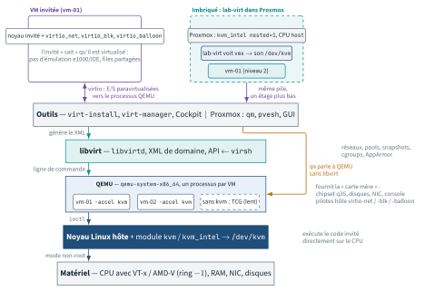
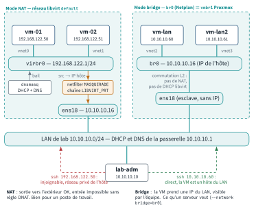

<!-- nav:début -->
[Accueil](../../README.md) › [Parcours](../../docs/parcours.md) › Partie IV — Socle DevOps › **Module 20**  
[← Projet A](../../projets/P1-factura/README.md) · [Corrigé](corrige.md) · [Module 21 →](../21-git/README.md)

<details><summary>Scripts du module (12)</summary>

Sur la VM indiquée en section « Mise en place », depuis `~/workbook/scripts/` (voir [chapitre 0](../../docs/00-mise-en-place.md)).

| Script | Rôle |
|---|---|
| [`setup_M20.sh`](../../scripts/setup/setup_M20.sh) | prépare le module |
| [`check_M20_01.sh`](../../scripts/check/check_M20_01.sh) | vérification |
| [`check_M20_02.sh`](../../scripts/check/check_M20_02.sh) | vérification |
| [`check_M20_03.sh`](../../scripts/check/check_M20_03.sh) | vérification |
| [`check_M20_04.sh`](../../scripts/check/check_M20_04.sh) | vérification |
| [`check_M20_05.sh`](../../scripts/check/check_M20_05.sh) | vérification |
| [`check_M20_06.sh`](../../scripts/check/check_M20_06.sh) | vérification |
| [`break_M20_01.sh`](../../scripts/break/break_M20_01.sh) | installe une panne |
| [`break_M20_02.sh`](../../scripts/break/break_M20_02.sh) | installe une panne |
| [`break_M20_03.sh`](../../scripts/break/break_M20_03.sh) | installe une panne |
| [`break_M20_04.sh`](../../scripts/break/break_M20_04.sh) | installe une panne |
| [`break_M20_05.sh`](../../scripts/break/break_M20_05.sh) | installe une panne |

</details>
<!-- nav:fin -->

# Module 20 — Virtualisation : KVM, QEMU et libvirt

## 20.0 Objectifs et compétences

> [!NOTE]
> **Objectifs**
>
> À la fin de ce module, je sais :
>
> * expliquer l'empilement **Proxmox → libvirt/`qm` → QEMU → KVM → CPU**, situer
>   un hyperviseur de type 1 et de type 2, et prouver en quatre commandes qu'une
>   machine peut accélérer des VM (`/dev/kvm`, `kvm-ok`, `lscpu`, `lsmod`) ;
> * activer la **virtualisation imbriquée** sur un nœud Proxmox (`cpu: host`,
>   `kvm-intel nested=1`) et la vérifier depuis la VM invitée ;
> * installer la pile `qemu-system-x86` + `libvirt` + `virtinst` sur Ubuntu et
>   Rocky, distinguer `qemu:///system` de `qemu:///session`, et lire
>   `virsh capabilities` / `domcapabilities` ;
> * choisir les bons périphériques **virtio** (`virtio-blk` vs `virtio-scsi`,
>   `virtio-net`, balloon, rng, virtiofs) et justifier pourquoi un pilote
>   paravirtualisé bat une carte émulée ;
> * manipuler des images disque avec `qemu-img` (`create`, `info`, `convert`,
>   `resize`, `rebase`), expliquer raw vs qcow2, le *thin provisioning*, les
>   *backing files*, les modes de cache et `discard` ;
> * créer une VM depuis une **image cloud** avec un seed **cloud-init** (ISO
>   `cidata`), la cloner en quelques secondes, lire et modifier son XML
>   (`virsh dumpxml`, `virsh edit`, `virt-xml`), l'agrandir et lui ajouter des
>   périphériques **à chaud** ;
> * construire les trois réseaux virtuels qui reviennent partout (NAT, bridge
>   sur le LAN, isolé), en lisant leur XML et en reconnaissant le bridge Linux
>   et les règles netfilter qui les portent ;
> * faire un **snapshot externe cohérent**, une sauvegarde à chaud par
>   `blockcommit`, une restauration prouvée, et comparer avec `qm snapshot` et
>   `vzdump` ;
> * décrire une migration à chaud (`virsh migrate --live`) et ce que Proxmox
>   fait à ta place ;
> * diagnostiquer une VM qui refuse de démarrer ou qui rame (logs libvirt,
>   processus `qemu-system-x86_64`, cgroups `machine.slice`, AppArmor/SELinux,
>   *steal time*) ;
> * scripter libvirt en bash et en Python (`libvirt-python`) et livrer une
>   « usine à VM » idempotente ;
> * situer Xen, ESXi/vSphere, Hyper-V, OpenStack, Firecracker et LXC dans un
>   entretien.
>
> **Temps estimé** : 7 h
>
> **Prérequis** : modules 07 (bash), 11 (partitions, `growpart`), 12 (bridge,
> `ip`, Netplan), 14 (clés SSH). Le module 24 reprend cloud-init côté Proxmox
> et OpenTofu : ici, cloud-init est traité côté libvirt uniquement.

---

## 20.1 Mise en place

VM concernée : **`lab-virt` (10.10.10.16, VMID 9007)**, 4 vCPU en
`cpu: host`, 6 Go, 40 Go. C'est un hyperviseur **dans** ton hyperviseur : les
VM que tu vas créer ici sont des « VM de VM ». **`lab-adm`** sert de poste
client pour les tests réseau (L20.2) et le nœud Proxmox intervient au début
(virtualisation imbriquée) et pour les comparaisons `qm`.

### Sur le nœud Proxmox : virtualisation imbriquée

Sans ça, `/dev/kvm` n'existe pas dans `lab-virt` et toute VM tournerait en
émulation pure (TCG), dix à cinquante fois plus lente.

```bash
# 1. le module KVM du nœud doit accepter l'imbrication
cat /sys/module/kvm_intel/parameters/nested      # Y attendu (Intel)
cat /sys/module/kvm_amd/parameters/nested        # 1 attendu (AMD)
# si N / 0 :
echo "options kvm-intel nested=1" > /etc/modprobe.d/kvm-intel.conf
#   (AMD : "options kvm-amd nested=1" > /etc/modprobe.d/kvm-amd.conf)
# puis, toutes les VM arrêtées : modprobe -r kvm_intel && modprobe kvm_intel
# ou plus simplement : reboot du nœud
# 2. lab-virt doit voir le CPU réel, pas un modèle générique
qm set 9007 --cpu host --cores 4 --memory 6144
qm stop 9007 && qm start 9007            # --cpu s'applique au démarrage
qm snapshot 9007 avant-lab20
```

### Sur `lab-virt`

```bash
sudo apt update
sudo apt install -y qemu-system-x86 qemu-utils libvirt-daemon-system \
  libvirt-clients virtinst cloud-image-utils genisoimage guestfs-tools \
  virt-top cpu-checker libosinfo-bin python3-libvirt jq
sudo adduser mathieu libvirt
sudo adduser mathieu kvm
# nouvelle session pour prendre les groupes (ou : newgrp libvirt)
```

`qemu-system-x86` est le vrai paquet derrière l'alias historique `qemu-kvm`.
`libvirt-daemon-system` installe le démon `libvirtd`, ses sockets et le
réseau `default`. `virtinst` fournit `virt-install`, `virt-clone`,
`virt-xml`. `cloud-image-utils` fournit `cloud-localds`. `guestfs-tools`
fournit `virt-sysprep`, `virt-customize`, `virt-filesystems`.
`cpu-checker` fournit `kvm-ok`.

> [!IMPORTANT]
> **Variante Rocky / RHEL**
>
> Sous Rocky 9 : `sudo dnf install -y qemu-kvm libvirt libvirt-client
> virt-install guestfs-tools genisoimage libosinfo python3-libvirt jq` puis
> `sudo usermod -aG libvirt mathieu`.
> Rocky lance libvirt en **démons modulaires** (`virtqemud`, `virtnetworkd`,
> `virtstoraged`…), activés par socket : `for d in qemu network nodedev nwfilter secret storage; do sudo systemctl enable --now virt${d}d{,-ro,-admin}.socket; done` (`libvirtd.service` existe encore mais entre en conflit avec eux); `journalctl -u virtqemud` remplace `journalctl -u libvirtd`.
> Le binaire QEMU est `/usr/libexec/qemu-kvm`, l'utilisateur des processus est
> `qemu` (Ubuntu : `libvirt-qemu`), et le confinement est SELinux (`svirt_t`)
> au lieu d'AppArmor. `cloud-localds` n'est pas packagé : `genisoimage` fait
> le même travail (E20.6).

Préparation (idempotent, relançable) :

```bash
sudo bash ~/workbook/scripts/setup/setup_M20.sh
```

Le script vérifie `/dev/kvm` et s'arrête avec la marche à suivre s'il manque,
installe les paquets ci-dessus, crée le pool `default`
(`/var/lib/libvirt/images`), télécharge l'image cloud Ubuntu 24.04 dans ce
pool sous le nom **`ubuntu-24.04-base.qcow2`** (lecture seule, c'est la base
de toutes les VM du module ; l'agent invité y est injecté par
`virt-customize` quand c'est possible), génère une clé SSH pour `mathieu`
sur `lab-virt` si elle n'existe pas, et prépare `~/lab20/` :

| Chemin | Rôle |
|---|---|
| `cloud-init/user-data.example`, `meta-data.example` | seed cloud-init de départ, avec tes clés |
| `cloud-init/network-config.example` | adressage statique pour une VM sur le bridge |
| `xml/net-isole.xml`, `xml/pool-lab20.xml` | gabarits réseau isolé et pool `dir` |
| `bin/usine-vm.sh` | squelette de l'usine à VM (L20.5), à compléter |
| `rapports/`, `backups/` | livrables |

Plan d'adressage réservé à ce module sur le LAN de lab : **10.10.10.160 à
10.10.10.179** pour les VM imbriquées attachées au bridge. Le réseau NAT
`default` de libvirt utilise `192.168.122.0/24`, invisible depuis `lab-adm`.

> [!CAUTION]
> **Attention**
>
> `lab-virt` a 6 Go : chaque VM imbriquée prend 512 Mo à 1 Go. Ne laisse jamais
> plus de quatre VM allumées en même temps, et arrête (`virsh shutdown`) celles
> d'un lab terminé. Le Break & Fix BF20.2 touche le Netplan de `lab-virt` :
> garde une console Proxmox (`qm terminal 9007`) sous la main.

---

## 20.2 Rappel express

### L'empilement

```text
  Proxmox VE (qm, pvesh, GUI)      ou      libvirt (virsh, virt-install, API)
              |                                       |
              +----------->  qemu-system-x86_64  <----+   (1 processus par VM)
                                    |
                    -accel kvm  ->  module noyau kvm + kvm_intel|kvm_amd
                                    |          (/dev/kvm)
                          VT-x / AMD-V du processeur (ring -1)
```

* **Type 1** : l'hyperviseur *est* l'OS qui touche le matériel (ESXi, Xen,
  Hyper-V, et Linux+KVM : le noyau hôte devient hyperviseur). **Type 2** :
  application au-dessus d'un OS (VirtualBox, VMware Workstation).
* **KVM** = module noyau qui expose `/dev/kvm` : il exécute le code invité
  directement sur le CPU en mode non-root VT-x ; il ne sait ni émuler un
  disque ni une carte réseau.
* **QEMU** = processus userland qui fournit la « carte mère » : chipset q35,
  disques, NIC, console. Sans `-accel kvm`, il **émule** aussi le CPU (TCG,
  lent). Avec, il ne fait que les entrées/sorties.
* **libvirt** = démon `libvirtd` + API + XML + `virsh`. Il génère la ligne de
  commande QEMU, gère réseaux, pools de stockage, snapshots, cgroups,
  AppArmor/SELinux. Proxmox n'utilise **pas** libvirt : `qm` parle à QEMU
  directement, avec sa propre conf (`/etc/pve/qemu-server/<vmid>.conf`).
* **Imbriqué** : `kvm_intel nested=1` sur l'hôte + CPU `host` exposé à la VM
  → la VM voit `vmx`/`svm` et a son propre `/dev/kvm`.

<p align="center"></p>

*Figure — La pile de virtualisation : du VT-x du processeur au module KVM, au processus QEMU par VM, à libvirt et aux outils ; Proxmox parle à QEMU sans libvirt, et lab-virt rejoue la même pile un étage plus bas.*

```bash
ls -l /dev/kvm ; kvm-ok ; lscpu | grep -iE 'virtualization|hypervisor'
grep -cE 'vmx|svm' /proc/cpuinfo ; lsmod | grep '^kvm'
virsh version ; virsh nodeinfo ; virsh capabilities | grep -A2 "type='kvm'"
virsh domcapabilities --virttype kvm | grep -A3 '<mode name='
```

### `virsh` — la boîte à outils

| Commande | Effet |
|---|---|
| `virsh uri` / `virsh -c qemu:///system` | URI en cours ; **session** ≠ **system** |
| `virsh list --all` / `--name` / `--state-running` | inventaire |
| `virsh define x.xml` / `undefine vm [--remove-all-storage]` | (dé)déclare |
| `virsh start` / `shutdown` / `reboot` / `destroy` / `autostart` | cycle de vie |
| `virsh dumpxml vm [--inactive]` / `virsh edit vm` | XML actif ou persistant |
| `virsh dominfo` / `domstate` / `domstats` / `domblklist` / `domiflist` | état et périphériques |
| `virsh domifaddr vm [--source agent\|arp\|lease]` | adresses IP |
| `virsh console vm` (sortie `Ctrl+]`) | console série |
| `virsh setvcpus vm 2 --live` / `setmem vm 2G --live` | à chaud, dans la limite du max |
| `virsh attach-disk` / `attach-interface` / `detach-*` (`--live --config`) | hot-plug |
| `virsh blockresize vm vda 30G` | agrandit à chaud ; `growpart` côté invité |
| `virsh snapshot-create-as` / `snapshot-list` / `-revert` / `-delete` | snapshots |
| `virsh blockcommit vm vda --active --pivot` / `blockpull` | fusion de chaîne |
| `virsh managedsave vm` / `save` / `restore` | suspension sur disque |
| `virsh migrate --live vm qemu+ssh://hote2/system` | migration |
| `virsh net-*` / `pool-*` / `vol-*` | réseaux, pools, volumes |
| `virsh qemu-agent-command vm '{"execute":"guest-ping"}'` | agent invité |
| `virsh qemu-monitor-command vm --hmp 'info status'` | monitor QEMU direct |

`shutdown` envoie un bouton ACPI que l'invité **peut ignorer** ; `destroy`
coupe le courant. `undefine` ne supprime pas les disques sans
`--remove-all-storage`. `virsh edit` modifie la définition **persistante** :
un `dumpxml` sans `- -inactive` sur une VM allumée montre la version en cours,
qui peut différer.

### Images disque

| | raw | qcow2 |
|---|---|---|
| Performance | maximale | −3 à −5 % (métadonnées) |
| Allocation | pleine (ou sparse via FS) | **thin** : grandit à l'écriture |
| Snapshots internes, backing file, compression, chiffrement | non | oui |
| Rétrécit après `fstrim` | via holes du FS | avec `discard='unmap'` |

```bash
qemu-img create -f qcow2 vm.qcow2 20G
qemu-img create -f qcow2 -F qcow2 -b base.qcow2 vm.qcow2 20G   # overlay
qemu-img info --backing-chain vm.qcow2
qemu-img convert -p -f qcow2 -O raw vm.qcow2 vm.raw   # aplatit la chaîne
qemu-img resize vm.qcow2 +10G          # jamais de réduction sans FS réduit
qemu-img rebase -u -F qcow2 -b /nouveau/base.qcow2 vm.qcow2   # -u : pointeur
qemu-img snapshot -l vm.qcow2          # snapshots internes
qemu-img check vm.qcow2 ; qemu-img measure -O qcow2 vm.raw
```

Modes de cache (`<driver name='qemu' type='qcow2' cache='...'/>`) :
`none` (O_DIRECT, pas de cache hôte, sûr, **le choix par défaut de Proxmox et
pour la migration**), `writeback` (cache hôte, sûr si l'invité fait des
`flush`, défaut QEMU), `writethrough` (sûr, lent), `unsafe` (ignore les
`flush` : installations jetables), `directsync`. `io='native'` va avec
`cache='none'`. `discard='unmap'` + `fstrim` dans l'invité rendent l'espace.

### virtio : pourquoi

Une carte `e1000` ou un disque IDE émulé forcent QEMU à rejouer, registre par
registre, un matériel réel : chaque accès = une sortie de VM (*VM exit*).
**virtio** est un contrat : l'invité sait qu'il est virtualisé et échange des
descripteurs par anneaux en mémoire partagée (*virtqueues*), avec un seul
signal par lot. Pilotes dans tout noyau Linux depuis 2.6.25, à installer sous
Windows.

| Périphérique | XML libvirt | Note |
|---|---|---|
| `virtio-blk` | `<target dev='vda' bus='virtio'/>` | simple, rapide, 1 PCI/disque |
| `virtio-scsi` | `<controller type='scsi' model='virtio-scsi'/>` + `bus='scsi'` | `sda`, hotplug, TRIM, milliers de LUN ; défaut Proxmox |
| `virtio-net` | `<model type='virtio'/>` | multiqueue, offloads |
| balloon | `<memballoon model='virtio'/>` | `setmem` à chaud, stats mémoire |
| rng | `<rng model='virtio'><backend model='random'>/dev/urandom` | entropie invitée |
| virtiofs / 9p | `<filesystem type='mount'><driver type='virtiofs'/>` | partage de répertoire hôte |
| agent | `<channel type='unix'><target type='virtio' name='org.qemu.guest_agent.0'/>` | `qemu-guest-agent` dans l'invité |

Dans l'invité : `lspci | grep -i virtio`, `ls /sys/bus/virtio/drivers`.

### CPU et mémoire

`<cpu mode='host-passthrough'/>` expose le CPU réel (perf, imbrication
possible, migration seulement entre CPU identiques) ;
`host-model` = modèle nommé le plus proche + drapeaux (migrable entre hôtes
proches) ; `custom` + `<model>Westmere</model>` = dénominateur commun (`x86-64-v2-AES` est le nom Proxmox, inconnu de libvirt).
Topologie : `<topology sockets='1' cores='2' threads='1'/>`. Pinning :
`<cputune><vcpupin vcpu='0' cpuset='2'/></cputune>`. **Steal time** (`st` de
`top` dans l'invité) = temps où le vCPU voulait tourner et l'hôte a donné le
CPU à un autre : c'est l'hôte qui est saturé, pas l'invité.
Mémoire : `<memory>` = maximum, `<currentMemory>` = alloué via **balloon** ;
**KSM** fusionne les pages identiques entre VM (`/sys/kernel/mm/ksm/run`) ;
**hugepages** (`<memoryBacking><hugepages/>`) évitent les fautes TLB pour
les bases de données.

### Réseau

| Mode | XML | Ce que c'est vraiment |
|---|---|---|
| NAT (`default`) | `<forward mode='nat'/>` + `<ip>` + `<dhcp>` | bridge `virbr0` + dnsmasq + MASQUERADE netfilter |
| Bridge | `<forward mode='bridge'/><bridge name='br0'/>` ou `--network bridge=br0` | la VM est **sur le LAN**, comme sur `vmbr1` Proxmox |
| Isolé | pas de `<forward>` | bridge sans route : VM ↔ VM et hôte seulement |
| macvtap | `<interface type='direct'><source dev='eth0' mode='bridge'/>` | sans bridge, mais l'hôte ne voit pas ses VM |

```bash
virsh net-list --all ; virsh net-dumpxml default ; virsh net-dhcp-leases default
virsh net-define isole.xml ; virsh net-start isole ; virsh net-autostart isole
ip -br link show type bridge ; bridge link ; iptables -t nat -L LIBVIRT_PRT -nv
```

Un bridge Netplan sur `lab-virt` (`bridges: br0: interfaces: [eth0]`) est
exactement ce que Proxmox appelle `vmbr0`/`vmbr1` dans
`/etc/network/interfaces`.

<p align="center"></p>

*Figure — NAT contre bridge : avec `virbr0` la VM sort par masquerade mais reste injoignable depuis le LAN ; avec `br0` elle est un hôte du LAN comme les autres.*

### Stockage libvirt

Pool = répertoire, VG LVM, export NFS, iSCSI, Ceph… Volume = fichier ou LV.

```bash
virsh pool-define-as lab20 dir --target /srv/vm
virsh pool-build lab20 ; virsh pool-start lab20 ; virsh pool-autostart lab20
virsh pool-list --all --details ; virsh pool-refresh lab20
virsh vol-create-as lab20 vm.qcow2 20G --format qcow2 \
  --backing-vol ubuntu-24.04-base.qcow2 --backing-vol-format qcow2
virsh vol-list lab20 --details ; virsh vol-info --pool lab20 vm.qcow2
virsh vol-delete --pool lab20 vm.qcow2
```

Les processus QEMU tournent sous `libvirt-qemu:kvm` (Ubuntu) ou `qemu:qemu`
(Rocky), chacun confiné par un profil AppArmor `libvirt-<uuid>` ou un label
SELinux `svirt_t:s0:cX,cY` unique (**sVirt**) : une VM compromise ne lit pas
les disques d'une autre. Conséquence pratique : une image posée dans `/root`
n'est pas ouvrable.

### cloud-init côté libvirt

Datasource **NoCloud** : une ISO étiquetée `cidata` avec `user-data`
(`#cloud-config`), `meta-data` (`instance-id`, `local-hostname`) et
optionnellement `network-config` (v2 Netplan). `cloud-localds seed.iso
user-data meta-data` ou `genisoimage -output seed.iso -volid cidata -joliet
-rock user-data meta-data`. `virt-install --import` démarre l'image sans
installation ; `--cloud-init user-data=...` fabrique l'ISO à ta place mais
tu dois savoir la faire à la main.

```bash
virt-install --name vm-01 --memory 1024 --vcpus 1 --cpu host-passthrough \
  --osinfo ubuntu24.04 --import \
  --disk vol=default/vm-01.qcow2,bus=virtio,discard=unmap \
  --disk vol=default/vm-01-seed.iso,device=cdrom \
  --network network=default,model=virtio \
  --graphics none --noautoconsole
```

### Snapshots et sauvegarde

* **Interne** (`virsh snapshot-create-as vm s1`) : tout dans le qcow2, RAM
  incluse si la VM tourne, `snapshot-revert` facile, lent, raw impossible.
* **Externe** (`--disk-only [--quiesce] [--no-metadata]`) : nouvel overlay
  `vm.s1`, la VM écrit dedans, l'ancien fichier est **gelé** : on le copie,
  puis `blockcommit --active --pivot` refusionne l'overlay et on le supprime.
  `--quiesce` demande à l'agent un `fsfreeze` : image cohérente.
* Proxmox : `qm snapshot` = snapshot LVM-thin/ZFS/qcow2 selon le stockage ;
  `vzdump --mode snapshot` = *backup job* QEMU avec agent `fsfreeze`.

```bash
virsh snapshot-create-as vm-01 sauv --disk-only --atomic --quiesce \
  --no-metadata
qemu-img convert -O qcow2 /var/lib/libvirt/images/vm-01.qcow2 sauv.qcow2
virsh blockcommit vm-01 vda --active --pivot --verbose ; rm vm-01.sauv
```

### Exploitation

```bash
sudo tail -f /var/log/libvirt/qemu/vm-01.log   # ligne QEMU + erreurs
journalctl -u libvirtd -n 50 ; virsh event --all --loop
ps -o pid,user,%cpu,args -C qemu-system-x86_64 | cut -c1-120
systemd-cgls -u machine.slice ; machinectl list
virsh domstats vm-01 --cpu-total --balloon --block --interface
virsh cpu-stats vm-01 ; virsh dommemstat vm-01 ; virt-top -b -n 2
aa-status | grep libvirt        # Rocky : ps -eZ | grep qemu-kvm
```

### Paysage (entretien)

**Xen** : type 1 historique (dom0/domU, PV puis HVM/PVH), ex-AWS ; **ESXi /
vSphere** : type 1 propriétaire, vCenter, vMotion, DRS, VMFS, licences
Broadcom 2024 ; **Hyper-V** : type 1 Microsoft, WSL2 ; **OpenStack** : IaaS
multi-locataire dont Nova pilote libvirt/KVM (Neutron réseau, Cinder
volumes, Glance images) ; **Proxmox** : QEMU/KVM + LXC + Ceph + corosync,
simple, sans abstraction locataire ; **Firecracker** : microVM Rust (AWS
Lambda), démarrage ~125 ms, l'un des VMM de Kata Containers ; **LXC** (`pct`) :
conteneur système partageant le noyau de l'hôte — moins isolé, plus dense
(module 22 pour Docker).

---

## 20.3 Quiz — QCM

<a id="q20-1"></a>**[Q20.1](corrige.md#q20-1)** — Sur `lab-virt`, `lscpu` affiche :

```text
Hypervisor vendor:                    KVM
Virtualization type:                  full
Virtualization:                       VT-x
```

Qu'en déduis-tu ? **Deux réponses correctes.**

a) `lab-virt` est elle-même une VM KVM
b) `lab-virt` peut à son tour accélérer des VM avec KVM
c) `lab-virt` tourne en émulation TCG
d) le nœud Proxmox utilise Xen

<a id="q20-2"></a>**[Q20.2](corrige.md#q20-2)** — Tu as installé libvirt, créé `vm-01` avec `sudo virt-install`,
puis en tant que `mathieu` : `virsh list --all` affiche une liste vide, sans
erreur. Explication ?

a) la VM a été supprimée au redémarrage de `libvirtd`
b) sans URI, `virsh` d'un utilisateur non root se connecte à
   `qemu:///session`, un hyperviseur privé différent de `qemu:///system`
c) `mathieu` n'est pas dans le groupe `kvm`
d) `virsh list` n'affiche que les VM en cours d'exécution

<a id="q20-3"></a>**[Q20.3](corrige.md#q20-3)** — `virsh dumpxml vm-01 | head -1` donne `<domain type='qemu'>`.
Conséquence ? **Deux réponses correctes.**

a) aucune : `qemu` et `kvm` sont deux noms du même mode
b) le CPU est émulé par TCG, le démarrage prend des minutes
c) `ps` montre `-accel tcg` au lieu de `-accel kvm`
d) la VM ne peut pas avoir plus d'un vCPU

<a id="q20-4"></a>**[Q20.4](corrige.md#q20-4)** — `qemu-img info` sur le disque d'une VM :

```text
virtual size: 20 GiB (21474836480 bytes)
disk size: 312 MiB
backing file: /var/lib/libvirt/images/ubuntu-24.04-base.qcow2
```

Quelle affirmation est exacte ?

a) supprimer le fichier de base ne gêne pas la VM : elle a ses 20 Go
b) le fichier ne contient que les blocs modifiés depuis la base ; la base
   doit rester lisible, au même chemin, et **jamais modifiée**
c) `disk size` est la taille vue par l'invité
d) la base est copiée dans le fichier au premier démarrage

<a id="q20-5"></a>**[Q20.5](corrige.md#q20-5)** — `virtio-blk` ou `virtio-scsi` ? **Deux réponses correctes.**

a) `virtio-scsi` présente les disques en `/dev/sdX` et supporte le TRIM, le
   hotplug massif et le passthrough SCSI
b) `virtio-blk` est plus simple et consomme un slot PCI par disque
c) `virtio-scsi` est une émulation, donc plus lente que `virtio-blk`
d) Proxmox utilise `virtio-blk` par défaut

<a id="q20-6"></a>**[Q20.6](corrige.md#q20-6)** — Un disque déclaré avec `cache='none'` :

a) désactive le cache de pages de l'invité
b) ouvre l'image en `O_DIRECT` : le cache de pages de l'**hôte** est
   contourné, les données vont directement au stockage, ce qui est sûr et
   compatible avec la migration à chaud
c) est plus rapide que `writeback` dans tous les cas
d) interdit les snapshots

<a id="q20-7"></a>**[Q20.7](corrige.md#q20-7)** — Deux hôtes KVM avec des CPU de générations différentes. Tu
veux pouvoir migrer à chaud dans les deux sens. Quel mode CPU ?

a) `host-passthrough`
b) `host-model`, ou un modèle `custom` commun aux deux hôtes
c) n'importe lequel, la migration renégocie le CPU
d) `host-passthrough` avec `migratable='on'`

<a id="q20-8"></a>**[Q20.8](corrige.md#q20-8)** — `virsh shutdown vm-01` rend la main, mais la VM tourne toujours
deux minutes après. `virsh destroy` fonctionne. Cause la plus probable ?

a) libvirt est en panne
b) `shutdown` envoie un événement ACPI que l'invité doit traiter ; ici rien
   ne l'écoute (invité bloqué au GRUB, ou sans `systemd-logind`/`acpid`)
c) la VM a un snapshot interne qui bloque l'arrêt
d) il faut `--mode agent` en plus de l'agent invité pour tout arrêt

<a id="q20-9"></a>**[Q20.9](corrige.md#q20-9)** — Sur `vm-01` en marche, disque `vda` =
`/var/lib/libvirt/images/vm-01.qcow2`. Tu lances
`virsh snapshot-create-as vm-01 s1 --disk-only --atomic`. Juste après :

a) la VM écrit toujours dans `vm-01.qcow2`, `vm-01.s1` est une copie
b) la VM écrit maintenant dans `vm-01.s1`, dont le backing file est
   `vm-01.qcow2`, désormais figé
c) la VM est en pause tant que le snapshot n'est pas supprimé
d) l'état de la RAM est dans `vm-01.s1`

<a id="q20-10"></a>**[Q20.10](corrige.md#q20-10)** — Après la sauvegarde, `virsh blockcommit vm-01 vda --active
--pivot`. Que se passe-t-il ?

a) les blocs de `vm-01.s1` sont fusionnés dans `vm-01.qcow2`, la VM bascule
   sur `vm-01.qcow2`, et `vm-01.s1` peut être supprimé
b) `vm-01.qcow2` est fusionné dans `vm-01.s1`
c) la VM redémarre
d) libvirt supprime `vm-01.s1` automatiquement

<a id="q20-11"></a>**[Q20.11](corrige.md#q20-11)** — `virsh setvcpus vm-01 4 --live` répond
`error: invalid argument: requested vcpus is greater than max allowable
vcpus for the live domain: 4 > 1`. Que faut-il ?

a) arrêter la VM et relancer la même commande
b) déclarer un maximum supérieur dans le XML (`<vcpu current='1'>4</vcpu>`,
   ou `setvcpus --maximum` à froid), puis ajouter à chaud dans cette limite
c) ajouter `--config`
d) passer `<cpu mode='host-passthrough'/>`

<a id="q20-12"></a>**[Q20.12](corrige.md#q20-12)** — Une VM sur `--network network=default` obtient une IP en DHCP.
La même image sur `--network bridge=br0` n'en obtient pas. Pourquoi ?

a) le bridge est cassé
b) le DHCP de `default` est le `dnsmasq` de libvirt sur `virbr0` ; sur `br0`
   la VM est sur `10.10.10.0/24` où personne ne sert de DHCP : il faut une
   adresse statique (cloud-init `network-config`)
c) `virtio-net` ne fait pas de DHCP
d) il manque `<forward mode='nat'/>` sur `br0`

<a id="q20-13"></a>**[Q20.13](corrige.md#q20-13)** — `virsh start import-1` échoue avec
`Cannot access storage file '/root/import/import- 1.qcow2' (as uid:64055, gid:108): Permission denied` alors que
le fichier appartient à root en 0600 et que libvirt tourne en root. **Deux
réponses correctes.**

a) le processus QEMU ne tourne pas en root mais en `libvirt-qemu`, qui ne
   peut pas traverser `/root` (0700)
b) libvirt change le propriétaire du fichier (`dynamic_ownership`) mais ne
   touche pas aux répertoires parents
c) il faut désactiver AppArmor
d) `chmod 777 /root` est le correctif attendu

<a id="q20-14"></a>**[Q20.14](corrige.md#q20-14)** — `virsh domifaddr vm-lan` ne renvoie rien pour une VM sur `br0`,
alors que la VM répond au ping. Commande utile ?

a) `virsh domifaddr vm-lan --source agent` (ou `--source arp`)
b) `virsh net-dhcp-leases br0`
c) `virsh domiflist vm-lan --ip`
d) redémarrer `libvirtd`

<a id="q20-15"></a>**[Q20.15](corrige.md#q20-15)** — Sur Proxmox, `qm snapshot 9007 s1` sur un disque `local-lvm`.
Mécanisme sous-jacent ?

a) un snapshot interne qcow2, comme `virsh snapshot-create-as`
b) un snapshot LVM-thin du volume logique, plus un fichier `.conf` versionné
c) un overlay externe qcow2 dans `/var/lib/vz`
d) une copie complète du disque

<a id="q20-16"></a>**[Q20.16](corrige.md#q20-16)** — *Entretien* : « Où est la frontière entre KVM et QEMU ? »

a) KVM émule le matériel, QEMU exécute le code invité
b) KVM (noyau) exécute le code invité sur le CPU physique via VT-x ; QEMU
   (userland) fournit les périphériques et gère chaque sortie de VM
c) QEMU est le nouveau nom de KVM depuis le noyau 5
d) KVM est un hyperviseur de type 2 posé sur QEMU

<a id="q20-17"></a>**[Q20.17](corrige.md#q20-17)** — Dans `vm-01`, `top` affiche `st` à 35 %. Diagnostic ?

a) la VM manque de RAM
b) l'hôte n'a pas assez de CPU pour tous ses vCPU : les vCPU attendent leur
   tour ; à traiter côté hôte (moins de vCPU, pinning, moins de VM)
c) les pilotes virtio manquent
d) le disque est en `cache='writethrough'`

<a id="q20-18"></a>**[Q20.18](corrige.md#q20-18)** — Migrer à chaud `vm-01` vers un second hôte **sans** stockage
partagé :

a) impossible avec libvirt
b) `virsh migrate --live --copy-storage-all vm-01
   qemu+ssh://hote2/system`, après avoir créé sur `hote2` un disque de même
   taille au même chemin
c) `virsh migrate --live --offline`
d) `scp` du qcow2 pendant que la VM tourne, puis `virsh define`

---

## 20.4 Quiz — questions ouvertes

<a id="qo20-1"></a>**[QO20.1](corrige.md#qo20-1)** — Décris le trajet d'une écriture disque depuis un `write()` dans
`vm-01` jusqu'au SSD du nœud Proxmox. Nomme chaque couche (noyau invité,
pilote virtio-blk, virtqueue, sortie de VM, QEMU, cache hôte, noyau de
`lab-virt`, puis à nouveau virtio-scsi/QEMU/KVM côté Proxmox) et dis à quel
endroit `cache='none'` et `discard='unmap'` interviennent.

<!-- repondre: 12 -->

<a id="qo20-2"></a>**[QO20.2](corrige.md#qo20-2)** — *On te demande en entretien* : « Explique-moi virtio. Pourquoi
une carte `e1000` émulée est-elle plus lente qu'une `virtio-net`, alors que
les deux sont du logiciel ? » Réponds avec les notions de *VM exit*, de
*virtqueue* et de paravirtualisation, puis cite les cinq périphériques virtio
que tu utilises au quotidien et à quoi sert chacun.

<!-- repondre: 10 -->

<a id="qo20-3"></a>**[QO20.3](corrige.md#qo20-3)** — Compare raw et qcow2 : performance, allocation (*thin
provisioning*), snapshots, backing files. Explique pourquoi un qcow2 « thin »
peut finir par remplir un hôte alors que chaque VM se croit loin d'être
pleine, ce que change `discard='unmap'` + `fstrim`, et pourquoi Proxmox
préfère du raw sur LVM-thin.

<!-- repondre: 10 -->

<a id="qo20-4"></a>**[QO20.4](corrige.md#qo20-4)** — Déroule la sauvegarde à chaud d'une VM libvirt par snapshot
externe : chaque commande, ce qui se passe dans les fichiers à chaque
étape, le rôle de `--quiesce` et de l'agent, ce que garantit `--atomic`, et
ce qui arrive si l'on oublie le `blockcommit` final pendant trois mois.

<!-- repondre: 12 -->

<a id="qo20-5"></a>**[QO20.5](corrige.md#qo20-5)** — *On te demande en entretien* : « Comment fonctionne une
migration à chaud ? » Explique le *pre-copy* (copie itérative des pages
sales), le moment de bascule, ce qui borne le *downtime*, les prérequis
(CPU compatible, stockage partagé ou `--copy-storage-all`, réseau, même
version QEMU ou compatible), et ce que Proxmox fait pour toi avec
`qm migrate --online`.

<!-- repondre: 12 -->

<a id="qo20-6"></a>**[QO20.6](corrige.md#qo20-6)** — Décris ta méthode complète quand `virsh start vm` échoue ou
quand la VM démarre mais ne répond pas : dans l'ordre, les commandes et ce
que tu cherches dans chaque sortie. Couvre au minimum : XML invalide,
backing file absent, permissions/AppArmor, bridge disparu, `/dev/kvm`
absent, console série muette, réseau sans DHCP, agent muet.

<!-- repondre: 14 -->

<a id="qo20-7"></a>**[QO20.7](corrige.md#qo20-7)** — Compare les quatre modes réseau (NAT, bridge, isolé, macvtap) :
qui voit qui, où sont les règles netfilter, quel DHCP, et ce que chacun
devient dans Proxmox (`vmbr0`, `vmbr1` + NAT du nœud, bridge sans port,
pare-feu). Donne un cas d'usage par mode.

<!-- repondre: 10 -->

<a id="qo20-8"></a>**[QO20.8](corrige.md#qo20-8)** — *On te demande en entretien* : « Proxmox, OpenStack, vSphere,
Firecracker : tu me les places ? Et quand est-ce que tu prends un conteneur
plutôt qu'une VM ? » Réponds en cinq points structurés, avec pour chaque
technologie ce qu'elle apporte que les autres n'ont pas.

<!-- repondre: 10 -->

<a id="qo20-9"></a>**[QO20.9](corrige.md#qo20-9)** — Explique le ballooning, KSM et les hugepages : mécanisme, gain
attendu, coût, et le scénario d'incident que chacun peut provoquer sur un
hôte suralloué en mémoire (OOM de l'hôte, VM qui swappe, latence).

<!-- repondre: 10 -->

---

## 20.5 Exercices guidés ★

Sauf mention contraire, tout se passe sur `lab-virt` en tant que `mathieu`,
dans `~/lab20`. Les exercices E20.7 à E20.15 supposent `vm-01` créée (L20.1).

<a id="e20-1"></a>**[E20.1](corrige.md#e20-1)** — Prouve en quatre commandes que `lab-virt` peut accélérer des VM :
le périphérique, l'outil de `cpu-checker`, les drapeaux CPU, les modules
noyau chargés. Puis, sur le nœud Proxmox, affiche la valeur du paramètre
`nested` du module KVM et la ligne `cpu:` de `/etc/pve/qemu-server/9007.conf`.

<a id="e20-2"></a>**[E20.2](corrige.md#e20-2)** — En tant que `mathieu` sans option, affiche l'URI à laquelle
`virsh` se connecte. Fais en sorte que `virsh list --all` montre les VM
système sans taper `-c` ni `sudo`, de façon persistante. Prouve que la
socket `/run/libvirt/libvirt-sock` t'est accessible et explique par quoi.

<a id="e20-3"></a>**[E20.3](corrige.md#e20-3)** — Affiche les versions de libvirt et de QEMU en une commande, les
ressources de l'hôte vues par libvirt, puis extrais de `virsh capabilities`
uniquement les types de domaine disponibles pour `x86_64` et de
`virsh domcapabilities` la liste des modes CPU supportés avec leur état.

<a id="e20-4"></a>**[E20.4](corrige.md#e20-4)** — Dans `~/lab20/img/` : crée un qcow2 de 20 Go, mesure son
occupation réelle avec deux commandes qui ne donnent pas la même réponse
(explique), convertis-le en raw et compare `ls -l` et `du -h` du raw,
agrandis le qcow2 de 5 Go, et donne la taille qu'aurait ce raw converti en
qcow2 compressé (sans le faire).

<a id="e20-5"></a>**[E20.5](corrige.md#e20-5)** — Toujours dans `~/lab20/img/` : crée un overlay `test.qcow2` de
20 Go dont la base est `/var/lib/libvirt/images/ubuntu-24.04-base.qcow2`.
Affiche la chaîne complète, la taille virtuelle et réelle de chaque maillon.
Puis déplace la base **fictivement** en changeant uniquement le pointeur de
`test.qcow2` vers `/tmp/base.qcow2`, constate l'erreur, et remets le pointeur.

<a id="e20-6"></a>**[E20.6](corrige.md#e20-6)** — Écris `~/lab20/cloud-init/vm-01/{user-data,meta-data}` :
hostname `vm-01`, utilisateur `mathieu` avec tes clés (celle de `lab-virt`
et celles de `~/.ssh/authorized_keys`), sudo sans mot de passe, paquet
`qemu-guest-agent` activé, fichier `/etc/lab20-marker` contenant `vm-01`.
Valide le YAML et le schéma. Fabrique `seed.iso` avec `cloud-localds`, puis
refais-la avec `genisoimage`, et prouve avec `isoinfo` que les deux ont le
label de volume attendu et les mêmes fichiers.

<a id="e20-7"></a>**[E20.7](corrige.md#e20-7)** — Sans éditeur, à partir du XML de `vm-01`, réponds : type de
machine QEMU, mode CPU, format et cache du disque `vda`, modèle de la carte
réseau et son MAC, présence du canal de l'agent, type de console. Une
commande par réponse (`xmllint --xpath` ou `grep` acceptés).

<a id="e20-8"></a>**[E20.8](corrige.md#e20-8)** — Vérifie si `virt-install` a posé un générateur `virtio-rng` sur
`vm-01` et ce qu'il alimente. Retire-le avec `virt-xml` (VM arrêtée),
constate dans l'invité l'absence de `/dev/hwrng`, puis remets-le **de deux
façons** : par `virsh edit` (XML écrit à la main), puis, après l'avoir
retiré de nouveau, par `virt-xml --add-device` sur la VM **allumée**.
Vérifie `/dev/hwrng` et le pilote chargé. Note laquelle des deux méthodes
exige un redémarrage et pourquoi.

<a id="e20-9"></a>**[E20.9](corrige.md#e20-9)** — Ouvre la console série de `vm-01`, constate qu'on te demande un
mot de passe que tu n'as pas, sors de la console proprement, pose un mot de
passe à `mathieu` **sans entrer dans la VM** (l'agent sait faire), puis
connecte-toi par la console. Explique ce qui rend cette console possible
(deux conditions : une côté XML, une côté noyau invité).

<a id="e20-10"></a>**[E20.10](corrige.md#e20-10)** — Interroge l'agent de `vm-01` : `guest-ping`, informations
générales (version, commandes supportées), systèmes de fichiers montés,
nom d'hôte, adresses IP par l'agent, heure de l'invité. Puis, depuis le nœud
Proxmox, obtiens les mêmes informations sur `lab-virt` (9007) avec `qm`.
Termine par un `guest-exec` qui exécute `uptime` dans `vm-01` et récupère la
sortie décodée.

<a id="e20-11"></a>**[E20.11](corrige.md#e20-11)** — Trouve le processus QEMU de `vm-01` et, depuis sa ligne de
commande uniquement, extrais : l'accélérateur, le modèle CPU, la mémoire, la
topologie SMP, le type de machine. Donne l'utilisateur qui l'exécute, son
cgroup exact (fichier `/proc`), et l'unité systemd transitoire
correspondante. Montre enfin ce que `machinectl` en dit.

<a id="e20-12"></a>**[E20.12](corrige.md#e20-12)** — À chaud sur `vm-01` : réduis la mémoire à 512 Mo puis remonte
à 1 Go, en observant `free -m` dans l'invité et `virsh dommemstat` à chaque
étape. Ajoute un disque `vdb` de 2 Go (qcow2 dans le pool `default`), vérifie
`lsblk` dans l'invité, puis retire-le. Chaque changement doit survivre à un
redémarrage de la VM.

<a id="e20-13"></a>**[E20.13](corrige.md#e20-13)** — Lance une charge CPU dans `vm-01` (`yes > /dev/null &` deux
fois) et, depuis `lab-virt`, mesure la consommation avec trois outils
différents (`virsh cpu-stats`, `virsh domstats`, `virt-top` en mode batch).
Depuis l'invité, note la colonne `st`. Puis sature `lab-virt` elle-même
(quatre `yes > /dev/null &` sur l'hôte) et observe l'évolution de `st` et
de `%CPU` dans `vm-01`, sans rien y changer. Arrête tout et explique à qui
appartient le problème.

<a id="e20-14"></a>**[E20.14](corrige.md#e20-14)** — Affiche le XML du réseau `default`, les baux DHCP en cours,
l'interface bridge et ses ports, et les règles NAT netfilter que libvirt a
posées. Réserve ensuite l'adresse `192.168.122.50` au MAC de `vm-01` **sans
arrêter le réseau ni la VM**, et prouve la réservation après un
renouvellement DHCP dans l'invité.

<a id="e20-15"></a>**[E20.15](corrige.md#e20-15)** — Depuis le journal QEMU de `vm-01`, extrais la dernière ligne de
commande QEMU lancée et la date du dernier arrêt. Dans un terminal, écoute
les événements libvirt ; dans un autre, redémarre `vm-01` ; colle les
événements reçus. Enfin, affiche les 20 dernières lignes de `libvirtd`
dans le journal système.

<a id="e20-16"></a>**[E20.16](corrige.md#e20-16)** — Écris `~/lab20/bin/inventaire.py` (`libvirt-python`) qui liste
toutes les VM de `qemu:///system` : nom, état en clair, vCPU, mémoire
allouée en Mo, chemin des disques ; sortie en JSON. Écris l'équivalent en
bash (`virsh` + `awk`/`jq`) en moins de 15 lignes. Compare les deux sur
l'exactitude de l'état d'une VM en `managedsave`.

---

## 20.6 Labs ★★

### <a id="l20-1"></a>**[L20.1](corrige.md#l20-1)** — Ticket EVO-412 : « Sortir de VMware : premier hôte KVM »

> **Contexte**
>
> La direction veut évaluer libvirt/KVM avant de renouveler les licences
> vSphere. On te confie une VM de test avec la virtualisation imbriquée et on
> te demande une première VM Ubuntu **créée sans ISO ni installateur**,
> joignable en SSH, avec l'agent invité opérationnel — et une note qui
> explique chaque composant.

1. Sur le nœud Proxmox : vérifie et active la virtualisation imbriquée,
   passe `lab-virt` en `cpu: host`, redémarre-la (§20.1). Dans `lab-virt`,
   prouve `/dev/kvm` et `kvm-ok`.
2. Installe la pile et lance `setup_M20.sh`. Ajoute `mathieu` aux groupes
   `libvirt` et `kvm`, fixe `LIBVIRT_DEFAULT_URI` de façon persistante.
   Vérifie `virsh list --all` (vide, mais sans erreur) et
   `virsh net-list --all` (réseau `default` actif, autostart).
3. Vérifie la base : `virsh vol-list default --details`, puis
   `virsh vol-dumpxml default ubuntu-24.04-base.qcow2` (format, capacité,
   allocation). Explique la différence capacité / allocation.
4. Crée le disque de `vm-01` comme **volume libvirt** de 20 Go avec la base
   en backing file (`virsh vol-create-as ... --backing-vol`). Vérifie avec
   `virsh vol-dumpxml` que le `backingStore` est bon.
5. Écris le seed cloud-init (E20.6) dans `~/lab20/cloud-init/vm-01/`,
   fabrique `seed.iso`, importe-la comme volume `vm-01-seed.iso` du pool
   `default` (`vol-create-as` à la taille exacte puis `vol-upload`).
6. `virt-install --import` : 1 Go, 1 vCPU, CPU `host-passthrough`, disque
   `virtio` avec `discard=unmap`, seed en cdrom, réseau `default` modèle
   `virtio`, sans graphique, sans attacher la console. Note l'`--osinfo`
   choisi et pourquoi il compte.
7. Suis le premier démarrage sur la console série jusqu'au message final de
   cloud-init, sors de la console. Obtiens l'IP par `virsh domifaddr`,
   connecte-toi en SSH depuis `lab-virt`, vérifie `/etc/lab20-marker`,
   `cloud-init status`, et que l'agent répond (`guest-ping`).
8. Rends la VM persistante au démarrage de `lab-virt` (`autostart`), teste
   `virsh shutdown` puis `virsh start`, et vérifie que l'`instance-id` n'a
   pas changé (donc que cloud-init n'a pas rejoué).
9. Rédige `~/lab20/rapports/evo-412.md` : pour chaque composant (KVM, QEMU,
   libvirt, virtio, cloud-init, agent), une ligne « rôle » et une ligne
   « comment je l'ai vérifié ». Ajoute la ligne de commande QEMU réelle
   (extraite du log) commentée en cinq points.

> [!TIP]
> **Astuce**
>
> `virt-install --osinfo list | grep -i ubuntu` te dit ce que ta base osinfo
> connaît. Si `ubuntu24.04` manque, prends `ubuntu22.04` : l'osinfo ne sert
> qu'à choisir des périphériques par défaut sensés (virtio, q35, agent).

> [!TIP]
> **Critère de succès**
>
> Critère de succès : `vm-01` est `running`, de type `kvm`, son disque `vda`
> est un qcow2 du pool `default` dont le backing file est
> `ubuntu-24.04-base.qcow2`, elle a une adresse sur `192.168.122.0/24`, son
> port 22 répond, l'agent répond à `guest-ping`, `autostart` est activé.
>
> ```bash
> bash check_M20_01.sh
> ```

---

### <a id="l20-2"></a>**[L20.2](corrige.md#l20-2)** — Ticket RES-77 : « La VM de test doit être joignable par l'équipe »

> **Contexte**
>
> L'équipe veut se connecter aux VM imbriquées depuis leur poste (ici
> `lab-adm`), pas seulement depuis `lab-virt`. Le NAT de libvirt les cache. On
> te demande un **bridge** sur le LAN de lab, une VM adressée en statique
> dessus, et, pour les tests de bases de données, un réseau **isolé** que
> personne d'autre ne voit. Tu dois expliquer les trois topologies à l'équipe.

1. Sur `lab-virt`, transforme l'interface principale en port d'un bridge
   `br0` qui porte `10.10.10.16/24` : désactive la génération réseau de
   cloud-init (`/etc/cloud/cloud.cfg.d/99-disable-network-config.cfg`),
   écris `/etc/netplan/60-br0.yaml`, retire l'adresse du fichier
   `50-cloud-init.yaml`, et applique avec `netplan try` (garde la console
   Proxmox ouverte). Prouve : `ip -br addr`, `bridge link`, ping de
   `lab-adm`.
2. Déclare le bridge côté libvirt comme réseau `lan`
   (`<forward mode='bridge'/>`), démarre-le et mets-le en autostart. Compare
   son XML à celui de `default` : qu'est-ce qui manque et pourquoi.
3. Crée `vm-lan` (1 Go, 1 vCPU) depuis la base avec un seed qui comprend un
   `network-config` v2 : `10.10.10.161/24`, passerelle `10.10.10.1`, DNS
   `10.10.10.1`, domaine `lab.local`. Attache-la à `br0`. Depuis `lab-adm` :
   `ping`, `ssh mathieu@10.10.10.161 hostname`, et `getent hosts lab-git`
   depuis `vm-lan` (elle doit résoudre le lab).
4. `virsh domifaddr vm-lan` ne donne rien : trouve les deux sources qui
   fonctionnent. Depuis `lab-virt`, `tcpdump -ni br0 -e icmp` pendant un
   ping depuis `lab-adm` : quel MAC source, quel MAC destination, et où est
   passé `lab-virt` dans l'échange ?
5. Crée le réseau `isole` (`~/lab20/xml/net-isole.xml`, `10.20.0.0/24`,
   DHCP `.100-.199`, aucun `<forward>`). Ajoute à chaud une deuxième carte
   `virtio` sur `isole` à `vm-01` **et** à `vm-lan` (persistante). Dans
   chaque VM, l'interface doit prendre une adresse : configure-la (Netplan
   dans l'invité, ou `dhclient`/`networkctl`). `ping` entre les deux VM par
   `10.20.0.x`, puis prouve depuis `lab-adm` que `10.20.0.0/24` est
   injoignable, et depuis `vm-lan` que `10.20.0.1` (l'hôte) répond mais
   qu'aucun paquet ne sort.
6. Sur `lab-virt`, liste les bridges et leurs ports (`virbr0`, `virbr20`,
   `br0`), puis les règles netfilter que libvirt a ajoutées pour `default`
   et pour `isole` (chaînes `LIBVIRT_FWI`, `LIBVIRT_FWO`, `LIBVIRT_PRT`).
   Explique en une ligne chacune.
7. Tableau dans `~/lab20/rapports/res-77.md` (4 colonnes : mode, qui voit la
   VM, DHCP/adressage, équivalent Proxmox) pour NAT, bridge, isolé, macvtap.

> [!CAUTION]
> **Attention**
>
> `netplan try` annule au bout de 120 s si tu ne confirmes pas : c'est ta
> ceinture de sécurité. Si tu te retrouves quand même dehors :
> `qm terminal 9007` depuis le nœud, et `netplan apply` après correction.

> [!TIP]
> **Critère de succès**
>
> Critère de succès : `br0` porte `10.10.10.16` avec l'interface physique en
> port, `vm-lan` tourne avec une interface sur `br0` et répond au ping en
> `10.10.10.161`, le réseau `isole` est actif sans `<forward>`, et `vm-01`
> comme `vm-lan` ont une interface persistante sur `isole`.
>
> ```bash
> bash check_M20_02.sh
> ```

---

### <a id="l20-3"></a>**[L20.3](corrige.md#l20-3)** — Ticket STO-208 : « Trois VM de recette en trente secondes »

> **Contexte**
>
> Les testeurs veulent pouvoir demander trois VM identiques et les jeter le
> soir. Le stockage doit vivre dans `/srv/vm` (un disque dédié plus tard), et
> une VM de recette doit pouvoir être agrandie **sans arrêt**. On veut aussi
> savoir ce que coûte un « vrai » clone complet par rapport à un clone par
> backing file.

1. Crée le pool `lab20` de type `dir` sur `/srv/vm` (gabarit
   `~/lab20/xml/pool-lab20.xml` ou `pool-define-as`) : build, start,
   autostart. Vérifie propriétaire et mode du répertoire créés par libvirt.
2. Copie la base dans le pool (`sudo cp` + `pool-refresh`, ou
   `vol-create-from`), en lecture seule. `virsh vol-list lab20 --details`.
3. Écris `~/lab20/bin/clone3.sh` qui, pour `clone-1` à `clone-3` : crée le
   volume overlay de 20 Go dans `lab20`, génère un seed (hostname et
   `instance-id` propres, réseau `default`), l'importe comme volume, et
   lance `virt-install --import --noautoconsole` (512 Mo, 1 vCPU). Mesure
   avec `time`. Objectif : **moins de 30 s** pour les trois.
4. Quand les trois répondent à `guest-ping`, affiche l'espace réellement
   occupé par chaque overlay (`vol-info` et `du`) et le total du pool.
   Explique pourquoi trois VM de 20 Go tiennent dans quelques centaines
   de Mo.
5. Agrandis `clone-1` **à chaud** à 30 Go : `virsh blockresize`, puis dans
   l'invité `lsblk`, `growpart`, `resize2fs` (ou le chemin cloud-init :
   `cloud-init clean` est interdit). `df -h /` doit montrer ~29 Go.
6. Clone complet : arrête `clone-1`, `virt-clone --original clone-1 --name
   clone-4 --auto-clone`, chronomètre, compare la taille et le
   `backing file` du disque produit à celui de `clone-1`. Passe
   `virt-sysprep` sur `clone-4` (opérations par défaut **sauf** la
   suppression des clés SSH utilisateur, hostname `clone-4`). Fabrique un
   seed **neuf** (`instance-id` et hostname propres) et fais pointer le
   cdrom de `clone-4` dessus — sinon cloud-init se croit toujours
   `clone-1` et le Netplan de l'invité reste épinglé sur l'ancien MAC.
   Démarre et vérifie : hostname, adresse IP, `machine-id` différent,
   clés d'hôte SSH différentes de `clone-1`.
7. Détruis `clone-2` et `clone-3` **avec leurs volumes** en une commande
   chacune, et vérifie que le pool ne les liste plus.
8. `~/lab20/rapports/sto-208.md` : temps et espace des deux méthodes,
   et ce qu'il faut absolument nettoyer quand on clone « à plat » (trois
   éléments minimum).

> [!TIP]
> **Critère de succès**
>
> Critère de succès : pool `lab20` actif sur `/srv/vm` en autostart,
> `clone-1` tourne avec un disque de capacité ≥ 30 Go dont le backing file est
> la base du pool, `clone-4` existe avec un disque **sans** backing file,
> `clone-2` et `clone-3` n'existent plus (ni domaine ni volume),
> `clone3.sh` existe.
>
> ```bash
> bash check_M20_03.sh
> ```

---

### <a id="l20-4"></a>**[L20.4](corrige.md#l20-4)** — Ticket SAV-15 : « Sauvegarder `vm-01` sans l'arrêter, et prouver la restauration »

> **Contexte**
>
> `vm-01` va héberger une base de recette. On veut une sauvegarde à chaud
> cohérente, sans arrêt, un fichier autoportant qu'on peut copier sur un NAS,
> et une procédure de restauration **testée** — pas « ça devrait marcher ».
> On veut aussi comprendre ce que Proxmox fait différemment.

1. Dans `vm-01`, crée `/srv/data/avant.txt` avec la date, et lance une
   écriture continue (`while true; do date >> /srv/data/journal.log;
   sleep 1; done &`).
2. Snapshot **interne** d'abord, VM allumée : `virsh snapshot-create-as
   vm-01 interne`. Chronomètre, observe `virsh snapshot-list`,
   `qemu-img snapshot -l` (en `sudo`), et la taille du qcow2. Reviens
   dessus avec `snapshot-revert` après avoir écrit `/srv/data/pendant.txt` :
   que devient ce fichier, et que devient le `journal.log` ? Supprime le
   snapshot interne.
3. Snapshot **externe** cohérent : `--disk-only --atomic --quiesce
   --no-metadata`, fichier de destination explicite
   `/var/lib/libvirt/images/vm-01.sauv` (`--diskspec`). Chronomètre.
   Prouve avec `domblklist` et `qemu-img info --backing-chain` qui écrit
   où maintenant. Prouve ensuite ce que fait `--quiesce` : un
   `virsh domfsfreeze vm-01` manuel doit bloquer la boucle d'écriture
   (trou dans `journal.log`) jusqu'au `domfsthaw`.
4. Sauvegarde : `qemu-img convert` du fichier figé vers
   `~/lab20/backups/vm-01-<date>.qcow2` **autoportant** (pas de backing
   file), plus `virsh dumpxml --inactive` à côté. Vérifie l'absence de
   backing file dans le résultat et sa taille par rapport à la chaîne.
5. Referme : `blockcommit --active --pivot --verbose`, vérifie
   `domblklist`, supprime l'overlay. La boucle d'écriture ne doit pas
   s'être arrêtée (compte les lignes du journal).
6. Sinistre : dans `vm-01`, `sudo rm -rf /srv/data` puis crée
   `/srv/data/apres.txt`. Restaure : arrête la VM, remplace son disque par
   la sauvegarde (nouveau volume dans le pool, XML pointé dessus avec
   `virt-xml --edit --disk path=`), démarre. `avant.txt` doit être là,
   `apres.txt` absent, et `journal.log` s'arrêter à l'heure du snapshot.
7. `managedsave` : sauvegarde l'état RAM de `vm-01`, constate
   `virsh list --all --managed-save`, la taille du fichier dans
   `/var/lib/libvirt/qemu/save/`, redémarre et prouve que l'`uptime` a
   continué. Quand est-ce utile, quand est-ce dangereux ?
8. `~/lab20/rapports/sav-15.md` : procédure de sauvegarde (commandes),
   procédure de restauration, durée d'indisponibilité mesurée pour chaque,
   et un tableau interne / externe / `qm snapshot` / `vzdump` (colonnes :
   RAM incluse ?, VM en marche ?, cohérence FS, où sont les données).

> [!TIP]
> **Critère de succès**
>
> Critère de succès : un fichier `~/lab20/backups/vm-01-*.qcow2` autoportant
> avec son XML, `vm-01` tourne sur un disque dont le nom ne contient pas
> `.sauv`, aucun overlay orphelin dans le pool, `/srv/data/avant.txt` présent
> et `apres.txt` absent dans l'invité, rapport rédigé.
>
> ```bash
> bash check_M20_04.sh
> ```

---

### <a id="l20-5"></a>**[L20.5](corrige.md#l20-5)** — Ticket AUT-3 : « Une commande, une VM »

> **Contexte**
>
> Les testeurs ne veulent plus lire une procédure de neuf étapes. On te
> demande un script `usine-vm.sh` : nom, RAM, vCPU, clé SSH, réseau en
> paramètres ; la VM est prête (SSH joignable) à la fin ; relancer le script
> sur une VM qui existe ne fait **rien** ; une option la détruit proprement.
> Le squelette est dans `~/lab20/bin/usine-vm.sh`.

Cahier des charges de `~/lab20/bin/usine-vm.sh` :

1. `#!/usr/bin/env bash`, `set -euo pipefail`, `--help`, sans `sudo`
   (tout passe par l'API libvirt : `vol-create-as`, `vol-upload`,
   `virt-install`).
2. Options : `--name` (obligatoire), `--ram` Mo (défaut 1024), `--vcpus`
   (défaut 1), `--key` fichier de clé publique (défaut
   `~/.ssh/id_ed25519.pub`), `--net network=default` ou `--net bridge=br0`
   (défaut `network=default`), `--ip A.B.C.D/24` (statique, obligatoire
   avec un bridge), `--disk` Go (défaut 20), `--pool` (défaut `default`),
   `--delete`.
3. Refus explicite (message, code 2) si le nom est invalide, la clé
   illisible, `--ip` absente avec un bridge, la base absente du pool.
4. Idempotence : si le domaine existe, afficher son état et son IP, code 0,
   **aucune** modification. Si un volume orphelin du même nom traîne,
   l'expliquer et sortir en erreur plutôt que l'écraser.
5. Création : overlay sur la base, seed avec `instance-id` unique
   (`uuidgen`), `network-config` généré si `--ip`, VM `host-passthrough`,
   virtio partout, `discard=unmap`, agent. Attente de l'IP (agent ou bail)
   avec un délai maximum de 180 s, puis attente du port 22. Affiche la
   commande `ssh` finale.
6. `--delete` : `destroy` si besoin, `undefine`, suppression des volumes
   disque **et** seed, du répertoire de seed, rien d'autre.
7. Journal : chaque étape horodatée sur stderr ; les erreurs de `virsh`
   sont visibles.
8. Tests : `usine-1` sur `default`, `usine-2` sur `br0` en `10.10.10.162`,
   relance des deux (aucune modification, temps < 2 s), `ssh` depuis
   `lab-adm` sur `usine-2`, puis `--delete` des deux et vérification que le
   pool est propre. Recrée `usine-1` pour le check.

> [!TIP]
> **Critère de succès**
>
> Critère de succès : `bash -n` passe, le script a `set -euo pipefail`,
> `usine-1` tourne et répond sur le port 22, un second lancement identique
> sort en 0 sans rien changer, et `--delete` sur une VM de test laisse le
> pool sans volume orphelin.
>
> ```bash
> bash check_M20_05.sh
> ```

---

## 20.7 Break & Fix ★★★

> [!CAUTION]
> **Attention**
>
> Avant chaque Break & Fix : `qm snapshot 9007 avant-bf20` depuis le nœud. Le
> snapshot `snap-clean` reste ton filet (`qm rollback 9007 snap-clean`), mais
> l'utiliser vaut échec : l'objectif est de réparer. Les scripts de panne
> supposent L20.1 à L20.3 faits (`vm-01`, `vm-lan`, `br0`, pool `lab20`).

### <a id="bf20-1"></a>**[BF20.1](corrige.md#bf20-1)** — « `vm-01` met quatre minutes à démarrer et l'hôte est à 100 % »

```bash
sudo bash break_M20_01.sh
```

**Symptôme utilisateur** : depuis « une intervention de nuit », `vm-01`
prend plusieurs minutes pour afficher un prompt, chaque commande dedans est
lente, et `top` sur `lab-virt` montre le processus QEMU en permanence à
100 % de CPU. `/dev/kvm` est bien présent sur `lab-virt` et les autres VM
vont bien.

**Interdit** : recréer la VM, réinstaller quoi que ce soit, redémarrer
`lab-virt`.

**Objectif** : trouver en trois commandes ce qui a changé dans la façon dont
QEMU est lancé, corriger la définition de la VM, redémarrer proprement, et
mesurer le temps de démarrage avant/après. Expliquer pourquoi la VM
fonctionnait quand même.

<!-- repondre: 10 -->

### <a id="bf20-2"></a>**[BF20.2](corrige.md#bf20-2)** — « Après la maintenance réseau, `vm-lan` ne démarre plus »

```bash
sudo bash break_M20_02.sh
```

**Symptôme utilisateur** : un collègue a « simplifié » le Netplan de
`lab-virt` pour régler un problème de DNS. `lab-virt` répond toujours en
`10.10.10.16`, mais `virsh start vm-lan` échoue avec une erreur qui parle de
MTU et de périphérique introuvable. `vm-01` démarre normalement.

**Interdit** : rattacher `vm-lan` au réseau `default`, modifier le XML de
`vm-lan`.

**Objectif** : identifier ce qui manque sur l'hôte, le remettre de façon
persistante et **sans perdre la main** sur `lab-virt`, redémarrer `vm-lan`
et prouver qu'elle est de nouveau joignable depuis `lab-adm`. Expliquer
pourquoi `lab-virt` gardait son adresse alors que la VM ne pouvait plus
démarrer.

<!-- repondre: 10 -->

### <a id="bf20-3"></a>**[BF20.3](corrige.md#bf20-3)** — « `clone-1` refuse de démarrer : fichier introuvable »

```bash
sudo bash break_M20_03.sh
```

**Symptôme utilisateur** : après un « rangement » de `/srv/vm`, `clone-1`
refuse de démarrer, alors que `clone-4` (si tu l'as gardé) démarre sans
problème. L'erreur cite un fichier que `clone-1` n'a jamais eu comme
disque. `virsh domblklist clone-1` montre pourtant un disque qui existe bel
et bien.

**Interdit** : recréer les VM, relancer `clone3.sh`, retélécharger l'image.

**Objectif** : retrouver le fichier, remettre la VM en marche **sans le
déplacer à nouveau** (le rangement est validé par l'équipe), et corriger la
même chose sur toutes les VM du pool. Expliquer ce que contient réellement
le disque de `clone-1` et pourquoi libvirt cherche un fichier absent de
son XML.

<!-- repondre: 10 -->

### <a id="bf20-4"></a>**[BF20.4](corrige.md#bf20-4)** — « La VM importée de l'ancien hôte refuse de démarrer : Permission denied »

```bash
sudo bash break_M20_04.sh
```

**Symptôme utilisateur** : un collègue a rapatrié une VM d'un autre hôte
(disque + XML) dans `/root/import/` et l'a définie avec `virsh define`.
`virsh start import-1` répond `Permission denied` sur le fichier disque.
Le fichier appartient à `root`, en `0600`, libvirt tourne en root, et
`sudo cat` du fichier fonctionne.

**Interdit** : `chmod` ou `chown` sur `/root`, désactiver AppArmor, passer
`user = "root"` dans `qemu.conf`.

**Objectif** : expliquer qui ouvre réellement le fichier et pourquoi ça
échoue, remettre l'image à sa place légitime en corrigeant le XML, démarrer,
puis montrer le profil de sécurité que libvirt a généré pour cette VM et le
chemin de l'image qu'il autorise.

<!-- repondre: 10 -->

### <a id="bf20-5"></a>**[BF20.5](corrige.md#bf20-5)** — « Le disque de `lab-virt` se remplit et personne ne sait pourquoi »

```bash
sudo bash break_M20_05.sh
```

**Symptôme utilisateur** : `df -h /` sur `lab-virt` a gagné plusieurs Go en
une heure. `virsh snapshot-list vm-01` est vide, `ls /var/lib/libvirt/images`
ne montre rien d'inhabituel à première vue, et pourtant `du` sur ce
répertoire grossit à vue d'œil. `vm-01` fonctionne normalement.

**Interdit** : supprimer un fichier sans avoir prouvé qu'aucune VM ne
l'utilise, arrêter `vm-01` (service « en production »).

**Objectif** : identifier le fichier qui grossit, prouver **qui** écrit
dedans et pourquoi libvirt ne le liste pas comme snapshot, refermer la
situation à chaud sans perte de données, récupérer l'espace côté hôte
(l'invité contient un gros fichier temporaire à nettoyer, et l'espace doit
revenir à l'hôte), et proposer la ligne de commande qui aurait évité
l'orphelin.

<!-- repondre: 10 -->

---

## 20.8 Défi du module ★★★

<a id="d20"></a>**[D20](corrige.md#d20) — Mini-plateforme de VM à la demande, sauvegardée, inventoriée**

> **Contexte**
>
> L'évaluation KVM est concluante. Avant la décision, on te demande une
> démonstration complète : un « parc » décrit dans un fichier, créé et
> détruit par une commande, avec un réseau frontal sur le LAN et un réseau
> dorsal isolé, une sauvegarde à chaud tournante testée par une restauration,
> un inventaire exploitable par Ansible, et un rapport qui compare avec ce que
> Proxmox aurait fait.

Cahier des charges, dans `~/lab20/` :

1. **`parc.txt`** : une VM par ligne, colonnes `nom ram_mo vcpus reseaux ip`
   (`reseaux` = `lan`, `isole` ou `lan+isole`). Trois VM : `p-web`
   (lan+isole, `10.10.10.170`), `p-app` (lan+isole, `10.10.10.171`), `p-db`
   (isole uniquement, DHCP libvirt).
2. **`bin/parc.sh apply|status|destroy parc.txt`** : `apply` crée ce qui
   manque (en s'appuyant sur `usine-vm.sh`, à étendre pour deux réseaux),
   ne touche pas à ce qui existe, sort en 0 ; `status` affiche nom, état,
   IP par réseau (agent) et espace disque réel ; `destroy` détruit tout,
   volumes compris. Deux `apply` de suite : le second ne crée rien.
3. **`bin/sauvegarde-vm.sh <nom>`** : snapshot externe cohérent, export
   autoportant + XML dans `backups/<nom>/`, `blockcommit`, rotation
   (3 derniers conservés), journal dans `backups/sauvegarde.log`. Doit
   refuser une VM éteinte (ou la traiter par simple copie, à documenter) et
   ne jamais laisser d'overlay derrière elle, même si `qemu-img convert`
   échoue (`trap`).
4. **`bin/restaure-vm.sh <nom> [fichier]`** : restaure la dernière
   sauvegarde (ou celle indiquée) dans un nouveau volume, sans écraser
   l'ancien disque (renommé `.avant-restauration`), redémarre. Démontre sur
   `p-db` : marqueur, sauvegarde, destruction du marqueur, restauration,
   marqueur revenu.
5. **`bin/inventaire.py`** (libvirt-python) : JSON complet (nom, uuid, état,
   vCPU, mémoire, disques avec backing file, interfaces avec MAC, réseau ou
   bridge, IP par l'agent) **et** option `--ansible` qui écrit un inventaire
   INI avec un groupe par réseau (`[lan]`, `[isole]`) et
   `ansible_host` = IP sur `lan` quand elle existe.
6. **Comparaison Proxmox** : dans `rapports/d20.md`, pour chaque action de
   ton parc (créer, cloner, snapshot, sauvegarde, restauration, inventaire,
   réseau isolé), la commande `qm`/`pvesh`/`vzdump`/`pct` équivalente, et
   trois choses que Proxmox te donne que libvirt seul ne donne pas.
7. **Mesures** dans le rapport : durée `apply` à froid, espace réel par VM,
   durée de sauvegarde et de restauration, durée du gel `fsfreeze`.

Temps visé : 60 à 90 minutes.

> [!TIP]
> **Critère de succès**
>
> ```bash
> bash check_M20_06.sh
> ```

---

## 20.9 Auto-évaluation

| Compétence | Acquis | À revoir |
|---|---|---|
| Expliquer l'empilement CPU → KVM → QEMU → libvirt/Proxmox | ☐ | ☐ |
| Activer et vérifier la virtualisation imbriquée | ☐ | ☐ |
| Distinguer `qemu:///system` et `qemu:///session`, groupes et socket | ☐ | ☐ |
| Choisir raw/qcow2, cache, discard ; manipuler `qemu-img` | ☐ | ☐ |
| Expliquer virtio et choisir blk/scsi/net/balloon/rng | ☐ | ☐ |
| Créer une VM depuis une image cloud avec un seed NoCloud | ☐ | ☐ |
| Lire et modifier le XML (`dumpxml`, `edit`, `virt-xml`) | ☐ | ☐ |
| Monter NAT, bridge et isolé, et les relier à netfilter/Proxmox | ☐ | ☐ |
| Gérer pools et volumes, permissions, sVirt | ☐ | ☐ |
| Hot-plug : mémoire, vCPU, disque, NIC, `blockresize` | ☐ | ☐ |
| Snapshot externe, sauvegarde à chaud, `blockcommit`, restauration | ☐ | ☐ |
| Diagnostiquer : logs, processus QEMU, cgroups, steal, AppArmor | ☐ | ☐ |
| Scripter libvirt (bash, Python) de façon idempotente | ☐ | ☐ |
| Situer Xen, ESXi, Hyper-V, OpenStack, Firecracker, LXC | ☐ | ☐ |

Pour aller plus loin :

* Monte une seconde VM `lab-virt2` (clone de 9007) et réalise une vraie
  `virsh migrate --live --copy-storage-all` entre les deux, puis avec un
  export NFS de `lab-db` comme pool partagé : mesure le *downtime* avec un
  `ping -i 0.1` depuis `lab-adm`.
* Sur le nœud Proxmox, crée un conteneur LXC avec `pct create` depuis un
  template `pveam`, compare `pct enter` et `virsh console`, et regarde
  `/proc/1/cgroup` dedans : c'est le module 22 vu de l'autre côté.
* Remplace `virtio-blk` par `virtio-scsi` sur `vm-01` (contrôleur + bus
  `scsi`) et compare `fio` en écriture aléatoire, puis active
  `iothread` : c'est ce que fait l'option `virtio-scsi-single` de Proxmox.
* Lis `/etc/apparmor.d/abstractions/libvirt-qemu` et le profil généré
  `/etc/apparmor.d/libvirt/libvirt-<uuid>` d'une VM en marche : tu y verras
  la liste exacte de ce qu'une VM compromise pourrait toucher.

<!-- nav:début -->
---

[← Projet A](../../projets/P1-factura/README.md) · [Corrigé](corrige.md) · [Module 21 →](../21-git/README.md) · [Parcours](../../docs/parcours.md) · [Accueil](../../README.md)
<!-- nav:fin -->
