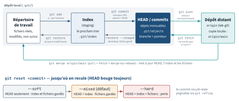
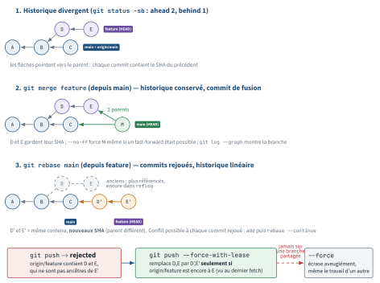

<!-- nav:début -->
[Accueil](../../README.md) › [Parcours](../../docs/parcours.md) › Partie IV — Socle DevOps › **Module 21**  
[← Module 20](../20-virtualisation-kvm/README.md) · [Corrigé](corrige.md) · [Module 22 →](../22-docker/README.md)

<details><summary>Scripts du module (11)</summary>

Sur la VM indiquée en section « Mise en place », depuis `~/workbook/scripts/` (voir [chapitre 0](../../docs/00-mise-en-place.md)).

| Script | Rôle |
|---|---|
| [`setup_M21.sh`](../../scripts/setup/setup_M21.sh) | prépare le module |
| [`check_M21_01.sh`](../../scripts/check/check_M21_01.sh) | vérification |
| [`check_M21_02.sh`](../../scripts/check/check_M21_02.sh) | vérification |
| [`check_M21_03.sh`](../../scripts/check/check_M21_03.sh) | vérification |
| [`check_M21_04.sh`](../../scripts/check/check_M21_04.sh) | vérification |
| [`check_M21_05.sh`](../../scripts/check/check_M21_05.sh) | vérification |
| [`check_M21_06.sh`](../../scripts/check/check_M21_06.sh) | vérification |
| [`break_M21_01.sh`](../../scripts/break/break_M21_01.sh) | installe une panne |
| [`break_M21_02.sh`](../../scripts/break/break_M21_02.sh) | installe une panne |
| [`break_M21_03.sh`](../../scripts/break/break_M21_03.sh) | installe une panne |
| [`break_M21_04.sh`](../../scripts/break/break_M21_04.sh) | installe une panne |

</details>
<!-- nav:fin -->

# Module 21 — Git pour l'ops et l'infra-as-code

## 21.0 Objectifs et compétences

> [!NOTE]
> **Objectifs**
>
> À la fin de ce module, je sais :
>
> * expliquer le modèle d'objets de Git (blob, tree, commit, tag), les trois
>   zones (working directory, index, HEAD) et pourquoi un commit est
>   immuable : son SHA est le condensé de tout ce qu'il contient, parents
>   compris ;
> * lire un historique avec `log --oneline --graph --all`, retrouver **qui** a
>   changé **quoi** et **quand** (`-S`, `--author`, `--since`, `blame`,
>   `show`), et comparer n'importe quelles zones ou branches avec `diff` ;
> * construire un `.gitignore` qui tient (patrons, négation, répertoire vs
>   `dir/*`, fichier global) et forcer les fins de ligne avec
>   `.gitattributes` ;
> * travailler en branches : `switch`, `merge` fast-forward ou `--no-ff`,
>   `rebase` interactif (squash/fixup/reword), résoudre un conflit sans
>   perdre l'un des deux côtés, `cherry-pick`, `stash -u` ;
> * dialoguer avec un distant : `fetch` puis décider, `pull --rebase`,
>   `push -u`, `--force-with-lease` (jamais `--force`), tags annotés ;
> * réparer : choisir entre `reset --soft/--mixed/--hard`, `revert`,
>   `restore`, retrouver un commit « perdu » avec `reflog`, nettoyer avec
>   `clean -ndx` avant `-fdx`, et localiser une régression avec
>   `bisect run` ;
> * choisir un workflow (trunk-based, GitHub flow, git-flow) adapté à un dépôt
>   d'infrastructure et écrire des messages Conventional Commits ;
> * purger un secret commité par erreur (`git filter-repo`), expliquer
>   pourquoi la rotation reste obligatoire, et empêcher la récidive avec un
>   hook `pre-commit` ;
> * monter un serveur Git minimal (dépôt bare en SSH + hook `post-receive`)
>   et une forge Gitea pour le lab ;
> * signer mes commits (SSH), configurer proprement `git config`
>   (`pull.rebase`, `push.default`, `core.autocrlf`, alias), et diagnostiquer
>   les messages « detached HEAD », « non-fast-forward », « have diverged ».
>
> **Temps estimé** : 8 h
>
> **Prérequis** : module 07 (bash, pour les hooks), module 14 (SSH, clés et
> `authorized_keys`), module 04 (groupes, setgid) pour le serveur Git.

---

## 21.1 Mise en place

VM concernées : **`lab-adm` (10.10.10.10)** pour tout le module, **`lab-ops`
(10.10.10.14)** pour le clone distant (L21.3) et la forge Gitea (L21.5).
Utilisateur `mathieu`. Aucun exercice n'exige `sudo`, sauf la partie serveur
(`/srv/git`) et l'installation des Break & Fix.

```bash
# depuis le shell Proxmox, avant de commencer
qm snapshot 9001 avant-lab21
qm snapshot 9005 avant-lab21
```

Paquets sur `lab-adm` :

```bash
sudo apt update
sudo apt install -y git git-filter-repo shellcheck yamllint
git --version        # 2.43 sur Ubuntu 24.04
```

> [!IMPORTANT]
> **Variante Rocky / RHEL**
>
> Sous Rocky 9 : `sudo dnf install -y git` (2.43 dans AppStream) ;
> `git-filter-repo`, `ShellCheck` et `yamllint` viennent d'EPEL
> (`sudo dnf install -y epel-release` d'abord).

Identité et réglages de base, **avant** le premier commit (E21.1 les
détaille) :

```bash
git config --global user.name  "Mathieu Teule"
git config --global user.email "mathieu@lab.local"
git config --global init.defaultBranch main
```

Préparation du terrain de jeu :

```bash
bash ~/workbook/scripts/setup/setup_M21.sh
```

Il crée `~/lab21/` :

| Chemin | Rôle |
|---|---|
| `factura-infra/` | ton clone de travail (branche `main`) |
| `remote/factura-infra.git` | le dépôt **bare** qui joue `origin` |
| `collegue/factura-infra` | le clone d'alice, pour simuler un collègue |
| `rapports/` | tes livrables, jamais effacé |

Le dépôt `factura-infra` a un historique d'une vingtaine de commits par trois auteurs,
un merge, deux tags (`v0.9.0` léger, `v1.0.0` annoté), deux branches
(`feature/tls-letsencrypt`, `hotfix/ansible-timeout`), **un secret commité
puis « retiré »**, et **un commit qui casse `bin/healthcheck.sh`**. Le script
est déterministe : tout le monde a les **mêmes SHA**, les corrigés les citent.

> [!CAUTION]
> **Attention**
>
> Le setup **remet le dépôt à zéro** à chaque exécution (les SHA doivent rester
> identiques pour tout le monde). Ne stocke rien d'important dedans en dehors
> de `~/lab21/rapports/`.

> [!TIP]
> **Astuce**
>
> Deux alias dès maintenant, tu les taperas cent fois :
>
> ```bash
> git config --global alias.lg \
>   "log --oneline --graph --all --decorate"
> git config --global alias.st "status -sb"
> ```

---

## 21.2 Rappel express

### Le modèle : quatre objets, trois zones, des références

```text
working directory  --add-->  index (staging)  --commit-->  HEAD (dépôt)
     fichiers                 le prochain tree            objets immuables
```

| Objet | Contenu | Identifié par |
|---|---|---|
| **blob** | le contenu d'un fichier (pas son nom) | SHA-1 du contenu |
| **tree** | liste `mode nom → blob/tree` | SHA du listing |
| **commit** | tree + parent(s) + auteur + committer + message | SHA de tout ça |
| **tag** (annoté) | objet pointant un commit + tagueur + message | SHA |

Un commit **contient** le SHA de son parent : changer un caractère n'importe
où dans le passé change tous les SHA suivants. C'est pourquoi `--amend`,
`rebase` et `filter-repo` **créent de nouveaux commits** — les anciens
restent joignables un temps par le **reflog**.

Références : `refs/heads/main` (branche = pointeur mobile),
`refs/tags/v1.0.0`, `refs/remotes/origin/main` (copie locale de l'état du
distant au dernier `fetch`), `HEAD` (→ la branche courante, ou un commit :
**detached**).

<p align="center"></p>

*Figure — Les quatre zones de Git et les commandes qui font passer les changements de l'une à l'autre ; `reset` recule HEAD plus ou moins profondément, le reflog garde une porte de sortie.*

```bash
git cat-file -t <sha>     # type      git cat-file -p <sha>   # contenu
git rev-parse HEAD~2 main@{upstream} v1.0.0^{commit}
```

### Regarder

| Commande | Ce qu'elle compare / montre |
|---|---|
| `git status -sb` | index vs HEAD (1re colonne), working dir vs index (2e) |
| `git diff` | working dir ↔ index |
| `git diff --staged` | index ↔ HEAD (ce qui **sera** commité) |
| `git diff HEAD` | working dir ↔ HEAD |
| `git diff A..B` | tree de A ↔ tree de B |
| `git diff A...B` | base commune ↔ B (ce que B apporte) |
| `git log -p --stat -S'texte' --author= --since= -- chemin` | filtres |
| `git show <rev>[:chemin]` | un commit, ou un fichier à cette révision |
| `git blame -L 12,18 fichier` | qui a écrit chaque ligne |

`git log --all -- fichier` retrouve un fichier **supprimé**. `-S` cherche
les commits qui changent le **nombre d'occurrences** d'une chaîne (le
« pickaxe ») ; `-G` prend une regex sur les lignes du diff.

### Ignorer et normaliser

```gitignore
# un répertoire (partout dans l'arbre)
.terraform/
# le contenu de logs/ à la racine seulement...
/logs/*
# ... sauf ce fichier : marche car le parent est logs/*
!/logs/.gitkeep
# patron glob
*.tfstate

Un commentaire n'est reconnu qu'en début de ligne : *.tfstate  # x serait un patron (avec son # x), pas un
commentaire.
```

Deux pièges : un fichier **déjà suivi** n'est jamais ignoré
(`git rm --cached` d'abord) ; on ne peut pas ré-inclure (`!`) un fichier
dont le **répertoire parent** est exclu (`logs/` ≠ `logs/*`).
`git check-ignore -v chemin` dit **quelle règle** s'applique.
Fichier global : `core.excludesFile` (`~/.gitignore_global`), pour les
fichiers propres à ton poste (`.idea/`, `*.swp`), pas au projet.

```gitattributes
# normalise en LF dans le dépôt et à l'extraction
* text=auto eol=lf
# les scripts ne survivent pas à un CRLF
*.sh text eol=lf
# pas de diff texte, pas de conversion
*.png binary
```

### Branches, fusion, rebase

| Commande | Effet |
|---|---|
| `git switch -c b` / `git switch b` | crée / change de branche (fichiers uniquement) |
| `git checkout` | l'ancienne commande qui fait aussi `restore` : ambiguë |
| `git merge b` | fast-forward si possible, sinon commit de merge |
| `git merge --no-ff b` | **toujours** un commit de merge (trace de la feature) |
| `git rebase main` | rejoue mes commits **par-dessus** main (nouveaux SHA) |
| `git rebase -i <base>` | `pick` / `reword` / `squash` / `fixup` / `drop` |
| `git cherry-pick <sha>` | recopie un commit ailleurs (nouveau SHA) |
| `git stash push -u -m msg` / `pop` / `list` / `apply` | met de côté (avec non-suivis) |

Conflit : `<<<<<<< HEAD` (le côté où tu es) … `=======` … `>>>>>>> autre`.
**Pendant un rebase, `HEAD` est la branche sur laquelle on rebase**, et
« autre » est ton commit rejoué — l'inverse d'un merge. Après édition :
`git add fichier`, puis `git rebase --continue` (ou `git merge --continue`).
`git diff --check` détecte les marqueurs oubliés. `git rerere` rejoue une
résolution déjà faite (`git config rerere.enabled true`).

### Distants

```bash
git fetch                  # met à jour origin/* : ne touche à RIEN d'autre
git status -sb             # ## main...origin/main [ahead 1, behind 2]
git pull --rebase          # = fetch + rebase   (pull.rebase=true)
git push -u origin main    # -u : mémorise l'upstream
git push --force-with-lease  # refuse si le distant a bougé depuis ton fetch
git push origin --delete feature/x
git tag -a v1.1.0 -m "..." && git push origin v1.1.0   # ou --tags
```

`rejected (non-fast-forward)` = le distant a des commits que tu n'as pas :
**fetch, intègre (rebase ou merge), repousse**. `--force` écrase le travail
des autres ; `--force-with-lease` n'écrase que ce que tu as déjà vu.
Tag **annoté** (`-a`, objet avec auteur/date/message, signable) pour les
versions ; tag léger (simple pointeur) pour un repère perso.

<p align="center"></p>

*Figure — Le même historique divergent intégré par `merge` (commit de fusion à deux parents) et par `rebase` (commits rejoués, nouveaux SHA), puis le `push` qui suit un rebase : `--force-with-lease`, jamais `--force`.*

### Réparer

| Commande | HEAD/branche | Index | Working dir |
|---|---|---|---|
| `reset --soft X` | → X | intact | intact |
| `reset --mixed X` (défaut) | → X | = X | intact |
| `reset --hard X` | → X | = X | **= X (perte)** |
| `revert X` | nouveau commit inverse | | |
| `restore f` / `restore --staged f` | | ← HEAD | ← index |
| `restore --source=v1.0.0 f` | | | ← v1.0.0 |

`reset` réécrit (réservé aux commits **non poussés**) ; `revert` ajoute un
commit inverse (le seul choix sur un historique partagé). `git reflog`
liste où `HEAD` est passé : un commit « perdu » par `reset --hard`, un
`rebase` raté ou un HEAD détaché s'y retrouve pendant 30 jours
(90 pour un commit encore joignable) (`git branch sauvetage HEAD@{3}`). `git clean -ndx` **liste** ce qui
serait supprimé (non suivis **et** ignorés) ; `-fdx` le fait.
`git bisect start <bad> <good>` puis `git bisect run ./test.sh` trouve le
commit fautif en log₂(n) essais.

### Workflows et conventions

| Workflow | Branches | Convient à |
|---|---|---|
| trunk-based | `main` + branches < 2 jours, feature flags | infra, CI mature |
| GitHub flow | `main` + branches de PR, déploiement depuis `main` | la plupart des équipes |
| git-flow | `develop`, `release/*`, `hotfix/*`, `master` | produits versionnés, releases lentes |

Pour un dépôt Ansible/Terraform : **trunk-based ou GitHub flow**, `main`
protégée (pas de push direct, revue obligatoire, CI verte, historique
linéaire ou `--no-ff` assumé), `CODEOWNERS` pour exiger la revue de
l'équipe réseau sur `terraform/network*`. Messages **Conventional
Commits** : `type(scope): description` — `feat`, `fix`, `docs`, `chore`,
`refactor`, `ci` ; `!` ou `BREAKING CHANGE:` pour une rupture ; le
changelog se génère à partir de ça.

### Ce qu'on ne commite jamais, et le jour où c'est fait

Secrets, `.env`, clés privées, `*.tfstate` (il contient les mots de passe en
clair), dumps. Si un secret est poussé : **1. rotation immédiate** (le
secret est compromis, réécrire l'historique n'y change rien), 2. purge
(`git filter-repo --invert-paths --path .env`), 3. `push --force` **après
avoir prévenu** (tous les clones doivent être re-clonés), 4. hook
`pre-commit` (`gitleaks`, motifs) pour la récidive. Les hooks
`.git/hooks/` ne sont pas versionnés : `core.hooksPath=.githooks` ou
l'outil `pre-commit` (`.pre-commit-config.yaml`) pour les partager.

### Configuration utile

```bash
git config --global pull.rebase true         # pull = fetch + rebase
git config --global push.default simple      # pousse la branche courante
git config --global push.autoSetupRemote true  # plus besoin de -u
git config --global fetch.prune true         # nettoie origin/* supprimées
git config --global rerere.enabled true
git config --global core.autocrlf input      # Linux/macOS ; true sous Windows
git config --global gpg.format ssh
git config --global user.signingkey ~/.ssh/id_ed25519.pub
git config --global commit.gpgsign true
git config --global credential.helper 'cache --timeout=3600'
git config --list --show-origin              # d'où vient chaque valeur
```

Ordre de priorité : `--local` (`.git/config`) > `--global`
(`~/.gitconfig`) > `--system` (`/etc/gitconfig`).

---

## 21.3 Quiz — QCM

<a id="q21-1"></a>**[Q21.1](corrige.md#q21-1)** — `git cat-file -p HEAD` affiche `tree f1e0365…`, `parent
a6736e7…`, auteur, committer et message. Tu modifies **uniquement** le
message de ce commit avec `--amend`. Que devient le SHA du commit, et
celui de son `tree` ?

a) les deux changent
b) le SHA du commit change, le tree reste `f1e0365…`
c) aucun ne change, seul le message est réécrit en place
d) le tree change, le SHA du commit reste identique

<a id="q21-2"></a>**[Q21.2](corrige.md#q21-2)** — Dans `~/lab21/factura-infra`, `git status -sb` affiche
`## main...origin/main [ahead 2, behind 3]`. Que signifie-t-il ?

a) tu as 2 commits non poussés et le distant en a 3 que tu n'as pas :
   les branches ont divergé
b) tu es en retard de 5 commits
c) `origin/main` a été supprimée
d) tu as 2 commits de plus que la branche `main` locale

<a id="q21-3"></a>**[Q21.3](corrige.md#q21-3)** — Après `git add -p` où tu as accepté un seul des deux hunks
de `README.md`, quelles commandes montrent une partie de ta modification de `README.md` ?
**Deux réponses correctes.**

a) `git diff`
b) `git diff --staged`
c) `git diff HEAD~1 HEAD`
d) `git show`

<a id="q21-4"></a>**[Q21.4](corrige.md#q21-4)** — `.gitignore` contient `logs/` puis `!logs/.gitkeep`. Le fichier
`logs/.gitkeep` n'est pas encore suivi. `git status` :

a) propose `logs/.gitkeep` en non suivi
b) n'affiche rien : on ne peut pas ré-inclure un fichier dont le répertoire
   parent est exclu
c) affiche une erreur de syntaxe
d) propose tout `logs/`

<a id="q21-5"></a>**[Q21.5](corrige.md#q21-5)** — `terraform/terraform.tfstate` est suivi par Git depuis 3 mois.
Tu ajoutes `*.tfstate` au `.gitignore` et commites. Au prochain
`terraform apply` :

a) le fichier n'apparaît plus dans `git status`
b) le fichier apparaît toujours comme modifié : un fichier suivi n'est jamais
   ignoré
c) Git le supprime du working directory
d) `git status` affiche un avertissement `ignored but tracked`

<a id="q21-6"></a>**[Q21.6](corrige.md#q21-6)** — `git merge feature/x` sur `main` ne crée **pas** de commit de
merge. Pourquoi ?

a) la branche était vide
b) `main` n'avait pas avancé depuis la création de `feature/x` : fast-forward
c) le merge a échoué silencieusement
d) `merge.ff=false` est réglé

<a id="q21-7"></a>**[Q21.7](corrige.md#q21-7)** — Pendant `git rebase main` sur ta branche, le fichier contient :

```text
<<<<<<< HEAD
        add_header Strict-Transport-Security "max-age=31536000" always;
=======
        ssl_certificate     /etc/letsencrypt/live/factura/fullchain.pem;
>>>>>>> 994e070 (feat(nginx): écoute en 443 avec certificat Let's Encrypt)
```

Quelle affirmation est vraie ?

a) `HEAD` est ta branche, `994e070` vient de `main`
b) `HEAD` est `main` (la base), `994e070` est ton commit en cours de rejeu
c) `HEAD` est la version commune aux deux
d) les deux blocs viennent de ta branche

<a id="q21-8"></a>**[Q21.8](corrige.md#q21-8)** — Tu as commité un mot de passe dans `.env`, puis tu as fait
`git rm .env` et un second commit `fix: retire .env`, puis poussé.
Quelle affirmation est vraie ? **Deux réponses correctes.**

a) le mot de passe reste lisible : `git show <sha1>:.env`
b) le second commit suffit, le fichier n'est plus dans `HEAD`
c) le mot de passe doit être changé quoi qu'il arrive
d) `git gc` va supprimer l'ancien blob au prochain passage

<a id="q21-9"></a>**[Q21.9](corrige.md#q21-9)** — Tu veux annuler le dernier commit **poussé** sur `main`
(branche partagée). La bonne commande :

a) `git reset --hard HEAD~1` puis `git push --force`
b) `git revert HEAD` puis `git push`
c) `git checkout HEAD~1`
d) `git restore --source=HEAD~1 .`

<a id="q21-10"></a>**[Q21.10](corrige.md#q21-10)** — `git reset --soft HEAD~2` puis `git commit -m "feat: x"`.
Résultat ?

a) les deux derniers commits sont perdus définitivement
b) les changements des deux commits sont réunis dans un seul nouveau commit
c) les fichiers du working directory reviennent à `HEAD~2`
d) erreur : `--soft` exige un seul commit

<a id="q21-11"></a>**[Q21.11](corrige.md#q21-11)** — Après `git switch --detach v1.0.0`, tu as fait deux commits,
puis `git switch main`. Où sont ces commits ?

a) sur `main`, Git les a rapatriés
b) perdus, `switch` les a supprimés
c) toujours dans la base d'objets, atteignables par `git reflog`
d) sur une branche automatique nommée `detached`

<a id="q21-12"></a>**[Q21.12](corrige.md#q21-12)** — Ton `git push` est rejeté : `! [rejected] main -> main
(non-fast-forward)`. Quelle option est **acceptable** ?

a) `git push --force`
b) `git pull --rebase` puis `git push`
c) supprimer le clone et recloner
d) `git push --delete origin main` puis `git push`

<a id="q21-13"></a>**[Q21.13](corrige.md#q21-13)** — Différence entre `git push --force` et
`git push --force-with-lease` :

a) aucune, `--force-with-lease` est un alias
b) `--force-with-lease` refuse si la branche distante ne pointe plus sur ce
   que ton dernier `fetch` a vu
c) `--force-with-lease` demande une confirmation interactive
d) `--force-with-lease` ne fonctionne que sur les tags

<a id="q21-14"></a>**[Q21.14](corrige.md#q21-14)** — `git cat-file -t v0.9.0` répond `commit` et
`git cat-file -t v1.0.0` répond `tag`. Conclusion ?

a) `v0.9.0` est corrompu
b) `v0.9.0` est un tag léger (pointeur), `v1.0.0` un tag annoté (objet avec
   auteur, date, message)
c) `v1.0.0` est un commit de merge
d) `v0.9.0` pointe sur une branche

<a id="q21-15"></a>**[Q21.15](corrige.md#q21-15)** — Le healthcheck passe à `v1.0.0` et échoue sur `main`, 8 commits
plus loin. Combien d'essais `git bisect` fait-il au maximum ?

a) 8
b) 4
c) 3
d) 1

<a id="q21-16"></a>**[Q21.16](corrige.md#q21-16)** — `git clean -fdx` dans un dépôt Terraform. Que supprime-t-il ?
**Deux réponses correctes.**

a) les fichiers non suivis, dont `.terraform/` **et** `terraform.tfstate`
   s'ils sont ignorés
b) les fichiers modifiés mais suivis
c) les répertoires non suivis
d) les commits non poussés

<a id="q21-17"></a>**[Q21.17](corrige.md#q21-17)** — Quel workflow est le plus adapté à un dépôt Ansible déployé
plusieurs fois par jour par une équipe de quatre personnes ?

a) git-flow avec `develop`, `release/*` et `hotfix/*`
b) trunk-based ou GitHub flow : `main` protégée, branches courtes, revue
c) une branche par personne, fusionnée le vendredi
d) pas de branches, tout le monde sur `main`

<a id="q21-18"></a>**[Q21.18](corrige.md#q21-18)** — Une clé SSH privée a été commitée. Tu lances
`git filter-repo --invert-paths --path id_rsa` et pousses en force. Que
manque-t-il ? **Deux réponses correctes.**

a) révoquer la clé sur tous les `authorized_keys` et en générer une nouvelle
b) demander à chaque collègue de re-cloner (leurs clones contiennent encore
   l'ancien historique et le repousseraient)
c) rien, l'historique est propre
d) lancer `git gc` sur le poste de l'attaquant

---

## 21.4 Quiz — questions ouvertes

<a id="qo21-1"></a>**[QO21.1](corrige.md#qo21-1)** — Explique pourquoi un commit Git est immuable en partant de ce
que contient réellement l'objet commit, puis déduis-en ce que font
vraiment `--amend`, `rebase` et `filter-repo`, et pourquoi le reflog permet
de « revenir en arrière » malgré tout.

<a id="qo21-2"></a>**[QO21.2](corrige.md#qo21-2)** — *On te demande en entretien* : « Merge ou rebase pour intégrer
une branche de feature ? » Réponds avec les critères qui font pencher d'un
côté ou de l'autre (historique partagé ou non, lisibilité du graphe,
bisect, revue), et donne la règle que tu imposerais à une équipe infra.

<a id="qo21-3"></a>**[QO21.3](corrige.md#qo21-3)** — Décris précisément ce que `git reset --soft`, `--mixed` et
`--hard` font aux trois zones, avec un cas d'usage légitime pour chacun,
puis le cas où `reset` est interdit et ce qu'on fait à la place.

<a id="qo21-4"></a>**[QO21.4](corrige.md#qo21-4)** — Un collègue a poussé une clé API dans `terraform.tfvars` il y a
trois jours. Décris la procédure complète, dans l'ordre, en expliquant
**pourquoi** l'ordre compte (rotation, purge, force-push, re-clone,
prévention), et ce que tu réponds à « on n'a qu'à supprimer le fichier ».

<a id="qo21-5"></a>**[QO21.5](corrige.md#qo21-5)** — *On te demande en entretien* : « Un push est rejeté en
`non-fast-forward`. Explique ce qui s'est passé et pourquoi `--force` est
la mauvaise réponse dans 99 % des cas. » Réponds en décrivant l'état des
deux dépôts, les deux façons correctes d'intégrer, et le seul cas où un
push forcé est légitime (avec quelle option).

<a id="qo21-6"></a>**[QO21.6](corrige.md#qo21-6)** — Compare `fetch` et `pull`, puis `pull` avec et sans `--rebase`.
Quel réglage global recommandes-tu à un ops et pourquoi le `pull` par
défaut de Git 2.43 refuse-t-il parfois de faire quoi que ce soit
(`Need to specify how to reconcile divergent branches`) ?

<a id="qo21-7"></a>**[QO21.7](corrige.md#qo21-7)** — Explique la différence entre `.gitignore`, `.git/info/exclude`
et `core.excludesFile`, dis ce qui va dans chacun, puis décris les deux
raisons pour lesquelles un fichier « refuse » de s'ignorer et la commande
qui tranche.

<a id="qo21-8"></a>**[QO21.8](corrige.md#qo21-8)** — Tu dois convaincre ton équipe de versionner `/etc` des cinq VM
du lab avec `etckeeper`. Qu'est-ce que ça apporte concrètement lors d'un
incident, quelles limites (secrets dans `/etc`, taille, droits), et
comment `etckeeper` s'articule-t-il avec `apt` ?

<a id="qo21-9"></a>**[QO21.9](corrige.md#qo21-9)** — Décris la démarche de diagnostic quand `git status` affirme
`HEAD detached at 4a34e42` alors que tu pensais être sur `main` : comment
c'est arrivé (trois causes courantes), comment sauver le travail éventuel,
et comment revenir sur `main`.

---

## 21.5 Exercices guidés ★

Sauf mention contraire, travaille dans `~/lab21/factura-infra`. Les SHA
cités sont ceux produits par `setup_M21.sh` ; s'ils diffèrent chez toi,
relance le setup.

<a id="e21-1"></a>**[E21.1](corrige.md#e21-1)** — Configure ton identité globale, `init.defaultBranch=main`,
`pull.rebase=true`, `push.default=simple`, `fetch.prune=true`, un alias
`lg` (graphe complet décoré) et un alias `st` (`status -sb`). Affiche
ensuite la liste des réglages **avec leur fichier d'origine**, et explique
pourquoi `user.name` apparaît **deux fois** avec deux valeurs différentes
dans ce dépôt. Bonus : quelle valeur de `core.autocrlf` recommandes-tu à
un collègue sous Windows, et pourquoi le `.gitattributes` du dépôt rend ce
réglage presque inutile ?

<a id="e21-2"></a>**[E21.2](corrige.md#e21-2)** — Sans ouvrir aucun fichier : affiche le type puis le contenu de
l'objet `HEAD`, le contenu de son `tree`, puis celui du sous-arbre `bin`.
Prouve que le blob de `README.md` a le même SHA que
`git hash-object README.md`. Enfin, montre que `v1.0.0` et
`v1.0.0^{commit}` ne désignent pas le même objet, et explique.

<a id="e21-3"></a>**[E21.3](corrige.md#e21-3)** — Réponds avec une seule commande `git log` à chaque question :
(a) quel commit a changé `worker_connections` de 1024 à 4096 ?
(b) quels commits d'alice sur `main` entre le 20 juin et le 1er juillet ?
(c) quels commits ont touché `.env`, y compris ceux qui l'ont supprimé ?
(d) combien de commits par auteur, toutes branches confondues ?
(e) le graphe complet sur une ligne par commit, avec branches et tags.

<a id="e21-4"></a>**[E21.4](corrige.md#e21-4)** — Compare `main` et `feature/tls-letsencrypt` avec
`git diff --stat main..feature/tls-letsencrypt` puis avec
`main...feature/tls-letsencrypt`. Les deux résultats diffèrent
(4 fichiers vs 2). Explique lequel répond à « qu'apporte cette branche ? »
et pourquoi l'autre montre `.gitattributes` et `docs/runbook.md` en
**suppression**.

<a id="e21-5"></a>**[E21.5](corrige.md#e21-5)** — Modifie `README.md` à deux endroits éloignés : le titre
(ajoute ` (lab.local)`) et une section `## Contact` en fin de fichier.
Commite **uniquement** le changement de titre, en un seul commit, sans
toucher la section Contact, puis prouve avec deux `diff` que le titre est
dans `HEAD` et Contact toujours dans le working directory.

<a id="e21-6"></a>**[E21.6](corrige.md#e21-6)** — Ton commit précédent s'appelle `docs(readme): titre avec le
domaine`. Renomme-le en `docs(readme): précise le domaine dans le titre`
sans créer de commit supplémentaire. Compare le SHA avant/après et le
`git status -sb` : que signifie `[ahead 1]` ? Commite ensuite la section
Contact avec `commit -a` sans passer par `add`. Enfin, sur une branche jetable `essai/renommage` créée depuis `feature/tls-letsencrypt` (qui doit rester intacte pour E21.9 et L21.1), déplace
`ansible/roles/nginx/tasks_certbot.yml` vers `ansible/roles/nginx/tasks/main.yml` en
un commit qui apparaît comme un **renommage** dans `git log --stat`, puis supprime la branche jetable.

<a id="e21-7"></a>**[E21.7](corrige.md#e21-7)** — `git status` liste `ansible/notes-perso.txt` et `logs/`. Fais en
sorte que : le contenu de `logs/` soit ignoré **mais** que `logs/.gitkeep`
soit commité ; `notes-perso.txt` soit ignoré **sans modifier le
`.gitignore` du projet** (c'est ton brouillon, pas celui de l'équipe).
Vérifie avec `git check-ignore -v` quelle règle et quel fichier ignorent
`terraform/terraform.tfstate`, `.README.md.swp` et `notes-perso.txt`.

<a id="e21-8"></a>**[E21.8](corrige.md#e21-8)** — Sur `main`, fusionne `hotfix/ansible-timeout` de deux façons
successives : d'abord un merge ordinaire, note le résultat et le graphe,
`reset --hard` pour revenir, puis `merge --no-ff`. Explique pourquoi le
premier n'a **pas** été un fast-forward alors que le hotfix ne contient
qu'un commit, et pourquoi les deux résultats sont ici identiques. Enfin,
`reset --hard` à nouveau, `cherry-pick 9c33a91`, puis
`git branch -d hotfix/ansible-timeout` : lis l'avertissement. Pourquoi Git
considère-t-il la branche « non fusionnée dans HEAD » alors que le contenu
est sur `main`, et qu'est-ce qui l'a quand même autorisé à la supprimer ?
(Garde ce `main` : E21.11 l'utilise.)

<a id="e21-9"></a>**[E21.9](corrige.md#e21-9)** — La branche `feature/tls-letsencrypt` contient `wip`,
`fix typo` et `feat(nginx): renouvellement automatique…`, trois commits qui
ne touchent que `tasks_certbot.yml`. Avec un rebase interactif **sur la
base commune** (pas sur `main`), réunis-les en **un seul** commit nommé
`feat(nginx): tâche certbot et renouvellement automatique` (`reword` +
`fixup`), pour obtenir exactement 2 commits au-dessus de `b344468`.
Vérifie avec `git log --oneline --stat main..HEAD` puis `git status -sb` :
pourquoi `994e070` a-t-il gardé son SHA, et que signifient `ahead 1,
behind 3` alors que tu n'as ajouté aucun contenu ?

<a id="e21-10"></a>**[E21.10](corrige.md#e21-10)** — Tu es sur `main` avec le titre du README modifié (non
commité) et un fichier `brouillon.txt` non suivi. On te demande de basculer
d'urgence sur `feature/tls-letsencrypt`. Fais-le sans commiter ni perdre
quoi que ce soit, y compris `brouillon.txt`, reviens sur `main` et
récupère tout. Montre pourquoi `git stash` **sans** `-u` aurait laissé un
piège.

<a id="e21-11"></a>**[E21.11](corrige.md#e21-11)** — Le commit `9c33a91` (timeout SSH) doit aller sur `main` **sans**
fusionner la branche `hotfix/ansible-timeout`. Applique-le, compare les
deux SHA et les deux dates (`git log --format='%h %ad %cd'`) : qu'est-ce
qui a été conservé, qu'est-ce qui a changé, et pourquoi ?

<a id="e21-12"></a>**[E21.12](corrige.md#e21-12)** — Crée un tag léger `essai` sur `HEAD` et un tag annoté
`v1.1.0-rc1` avec message. Montre avec `git cat-file -t` et `git show` ce
qui les distingue, puis pousse **uniquement** `v1.1.0-rc1` vers `origin`
(pas `essai`). Vérifie côté distant avec `git ls-remote --tags origin` :
pourquoi `v1.1.0-rc1` apparaît-il **deux fois** (`^{}`) ?

<a id="e21-13"></a>**[E21.13](corrige.md#e21-13)** — Alice a poussé un commit sur `origin/main` que tu n'as pas.
Sans `pull` : constate l'écart avec `fetch` puis `status -sb` et
`log main..origin/main`. Intègre-le ensuite avec `pull --rebase`, et
explique ce que `pull` a fait exactement, et ce qu'il aurait fait avec
`pull.rebase=false` si tu avais eu un commit local.

<a id="e21-14"></a>**[E21.14](corrige.md#e21-14)** — Fais trois commits jetables sur `main` (`touch a; git add a;
git commit -m "tmp a"`, etc.). Remplis le tableau `--soft/--mixed/--hard`
en exécutant réellement `git reset --soft HEAD~1`, puis `--mixed HEAD~1`,
puis `--hard HEAD~1`, et en notant après chacun la sortie de
`git status --short` et de `git log --oneline -1`. Termine par
`git reflog -5` et remets `main` **exactement** là où elle était avant
les trois commits, sans compter à la main.

<a id="e21-15"></a>**[E21.15](corrige.md#e21-15)** — `git branch -D feature/tls-letsencrypt` (oui, `-D`). Elle est
perdue ? Retrouve le SHA de son dernier commit **de deux manières**
(reflog de `HEAD`, et `git fsck --lost-found` ou `git log -g`), recrée la
branche au même endroit et compare-la à
`origin/feature/tls-letsencrypt`.

<a id="e21-16"></a>**[E21.16](corrige.md#e21-16)** — `bin/healthcheck.sh` échoue sur `main` et passait à `v1.0.0`.
Trouve le commit fautif **sans lire aucun diff**, en laissant Git tester
lui-même (`bisect run`). Puis, avec `blame`, identifie la ligne et son
auteur. Ne corrige pas encore : c'est L21.2.

---

## 21.6 Labs ★★

### <a id="l21-1"></a>**[L21.1](corrige.md#l21-1)** — Intégrer la branche TLS d'alice : rebase, conflit, release

> **Contexte**
>
> Alice part en congé ; sa branche `feature/tls-letsencrypt` doit être en
> production lundi. Elle contient deux commits `wip` et `fix typo` que la
> revue refuse, et elle a été créée avant que `main` reçoive les en-têtes
> HSTS sur le **même** bloc `server` du template nginx. On veut : un
> historique propre, un `main` qui garde HSTS **et** gagne TLS, un tag de
> version, et la branche supprimée du distant.

1. Pousse d'abord ce que tu as sur `main` (`git push`), puis passe sur
   `feature/tls-letsencrypt`. Constate avec `git log --oneline main..HEAD`
   les 4 commits.
2. Rebase interactif sur la base commune (`git merge-base main HEAD`) :
   `wip`, `fix typo` et `renouvellement automatique` deviennent **un**
   commit `feat(nginx): tâche certbot et renouvellement automatique`
   (c'est E21.9 ; si tu l'as déjà fait, passe). Résultat attendu :
   2 commits.
3. `git rebase main`. Un conflit sur
   `ansible/roles/nginx/templates/factura.conf.j2`. Résous-le en gardant
   **les deux** apports (HSTS et `ssl_certificate*`), sans marqueur.
   Vérifie avec `git diff --check` avant `git add`.
4. `git rebase --continue`. Pousse la branche : le push est rejeté. Utilise
   la bonne option (pas `--force`) et explique dans ton rapport pourquoi
   elle est acceptable **ici** et pas sur `main`.
5. Sur `main` : `git merge --no-ff` avec un message qui mentionne TLS. Tag
   **annoté** `v1.1.0`. Pousse `main` et le tag.
6. Supprime `feature/tls-letsencrypt` sur `origin` puis en local.
7. Active `rerere` et note dans `~/lab21/rapports/L21.1.md` ce qu'il
   aurait changé si tu avais dû résoudre ce conflit une seconde fois.

> [!TIP]
> **Critère de succès**
>
> Critère de succès : `git show main:ansible/roles/nginx/templates/factura.conf.j2`
> contient `listen 443 ssl` **et** `Strict-Transport-Security`, aucun
> commit `wip` dans `git log main`, `v1.1.0` annoté et présent sur `origin`.
>
> ```bash
> bash check_M21_01.sh
> ```

---

### <a id="l21-2"></a>**[L21.2](corrige.md#l21-2)** — Bisect : « le healthcheck est rouge depuis quelques jours »

> **Contexte**
>
> Le pipeline exécute `bin/healthcheck.sh` avant chaque déploiement. Il est
> rouge « depuis le milieu du mois » ; personne ne sait quel commit. Il
> passait à `v1.0.0`. Interdit de lire les diffs un par un : il y a 40 commits
> dans la vraie vie, et le script de test existe déjà.

1. Confirme le symptôme : `bin/healthcheck.sh` sur `main` (code de retour),
   et sur `v1.0.0` (dans un `git worktree add ../wt-v1 v1.0.0` pour ne pas
   quitter `main`, puis `git worktree remove`).
2. `git bisect start main v1.0.0`, puis laisse `git bisect run` piloter avec
   le script de test. Note le nombre d'étapes et le SHA du premier mauvais
   commit. `git bisect reset`.
3. `git show <sha>` : identifie la ligne fautive (une faute de frappe dans
   un nom de fichier). `git blame -L` sur cette ligne pour confirmer.
4. Corrige **la ligne** (pas un `revert` du refactor entier, pas un
   renommage du playbook), en un commit Conventional Commits `fix(...)`
   dont le corps cite le SHA fautif. Le healthcheck doit répondre 0.
5. Rapport `~/lab21/rapports/bisect.md` : la commande `bisect run`
   utilisée, le nombre d'étapes, le SHA, la cause, le correctif, et deux
   lignes sur ce qu'un `commit-msg` hook ou une CI aurait pu empêcher.
6. Pousse `main`.

> [!TIP]
> **Critère de succès**
>
> ```bash
> bash check_M21_02.sh
> ```

---

### <a id="l21-3"></a>**[L21.3](corrige.md#l21-3)** — Serveur Git minimal : dépôt bare en SSH et déploiement par hook

> **Contexte**
>
> Pas de forge encore. On veut que `lab-adm` héberge le dépôt de référence
> `factura-infra`, accessible en SSH par les membres du groupe `git`, et que
> chaque push sur `main` **déploie** automatiquement la configuration dans
> `/srv/factura-conf/`. Le hook doit refuser de déployer autre chose que
> `main`.

Sur **`lab-adm`** :

1. Crée le groupe `git`, ajoute `mathieu`, crée `/srv/git` (groupe `git`,
   setgid, `2775`).
2. `git init --bare --shared=group /srv/git/factura-infra.git`, HEAD sur
   `main`. Vérifie avec `git config --list` dans le bare ce que
   `--shared=group` a réglé **en plus** de `core.sharedRepository`.
3. Hook `hooks/post-receive` : lit les triplets `ancien nouveau ref` sur
   stdin, ne réagit qu'à `refs/heads/main`, extrait le contenu du nouveau
   commit dans `/srv/factura-conf` avec `git archive | tar -x` (pas de
   `.git` dans la cible), journalise date/SHA/utilisateur dans
   `/srv/factura-conf/.deploy.log`.
4. Depuis `~/lab21/factura-infra` : `git remote add lab-adm
   ssh://mathieu@lab-adm/srv/git/factura-infra.git` et pousse `main` et
   les tags. Lis ce que le hook affiche (`remote:`).

Sur **`lab-ops`** :

5. Clone en SSH, ajoute une ligne au `CHANGELOG.md`, commite, pousse.
   Vérifie sur `lab-adm` que `/srv/factura-conf/CHANGELOG.md` a suivi.
6. Depuis `lab-ops`, essaie de pousser une branche `essai` : le hook doit
   rester muet. Puis force un push non fast-forward sur `main` : que
   répond le serveur, et quel réglage en est responsable ?

> [!TIP]
> **Astuce**
>
> Dans un hook côté serveur, le répertoire courant est le dépôt bare et
> `GIT_DIR` est positionné : `git archive main` fonctionne sans option.
> Tout ce que le hook écrit sur stdout/stderr remonte au client préfixé
> `remote:`.

> [!TIP]
> **Critère de succès**
>
> ```bash
> bash check_M21_03.sh      # sur lab-adm
> ```

---

### <a id="l21-4"></a>**[L21.4](corrige.md#l21-4)** — Un mot de passe dans l'historique : purge, rotation, garde-fou

> **Contexte**
>
> Audit de sécurité : `git log --all -p | grep -i password` sur
> `factura-infra` remonte `DB_PASSWORD=S3cr3t-Factura-2026!` et une clé
> `AKIA…`. Bob avait « retiré » le fichier en juin. Tu dois rendre le secret
> introuvable dans **tous** les dépôts (origin, clones), sans perdre les
> tags ni les branches, et faire en sorte que ça ne se reproduise pas.

1. Prouve la fuite : le commit qui a ajouté `.env`, celui qui l'a supprimé,
   et la commande qui affiche encore le mot de passe **aujourd'hui** depuis
   `HEAD` de `main`. Note-les dans `~/lab21/rapports/incident-secret.md`.
2. **Rotation d'abord** : écris dans le rapport quels secrets sont
   compromis et ce qui doit être changé, avant toute manipulation Git.
3. Pousse tout ton travail local (`git push --all`, `--tags`), puis fais un
   clone `--mirror` de `origin` dans `~/lab21/purge` : c'est là que tu
   réécris.
4. `git filter-repo --invert-paths --path .env` (avec `--force` sur un clone
   frais si demandé). Si `git-filter-repo` n'est pas installable, la
   variante `filter-branch --index-filter` est acceptée mais tu dois
   ensuite supprimer `refs/original/`, expirer le reflog et `gc --prune=now`.
5. Vérifie dans `purge` : `git log --all -- .env` vide, `git grep S3cr3t
   $(git rev-list --all)` vide, `v1.0.0` toujours présent.
6. `git push --mirror` vers `origin`, puis, **dans le bare**, expire le
   reflog et `gc --prune=now` : `git cat-file -e 1557f83…` doit échouer.
7. Reviens dans `~/lab21/factura-infra` : `git fetch` puis `git status -sb`.
   Explique le `[ahead N, behind M]`. Remplace ton clone par un clone
   frais (garde `rapports/`), ou justifie une autre méthode dans le
   rapport.
8. Hook `pre-commit` (`.git/hooks/pre-commit`) qui refuse tout fichier
   `.env`/`*.pem`/`*.key` indexé et toute ligne `PASSWORD=`, `SECRET=`,
   `API_KEY=`, `AKIA[0-9A-Z]{16}`, `BEGIN … PRIVATE KEY` dans le contenu
   **indexé** (pas le working directory). Il laisse passer un commit sain.
   Mentionne `gitleaks` dans le rapport comme version industrielle.

> [!CAUTION]
> **Attention**
>
> `filter-repo` réécrit **tous** les SHA après le commit purgé. Toute
> personne ayant un clone doit le jeter : un `git pull` depuis un vieux
> clone repousserait les anciens commits. Prévenir avant le `--mirror`.

> [!TIP]
> **Critère de succès**
>
> ```bash
> bash check_M21_04.sh
> ```

---

### <a id="l21-5"></a>**[L21.5](corrige.md#l21-5)** — Forge locale : Gitea sur `lab-ops`

> **Contexte**
>
> Les modules 25 (CI) et 26 (GitOps) ont besoin d'une forge avec merge
> requests, protection de branche et webhooks. Gitea tient en un binaire et
> tourne en 5 minutes sur `lab-ops`. Le dépôt `factura-infra` y sera poussé
> avec `main` protégée.

Sur **`lab-ops`** :

1. Utilisateur système `git` (home `/home/git`), répertoires
   `/var/lib/gitea/{custom,data,log}` (`750`, propriétaire `git`) et
   `/etc/gitea` (`770`, groupe `git` le temps de l'installation).
2. Binaire : `wget -O /usr/local/bin/gitea
   https://dl.gitea.com/gitea/<version>/gitea-<version>-linux-amd64`
   (prends la dernière 1.x affichée sur `https://dl.gitea.com/gitea/`),
   `chmod +x`. Vérifie `gitea --version`.
3. Unité systemd `gitea.service` (`User=git`, `WorkingDirectory=/var/lib/gitea`,
   `ExecStart=/usr/local/bin/gitea web --config /etc/gitea/app.ini`,
   `Environment=GITEA_WORK_DIR=/var/lib/gitea HOME=/home/git`,
   `Restart=always`, `After=network.target`). `enable --now`.
4. `http://10.10.10.14:3000` : installation avec SQLite3, domaine
   `lab-ops.lab.local`, `ROOT_URL http://10.10.10.14:3000/`, port SSH
   `2222` (le serveur SSH intégré, pour ne pas toucher au sshd système),
   compte admin `mathieu`. Après installation : `/etc/gitea` en `750` et
   `app.ini` en `640`.
5. Crée l'organisation `infra` et le dépôt `infra/factura-infra` (vide),
   ajoute ta clé publique SSH au profil, puis depuis `lab-adm` :
   `git remote add gitea ssh://git@10.10.10.14:2222/infra/factura-infra.git`
   et pousse `main` et les tags.
6. Protège `main` : pas de push direct, 1 approbation, merge par MR
   seulement. Teste : un `git push gitea main` direct doit être refusé.
7. Crée une branche `docs/gitea`, ajoute une ligne au README, pousse, ouvre
   une MR dans l'interface, fusionne-la avec « rebase then merge » ou
   « merge commit », puis `git pull` sur `lab-adm`.

> [!TIP]
> **Astuce**
>
> Variante Docker en une ligne (si Docker est déjà là, sinon module 22) :
> `docker run -d --name gitea -p 3000:3000 -p 2222:22 -v gitea:/data
> --restart always gitea/gitea:1` — même écran d'installation.

> [!TIP]
> **Critère de succès**
>
> ```bash
> bash check_M21_05.sh      # depuis lab-adm
> ```

---

## 21.7 Break & Fix ★★★

> [!CAUTION]
> **Attention**
>
> Avant chaque Break & Fix : `qm snapshot 9001 avant-bf21`. Chaque panne
> construit son **propre** dépôt dans `~/lab21/bfN/` : le dépôt principal
> n'est pas touché. Les scripts sauvegardent un `git bundle` de l'état
> initial dans `/root/.breakfix-backup/`, mais l'utiliser vaut échec : ici
> on répare avec Git, pas avec une sauvegarde.

### <a id="bf21-1"></a>**[BF21.1](corrige.md#bf21-1)** — « Le rebase d'alice est resté en plan »

```bash
sudo bash break_M21_01.sh
```

**Symptôme utilisateur** : dans `~/lab21/bf1/factura-infra`, `git status`
annonce `interactive rebase in progress`, `git switch main` répond
`fatal: cannot switch branch while rebasing`, et le template nginx contient
des lignes `<<<<<<<`. Alice devait rebaser `feature/tls` sur `main` avant
de partir ; `git status` prétend pourtant `all conflicts fixed: run "git
rebase --continue"`.

**Interdit** : supprimer `.git/rebase-merge` à la main, recloner, `git
push --force` sans `--force-with-lease`.

**Objectif** : `feature/tls` rebasée sur `main`, **sans** le commit `wip`
(à fusionner dans le précédent), le template contenant HSTS **et** les
directives `ssl_*`, aucun marqueur nulle part, `origin/feature/tls` mise à
jour, `git status` propre. Explique pourquoi `git rebase --continue` tel
quel aurait été pire que la panne, et quelle commande l'aurait détecté en
une ligne.

### <a id="bf21-2"></a>**[BF21.2](corrige.md#bf21-2)** — « Les correctifs de l'astreinte ont disparu »

```bash
sudo bash break_M21_02.sh
```

**Symptôme utilisateur** : pendant l'astreinte du 11 juillet, deux
correctifs de `bin/deploy.sh` ont été commités dans
`~/lab21/bf2/factura-infra` (message contenant `incident 2026-07-11`).
Ce matin, `git log` ne les montre pas, `git branch` ne liste que `main`,
et `deploy.sh` sur `main` a toujours ses chemins `rsync` non quotés.

**Interdit** : réécrire les correctifs à la main, `git gc`, `git prune`,
toute commande qui expire le reflog.

**Objectif** : retrouver les deux commits, expliquer comment ils ont été
« perdus » (reconstitue la séquence exacte à partir du reflog), les
remettre dans une branche `hotfix/deploy-quotes`, l'intégrer à `main`
proprement, et dire combien de temps il te restait pour les retrouver.

### <a id="bf21-3"></a>**[BF21.3](corrige.md#bf21-3)** — « Impossible de pousser, et pull ne veut rien faire »

```bash
sudo bash break_M21_03.sh
```

**Symptôme utilisateur** : dans `~/lab21/bf3/factura-infra`, deux commits
sont prêts. `git push` : `! [rejected] main -> main (fetch first)`.
`git pull` : `fatal: Not possible to fast-forward, aborting.` Alice a
poussé de son côté ; l'un de ses commits touche `ansible/inventory.ini`
au même endroit que le tien.

**Interdit** : `--force`, supprimer le clone, écraser le travail d'alice,
modifier la configuration **globale**.

**Objectif** : `origin/main` contient les quatre commits (les deux d'alice,
les deux tiens), `inventory.ini` a `lab-rhel` **et** `lab-ops` dans le bon
groupe, plus aucune divergence. Identifie le réglage local responsable du
comportement de `pull`, dis s'il faut le garder, et donne les deux
stratégies d'intégration possibles avec le graphe résultant de chacune.

### <a id="bf21-4"></a>**[BF21.4](corrige.md#bf21-4)** — « git status affiche 2 000 fichiers »

```bash
sudo bash break_M21_04.sh
```

**Symptôme utilisateur** : dans `~/lab21/bf4/factura-infra`, `git status`
liste plus de 2 000 fichiers non suivis (`terraform/.terraform/…`,
`logs/…`), et `terraform/terraform.tfstate` apparaît comme modifié à
chaque `terraform apply`. Le fichier contient `pve_password`.

**Interdit** : `git add -A` (évidemment), supprimer `.terraform/` ou les
journaux (ils servent), `git rm` sans `--cached` sur le `tfstate`.

**Objectif** : `git status` ne montre plus que ce qui doit l'être ;
`terraform.tfstate` n'est plus suivi mais reste sur disque ;
`.terraform.lock.hcl` **reste** suivi ; `logs/.gitkeep` reste suivi.
Retrouve **quand** et **par qui** le `.gitignore` a disparu, restaure-le
depuis l'historique (pas de réécriture à la main), et explique ce qui
reste à faire au sujet du mot de passe dans le `tfstate` — même une fois
le fichier non suivi.

---

## 21.8 Défi du module ★★★

<a id="d21"></a>**[D21](corrige.md#d21) — Le dépôt de référence de l'équipe infra**

> **Contexte**
>
> `factura-infra` devient le dépôt officiel : cinq personnes, déploiements
> quotidiens, audit annuel. On te demande de le rendre **gouvernable** : les
> règles sont dans le dépôt, appliquées par des hooks côté client **et**
> côté serveur, les commits sont signés, les releases sont taguées et
> documentées.

Cahier des charges, dans `~/lab21/factura-infra` :

1. **Hooks versionnés** dans `.githooks/`, activés par
   `git config core.hooksPath .githooks` (documenté) :
   * `pre-commit` : refuse `.env`, `*.pem`, `*.key`, `*.tfstate` indexés et
     les motifs de secrets (L21.4) ; passe `shellcheck` sur les `*.sh`
     indexés et `yamllint -d relaxed` sur les `*.yml` ; ne bloque pas un
     commit sain ;
   * `commit-msg` : première ligne au format Conventional Commits
     (`type(scope)!: sujet`, types `feat|fix|docs|chore|refactor|test|ci|
     perf|build|revert`), laisse passer `Merge …` et `Revert …`.
2. **`CONTRIBUTING.md`** : workflow retenu (trunk-based ou GitHub flow,
   justifié en 5 lignes), nommage des branches, convention de commit,
   ce qu'on ne commite jamais et la procédure de fuite, procédure de
   release, comment activer les hooks.
3. `.gitignore` durci (`.env`, `*.pem`, `*.key`, `*.tfstate`, `.terraform/`,
   `*.retry`, éditeurs) et `.gitattributes` avec `eol=lf`.
4. **Signature SSH** : `gpg.format ssh`, `user.signingkey`,
   `commit.gpgsign` et `tag.gpgsign` à `true`, `allowed_signers` pour que
   `git log --show-signature` affiche `Good "git" signature`. Tous les
   commits du défi sont signés.
5. **Côté serveur** (`/srv/git/factura-infra.git` de L21.3) : hook
   `pre-receive` qui, pour `refs/heads/main` uniquement, refuse tout push
   contenant un commit hors convention ou ajoutant un fichier interdit ;
   le `post-receive` de L21.3 continue de déployer.
6. **Release `v1.2.0`** : `CHANGELOG.md` généré depuis
   `git log v1.1.0..HEAD --format=...` (pas à la main), tag annoté **et
   signé**, poussé sur `lab-adm` (et Gitea si L21.5 est fait).
7. Rapport `~/lab21/rapports/D21.md` : les choix (workflow, `--no-ff` ou
   linéaire, protection de branche, CODEOWNERS), la procédure de rollback
   d'un déploiement avec Git (tag précédent + hook), et ce que tu ferais
   différemment avec Gitea/GitLab à la place des hooks maison.

Temps visé : 60 à 90 minutes.

> [!TIP]
> **Critère de succès**
>
> ```bash
> bash check_M21_06.sh      # sur lab-adm
> ```

---

## 21.9 Auto-évaluation

| Compétence | Acquis | À revoir |
|---|---|---|
| Expliquer blob/tree/commit et pourquoi un SHA change | ☐ | ☐ |
| Lire `status -sb`, `diff` / `--staged` / `HEAD` / `A...B` | ☐ | ☐ |
| Retrouver un changement avec `log -S`, `--all -- f`, `blame` | ☐ | ☐ |
| Écrire un `.gitignore` qui tient (négation, `dir/*`, global) | ☐ | ☐ |
| Fusionner en `--no-ff` ou rebaser, et savoir quand | ☐ | ☐ |
| Résoudre un conflit sans perdre un côté, `diff --check` | ☐ | ☐ |
| Rebase interactif : fixup, reword, squash | ☐ | ☐ |
| `fetch` puis décider, `pull --rebase`, `--force-with-lease` | ☐ | ☐ |
| Choisir `reset --soft/--mixed/--hard` ou `revert` | ☐ | ☐ |
| Retrouver un commit perdu avec `reflog` | ☐ | ☐ |
| Localiser une régression avec `bisect run` | ☐ | ☐ |
| Purger un secret et expliquer la rotation | ☐ | ☐ |
| Monter un bare + hook, signer ses commits | ☐ | ☐ |

Pour aller plus loin :

* Lis `man gitrevisions` (les formes `HEAD~2`, `main@{yesterday}`,
  `v1.0.0^{commit}`, `A...B`) et `man gitworkflows` : deux pages que
  presque personne ne lit et qui répondent à la moitié des questions.
* Installe `pre-commit` (`sudo apt install pre-commit`) et remplace tes hooks
  maison par un `.pre-commit-config.yaml` avec `gitleaks`, `shellcheck-py`
  et `yamllint` : compare l'effort d'installation pour un nouveau
  collègue.
* Sur `lab-web`, `sudo apt install etckeeper` puis `sudo etckeeper init` et
  `commit` : regarde ce que `apt` commite tout seul après un
  `apt upgrade`, et lis `/etc/.gitignore`.
* Essaie `git worktree` pour tenir une branche `hotfix` et `main`
  extraites en parallèle, et `git lfs` sur un dépôt contenant une image
  de VM : note ce que ça change pour `clone`.

<!-- nav:début -->
---

[← Module 20](../20-virtualisation-kvm/README.md) · [Corrigé](corrige.md) · [Module 22 →](../22-docker/README.md) · [Parcours](../../docs/parcours.md) · [Accueil](../../README.md)
<!-- nav:fin -->
