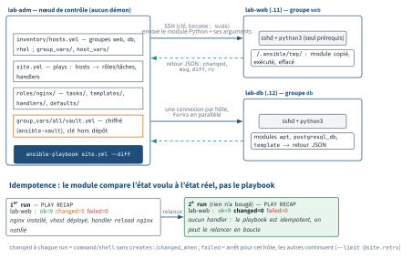

<!-- nav:début -->
[Accueil](../../README.md) › [Parcours](../../docs/parcours.md) › Partie IV — Socle DevOps › **Module 23**  
[← Module 22](../22-docker/README.md) · [Corrigé](corrige.md) · [Module 24 →](../24-iac-terraform/README.md)

<details><summary>Scripts du module (11)</summary>

Sur la VM indiquée en section « Mise en place », depuis `~/workbook/scripts/` (voir [chapitre 0](../../docs/00-mise-en-place.md)).

| Script | Rôle |
|---|---|
| [`setup_M23.sh`](../../scripts/setup/setup_M23.sh) | prépare le module |
| [`check_M23_01.sh`](../../scripts/check/check_M23_01.sh) | vérifie L23.1 |
| [`check_M23_02.sh`](../../scripts/check/check_M23_02.sh) | vérifie L23.2 |
| [`check_M23_03.sh`](../../scripts/check/check_M23_03.sh) | vérifie L23.3 |
| [`check_M23_04.sh`](../../scripts/check/check_M23_04.sh) | vérifie L23.4 |
| [`check_M23_05.sh`](../../scripts/check/check_M23_05.sh) | vérifie L23.5 |
| [`check_M23_06.sh`](../../scripts/check/check_M23_06.sh) | vérifie D23 |
| [`break_M23_01.sh`](../../scripts/break/break_M23_01.sh) | installe la panne BF23.1 |
| [`break_M23_02.sh`](../../scripts/break/break_M23_02.sh) | installe la panne BF23.2 |
| [`break_M23_03.sh`](../../scripts/break/break_M23_03.sh) | installe la panne BF23.3 |
| [`break_M23_04.sh`](../../scripts/break/break_M23_04.sh) | installe la panne BF23.4 |

</details>
<!-- nav:fin -->

# Module 23 — Ansible : automatiser le parc

## 23.0 Objectifs et compétences

> [!NOTE]
> **Objectifs**
>
> À la fin de ce module, je sais :
>
> * expliquer ce que veut dire *agentless*, *push par SSH*, *idempotent* et
>   *déclaratif*, et dire en une phrase quand je prends Ansible plutôt qu'un
>   script bash, et Terraform plutôt qu'Ansible ;
> * installer `ansible-core` avec `pipx` sur Ubuntu 24.04, écrire un
>   `ansible.cfg` de projet et justifier chacune de ses clés ;
> * décrire un parc dans un inventaire INI ou YAML avec groupes, `children`,
>   `group_vars`/`host_vars`, et le vérifier avec `ansible-inventory` ;
> * lancer des commandes ad hoc (`ping`, `command`, `shell`, `setup`) avec
>   `-b`, `--limit`, et lire une sortie `CHANGED`/`SUCCESS`/`FAILED`/
>   `UNREACHABLE` ;
> * écrire un playbook complet : `hosts`, `become`, `vars`, `tasks`,
>   `handlers`, `tags`, et le piloter avec `--check --diff`, `--limit`,
>   `--start-at-task`, `-v` ;
> * choisir le bon module (et son FQCN) pour chaque besoin, et reconnaître
>   les trois modules qui cassent l'idempotence si on ne les encadre pas
>   (`command`, `shell`, `lineinfile`) ;
> * écrire un template Jinja2 avec filtres, conditions, boucles, facts et
>   variables magiques (`hostvars`, `groups`, `inventory_hostname`) ;
> * contrôler le flux : `when`, `loop`, `register`, `until`, `block/rescue/
>   always`, `run_once`, `delegate_to`, `serial`, `max_fail_percentage` ;
> * structurer un rôle, citer l'ordre de précédence des variables, et gérer
>   les dépendances externes avec `requirements.yml` ;
> * protéger des secrets avec `ansible-vault` sans jamais les faire fuir dans
>   les journaux (`no_log`) ;
> * valider un dépôt d'infra avec `ansible-lint` et `yamllint`, et diagnostiquer
>   les six erreurs qui reviennent toujours : `UNREACHABLE`, `Missing sudo
>   password`, Python absent, handler muet, tâche non idempotente, vault
>   indéchiffrable.
>
> **Temps estimé** : 9 h
>
> **Prérequis** : module 07 (bash, `set -euo pipefail`, codes de sortie), module 14
> (SSH : clés, `known_hosts`, agent), module 10 (apt/dnf), module 08 (systemd).
> Le module 21 (Git) est un plus pour le défi.

---

## 23.1 Mise en place

Nœud de contrôle : **`lab-adm` (10.10.10.10)**, utilisateur `mathieu`.
Cibles : `lab-web` (10.10.10.11), `lab-db` (10.10.10.12), `lab-rhel`
(10.10.10.13), `lab-ops` (10.10.10.14). Ansible ne s'installe **que** sur
`lab-adm` : les cibles n'ont besoin que de `sshd` et de `python3`.

```bash
# depuis le shell Proxmox, avant de commencer
for id in 9001 9002 9003 9004 9005; do qm snapshot $id avant-lab23; done
```

Préparation du nœud de contrôle (installe `pipx`, `ansible-core`,
`ansible-lint`, `yamllint`, les collections du module, et crée `~/lab23/`) :

```bash
sudo bash ~/workbook/scripts/setup/setup_M23.sh
```

Ce que fait le script, pour que tu saches le refaire à la main :

```bash
sudo apt update && sudo apt install -y pipx sshpass
pipx ensurepath                      # ajoute ~/.local/bin au PATH
pipx install ansible-core
pipx install ansible-lint            # embarque son propre ansible-core
pipx install yamllint
exec bash                            # recharge le PATH
ansible --version
```

Il prépare aussi `~/.ssh/known_hosts` avec les clés des quatre cibles
(`ssh-keyscan`), pour ne **pas** avoir à désactiver `host_key_checking`.

> [!TIP]
> **Astuce**
>
> `pipx install ansible-core` fournit les binaires et les modules
> `ansible.builtin`. Tout le reste (`community.general`, `ansible.posix`,
> `community.postgresql`, `community.crypto`) vient de collections déclarées
> dans `~/lab23/collections/requirements.yml` et installées par
> `ansible-galaxy collection install -r collections/requirements.yml`.
> L'alternative `pipx install --include-deps ansible` embarque *toutes* les
> collections communautaires (plusieurs centaines de Mo) : pratique pour
> découvrir, à proscrire dans un dépôt d'infra où l'on veut des versions
> épinglées.

Vérifie que les cibles répondent avant de commencer les exercices :

```bash
cd ~/lab23
ansible all -m ansible.builtin.ping
```

Les quatre hôtes doivent répondre `SUCCESS` avec `"ping": "pong"`. Si
`lab-rhel` répond `UNREACHABLE`, vérifie que ta clé est bien déployée pour
`mathieu` sur Rocky (module 14) — et note que c'est le premier diagnostic du
module.

`sudo` sur les cibles demande un mot de passe pour `mathieu` : tant que le lab
L23.1 n'a pas créé le compte de service `ansible`, ajoute `-K`
(`--ask-become-pass`) à chaque commande qui utilise `become`.

> [!IMPORTANT]
> **Variante Rocky / RHEL**
>
> Rocky 9 minimal embarque `python3` (3.9) et `sudo`, mais pas toujours
> `python3-libselinux`, dont les modules `copy`/`template`/`file` ont besoin
> sur un système SELinux *enforcing*. Le message est explicite :
> `Aborting, target uses selinux but python bindings (libselinux-python) aren't
> installed!`. Correction : `sudo dnf install -y python3-libselinux`.

---

## 23.2 Rappel express

### Positionnement

| Outil | Modèle | On l'utilise pour |
|---|---|---|
| script bash | impératif, exécuté sur place | une machine, une action, jetable |
| **Ansible** | déclaratif, agentless, **push SSH** | configurer un parc existant |
| Terraform | déclaratif, état (`tfstate`), plan/apply | **créer** l'infra (VM, réseau, DNS) |

Ansible : pas d'agent, la machine de contrôle ouvre une session SSH, envoie un
petit programme Python (le *module*), l'exécute, lit un JSON de retour. Une
tâche est **idempotente** quand la relancer ne change rien
(`changed=0`) : c'est le module qui compare l'état voulu à l'état réel.
Bash décrit *comment*, Ansible décrit *quoi*. Bascule vers Ansible dès que
tu écris un `if [ -f ]` avant chaque action ou que le même script doit tourner
sur plus d'une machine. Bascule vers Terraform quand l'objet à gérer est une
ressource *créée* par une API (VM Proxmox, enregistrement DNS, bucket) dont il
faut suivre le cycle de vie, y compris la destruction.

<p align="center"></p>

*Figure — Ansible en mode push : lab-adm ouvre une session SSH par hôte, envoie le module Python, lit le JSON de retour ; un second run sans changement donne `changed=0` — c'est l'idempotence.*

### `ansible.cfg` de projet (le premier trouvé : `ANSIBLE_CONFIG`, `./ansible.cfg`, `~/.ansible.cfg`, `/etc/ansible/ansible.cfg`)

```ini
[defaults]
inventory          = inventory/hosts.yml
remote_user        = mathieu
private_key_file   = ~/.ssh/id_ed25519
interpreter_python = auto_silent   ; sinon [WARNING] à chaque hôte
forks              = 10            ; hôtes traités en parallèle (défaut 5)
roles_path         = roles
collections_path   = collections
callback_result_format = yaml      ; sorties lisibles au lieu du JSON
vault_password_file = .vault_pass
retry_files_enabled = False
# host_key_checking = False        # NON : préfère ssh-keyscan
[privilege_escalation]
become        = True
become_method = sudo
[ssh_connection]
pipelining = True    ; 1 connexion par tâche au lieu de 3, sudo sans requiretty
ssh_args   = -o ControlMaster=auto -o ControlPersist=60s
```

### Dans `ansible.cfg`, un commentaire en fin de ligne commence par `;` : un `#` n'est reconnu qu'en début de ligne, sinon il fait partie de la valeur. Inventaire

```ini
# INI : groupes, variables d'hôte, groupe de groupes
[web]
lab-web  ansible_host=10.10.10.11
lab-rhel ansible_host=10.10.10.13
[db]
lab-db   ansible_host=10.10.10.12
[rhel]
lab-rhel
[web:vars]
http_port=80
[parc:children]      # groupe de groupes : tout groupe cité doit exister
web
db
```

```yaml
# YAML : même chose, tout est sous all.children
all:
  children:
    web:
      hosts:
        lab-web: { ansible_host: 10.10.10.11 }
        lab-rhel: { ansible_host: 10.10.10.13 }
    db:
      hosts:
        lab-db: { ansible_host: 10.10.10.12 }
```

Variables : `inventory/group_vars/<groupe>.yml` (ou `<groupe>/*.yml`) et
`inventory/host_vars/<hôte>.yml`, chargés automatiquement à côté de
l'inventaire. `all` est un groupe comme un autre ; `ungrouped` reçoit les
hôtes sans groupe. Un hôte peut être dans plusieurs groupes.
`ansible-inventory --graph` (arbre), `--list` (JSON complet), `--host lab-db`
(variables résolues d'un hôte). Inventaire dynamique : un plugin
(`community.general.proxmox`, fichier `inventory/proxmox.yml` avec
`plugin: community.general.proxmox`, `url`, `user`, `token_id`,
`token_secret`) interroge l'API et fabrique les groupes à la volée.

### Ad hoc

```bash
ansible all -m ansible.builtin.ping
ansible web -m ansible.builtin.command -a 'uptime'          # pas de | > $
ansible web -m ansible.builtin.shell -a 'ss -tlnp | grep 443'
ansible db  -m ansible.builtin.setup -a 'filter=ansible_distribution*'
ansible all -b -K -m ansible.builtin.apt -a 'name=htop state=present'
ansible all --limit 'web:!lab-rhel' -m ansible.builtin.ping
```

Motifs : `web:db` (union), `web:&ubuntu` (intersection), `web:!lab-rhel`
(exclusion), `lab-*`, `~^lab-(web|db)$` (regex). `--limit` prend la même
syntaxe. Un `command` ne passe **pas** par un shell : pas de pipe, pas de
redirection, pas de variable d'environnement, pas de glob. Codes de retour
d'`ansible`/`ansible-playbook` : 0 ok, 2 une tâche a échoué, 4 un hôte est
injoignable, 1 erreur générale.

### Anatomie d'un playbook

```yaml
---
- name: Baseline web
  hosts: web
  become: true
  gather_facts: true            # facts → ansible_facts / ansible_*
  vars:
    http_port: 80
  vars_files:
    - vars/web.yml
  tasks:
    - name: Installer nginx
      ansible.builtin.package:
        name: nginx
        state: present
      tags: [paquets]

    - name: Déployer le vhost
      ansible.builtin.template:
        src: vhost.conf.j2
        dest: /etc/nginx/sites-available/vitrine.conf
        mode: "0644"
        # validate: exige %s (fichier temporaire) ; inutilisable sur un
        # vhost seul, voir L23.2
      notify: Reload nginx

  handlers:
    - name: Reload nginx
      ansible.builtin.service:
        name: nginx
        state: reloaded
```

Un *handler* ne tourne qu'**une fois**, **à la fin du play**, et seulement si
au moins une tâche `changed` l'a notifié par son **nom exact** (casse
comprise) ou par `listen`. Il ne tourne **pas** pour un hôte dont une tâche a
échoué (sauf `force_handlers = True` ou `--force-handlers`). Pour le forcer
au milieu : `- ansible.builtin.meta: flush_handlers`.

```bash
ansible-playbook site.yml --check --diff       # simulation + diff des fichiers
ansible-playbook site.yml --limit lab-web -t paquets --skip-tags tls
ansible-playbook site.yml --list-tasks --list-hosts --list-tags
ansible-playbook site.yml --start-at-task 'Déployer le vhost' --step
ansible-playbook site.yml -v   # -vv : paramètres, -vvv : SSH, -vvvv : tout
ansible-playbook site.yml -e app_version=2.1.0 -e @vars/prod.yml
```

`--check` n'exécute pas `command`/`shell` (sauf `check_mode: false`) et
une tâche qui `register` une sortie qu'une autre utilise peut alors échouer :
c'est normal, pas un bug.

### Modules essentiels et FQCN

| Besoin | Module (FQCN) | Piège |
|---|---|---|
| paquet | `ansible.builtin.apt` / `dnf` / `package` | `apt: update_cache` + `cache_valid_time: 3600` sinon `changed` à chaque fois |
| service | `ansible.builtin.systemd_service` (`service`) | `state: restarted` dans une tâche = jamais idempotent → handler |
| compte | `ansible.builtin.user` / `group` | `password` attend un **hash** (`password_hash('sha512')`) |
| clé SSH | `ansible.posix.authorized_key` | `exclusive: true` efface les autres clés |
| fichier | `copy`, `template`, `file` | `template` gère tout un fichier ; `lineinfile` une ligne, `blockinfile` un bloc balisé |
| téléchargement | `get_url` (`checksum: sha256:URL`) | sans `dest` fixe ni `checksum`, re-télécharge |
| archive | `unarchive` (`remote_src`, `creates`) | sans `creates`, re-extrait |
| dépôt | `git` (`version`, `force`) | `force: true` écrase les modifs locales |
| commande | `command` / `shell` | `creates`/`removes`, `changed_when`, `failed_when` **obligatoires** |
| état | `stat` → `.stat.exists`, `debug`, `assert` | `assert` échoue le play, `debug` non |
| attente / test | `wait_for` (port, fichier), `uri` (`status_code`) | `uri` : `validate_certs: false` en lab TLS auto-signé |
| planification | `cron` (`name` = clé d'idempotence) | changer `name` crée une 2e entrée |
| montage | `ansible.posix.mount` (`state: mounted`) | `present` écrit fstab sans monter |
| pare-feu | `community.general.ufw`, `ansible.posix.firewalld` | `firewalld` : `permanent` + `immediate` |
| base | `community.postgresql.postgresql_*` | `become_user: postgres` + `acl` installé sur la cible |

`lineinfile` sans `regexp` ajoute une ligne à chaque exécution si `line`
change ; avec `regexp` il ne touche que la **dernière** occurrence. Un fichier
géré par plusieurs `lineinfile` finit toujours divergent : dès deux lignes,
`template` avec l'en-tête `# Managed by Ansible` gagne.

### Jinja2, facts, variables magiques

```yaml
"{{ http_port | default(80) }}"           # défaut si non défini
"{{ ntp_servers | join(' ') }}"           # liste → chaîne
"{{ path | regex_replace('^/srv/', '') }}"
"{{ users | dict2items | selectattr('value.admin') | map(attribute='key') }}"
"{{ groups['web'] | map('extract', hostvars, 'ansible_host') | list }}"
"{{ ansible_facts['distribution'] }}"     # Ubuntu / Rocky
"{{ ansible_facts['os_family'] }}"        # Debian / RedHat
"{{ inventory_hostname }}"                # nom dans l'inventaire
"{{ hostvars['lab-db']['ansible_host'] }}"
"{{ ansible_play_hosts }}" "{{ ansible_play_batch }}"  # hôtes du play / du lot
```

Template : `...`,
``, `{{ var | to_nice_yaml }}`,
`{{ var | to_json }}`, `{{ lookup('file', 'x') }}`, `{{ item.key }}`.
Un `{{ }}` en début de valeur YAML **doit** être entre guillemets.
Facts : `ansible_facts['default_ipv4']['address']`, `['memtotal_mb']`,
`['processor_vcpus']`, `['pkg_mgr']`, `['service_mgr']`.

### Contrôle de flux

```yaml
when: ansible_facts['os_family'] == 'Debian' and x is defined   # sans {{ }}
loop: "{{ users }}"      # loop_control: { label: "{{ item.name }}" }
register: r              # r.rc r.stdout r.stdout_lines r.changed r.failed
until: r.status == 200   # avec retries: 10 / delay: 3
block: / rescue: / always:          # try / except / finally
ignore_errors: true      # marque « ignored », continue
run_once: true           # une seule fois, résultat partagé
delegate_to: localhost   # exécute ailleurs, facts de l'hôte courant
serial: 1 (ou "25%" ou [1, 5, "100%"])  # rolling
max_fail_percentage: 0   # arrête le play au premier échec du lot
any_errors_fatal: true
```

### Rôles, précédence, collections

```text
roles/nginx/{defaults,vars,tasks,handlers,templates,files,meta}/main.yml
                                                    meta/argument_specs.yml
```

Précédence (croissante) : `defaults/main.yml` < `group_vars/all` <
`group_vars/*` < `host_vars` < `vars:` du play < `vars_files` < `vars/main.yml`
du rôle < variables de tâche < `set_fact`/`register` \< `-e` (extra vars,
**toujours gagnant**). `ansible-galaxy role init roles/nginx` crée le
squelette ; `ansible-galaxy collection install -r requirements.yml` installe
les collections déclarées (`name`, `version`).

### Vault

```bash
ansible-vault create group_vars/all/vault.yml    # éditeur, puis chiffré
ansible-vault edit|view|encrypt|decrypt|rekey fichier
ansible-vault encrypt_string --name vault_pg_pass 'S3cret'   # inline
```

Convention : `vault_*` dans le fichier chiffré, `pg_pass: "{{ vault_pg_pass }}"`
dans le fichier clair (on grep les noms sans déchiffrer). `no_log: true` sur
toute tâche qui manipule un secret, sinon `-v` l'affiche. Fichier de mot de
passe : `vault_password_file` (mode 0600, jamais commité).

### Qualité et diagnostic

`yamllint .` (syntaxe, indentation, `---`, `truthy`), `ansible-lint` (FQCN,
noms de tâches, `mode` explicite, `command` sans `changed_when`),
`ansible-playbook --syntax-check`, `--check --diff` avant tout `apply`.
Molecule (`molecule init scenario`, `molecule test`) rejoue un rôle dans un
conteneur : `create → converge → idempotence → verify → destroy`.

| Message | Cause | Vérifier |
|---|---|---|
| `UNREACHABLE! ... Failed to connect to the host via ssh` | SSH refusé, clé, `known_hosts`, port | `ssh -v mathieu@ip`, `-vvv` |
| `Missing sudo password` | `become` sans `NOPASSWD` ni `-K` | `sudo -n true` sur la cible |
| `/bin/sh: 1: /usr/bin/python3: not found` | Python absent | `raw: apt install -y python3` |
| `Decryption failed (no vault secrets were found that could decrypt)` | mauvais mot de passe vault | `ansible-vault view` |
| `Attempting to decrypt but no vault secrets found` | aucun mot de passe fourni | `vault_password_file`, `--ask-vault-pass` |
| `Could not match supplied host pattern` | groupe absent / inventaire non parsé | `ansible-inventory --graph` |
| `The task includes an option with` |  |  |
| `an undefined variable` | variable non définie `-` | `-e`, `default()`, `ansible-inventory -host` |

---

## 23.3 Quiz — QCM

<a id="q23-1"></a>**[Q23.1](corrige.md#q23-1)** — Une tâche `ansible.builtin.shell: systemctl restart nginx` est
relancée trois fois de suite sur un hôte sain. Que rapporte Ansible ?

a) `ok` aux trois exécutions, le service tourne déjà
b) `changed` aux trois exécutions
c) `changed` la première fois, `ok` ensuite
d) `failed` : `shell` ne peut pas piloter systemd

<a id="q23-2"></a>**[Q23.2](corrige.md#q23-2)** — `ansible db -m ansible.builtin.command -a 'ls /var/lib/postgresql/*/main | wc -l'`
répond :

```text
lab-db | FAILED | rc=2 >>
ls: cannot access '/var/lib/postgresql/*/main': No such file or directory
ls: cannot access '|': No such file or directory
...
```

Pourquoi ?

a) `mathieu` n'a pas le droit de lire `/var/lib/postgresql`
b) `command` n'invoque pas de shell : ni glob, ni pipe ; il faut `shell`
c) il manque `-b`
d) `wc` n'est pas installé sur `lab-db`

<a id="q23-3"></a>**[Q23.3](corrige.md#q23-3)** — Ton `ansible.cfg` contient `become = True` dans
`[privilege_escalation]`. `ansible all -m ansible.builtin.ping` renvoie pour
les quatre hôtes `FAILED! => {"msg": "Missing sudo password"}`. **Deux
réponses correctes.**

a) ajouter `-K` à la commande
b) déployer `mathieu ALL=(ALL) NOPASSWD: ALL` dans `/etc/sudoers.d/` sur les
   cibles
c) passer `remote_user = root`
d) mettre `host_key_checking = False`

<a id="q23-4"></a>**[Q23.4](corrige.md#q23-4)** — Sur `lab-rhel`, la sortie contient
`"module_stderr": "/bin/sh: /usr/bin/python3: No such file or directory"` et
`"rc": 127`. Quelle tâche peut **encore** s'exécuter sur cet hôte pour réparer ?

a) `ansible.builtin.dnf: name=python3`
b) `ansible.builtin.raw: dnf install -y python3` avec `gather_facts: false`
c) `ansible.builtin.package: name=python3`
d) aucune, il faut passer par la console

<a id="q23-5"></a>**[Q23.5](corrige.md#q23-5)** — Un playbook contient :

```yaml
  tasks:
    - name: Vhost
      ansible.builtin.template:
        src: vhost.conf.j2
        dest: /etc/nginx/sites-enabled/vitrine.conf
      notify: reload nginx
  handlers:
    - name: Reload nginx
      ansible.builtin.service:
        name: nginx
        state: reloaded
```

Le template change (`changed=1`) mais nginx n'est jamais rechargé. Pourquoi ?

a) `service` ne connaît pas `reloaded`, il faut `systemd_service`
b) le nom du handler est comparé en respectant la casse : `reload` ≠ `Reload`
c) `notify` n'accepte qu'une liste
d) le handler doit être déclaré avant les tâches

<a id="q23-6"></a>**[Q23.6](corrige.md#q23-6)** — `ansible-inventory --graph` affiche :

```text
@all:
  |--@ungrouped:
  |  |--lab-db
  |--@web:
  |  |--lab-rhel
  |  |--lab-web
```

et `inventory/group_vars/db.yml` définit `pg_version: 16`. Que vaut
`pg_version` sur `lab-db` ?

a) 16
b) la variable est indéfinie : `lab-db` n'est dans aucun groupe `db`
c) 16, `group_vars` s'applique par nom d'hôte
d) une erreur de parsing de l'inventaire

<a id="q23-7"></a>**[Q23.7](corrige.md#q23-7)** — Quel est l'ordre de précédence **croissant** correct ?

a) `-e` < `host_vars` < `group_vars` < `defaults/main.yml`
b) `defaults/main.yml` < `group_vars` < `host_vars` < `vars:` du play < `-e`
c) `group_vars` < `defaults/main.yml` < `-e` < `host_vars`
d) `host_vars` < `group_vars` < `vars/main.yml` du rôle < `-e`

<a id="q23-8"></a>**[Q23.8](corrige.md#q23-8)** — Un play `hosts: web` avec `serial: 1` et `max_fail_percentage: 0`
déploie sur `lab-web` puis `lab-rhel`. La vérification de santé échoue sur
`lab-web`. Que se passe-t-il ?

a) Ansible continue sur `lab-rhel`, puis affiche `failed=1` dans le recap
b) Ansible arrête le play : `lab-rhel` n'est jamais touché
c) Ansible relance `lab-web` jusqu'à `retries`
d) Ansible annule les changements sur `lab-web`

<a id="q23-9"></a>**[Q23.9](corrige.md#q23-9)** — Tu veux qu'un rapport listant les noyaux de tous les hôtes soit
écrit **une seule fois** sur le nœud de contrôle. **Deux réponses correctes.**

a) `delegate_to: localhost` + `run_once: true`
b) `local_action` seule
c) `ansible.builtin.copy` avec `when: inventory_hostname == ansible_play_hosts[0]` +
   `delegate_to: localhost`
d) `connection: local` sur chaque hôte

<a id="q23-10"></a>**[Q23.10](corrige.md#q23-10)** — Quelle expression Jinja2 produit la liste des adresses IP des
hôtes du groupe `web` ?

a) `{{ groups['web'] | map(attribute='ansible_host') | list }}`
b) `{{ groups['web'] | map('extract', hostvars, 'ansible_host') | list }}`
c) `{{ hostvars['web']['ansible_host'] }}`
d) `{{ web | map('ansible_host') }}`

<a id="q23-11"></a>**[Q23.11](corrige.md#q23-11)** — `ansible-playbook site.yml --check --diff` s'arrête sur :

```text
fatal: [lab-web]: FAILED! => {"msg": "The task includes an option with an
undefined variable. The error was: list object has no element 0"}
```

sur une tâche qui utilise `r.stdout_lines[0]` après `register: r` d'un `command`.
Cause la plus probable ?

a) le `command` a échoué
b) en `--check`, `command` n'est pas exécuté : `r` est un résultat *skipped* dont `stdout` est vide et `stdout_lines` une liste vide
c) `register` ne fonctionne pas avec `command`
d) il faut `r.stdout`

<a id="q23-12"></a>**[Q23.12](corrige.md#q23-12)** — Quelle tâche est idempotente **et** signale correctement les
changements ?

a) `ansible.builtin.shell: useradd deploy || true`
b) `ansible.builtin.command: useradd deploy` avec `ignore_errors: true`
c) `ansible.builtin.command: useradd deploy` avec `creates: /home/deploy`
d) `ansible.builtin.shell: id deploy || useradd deploy` avec
   `changed_when: false`

<a id="q23-13"></a>**[Q23.13](corrige.md#q23-13)** — `ansible-vault view group_vars/all/vault.yml` répond
`ERROR! Decryption failed (no vault secrets were found that could decrypt)`.
Que sais-tu avec certitude ?

a) le fichier n'est pas chiffré
b) un mot de passe a été fourni, mais aucun ne déchiffre ce fichier
c) aucun mot de passe n'a été fourni
d) le fichier est corrompu

<a id="q23-14"></a>**[Q23.14](corrige.md#q23-14)** — Une tâche `ansible.builtin.get_url` télécharge
`node_exporter-1.9.1.linux-amd64.tar.gz` vers `/tmp/ne.tar.gz` avec
`force: true` (« pour être sûr d'avoir la dernière version »). Elle retélécharge l'archive à chaque exécution. Quelle correction évite ce téléchargement inutile ? **Deux réponses correctes.**

a) remplacer `force: true` par `checksum: "sha256:<empreinte>"` : le fichier présent est comparé
   avant tout téléchargement
b) retirer `force: true` et garder un `dest` stable : un fichier existant
   n'est pas retéléchargé
c) ajouter `changed_when: false`
d) remplacer par `ansible.builtin.shell: wget ...`

<a id="q23-15"></a>**[Q23.15](corrige.md#q23-15)** — Dans un rôle, `defaults/main.yml` contient `nginx_port: 80` et
`vars/main.yml` contient `nginx_port: 8080`. Le playbook passe
`-e nginx_port=443`. Le template reçoit :

a) 80
b) 8080
c) 443
d) une erreur de variable dupliquée

<a id="q23-16"></a>**[Q23.16](corrige.md#q23-16)** — `ansible-playbook site.yml` affiche pour `lab-rhel` :

```text
[WARNING]: Platform linux on host lab-rhel is using the discovered Python
interpreter at /usr/bin/python3.9, but future installation of another
Python interpreter could change the meaning of that path.
```

Comment faire disparaître proprement cet avertissement ?

a) `interpreter_python = auto_silent` dans `ansible.cfg`, ou
   `ansible_python_interpreter` dans l'inventaire
b) installer Python 3.12 sur Rocky
c) `gather_facts: false`
d) `-vvv` pour voir la vraie erreur

<a id="q23-17"></a>**[Q23.17](corrige.md#q23-17)** — Quelle affirmation sur `--check` est **fausse** ?

a) `template` et `copy` rapportent `changed` et montrent le diff avec `--diff`
b) `command`/`shell` sont sautés sauf `check_mode: false`
c) les handlers notifiés sont exécutés pour de vrai
d) `apt` interroge le cache sans installer

<a id="q23-18"></a>**[Q23.18](corrige.md#q23-18)** — Un play sur `web` contient une tâche avec
`loop: "{{ groups['db'] }}"` et `delegate_to: "{{ item }}"`. Sur quels
hôtes cette tâche s'exécute-t-elle, et avec quels facts ?

a) sur `lab-db`, avec les facts de `lab-db`
b) sur `lab-db` (une fois par hôte du groupe `web`), avec les facts et
   variables de l'hôte `web` courant, sauf les variables de connexion
c) sur `lab-web` et `lab-rhel`, avec les facts de `lab-db`
d) erreur : `delegate_to` n'accepte pas de variable

---

## 23.4 Quiz — questions ouvertes

<a id="qo23-1"></a>**[QO23.1](corrige.md#qo23-1)** — Explique mécaniquement ce qui se passe entre
`ansible-playbook` et un hôte pour **une** tâche `apt` : connexion, transfert,
exécution, retour. Où intervient `pipelining`, et pourquoi réduit-il de trois à
un le nombre de connexions ? Que change `become` dans ce cheminement ?

<a id="qo23-2"></a>**[QO23.2](corrige.md#qo23-2)** — *On te demande en entretien* : « Un collègue soutient qu'un
script bash avec `set -e` et des `if [ -f ]` est aussi idempotent qu'un
playbook, et plus simple. Réponds-lui. » Donne une définition opérationnelle
de l'idempotence, deux cas où bash l'obtient difficilement, et un cas où le
bash reste le bon choix.

<a id="qo23-3"></a>**[QO23.3](corrige.md#qo23-3)** — Compare `lineinfile`, `blockinfile` et `template` pour gérer
`/etc/ssh/sshd_config.d/50-baseline.conf`. Explique pourquoi une
configuration gérée par plusieurs `lineinfile` finit divergente, et ce que
`validate:` apporte à `template`.

<a id="qo23-4"></a>**[QO23.4](corrige.md#qo23-4)** — Décris précisément le cycle de vie d'un *handler* : quand il est
notifié, quand il s'exécute, combien de fois, ce qui l'empêche de tourner, et
les deux moyens de forcer son exécution. Donne un cas de production où
`flush_handlers` est indispensable.

<a id="qo23-5"></a>**[QO23.5](corrige.md#qo23-5)** — *On te demande en entretien* : « Tu dois mettre à jour 40
frontaux derrière un répartiteur sans interruption de service. Décris le
playbook. » Cite les mots-clés (`serial`, `max_fail_percentage`,
`pre_tasks`/`post_tasks`, `delegate_to`, `uri`/`until`,
`flush_handlers`) et explique le rôle de chacun dans le scénario.

<a id="qo23-6"></a>**[QO23.6](corrige.md#qo23-6)** — Explique la précédence des variables Ansible en te limitant aux
sept niveaux que tu rencontres réellement (défauts de rôle, `group_vars/all`,
`group_vars/<g>`, `host_vars`, `vars:` du play, `vars/main.yml` du rôle,
extra vars). Pourquoi un rôle bien conçu ne met-il **rien** d'ajustable dans
`vars/main.yml` ?

<a id="qo23-7"></a>**[QO23.7](corrige.md#qo23-7)** — Un playbook qui fonctionnait hier répond ce matin
`UNREACHABLE` sur `lab-rhel` uniquement. Décris ta démarche de diagnostic
dans l'ordre (commandes, verbosité, ce que tu cherches), et liste les cinq
causes les plus fréquentes avec leur signature dans la sortie `-vvv`.

<a id="qo23-8"></a>**[QO23.8](corrige.md#qo23-8)** — Décris l'organisation d'un dépôt d'infra Ansible propre : arbre
des répertoires, ce qui est chiffré, ce qui est ignoré par Git, ce qui tourne
en CI avant la fusion. Où ranges-tu le mot de passe du vault, et comment le
runner CI l'obtient-il sans qu'il apparaisse dans un journal ?

<a id="qo23-9"></a>**[QO23.9](corrige.md#qo23-9)** — Terraform et Ansible sont souvent présentés comme concurrents.
Explique ce que chacun modélise (ressource vs état d'une machine), ce qu'est
l'état Terraform et pourquoi Ansible n'en a pas, et comment les deux
s'enchaînent pour créer puis configurer une VM Proxmox.

---

## 23.5 Exercices guidés ★

Travaille dans `~/lab23` (le `ansible.cfg` du projet n'est lu que depuis ce
répertoire). Chaque playbook doit passer `yamllint` et `ansible-lint` sans
erreur, et chaque tâche doit avoir un `name` et un FQCN : c'est la règle du
module. Range tes playbooks dans `~/lab23/playbooks/`.

<a id="e23-1"></a>**[E23.1](corrige.md#e23-1)** — Affiche l'arbre de l'inventaire fourni, puis les variables
résolues de `lab-db` au format JSON. Identifie dans cette sortie une variable
qui vient de `group_vars/all/vars.yml`, une de `group_vars/ubuntu.yml` et une
définie directement dans `hosts.yml`.

<a id="e23-2"></a>**[E23.2](corrige.md#e23-2)** — Récupère l'uptime des quatre hôtes en une commande ad hoc, puis
le nombre de fichiers `*.conf` dans `/etc`. La première doit fonctionner avec
`command`, la seconde ne le peut pas : montre l'erreur, explique-la, et
donne la forme qui marche.

<a id="e23-3"></a>**[E23.3](corrige.md#e23-3)** — Sans écrire de playbook, affiche pour chaque hôte uniquement sa
distribution, sa version et sa famille d'OS. Puis, en une commande, le nombre
de vCPU et la RAM totale.

<a id="e23-4"></a>**[E23.4](corrige.md#e23-4)** — Toujours en ad hoc, déploie `/etc/motd` avec le contenu
`Parc géré par Ansible - ne pas modifier à la main` sur les quatre hôtes.
D'abord en simulation avec diff, puis pour de vrai, puis une troisième fois :
observe la couleur et le mot-clé de chaque exécution.

<a id="e23-5"></a>**[E23.5](corrige.md#e23-5)** — Écris `playbooks/paquets.yml` qui installe `htop`, `vim`, `curl`
et `tree` sur les quatre hôtes, Ubuntu et Rocky compris, **avec un seul
play et une seule tâche d'installation**. La seconde exécution doit afficher
`changed=0` partout, et `--check` ne doit pas déclencher de mise à jour du
cache apt à chaque fois (regarde `cache_valid_time`).

<a id="e23-6"></a>**[E23.6](corrige.md#e23-6)** — Définis `ntp_servers` (liste) dans `group_vars/all/vars.yml` avec les
serveurs `0.ubuntu.pool.ntp.org` et `1.ubuntu.pool.ntp.org`, redéfinis-la pour
le groupe `rhel` avec les pools Rocky, et pour `lab-db` uniquement avec
`10.10.10.1`. Prouve avec `ansible-inventory --host` puis avec un playbook
`debug` que chaque hôte reçoit la bonne valeur, et surcharge tout avec `-e`.

<a id="e23-7"></a>**[E23.7](corrige.md#e23-7)** — Écris `playbooks/templates/hosts.j2` et `playbooks/hosts.yml` qui génèrent
`/etc/hosts` complet sur chaque hôte : en-tête `# Managed by Ansible`,
loopback, puis une ligne `<ip> <nom>.lab.local <nom>` par hôte de
l'inventaire, quel que soit le nombre d'hôtes, en lisant `hostvars`. Le
fichier doit être identique sur les quatre machines et la tâche `ok` à la
seconde exécution.

<a id="e23-8"></a>**[E23.8](corrige.md#e23-8)** — Écris un playbook qui exécute `sha256sum /etc/hosts` sur chaque
hôte, enregistre le résultat, et affiche seulement l'empreinte (pas tout le
dictionnaire). La tâche ne doit **jamais** rapporter `changed`, et doit
rapporter `failed` si l'empreinte ne commence pas par un chiffre hexadécimal
(utilise `failed_when` avec un test regex).

<a id="e23-9"></a>**[E23.9](corrige.md#e23-9)** — Ajoute un paramètre noyau `vm.swappiness = 10` sur les hôtes
Ubuntu de deux façons : d'abord avec `blockinfile` dans
`/etc/sysctl.d/90-lab.conf` (bloc balisé), puis en remplaçant par le module
`ansible.posix.sysctl` avec `sysctl_file` et `reload: true`. Compare le
résultat de `sysctl vm.swappiness` et explique laquelle des deux méthodes
sait aussi *appliquer* le réglage.

<a id="e23-10"></a>**[E23.10](corrige.md#e23-10)** — Écris un playbook qui tente d'installer le paquet inexistant
`nginx-ultra` dans un `block`, capture l'échec dans `rescue` en affichant
`ansible_failed_result.msg`, et écrit dans `always` la ligne
`<hôte> ; <date ISO> ; <ok|echec>` dans `~/lab23/rapports/paquets.log` sur
le nœud de contrôle. Le play doit se terminer avec `failed=0`.

<a id="e23-11"></a>**[E23.11](corrige.md#e23-11)** — Écris un playbook qui, sur `lab-web`, s'assure que le port 22
répond (`wait_for`), puis interroge `http://10.10.10.11/` avec `uri` en
tolérant l'absence de service : 10 tentatives espacées de 3 secondes, puis
un `debug` qui affiche `web indisponible` ou le code HTTP. Le play ne doit
pas échouer si nginx n'est pas installé.

<a id="e23-12"></a>**[E23.12](corrige.md#e23-12)** — Produis, en une seule tâche déléguée au nœud de contrôle et
exécutée une seule fois, le fichier `~/lab23/rapports/noyaux.txt` contenant
une ligne `<hôte> <version de noyau> <distribution>` pour **tous** les hôtes
du play, à partir des facts déjà collectés.

<a id="e23-13"></a>**[E23.13](corrige.md#e23-13)** — Chiffre la valeur `Sup3r-Secret` sous le nom `vault_api_token`
avec `encrypt_string`, colle le résultat dans `group_vars/all/vars.yml`, et
affiche-la en clair avec un playbook `debug`. Relance en `-v` : la valeur
apparaît-elle ailleurs que dans le message ? Ajoute ce qu'il faut pour qu'un
`-vvv` ne la montre plus, puis vérifie avec `ansible-vault view` que le
fichier `group_vars/all/vault.yml` fourni par le setup se déchiffre.

<a id="e23-14"></a>**[E23.14](corrige.md#e23-14)** — Sur `playbooks/paquets.yml` étendu d'une tâche `debug` taguée
`info` : liste les tâches, liste les tags, exécute uniquement le tag `info`,
tout sauf `info`, uniquement sur `lab-rhel`, et enfin en démarrant à la tâche
`debug`. Note pour chaque cas le nombre de tâches réellement exécutées.

<a id="e23-15"></a>**[E23.15](corrige.md#e23-15)** — Génère le squelette d'un rôle `motd` avec `ansible-galaxy`,
supprime les répertoires inutiles, et fais-lui déployer le `/etc/motd` de
E23.4 avec un texte paramétrable dans `defaults/main.yml`. Ajoute
`community.general` à `collections/requirements.yml` avec une contrainte de
version, installe, puis liste les collections présentes avec leur version.

<a id="e23-16"></a>**[E23.16](corrige.md#e23-16)** — À partir de cette variable dans `group_vars/all/vars.yml` :

```yaml
comptes:
  alice: { uid: 2001, admin: true,  shell: /bin/bash }
  bob:   { uid: 2002, admin: false, shell: /bin/bash }
  carol: { uid: 2003, admin: true,  shell: /usr/sbin/nologin }
```

écris un playbook `debug` qui affiche : la liste des noms des admins
(`selectattr`, `map`), la chaîne `alice,carol` (`join`), la variable entière
en YAML indenté (`to_nice_yaml`), et le uid de `bob` obtenu sans boucle.
Aucune tâche ne doit boucler.

---

## 23.6 Labs ★★

### <a id="l23-1"></a>**[L23.1](corrige.md#l23-1)** — Baseline commune du parc

> **Contexte**
>
> Quatre VM ont été installées à la main par trois personnes différentes. Les
> fuseaux horaires ne concordent pas, `sshd` accepte encore les mots de passe
> sur deux d'entre elles, aucune n'a de pare-feu, et Prometheus (module 26) ne
> voit rien. Ticket : « Appliquer la baseline du service à toutes les machines,
> et garantir qu'une machine réinstallée la reçoit en une commande. »

Écris `~/lab23/playbooks/baseline.yml` (un ou plusieurs plays, à toi de
découper), applicable à `all`, Ubuntu **et** Rocky.

1. **Compte de service** : utilisateur `ansible` (uid 900, shell bash, groupe
   `sudo` ou `wheel` selon l'OS), clé publique `~/.ssh/id_ed25519.pub` de
   `mathieu` sur `lab-adm` déployée avec `ansible.posix.authorized_key`,
   et `/etc/sudoers.d/ansible` contenant `ansible ALL=(ALL) NOPASSWD: ALL`,
   validé par `visudo -cf %s`. Première exécution avec `-K` ; ensuite,
   bascule `remote_user = ansible` dans `ansible.cfg` et plus jamais de `-K`.
2. **Paquets** : `htop vim curl tree acl chrony`, plus `unattended-upgrades`
   sur Ubuntu et `dnf-automatic` sur Rocky, plus `python3-libselinux` sur
   Rocky. Une seule tâche `package` pour le tronc commun.
3. **Fuseau et heure** : `Europe/Paris` (module `community.general.timezone`),
   `chrony` actif et activé au démarrage — attention, l'unité s'appelle
   `chrony.service` sur Ubuntu et `chronyd.service` sur Rocky.
4. **Mises à jour automatiques** : sur Ubuntu,
   `/etc/apt/apt.conf.d/20auto-upgrades` avec `Update-Package-Lists "1"` et
   `Unattended-Upgrade "1"` ; sur Rocky, `apply_updates = yes` dans
   `/etc/dnf/automatic.conf` et `dnf-automatic.timer` actif.
5. **sshd durci** : template `/etc/ssh/sshd_config.d/50-baseline.conf` avec
   `PasswordAuthentication no`, `PermitRootLogin no`, `KbdInteractiveAuthentication no`,
   `MaxAuthTries 3`, `X11Forwarding no`, `AllowGroups sudo wheel`, validé par
   `sshd -t -f %s`, et un handler qui redémarre `ssh.service` (Ubuntu) ou
   `sshd.service` (Rocky) — une seule variable `ssh_service_name` par groupe.
6. **Pare-feu** : Ubuntu → `ufw` activé, politique entrante `deny`, `22/tcp`
   autorisé, `9100/tcp` autorisé **uniquement depuis 10.10.10.14** ; Rocky →
   `firewalld` actif, service `ssh`, port `9100/tcp` via une *rich rule*
   limitée à `10.10.10.14`. Ouvre SSH **avant** d'activer le pare-feu.
7. **node_exporter** 1.9.1 : utilisateur système `node_exporter` sans
   shell, téléchargement de l'archive GitHub avec vérification `sha256`
   (`checksum: sha256:<url de sha256sums.txt>`), extraction dans `/opt`,
   copie du binaire vers `/usr/local/bin/node_exporter` (pas de lien : sous
   SELinux le contexte du binaire compte), unité systemd générée par template,
   service actif et activé. Rien ne doit être retéléchargé ni réextrait à
   la seconde exécution.
8. La seconde exécution complète affiche `changed=0` sur les quatre hôtes,
   `--check --diff` ne montre aucun diff, et `ansible-lint` est muet.

> [!CAUTION]
> **Attention**
>
> Le durcissement de `sshd` et le pare-feu peuvent te couper l'accès si tu te
> trompes. Garde une console Proxmox ouverte, et fais tourner l'étape 5 puis
> l'étape 6 avec `--limit lab-ops` avant `all`. `sshd -t -f %s` dans
> `validate:` refuse un fichier syntaxiquement faux, pas un fichier qui
> t'enferme dehors.

> [!TIP]
> **Critère de succès**
>
> Critère de succès : `ansible all -m ansible.builtin.ping` fonctionne avec
> `remote_user = ansible` sans `-K` ; `sudo sshd -T | grep -i passwordauth`
> répond `no` sur les quatre hôtes ; `curl -s localhost:9100/metrics | head -1`
> répond sur chaque hôte ; la seconde exécution est `changed=0`.
>
> ```bash
> bash check_M23_01.sh
> ```

---

### <a id="l23-2"></a>**[L23.2](corrige.md#l23-2)** — Frontal nginx : vhost templaté et TLS

> **Contexte**
>
> L'application « vitrine » doit être servie en HTTPS par `lab-web` et par
> `lab-rhel` (l'équipe veut prouver que la conf est portable). Pas de CA
> interne pour l'instant : certificat auto-signé généré **sur la cible**,
> jamais copié depuis le poste d'admin. Le vhost doit être régénéré à partir de
> variables, pas recopié à la main entre les deux distributions.

Écris `~/lab23/playbooks/nginx.yml` pour le groupe `web`.

1. Variables dans `group_vars/web.yml` : `vitrine_server_name`
   (`vitrine.lab.local`), `vitrine_root` (`/srv/vitrine`),
   `vitrine_tls_dir` (`/etc/nginx/tls`), `vitrine_version` (`1.0.0`).
   Dans `group_vars/ubuntu.yml` et `group_vars/rhel.yml`, la variable
   `nginx_vhost_dir` (`/etc/nginx/sites-enabled` vs `/etc/nginx/conf.d`)
   et `nginx_user` (`www-data` vs `nginx`).
2. Installation de nginx et de `python3-cryptography` (nécessaire à
   `community.crypto` sur la cible). Sur Ubuntu, supprime le lien
   `sites-enabled/default`.
3. Clé privée (`community.crypto.openssl_privatekey`, 0600, propriétaire
   root), CSR avec `common_name` et `subject_alt_name` DNS + IP de l'hôte
   (`ansible_host`), certificat auto-signé
   (`community.crypto.x509_certificate`, `provider: selfsigned`). Aucun des
   trois ne doit être régénéré à la seconde exécution.
4. Template `playbooks/templates/vitrine.conf.j2` : redirection 80 → 443, vhost 443
   avec `ssl_certificate`, `ssl_certificate_key`, `root`, `server_name`,
   en-tête `add_header X-Vitrine-Version "{{ vitrine_version }}"`, et un
   `access_log` propre au vhost. Déployé dans `{{ nginx_vhost_dir }}`, validé
   par `nginx -t -c %s` **ou** par une tâche `command: nginx -t` avec
   `changed_when: false` — explique dans un commentaire pourquoi
   `validate:` sur un fichier de vhost seul ne fonctionne pas.
5. `index.html` généré par template dans `vitrine_root`, propriétaire
   `nginx_user`, contenant `vitrine {{ vitrine_version }} sur {{ inventory_hostname }}`.
6. Handler `Reload nginx` (reload, pas restart). Service actif et activé.
   Pare-feu : `80/tcp` et `443/tcp` ouverts (ufw ou firewalld selon l'OS).
7. Dernière tâche : `uri` vers `https://{{ ansible_host }}/` avec
   `validate_certs: false`, qui vérifie le code 200 et la présence de la
   version dans le corps.

> [!IMPORTANT]
> **Variante Rocky / RHEL**
>
> Sur Rocky, nginx est fourni par les dépôts AppStream, ses vhosts vivent dans
> `/etc/nginx/conf.d/*.conf`, il n'y a pas de `sites-enabled`, et le
> `nginx.conf` contient déjà un `server` par défaut sur le port 80 : ne déclare
> pas `default_server` dans ton vhost. SELinux autorise nginx à lire
> `/srv/vitrine` seulement si le contexte est `httpd_sys_content_t` :
> `community.general.sefcontext` + `ansible.builtin.command: restorecon -Rv`.

> [!TIP]
> **Critère de succès**
>
> Critère de succès : depuis `lab-adm`,
> `curl -sk -H 'Host: vitrine.lab.local' https://10.10.10.11/` et la même
> commande vers `10.10.10.13` renvoient `vitrine 1.0.0 sur lab-web` /
> `... sur lab-rhel`, et `curl -skI` montre `X-Vitrine-Version: 1.0.0` ; la
> seconde exécution est `changed=0`.
>
> ```bash
> bash check_M23_02.sh
> ```

---

### <a id="l23-3"></a>**[L23.3](corrige.md#l23-3)** — PostgreSQL : instance, base, utilisateur, accès réseau

> **Contexte**
>
> Les développeurs veulent une base `vitrine` sur `lab-db`, accessible depuis
> `lab-web` avec un compte applicatif dont le mot de passe **n'apparaît nulle
> part en clair** dans le dépôt. La base existante `postgresql@16-main` doit
> rester intacte.

Écris `~/lab23/playbooks/postgresql.yml` pour le groupe `db`.

1. Paquets `postgresql`, `postgresql-contrib`, `python3-psycopg2`, `acl`.
   Service `postgresql.service` actif et activé.
2. Mot de passe applicatif dans `group_vars/db/vault.yml` (chiffré, variable
   `vault_vitrine_db_password`), référencé par `vitrine_db_password` dans
   `group_vars/db/vars.yml`.
3. `listen_addresses = 'localhost,10.10.10.12'` via
   `community.postgresql.postgresql_set`, avec handler de **redémarrage**
   (ce paramètre ne se recharge pas). Aucun `lineinfile` sur
   `postgresql.conf`.
4. Base `vitrine` (encodage UTF-8), rôle `vitrine_app` avec le mot de passe
   du vault, propriétaire de la base, `no_log: true` sur la tâche. Privilèges
   `ALL` sur la base pour ce rôle.
5. Entrée `pg_hba` : `host vitrine vitrine_app 10.10.10.11/32 scram-sha-256`
   via `community.postgresql.postgresql_pg_hba`, handler de rechargement.
6. `ufw` : port `5432/tcp` autorisé depuis `10.10.10.11` uniquement.
7. Vérification finale déléguée à `lab-web` : `psql` en ligne de commande
   (installe `postgresql-client` sur `lab-web` dans un play dédié) avec
   `PGPASSWORD` passé par `environment:`, `no_log: true`, qui exécute
   `SELECT 1` et échoue si le résultat n'est pas `1`.

> [!TIP]
> **Astuce**
>
> Les modules `community.postgresql` s'exécutent avec `become_user: postgres`.
> Si tu vois `Failed to set permissions on the temporary files Ansible needs to
> create when becoming an unprivileged user`, c'est que `acl` manque sur la
> cible, ou que `pipelining` est désactivé. Les deux sont dans l'énoncé pour
> une raison.

> [!TIP]
> **Critère de succès**
>
> Critère de succès : depuis `lab-web`,
> `PGPASSWORD=... psql -h 10.10.10.12 -U vitrine_app -d vitrine -c 'select 1'`
> répond ; depuis `lab-adm` la même commande est refusée par `pg_hba` ;
> `grep -rn vault_vitrine_db_password ~/lab23/group_vars` ne montre le nom que
> dans un fichier chiffré et une référence en clair.
>
> ```bash
> bash check_M23_03.sh
> ```

---

### <a id="l23-4"></a>**[L23.4](corrige.md#l23-4)** — Rolling update avec vérification de santé

> **Contexte**
>
> La « vitrine » passe en `2.1.0`. Deux frontaux, zéro interruption : on met à
> jour un hôte à la fois, on vérifie qu'il sert bien la nouvelle version en
> HTTPS **avant** de passer au suivant, et si le premier échoue, on n'abîme pas
> le second. L'astreinte veut aussi que le playbook soit rejouable avec
> n'importe quel numéro de version passé en ligne de commande.

Écris `~/lab23/playbooks/rolling.yml` pour le groupe `web`.

1. `serial: 1`, `max_fail_percentage: 0`. La version vient de
   `vitrine_version`, surchargeable par `-e vitrine_version=2.1.0`.
2. `pre_tasks` : `assert` que `vitrine_version` respecte `X.Y.Z` (regex),
   et un `debug` `Mise à jour de {{ inventory_hostname }} vers ...`.
3. Déploiement de `index.html` et du vhost (réutilise les templates de
   L23.2, la version de l'en-tête doit changer aussi), avec notification du
   handler `Reload nginx`.
4. **Le rechargement doit avoir lieu avant la vérification** : place ce
   qu'il faut pour que le handler ne soit pas repoussé à la fin du play.
5. `post_tasks` : `uri` vers `https://{{ ansible_host }}/` avec
   `return_content: true`, `until` le code est 200 **et** le corps contient
   la version demandée ; 5 tentatives, 2 secondes. Puis un contrôle de
   l'en-tête `X-Vitrine-Version` (`r.x_vitrine_version`).
6. Une tâche `run_once` déléguée à `localhost` ajoute en fin de play une
   ligne `<date ISO> <version> <liste des hôtes du lot>` à
   `~/lab23/rapports/deploiements.log`.
7. Prouve le comportement en cas d'échec : lance avec
   `-e vitrine_version=9.9.9 -e vitrine_root=/srv/inexistant` (ou une autre
   manière de faire échouer la santé) et observe que `lab-rhel` n'est pas
   touché après l'échec de `lab-web`. Remets ensuite `2.1.0`.

> [!TIP]
> **Critère de succès**
>
> Critère de succès : `curl -sk https://10.10.10.11/` et `.../10.10.10.13/`
> affichent `2.1.0`, `deploiements.log` contient au moins deux lignes pour
> cette version (une par lot), et `ansible-playbook playbooks/rolling.yml
> --list-hosts` montre les deux hôtes.
>
> ```bash
> bash check_M23_04.sh
> ```

---

### <a id="l23-5"></a>**[L23.5](corrige.md#l23-5)** — Un rôle `node_exporter` réutilisable

> **Contexte**
>
> Le bloc node_exporter de la baseline va être réutilisé sur un autre projet,
> par une autre équipe, sur Debian 12 et Rocky. Il doit devenir un **rôle** :
> paramétrable, documenté, validé, sans rien qui dépende de ton inventaire.

1. `ansible-galaxy role init roles/node_exporter`, puis supprime
   `tests/` et `vars/` (rien d'ajustable n'y a sa place ici).
2. `defaults/main.yml` : `node_exporter_version: "1.9.1"`,
   `node_exporter_listen: "0.0.0.0:9100"`, `node_exporter_user`,
   `node_exporter_allowed_cidr: "10.10.10.14/32"`,
   `node_exporter_manage_firewall: true`, `node_exporter_extra_args: []`.
3. `tasks/main.yml` inclut `install.yml`, `service.yml` et, selon
   `ansible_facts['os_family']`, `firewall_Debian.yml` ou
   `firewall_RedHat.yml` (utilise `include_tasks` avec un nom construit
   dynamiquement).
4. `templates/node_exporter.service.j2` avec `{{ node_exporter_extra_args | join(' ') }}`, handler `Restart node_exporter`, `meta/main.yml` renseigné
   (`galaxy_info.platforms`, `min_ansible_version`),
   `meta/argument_specs.yml` qui type chaque variable (`str`, `bool`, `list`)
   et documente chacune.
5. `README.md` du rôle : variables, exemple de play, prérequis.
6. `playbooks/monitoring.yml` applique le rôle à `all` ; la baseline de L23.1
   ne doit plus contenir les tâches node_exporter mais appeler le rôle.
   Seconde exécution `changed=0` ; `ansible-lint roles/node_exporter` muet.
7. Prouve l'`argument_specs` : lance avec
   `-e node_exporter_manage_firewall=oui` et note le message d'erreur.

> [!TIP]
> **Critère de succès**
>
> Critère de succès : `tree roles/node_exporter` montre la structure attendue,
> `ansible-playbook playbooks/monitoring.yml` est `changed=0` en seconde
> passe, `ansible-lint roles/node_exporter` sort en 0.
>
> ```bash
> bash check_M23_05.sh
> ```

---

## 23.7 Break & Fix ★★★

> [!CAUTION]
> **Attention**
>
> Avant chaque Break & Fix : `qm snapshot 9001 avant-bf23`. Les pannes ne
> touchent que `~/lab23/` sur `lab-adm` (BF23.1 déploie aussi sur les cibles,
> mais tout est réversible depuis Ansible). Snapshot de secours : `snap-clean`,
> mais l'utiliser vaut échec, on répare du code.

### <a id="bf23-1"></a>**[BF23.1](corrige.md#bf23-1)** — « Le playbook de Julien marche, mais il faut le lancer deux fois »

```bash
sudo bash break_M23_01.sh
```

**Symptôme utilisateur** : `~/lab23/casse/prepa-deploy.yml`, écrit par un
collègue parti en congé, prépare les frontaux pour l'appli. Première
exécution : `lab-rhel` échoue, `lab-web` finit `changed=7`. Deuxième
exécution : `lab-web` échoue cette fois (`useradd: user 'deploy' already
exists`, `mkdir: cannot create directory`). Troisième, après avoir commenté
deux tâches « qui gênent » : tout est `changed`, à chaque fois, et
`/etc/sudoers.d/deploy` contient la même ligne quatre fois.

**Interdit** : `ignore_errors: true` comme solution, supprimer des tâches
(chaque intention du collègue doit être conservée), lancer avec `--limit`
pour éviter Rocky.

**Objectif** : réécris le playbook tâche par tâche avec les bons modules ou
les bonnes gardes, pour qu'il réussisse sur `lab-web` **et** `lab-rhel`, soit
`changed=0` en seconde passe, ne redémarre nginx que si sa configuration a
changé, et passe `ansible-lint`. Pour chaque tâche d'origine, note dans un
commentaire ce qui la rendait fragile ou non idempotente.

### <a id="bf23-2"></a>**[BF23.2](corrige.md#bf23-2)** — « Le groupe db a disparu »

```bash
sudo bash break_M23_02.sh
```

**Symptôme utilisateur** : depuis qu'un collègue a « rangé » l'inventaire,
`ansible db -m ansible.builtin.ping` répond :

```text
[WARNING]: Could not match supplied host pattern, ignoring: db
[WARNING]: No hosts matched, nothing to do
```

et `ansible all -m ansible.builtin.ping` ne trouve plus aucun hôte, avec des
avertissements. Le playbook `baseline.yml` n'a rien changé.

**Interdit** : revenir à l'ancien fichier depuis Git ou une sauvegarde,
réécrire l'inventaire depuis zéro.

**Objectif** : lire **tous** les avertissements (il y en a plus d'un, et le
premier est le seul qui compte), trouver les erreurs dans le fichier (il y en
a au moins deux, dont une seule bloque le parsing),
corriger, et vérifier avec `ansible-inventory --graph` que `db`, `web`,
`ubuntu` et `rhel` contiennent les bons hôtes. Explique pourquoi une seule
ligne fausse a fait disparaître **tout** l'inventaire, et pas seulement un
groupe.

### <a id="bf23-3"></a>**[BF23.3](corrige.md#bf23-3)** — « Le vault ne s'ouvre plus »

```bash
sudo bash break_M23_03.sh
```

**Symptôme utilisateur** : n'importe quelle commande, même
`ansible all -m ansible.builtin.ping`, s'arrête avant de toucher un hôte :

```text
ERROR! Attempting to decrypt but no vault secrets found
```

Après un premier bricolage dans `ansible.cfg`, le message change :

```text
ERROR! Decryption failed (no vault secrets were found that could decrypt)
```

Un mail de Julien traîne dans `~/lab23/casse/`.

**Interdit** : recréer le fichier vault avec de nouveaux secrets (les valeurs
qu'il contient sont celles en production), désactiver le chiffrement.

**Objectif** : expliquer la différence exacte entre les deux messages, retrouver
un accès au fichier, le **rechiffrer avec le mot de passe de l'équipe**
(`~/lab23/.vault_pass`), remettre `ansible.cfg` en état, et proposer une
règle pour que ça n'arrive plus.

### <a id="bf23-4"></a>**[BF23.4](corrige.md#bf23-4)** — « On change le vhost, nginx ne bouge pas »

```bash
sudo bash break_M23_04.sh
```

**Prérequis** : L23.2 appliqué (le playbook réutilise ses variables et son
template).

**Symptôme utilisateur** : `~/lab23/casse/vhost-update.yml` modifie
l'en-tête `X-Vitrine-Version` du vhost sur le groupe `web`. Le playbook se
termine sans erreur sur `lab-rhel`, en erreur sur `lab-web`, et dans les
deux cas `curl -skI https://.../` renvoie **toujours l'ancienne** version.
Le fichier du vhost, lui, est bien modifié sur les deux hôtes.

**Interdit** : ajouter une tâche `service: state: restarted`, lancer
`systemctl reload nginx` à la main.

**Objectif** : identifier **trois** mécanismes distincts qui empêchent le
handler de tourner (un par hôte au moins, un commun), corriger chacun, et
prouver que le handler se déclenche une seule fois par hôte modifié et pas du
tout quand rien ne change.

---

## 23.8 Défi du module ★★★

<a id="d23"></a>**[D23](corrige.md#d23) — Le dépôt d'infra de référence**

> **Contexte**
>
> Tout ce que tu as écrit dans ce module vit dans des playbooks disparates. Le
> service veut **un** dépôt `~/lab23/factura-infra` que n'importe quel membre
> de l'équipe peut cloner, dont une seule commande applique tout le parc, qui
> passe en CI, et dans lequel aucun secret n'est lisible. C'est ce dépôt qui
> sera repris en module 25 pour être exécuté par un pipeline.

Cahier des charges :

1. Arborescence :

```text
factura-infra/
  ansible.cfg  site.yml  requirements.yml  .ansible-lint  .yamllint
  .gitignore   README.md  Makefile
  inventory/hosts.yml  inventory/group_vars/{all,web,db,ubuntu,rhel}/
  playbooks/{baseline,nginx,postgresql,rolling,monitoring}.yml
  roles/{common,nginx_vitrine,postgresql_vitrine,node_exporter}/
```

2. `site.yml` importe les playbooks dans l'ordre (`import_playbook`) ;
   `ansible-playbook site.yml` sur un parc restauré `snap-clean` (avec `-K`
   la première fois) aboutit à l'état des labs L23.1 à L23.3 + L23.5.
   Seconde exécution : `changed=0` sur les quatre hôtes.
3. Les quatre rôles ont `defaults/`, `meta/main.yml`, `README.md`, et
   aucune valeur codée en dur qui dépende du lab (IP, noms) : tout vient de
   l'inventaire.
4. Secrets : `group_vars/all/vault.yml` et `group_vars/db/vault.yml` chiffrés,
   variables `vault_*` référencées depuis `vars.yml`. `.vault_pass` dans
   `.gitignore`. `git grep -i secret` ne doit rien montrer en clair.
5. Qualité : `make lint` lance `yamllint .` puis `ansible-lint` (profil
   `production`), `make check` lance `ansible-playbook site.yml --check
   --diff`, `make deploy` applique. Les trois sorties sont propres.
6. `README.md` : prérequis (pipx, collections), comment obtenir le mot de
   passe du vault, la commande de déploiement, la procédure de rolling update
   avec exemple, et un tableau des variables ajustables par rôle.
7. Runbook `docs/RUNBOOK.md` : les six erreurs de diagnostic du module
   (`UNREACHABLE`, `Missing sudo password`, Python absent, handler muet, tâche
   non idempotente, vault) avec pour chacune la commande de diagnostic et le
   correctif.
8. Bonus : `molecule init scenario -r node_exporter` avec le driver
   `podman` (module 22 pour l'outillage) et un `converge.yml` ; si Molecule
   n'est pas installable, décris dans le README ce que la séquence
   `molecule test` ferait sur ce rôle.

Livrable : le dépôt, initialisé avec Git (`git log` d'au moins cinq commits
lisibles), et un rapport `~/lab23/rapports/D23-notes.md` qui justifie trois
décisions : découpage des rôles, ce qui est dans `defaults` vs `group_vars`,
et la stratégie de rollback (que fais-tu si le rolling update casse le
deuxième frontal ?).

Temps visé : 60 à 90 minutes.

> [!TIP]
> **Critère de succès**
>
> ```bash
> bash check_M23_06.sh
> ```

---

## 23.9 Auto-évaluation

| Compétence | Acquis | À revoir |
|---|---|---|
| Expliquer agentless, push SSH, idempotence, déclaratif | ☐ | ☐ |
| Installer ansible-core et écrire un `ansible.cfg` justifié | ☐ | ☐ |
| Écrire un inventaire avec groupes, children, group/host_vars | ☐ | ☐ |
| Lancer et lire une commande ad hoc (`ping`, `command`, `setup`) | ☐ | ☐ |
| Piloter un playbook : `--check --diff`, `--limit`, tags, `-v` | ☐ | ☐ |
| Choisir le module et son FQCN, éviter `shell` quand un module existe | ☐ | ☐ |
| Rendre `command`/`shell` idempotents (`creates`, `changed_when`) | ☐ | ☐ |
| Écrire un template Jinja2 avec facts et `hostvars` | ☐ | ☐ |
| Utiliser `register`, `until`, `block/rescue`, `delegate_to`, `serial` | ☐ | ☐ |
| Structurer un rôle et citer la précédence des variables | ☐ | ☐ |
| Chiffrer des secrets avec vault et `no_log` | ☐ | ☐ |
| Diagnostiquer `UNREACHABLE`, sudo, Python, handler, vault | ☐ | ☐ |

Pour aller plus loin :

* Lis `ansible-doc ansible.builtin.template` et `ansible-doc -l | wc -l` :
  chaque module a des paramètres que tu n'as pas encore utilisés (`backup`,
  `validate`, `unsafe_writes`), et ils répondent souvent à un problème que tu
  résous encore avec `shell`.
* Branche l'inventaire dynamique `community.general.proxmox` sur ton
  hyperviseur avec un jeton API en lecture seule, et compare
  `ansible-inventory --graph` avec ton `hosts.yml`.
* Installe Molecule avec `pipx install molecule` puis
  `pipx inject molecule molecule-plugins[podman]`, et fais passer le rôle
  `node_exporter` par `molecule test` : l'étape `idempotence` est un juge
  plus sévère que toi.
* Remplace ton `sauvegarde.sh` du module 07 par un rôle `backup` et
  compte ce que tu as gagné en lisibilité et perdu en contrôle fin.

<!-- nav:début -->
---

[← Module 22](../22-docker/README.md) · [Corrigé](corrige.md) · [Module 24 →](../24-iac-terraform/README.md) · [Parcours](../../docs/parcours.md) · [Accueil](../../README.md)
<!-- nav:fin -->
