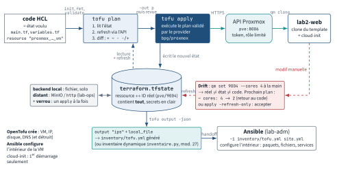

<!-- nav:début -->
[Accueil](../../README.md) › [Parcours](../../docs/parcours.md) › Partie IV — Socle DevOps › **Module 24**  
[← Module 23](../23-ansible/README.md) · [Corrigé](corrige.md) · [Module 25 →](../25-cicd/README.md)

<details><summary>Scripts du module (10)</summary>

Sur la VM indiquée en section « Mise en place », depuis `~/workbook/scripts/` (voir [chapitre 0](../../docs/00-mise-en-place.md)).

| Script | Rôle |
|---|---|
| [`setup_M24.sh`](../../scripts/setup/setup_M24.sh) | prépare le module |
| [`check_M24_01.sh`](../../scripts/check/check_M24_01.sh) | vérification |
| [`check_M24_02.sh`](../../scripts/check/check_M24_02.sh) | vérification |
| [`check_M24_03.sh`](../../scripts/check/check_M24_03.sh) | vérification |
| [`check_M24_04.sh`](../../scripts/check/check_M24_04.sh) | vérification |
| [`check_M24_05.sh`](../../scripts/check/check_M24_05.sh) | vérification |
| [`break_M24_01.sh`](../../scripts/break/break_M24_01.sh) | installe une panne |
| [`break_M24_02.sh`](../../scripts/break/break_M24_02.sh) | installe une panne |
| [`break_M24_03.sh`](../../scripts/break/break_M24_03.sh) | installe une panne |
| [`break_M24_04.sh`](../../scripts/break/break_M24_04.sh) | installe une panne |

</details>
<!-- nav:fin -->

# Module 24 — Infrastructure as Code : OpenTofu, cloud-init, Proxmox

## 24.0 Objectifs et compétences

> [!NOTE]
> **Objectifs**
>
> À la fin de ce module, je sais :
>
> * expliquer, avec des exemples, ce que signifient **déclaratif**, **état**,
>   **idempotence**, **drift**, **immutable** et **pets vs cattle**, et situer
>   Terraform/OpenTofu (provisionner) par rapport à Ansible (configurer) ;
> * écrire un fichier **`#cloud-config`** valide (users, clés SSH, packages,
>   write_files, runcmd, hostname), le valider avant de l'utiliser, et déboguer
>   une VM dont cloud-init ne s'applique pas (`cloud-init status`, journaux,
>   `cloud-init clean`) ;
> * fabriquer un **template Proxmox cloud-init** à partir de l'image cloud
>   Ubuntu 24.04 officielle avec `qm`, le cloner, l'adresser, le démarrer,
>   le snapshoter, le redimensionner et le détruire depuis la ligne de commande
>   ou l'API (`pvesh`, `curl` + token) ;
> * lire un fichier HCL bloc par bloc (`terraform`, `provider`, `resource`,
>   `data`, `variable`, `output`, `locals`, `module`) et dérouler le cycle
>   `init` → `plan` → `apply` → `destroy` en expliquant ce que fait chaque étape ;
> * lire une **sortie de `plan` ligne par ligne** et dire, avant d'appliquer,
>   ce qui sera créé, modifié sur place, ou détruit-puis-recréé, et pourquoi ;
> * déployer un parc de VM sur Proxmox avec le provider **bpg/proxmox**, un
>   token API, un `for_each` sur une map de variables typées et validées ;
> * gérer l'**état** : le protéger (il contient des secrets), le stocker à
>   distance avec verrouillage, importer une ressource existante, corriger un
>   drift, déplacer une ressource (`state mv`, `moved`) sans rien recréer ;
> * structurer le code en **modules** réutilisables et versionnés, et enchaîner
>   sur **Ansible** avec un inventaire généré depuis les outputs ;
> * outiller la qualité : `fmt`, `validate`, tflint, pre-commit, revue de plan
>   en PR, `tofu test` ;
> * situer Packer, Pulumi, CloudFormation, Bicep et Crossplane en entretien.
>
> **Temps estimé** : 9 h
>
> **Prérequis** : module 07 (bash), module 12 (réseau, `/etc/hosts`), module 14
> (clés SSH, agent), notions d'Ansible (inventaire, `ansible -m ping`) et un
> Docker fonctionnel sur `lab-ops` pour le backend d'état distant.

---

## 24.1 Mise en place

Poste de travail : **`lab-adm` (10.10.10.10)**, utilisateur `mathieu`. Le
« cloud » du module est ton **nœud Proxmox VE 8**, joignable depuis le réseau
de lab sur `https://10.10.10.1:8006/` (c'est l'adresse du nœud sur `vmbr1` ;
si ton nœud n'a pas d'adresse sur ce bridge, remplace par son IP de
management partout dans le module). Dans les exemples, le nœud s'appelle
`pve` : vérifie avec `hostname` sur le nœud et adapte.

Les VM créées par ce module portent les VMID **9100 à 9199** et les adresses
**10.10.10.100 à 10.10.10.129** : elles ne touchent jamais aux sept VM du lab
(9001 à 9007). Il faut environ 6 Go de RAM libre sur le nœud pour le lab
central ; si tu es juste, arrête `lab-db` et `lab-rhel` le temps du module.

```bash
# depuis le shell Proxmox, avant de commencer
qm snapshot 9001 avant-lab24
```

Sur `lab-adm`, installe OpenTofu (dépôt officiel) et les outils annexes :

```bash
sudo apt update
sudo apt install -y curl jq git cloud-init python3-yaml
curl --proto '=https' --tlsv1.2 -fsSL \
  https://get.opentofu.org/install-opentofu.sh -o /tmp/install-opentofu.sh
chmod +x /tmp/install-opentofu.sh
/tmp/install-opentofu.sh --install-method deb
tofu version
```

Tout ce qui suit vaut mot pour mot pour `terraform` : même syntaxe HCL, mêmes
sous-commandes, mêmes providers. Si tu préfères Terraform, installe-le depuis
le dépôt HashiCorp et remplace `tofu` par `terraform` dans les commandes.

> [!IMPORTANT]
> **Variante Rocky / RHEL**
>
> Sous Rocky 9 : `sudo dnf install -y jq git cloud-init python3-pyyaml`, puis
> `/tmp/install-opentofu.sh --install-method rpm`.

Tu dois pouvoir ouvrir un shell root sur le nœud depuis `lab-adm` (c'est là
que se fabrique le template) :

```bash
ssh root@10.10.10.1 'hostname; pveversion'
```

Préparation du terrain de jeu (idempotent, relançable) :

```bash
bash ~/workbook/scripts/setup/setup_M24.sh
```

Il crée `~/lab24/` : un fichier `.env.example` pour les identifiants, des
`user-data` d'exemple dans `cloud-init/`, le script `proxmox/make-template.sh`
**à copier et exécuter sur le nœud**, les squelettes des labs (`01-premier/`,
`02-lab2/`, `03-remote/`, `04-modules/`), un module vide dans
`modules/vm-ubuntu/` et un gabarit d'inventaire Ansible.

> [!CAUTION]
> **Attention**
>
> Le token API que tu vas créer en E24.8 donne le droit de détruire des VM.
> Il vit dans `~/lab24/.env` (mode `0600`, jamais dans git, jamais dans un
> fichier `.tf`). Le fichier `.gitignore` posé par le setup exclut `.env`,
> `*.tfstate*`, `*.tfvars` et `.terraform/` : ne le retire pas.

---

## 24.2 Rappel express

### Le vocabulaire qui structure tout le module

| Terme | Définition opérationnelle |
|---|---|
| Déclaratif | tu décris l'état **voulu**, l'outil calcule les actions |
| État (state) | la mémoire de l'outil : ce qu'il a créé et ses attributs réels |
| Idempotence | relancer sans changement produit `0 to add, 0 to change` |
| Drift | la réalité a divergé du code (modif à la main, panne) |
| Immutable | on ne modifie pas une VM, on la remplace (`-replace`) |
| Pets vs cattle | machines nommées et soignées vs numérotées et jetables |

Terraform et OpenTofu partagent syntaxe, sous-commandes et providers.
OpenTofu est le fork communautaire (Linux Foundation, licence MPL-2.0) né du
passage de Terraform sous licence BUSL en 2023. Différences utiles : OpenTofu
ajoute le **chiffrement de l'état** (`terraform { encryption {} }`), les
variables dans `backend` et `module.source`, et son propre registre
(`registry.opentofu.org`). Un projet écrit pour l'un s'exécute avec l'autre
tant qu'on n'utilise pas ces extensions.

**Provisionner vs configurer.** Terraform crée les machines (VM, disques,
réseau, DNS) et s'arrête à « la VM répond ». Ansible entre ensuite pour les
paquets, les fichiers de conf, les services. cloud-init fait le pont : il
donne à la VM une identité, un utilisateur et une clé au premier démarrage,
donc Ansible peut se connecter. Enchaînement type :

```text
image cloud --(qm / Packer)--> template --(tofu clone + cloud-init)--> VM
        --(output tofu -> inventaire)--> Ansible --> service en production
```

### cloud-init en dix lignes

* Trois entrées : **user-data** (`#cloud-config`, YAML), **meta-data**
  (`instance-id`, `local-hostname`), **network-config** (v1 ou v2 netplan).
* Sur Proxmox, le datasource est **NoCloud** : le disque `ide2` (`cloudinit`)
  est une ISO étiquetée `cidata`, régénérée au démarrage de la VM (ou par `qm cloudinit update`) après un changement d'option cloud-init.
* Ce qui est **per-instance** (users, clés, hostname, `runcmd`) ne rejoue que
  si `instance-id` change. Proxmox calcule l'`instance-id` à partir des
  options cloud-init : modifier `--memory` ne rejoue rien ; modifier
  `--sshkeys` si.
* `--cicustom user=local:snippets/x.yaml` **remplace** entièrement le user-data
  généré (`--ciuser`, `--sshkeys` sont alors ignorés).

```yaml
#cloud-config
hostname: lab2-web
fqdn: lab2-web.lab.local
manage_etc_hosts: true
users:
  - name: mathieu
    groups: [sudo]
    shell: /bin/bash
    sudo: "ALL=(ALL) NOPASSWD:ALL"
    lock_passwd: true
    ssh_authorized_keys:
      - ssh-ed25519 AAAAC3... mathieu@lab-adm
package_update: true
packages: [qemu-guest-agent]
write_files:
  - path: /etc/motd
    permissions: "0644"
    content: |
      VM provisionnee par cloud-init : ne pas modifier a la main.
runcmd:
  - systemctl enable --now qemu-guest-agent
```

| Commande (dans la VM) | Usage |
|---|---|
| `cloud-init status --long` | `done`, `running`, `error`, `disabled` + détail |
| `cloud-init schema --config-file f.yaml` | valide un user-data **avant** usage |
| `cloud-init query userdata` / `-a` | ce que la VM a réellement reçu |
| `/var/log/cloud-init.log`, `-output.log` | trace des modules / stdout des runcmd |
| `sudo cloud-init clean --logs` + reboot | rejouer comme un premier démarrage |

### Template et clones avec `qm` (sur le nœud)

```bash
wget -q https://cloud-images.ubuntu.com/noble/current/\
noble-server-cloudimg-amd64.img
qm create 9100 --name ubuntu-2404-tpl --memory 1024 --cores 1 \
  --net0 virtio,bridge=vmbr1 --scsihw virtio-scsi-single --ostype l26 \
  --agent enabled=1 --cpu x86-64-v2-AES --serial0 socket --vga serial0
qm disk import 9100 noble-server-cloudimg-amd64.img local-lvm   # ex-importdisk
qm set 9100 --scsi0 local-lvm:vm-9100-disk-0,discard=on,iothread=1
qm set 9100 --ide2 local-lvm:cloudinit --boot order=scsi0
qm set 9100 --ciuser mathieu --sshkeys /root/keys/mathieu.pub \
  --ipconfig0 ip=dhcp --ciupgrade 0
qm disk resize 9100 scsi0 20G
qm template 9100
```

| Action | Commande |
|---|---|
| Cloner | `qm clone 9100 9110 --name ci-test --full 1` |
| Adresser | `qm set 9110 --ipconfig0 ip=10.10.10.110/24,gw=10.10.10.1` |
| User-data perso | `qm set 9110 --cicustom user=local:snippets/ci.yaml` |
| Voir le user-data | `qm cloudinit dump 9110 user` |
| Démarrer / arrêter | `qm start 9110` / `qm shutdown 9110 --timeout 60` |
| Agent | `qm agent 9110 ping`, `qm guest exec 9110 -- hostname` |
| Snapshot | `qm snapshot 9110 s1`, `qm rollback 9110 s1`, `qm listsnapshot 9110` |
| Disque | `qm disk resize 9110 scsi0 +5G` (jamais de rétrécissement) |
| Détruire | `qm stop 9110; qm destroy 9110 --purge` |

`pvesh` expose la même API que l'interface web : `pvesh get /nodes/pve/qemu`,
`pvesh create /nodes/pve/qemu/9100/clone --newid 9111 --name t --full 1`,
`pvesh set /nodes/pve/qemu/9111/config --memory 1024`,
`pvesh create /nodes/pve/qemu/9111/status/start`,
`pvesh delete /nodes/pve/qemu/9111 --purge 1`. Les actions longues renvoient
un **UPID** de tâche. Depuis `lab-adm`, `curl` fait pareil avec l'en-tête
`Authorization: PVEAPIToken=terraform@pve!tofu=<uuid>` sur
`https://10.10.10.1:8006/api2/json/.. .`.

### HCL et cycle de vie

```hcl
terraform {
  required_version = ">= 1.6"
  required_providers {
    proxmox = { source = "bpg/proxmox", version = "~> 0.7" }
  }
}
provider "proxmox" {            # endpoint et token : variables d'environnement
  insecure = true               # PROXMOX_VE_ENDPOINT / PROXMOX_VE_API_TOKEN
}
variable "vms" {
  type = map(object({
    vm_id = number
    host  = number
                      cores = optional(number, 1) }))
}
locals { ips = { for k, v in var.vms : k => cidrhost("10.10.10.0/24", v.host) } }
resource "proxmox_virtual_environment_vm" "lab" {
  for_each  = var.vms
  name      = each.key
  vm_id     = each.value.vm_id
  node_name = "pve"
  clone { vm_id = 9100 }
  initialization {
    ip_config { ipv4 { address = "${local.ips[each.key]}/24"
                       gateway = "10.10.10.1" } }
    user_account { username = "mathieu"
                   keys = [trimspace(file("~/.ssh/id_ed25519.pub"))] }
  }
}
output "ips" { value = local.ips }
```

| Commande | Ce qu'elle fait réellement |
|---|---|
| `tofu init` | télécharge providers/modules, écrit `.terraform.lock.hcl`, configure le backend |
| `tofu plan [-out p]` | rafraîchit l'état, calcule le diff code ↔ état ↔ réalité |
| `tofu apply [p]` | exécute le plan, met à jour l'état ; `-auto-approve` en CI |
| `tofu destroy` | plan inverse ; `-target` pour cibler |
| `tofu fmt` / `validate` | met en forme / vérifie syntaxe et types sans état |
| `tofu show`, `state list` | lit l'état ; `state show adr` pour une ressource |
| `tofu state mv/rm`, `import` | renomme / oublie / adopte sans toucher à la réalité |
| `tofu apply -replace=adr` | force la recréation (immutable) |
| `tofu apply -refresh-only` | accepte le drift dans l'état sans modifier l'infra |
| `tofu console` | teste expressions et fonctions |

Symboles d'un plan : `+` créer, `~` modifier sur place, `-` détruire,
`-/+` détruire puis recréer, `+/-` recréer avant de détruire
(`create_before_destroy`). La mention `# forces replacement` désigne
l'attribut responsable. `(known after apply)` : valeur inconnue avant
création. `(sensitive value)` : masqué à l'affichage, **en clair dans l'état**.

`count` indexe par entier (`[0]`) : retirer le premier élément décale tout
et recrée le reste. `for_each` indexe par clé (`["lab2-web"]`) : stable.
`depends_on` ne sert que lorsque la dépendance n'est pas déductible d'une
référence. `lifecycle { prevent_destroy, create_before_destroy,
ignore_changes, replace_triggered_by }`. Précédence des variables : `-var` >
`*.auto.tfvars` > `terraform.tfvars` > `TF_VAR_x` > `default`.

### État et modules

* L'état est un JSON (`serial`, `lineage`, `resources`) qui contient **tout**,
  y compris les valeurs `sensitive`. Backend distant + verrou obligatoires à
  plusieurs : S3 (MinIO), `http`, Consul… `tofu init -migrate-state` déplace
  un état local vers le backend. Workspaces = plusieurs états pour un même
  code (`tofu workspace new recette`).
* `import` (bloc `import { to, id }` ou `tofu import adr id`) adopte une
  ressource existante ; l'identifiant bpg d'une VM est `pve/9004`.
* Un module = un répertoire avec `variables.tf`, `main.tf`, `outputs.tf`,
  appelé par `module "x" { source = "./modules/vm-ubuntu" ... }` ; versionné
  par tag git (`source = "git::ssh://...//modules/vm-ubuntu?ref=v1.2.0"`).

<p align="center"></p>

*Figure — Le cycle OpenTofu : code HCL, `plan` qui compare état et réel via le provider, `apply` qui appelle l'API Proxmox et réécrit le `tfstate` ; le drift d'une modification manuelle, et le handoff vers Ansible par l'inventaire généré.*

### Panorama pour l'entretien

**Packer** fabrique l'image, Terraform la déploie. Un fichier `.pkr.hcl`
décrit une `source` (plugin `proxmox-clone` ou `proxmox-iso` : nœud, template
de départ, disque, cloud-init) et un `build` avec des provisioners (shell,
Ansible) qui installent agents, durcissement et paquets communs ; `packer init`
puis `packer build .` produisent un template Proxmox horodaté. Intérêt : les
VM démarrent déjà prêtes, cloud-init n'a plus qu'à poser l'identité, et le
template est versionné comme du code. Sans Packer, `make-template.sh` + un
user-data qui installe les paquets suffit pour un lab, pas pour une flotte.

**Pulumi** : même modèle état/plan/apply mais en langage général (Python, Go,
TS) avec tests unitaires natifs ; état sur Pulumi Cloud ou S3.
**CloudFormation** : natif AWS, YAML/JSON, l'état est géré par AWS (stacks,
change sets), pas de multi-cloud. **Bicep** : équivalent Azure, DSL compilé
en ARM, déploiement incrémental sans fichier d'état. **Crossplane** : des
ressources cloud décrites comme des objets Kubernetes réconciliés en continu
par des contrôleurs — la boucle de réconciliation remplace le `apply`
ponctuel, au prix d'un cluster à opérer.

---

## 24.3 Quiz — QCM

<a id="q24-1"></a>**[Q24.1](corrige.md#q24-1)** — Tu relances `tofu apply` sans avoir modifié ni le code ni
l'infrastructure. Le plan affiche `0 to add, 0 to change, 0 to destroy`.
Cette propriété s'appelle :

a) le drift
b) l'idempotence
c) l'immutabilité
d) la convergence Ansible

<a id="q24-2"></a>**[Q24.2](corrige.md#q24-2)** — Un collègue a augmenté la RAM d'une VM gérée par OpenTofu depuis
l'interface Proxmox. Que montre le prochain `tofu plan` si `memory` est
déclaré à 2048 dans le code ?

a) rien, Proxmox a la priorité sur le code
b) `~ update in-place` qui ramène la mémoire à 2048
c) `-/+ destroy and then create replacement`
d) une erreur `state lock`

<a id="q24-3"></a>**[Q24.3](corrige.md#q24-3)** — Dans cette sortie de plan, quelle ligne indique la **cause** de
la recréation ?

```text
  # proxmox_virtual_environment_vm.lab["lab2-web"] must be replaced
-/+ resource "proxmox_virtual_environment_vm" "lab" {
      ~ id        = "9102" -> (known after apply)
        name      = "lab2-web"
      ~ clone {
          ~ vm_id = 9100 -> 9200 # forces replacement
        }
```

a) `must be replaced`
b) `~ id = "9102" -> (known after apply)`
c) `~ vm_id = 9100 -> 9200 # forces replacement`
d) `-/+`

<a id="q24-4"></a>**[Q24.4](corrige.md#q24-4)** — Un user-data commence par `# cloud-config` (avec une espace après
le dièse). Que fait cloud-init ?

a) il l'applique normalement, l'espace est tolérée
b) il l'ignore avec un avertissement `Unhandled non-multipart userdata`
c) il refuse de démarrer la VM
d) il n'applique que la section `users`

<a id="q24-5"></a>**[Q24.5](corrige.md#q24-5)** — Tu passes `--cicustom user=local:snippets/web.yaml` sur une VM
qui avait `--ciuser mathieu --sshkeys ...`. Au prochain premier démarrage :

a) les deux sources sont fusionnées
b) `mathieu` et sa clé sont créés, puis le snippet est appliqué
c) seul le snippet est appliqué ; `--ciuser`/`--sshkeys` sont ignorés
d) Proxmox refuse la commande car les options sont exclusives

<a id="q24-6"></a>**[Q24.6](corrige.md#q24-6)** — Tu as trois VM créées avec `count = 3` et tu supprimes la
première de la liste `var.names`. Que propose le plan ?

a) 1 to destroy
b) 1 to destroy, 2 to change (renommage sur place)
c) 2 to add, 3 to destroy : les index se décalent
d) 3 to destroy, 3 to add

<a id="q24-7"></a>**[Q24.7](corrige.md#q24-7)** — `variable "token" { sensitive = true }`. Que se passe-t-il avec
`output "t" { value = var.token }` ? **Trois réponses correctes.**

a) `tofu plan` refuse : « Output refers to sensitive values »
b) avec `sensitive = true` sur l'output, `tofu output -raw t` affiche la valeur
c) le token n'est jamais écrit dans le tfstate
d) le token est stocké en clair dans le tfstate quoi qu'il arrive

<a id="q24-8"></a>**[Q24.8](corrige.md#q24-8)** — Quelle commande fait oublier une ressource à OpenTofu **sans**
la détruire ?

a) `tofu destroy -target=adr`
b) `tofu state rm adr`
c) `tofu apply -replace=adr`
d) `tofu taint adr`

<a id="q24-9"></a>**[Q24.9](corrige.md#q24-9)** — Sur Proxmox, `qm clone 9100 9110 --full 1` puis `qm start 9110`.
La VM démarre mais n'a aucune adresse IP et le user `mathieu` n'existe pas.
`qm config 9110` montre `ipconfig0: ip=10.10.10.110/24,gw=10.10.10.1` mais
pas de ligne `ide2`. Cause la plus probable :

a) le bridge `vmbr1` est en panne
b) il manque le lecteur cloud-init : rien ne transporte les données vers la VM
c) `--full 1` a désactivé cloud-init
d) l'image cloud Ubuntu exige DHCP

<a id="q24-10"></a>**[Q24.10](corrige.md#q24-10)** — Le backend S3 est configuré avec `use_lockfile = true`.
Un `tofu apply` plante brutalement (coupure réseau). Au lancement suivant :

a) l'état est perdu, il faut réimporter
b) `Error acquiring the state lock` ; on vérifie que personne ne travaille,
   puis `tofu force-unlock <ID>`
c) le verrou est libéré automatiquement après 60 s
d) OpenTofu recrée toutes les ressources

<a id="q24-11"></a>**[Q24.11](corrige.md#q24-11)** — Lequel de ces changements peut être fait **sans** recréer la
VM avec le provider bpg/proxmox ? **Deux réponses correctes.**

a) passer `memory.dedicated` de 1024 à 2048
b) changer `clone.vm_id` (template source)
c) agrandir `disk.size` de 20 à 30
d) changer `vm_id`

<a id="q24-12"></a>**[Q24.12](corrige.md#q24-12)** — Tu importes `lab-rhel` (VMID 9004) dans un `resource`
`proxmox_virtual_environment_vm "rhel"`. Quel identifiant passes-tu à
`tofu import` ?

a) `9004`
b) `lab-rhel`
c) `pve/9004`
d) `qemu/9004`

<a id="q24-13"></a>**[Q24.13](corrige.md#q24-13)** — Où `local_file.inventory` avec
`content = templatefile("inv.tftpl", { vms = local.ips })` échoue-t-il si
`inv.tftpl` contient `%{ for k, v in vms }${k} ansible_host=${v}\n%{ endfor }` ?

a) nulle part : c'est correct
b) `templatefile` ne lit pas les fichiers hors `path.module`
c) `%{ for }` n'existe pas dans les templates
d) `ansible_host` est un mot réservé HCL

<a id="q24-14"></a>**[Q24.14](corrige.md#q24-14)** — Le premier démarrage d'une VM clonée dure 4 minutes et
`cloud-init-output.log` montre des dizaines de lignes `apt`. Explication :

a) `package_update: true` est lent par nature
b) l'option Proxmox `--ciupgrade` vaut 1 par défaut : upgrade complet au
   premier boot
c) le miroir Ubuntu est injoignable
d) qemu-guest-agent force une mise à jour

<a id="q24-15"></a>**[Q24.15](corrige.md#q24-15)** — Pour qu'OpenTofu attende qu'une VM soit joignable avant de
générer l'inventaire Ansible, tu t'appuies sur :

a) `depends_on` explicite, car `local_file` ne référence rien de la VM
b) le graphe de dépendances implicite dès que `content` référence un
   attribut de la VM
c) `provisioner "local-exec"` avec `sleep 60`
d) `lifecycle { create_before_destroy = true }`

<a id="q24-16"></a>**[Q24.16](corrige.md#q24-16)** — *Entretien* : « Terraform ou Ansible pour installer nginx sur
100 VM ? » La réponse attendue :

a) Terraform, avec des `provisioner "remote-exec"`
b) Ansible : Terraform provisionne, Ansible configure ; les provisioners
   sont un dernier recours documenté comme tel
c) les deux font pareil, question de goût
d) Terraform, car il a un état

---

## 24.4 Quiz — questions ouvertes

<a id="qo24-1"></a>**[QO24.1](corrige.md#qo24-1)** — Explique le rôle du fichier d'état : pourquoi un outil
déclaratif en a besoin alors qu'il pourrait interroger l'API à chaque fois,
ce qu'il contient, ce qui arrive si deux personnes appliquent en même temps
sans verrou, et pourquoi on ne le commite jamais dans git.

<!-- repondre: 10 -->

<a id="qo24-2"></a>**[QO24.2](corrige.md#qo24-2)** — *On te demande en entretien* : « Décris ce qui se passe entre
`qm clone` et le moment où tu peux faire `ssh mathieu@10.10.10.110`. » Détaille
le rôle de l'ISO `cidata`, du datasource NoCloud, de l'`instance-id`, des
modules per-instance et per-boot, et ce qui rejoue ou non à un redémarrage.

<!-- repondre: 12 -->

<a id="qo24-3"></a>**[QO24.3](corrige.md#qo24-3)** — Compare `count` et `for_each` : indexation, comportement à la
suppression d'un élément intermédiaire, contraintes sur les clés (connues au
plan). Donne le cas où `count` reste le bon choix et la procédure pour migrer
de l'un à l'autre sans rien recréer.

<!-- repondre: 10 -->

<a id="qo24-4"></a>**[QO24.4](corrige.md#qo24-4)** — Une VM gérée par OpenTofu a été supprimée à la main, puis son
VMID a été réutilisé pour une VM de test d'un collègue. Décris ce que montre
`tofu plan`, pourquoi le provider ne voit pas la différence, et la procédure
qui remet les choses d'équerre **sans** détruire la VM du collègue.

<!-- repondre: 10 -->

<a id="qo24-5"></a>**[QO24.5](corrige.md#qo24-5)** — *On te demande en entretien* : « Immutable infrastructure :
concrètement, qu'est-ce que ça change dans ta façon de patcher ? » Réponds
avec le triptyque Packer → Terraform → cloud-init, les avantages (rollback,
reproductibilité) et les coûts (données, temps de build, IP flottantes).

<!-- repondre: 10 -->

<a id="qo24-6"></a>**[QO24.6](corrige.md#qo24-6)** — Explique pourquoi `sensitive = true` ne protège pas un secret,
ce que fait réellement l'attribut, où le secret finit quand même (état,
`plan -out`, logs CI), et trois mesures concrètes pour un token Proxmox.

<!-- repondre: 8 -->

<a id="qo24-7"></a>**[QO24.7](corrige.md#qo24-7)** — Tu reçois une PR qui modifie `main.tf` et joint la sortie de
`tofu plan`. Décris ta grille de revue : ce que tu vérifies dans le plan avant
même de lire le code, les symboles qui déclenchent une discussion, et le
mécanisme CI qui garantit que le plan joint est bien celui qui sera appliqué.

<!-- repondre: 10 -->

<a id="qo24-8"></a>**[QO24.8](corrige.md#qo24-8)** — Décris ta démarche de diagnostic quand une VM clonée démarre
mais que cloud-init « n'a rien fait » : ordre des vérifications côté Proxmox
(`qm config`, `qm cloudinit dump`), côté VM (`cloud-init status`, journaux,
`query`), et le test qui distingue « pas de datasource » de « user-data
invalide ».

<!-- repondre: 10 -->

---

## 24.5 Exercices guidés ★

Sauf mention contraire, travaille sur `lab-adm` dans `~/lab24`. Les
exercices E24.1 à E24.7 et E24.13 à E24.16 ne touchent pas Proxmox : ils
utilisent les providers `local` et `random` pour manipuler HCL sans risque.

<a id="e24-1"></a>**[E24.1](corrige.md#e24-1)** — Installe OpenTofu et prouve que `tofu version` répond. Montre
ensuite que `TF_LOG=DEBUG tofu version` est verbeux et que `tofu -help plan`
liste `-out`, `-replace`, `-refresh-only`, `-target` et `-var`. Note dans
`~/lab24/notes.md` ce que change chacune de ces cinq options.

<a id="e24-2"></a>**[E24.2](corrige.md#e24-2)** — Dans `~/lab24/e02/`, écris un `main.tf` qui crée un fichier
`hello.txt` (provider `hashicorp/local`) dont le contenu contient un nom
d'animal aléatoire (provider `hashicorp/random`, `random_pet`). Déroule
`init`, `plan`, `apply`. Puis réponds en observant les fichiers produits :
que contient `.terraform.lock.hcl`, quelle est la taille de `.terraform/`,
et que donne `tofu state list` puis `tofu state show random_pet.nom` ?

<a id="e24-3"></a>**[E24.3](corrige.md#e24-3)** — Toujours dans `e02/`, ajoute une variable `longueur` de type
`number`, valeur par défaut 2, avec une `validation` qui refuse les valeurs
hors de 1 à 4, et branche-la sur `random_pet.length`. Teste
`tofu plan -var longueur=9` (doit échouer avec ton message), puis un fichier
`terraform.tfvars`, puis `TF_VAR_longueur=3`. Établis l'ordre de précédence
observé.

<a id="e24-4"></a>**[E24.4](corrige.md#e24-4)** — Dans `tofu console` (répertoire `~/lab24/e04/` préparé par le
setup avec une variable `vms` de type map), calcule : la liste des noms
triés, l'adresse de chaque VM avec `cidrhost("10.10.10.0/24", v.host)`, la
map `nom => ip`, et la chaîne `lab2-adm,lab2-web,...` avec `join`. Reporte
ces quatre expressions dans `locals` et un `output` par expression.

<a id="e24-5"></a>**[E24.5](corrige.md#e24-5)** — Écris `~/lab24/e04/templates/hosts.tftpl` et une ressource
`local_file` qui génère `hosts.lab2` au format `/etc/hosts` (une ligne
`ip nom nom.lab.local` par VM, triée par IP). Vérifie que deux `apply`
successifs ne changent rien, puis modifie le template et lis le plan : le fichier est-il modifié sur place (`~`) ou recréé ( `-/+`)? Explique.

<a id="e24-6"></a>**[E24.6](corrige.md#e24-6)** — Dans `~/lab24/e06/`, crée trois fichiers `vm-<nom>.txt` avec
`count` sur la liste `["adm", "web", "db"]`. Applique. Retire `"adm"` de la
liste et lis le plan sans appliquer : combien de destructions, combien de
créations, et pourquoi ? Réécris avec `for_each` sur `toset(...)`, réapplique
la liste complète, retire `"adm"` et compare le plan.

<a id="e24-7"></a>**[E24.7](corrige.md#e24-7)** — Écris `~/lab24/cloud-init/ci-test.yaml` : hostname `ci-test`,
utilisateur `mathieu` avec ta clé publique et sudo sans mot de passe, paquets
`qemu-guest-agent` et `htop`, un fichier `/etc/lab24-marker` contenant
`ci-test provisionne par cloud-init`, et un `runcmd` qui active l'agent.
Valide-le avec `cloud-init schema --config-file`. Puis casse volontairement
la première ligne (`#cloud-config` → `#cloud config`) et montre ce que dit le
validateur. Enfin vérifie avec `python3 -c 'import yaml,sys; ...'` que le YAML
est syntaxiquement correct.

<a id="e24-8"></a>**[E24.8](corrige.md#e24-8)** — Sur le nœud (`ssh root@10.10.10.1`), crée l'utilisateur
`terraform@pve`, un rôle `TofuLab` avec les privilèges nécessaires au clonage
et à la gestion de VM (liste-les), l'ACL sur `/`, puis un token `tofu` sans
séparation de privilèges. Reporte le token dans `~/lab24/.env` (copie
`.env.example`, mode `0600`). Depuis `lab-adm`, prouve avec `curl` que
`GET /api2/json/version` et `GET /api2/json/nodes/pve/qemu` répondent avec le
token, et que sans token la réponse est `401`.

<a id="e24-9"></a>**[E24.9](corrige.md#e24-9)** — Copie `~/lab24/proxmox/make-template.sh` sur le nœud, lis-le
**en entier** (chaque `qm set` doit t'être clair), exécute-le. Vérifie
`qm config 9100` : disque `scsi0`, `ide2` en `cloudinit`, `agent: 1`,
`template: 1`, `serial0`. Explique à quoi servent `--serial0 socket
--vga serial0` et `--cpu x86-64-v2-AES` sur une image cloud.

<a id="e24-10"></a>**[E24.10](corrige.md#e24-10)** — Sur le nœud, clone le template en 9110 (`ci-test`), adresse-le
en `10.10.10.110/24`, démarre-le, attends que `qm agent 9110 ping` réponde,
puis obtiens son adresse par l'agent (`qm guest cmd 9110
network-get-interfaces`, ou `pvesh get .../agent/network-get-interfaces`).
Depuis `lab-adm`, connecte-toi en SSH. Mesure le temps entre `qm start` et le
premier `ssh` réussi.

<a id="e24-11"></a>**[E24.11](corrige.md#e24-11)** — Sur `ci-test`, réponds avec des commandes : quel datasource a
été utilisé, quel `instance-id`, le user-data reçu tel quel, combien de
secondes a duré le premier boot (`cloud-init analyze show`), et la liste des
modules per-instance exécutés. Puis, depuis le nœud, remplace la clé SSH
(`qm set 9110 --sshkeys .. .`) et redémarre : la nouvelle clé est-elle
déployée ? Explique le résultat avec `instance-id`.

<a id="e24-12"></a>**[E24.12](corrige.md#e24-12)** — Écris un script `~/lab24/bin/pve.sh` (bash, `set -euo pipefail`)
qui pilote Proxmox **depuis `lab-adm` via l'API** (`curl` + token de `.env`),
avec les sous-commandes `list` (vmid, nom, statut en TSV, via `jq`),
`snap <vmid> <nom>`, `rollback <vmid> <nom>`, `resize <vmid> +5G`, et
`destroy <vmid>` (arrêt forcé puis `purge=1`). Les tâches asynchrones
doivent être attendues jusqu'à `stopped` en lisant le statut de l'UPID.
Démontre snapshot → modification → rollback sur `ci-test`.

<a id="e24-13"></a>**[E24.13](corrige.md#e24-13)** — Dans `~/lab24/e13/` (provider proxmox, aucune ressource),
déclare un `data "proxmox_virtual_environment_nodes"` et un output qui
affiche les noms des nœuds. `tofu init` puis `tofu apply` : quelle valeur ?
Puis montre avec `tofu providers` et `tofu providers lock` d'où vient le
provider et à quoi sert le fichier de verrou en CI.

<a id="e24-14"></a>**[E24.14](corrige.md#e24-14)** — Dans `e02/`, ajoute `lifecycle { prevent_destroy = true }` sur
le `local_file`, tente `tofu destroy` et lis l'erreur. Retire-le, puis
force la recréation du seul `random_pet` avec `-replace` : combien de
ressources sont touchées et pourquoi le fichier suit ?

<a id="e24-15"></a>**[E24.15](corrige.md#e24-15)** — Dans `e02/`, déclare une variable `secret` marquée `sensitive`,
écris-la dans le contenu du fichier, et ajoute un output qui la retourne.
Observe : l'erreur d'`apply`, la correction avec `sensitive = true` sur
l'output, ce qu'affichent `tofu output` puis `tofu output -raw secret`, et
enfin `tofu show -json | jq '.values.root_module.resources[].values'`.
Conclus en une phrase sur ce que protège `sensitive`.

<a id="e24-16"></a>**[E24.16](corrige.md#e24-16)** — Renomme la ressource `random_pet.nom` en `random_pet.animal`
dans le code. Lis le plan (que veut-il faire ?), annule, puis obtiens
`0 to add` avec un bloc `moved`. Refais la même chose avec
`tofu state mv` et compare les deux approches du point de vue d'une revue
de code.

---

## 24.6 Labs ★★

### <a id="l24-1"></a>**[L24.1](corrige.md#l24-1)** — Template cloud-init et VM sur mesure avec `qm` et un snippet

> **Contexte**
>
> L'équipe CI a besoin de VM de test jetables, prêtes en moins de deux minutes,
> avec `mathieu` connecté, `docker.io` et `qemu-guest-agent` installés, et un
> marqueur dans `/etc/lab24-marker`. Aujourd'hui, un collègue clone une VM
> « modèle » qu'il maintient à la main depuis 2023. On te demande de remplacer
> ça par un template cloud-init officiel et un user-data versionné.

Sur le nœud Proxmox, puis sur `lab-adm`.

1. Vérifie que le template `9100` existe (E24.9) et que le stockage `local`
   accepte les snippets : `pvesm status`, `pvesm set local --content
   iso,vztmpl,backup,snippets` si nécessaire.
2. Écris `~/lab24/cloud-init/ci-test.yaml` (E24.7) et enrichis-le :
   `docker.io` dans les paquets, `mathieu` ajouté au groupe `docker`,
   `final_message` avec la durée du boot. Valide-le, puis copie-le sur le nœud
   dans `/var/lib/vz/snippets/ci-test.yaml`.
3. Clone `9100` en `9110` nommé `ci-test`, attache le snippet avec
   `--cicustom user=local:snippets/ci-test.yaml`, adresse `10.10.10.110/24`,
   passerelle `10.10.10.1`, DNS `10.10.10.1`, domaine `lab.local`, 2 Go de
   RAM. Compare `qm cloudinit dump 9110 user` **avant et après** `--cicustom`.
4. Démarre, attends l'agent, connecte-toi. Vérifie : hostname, membre du
   groupe `docker`, `docker version`, `/etc/lab24-marker`,
   `cloud-init status --long` en `done`.
5. Prends un snapshot `avant-test`, installe n'importe quoi en plus dans la
   VM, reviens au snapshot, prouve que le paquet a disparu.
6. Agrandis le disque de 5 Go depuis le nœud, puis vérifie **dans la VM** que
   `/` a grandi sans intervention (cloud-init `growpart` + `resizefs`).
7. Script `~/lab24/bin/ci-vm.sh <vmid> <nom> <ip>` qui, depuis `lab-adm` et
   via `ssh root@10.10.10.1`, enchaîne clone → cicustom → ipconfig → start →
   attente agent → `ssh` de test, et sort en code non nul si l'agent ne répond
   pas en 180 s. Lance-le pour créer `9111` / `ci-test2` / `10.10.10.111`.

> [!TIP]
> **Critère de succès**
>
> Critère de succès : `ssh mathieu@10.10.10.110 'cat /etc/lab24-marker; id -nG;
> cloud-init status'` répond `ci-test provisionne par cloud-init`, contient
> `docker` et `status: done` ; `qm config 9100` contient `template: 1` ;
> `ci-vm.sh` a créé `ci-test2` joignable en 10.10.10.111.
>
> ```bash
> bash check_M24_01.sh
> ```

---

### <a id="l24-2"></a>**[L24.2](corrige.md#l24-2)** — Le lab en code : cinq VM avec OpenTofu et `for_each`

> **Contexte**
>
> Le lab de formation doit pouvoir être recréé pour chaque session dans un
> second environnement, `lab2`, sans passer par l'interface Proxmox. Cinq VM,
> mêmes rôles que le lab, VMID 9101 à 9105, adresses 10.10.10.101 à 105. On
> veut un seul `tofu apply`, une variable par VM, et un `plan` lisible en revue.

Travaille dans `~/lab24/02-lab2/`. Le token vient de `~/lab24/.env`
(`set -a; . ~/lab24/.env; set +a`).

1. `versions.tf` : `required_version`, provider `bpg/proxmox` (`-> 0.7`).
   `providers.tf` : `endpoint`/`api_token` **par variables d'environnement**
   (`PROXMOX_VE_ENDPOINT`, `PROXMOX_VE_API_TOKEN`), `insecure = true`.
2. Commence par **une** ressource `proxmox_virtual_environment_vm "web"`
   clonée depuis `9100` : `node_name`, `vm_id = 9102`, `name = "lab2-web"`,
   `cpu { cores }`, `memory { dedicated }`, `disk` `scsi0` 20 Go sur
   `local-lvm`, `network_device` sur `vmbr1`, `agent { enabled = true }`,
   `initialization { }` avec `ip_config`, `dns`, `user_account` (clé lue par
   `file()` + `trimspace`), `stop_on_destroy = true`, tags `["lab2","tofu"]`.
   `tofu init`, `fmt`, `validate`, `plan -out plan.bin`. **Lis le plan en
   entier** et note dans `notes.md` : les attributs `(known after apply)`,
   l'`interface` d'`initialization`, la valeur par défaut de `agent.timeout`.
3. `tofu apply plan.bin`. Chronomètre. Vérifie `ssh mathieu@10.10.10.102
   hostname`. Relance `tofu plan` : il doit être vide. S'il ne l'est pas, note
   quel attribut dérive et traite-le (valeur explicite ou `ignore_changes`).
4. Généralise : `variable "vms"` de type `map(object({ vm_id, host, cores,
   memory, disk, tags }))` avec `optional()` et valeurs par défaut,
   `validation` (VMID entre 9100 et 9199, `host` entre 100 et 129), un
   `locals` qui calcule l'IP avec `cidrhost`, et une ressource `lab` avec
   `for_each`. `terraform.tfvars` décrit `lab2-adm`, `lab2-web`, `lab2-db`
   (30 Go), `lab2-rhel`, `lab2-ops` (4 Go). Déplace la VM `web` déjà créée
   vers `lab["lab2-web"]` avec un bloc `moved` : le plan doit annoncer
   **4 to add, 0 to destroy**.
5. Outputs : `ips` (map nom → IP), `vm_ids`, et `ssh` (map nom → commande
   `ssh mathieu@ip`). `tofu output -json ips | jq`.
6. Prouve l'idempotence (plan vide), puis le côté **cattle** : `tofu apply
   -replace='proxmox_virtual_environment_vm.lab["lab2-db"]'` recrée la seule
   `lab2-db`. Combien de temps ? Qu'est-il arrivé à ses données ?
7. Modifie `memory` de `lab2-ops` dans le tfvars : le plan doit être un `~`
   sur place. Applique et vérifie côté Proxmox.

> [!TIP]
> **Astuce**
>
> `agent { enabled = true }` fait attendre l'apply jusqu'à ce que l'agent
> réponde (15 min par défaut). Si le template n'a pas `qemu-guest-agent`
> installé et activé, l'apply « pend ». C'est aussi ce qui permet au provider de
> remplir `ipv4_addresses`.

> [!TIP]
> **Critère de succès**
>
> Critère de succès : `tofu state list` donne 5 entrées
> `proxmox_virtual_environment_vm.lab["..."]`, `tofu plan` est vide,
> `tofu output -json ips` liste 5 adresses joignables en SSH.
>
> ```bash
> bash check_M24_02.sh
> ```

---

### <a id="l24-3"></a>**[L24.3](corrige.md#l24-3)** — État distant, verrou, import et drift

> **Contexte**
>
> Deux personnes vont maintenant travailler sur `lab2`. L'état local dans le
> dépôt de Mathieu ne convient plus. On monte un MinIO sur `lab-ops` comme
> backend S3 avec verrouillage, on y migre l'état, on adopte dans le code la
> VM `lab-rhel` (9004) que personne n'a jamais décrite, et on s'entraîne à
> absorber un drift sans casser quoi que ce soit.

1. Sur `lab-ops`, lance MinIO en conteneur (`quay.io/minio/minio`, données
   dans `/srv/minio`, API `9000`, console `9001`), crée un bucket `tfstate`
   avec versionnage activé et un utilisateur `tofu` limité à ce bucket.
2. Dans `~/lab24/02-lab2/`, ajoute un bloc `backend "s3"` : bucket `tfstate`,
   clé `lab2/terraform.tfstate`, `endpoints = { s3 = "http://10.10.10.14:9000" }`,
   `use_path_style`, les quatre `skip_*` nécessaires hors AWS, région
   arbitraire, et `use_lockfile = true`. Identifiants via
   `AWS_ACCESS_KEY_ID`/`AWS_SECRET_ACCESS_KEY` dans `.env`. `tofu init
   -migrate-state`. Prouve que l'objet existe côté MinIO et que
   `terraform.tfstate` local est vide ou absent. Supprime-le.
3. Test du verrou : dans un terminal, `tofu apply` sur un plan qui change
   quelque chose et **n'appuie pas sur `yes`** ; dans un second terminal,
   `tofu plan`. Note le message et l'ID de verrou. Termine le premier
   proprement, puis simule un verrou orphelin et libère-le avec
   `force-unlock`.
4. Import : décris `lab-rhel` dans `imports.tf` avec un bloc `import { to =
   proxmox_virtual_environment_vm.rhel, id = "pve/9004" }`, génère le squelette
   avec `tofu plan -generate-config-out=rhel.tf`, nettoie `rhel.tf` jusqu'à
   obtenir un plan **sans aucune modification** (`ignore_changes` autorisé,
   documenté en commentaire), puis applique l'import. `tofu state show` doit
   montrer la VM.
5. Drift : depuis le nœud, `qm set 9105 --memory 3072` (lab2-ops). Compare
   `tofu plan` et `tofu plan -refresh-only`. Décide : revenir au code
   (`apply`) ou accepter la réalité (`apply -refresh-only` + mise à jour du
   tfvars). Fais les deux, dans cet ordre, et vérifie l'état après chacune.
6. Workspaces : crée `recette`, observe la clé d'état dans MinIO, constate
   que `tofu plan` veut tout créer, reviens sur `default`. Explique dans
   `notes.md` pourquoi tu n'utiliseras pas les workspaces pour séparer prod
   et recette.
7. Lis l'état : `tofu state pull | jq '.resources[] | {type, name,
   instances: (.instances | length)}'`, `serial`, `lineage`. Cherche ta clé
   SSH publique dedans. Conclus sur les droits à poser sur le bucket.

> [!CAUTION]
> **Attention**
>
> Ne modifie jamais le JSON de l'état à la main : `state mv`, `state rm`,
> `import`, `apply -refresh-only` et les blocs `moved`/`removed`/`import`
> couvrent tous les cas courants. L'édition manuelle est le dernier recours
> d'un état corrompu, après `state pull` sauvegardé et à deux.

> [!TIP]
> **Critère de succès**
>
> Critère de succès : `.terraform/terraform.tfstate` déclare le backend `s3`,
> aucun `terraform.tfstate` local non vide, `tofu state list` contient
> `proxmox_virtual_environment_vm.rhel`, `tofu plan` vide.
>
> ```bash
> bash check_M24_03.sh
> ```

---

### <a id="l24-4"></a>**[L24.4](corrige.md#l24-4)** — Module `vm-ubuntu`, versionnage et inventaire Ansible généré

> **Contexte**
>
> Trois autres équipes veulent créer des VM « comme lab2 ». On extrait un
> module `vm-ubuntu` réutilisable, on le versionne, on migre `lab2` dessus
> sans recréer une seule VM, et on produit l'inventaire Ansible depuis les
> outputs pour que le playbook de base tourne juste après l'apply.

1. Remplis `~/lab24/modules/vm-ubuntu/` : `variables.tf` (name, vm_id, ip,
   gateway, node_name, template_id, cores, memory, disk_gb, ssh_keys,
   tags, `user_data` optionnel), `main.tf` (la ressource VM, plus une
   ressource `proxmox_virtual_environment_file` de type `snippets` créée
   **seulement** si `user_data` est fourni, référencée par
   `initialization.user_data_file_id`), `outputs.tf` (vm_id, name, ip),
   `README.md` de dix lignes, `versions.tf`.
2. Dans `~/lab24/04-modules/` (copie du backend de L24.3 avec la clé d'état
   `lab2/terraform.tfstate` : c'est le **même** état), remplace la ressource
   `lab` par `module "vm" { for_each = var.vms source = "../modules/vm-ubuntu"
   ... }`. Génère les cinq blocs `moved` avec une boucle bash. Le plan doit
   annoncer **0 to add, 0 to change, 0 to destroy** (la ressource importée
   `rhel` reste hors module).
3. Ajoute au module la possibilité de passer un snippet : pour `lab2-ops`
   uniquement, un user-data qui installe `docker.io`. Le provider a besoin
   d'un accès SSH au nœud pour poser un snippet : configure le bloc
   `ssh { }` du provider (`username = "root"`, clé privée ou agent, bloc
   `node { name, address }`). Applique : seule `lab2-ops` doit être recréée.
   Explique pourquoi c'est une recréation et pas une mise à jour.
4. Versionne : `git init` dans `~/lab24`, commit, tag `v0.1.0` ; dans
   `04-modules/`, change `source` en
   `git::file:///home/mathieu/lab24//modules/vm-ubuntu?ref=v0.1.0`,
   `tofu init -upgrade`, plan vide. Modifie le module (une valeur par défaut)
   sans retaguer : montre que `04-modules` ne voit rien tant que `ref` ne
   bouge pas.
5. Inventaire : `templates/inventory.tftpl` + `local_file.inventory` qui
   écrit `~/lab24/ansible/inventory.ini` avec un groupe `[lab2]` (une ligne
   `nom ansible_host=ip` par VM, triée), un groupe `[docker]` contenant
   `lab2-ops`, et `[lab2:vars]` avec `ansible_user=mathieu`. Le fichier ne
   doit être régénéré que si les outputs changent.
6. `ansible -i ~/lab24/ansible/inventory.ini lab2 -m ping` : cinq `pong`.
   Puis le playbook `~/lab24/ansible/base.yml` (fourni : `/etc/motd`, `htop`,
   fuseau) sur `lab2`.
7. Qualité : `tofu fmt -check -recursive`, `tofu validate` dans les deux
   racines et le module, `.pre-commit-config.yaml` avec deux hooks locaux
   (`fmt -check`, `validate`), et `tests/vms.tftest.hcl` avec un `run` en
   mode `plan` qui vérifie que le module produit exactement 5 instances et
   que chaque IP est dans `10.10.10.0/24`.

> [!TIP]
> **Critère de succès**
>
> Critère de succès : `tofu state list` montre `module.vm["lab2-web"]...`,
> plan vide, `inventory.ini` présent avec 5 hôtes, `ansible ... -m ping` vert,
> `tofu test` vert.
>
> ```bash
> bash check_M24_04.sh
> ```

---

## 24.7 Break & Fix ★★★

> [!CAUTION]
> **Attention**
>
> Avant chaque Break & Fix : `qm snapshot 9001 avant-bf24` (poste de travail)
> et une copie de l'état : `tofu state pull > ~/lab24/backup-$(date +%s).json`.
> Les scripts de panne lisent `~/lab24/.env` et agissent sur les VM 9100+
> uniquement. Ils s'exécutent avec `sudo` depuis `lab-adm` ; la réparation se
> fait sans `sudo`. Le snapshot `snap-clean` reste ton filet, mais l'utiliser
> vaut échec : ici on répare un **état**, pas un système.

### <a id="bf24-1"></a>**[BF24.1](corrige.md#bf24-1)** — « Le plan veut reconfigurer une VM qui n'est pas à nous »

```bash
sudo bash break_M24_01.sh
```

**Symptôme utilisateur** : `tofu plan` dans `~/lab24/04-modules/` (ou
`02-lab2/` si tu n'as pas fait L24.4) annonce une modification sur
`lab2-ops` : changement de nom, de mémoire, d'adresse, redémarrage. Or dans
Proxmox, le VMID 9105 s'appelle maintenant `sandbox-julien`, appartient à un
collègue, et contient une semaine de travail non sauvegardé. Julien jure
qu'il a juste « pris un VMID libre ».

**Interdit** : appliquer le plan tel quel, détruire `sandbox-julien`, éditer
le JSON de l'état à la main, restaurer l'état depuis la sauvegarde sans
comprendre.

**Objectif** : expliquer pourquoi OpenTofu confond les deux VM, remettre
l'état en accord avec la réalité, redonner à `lab2-ops` une existence avec
un VMID libre, et proposer la mesure qui empêche un collègue de « prendre un
VMID libre » dans la plage gérée par le code. `tofu plan` final : exactement
`1 to add`, rien d'autre, et `sandbox-julien` intacte.

<!-- repondre: 10 -->

### <a id="bf24-2"></a>**[BF24.2](corrige.md#bf24-2)** — « Le refactoring veut tout détruire »

```bash
sudo bash break_M24_02.sh
```

**Symptôme utilisateur** : un collègue a « modernisé » `02-lab2/main.tf` en
remplaçant `count` par `for_each`, comme demandé en revue. Son `tofu plan`
annonce **5 to add, 5 to destroy** : les cinq VM de `lab2` seraient
détruites puis recréées, données comprises. La PR est bloquée.

**Interdit** : appliquer, revenir à `count`, `state rm` suivi d'un
`import` (trop long, et ce n'est pas le bon outil ici).

**Objectif** : obtenir un plan **vide** avec le code en `for_each`, en
utilisant le mécanisme prévu pour ce cas, de façon **relisible en PR**
(le second reviewer doit voir le déplacement dans le diff, pas dans ton
terminal). Explique pourquoi la première méthode est préférable à
`tofu state mv` en équipe.

<!-- repondre: 10 -->

### <a id="bf24-3"></a>**[BF24.3](corrige.md#bf24-3)** — « Le token est dans le pipeline »

```bash
sudo bash break_M24_03.sh
```

**Symptôme utilisateur** : la sécurité a repéré le token Proxmox en clair
dans les logs du dernier job CI (`tofu apply` affiche les outputs) et dans
un fichier committé. Le projet `~/lab24/02-lab2/` a été « amélioré » pour
« faciliter le debug ». Le job CI reste vert.

**Interdit** : simplement supprimer l'output et déclarer l'incident clos ;
garder le token actuel.

**Objectif** : lister **tous** les endroits où le secret a fui (il y en a
au moins quatre, dont un que `git rm` ne règle pas), corriger le code pour
que le secret ne puisse plus apparaître (variable, output, fichier généré),
faire tourner le token, et vérifier que l'état ne contient plus l'ancien.
`tofu plan` doit rester vide après remédiation.

<!-- repondre: 12 -->

### <a id="bf24-4"></a>**[BF24.4](corrige.md#bf24-4)** — « La VM démarre mais cloud-init n'a rien fait »

```bash
sudo bash break_M24_04.sh
```

**Symptôme utilisateur** : une VM `bf-ci` (VMID 9120) a été clonée à la
main depuis le template par un collègue, avec `ipconfig0` correct
(`10.10.10.120/24`). Elle démarre, la console montre un prompt de login
`ubuntu login:`, mais aucune adresse sur `vmbr1`, aucun utilisateur
`mathieu`, aucun mot de passe connu, impossible de se connecter.

**Interdit** : réinstaller la VM, passer par le mode rescue pour poser un
mot de passe, détruire la VM.

**Objectif** : diagnostiquer depuis le nœud **sans** entrer dans la VM (deux
commandes suffisent pour la cause), corriger, redémarrer, et prouver avec
`cloud-init status --long` et `cloud-init query ds` que le datasource est
bien trouvé et appliqué. Explique pourquoi cloud-init s'est lancé quand même
au premier boot et pourquoi le correctif fonctionne au second sans
`cloud-init clean`.

<!-- repondre: 10 -->

---

## 24.8 Défi du module ★★★

<a id="d24"></a>**[D24](corrige.md#d24) — `lab2` reconstruit de zéro, prêt pour Ansible, en une commande**

> **Contexte**
>
> Le formateur veut, la veille de chaque session, détruire `lab2` et le
> reconstruire en un seul `make deploy`, puis lancer la configuration de base.
> Il veut aussi une PR propre : `fmt`, `validate`, tests, plan joint, et
> aucune donnée sensible dans le dépôt.

Cahier des charges, dans `~/lab24/04-modules/` (état distant sur MinIO) :

1. `tofu destroy` du parc `lab2` (la VM importée `rhel` est **protégée** par
   `prevent_destroy` et doit survivre : documente comment tu détruis quand
   même le reste).
2. Un `Makefile` avec les cibles `fmt`, `validate`, `test`, `plan` (écrit
   `plan.bin` **et** `plan.txt` lisible), `apply` (n'accepte que `plan.bin`),
   `inventory`, `configure` (Ansible), `deploy` (tout enchaîné) et `destroy`.
   Les identifiants viennent uniquement de `.env`.
3. Le module `vm-ubuntu` passe en `v1.0.0` (tag git) : `user_data` par
   défaut généré par `templatefile` depuis `templates/user-data.tftpl` avec
   le hostname, le FQDN, la clé et une liste de paquets par VM
   (`lab2-ops` : docker.io ; `lab2-db` : postgresql ; les autres : htop).
   Un snippet par VM, posé par le provider.
4. `lab2-db` reçoit un second disque de 5 Go (`scsi1`) déclaré dans le
   module via une variable `extra_disks = list(number)`.
5. Un test `tests/deploy.tftest.hcl` : cinq VM, IP dans le bon réseau, VMID
   dans 9101–9105, `lab2-db` a deux disques.
6. `ansible/base.yml` : paquets, `/etc/hosts` complet des cinq VM généré
   depuis l'inventaire, fuseau `Europe/Paris`, `qemu-guest-agent` actif.
   `make configure` idempotent (`changed=0` au second passage).
7. `.pre-commit-config.yaml` (fmt, validate, refus de tout fichier
   `*.tfstate` ou `.env`), `.gitignore` complet, `README.md` avec le schéma
   d'enchaînement et la procédure de rotation du token.
8. Livrable : le dépôt taggé, `plan.txt` de la reconstruction complète, et
   `~/lab24/rapports/d24.md` : durée du `deploy` complet, ce qui est
   idempotent et ce qui ne l'est pas, les trois risques que tu vois pour un
   passage en production (état, token, template non versionné) et comment tu
   les traiterais.

Temps visé : 60 à 90 minutes.

> [!TIP]
> **Critère de succès**
>
> ```bash
> bash check_M24_05.sh
> ```

---

## 24.9 Auto-évaluation

| Compétence | Acquis | À revoir |
|---|---|---|
| Définir état, idempotence, drift, immutable, pets/cattle | ☐ | ☐ |
| Situer Terraform/OpenTofu, cloud-init, Ansible, Packer | ☐ | ☐ |
| Écrire et valider un `#cloud-config` | ☐ | ☐ |
| Fabriquer et cloner un template cloud-init avec `qm` | ☐ | ☐ |
| Scripter Proxmox via `pvesh` ou l'API avec un token | ☐ | ☐ |
| Déboguer cloud-init (status, logs, query, clean) | ☐ | ☐ |
| Dérouler init/plan/apply/destroy et lire un plan | ☐ | ☐ |
| Déclarer variables typées, validation, locals, outputs | ☐ | ☐ |
| Choisir `for_each` vs `count` et migrer sans recréer | ☐ | ☐ |
| Déployer des VM avec bpg/proxmox et `initialization` | ☐ | ☐ |
| Gérer l'état : backend distant, verrou, import, drift | ☐ | ☐ |
| Écrire, versionner et consommer un module | ☐ | ☐ |
| Générer un inventaire Ansible depuis les outputs | ☐ | ☐ |

Pour aller plus loin :

* Remplace `make-template.sh` par une ressource
  `proxmox_virtual_environment_download_file` + une VM `template = true`
  créée depuis `disk { file_id = ... }` : le template devient lui-même du
  code, versionné avec la date de l'image.
* Écris le fichier Packer `ubuntu-2404.pkr.hcl` (plugin `proxmox-clone`) qui
  part de `9100`, installe `qemu-guest-agent`, `docker.io` et tes paquets de
  base, et produit `9200` ; fais pointer `template_id` dessus et mesure le
  gain au premier boot.
* Active le chiffrement d'état d'OpenTofu (`terraform { encryption {} }`
  avec une clé `pbkdf2`) et regarde ce que devient l'objet dans MinIO.
* Lance `tflint --init` puis `tflint` sur `04-modules/` avec le ruleset
  `terraform` : classe les avertissements (naming, variables non utilisées,
  version de provider non épinglée) et corrige-les.

<!-- nav:début -->
---

[← Module 23](../23-ansible/README.md) · [Corrigé](corrige.md) · [Module 25 →](../25-cicd/README.md) · [Parcours](../../docs/parcours.md) · [Accueil](../../README.md)
<!-- nav:fin -->
