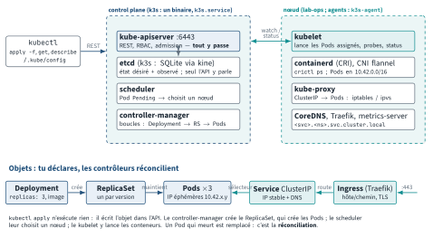
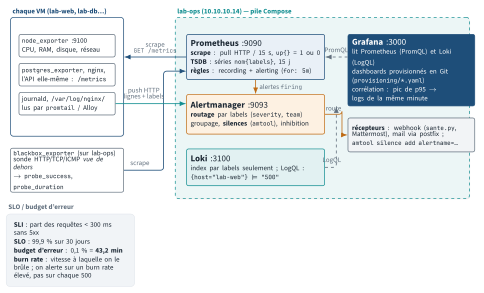

<!-- nav:début -->
[Accueil](../../README.md) › [Parcours](../../docs/parcours.md) › Partie IV — Socle DevOps › **Module 26**  
[← Module 25](../25-cicd/README.md) · [Corrigé](corrige.md) · [Module 27 →](../27-python-ops/README.md)

<details><summary>Scripts du module (13)</summary>

Sur la VM indiquée en section « Mise en place », depuis `~/workbook/scripts/` (voir [chapitre 0](../../docs/00-mise-en-place.md)).

| Script | Rôle |
|---|---|
| [`setup_M26.sh`](../../scripts/setup/setup_M26.sh) | prépare le module |
| [`check_M26_01.sh`](../../scripts/check/check_M26_01.sh) | vérification |
| [`check_M26_02.sh`](../../scripts/check/check_M26_02.sh) | vérification |
| [`check_M26_03.sh`](../../scripts/check/check_M26_03.sh) | vérification |
| [`check_M26_04.sh`](../../scripts/check/check_M26_04.sh) | vérification |
| [`check_M26_05.sh`](../../scripts/check/check_M26_05.sh) | vérification |
| [`check_M26_06.sh`](../../scripts/check/check_M26_06.sh) | vérification |
| [`break_M26_01.sh`](../../scripts/break/break_M26_01.sh) | installe une panne |
| [`break_M26_02.sh`](../../scripts/break/break_M26_02.sh) | installe une panne |
| [`break_M26_03.sh`](../../scripts/break/break_M26_03.sh) | installe une panne |
| [`break_M26_04.sh`](../../scripts/break/break_M26_04.sh) | installe une panne |
| [`break_M26_05.sh`](../../scripts/break/break_M26_05.sh) | installe une panne |
| [`break_M26_06.sh`](../../scripts/break/break_M26_06.sh) | installe une panne |

</details>
<!-- nav:fin -->

# Module 26 — Kubernetes et observabilité

## 26.0 Objectifs et compétences

> [!NOTE]
> **Objectifs**
>
> À la fin de ce module, je sais :
>
> * décrire l'architecture d'un cluster Kubernetes (api-server, etcd, scheduler,
>   controller-manager, kubelet, kube-proxy, runtime), expliquer le modèle
>   déclaratif et ce qu'est une boucle de réconciliation, et dire ce que k3s
>   remplace ou embarque par rapport à un cluster « complet » ;
> * installer k3s sur `lab-ops`, configurer `kubectl` (kubeconfig, contextes,
>   namespace par défaut, alias, complétion) depuis `lab-ops` **et** `lab-adm`,
>   et installer, mettre à jour et revenir en arrière sur un chart Helm ;
> * écrire de zéro des manifestes corrects pour Pod, Deployment, Service,
>   Ingress (Traefik, TLS), ConfigMap, Secret, StatefulSet + PVC, Job/CronJob,
>   DaemonSet, ResourceQuota, et les appliquer dans un Namespace dédié ;
> * déployer nginx + une API + PostgreSQL sur k3s, depuis un registre privé
>   authentifié, avec probes, requests/limits, rolling update et rollback ;
> * dérouler une méthode de diagnostic sur un Pod `Pending`, `ImagePullBackOff`,
>   `CrashLoopBackOff`, `OOMKilled`, une readiness qui échoue, un Service sans
>   endpoint, un Ingress en 404/5xx, une résolution DNS interne qui échoue —
>   en lisant `describe`, `logs --previous` et `get events --sort-by` ;
> * définir SLI, SLO, SLA et budget d'erreur, et calculer un budget et une
>   vitesse de consommation (*burn rate*) sur un cas chiffré ;
> * déployer Prometheus, Alertmanager, Grafana, Loki et Alloy sur `lab-ops`,
>   scraper les cinq VM et des exporters (nginx, PostgreSQL, blackbox,
>   kube-state-metrics, l'API sur k3s), et écrire les dix requêtes PromQL
>   qu'on tape vraiment en astreinte ;
> * écrire des règles d'enregistrement et d'alerte correctes (`expr`, `for`,
>   `labels`, `annotations`, `runbook_url`), router, grouper, inhiber et faire
>   taire une alerte dans Alertmanager ;
> * provisionner Grafana par fichiers, construire un tableau de bord avec
>   variables et seuils, importer un tableau de bord communautaire, et corréler
>   une métrique avec les logs Loki en LogQL ;
> * distinguer ce qui mérite une page de ce qui mérite un ticket, reconnaître
>   la fatigue d'alerte, et raccrocher un incident à un post-mortem.
>
> **Temps estimé** : 12 h (deux séances de 6 h, partie A puis partie B)
>
> **Prérequis** : modules 08 (systemd), 12 (réseau), 14 (SSH), 16 (journaux,
> `node_exporter`), 19 (méthode d'incident, post-mortem), et le module 22
> (Docker : images, registre, Compose). PostgreSQL et nginx sont utilisés tels quels.

---

## 26.1 Mise en place

VM concernées : **`lab-ops` (10.10.10.14)** porte k3s, le registre privé et la
pile d'observabilité. **`lab-adm` (10.10.10.10)** sert de poste client
(`kubectl`, `curl`, `helm`). Les trois autres VM reçoivent `node_exporter`
(lab-web et lab-db reçoivent en plus un exporter applicatif). L'agent k3s sur
`lab-web` est optionnel (E26.9).

```bash
# depuis le shell Proxmox, avant de commencer
qm snapshot 9005 avant-lab26
qm snapshot 9001 avant-lab26
```

Sur `lab-ops`, le script de préparation (idempotent) :

```bash
sudo bash ~/workbook/scripts/setup/setup_M26.sh
```

Il prépare, **sans installer k3s ni démarrer la supervision** (c'est le travail
des labs) :

| Élément | Où | Rôle |
|---|---|---|
| Registre privé `10.10.10.14:5000` | conteneur Docker `registre-lab` | authentifié (`mathieu` / `labpass`) |
| `factura-api:1.0` et `:1.1` | dans ce registre | l'API du fil rouge, expose `/metrics` |
| `/etc/rancher/k3s/registries.yaml` | lab-ops | dit à containerd que le registre est en HTTP |
| `~/lab26/k8s/` | lab-ops | manifestes **squelettes** à compléter (`A_COMPLETER`) |
| `~/lab26/k8s/casse/` | lab-ops | manifestes volontairement faux (L26.3) |
| `~/lab26/tls/` | lab-ops | certificat auto-signé `factura.lab.local` |
| `/opt/observabilite/` | lab-ops | Compose + configs Prometheus, Alertmanager, Grafana, Loki, Alloy, blackbox |
| `~/lab26/bin/` | lab-ops | `installer-node-exporter.sh`, `charge-api.sh` |
| `helm` | `/usr/local/bin` | binaire + complétion |

L'API `factura-api` (image `python:3.12-alpine`, port 8080) répond sur `/`
(version et nom du pod), `/sante` (liveness), `/pret` (readiness : 200
seulement si PostgreSQL est joignable), `/factures` (métier, 5 à 80 ms) et
`/metrics` (format Prometheus). Elle se pilote par variables d'environnement :
`DB_HOST`, `DB_PORT`, `FACTURA_DELAI_PRET`, `FACTURA_CRASH_APRES`,
`FACTURA_MEM_MB`, `FACTURA_TAUX_ERREUR`.

Sur `lab-adm`, il faut `curl`, `jq` et, pour E26.1, `kubectl` :

```bash
sudo apt update && sudo apt install -y curl jq
curl -fsSLo kubectl "https://dl.k8s.io/release/$(curl -fsSL \
  https://dl.k8s.io/release/stable.txt)/bin/linux/amd64/kubectl"
sudo install -m 0755 kubectl /usr/local/bin/kubectl && rm kubectl
```

> [!IMPORTANT]
> **Variante Rocky / RHEL**
>
> Sur `lab-rhel`, `node_exporter` n'est pas dans les dépôts de base : le script
> `~/lab26/bin/installer-node-exporter.sh` télécharge le binaire officiel, crée
> `node_exporter.service` et ouvre `9100/tcp` dans firewalld. Pense au SELinux :
> le binaire dans `/usr/local/bin` est exécutable par systemd sans étiquette
> particulière.

> [!CAUTION]
> **Attention**
>
> `lab-ops` a 4 Go de RAM pour Docker (registre + 7 conteneurs d'observabilité)
> **et** k3s. Ça tient, à condition de respecter les `requests`/`limits` des
> manifestes et de ne pas installer `kube-prometheus-stack` complet (voir 26.9).
> Surveille `kubectl top node` **et** `free -m` : si la VM swappe, tout ralentit sans qu'aucun pod ne soit tué. Le snapshot
> `avant-lab26` est ta porte de sortie ; `k3s-uninstall.sh` en est une autre.

---

## 26.2 Rappel express

### Partie A — Kubernetes

#### Architecture

```text
 control plane                              nœud (worker)
 +----------------------------+             +-------------------------+
 | kube-apiserver  <-- REST --+-- kubectl   | kubelet  (pods, probes) |
 |   |  etcd (état désiré +   |             | kube-proxy (Services -> |
 |   |        état observé)   |   watch     |    iptables/ipvs)       |
 | scheduler (Pending -> nœud)|<----------->| runtime containerd      |
 | controller-manager (boucles|             | CNI (flannel), CoreDNS  |
 |   Deployment->RS->Pod...)  |             +-------------------------+
 +----------------------------+
```

Tout passe par l'API server ; **personne d'autre ne parle à etcd**. Tu
déclares un état désiré (`kubectl apply`), des contrôleurs comparent en boucle
l'état observé à l'état désiré et corrigent l'écart : c'est la
**réconciliation**. Rien n'est « exécuté » par `kubectl` : il écrit un objet,
puis quelqu'un d'autre réagit.

<p align="center"></p>

*Figure — Control plane et nœud : tout passe par l'API server, les contrôleurs réconcilient ; `kubectl apply` écrit un Deployment, le ReplicaSet crée les Pods, le Service leur donne une IP stable, l'Ingress route depuis l'extérieur.*

**k3s** : un seul binaire, un seul service `k3s.service`. Il embarque containerd,
flannel (CNI), CoreDNS, **Traefik** (Ingress, classe `traefik`), ServiceLB
(`LoadBalancer` sur l'IP du nœud), `local-path` (StorageClass par défaut,
données sous `/var/lib/rancher/k3s/storage/`) et metrics-server. Datastore
**SQLite** via kine à la place d'etcd (etcd embarqué si `--cluster-init`).

```bash
curl -sfL https://get.k3s.io | sh -               # serveur, ~1 min
sudo cat /etc/rancher/k3s/k3s.yaml                # kubeconfig (root, 0600)
sudo cat /var/lib/rancher/k3s/server/node-token   # pour joindre un agent
curl -sfL https://get.k3s.io | K3S_URL=https://10.10.10.14:6443 \
  K3S_TOKEN=<token> sh -                          # agent (k3s-agent.service)
journalctl -u k3s -f ; sudo k3s crictl ps ; sudo k3s ctr images ls
/etc/rancher/k3s/registries.yaml                  # registres/miroirs containerd
/usr/local/bin/k3s-uninstall.sh                   # tout retirer
```

#### kubectl

```bash
export KUBECONFIG=~/.kube/config
kubectl config get-contexts ; kubectl config use-context default
kubectl config set-context --current --namespace=factura
source <(kubectl completion bash) ; alias k=kubectl
complete -o default -F __start_kubectl k
kubectl explain deployment.spec.strategy --recursive
kubectl api-resources ; kubectl get all -n factura
kubectl get pods -o wide | -o yaml | -o json
kubectl get pods -o \
  jsonpath='{range .items[*]}{.metadata.name}{"\t"}{.status.podIP}{"\n"}{end}'
kubectl get pods -o custom-columns=NOM:.metadata.name,NOEUD:.spec.nodeName
kubectl create deployment web --image=nginx:1.27-alpine \
  --dry-run=client -o yaml > web.yaml           # générer, puis éditer
kubectl apply -f dossier/ ; kubectl diff -f x.yaml ; kubectl delete -f x.yaml
kubectl describe pod NOM ; kubectl get events --sort-by=.lastTimestamp
kubectl logs NOM -c conteneur --previous --tail=100 --since=10m -f
kubectl logs deploy/factura-api --all-containers ; kubectl logs -l app=x
kubectl exec -it NOM -- sh ; kubectl port-forward svc/front 8080:80
kubectl scale deploy factura-api --replicas=3 ; kubectl edit deploy x
kubectl set image deploy/factura-api api=10.10.10.14:5000/factura-api:1.1
kubectl rollout status|history|undo [--to-revision=1]|restart deploy/x
kubectl top node ; kubectl top pod -n factura --containers
kubectl run -it --rm dbg --image=busybox:1.36 --restart=Never -- sh
kubectl auth can-i delete pods --as=system:serviceaccount:factura:default
kubectl apply -k dossier/         # kustomize : kustomization.yaml
```

`k9s` : la même chose en plein écran (`:pods`, `l` logs, `d` describe, `s`
shell). Pratique, mais l'entretien se passe en `kubectl`.

#### Objets

| Objet | Rôle | Point clé |
|---|---|---|
| Pod | 1..n conteneurs, même IP, même réseau | jamais créé à la main en prod |
| ReplicaSet | maintient N pods identiques | géré par le Deployment |
| Deployment | RS + stratégie de mise à jour | `RollingUpdate` (maxSurge/maxUnavailable) ou `Recreate` |
| StatefulSet | identité stable, `pod-0`, PVC par pod | Service headless obligatoire |
| DaemonSet | un pod par nœud | agents (logs, node_exporter) |
| Job / CronJob | tâche qui se termine | `backoffLimit`, `schedule`, `restartPolicy` |
| Service | IP virtuelle stable + DNS vers des pods | `selector` → Endpoints |
| Ingress | routage HTTP(S) par Host/path | besoin d'un contrôleur (Traefik) |
| ConfigMap / Secret | config / données sensibles | Secret = **base64, pas chiffré** |
| PVC / PV / StorageClass | stockage persistant | `local-path` sur k3s |
| Namespace | isolation logique | quotas, RBAC, DNS `svc.ns.svc.cluster.local` |

Service : `ClusterIP` (interne, défaut) ⊂ `NodePort` (30000–32767 sur chaque
nœud) ⊂ `LoadBalancer` (IP externe ; sur k3s, ServiceLB prend l'IP du nœud).
DNS interne : `factura-api` (même namespace), `factura-api.factura`,
`factura-api.factura.svc.cluster.local`. Le `resolv.conf` des pods a
`search <ns>.svc.cluster.local svc.cluster.local cluster.local` et `ndots:5`.

Probes : **liveness** (échec → restart du conteneur), **readiness** (échec →
retiré des Endpoints, pas de restart), **startup** (bloque les deux autres
tant que l'app démarre). Champs : `initialDelaySeconds`, `periodSeconds`,
`timeoutSeconds`, `failureThreshold`.

Ressources : `requests` (réservation, sert au scheduler) et `limits` (plafond ;
CPU → throttling, mémoire → **OOMKilled**, code 137). QoS : `Guaranteed`
(requests = limits partout), `Burstable`, `BestEffort` (rien) — évincés dans
cet ordre inverse. HPA : `kubectl autoscale deploy x --cpu-percent=60 --min=2
--max=4` (exige des requests et metrics-server). `ResourceQuota` plafonne un
namespace, `LimitRange` pose des défauts par conteneur.

RBAC : `Role`/`ClusterRole` (règles : apiGroups, resources, verbs) liés à un
sujet (User, Group, ServiceAccount) par `RoleBinding`/`ClusterRoleBinding`.
ClusterRoles prêts à l'emploi : `view`, `edit`, `admin`, `cluster-admin`.
NetworkPolicy : par défaut tout pod parle à tout pod ; une policy avec
`podSelector` + `policyTypes: [Ingress]` ferme, puis on ouvre par règle
(k3s l'applique, contrairement à flannel seul).

Helm : `helm repo add|update`, `helm search repo`, `helm show values chart >
values.yaml`, `helm install NOM chart -n ns --create-namespace -f
values.yaml`, `helm upgrade --install`, `helm list -A`, `helm history NOM`,
`helm rollback NOM 1`, `helm uninstall`, `helm template` (voir le YAML sans
l'appliquer). Un chart = templates + `values.yaml` ; une *release* = chart +
valeurs + révision.

#### Diagnostic — la table des symptômes

| Symptôme | Où regarder | Cause typique |
|---|---|---|
| `Pending` | `describe pod` → Events | requests trop gros, nodeSelector, PVC non lié, quota |
| `ImagePullBackOff` | Events : `401`, `not found`, `x509` | nom/tag faux, secret absent, registre HTTP non déclaré |
| `CrashLoopBackOff` | `logs --previous`, `describe` → Last State | l'app sort en erreur, config manquante |
| `OOMKilled` (137) | `describe` → `Reason: OOMKilled` | limite mémoire < besoin réel (`kubectl top`) |
| `0/1 READY` durable | `describe` → readiness failed | mauvais port/chemin, dépendance absente |
| Service muet | `kubectl get endpoints` vide | selector ≠ labels des pods, pods non Ready |
| Ingress 404 | `describe ingress`, Host envoyé | aucune règle ne matche (Host/path) |
| Ingress 5xx | `get endpoints` du backend | règle OK, aucun endpoint prêt |
| DNS `NXDOMAIN` | `nslookup` depuis un pod | mauvais namespace, CoreDNS `kube-system` |

`kubectl get events -A --sort-by=.lastTimestamp | tail -20` d'abord,
toujours.

### Partie B — Observabilité

#### Vocabulaire

Trois piliers : **métriques** (nombres agrégés dans le temps, peu chers,
alertables), **logs** (événements discrets, contexte, coûteux en volume),
**traces** (le chemin d'une requête à travers les services). **SLI** :
indicateur mesuré (ex. part des requêtes en moins de 300 ms sans 5xx).
**SLO** : objectif interne sur le SLI (99,9 % sur 30 jours). **SLA** : contrat
avec pénalités, toujours plus lâche que le SLO. **Budget d'erreur** :
`1 − SLO` (99,9 % → 0,1 % → **43,2 min** sur 30 jours). *Burn rate* : vitesse
de consommation du budget (1 = tout le budget juste à la fin de la fenêtre).

#### Prometheus

Modèle : `nom{label="v",...}` → une série ; échantillons (horodatage, float).
Types : **counter** (ne fait que monter, `_total`), **gauge** (monte et
descend), **histogram** (`_bucket{le=}`, `_sum`, `_count`), **summary**
(quantiles précalculés, non agrégeables). Collecte en **pull** HTTP sur
`/metrics`, toutes les `scrape_interval` ; `up{job,instance}` vaut 1 ou 0 par
cible. Une série sans échantillon depuis 5 min est *stale*.

```yaml
global: {scrape_interval: 15s, evaluation_interval: 15s}
rule_files: [/etc/prometheus/rules/*.yml]
alerting: {alertmanagers: [{static_configs: [{targets: [alertmanager:9093]}]}]}
scrape_configs:
  - job_name: node
    static_configs:
      - targets: ["10.10.10.11:9100"]
        labels: {instance: lab-web}
```

`promtool check config prometheus.yml`, `promtool check rules r.yml`,
rechargement `curl -X POST http://localhost:9090/-/reload`
(`--web.enable-lifecycle`). Cibles : `http://10.10.10.14:9090/targets`.

PromQL — l'essentiel :

| Fonction | Sur | Ce que ça donne |
|---|---|---|
| `rate(c[5m])` | counter | variation **par seconde**, moyenne sur 5 min, gère les resets |
| `irate(c[5m])` | counter | idem sur les 2 derniers points : nerveux, jamais en alerte |
| `increase(c[1h])` | counter | total d'incréments sur la fenêtre (= rate × 3600) |
| `sum by (l) (v)` | tout | agrège en gardant `l` ; `without (l)` fait l'inverse |
| `histogram_quantile(0.95, sum by (le) (rate(h_bucket[5m])))` | histogram | p95 approché |
| `predict_linear(g[6h], 86400)` | gauge | valeur extrapolée dans 24 h |
| `topk(3, v)`, `absent(v)`, `changes(v[1h])` | | classement, absence, instabilité |
| `v offset 1d`, `avg_over_time(v[1h])` | | comparaison hier, lissage |

Fenêtre de `rate` ≥ 4 × `scrape_interval`. Une comparaison (`> 0.9`)
**filtre** les séries, elle ne rend pas un booléen. Les règles
d'enregistrement se nomment `niveau:métrique:opération`
(`instance:node_cpu:ratio_5m`).

Règle d'alerte :

```yaml
- alert: InstanceDown
  expr: up == 0
  for: 2m                       # pending pendant 2 min, puis firing
  labels: {severity: page}
  annotations:
    summary: "{{ $labels.instance }} ne répond plus au scrape"
    runbook_url: https://wiki.lab.local/runbooks/instance-down
```

#### Alertmanager

Arbre de routes : chaque alerte descend jusqu'à la première route qui matche
(`matchers`), sauf `continue: true`. `group_by` fusionne les alertes en une
notification ; `group_wait` (30 s : attendre les copines), `group_interval`
(5 min : nouvelles alertes dans un groupe existant), `repeat_interval` (4 h :
re-notifier si toujours en cours). `inhibit_rules` : si `source` est en
cours, on tait `target` quand les labels `equal` coïncident. Silences : UI
ou `amtool silence add alertname=X instance=Y --duration=2h --comment="..."`.
`amtool check-config alertmanager.yml`.

#### Grafana, Loki, traces

Grafana : provisioning par fichiers dans `/etc/grafana/provisioning/
{datasources,dashboards}` ; un tableau de bord = panneaux (requête, unité,
légende `{{instance}}`, seuils) + variables (`label_values(m, instance)`).
Import communautaire : *Node Exporter Full* = ID **1860**.

Loki indexe **les labels seulement** (peu, stables : `job`, `host`) et
stocke les lignes compressées ; ELK indexe le texte intégral (cher, puissant).
Collecte : Alloy (Promtail est en fin de vie). LogQL :

```text
{job="systemd-journal", host="lab-web"} |= "error" != "debug"
{job="varlogs"} |~ "5[0-9]{2} " | logfmt | duree_ms > 100
sum by (host) (rate({job="systemd-journal"} |= "oom" [5m]))
```

<p align="center"></p>

*Figure — La pile d'observabilité sur lab-ops : Prometheus scrape les exporters et la sonde blackbox, évalue les règles et pousse les alertes à Alertmanager qui les route ; Promtail/Alloy poussent les logs vers Loki ; Grafana lit les deux ; le SLO fixe le budget d'erreur.*

Traces : OpenTelemetry (SDK + collecteur + protocole OTLP) produit des
*spans* reliés par un `trace_id`, propagé en HTTP par l'en-tête
`traceparent` ; stockage Tempo ou Jaeger. Corrélation : un `trace_id` dans
les logs, des *exemplars* sur les histogrammes.

#### Métriques Kubernetes

`metrics-server` : instantané CPU/RAM pour `kubectl top` et l'HPA, **aucun
historique**. `kube-state-metrics` : l'état des objets
(`kube_pod_container_status_restarts_total`,
`kube_deployment_status_replicas_available`,
`kube_pod_container_status_waiting_reason{reason="CrashLoopBackOff"}`).
cAdvisor (dans kubelet, `/metrics/cadvisor`) :
`container_memory_working_set_bytes`, `container_cpu_usage_seconds_total`.
`kube-prometheus-stack` (Helm) installe tout ça plus l'operator et ses CRD
(`ServiceMonitor`, `PrometheusRule`), Grafana et des dizaines d'alertes.

#### Astreinte

**Page** = un humain doit agir maintenant, impact utilisateur, action
possible. **Ticket** = à traiter dans la journée. Une alerte sans runbook
n'est pas une alerte, c'est du bruit. On alerte sur des **symptômes**
(latence, erreurs, disponibilité), on diagnostique avec les causes (CPU,
disque). Chaque page mérite une trace écrite ; chaque incident sérieux, un
post-mortem blameless (modèle : `~/lab19/modeles/postmortem.md`).

---

## 26.3 Quiz — QCM

<a id="q26-1"></a>**[Q26.1](corrige.md#q26-1)** — Tu tapes `kubectl scale deploy factura-api --replicas=3`. Décris ce
qui se passe réellement dans le cluster.

a) `kubectl` demande au kubelet de lancer un troisième conteneur
b) `kubectl` modifie `spec.replicas` via l'API server ; le contrôleur de
   Deployment ajuste le ReplicaSet ; le contrôleur de ReplicaSet crée un Pod
   sans nœud ; le scheduler lui en assigne un ; le kubelet de ce nœud le
   démarre
c) le scheduler crée directement le pod sur le nœud le moins chargé
d) etcd notifie le kubelet qu'un pod manque

<a id="q26-2"></a>**[Q26.2](corrige.md#q26-2)** — Sur k3s mono-nœud, quelle affirmation est vraie ? **Deux réponses
correctes.**

a) etcd tourne dans un pod `kube-system`
b) le datastore par défaut est SQLite, servi à l'API server par kine
c) Traefik, CoreDNS et metrics-server sont déployés automatiquement
d) kube-proxy est remplacé par nginx

<a id="q26-3"></a>**[Q26.3](corrige.md#q26-3)** — `kubectl get pods -n factura` affiche :

```text
NAME                           READY   STATUS             RESTARTS      AGE
factura-api-7d9c8b5f4-x2k9p    0/1     CrashLoopBackOff   6 (2m ago)    9m
```

Quelle commande donne **la raison de la sortie précédente** du conteneur ?

a) `kubectl logs factura-api-7d9c8b5f4-x2k9p`
b) `kubectl logs factura-api-7d9c8b5f4-x2k9p --previous`
c) `kubectl get events -n factura`
d) `kubectl top pod factura-api-7d9c8b5f4-x2k9p`

<a id="q26-4"></a>**[Q26.4](corrige.md#q26-4)** — `kubectl describe pod` montre `Last State: Terminated, Reason:
OOMKilled, Exit Code: 137`. Que s'est-il passé ?

a) la liveness probe a échoué trois fois et le kubelet a redémarré le pod
b) le conteneur a dépassé `resources.limits.memory` ; le noyau (cgroup) l'a
   tué avec `SIGKILL` ; augmenter la limite ou corriger la fuite
c) le nœud manque de mémoire et le scheduler a évincé le pod
d) `requests.memory` est trop bas, il faut l'augmenter

<a id="q26-5"></a>**[Q26.5](corrige.md#q26-5)** — Un Service `factura-api` a une ClusterIP mais
`kubectl get endpoints factura-api` renvoie `<none>`. Les pods de l'API sont
`Running` et `1/1`. Cause la plus probable ?

a) le port `targetPort` du Service ne correspond pas au `containerPort`
b) le `selector` du Service ne correspond pas aux labels des pods
c) CoreDNS est arrêté
d) il manque un Ingress

<a id="q26-6"></a>**[Q26.6](corrige.md#q26-6)** — Même Service, mais cette fois les pods sont `Running` et `0/1`.
Que conclus-tu ? **Deux réponses correctes.**

a) la readiness probe échoue, donc les pods sont retirés des Endpoints
b) la liveness probe échoue, donc les pods vont redémarrer
c) `kubectl describe pod` montrera `Readiness probe failed` avec la raison
   (connexion refusée, 503, timeout)
d) les pods sont en attente de scheduling

<a id="q26-7"></a>**[Q26.7](corrige.md#q26-7)** — Un Secret contient `POSTGRES_PASSWORD: bGFicGFzcw==`. Qu'affirmer ?

a) la valeur est chiffrée avec la clé de l'API server
b) c'est du base64 : `echo bGFicGFzcw== | base64 -d` donne `labpass` ; tout
   compte autorisé à lire le Secret lit le mot de passe
c) seul root sur le nœud peut la décoder
d) un Secret est toujours chiffré au repos dans etcd

<a id="q26-8"></a>**[Q26.8](corrige.md#q26-8)** — Depuis un pod du namespace `casse`, `nslookup postgres` échoue en
`NXDOMAIN`, alors que le Service `postgres` existe dans le namespace
`factura`. Quel nom fonctionne ?

a) `postgres.factura`
b) `postgres.cluster.local`
c) `factura.postgres.svc`
d) `postgres.kube-system`

<a id="q26-9"></a>**[Q26.9](corrige.md#q26-9)** — Un Deployment (2 réplicas, `RollingUpdate` par défaut) reçoit une
nouvelle image dont la readiness ne passe jamais. Que voit-on après 5 minutes ?

a) les 2 anciens pods sont supprimés, le service est coupé
b) 3 pods : 2 anciens `1/1` et 1 nouveau `0/1` ; le rollout reste bloqué mais
   le service continue de répondre
c) le Deployment revient tout seul à l'ancienne image
d) les nouveaux pods passent `CrashLoopBackOff`

<a id="q26-10"></a>**[Q26.10](corrige.md#q26-10)** — `curl -k https://factura.lab.local/api/factures` (résolu vers
10.10.10.14) répond `404 page not found`, corps de Traefik. Que vérifies-tu en
premier ?

a) les logs de PostgreSQL
b) que l'Ingress a bien une règle dont `host` vaut `factura.lab.local` et
   un `path` qui couvre `/api/factures` (`Prefix` et non `Exact`)
c) que le pod nginx a une limite mémoire suffisante
d) que le Secret TLS est valide

<a id="q26-11"></a>**[Q26.11](corrige.md#q26-11)** — `kubectl get pod x -o jsonpath='{.status.qosClass}'` renvoie
`Burstable`. Ce qui est vrai :

a) requests et limits sont égaux pour CPU et mémoire sur tous les conteneurs
b) aucune ressource n'est définie
c) au moins un conteneur a une request ou une limite, sans que tout soit égal ;
   sous pression mémoire, ce pod est évincé après les `BestEffort` et avant les
   `Guaranteed`
d) le pod ne peut pas être évincé

<a id="q26-12"></a>**[Q26.12](corrige.md#q26-12)** — `rate(factura_http_requests_total[5m])` et
`increase(factura_http_requests_total[5m])`. **Deux réponses correctes.**

a) `increase` = `rate` × 300 sur cette fenêtre
b) `rate` renvoie un nombre par seconde, `increase` un nombre d'événements
c) `rate` s'utilise sur une gauge, `increase` sur un counter
d) `irate` est préférable dans une règle d'alerte parce qu'il réagit plus vite

<a id="q26-13"></a>**[Q26.13](corrige.md#q26-13)** — Quel est le p95 correct de la latence de l'API à partir de son
histogramme, toutes routes confondues ?

a) `histogram_quantile(0.95, factura_http_request_duration_seconds_bucket)`
b) `histogram_quantile(0.95, sum by (le)
   (rate(factura_http_request_duration_seconds_bucket[5m])))`
c) `quantile(0.95, rate(factura_http_request_duration_seconds_sum[5m]))`
d) `rate(factura_http_request_duration_seconds_sum[5m]) /
   rate(factura_http_request_duration_seconds_count[5m])`

<a id="q26-14"></a>**[Q26.14](corrige.md#q26-14)** — Une règle `InstanceDown` avec `expr: up == 0` et `for: 2m`. Tu
arrêtes `node_exporter` sur lab-web. À `t+60s`, que montre
`http://lab-ops:9090/alerts` ?

a) rien : l'alerte n'existe qu'une fois notifiée
b) `InstanceDown` en état **pending** (jaune) ; elle passera **firing** à
   `t+120s` si l'expression reste vraie à chaque évaluation, et Alertmanager
   ne la reçoit qu'à ce moment-là
c) `InstanceDown` en firing, Alertmanager attend `group_wait`
d) une erreur, car `up` n'est pas une métrique définie

<a id="q26-15"></a>**[Q26.15](corrige.md#q26-15)** — Dans `alertmanager.yml`, que fait ce bloc ?

```yaml
inhibit_rules:
  - source_matchers: ['alertname="InstanceDown"']
    target_matchers: ['severity="ticket"']
    equal: ['instance']
```

a) supprime définitivement les alertes `ticket`
b) tant qu'`InstanceDown` est en cours pour une instance, toute alerte
   `severity=ticket` **de la même instance** n'est pas notifiée (elle reste
   visible, marquée *inhibited*)
c) transforme les `ticket` en `page`
d) regroupe `InstanceDown` avec les tickets dans une seule notification

<a id="q26-16"></a>**[Q26.16](corrige.md#q26-16)** — SLO 99,9 % sur 30 jours pour l'API. Sur les 10 premiers jours, elle
a cumulé 30 minutes d'indisponibilité. Que peut-on dire ?

a) le SLO est déjà violé
b) il reste 13,2 minutes de budget pour 20 jours : le burn rate est ≈ 2,1 ;
   à ce rythme, le budget est épuisé avant la fin de la fenêtre
c) il reste 70 % du budget, tout va bien
d) le SLA est violé

<a id="q26-17"></a>**[Q26.17](corrige.md#q26-17)** — Ce qu'indexe Loki, et pourquoi c'est important :

a) le texte intégral de chaque ligne, comme Elasticsearch
b) uniquement les labels du flux ; d'où la règle « peu de labels, à faible
   cardinalité », et le filtrage de contenu (`|=`) qui se fait après coup en
   parcourant les chunks
c) rien, tout est en mémoire
d) les labels **et** les champs `logfmt`

<a id="q26-18"></a>**[Q26.18](corrige.md#q26-18)** — Quelle alerte mérite une **page** de nuit ? **Une seule réponse.**

a) `node_filesystem_avail_bytes / node_filesystem_size_bytes < 0.30` sur
   lab-adm
b) taux de 5xx de l'API > 5 % pendant 5 min et `probe_success == 0` sur
   `https://factura.lab.local` depuis 3 min
c) CPU de lab-db > 80 % pendant 10 min
d) `predict_linear` annonce un disque plein dans 4 jours

---

## 26.4 Quiz — questions ouvertes

<a id="qo26-1"></a>**[QO26.1](corrige.md#qo26-1)** — *On te demande en entretien* : « Explique-moi ce qui se passe entre
`kubectl apply -f deployment.yaml` et le moment où le conteneur répond. »
Cite chaque composant, ce qu'il lit, ce qu'il écrit, et où se trouve l'état.
Termine par ce que signifie « modèle déclaratif » et donne un exemple de
réconciliation qui se produit **sans** aucune action humaine.

<!-- repondre: 12 -->

<a id="qo26-2"></a>**[QO26.2](corrige.md#qo26-2)** — Compare liveness, readiness et startup probe : ce qui se passe
quand chacune échoue, un exemple concret de mauvais usage (une liveness qui
teste la base de données, par exemple) et ses conséquences en production.
Dans quel cas une readiness qui échoue est-elle une **bonne** nouvelle ?

<!-- repondre: 10 -->

<a id="qo26-3"></a>**[QO26.3](corrige.md#qo26-3)** — Un pod est `Pending` depuis 10 minutes. Déroule ta méthode :
quelles commandes, dans quel ordre, ce que tu cherches dans chaque sortie.
Couvre au moins : ressources insuffisantes, `nodeSelector`/taints, PVC non
lié, `ResourceQuota` dépassé (où se lit celui-là ?), et nœud `NotReady`.

<!-- repondre: 12 -->

<a id="qo26-4"></a>**[QO26.4](corrige.md#qo26-4)** — *On te demande en entretien* : « Deployment ou StatefulSet pour
PostgreSQL ? Et pourquoi un Service headless ? » Explique identité stable,
`volumeClaimTemplates`, ordre de démarrage, DNS `pod-0.svc`, et dis ce
qu'un Deployment avec un PVC ferait de mal lors d'un rolling update.

<!-- repondre: 10 -->

<a id="qo26-5"></a>**[QO26.5](corrige.md#qo26-5)** — GitOps, operators, service mesh, managé vs auto-hébergé :
donne pour chacun une définition en deux phrases, un outil, et le problème
qu'il résout. Puis prends position : pour une équipe de 4 personnes qui
héberge 10 applications, que recommandes-tu et pourquoi ?

<!-- repondre: 12 -->

<a id="qo26-6"></a>**[QO26.6](corrige.md#qo26-6)** — Définis SLI, SLO, SLA et budget d'erreur avec un exemple chiffré
pour `factura-api`. Explique pourquoi on alerte sur la **vitesse de
consommation** du budget plutôt que sur un seuil fixe, et décris l'alerte
« multi-fenêtre, multi-burn-rate » (deux fenêtres, deux seuils).

<!-- repondre: 12 -->

<a id="qo26-7"></a>**[QO26.7](corrige.md#qo26-7)** — *On te demande en entretien* : « Pourquoi `rate()` sur un counter
et pas une soustraction de deux valeurs ? Que se passe-t-il si le service
redémarre ? Pourquoi une fenêtre de `[1m]` avec un scrape à 15 s est-elle une
mauvaise idée ? » Explique aussi pourquoi `sum(rate(...))` est correct et
`rate(sum(...))` est faux.

<!-- repondre: 10 -->

<a id="qo26-8"></a>**[QO26.8](corrige.md#qo26-8)** — Décris le chemin complet d'une alerte, de l'expression PromQL
jusqu'au téléphone de l'astreinte : évaluation, `pending`/`firing`, envoi à
Alertmanager, déduplication, routage, groupement (`group_wait`,
`group_interval`, `repeat_interval`), inhibition, silence, notification,
résolution. À chaque étape, dis ce qui peut faire qu'une alerte « n'arrive
jamais ».

<!-- repondre: 14 -->

<a id="qo26-9"></a>**[QO26.9](corrige.md#qo26-9)** — Un collègue propose d'ajouter un label `user_id` aux métriques
HTTP de l'API et `request_id` aux labels Loki « pour pouvoir tout retrouver ».
Explique ce qu'est la cardinalité, ce que ça coûte dans Prometheus et dans
Loki, et propose la bonne façon de retrouver une requête précise (logs,
traces, exemplars).

<!-- repondre: 10 -->

<a id="qo26-10"></a>**[QO26.10](corrige.md#qo26-10)** — Ton équipe reçoit 40 alertes par nuit, dont 3 utiles. Décris la
fatigue d'alerte, ses conséquences, et un plan en cinq actions concrètes pour
passer à moins de 5 alertes par nuit sans rater un incident. Quel rôle joue le
post-mortem là-dedans ?

<!-- repondre: 10 -->

---

## 26.5 Exercices guidés ★

<a id="e26-1"></a>**[E26.1](corrige.md#e26-1)** — Depuis `lab-adm`, sans copier-coller le fichier à la main dans un
éditeur, récupère le kubeconfig de k3s, adapte l'adresse du serveur, et fais en
sorte que `kubectl get nodes` fonctionne. Puis règle `factura` comme
namespace par défaut du contexte, installe la complétion bash **et** l'alias
`k` avec complétion. Prouve que `k get po` complète les noms de pods.

<a id="e26-2"></a>**[E26.2](corrige.md#e26-2)** — Génère, sans l'appliquer, le manifeste YAML d'un Deployment
`demo` (image `nginx:1.27-alpine`, 2 réplicas) puis celui d'un Service
ClusterIP qui l'expose sur le port 80. Nettoie les champs inutiles
(`creationTimestamp: null`, `status: {}`, `resources: {}`) et applique les
deux fichiers dans un namespace `demo`. Vérifie avec `kubectl get all`.

<a id="e26-3"></a>**[E26.3](corrige.md#e26-3)** — Affiche, en **une** commande chacune : (a) le nom, l'IP et le nœud
de chaque pod de tous les namespaces avec `custom-columns` ; (b) l'image de
chaque conteneur de chaque Deployment du namespace `factura` avec `jsonpath` ;
(c) les 15 derniers événements du cluster classés par date.

<a id="e26-4"></a>**[E26.4](corrige.md#e26-4)** — Sans Service ni Ingress, atteins nginx du Deployment `demo` depuis
`lab-adm` grâce à un tunnel `kubectl`. Ensuite, ouvre un shell dans un pod
`demo`, affiche son `/etc/resolv.conf`, et explique les lignes `search` et
`ndots`. Enfin, affiche les 20 dernières lignes des logs de **tous** les pods
du Deployment en une commande.

<a id="e26-5"></a>**[E26.5](corrige.md#e26-5)** — Pose le label `env=test` sur un seul des pods `demo`, puis affiche
les pods avec la colonne `env` visible, puis uniquement ceux qui ont
`env=test`, puis ceux qui **n'ont pas** ce label. Que se passe-t-il si tu
changes le label `app` d'un pod du Deployment ? Prouve-le.

<a id="e26-6"></a>**[E26.6](corrige.md#e26-6)** — Crée une ConfigMap `demo-conf` à partir d'un fichier
`message.txt` et d'un littéral `COULEUR=bleu`, injecte-la dans un pod à la
fois comme variable d'environnement et comme fichier monté, et montre les
deux depuis le pod. Puis modifie la ConfigMap et observe, sans redémarrer, ce
qui change et ce qui ne change pas. Explique.

<a id="e26-7"></a>**[E26.7](corrige.md#e26-7)** — Complète `~/lab26/k8s/60-cronjob-sauvegarde.yaml` : un CronJob
`sauvegarde-pg` à 02:30 tous les jours qui exécute `pg_dump` vers
`/backup/factura-<date>.sql` sur un PVC `sauvegardes` de 1 Gi, mot de passe
tiré du Secret `postgres-auth`. Déclenche-le **immédiatement** sans attendre
02:30, suis le Job, et vérifie le fichier produit. Quelle directive empêche
que deux exécutions se chevauchent ?

<a id="e26-8"></a>**[E26.8](corrige.md#e26-8)** — Écris un DaemonSet `noeud-info` (namespace `kube-system`, image
`busybox:1.36`) dont le conteneur affiche toutes les 60 s le nom du nœud
(injecté depuis `spec.nodeName` via la Downward API) et l'uptime lu dans
`/proc/uptime` du **nœud** (pas du conteneur). Vérifie dans les logs.

<a id="e26-9"></a>**[E26.9](corrige.md#e26-9)** — *(optionnel, si lab-web a de la marge)* Ajoute `lab-web` comme
agent du cluster. Vérifie `kubectl get nodes -o wide`, pose le label
`role=web` sur ce nœud, puis force le Deployment `demo` à n'y tourner que là.
Prouve-le avec la colonne NODE. Retire ensuite le nœud proprement (`drain`,
`delete node`, désinstallation de l'agent).

<a id="e26-10"></a>**[E26.10](corrige.md#e26-10)** — Crée dans `factura` un ServiceAccount `lecteur`, donne-lui le
droit de lire pods, services et logs dans ce namespace **seulement**, via une
ClusterRole existante. Prouve avec `kubectl auth can-i` (a) qu'il peut lister
les pods de `factura`, (b) qu'il ne peut pas les supprimer, (c) qu'il ne peut
rien lister dans `kube-system`.

<a id="e26-11"></a>**[E26.11](corrige.md#e26-11)** — Pose une `ResourceQuota` sur `factura` : 4 pods maximum, 2 CPU et
2 Gi de requests. Scale `factura-api` à 5 réplicas. Combien de pods
apparaissent ? Où se lit le refus (ce n'est **pas** dans `get pods`) ? Reviens
à 2 réplicas et retire la quota.

<a id="e26-12"></a>**[E26.12](corrige.md#e26-12)** — Depuis l'interface Prometheus (`http://10.10.10.14:9090`), écris
et exécute les requêtes suivantes, et note pour chacune la valeur sur
`lab-web` : (a) CPU utilisé en % par instance ; (b) mémoire disponible en % ;
(c) espace disque `/` utilisé en % ; (d) charge 5 min divisée par le nombre de
cœurs ; (e) débit réseau entrant en bit/s hors `lo` et interfaces virtuelles.

<a id="e26-13"></a>**[E26.13](corrige.md#e26-13)** — Toujours en PromQL : (f) le nombre de requêtes par seconde de
l'API par code HTTP ; (g) le ratio de 5xx sur 5 min ; (h) le p95 de latence de
`/factures` ; (i) la date estimée à laquelle `/` de `lab-db` sera plein si la
tendance des 6 dernières heures continue ; (j) les cibles `down` et depuis
combien de temps (indice : `changes`). Utilise `~/lab26/bin/charge-api.sh`
pour avoir du trafic.

<a id="e26-14"></a>**[E26.14](corrige.md#e26-14)** — Calcule à la main, puis vérifie en PromQL avec les métriques de
l'API : pour un SLO de 99,5 % de requêtes sans 5xx sur 30 jours, (a) le budget
en pourcentage et en nombre de requêtes si l'API en sert 2 millions par mois ;
(b) le budget en minutes si on raisonne en disponibilité ; (c) le burn rate
si le taux d'erreur mesuré sur 1 h est de 2 % ; (d) en combien de temps le
budget est épuisé à ce rythme.

<a id="e26-15"></a>**[E26.15](corrige.md#e26-15)** — Avec `amtool` (dans le conteneur `alertmanager`) : liste les
alertes en cours, crée un silence de 2 h sur `alertname=InstanceDown` pour
`instance=lab-rhel` avec un commentaire, liste les silences, puis expire-le.
Montre que la commande `amtool check-config` valide bien
`/opt/observabilite/alertmanager/alertmanager.yml`.

<a id="e26-16"></a>**[E26.16](corrige.md#e26-16)** — En LogQL dans Grafana → Explore : (a) toutes les lignes du
journal systemd de lab-ops contenant `k3s` mais pas `level=info` ; (b) le
nombre de lignes par minute du journal sur les 30 dernières minutes ; (c) les
lignes de l'API `factura` (via les logs de pods montés, ou après l'étape Loki
de L26.5) dont `duree_ms` dépasse 50 ; (d) le taux de lignes `code=5..` par
seconde.

---

## 26.6 Labs ★★

### <a id="l26-1"></a>**[L26.1](corrige.md#l26-1)** — Installer k3s et livrer un premier Deployment proprement

> **Contexte**
>
> Ticket CHG-4401 : « Mettre à disposition un cluster Kubernetes de lab sur
> lab-ops, accessible depuis lab-adm, avec un premier service de démonstration,
> une mise à jour et un retour arrière documentés. » L'équipe attend un cluster
> qu'on peut détruire et reconstruire en dix minutes.

1. Installe k3s sur `lab-ops`. Vérifie le service, le nœud (`Ready`), les
   pods de `kube-system`, et note ce qui tourne : quels composants sont des
   pods, lesquels sont dans le binaire `k3s`.
2. Configure `kubectl` pour `mathieu` sur `lab-ops` (kubeconfig dans
   `~/.kube/config`, droits corrects, pas de `sudo` pour `kubectl`) puis sur
   `lab-adm` (E26.1). Vérifie depuis les deux VM.
3. Constate ce que le setup a mis dans `/etc/rancher/k3s/registries.yaml` et
   vérifie dans la configuration containerd générée par k3s que le registre
   `10.10.10.14:5000` est bien connu en HTTP.
4. Crée le namespace `factura` et le Secret de registre `registre-lab`
   (type `kubernetes.io/dockerconfigjson`) dedans. Inspecte son contenu
   décodé.
5. Déploie `factura-api:1.0` (2 réplicas, `imagePullSecrets`, `DB_HOST` à
   `127.0.0.1` pour l'instant : l'API ne sera pas « prête », c'est normal)
   avec un Service ClusterIP. Vérifie l'image tirée avec `crictl` côté nœud.
6. Passe l'image en `1.1` avec `kubectl set image`, annote la cause du
   changement (`kubernetes.io/change-cause`), suis le rollout, lis
   l'historique, puis reviens en `1.0` avec `rollout undo`. Prouve la version
   servie avec un `port-forward` et `curl /`.
7. Explique dans `~/lab26/rapports/rollout.md` ce que `maxSurge` et
   `maxUnavailable` valent par défaut, et ce que tu as observé pod par pod
   (`kubectl get pods -w` dans un second terminal pendant le rollout).
8. Helm : ajoute le dépôt `prometheus-community`, installe
   `kube-state-metrics` dans un namespace `monitoring` avec un fichier
   `~/lab26/helm/ksm-values.yaml` (1 réplica, annotations de pod
   `prometheus.io/scrape: "true"` et `prometheus.io/port: "8080"`), vérifie
   que son `/metrics` répond via `port-forward`. Fais un `helm upgrade` à 2
   réplicas, lis `helm history`, reviens à la révision 1 avec `helm rollback`.

> [!TIP]
> **Astuce**
>
> `kubectl get pods -w` et `kubectl get events -w` dans un second terminal
> `tmux` pendant chaque étape : tu verras les objets naître et mourir. C'est la
> meilleure façon d'intérioriser le modèle déclaratif.

> [!TIP]
> **Critère de succès**
>
> Critère de succès : nœud `Ready`, `kubectl` fonctionne pour `mathieu` sans
> `sudo` sur lab-ops, Deployment `factura-api` à 2 réplicas en image `1.0`
> avec au moins 2 révisions d'historique, Secret `registre-lab` présent,
> release Helm `ksm` déployée en révision ≥ 3, rapport rédigé.
>
> ```bash
> bash check_M26_01.sh
> ```

---

### <a id="l26-2"></a>**[L26.2](corrige.md#l26-2)** — Déployer factura : nginx + API + PostgreSQL, TLS, quotas

> **Contexte**
>
> Ticket CHG-4402 : « Déployer l'application factura sur le cluster, exposée en
> HTTPS sur `factura.lab.local`, avec une base PostgreSQL persistante. Les
> manifestes doivent être versionnables et applicables d'un seul `kubectl
> apply`. » Les squelettes sont dans `~/lab26/k8s/`, chaque `A_COMPLETER` est un
> trou à boucher.

1. Complète `10-configmap.yaml` (`DB_HOST` vers le Service PostgreSQL) et
   `11-secret.yaml` (mot de passe `labpass`, en `data` base64 **ou** en
   `stringData`). Applique et vérifie le décodage.
2. Complète `20-postgres.yaml` : StatefulSet avec `volumeClaimTemplates`
   (1 Gi, `local-path`), variables `POSTGRES_USER`/`POSTGRES_PASSWORD` tirées
   du Secret, readiness `pg_isready -U factura`. Applique, observe la création
   du PVC, du PV, et trouve **où sur le disque de lab-ops** vivent les données.
3. Complète `30-api.yaml` : image du registre privé, `imagePullSecrets`,
   `envFrom` la ConfigMap, liveness sur `/sante`, readiness sur `/pret`
   (période 5 s), `requests` 50m/64Mi, `limits` mémoire 128Mi. Les 2 pods
   doivent être `1/1` : si ce n'est pas le cas, `describe` te dit pourquoi.
4. Applique `40-front.yaml` tel quel et lis-le : où va `/api/`, comment nginx
   résout `factura-api`, et pourquoi `proxy_pass` a un `/` final.
5. Crée le Secret TLS `factura-tls` à partir de `~/lab26/tls/`, complète
   `50-ingress.yaml` (backend `front`, bloc `tls`). Sur `lab-adm`, ajoute
   `factura.lab.local` dans `/etc/hosts` et vérifie :
   `curl -k https://factura.lab.local/` puis `/api/factures` puis
   `/api/` (doit renvoyer version et nom du pod, différent d'un appel à
   l'autre). Regarde le certificat servi avec `openssl s_client`.
6. Vérifie la QoS de chaque pod, `kubectl top pod`, et ajuste les limites de
   l'API si `top` montre qu'on est loin de la limite ou trop près.
7. Pose une `NetworkPolicy` dans `factura` : PostgreSQL n'accepte des
   connexions que des pods `app=factura-api`. Prouve-la : un pod `busybox`
   du même namespace ne doit plus pouvoir ouvrir `postgres:5432`, l'API
   doit rester `1/1`.
8. `kubectl apply -f ~/lab26/k8s/` doit passer d'un coup sur un namespace
   vide : supprime tout (`kubectl delete ns factura`), réapplique, et
   chronomètre le retour de `/api/factures`. Note ce qui doit être recréé à la
   main (Secret de registre, Secret TLS) et propose une solution.

> [!CAUTION]
> **Attention**
>
> `kubectl delete ns factura` supprime aussi le PVC de PostgreSQL et, avec
> `local-path`, **les données** (reclaimPolicy `Delete`). En production, on
> sauvegarde avant (E26.7) et on protège le PV.

> [!TIP]
> **Critère de succès**
>
> Critère de succès : dans `factura`, StatefulSet `postgres` 1/1 avec un PVC
> `Bound`, Deployment `factura-api` 2/2 prêts avec probes et limites,
> Deployment `front` 1/1, Ingress `factura` avec TLS, `curl -k
> https://factura.lab.local/api/factures` répond 200 depuis lab-ops, et une
> NetworkPolicy cible `app=postgres`.
>
> ```bash
> bash check_M26_02.sh
> ```

---

### <a id="l26-3"></a>**[L26.3](corrige.md#l26-3)** — Session de debug : cinq manifestes, cinq pannes

> **Contexte**
>
> Un développeur a poussé cinq manifestes dans `~/lab26/k8s/casse/` « qui
> marchent sur son poste ». Rien ne fonctionne. On te demande de tout remettre
> en état **en corrigeant les manifestes** (pas en bricolant les objets avec
> `edit`), et de documenter chaque cause dans un tableau.

Applique tout d'un coup (`kubectl apply -f ~/lab26/k8s/casse/`) puis traite
chaque Deployment. Pour chacun, note dans `~/lab26/rapports/debug.md` :
symptôme (`STATUS`), commande qui a révélé la cause, message exact lu, cause,
correctif appliqué au manifeste.

1. `gourmand` reste `Pending`. Il y a **deux** causes indépendantes ; le
   scheduler ne t'en montre qu'une à la fois. Corrige sans toucher au nœud.
2. `api-image` : `ImagePullBackOff`. Lis le message d'erreur du kubelet dans
   les événements. Corrige avec l'objet qui manque dans **ce** namespace
   (les Secrets ne traversent pas les namespaces).
3. `api-crash` : `CrashLoopBackOff` après quelques secondes. Lis les logs de
   l'instance **précédente**, trouve la ligne fatale, et retire la cause
   du manifeste. Observe aussi le délai de redémarrage croissant (10 s, 20 s,
   40 s…) dans `describe`.
4. `api-dns` : `Running` mais `0/1` pour toujours. La readiness dépend d'une
   base qui existe… dans un autre namespace. Prouve la cause depuis un pod
   `busybox` avec `nslookup`, puis corrige `DB_HOST` avec le nom DNS complet.
5. `casse` (Ingress) : depuis lab-adm, `curl -k --resolve
   casse.lab.local:443:10.10.10.14 https://casse.lab.local/api/factures`
   renvoie 404. Deux 404 différents vont se succéder (l'un vient de Traefik,
   l'autre de l'application) : distingue-les par le corps de la réponse et
   corrige `pathType` et `path` pour que `/factures` réponde 200.
6. Pour finir, provoque un `OOMKilled` volontaire : ajoute
   `FACTURA_MEM_MB=200` à `api-dns` avec une limite mémoire de `64Mi`,
   observe `describe` (`Reason`, `Exit Code`), puis remets en état.

> [!TIP]
> **Critère de succès**
>
> Critère de succès : tous les Deployments du namespace `casse` ont leurs
> réplicas disponibles, l'Ingress `casse` répond 200 sur
> `https://casse.lab.local/factures`, et le rapport contient une ligne par
> panne.
>
> ```bash
> bash check_M26_03.sh
> ```

---

### <a id="l26-4"></a>**[L26.4](corrige.md#l26-4)** — Prometheus et Alertmanager : scraper les cinq VM et l'API

> **Contexte**
>
> Ticket CHG-4410 : « Mettre en place la supervision centrale sur lab-ops :
> métriques système des cinq VM, nginx de lab-web, PostgreSQL de lab-db, sondes
> externes sur les URL publiques, et métriques du cluster k3s. Alertes routées
> vers deux canaux (page / ticket), avec runbooks. » Le webhook de démonstration
> `webhook` remplace PagerDuty et le système de tickets : ses logs sont ta
> preuve de réception.

1. Installe `node_exporter` sur lab-adm, lab-web, lab-db et lab-rhel avec
   `~/lab26/bin/installer-node-exporter.sh` (via SSH depuis lab-adm ; sur
   lab-rhel vérifie firewalld). Vérifie `curl -s http://IP:9100/metrics |
   head` depuis lab-ops pour chacune.
2. Lance la pile : `cd /opt/observabilite & docker compose up -d`. Vérifie
   `http://10.10.10.14:9090/targets` : 5 cibles `node` UP. Fais échouer
   volontairement `promtool check config` (syntaxe cassée) puis répare et
   recharge **sans redémarrer** le conteneur.
3. nginx : sur lab-web, active `stub_status` sur `127.0.0.1:8080/stub_status`
   et installe `prometheus-nginx-exporter` (port 9113) pointant dessus.
   PostgreSQL : sur lab-db, crée un rôle `monitoring` avec `pg_monitor`,
   installe `prometheus-postgres-exporter` (9187) avec le bon
   `DATA_SOURCE_NAME`. Ajoute deux jobs `nginx` et `postgres` à
   `prometheus.yml`. Cible attendue : `nginx_connections_active`, `pg_up`.
4. Blackbox : ajoute un job `blackbox-http` (module `http_2xx`) qui sonde
   `http://10.10.10.11/`, `https://factura.lab.local/api/sante` (résolution :
   utilise `--resolve`… non disponible ici, donc ajoute `factura.lab.local`
   dans le `/etc/hosts` de lab-ops **et** un `extra_hosts` au service
   `blackbox` du Compose) et `http://10.10.10.14:3000/api/health`, plus un
   job `blackbox-icmp` sur les 5 IP. Le `relabel_configs` doit faire
   apparaître l'URL sondée comme `instance`.
5. k3s : applique un ServiceAccount `prometheus` (namespace `monitoring`)
   avec une ClusterRole en lecture sur nodes, pods, services, endpoints ;
   génère un token longue durée dans `/opt/observabilite/prometheus/k8s-token`
   ; ajoute un job `k8s-pods` avec `kubernetes_sd_configs` (`role: pod`,
   `api_server: https://10.10.10.14:6443`) et un relabel qui ne garde que
   les pods annotés `prometheus.io/scrape: "true"` et remplace le port par
   `prometheus.io/port`. Attendu : les 2 pods de l'API et kube-state-metrics
   apparaissent, avec les labels `namespace` et `pod`.
6. Règles d'enregistrement dans `prometheus/rules/lab-enregistrement.yml` :
   `instance:node_cpu_utilisation:ratio_5m`,
   `instance:node_memory_utilisation:ratio`,
   `job:factura_http_requests:rate5m` (par `code`), et
   `job:factura_http_errors:ratio_rate5m`. Vérifie-les dans l'UI.
7. Règles d'alerte dans `prometheus/rules/lab-alertes.yml` (chacune avec
   `severity` `page` ou `ticket`, `summary`, `description` avec la valeur
   humanisée, `runbook_url`) : `InstanceDown` (2 min, page),
   `CpuEleve` (> 85 % 10 min, ticket), `MemoireBasse` (< 10 % dispo 5 min,
   ticket), `DisquePleinDans24h` (`predict_linear` 6 h, ticket),
   `DisquePresquePlein` (> 90 %, page), `ApiErreurs5xx` (ratio > 5 % 5 min,
   page), `ApiLatenceP95` (> 500 ms 10 min, ticket), `SondeEchec`
   (`probe_success == 0` 3 min, page), `CertificatExpire` (< 14 jours,
   ticket), `PodEnCrashLoop` (kube-state-metrics, 5 min, page),
   `PostgresDown` (`pg_up == 0` 2 min, page). Valide avec `promtool check
   rules`.
8. Alertmanager : route `severity=page` → receiver `page`
   (`group_wait: 30s`, `repeat_interval: 1h`), route `severity=ticket` →
   receiver `ticket` (`repeat_interval: 24h`), groupement par `alertname` et
   `instance`, inhibition des `ticket` d'une instance quand `InstanceDown`
   est en cours dessus. Valide avec `amtool check-config`, recharge.
9. Test de bout en bout : arrête `node_exporter` sur lab-rhel. Chronomètre :
   apparition en `pending`, passage en `firing`, réception dans `docker
   compose logs -f webhook`. Provoque ensuite un `CpuEleve` sur lab-rhel
   (`stress` ou une boucle `yes > /dev/null`) **pendant** l'InstanceDown :
   il doit être inhibé. Pose un silence de 30 min sur lab-rhel, relance
   `node_exporter`, observe la résolution. Consigne les temps dans
   `~/lab26/rapports/alerting.md`.

> [!TIP]
> **Astuce**
>
> Pour les jobs k8s, les IP de pods (`10.42.0.0/24`) sont joignables depuis les
> conteneurs Docker de lab-ops parce que l'hôte route vers `cni0`. Si ce
> n'était pas le cas, la solution de repli est un Service `NodePort` scrapé en
> statique — mais tu perdrais alors la ventilation par pod (chaque scrape
> tomberait sur un pod au hasard et tes `rate()` seraient faux).

> [!TIP]
> **Critère de succès**
>
> Critère de succès : au moins 8 cibles UP (5 node, nginx, postgres,
> prometheus), un job `blackbox-http` avec `probe_success` et un job `k8s-pods`
> avec des séries `factura_http_requests_total`, les deux fichiers de règles
> valides et chargés, `alertmanager.yml` avec deux routes et une inhibition,
> rapport rédigé.
>
> ```bash
> bash check_M26_04.sh
> ```

---

### <a id="l26-5"></a>**[L26.5](corrige.md#l26-5)** — Grafana et Loki : voir, corréler, provisionner

> **Contexte**
>
> Ticket CHG-4411 : « Tableau de bord d'exploitation pour l'équipe : état des
> cinq VM, santé de l'API, et accès aux logs depuis le même écran. Tout doit
> être reconstruit depuis des fichiers versionnés, sans clic. » Un tableau de
> bord minimal est déjà provisionné (`Lab — Nœuds`) : c'est ton point de départ.

1. Connecte-toi (`admin` / `labpass`), vérifie que les trois sources
   (Prometheus, Loki, Alertmanager) sont provisionnées et que `Lab — Nœuds`
   est présent en lecture depuis fichier. Explique ce qu'il advient d' une modification de ce tableau sauvegardée depuis l'interface, tel qu'il
   est configuré, et ce que change `allowUiUpdates`.
2. Importe *Node Exporter Full* (ID 1860) en pointant la source Prometheus.
   Repère trois panneaux dont tu comprends la requête, et un panneau vide :
   explique pourquoi il est vide (indice : `instance`).
3. Crée par **fichier** `~/lab26/grafana/api.json` (copié ensuite dans
   `/opt/observabilite/grafana/dashboards/`) un tableau `Lab — API factura` :
   variable `pod` (`label_values(factura_http_requests_total, pod)`), panneaux
   requêtes/s par code (empilé), ratio 5xx (seuils 1 % orange, 5 % rouge),
   p95 latence, pods `Ready` (kube-state-metrics), redémarrages sur 1 h.
   Redémarre Grafana et vérifie qu'il apparaît sous le dossier `Lab`.
4. Loki : vérifie que `alloy` pousse le journal de lab-ops (`{job=
   "systemd-journal"}` dans Explore). Ajoute un second flux : les logs de
   pods k3s, qui sont sur le disque de lab-ops dans
   `/var/log/pods/*/*/*.log`, avec les labels `job="k8s-pods"` et, extraits
   du chemin, `namespace` et `pod`. (Indice : le chemin contient
   `<namespace>_<pod>_<uid>`.) Vérifie avec `{namespace="factura"}`.
5. Corrélation : lance `~/lab26/bin/charge-api.sh` 3 minutes puis provoque
   des erreurs (`kubectl set env deploy/factura-api FACTURA_TAUX_ERREUR=0.3`
   dans `factura`). Dans Explore, en *split view*, mets en haut le ratio 5xx
   PromQL et en bas les lignes `code=500` de Loki sur la même fenêtre. Fais
   une capture ou décris ce que tu vois dans `~/lab26/rapports/grafana.md`,
   puis remets `FACTURA_TAUX_ERREUR=0`.
6. Ajoute au tableau `Lab — API factura` un panneau *Logs* (source Loki)
   filtré par `$pod`, et un panneau *State timeline* de l'alerte
   `ApiErreurs5xx` à partir de la métrique `ALERTS`.

> [!TIP]
> **Critère de succès**
>
> Critère de succès : Grafana répond, trois sources provisionnées, deux
> tableaux dans le dossier `Lab` dont `Lab — API factura` avec au moins 5
> panneaux et une variable `pod`, Loki a des flux `systemd-journal` **et**
> `k8s-pods`, rapport rédigé.
>
> ```bash
> bash check_M26_05.sh
> ```

---

## 26.7 Break & Fix ★★★

> [!CAUTION]
> **Attention**
>
> Avant chaque Break & Fix : `qm snapshot 9005 avant-bf26`. Le snapshot de
> secours reste `avant-lab26`, mais l'utiliser vaut échec de l'exercice.
> BF26.1 à BF26.4 supposent L26.2 terminé ; BF26.5 et BF26.6 supposent L26.4.
> Tous les scripts se lancent sur `lab-ops`.

### <a id="bf26-1"></a>**[BF26.1](corrige.md#bf26-1)** — « L'API répond 502 depuis le déploiement de ce matin »

```bash
sudo bash break_M26_01.sh
```

**Symptôme utilisateur** : `curl -k https://factura.lab.local/` répond
`factura front`, mais `/api/factures` renvoie `502 Bad Gateway` (page nginx).
Les pods de l'API sont `Running`, `1/1`, sans redémarrage, et leurs logs ne
montrent **aucune** requête entrante. Un collègue a « juste ajusté un label
pour le tri dans Lens ».

**Interdit** : supprimer et recréer le namespace, relancer `setup_M26.sh`,
redéployer depuis `~/lab26/k8s/` sans avoir trouvé la cause.

**Objectif** : trouver pourquoi le trafic n'arrive plus aux pods, corriger,
et expliquer pourquoi nginx répond 502 et non 504 ou 404.

<!-- repondre: 8 -->

### <a id="bf26-2"></a>**[BF26.2](corrige.md#bf26-2)** — « Le rollout ne finit jamais »

```bash
sudo bash break_M26_02.sh
```

**Symptôme utilisateur** : `kubectl rollout status deploy/factura-api -n
factura` tourne indéfiniment sur `Waiting for deployment "factura-api"
rollout to finish: 1 out of 2 new replicas have been updated...`. Il y a
trois pods de l'API : deux anciens `1/1` et un nouveau `0/1` `Running` sans
redémarrage. Le site fonctionne. L'image n'a pas changé.

**Interdit** : `rollout undo` avant d'avoir identifié la ligne fautive ;
supprimer les pods.

**Objectif** : identifier ce qui a changé dans le template, expliquer pourquoi
le Deployment n'a pas coupé le service, corriger le manifeste, et proposer
la valeur de `progressDeadlineSeconds` qui aurait fait sortir `rollout
status` en erreur au lieu d'attendre.

<!-- repondre: 8 -->

### <a id="bf26-3"></a>**[BF26.3](corrige.md#bf26-3)** — « L'API redémarre en boucle, le code n'a pas changé »

```bash
sudo bash break_M26_03.sh
```

**Symptôme utilisateur** : les pods de l'API affichent `CrashLoopBackOff`
avec `RESTARTS` qui grimpe. `kubectl logs --previous` montre un démarrage
normal puis plus rien : pas de trace d'erreur applicative. Le développeur
jure que l'image `1.0` est celle de la semaine dernière.

**Interdit** : changer d'image, modifier le code, retirer les probes.

**Objectif** : lire dans `describe` la vraie raison de l'arrêt (elle n'est
pas dans les logs), la relier à une valeur du manifeste, mesurer le besoin
réel avec un pod sain, et fixer une limite justifiée.

<!-- repondre: 8 -->

### <a id="bf26-4"></a>**[BF26.4](corrige.md#bf26-4)** — « Depuis le redémarrage, plus aucun pod ne démarre »

```bash
sudo bash break_M26_04.sh
```

**Symptôme utilisateur** : après un `rollout restart` de l'API, les nouveaux
pods restent en `ErrImagePull` puis `ImagePullBackOff`. L'image existe : un
`docker pull 10.10.10.14:5000/factura-api:1.0` **avec login** fonctionne
depuis lab-ops. Le namespace `casse` n'est pas affecté.

**Interdit** : passer le registre en accès anonyme, changer l'image.

**Objectif** : lire le message HTTP exact renvoyé par le registre dans les
événements, trouver ce qui manque dans le namespace `factura` (compare avec
`casse`), remettre en place, et expliquer pourquoi le pull marche sur lab-ops
mais pas dans le cluster.

<!-- repondre: 8 -->

### <a id="bf26-5"></a>**[BF26.5](corrige.md#bf26-5)** — « Toutes les VM sont DOWN dans Prometheus »

```bash
sudo bash break_M26_05.sh
```

**Symptôme utilisateur** : `http://10.10.10.14:9090/targets` montre les 5
cibles `node` en `DOWN`, Grafana affiche `No data` sur `Lab — Nœuds`, et
`InstanceDown` est `firing` pour les 5 VM. Pourtant `ssh` fonctionne
partout, et `curl http://10.10.10.11:9100/metrics` depuis lab-ops répond.

**Interdit** : redémarrer les VM, réinstaller `node_exporter`.

**Objectif** : lire l'erreur exacte par cible dans `/targets`, trouver la
cause dans la configuration, corriger, recharger sans redémarrer Prometheus,
et dire pourquoi l'alerte `InstanceDown` a été utile **et** trompeuse.

<!-- repondre: 8 -->

### <a id="bf26-6"></a>**[BF26.6](corrige.md#bf26-6)** — « L'alerte ne part jamais »

```bash
sudo bash break_M26_06.sh
```

**Symptôme utilisateur** : hier soir, lab-rhel est resté injoignable une
heure et personne n'a été prévenu. Pour reproduire, arrête `node_exporter`
sur lab-rhel : `InstanceDown` apparaît en `pending` dans Prometheus et y
reste, jamais `firing`, rien dans les logs de `webhook`. Les autres alertes
fonctionnent.

**Interdit** : réécrire toutes les règles ; supprimer la règle.

**Objectif** : trouver la valeur fautive, expliquer précisément la sémantique
de `pending` et de `for` (que se passe-t-il si la condition redevient fausse
une seule évaluation ?), corriger, et proposer un test `promtool test rules`
qui aurait attrapé l'erreur avant la mise en production.

<!-- repondre: 8 -->

---

## 26.8 Défi du module ★★★

<a id="d26"></a>**[D26](corrige.md#d26) — factura en production : cluster, supervision, SLO et astreinte**

> **Contexte**
>
> L'application passe en production sur le cluster. On te demande le dossier
> d'exploitation complet : manifestes finaux, supervision, SLO chiffré, alerting
> fondé sur le budget d'erreur, tableau de bord, runbooks, et un script qui
> vérifie la conformité du tout. Un collègue qui n'a pas fait le module doit
> pouvoir reconstruire l'ensemble.

Cahier des charges :

1. **Manifestes** dans `~/lab26/prod/` (kustomize : un `kustomization.yaml`
   qui liste les ressources, force le namespace `factura` et fixe le tag
   d'image en un seul endroit). `kubectl apply -k ~/lab26/prod/` doit
   suffire sur un namespace vide, **Secrets compris** (mot de passe, registre,
   TLS : au choix `secretGenerator` ou fichiers `.yaml` — justifie).
   L'API a 2 réplicas, probes, limites, une `PodDisruptionBudget`
   (`minAvailable: 1`) et un HPA (2 à 4 réplicas, 60 % CPU).
2. **SLO** : dans `~/lab26/rapports/slo.md`, définis deux SLI pour l'API
   (disponibilité = part des requêtes non-5xx ; latence = part des requêtes
   `/factures` sous 300 ms), un SLO à 99,5 % sur 30 jours pour chacun, le
   budget en minutes et en requêtes, et les requêtes PromQL qui les calculent.
3. **Alerting sur budget** : dans `prometheus/rules/slo.yml`, des règles
   d'enregistrement `slo:factura_errors:ratio_rate1h`, `_rate6h`,
   `_rate5m`, `_rate30m`, et deux alertes multi-fenêtre : `page` si le burn
   rate dépasse 14,4 sur 1 h **et** 5 min ; `ticket` si il dépasse 6 sur 6 h
   **et** 30 min. Chaque alerte a un `runbook_url` vers un fichier de
   `~/lab26/runbooks/`. Test : `promtool test rules` avec un fichier de test
   qui prouve le déclenchement et le non-déclenchement.
4. **Runbooks** : `~/lab26/runbooks/api-erreurs.md` et
   `~/lab26/runbooks/instance-down.md`, chacun avec : symptôme, impact,
   premières commandes (5 max, avec ce qu'on cherche), causes connues et
   correctifs, quand escalader, comment vérifier la résolution.
5. **Tableau de bord** `Lab — SLO factura` provisionné par fichier : budget
   restant (stat, seuils), burn rate 1 h / 6 h (timeseries avec lignes de
   seuil 14,4 et 6), disponibilité 30 j, et le panneau de logs Loki des 500.
6. **Script de conformité** `~/lab26/bin/verif-prod.sh` (`set -euo
   pipefail`, sortie `[ OK ]`/`[FAIL]` par point, code 0 si tout passe) :
   pods de l'API tous `Ready` avec limites et probes ; PDB et HPA présents ;
   Ingress TLS répond 200 ; toutes les cibles Prometheus du job `node` UP ;
   règles `slo.yml` chargées ; `alertmanager.yml` valide ; les deux tableaux
   provisionnés ; aucune alerte `page` en cours.
7. **Exercice d'astreinte** : provoque `FACTURA_TAUX_ERREUR=0.5` pendant
   10 minutes sous charge, montre que la page part, déroule ton runbook,
   résous, et écris le post-mortem avec le modèle du module 19
   (`~/lab19/modeles/postmortem.md`) dans `~/lab26/rapports/postmortem.md`.

Temps visé : 90 minutes.

> [!TIP]
> **Critère de succès**
>
> ```bash
> bash check_M26_06.sh
> ```

---

## 26.9 Auto-évaluation

| Compétence | Acquis | À revoir |
|---|---|---|
| Expliquer le control plane, les nœuds et la réconciliation | ☐ | ☐ |
| Installer k3s, configurer kubectl (contextes, alias, complétion) | ☐ | ☐ |
| Écrire Deployment, Service, Ingress TLS, ConfigMap, Secret corrects | ☐ | ☐ |
| Déployer un StatefulSet avec PVC et comprendre `local-path` | ☐ | ☐ |
| Choisir probes, requests/limits, QoS ; lire `kubectl top` | ☐ | ☐ |
| Dérouler le diagnostic Pending / ImagePull / CrashLoop / OOM | ☐ | ☐ |
| Débloquer un Service sans endpoint, un Ingress 404/5xx, un DNS | ☐ | ☐ |
| Installer, upgrader, rollback un chart Helm | ☐ | ☐ |
| Définir SLI/SLO/SLA, calculer budget et burn rate | ☐ | ☐ |
| Écrire prometheus.yml, relabel, règles d'enregistrement et d'alerte | ☐ | ☐ |
| Écrire les 10 requêtes PromQL de l'astreinte sans doc | ☐ | ☐ |
| Router, grouper, inhiber, faire taire dans Alertmanager | ☐ | ☐ |
| Provisionner Grafana, construire un tableau avec variables et seuils | ☐ | ☐ |
| Interroger Loki en LogQL et corréler avec une métrique | ☐ | ☐ |

Pour aller plus loin :

* Installe `kube-prometheus-stack` sur un k3s avec 8 Go (ou sur lab-ops
  après avoir arrêté la pile Compose), lis les `PrometheusRule` livrées :
  c'est le meilleur catalogue d'alertes Kubernetes existant, et tu
  reconnaîtras celles du module.
* Lis le chapitre *Alerting on SLOs* du *Site Reliability Workbook* de
  Google (gratuit en ligne) : les seuils 14,4 et 6 de D26 viennent de là, et
  tu sauras les rejustifier en entretien.
* Déploie ArgoCD sur k3s et fais-lui synchroniser `~/lab26/prod/` depuis un
  dépôt Git : tu auras fait du GitOps de bout en bout, et tu comprendras ce
  que « drift » veut dire quand tu modifieras un objet à la main.

<!-- nav:début -->
---

[← Module 25](../25-cicd/README.md) · [Corrigé](corrige.md) · [Module 27 →](../27-python-ops/README.md) · [Parcours](../../docs/parcours.md) · [Accueil](../../README.md)
<!-- nav:fin -->
