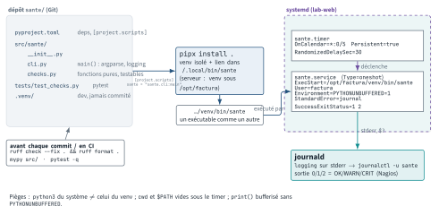

<!-- nav:début -->
[Accueil](../../README.md) › [Parcours](../../docs/parcours.md) › Partie IV — Socle DevOps › **Module 27**  
[← Module 26](../26-kubernetes-observabilite/README.md) · [Corrigé](corrige.md) · [Projet B →](../../projets/P2-factura-devops/README.md)

<details><summary>Scripts du module (11)</summary>

Sur la VM indiquée en section « Mise en place », depuis `~/workbook/scripts/` (voir [chapitre 0](../../docs/00-mise-en-place.md)).

| Script | Rôle |
|---|---|
| [`setup_M27.sh`](../../scripts/setup/setup_M27.sh) | prépare le module |
| [`check_M27_01.sh`](../../scripts/check/check_M27_01.sh) | vérification |
| [`check_M27_02.sh`](../../scripts/check/check_M27_02.sh) | vérification |
| [`check_M27_03.sh`](../../scripts/check/check_M27_03.sh) | vérification |
| [`check_M27_04.sh`](../../scripts/check/check_M27_04.sh) | vérification |
| [`check_M27_05.sh`](../../scripts/check/check_M27_05.sh) | vérification |
| [`check_M27_06.sh`](../../scripts/check/check_M27_06.sh) | vérification |
| [`break_M27_01.sh`](../../scripts/break/break_M27_01.sh) | installe une panne |
| [`break_M27_02.sh`](../../scripts/break/break_M27_02.sh) | installe une panne |
| [`break_M27_03.sh`](../../scripts/break/break_M27_03.sh) | installe une panne |
| [`break_M27_04.sh`](../../scripts/break/break_M27_04.sh) | installe une panne |

</details>
<!-- nav:fin -->

# Module 27 — Python pour l'ops

## 27.0 Objectifs et compétences

> [!NOTE]
> **Objectifs**
>
> À la fin de ce module, je sais :
>
> * installer Python proprement sur un serveur : distinguer l'interpréteur
>   système, un venv (`python3 -m venv`) et un outil `pipx`, épingler mes
>   dépendances dans un `requirements.txt`, et expliquer pourquoi
>   `sudo pip install` sur une machine de production est une faute ;
> * écrire un outil d'exploitation en Python idiomatique : types de base,
>   listes/dicts/sets, f-strings, compréhensions, fonctions annotées,
>   `dataclasses`, exceptions ciblées, `with`, `if __name__ == "__main__"` ;
> * remplacer les commandes système par leur équivalent standard (`pathlib`,
>   `shutil`, `subprocess.run` en liste d'arguments, `json`, `csv`, `re`,
>   `datetime`/`zoneinfo`, `socket`, `ipaddress`, `hashlib`, `tempfile`,
>   `tomllib`, `signal`) et savoir quand garder la commande ;
> * lire un journal de plusieurs Go en flux, écrire un fichier atomiquement,
>   déclarer les encodages, m'insérer dans un pipe et rendre des codes de
>   sortie que le superviseur comprend ;
> * construire une interface propre avec `argparse` (sous-commandes,
>   `--help`, `--dry-run`) et journaliser avec `logging` vers stderr et
>   syslog, jamais avec `print` ;
> * consommer une API REST avec `urllib` puis `requests` (timeout, retries,
>   erreurs HTTP, token), notamment Proxmox, Gitea et Prometheus, et lire du
>   YAML avec PyYAML ;
> * tester avec `pytest` (fixtures `tmp_path`, `monkeypatch`, `caplog`),
>   linter et formater avec `ruff`, typer légèrement avec `mypy`, structurer
>   un projet `pyproject.toml` + `src/` + `tests/` ;
> * packager et déployer : `pip install .` dans un venv dédié, wrapper ou
>   chemin absolu dans une unité systemd, journalisation dans journald ;
> * reconnaître les dix pièges classiques (`shell=True`, `check` oublié,
>   `except:` nu, mutable par défaut, encodage implicite, `print`, chemin
>   relatif, dépendances flottantes, venv absent du timer, descripteurs
>   jamais fermés) et les corriger en revue de code ;
> * décider, avec un tableau de critères, entre bash, Python et Ansible.
>
> **Temps estimé** : 9 h (deux séances)
>
> **Prérequis** : module 07 (scripting bash, dont sa dernière question « quand
> passer à Python »), module 08 (systemd), module 16 (`sante.sh`), module 17
> (timers), module 24 (token API Proxmox), module 26 (Prometheus).

---

## 27.1 Mise en place

VM concernée : **`lab-adm` (10.10.10.10)**, utilisateur `mathieu`. L'API
Proxmox (10.10.10.1:8006), Gitea (10.10.10.14:3000) et Prometheus
(10.10.10.14:9090) sont interrogés en lecture ; chaque lab a un mode hors
ligne. Les Break & Fix demandent `sudo` pour installer la panne.

```bash
# depuis le shell Proxmox, avant de commencer
qm snapshot 9001 avant-lab27
```

Paquets nécessaires — et rien d'autre avec `apt` :

```bash
sudo apt update
sudo apt install -y python3 python3-venv python3-pip pipx
python3 --version        # Python 3.12.3 sur Ubuntu 24.04
```

> [!IMPORTANT]
> **Variante Rocky / RHEL**
>
> Sous Rocky 9, le Python système est 3.9 : trop vieux pour ce module
> (`tomllib`, `datetime.UTC`, syntaxe `X | None`). Installe la version
> parallèle : `sudo dnf install -y python3.12 python3.12-pip` puis
> `python3.12 -m venv ...`. `pipx` vient d'EPEL.

Préparation du terrain de jeu (sans `sudo`, idempotent) :

```bash
bash ~/workbook/scripts/setup/setup_M27.sh
source ~/lab27/venv/bin/activate
python -c 'import requests, yaml; print("venv ok")'
```

Il crée `~/lab27/` : le venv du module avec ses dépendances, l'`access.log`
du module 05 (et une version de 45 Mo), une fixture JSON de l'API Proxmox,
120 archives datées, 400 factures en CSV, les fichiers de configuration des
labs, et quatre scripts mal écrits dans `casse/`.

> [!CAUTION]
> **Attention**
>
> Si `pip install` échoue derrière un proxy, exporte `HTTPS_PROXY` puis
> relance le setup : il ne réinstalle que ce qui manque. N'installe jamais les
> dépendances avec `sudo pip` pour contourner.

---

## 27.2 Rappel express

### Trois Python, trois usages

| Besoin | Outil | Où ça vit |
|---|---|---|
| l'OS lui-même (`apt`, `cloud-init`) | `python3` système | `/usr/lib/python3` |
| ton projet et ses dépendances | `python3 -m venv` | `projet/venv/` |
| un outil en ligne de commande | `pipx install x` | `~/.local/pipx/venvs` |

```bash
python3 -m venv ~/lab27/venv            # crée l'environnement
source ~/lab27/venv/bin/activate        # facultatif : PATH seulement
~/lab27/venv/bin/pip install -r requirements.txt   # sans activer
~/lab27/venv/bin/pip freeze > requirements.txt     # versions exactes
python3 -m pip ... ; python3 -m pytest ...  # le module DU BON python
```

`sudo pip install` sur Ubuntu 24.04 répond `externally-managed-environment`
(PEP 668) : c'est une protection, pas un bug. Un `--break-system-packages`
pour passer outre casse `apt` le jour où les deux gestionnaires touchent le
même fichier.

### La syntaxe qu'un ops utilise vraiment

```python
hotes = ["lab-web", "lab-db"]          # liste, ordonnée, mutable
conf = {"port": 22, "user": "mathieu"} # dict, clé -> valeur
vus: set[str] = set()                   # ensemble : dédoublonne
nom, vmid = "lab-web", 9002             # tuple, dépaquetage
print(f"{nom:<10}{vmid:>6} {3/7:.2f}")  # f-string, largeur, précision
hotes[0], hotes[-1], hotes[1:], hotes[::-1]      # indices, slicing
[h.upper() for h in hotes if h.startswith("lab")] # compréhension
{h: len(h) for h in hotes}                        # dict compréhension
for i, h in enumerate(hotes, start=1): ...
```

```python
from dataclasses import dataclass

@dataclass(frozen=True)
class Machine:            # un enregistrement typé, immuable, comparable
    nom: str
    vmid: int
    adresse: str | None = None

def lire(chemin: str, defaut: int = 0) -> list[str]:  # annotations
    ...
```

```python
try:
    donnees = json.load(f)
except FileNotFoundError:            # précis d'abord
    log.warning("pas de cache")
except (OSError, ValueError) as exc: # groupe ensuite, JAMAIS « except: »
    log.error("illisible : %s", exc)
    return 1
else:
    traiter(donnees)                 # seulement si tout s'est bien passé
finally:
    verrou.release()                 # toujours, même sur return
raise RuntimeError("config invalide") from exc   # chaîne la cause

with open(p, encoding="utf-8") as f: ...  # fermeture garantie
if __name__ == "__main__":          # importable ET exécutable
    sys.exit(main())
```

### Les modules standard qui remplacent les commandes

| Commande | Python |
|---|---|
| `ls`, `find`, `basename`, `test -f` | `pathlib.Path` : `.glob`, `.rglob`, `.name`, `.exists()` |
| `cp`, `mv`, `rm -r`, `which`, `df` | `shutil.copy2/move/rmtree/which/disk_usage` |
| lancer une commande | `subprocess.run([...], capture_output=True, text=True, check=True, timeout=30)` |
| `jq`, `yq`, `cut -d;` | `json`, `yaml.safe_load`, `csv.DictReader` |
| `grep -E`, `sed -E` | `re.compile(...)`, `.match`, `.sub` |
| `date -Is`, `date -d` | `datetime.now(UTC)`, `.astimezone(ZoneInfo(...))`, `strptime` |
| `nc -z`, `getent hosts` | `socket.create_connection`, `socket.gethostbyname` |
| `ipcalc` | `ipaddress.ip_interface("10.10.10.11/24").network` |
| `sha256sum` | `hashlib.file_digest(f, "sha256")` |
| `mktemp` | `tempfile.mkstemp(dir=...)`, `TemporaryDirectory()` |
| `getopts` | `argparse` |
| `logger` | `logging.handlers.SysLogHandler(address="/dev/log")` |
| `trap` | `signal.signal(SIGTERM, handler)`, `try/finally` |

`subprocess.run` : une **liste** d'arguments (jamais une chaîne avec
`shell=True` sur une entrée externe), `check=True` sinon l'échec est
silencieux, `timeout=` sinon le script attend éternellement. Trois
exceptions à connaître : `CalledProcessError` (code ≠ 0), `FileNotFoundError`
(commande absente), `TimeoutExpired`.

### Fichiers, flux, encodages, codes

```python
with open(p, encoding="utf-8") as f:   # explicite, sinon locale du timer
    for ligne in f:                     # flux : 10 Go en RAM constante
        ...
open(p, encoding="utf-8-sig")           # BOM d'Excel
open(p, encoding="utf-8", errors="replace")  # journaux douteux
for ligne in sys.stdin: ...             # dans un pipe : cat x | script -
fd, tmp = tempfile.mkstemp(dir=cible.parent)   # même système de fichiers
with os.fdopen(fd, "w", encoding="utf-8") as f:
    f.write(texte); f.flush(); os.fsync(f.fileno())
os.replace(tmp, cible)                  # rename atomique
```

Codes de sortie : `0` ok, `1` erreur, `2` usage (celui d'`argparse`), et la
convention Nagios pour une sonde : `0` OK, `1` WARNING, `2` CRITICAL,
`3` UNKNOWN. Un `Traceback` non attrapé sort en `1` : c'est un plantage, pas
un code.

### Journalisation et interface

```python
log = logging.getLogger("outil")
logging.basicConfig(level=logging.INFO, stream=sys.stderr,
    format="%(asctime)s %(levelname)s %(name)s: %(message)s")
log.info("hôte %s : %d erreurs", h, n)   # %s : formaté seulement si émis
log.exception("échec")                   # dans un except : avec la trace

p = argparse.ArgumentParser(description="...")
p.add_argument("fichier"); p.add_argument("--top", type=int, default=10)
p.add_argument("-n", "--dry-run", action="store_true")
sub = p.add_subparsers(dest="cmd", required=True)
sub.add_parser("list"); sub.add_parser("add").add_argument("nom")
args = p.parse_args()   # --help gratuit, erreur d'usage -> code 2
```

Le **résultat** sort sur stdout, le **journal** sur stderr : un script dont
on peut rediriger la sortie dans un fichier sans y trouver des `INFO`.

### Réseau et API

```python
import requests
s = requests.Session()
s.headers["Authorization"] = "PVEAPIToken=ops@pve!inv=xxxxxxxx-..."
r = s.get("https://10.10.10.1:8006/api2/json/cluster/resources",
          params={"type": "vm"}, timeout=(3.05, 10), verify="/etc/ssl/pve.crt")
r.raise_for_status()          # sinon un 401 devient un JSON vide « normal »
vms = r.json()["data"]
# requests.RequestException (hérite d'OSError) : réseau, HTTP, timeout
```

| Cible | Auth et appel |
|---|---|
| Proxmox | `PVEAPIToken=user@realm!id=uuid` ; `/api2/json/nodes/pve/qemu/9002/config` |
| Gitea | `Authorization: token ...` ; `/api/v1/repos/search?q=` ; `POST .../issues` |
| Prometheus | `/api/v1/query?query=up` → `data.result[].value[1]` (chaîne !) |
| Docker | socket Unix `/var/run/docker.sock`, `GET /containers/json` |

`urllib.request` suffit pour un GET sans dépendance ; `requests` dès qu'il
y a une session, des retries (`HTTPAdapter(max_retries=Retry(...))`), du
JSON en POST. `yaml.safe_load` toujours, `yaml.load` jamais.

### Qualité et déploiement

```bash
ruff check --fix . && ruff format .   # lint + format, une seule dépendance
mypy src/                             # les annotations servent à ça
pytest -q                             # tests/test_*.py, fonctions test_*
pip install .                         # [project.scripts] -> venv/bin/outil
pipx install .                        # idem, pour un outil de poste
```

```ini
[Service]
ExecStart=/opt/factura/venv/bin/sante --config /etc/factura/sante.yaml
WorkingDirectory=/opt/factura
Environment=PYTHONUNBUFFERED=1 LANG=C.UTF-8
StandardError=journal
SuccessExitStatus=1 2
```

<p align="center"></p>

*Figure — De l'outil Python d'exploitation à son exécution : dépôt avec `pyproject.toml`, `src/`, `tests/`, qualité par ruff/mypy/pytest, installation par `pipx`, puis un timer systemd qui lance le service et journald qui reçoit stderr et le code de sortie.*

### Quand quoi — prolongement du module 07

| Critère | bash | Python | Ansible |
|---|---|---|---|
| enchaîner des commandes, < 100 lignes | **oui** | non | non |
| JSON/YAML, API, structures imbriquées | non | **oui** | (données) |
| tests unitaires exigés | `bats` | **oui** | molecule |
| décrire un état sur N machines | non | non | **oui** |
| long-running, retries, parallélisme | non | **oui** | non |
| présent partout sans installation | **oui** | presque | non |

### Les dix pièges

1. `subprocess.run(f"tar -czf {d} {src}", shell=True)` : espace, `;`, `$`.
2. `check=True` oublié : l'échec passe, le script dit OK.
3. `except:` / `except Exception: pass` : l'erreur réseau devient un succès.
4. `def f(x, liste=[])` : l'argument mutable est partagé entre appels.
5. `open(p)` sans `encoding` : marche dans ton shell, pas sous le timer.
6. `print` pour journaliser : bufferisé, mélangé au résultat.
7. `open("conf.yaml")` en chemin relatif : le timer a un autre `cwd`.
8. `pip install requests` sans version : le déploiement dérive.
9. `#!/usr/bin/env python3` sous systemd : c'est le python **système**.
10. `open()` sans `with` dans une boucle : `Too many open files`.

---

## 27.3 Quiz — QCM

<a id="q27-1"></a>**[Q27.1](corrige.md#q27-1)** — Sur `lab-adm` (Ubuntu 24.04), `sudo pip install requests`
répond `error: externally-managed-environment`. Quelle est la bonne
réaction ?

a) ajouter `--break-system-packages`, c'est un faux positif
b) `sudo apt install python3-requests` si c'est pour un outil système, sinon
   un venv du projet
c) `pip install --user requests`
d) réinstaller pip depuis `get-pip.py`

<a id="q27-2"></a>**[Q27.2](corrige.md#q27-2)** — Un timer systemd lance `ExecStart=/home/mathieu/lab27/bin/
sante.py`, dont la première ligne est `#!/usr/bin/env python3`. Le script
importe `yaml`, installé dans `~/lab27/venv`. Résultat ?

a) ça fonctionne, le shebang trouve le venv via `PATH`
b) `ModuleNotFoundError: No module named 'yaml'` : `env` résout le python
   système, qui ne voit pas le venv
c) systemd active automatiquement le venv le plus proche
d) `Permission denied`, systemd refuse les scripts dans `/home`

<a id="q27-3"></a>**[Q27.3](corrige.md#q27-3)** — Que produit ce code ?

```python
def ajouter(nom, liste=[]):
    liste.append(nom)
    return liste
a = ajouter("lab-web")
b = ajouter("lab-db")
print(b)
```

a) `['lab-db']`
b) `['lab-web', 'lab-db']`
c) `TypeError`
d) `[]`

<a id="q27-4"></a>**[Q27.4](corrige.md#q27-4)** — `subprocess.run("tar -czf /tmp/a.tgz " + rep, shell=True)` avec
`rep = "/srv/rapport final"`. Que se passe-t-il ? **Deux réponses.**

a) tar reçoit deux arguments, `/srv/rapport` et `final`, et échoue
b) le script continue et sort en 0 : `check=True` n'est pas là
c) Python ajoute automatiquement des guillemets autour des espaces
d) `shell=True` refuse les chemins contenant une espace

<a id="q27-5"></a>**[Q27.5](corrige.md#q27-5)** — Quel appel est correct pour exécuter `systemctl is-active nginx`
et obtenir une exception si la commande échoue ?

a) `subprocess.run("systemctl is-active nginx")`
b) `subprocess.run(["systemctl", "is-active", "nginx"], check=True)`
c) `subprocess.call(["systemctl is-active nginx"])`
d) `os.system("systemctl is-active nginx") or raise`

<a id="q27-6"></a>**[Q27.6](corrige.md#q27-6)** — Ce fragment vérifie un site :

```python
try:
    urllib.request.urlopen(url, timeout=2)
    print("OK")
except:
    pass
sys.exit(0)
```

Le site est injoignable. Qu'affiche le script et avec quel code ?

a) `URLError` et code 1
b) rien, code 0 : l'exception est avalée, le superviseur voit un succès
c) `OK` et code 0
d) rien, code 2

<a id="q27-7"></a>**[Q27.7](corrige.md#q27-7)** — `open("/var/log/factura/app.log").read()` fonctionne dans ton
shell et lève `UnicodeDecodeError` sous le timer. Cause la plus probable ?

a) le timer tourne en root et n'a pas les droits
b) l'encodage par défaut dépend de la locale, absente sous systemd :
   `encoding="utf-8"` (ou `errors="replace"`) manque
c) le fichier a changé entre-temps
d) `read()` ne fonctionne pas hors d'un terminal

<a id="q27-8"></a>**[Q27.8](corrige.md#q27-8)** — Un script compte les erreurs de 3 000 journaux :

```python
handles = [open(p) for p in Path(rep).glob("*.log")]
for f in handles: ...
```

Il plante avec `OSError: [Errno 24] Too many open files`. Correctif ?

a) `ulimit -n 65536` dans le timer
b) ouvrir chaque fichier dans un `with` à l'intérieur de la boucle, et ne
   garder que le résultat
c) `gc.collect()` après chaque itération
d) remplacer `open` par `Path.read_text`, qui n'ouvre rien

<a id="q27-9"></a>**[Q27.9](corrige.md#q27-9)** — Tu écris un rapport JSON lu par une sonde toutes les 30 s.
Quelle séquence garantit qu'elle ne lira jamais un fichier tronqué ?

a) `open(cible, "w").write(texte)`
b) `mkstemp(dir=cible.parent)` → écrire → `fsync` → `os.replace(tmp, cible)`
c) `open(cible, "a")` puis `truncate`
d) écrire dans `/tmp` puis `shutil.copy`

<a id="q27-10"></a>**[Q27.10](corrige.md#q27-10)** — `r = requests.get(url, timeout=5)` renvoie un `401`. Sans autre
ligne, que vaut `r.json()` et que fait le script ?

a) exception `HTTPError` immédiatement
b) le corps JSON d'erreur de l'API (`{"data": null}`), et le script continue
   comme si de rien n'était : il manque `r.raise_for_status()`
c) `None`
d) `requests` réessaie trois fois puis lève

<a id="q27-11"></a>**[Q27.11](corrige.md#q27-11)** — Quelle ligne est **fausse** à propos de `logging` ?

a) `log.info("hôte %s", h)` ne formate la chaîne que si le message est émis
b) `logging.basicConfig(stream=sys.stderr)` garde stdout pour le résultat
c) `log.exception("échec")` ajoute la trace quand on est dans un `except`
d) `print` est équivalent à `log.info` si on ajoute `file=sys.stderr`

<a id="q27-12"></a>**[Q27.12](corrige.md#q27-12)** — Réponse de `/api/v1/query?query=up` de Prometheus :

```json
{"status":"success","data":{"resultType":"vector","result":[
 {"metric":{"instance":"10.10.10.11:9100"},"value":[1758200000.1,"1"]}]}}
```

Comment obtenir la valeur numérique de la première série ?

a) `d["data"]["result"][0]["value"][1]`, qui est déjà un entier
b) `float(d["data"]["result"][0]["value"][1])` : la valeur est une chaîne
c) `d["result"]["value"]`
d) `d["data"]["value"][0]`

<a id="q27-13"></a>**[Q27.13](corrige.md#q27-13)** — `pytest` : quelle affirmation est vraie ? **Deux réponses.**

a) `tmp_path` fournit un répertoire vide, propre à chaque test, nettoyé
   automatiquement
b) `monkeypatch.setattr(subprocess, "run", faux)` remplace `run` pendant le
   test seulement
c) `capsys.readouterr().err` contient les messages émis via `logging`
d) un test doit s'appeler `check_*` pour être collecté

<a id="q27-14"></a>**[Q27.14](corrige.md#q27-14)** — `dates[-n:]` avec `n = 0` renvoie :

a) une liste vide
b) toute la liste
c) le dernier élément
d) `IndexError`

<a id="q27-15"></a>**[Q27.15](corrige.md#q27-15)** — Un `pyproject.toml` contient
`[project.scripts] sante-serveur = "pilotage.cli:main"`. Après
`/opt/factura/venv/bin/pip install .`, que trouve-t-on ?

a) `/usr/local/bin/sante-serveur`
b) `/opt/factura/venv/bin/sante-serveur`, un lanceur qui appelle
   `pilotage.cli.main()` avec le python du venv
c) rien : il faut `python -m pilotage.cli`
d) un alias dans `~/.bashrc`

<a id="q27-16"></a>**[Q27.16](corrige.md#q27-16)** — Tu dois écrire un outil qui lit l'inventaire Proxmox, le
compare à Gitea, et ouvre une issue par écart. Quel outil, et pourquoi ?

a) bash + `jq` + `curl` : c'est de l'appel d'API
b) Python : deux API, des structures à croiser, une logique testable
c) Ansible : c'est de l'inventaire
d) un script Perl, plus rapide

<a id="q27-17"></a>**[Q27.17](corrige.md#q27-17)** — `datetime.now()` et `datetime.now(UTC)` : lequel comparer avec
la date d'expiration d'un certificat obtenue via `ssl.cert_time_to_seconds` ?

a) `datetime.now()`, les certificats sont en heure locale
b) ni l'un ni l'autre : `cert_time_to_seconds` rend un timestamp, on le
   compare à `time.time()`
c) `datetime.now(UTC).timestamp()` est aussi correct
d) b et c sont corrects

<a id="q27-18"></a>**[Q27.18](corrige.md#q27-18)** — Un script Python lancé par timer écrit `print("étape 1")` puis
lance une commande longue qui écrit sur stderr. Dans `journalctl`, la ligne
`étape 1` apparaît **après** la sortie de la commande. Pourquoi ?

a) journald trie par priorité
b) stdout est bufferisé quand il n'est pas un terminal ; stderr non.
   `PYTHONUNBUFFERED=1` ou `flush=True`
c) `print` est asynchrone
d) le timer a lancé le script deux fois

---

## 27.4 Quiz — questions ouvertes

<a id="qo27-1"></a>**[QO27.1](corrige.md#qo27-1)** — Explique ce que fait réellement `source venv/bin/activate`
(quelles variables changent), pourquoi un timer systemd n'en a pas besoin,
et quelle ligne `ExecStart` tu écris pour lancer un script d'un venv. Puis
explique la différence entre `pip install x` et `python3 -m pip install x`
sur une machine où trois interpréteurs cohabitent.

<!-- repondre: 8 -->

<a id="qo27-2"></a>**[QO27.2](corrige.md#qo27-2)** — *On te demande en entretien* : « Tu reprends un script Python
de 400 lignes qui fait des `subprocess.run(..., shell=True)` partout. Que
regardes-tu en premier, qu'est-ce qui est dangereux, et comment le corriges-tu
sans tout réécrire ? » Réponds avec les mécanismes : découpage des mots,
métacaractères, injection, `check`, `timeout`.

<!-- repondre: 10 -->

<a id="qo27-3"></a>**[QO27.3](corrige.md#qo27-3)** — Décris la différence entre `except:`, `except Exception:` et
`except (OSError, ValueError):`. Quelles exceptions le premier attrape-t-il
en plus du deuxième, et pourquoi est-ce grave dans un script lancé par un
timer (pense à `sys.exit` et à Ctrl-C) ?

<!-- repondre: 8 -->

<a id="qo27-4"></a>**[QO27.4](corrige.md#qo27-4)** — Pourquoi `for ligne in f:` sur un fichier de 8 Go fonctionne
alors que `f.read().splitlines()` tue le processus ? Explique en termes de
mémoire, puis donne l'équivalent pour un `.gz` et pour un pipe (`stdin`).
Que se passe-t-il si le fichier est en latin-1 et que tu n'as rien précisé ?

<!-- repondre: 8 -->

<a id="qo27-5"></a>**[QO27.5](corrige.md#qo27-5)** — *On te demande en entretien* : « Ton script de rétention a
supprimé une archive mensuelle qu'il devait garder. Comment tu t'assures que
ça ne se reproduit pas ? » Réponds avec : logique pure séparée des effets,
tests unitaires sur la sélection, `--dry-run`, et le rôle d'un cas de test
qui reproduit l'incident.

<!-- repondre: 8 -->

<a id="qo27-6"></a>**[QO27.6](corrige.md#qo27-6)** — Un fichier écrit avec `open(cible, "w")` peut être lu tronqué
par un autre processus. Explique le mécanisme, puis décris l'écriture
atomique (temporaire dans le même répertoire, `fsync`, `os.replace`) et
pourquoi un temporaire dans `/tmp` ne convient pas.

<!-- repondre: 8 -->

<a id="qo27-7"></a>**[QO27.7](corrige.md#qo27-7)** — Compare `urllib.request` et `requests` pour interroger l'API
Proxmox : gestion du token, du timeout, des codes 4xx/5xx, des retries.
Dans quel cas restes-tu sur la bibliothèque standard ?

<!-- repondre: 8 -->

<a id="qo27-8"></a>**[QO27.8](corrige.md#qo27-8)** — Reprends les trois critères de QO7.8 (données, idempotence,
taille) et ajoute-leur deux critères propres à Python : la testabilité et le
long-running. Pour chaque critère, donne un exemple pris dans ce module et
dis ce que bash aurait coûté.

<!-- repondre: 10 -->

---

## 27.5 Exercices guidés ★

Sauf mention contraire, travaille dans `~/lab27` avec le venv activé.
Chaque script doit passer `ruff check` sans avertissement et commencer par
`#!/usr/bin/env python3`.

<a id="e27-1"></a>**[E27.1](corrige.md#e27-1)** — Montre, avec `which python3`, `python3 -c 'import sys;
print(sys.prefix)'` et `pip --version`, ce qui change quand tu actives le
venv puis quand tu le désactives. Lance ensuite `~/lab27/venv/bin/python -c
'import yaml'` **sans** activation et explique pourquoi ça marche.

<a id="e27-2"></a>**[E27.2](corrige.md#e27-2)** — Installe `ruff` de deux façons : dans le venv (`pip`) et comme
outil de poste (`pipx install ruff`). Compare `which ruff` dans les deux cas,
puis supprime celui du venv. Justifie en deux lignes lequel garder pour un
outil de lint et lequel pour `requests`.

<a id="e27-3"></a>**[E27.3](corrige.md#e27-3)** — À partir de `~/lab27/requirements.in`, produis un
`requirements.txt` épinglé avec `pip freeze`, puis recrée un second venv
`~/lab27/venv2` à l'identique en une commande. Vérifie que
`pip list --format=freeze` des deux venvs est identique (`diff`).

<a id="e27-4"></a>**[E27.4](corrige.md#e27-4)** — Écris `bin/hotes.py` qui charge la fixture
`fixtures/proxmox-qemu.json` et affiche, avec une compréhension et une
f-string alignée, une ligne `nom vmid statut` par VM `qemu` en cours
d'exécution, triée par nom. Un `dataclass(frozen=True)` porte chaque VM.

<a id="e27-5"></a>**[E27.5](corrige.md#e27-5)** — Exécute `casse/mutable.py`, explique la sortie, corrige avec
`None` comme valeur par défaut. Puis écris une fonction `compter(mots:
list[str]) -> dict[str, int]` qui compte les occurrences, d'abord à la main
avec `dict.get`, puis avec `collections.Counter`.

<a id="e27-6"></a>**[E27.6](corrige.md#e27-6)** — Réécris `casse/purge.py` sans `os.system` : `pathlib` pour
lister les `*.tmp`, `unlink()` pour supprimer, `--dry-run` avec `argparse`,
refus (code 2) si le répertoire n'existe pas. Prouve qu'il ne touche pas
`important.txt` et qu'il traite un répertoire dont le nom contient une
espace.

<a id="e27-7"></a>**[E27.7](corrige.md#e27-7)** — Lance `casse/lecture.py data/clients-latin1.csv`, lis l'erreur,
corrige avec l'`encoding` adapté, puis rends le script robuste à
`data/inventaire-excel.csv` (BOM UTF-8) avec `utf-8-sig`. Utilise
`csv.DictReader` avec `delimiter=";"` au lieu du `split`.

<a id="e27-8"></a>**[E27.8](corrige.md#e27-8)** — Écris `bin/ssh-check.py` qui lit des hôtes sur **stdin** (un par
ligne, `# commentaires` ignorés) et teste le port 22 de chacun avec
`socket.create_connection` (timeout 2 s). Sortie : `hote OK|KO durée_ms` sur
stdout ; code 1 si au moins un KO. Vérifie avec
`printf '10.10.10.11\n10.10.10.99\n' | bin/ssh-check.py`.

<a id="e27-9"></a>**[E27.9](corrige.md#e27-9)** — Réécris `casse/stock.py` avec `logging` : niveau via `-v`,
format horodaté sur stderr, `ERREUR` en `log.error`. Ajoute un
`SysLogHandler` vers `/dev/log` et retrouve les messages avec
`journalctl -t stock -n 5`. Montre que `./stock.py > /dev/null` garde les
erreurs visibles.

<a id="e27-10"></a>**[E27.10](corrige.md#e27-10)** — Écris `bin/exec-tracee.py`, cousin de `exec-tracee.sh` du
module 07 : `exec-tracee.py [-t tag] -- commande [args]`. Il lance la
commande avec `subprocess.run` (liste, `timeout` optionnel), journalise début,
fin, durée (`time.monotonic`) et code, et rend **exactement** le code de la
commande. `exec-tracee.py -- sh -c 'exit 7'; echo $?` affiche 7 ;
`exec-tracee.py -- printf '[%s]\n' 'a b' c` affiche deux lignes.

<a id="e27-11"></a>**[E27.11](corrige.md#e27-11)** — Écris `bin/dates.py` qui affiche l'heure courante en UTC et en
`Europe/Paris` (`zoneinfo`), parse la date `18/Sep/2026:14:02:11 +0200`
d'une ligne nginx, et calcule le nombre de jours avant le 1er janvier
prochain. Montre l'erreur obtenue en comparant un `datetime` naïf à un
`datetime` aware.

<a id="e27-12"></a>**[E27.12](corrige.md#e27-12)** — Écris `bin/empreintes.py REP` qui calcule le SHA-256 de chaque
fichier de `REP` (`hashlib.file_digest`), écrit un `empreintes.json`
**atomiquement** (temporaire + `os.replace`), et, à l'exécution suivante,
affiche les fichiers modifiés. Teste en modifiant un fichier entre deux
exécutions.

<a id="e27-13"></a>**[E27.13](corrige.md#e27-13)** — Avec `urllib.request` uniquement, interroge
`http://10.10.10.14:9090/api/v1/query?query=up` et affiche `instance valeur`
par série. Gère `URLError` (Prometheus arrêté) et `HTTPError` avec un
message propre et le code 1. Si ton lab-ops est éteint, cible
`http://10.10.10.14:9090/-/healthy` et montre le message d'erreur.

<a id="e27-14"></a>**[E27.14](corrige.md#e27-14)** — Même chose avec `requests` : `Session`, `timeout=(3.05, 10)`,
`raise_for_status()`, et un `HTTPAdapter` avec `Retry(total=3,
backoff_factor=0.5, status_forcelist=[502, 503, 504])`. Ajoute un appel à
l'API Gitea `GET /api/v1/repos/search?q=factura` avec un token lu dans la
variable `GITEA_TOKEN` (jamais dans le code). Montre le JSON obtenu.

<a id="e27-15"></a>**[E27.15](corrige.md#e27-15)** — Écris `bin/proxmox-vms.py` qui liste les VM via l'API Proxmox
avec un token `PVE_TOKEN` (créé au module 24, droits `VM.Audit`), sur
`https://10.10.10.1:8006`, en vérifiant le certificat (`verify=` chemin du
CA de ton PVE, ou `--insecure` explicite). Compare avec
`pvesh get /cluster/resources --type vm --output-format json` lancé sur
l'hyperviseur, et note deux différences entre les deux approches.

<a id="e27-16"></a>**[E27.16](corrige.md#e27-16)** — Crée un projet minimal `~/lab27/monoutil/` à partir de
`pyproject.example.toml` : `src/monoutil/cli.py` avec un `main()` qui
affiche `bonjour`, `tests/test_cli.py` avec un test, `pip install -e .`
dans le venv, puis `monoutil` depuis n'importe quel répertoire. Termine par
`ruff check`, `ruff format - -check` et `pytest` verts.

---

## 27.6 Labs ★★

### <a id="l27-1"></a>**[L27.1](corrige.md#l27-1)** — `logstats.py` : remplacer le pipeline awk du module 05

> **Contexte**
>
> Le rapport matinal des accès nginx est produit par un pipeline
> `awk | sort | uniq -c | sort -rn` en trois exemplaires, un par indicateur,
> copié dans un mail. Quelqu'un a demandé « le p95 par URL » et le pipeline a
> doublé de taille. On te demande un outil unique, lisible, testé, qui accepte
> un fichier, un `.gz` ou stdin.

Écris `~/lab27/bin/logstats.py` (format `combined` + `$request_time` en
dernier champ, comme `data/access.log`).

1. Interface `argparse` : `FICHIER` (ou `-` pour stdin), `--top N` (défaut
   10), `--json`, `--since ISO`, `-v`. `--help` documente les codes de
   sortie : `0` ok, `1` fichier illisible, `2` usage, `3` aucune ligne
   valide.
2. Une regex compilée avec des groupes nommés (`ip`, `date`, `url`, `code`,
   `duree`). Les lignes qui ne matchent pas sont comptées et journalisées
   en `DEBUG`, jamais fatales.
3. Lecture en **flux** (`for ligne in f`), `.gz` transparent via
   `gzip.open(..., "rt")`, stdin via `sys.stdin`. Le fichier de 45 Mo
   `data/gros.log` doit passer sans que la RSS dépasse ~60 Mo
   (`/usr/bin/time -v`).
4. Un `dataclass` accumulateur (`Counter` pour les IP et les codes, liste
   des durées), une fonction `percentile(valeurs_triées, p)` en
   *nearest-rank*, et une fonction `resume()` qui rend un `dict` — c'est ce
   dict qui est affiché en texte ou en JSON.
5. Sortie texte : top IP, répartition des codes avec pourcentage, latence
   (moyenne, p50, p95, p99, max), top des URL en 5xx.
6. Compare avec `bin/logstats.awk` : mêmes chiffres (top IP `10.10.10.14`
   avec 1212, p95 `0.537`), temps d'exécution avec `time` sur `gros.log`,
   et nombre de lignes de code. Note les trois observations dans
   `rapports/logstats-comparaison.md`.
7. `tests/test_logstats.py` : au moins 4 tests (percentile, ligne
   invalide comptée, `.gz`, fichier vide → code 3).

> [!TIP]
> **Critère de succès**
>
> Critère de succès : `logstats.py data/access.log` affiche `10.10.10.14`
> avec `1212` en tête et `p95 0.537` ; `--json` produit un JSON avec
> `lignes = 7200` ; `head -100 data/access.log | logstats.py -` fonctionne.
>
> ```bash
> bash check_M27_01.sh
> ```

---

### <a id="l27-2"></a>**[L27.2](corrige.md#l27-2)** — `inventaire.py` : un inventaire Ansible depuis l'API Proxmox

> **Contexte**
>
> L'inventaire Ansible du module 23 est écrit à la main et il diverge de la
> réalité : une VM clonée pour un test a été oubliée, une autre détruite y
> figure encore. La source de vérité, c'est Proxmox. On veut un générateur
> qui tourne aussi sur un poste sans accès à l'API — pour les tests et la CI —
> grâce à des réponses enregistrées.

Écris `~/lab27/bin/inventaire.py`.

1. Deux sources derrière **une même interface** (`Protocol` ou classe de
   base) : `Fixture(chemin)` qui lit `fixtures/proxmox-qemu.json`, et
   `ApiProxmox(url, token, verify)` qui appelle
   `GET /api2/json/cluster/resources?type=vm` puis
   `GET /api2/json/nodes/{node}/qemu/{vmid}/config` avec `requests`,
   header `Authorization: PVEAPIToken=...`, `timeout`, `raise_for_status`.
   Le token vient de la variable `PVE_TOKEN`, jamais d'un argument.
2. Règles : seules les VM `qemu` ; les templates ignorés ; les VM arrêtées
   ignorées sauf `--all` ; un groupe par tag Proxmox (séparateur `;`) ;
   l'adresse vient de `ipconfig0` (`ip=10.10.10.11/24,...`, parsée avec
   `ipaddress`), sinon d'une résolution DNS de `<nom>.lab.local`, sinon la
   VM est **omise avec un avertissement** sur stderr.
3. `--format ini` (défaut) et `--format yaml` (`yaml.safe_dump`,
   `sort_keys=False`) ; `-o FICHIER`. Le YAML respecte la structure
   `all: {hosts: ..., children: {groupe: {hosts: ...}}}`.
4. Codes : `0`, `1` source illisible ou API en erreur (sans Traceback),
   `2` usage ou token absent, `4` aucune VM retenue.
5. La logique (`collecter`, `par_groupe`, `rendre_ini`) ne fait **aucune**
   E/S : elle reçoit des dicts et rend des chaînes, pour être testable.
6. Valide avec `ansible-inventory -i inventaire.ini --graph`, puis
   `ansible -i inventaire.ini prod -m ping`.
7. Si ton token Proxmox est prêt : `PVE_TOKEN=... inventaire.py --url
   https://10.10.10.1:8006 --ca /etc/ssl/pve.crt` et compare avec la
   fixture.

> [!TIP]
> **Astuce**
>
> Pour enregistrer ta propre fixture : `pvesh get /cluster/resources --type vm
> --output-format json` sur l'hyperviseur, puis un `pvesh get
> /nodes/pve/qemu/9002/config --output-format json` par VM.

> [!TIP]
> **Critère de succès**
>
> Critère de succès : la sortie INI contient `lab-web ansible_host=10.10.10.11`
> et un groupe `[prod]` avec `lab-db` et `lab-web` ; ni le template, ni le
> conteneur LXC, ni `lab-web-old` (sans `--all`) n'apparaissent ;
> `lab-sandbox` est omise et signalée.
>
> ```bash
> bash check_M27_02.sh
> ```

---

### <a id="l27-3"></a>**[L27.3](corrige.md#l27-3)** — `sante.py` : sonde multi-services, JSON, code Nagios, timer

> **Contexte**
>
> La supervision Prometheus du module 26 dit si les cibles répondent, mais
> l'astreinte veut un verdict unique et lisible : « le port SSH de lab-web,
> la boutique, le certificat, le disque ». Une sonde en Python, configurée en
> YAML, qui sort du JSON exploitable et un code de sortie standard, lancée
> toutes les 5 minutes par un timer.

Écris `~/lab27/bin/sante.py`, configuration `~/lab27/conf/sante.yaml`.

1. Types de vérification, **une fonction par type** enregistrée dans un
   dict `{"tcp": verif_tcp, ...}` : `tcp` (hôte, port), `http` (url, code
   attendu, texte `contient` optionnel — `urllib.request`, `HTTPError`
   distingué de `URLError`), `tls` (certificat valide via
   `ssl.create_default_context`, jours restants ≥ `jours_min`), `disque`
   (`shutil.disk_usage`, `pct_max`), `commande` (`argv` en **liste**,
   `subprocess.run` avec `timeout`, jamais `shell=True`).
2. Chaque vérification rend `(code, détail)` avec `0/1/2/3` ; un type
   inconnu ou un paramètre manquant donne `3` (UNKNOWN), jamais un
   Traceback. Le code global est le **pire** des codes.
3. Sortie stdout : JSON (`horodatage` UTC ISO, `hote`, `statut`, `code`,
   compte par statut, liste des vérifications avec durée en ms). `--text`
   pour un humain. Journal sur stderr via `logging` (`-v`).
4. `-o /var/lib/factura/sante.json` écrit **atomiquement** ; `--only NOM`
   pour une seule vérification ; `-c` chemin de configuration ; code `3`
   si la configuration est absente ou invalide.
5. `tests/test_sante.py` : au moins 5 tests **sans réseau** — `monkeypatch`
   sur `socket.create_connection`, `shutil.disk_usage` et
   `subprocess.run` ; un test qui prouve que `subprocess.run` reçoit une
   liste et un `timeout`.
6. Déploiement : `sudo mkdir -p /var/lib/factura /etc/factura`, copie de la
   configuration, `sante.service` (`Type=oneshot`, `ExecStart=` avec le
   python du venv en chemin absolu, `SuccessExitStatus=1 2 3`) et
   `sante.timer` (`OnCalendar=*:0/5`). Vérifie avec `systemctl list-timers`
   et `jq .statut /var/lib/factura/sante.json`.

> [!TIP]
> **Critère de succès**
>
> Critère de succès : une configuration saine donne code 0 et un JSON
> `statut: OK` ; un port fermé donne code 2 ; une configuration absente donne
> code 3 ; aucun fichier temporaire ne reste après `-o`.
>
> ```bash
> bash check_M27_03.sh
> ```

---

### <a id="l27-4"></a>**[L27.4](corrige.md#l27-4)** — `rotate_backups.py` : rétention GFS testée

> **Contexte**
>
> `~/lab27/data/sauvegardes/` reçoit une archive `factura-AAAA-MM-JJ.tar.gz`
> par nuit depuis quatre mois. Le `find -mtime +30 -delete` en place a
> supprimé, un soir de restauration, l'archive du 1er du mois précédent. La
> politique demandée : 7 quotidiennes, 4 hebdomadaires, 6 mensuelles. Et cette
> fois, des tests.

Écris `~/lab27/rotate/rotate_backups.py` (underscore : le fichier doit être
importable par les tests) et `~/lab27/rotate/tests/test_rotate_backups.py`.

1. La date est lue dans le **nom** (regex avec le préfixe échappé par
   `re.escape`), jamais dans le mtime. Les fichiers hors motif (`export
   final.tar.gz`, un autre préfixe, une date invalide) sont ignorés.
2. `selection(dates, politique) -> dict[date, raison]` est une fonction
   **pure** : quotidiennes = les N dates les plus récentes ; hebdomadaires =
   la **dernière** archive de chacune des N dernières semaines ISO
   (`date.isocalendar()`) ; mensuelles = la **première** archive de chacun
   des N derniers mois. Une date gardée pour plusieurs raisons ne compte
   qu'une fois.
3. `appliquer(archives, politique, dry_run)` supprime avec `Path.unlink`
   et rend un bilan `{"gardees": [...], "supprimees": [...]}` ; `--json`
   l'affiche.
4. Options : `REPERTOIRE`, `--prefix`, `--daily`, `--weekly`, `--monthly`,
   `-n/--dry-run`, `-v`. Une rétention négative est refusée (code 2).
5. Au moins 5 tests avec `tmp_path` : sélection des 7 quotidiennes ; les
   hebdomadaires tombent un dimanche (sauf la semaine en cours) ; la
   mensuelle est le 1er ; `--dry-run` ne supprime rien ; l'intrus survit ;
   répertoire absent → code 1 (avec `caplog`).
6. Ajoute un test qui **reproduit l'incident** : 120 jours d'archives, le
   1er du mois précédent doit être gardé.
7. Piège à documenter dans un commentaire : `liste[-0:]`.

> [!TIP]
> **Critère de succès**
>
> Critère de succès : sur 120 archives + 2 intrus, `--dry-run` ne supprime
> rien, l'exécution réelle garde entre 12 et 17 archives `factura-*` dont les 7
> dernières et le 1er du mois précédent, les intrus survivent, un second
> passage ne change rien, et `pytest` passe (≥ 5 tests).
>
> ```bash
> bash check_M27_04.sh
> ```

---

### <a id="l27-5"></a>**[L27.5](corrige.md#l27-5)** — Un exporter Prometheus « métier »

> **Contexte**
>
> Les tableaux de bord du module 26 montrent CPU et latence, mais la question
> du lundi est « combien de factures en attente ? ». La donnée est dans
> PostgreSQL sur `lab-db` (ou, pour ce lab, dans `data/factures.csv`).
> On te demande un exporter qui expose cette donnée à Prometheus, déployé
> comme un service.

Écris `~/lab27/bin/factura_exporter.py`.

1. Configuration TOML (`tomllib`, fichier ouvert en `"rb"`) :
   `[http] port`, `[source] csv = ...` **ou** `dsn = ...`.
2. Métriques exposées sur `/metrics`, format texte Prometheus écrit à la
   main (`# HELP`, `# TYPE`, étiquettes) : `factura_factures_total{statut}`
   (gauge), `factura_montant_euros{statut}`, `factura_collecte_duree_seconds`
   et `factura_collecte_ok` (0/1). Les valeurs sont **lues à chaque scrape**,
   jamais mises en cache.
3. Serveur `http.server.ThreadingHTTPServer` : `/metrics` → 200 avec
   `Content-Type: text/plain; version=0.0.4`, tout autre chemin → 404,
   journal d'accès envoyé à `logging` en DEBUG. Une source injoignable donne
   `factura_collecte_ok 0`, pas un Traceback ni un 500.
4. `SIGTERM` intercepté avec `signal` : arrêt propre, code 0 ; `--once`
   affiche les métriques et sort (pour les tests).
5. Variante à écrire ensuite, dans `bin/factura_exporter_lib.py`, avec
   `prometheus_client` (`Gauge(...).labels(...).set(...)`, un collecteur
   personnalisé avec `collect()` ou `start_http_server`). Compare les deux
   sorties avec `diff <(curl -s :9105/metrics) <(curl -s :9106/metrics)`.
6. Déploiement sur `lab-adm` : `factura-exporter.service` (`Type=simple`,
   `User=factura` ou `DynamicUser=yes`, `ExecStart=` du venv,
   `Restart=on-failure`), puis un `scrape_config` dans le Prometheus de
   `lab-ops` et une requête `sum(factura_factures_total{statut="emise"})`.
7. Bonus PostgreSQL : sur `lab-db`, crée une table `factures(statut,
   montant)` dans la base `factura`, installe `psycopg[binary]` dans le
   venv, et bascule la configuration sur `dsn`.

> [!TIP]
> **Critère de succès**
>
> Critère de succès : `curl -s localhost:9105/metrics` contient
> `# TYPE factura_factures_total gauge` et une ligne par statut ; modifier le
> CSV change la valeur au scrape suivant ; un chemin inconnu répond 404 ;
> `kill -TERM` arrête le service en code 0.
>
> ```bash
> bash check_M27_05.sh
> ```

---

## 27.7 Break & Fix ★★★

> [!CAUTION]
> **Attention**
>
> Avant chaque Break & Fix : `qm snapshot 9001 avant-bf27`. Le snapshot de
> secours reste `snap-clean`, mais on répare du **code** : le script fautif est
> livré dans `~/lab27/bfN/`, c'est lui qu'il faut lire, comprendre et corriger,
> ligne à ligne, avec une justification qu'on peut mettre dans une revue.

### <a id="bf27-1"></a>**[BF27.1](corrige.md#bf27-1)** — « Ça marche chez moi, pas sous le timer »

```bash
sudo bash break_M27_01.sh
```

**Symptôme utilisateur** : `~/lab27/bf1/export-rapport.py` fonctionne
quand on le lance à la main depuis `~/lab27/bf1` avec le venv activé.
Déployé via `export-rapport.timer` (toutes les 2 minutes), le service est
en `failed` à chaque exécution, et `~/lab27/bf1/rapports/` reste vide.

**Interdit** : installer quoi que ce soit avec `sudo pip`, copier des
modules dans `/usr/lib/python3`, lancer le timer avec `User=root`, mettre un
`cd` dans un wrapper bash.

**Objectif** : trouver les **trois** différences d'environnement entre ton
shell et le service (`journalctl -u export-rapport.service` en donne une par
exécution si tu corriges dans l'ordre), corriger le script **et** l'unité
pour que le rapport soit produit par le timer, et écrire dans ta réponse la
liste des variables d'environnement sur lesquelles un script lancé par systemd
ne peut pas compter. Bonus : pourquoi `PYTHONUNBUFFERED=1` a sa place dans
l'unité.

<!-- repondre: 12 -->

### <a id="bf27-2"></a>**[BF27.2](corrige.md#bf27-2)** — « L'archive est incomplète et tar râle »

```bash
sudo bash break_M27_02.sh
```

**Symptôme utilisateur** : `~/lab27/bf2/archiver.py ~/lab27/bf2/logs
~/lab27/bf2/archives/logs.tar.gz` affiche `archive écrite` et sort en 0,
mais `tar` se plaint de fichiers introuvables et l'archive ne contient pas
les six journaux. Un collègue rapporte qu'avec certains noms de fichiers,
« une commande bizarre s'exécute ».

**Interdit** : renommer les journaux, filtrer les caractères « gênants »,
ajouter des guillemets dans la chaîne (ce n'est pas un correctif, c'est un
sursis).

**Objectif** : expliquer précisément ce que fait le shell de la chaîne
construite, reproduire l'exécution de la « commande bizarre » sans dégât,
corriger `subprocess.run` (liste d'arguments, `check=True`, `--` avant les
noms de fichiers), et rendre un code non nul quand `tar` échoue. Prouve avec
`tar -tzf` que les six journaux sont dans l'archive.

<!-- repondre: 10 -->

### <a id="bf27-3"></a>**[BF27.3](corrige.md#bf27-3)** — « Too many open files »

```bash
sudo bash break_M27_03.sh
```

**Symptôme utilisateur** : `~/lab27/bf3/compte-erreurs.py ~/lab27/bf3/logs`
s'arrête sur `OSError: [Errno 24] Too many open files`. Le script tournait
bien quand le répertoire contenait 200 journaux ; il en a 1 500 aujourd'hui.

**Interdit** : augmenter `ulimit -n` ou `LimitNOFILE=`, réduire le nombre de
journaux.

**Objectif** : prouver la fuite en observant `/proc/PID/fd` pendant
l'exécution (ou avec `python3 -X dev`), expliquer pourquoi le script garde
les descripteurs ouverts, corriger avec `with` en ne conservant que le
résultat, et montrer que le nombre de descripteurs ouverts reste constant
pendant tout le parcours. Expliquer aussi pourquoi `open(p).read()` sans
`with`, dans une boucle, « marche » en CPython mais reste une faute.

<!-- repondre: 10 -->

### <a id="bf27-4"></a>**[BF27.4](corrige.md#bf27-4)** — « La supervision dit OK, le site est mort »

```bash
sudo bash break_M27_04.sh
```

**Symptôme utilisateur** : `~/lab27/bf4/verif-site.py ~/lab27/bf4/sites.txt`
termine sur `tous les sites OK` avec le code 0. Deux des quatre URL ne
répondent pas. Le script est appelé toutes les cinq minutes par la
supervision, qui n'a jamais alerté. En plus, Ctrl-C pendant l'exécution
n'interrompt pas le script.

**Interdit** : remplacer le script par `curl` dans un `for` bash.

**Objectif** : identifier les **deux** défauts de structure (l'`except`
nu et l'endroit où est fait le `sys.exit`), expliquer pourquoi Ctrl-C est
avalé, réécrire la fonction pour qu'elle rende un résultat (jamais qu'elle
sorte du programme), attraper `HTTPError`, `URLError` et `TimeoutError`
avec un message par URL sur stderr, et rendre `2` dès qu'un site échoue.
Ajoute un test `pytest` avec `monkeypatch` sur `urllib.request.urlopen` qui
aurait détecté la régression.

<!-- repondre: 10 -->

---

## 27.8 Défi du module ★★★

<a id="d27"></a>**[D27](corrige.md#d27) — `sante.sh` (module 16) réécrit en Python, testé, packagé, planifié**

> **Contexte**
>
> Le `sante.sh` du module 16 a rendu service, mais il a atteint la limite du
> bash : 200 lignes d'`awk` imbriqués, aucune fonction testable, un `set -e`
> qu'on désamorce avec des `|| true`. L'équipe veut le même outil, même
> interface, en Python : un paquet installable, des tests, un timer. Toute
> personne qui lance `sante-serveur` doit obtenir exactement ce que `sante.sh`
> donnait.

Cahier des charges du projet `~/lab27/pilotage/` :

1. **Structure** : `pyproject.toml` (`[project.scripts]
   sante-serveur = "pilotage.cli:main"`, `requires-python = ">=3.12"`,
   aucune dépendance hors bibliothèque standard), `src/pilotage/`
   (`collecte.py` : lecture des sources, `cli.py` : rapport et verdict),
   `tests/`.
2. **Même interface que `sante.sh`** : sans argument, rapport Markdown sur
   stdout, diagnostics sur stderr, code `0` rien, `1` avertissement, `2`
   critique. Options en plus : `--delai` (secondes entre les deux lectures
   CPU), `-v`, `--version`.
3. **Contenu du rapport** : identité, cœurs, uptime ; charge 1/5/15 et
   ratio/cœur ; CPU `us/sy/wa/st` par **delta** de `/proc/stat` ; mémoire
   totale/disponible/% et swap actif ; pour chaque montage réel en écriture
   (`/proc/mounts`, `os.statvfs`) : % espace **et** % inodes ; top 5
   processus par CPU et par RSS (`ps` via `subprocess`) ; 5 plus gros
   fichiers de `/var/log` (`os.walk`) ; taille du journal et nombre
   d'entrées `err` depuis le boot ; unités en échec ; section `VERDICT`.
4. **Dégradation** : chaque commande externe passe par une fonction
   `commande(argv) -> str | None` qui teste `shutil.which`, applique un
   `timeout`, et journalise un avertissement au lieu de planter. Les
   seuils sont ceux du module 16, dans un `dataclass Seuils`.
5. **Testabilité** : chaque lecteur de `/proc` accepte le texte brut en
   paramètre ; `evaluer(seuils, ...) -> Verdict` est pure. Au moins 8
   tests : delta CPU sur deux textes, `/proc/stat` sans ligne `cpu`,
   mémoire et pourcentage, filtrage des montages `tmpfs`/`ro` avec un faux
   `statvfs`, commande absente, commande en échec (`monkeypatch` sur
   `subprocess.run`), parsing des unités en échec, et les trois verdicts.
6. **Qualité** : `ruff check` et `ruff format --check` muets, `mypy src`
   sans erreur, `pytest -q` vert.
7. **Déploiement** : `sudo python3 -m venv /opt/factura/venv`,
   `sudo /opt/factura/venv/bin/pip install ~/lab27/pilotage`,
   `/etc/systemd/system/sante-serveur.service` (`Type=oneshot`,
   `ExecStart=/opt/factura/venv/bin/sante-serveur`, stdout ajouté à
   `/var/log/factura/sante-serveur.md`, stderr vers le journal,
   `SyslogIdentifier`, `SuccessExitStatus=1 2`) et `sante-serveur.timer`
   toutes les 15 minutes, `Persistent=true`.
8. **Livrable écrit** `~/lab27/rapports/pilotage-notes.md` : les cinq
   endroits où Python a simplifié le bash (avec les lignes en face), ce
   qui reste plus simple en bash, et comment tu ajouterais une nouvelle
   vérification (quel fichier, quel test).

Temps visé : 90 minutes.

> [!TIP]
> **Critère de succès**
>
> ```bash
> bash check_M27_06.sh
> ```

---

## 27.9 Auto-évaluation

| Compétence | Acquis | À revoir |
|---|---|---|
| Choisir entre python système, venv et pipx, et le justifier | ☐ | ☐ |
| Épingler les dépendances et recréer un venv à l'identique | ☐ | ☐ |
| Écrire un `dataclass`, une compréhension, une f-string alignée | ☐ | ☐ |
| Attraper les bonnes exceptions, jamais `except:` | ☐ | ☐ |
| Appeler `subprocess.run` en liste avec `check` et `timeout` | ☐ | ☐ |
| Lire un fichier en flux avec un encodage explicite | ☐ | ☐ |
| Écrire un fichier atomiquement | ☐ | ☐ |
| Construire une interface `argparse` et des codes de sortie | ☐ | ☐ |
| Journaliser avec `logging` vers stderr et syslog | ☐ | ☐ |
| Consommer une API avec `requests` : timeout, erreurs, retries | ☐ | ☐ |
| Écrire 5 tests `pytest` avec `tmp_path` et `monkeypatch` | ☐ | ☐ |
| Structurer, packager et déployer un projet sous systemd | ☐ | ☐ |
| Décider bash / Python / Ansible sur un cas donné | ☐ | ☐ |

Pour aller plus loin :

* Lis la page `subprocess` de la documentation officielle en entier, puis
  la section *Security Considerations* : tout BF27.2 y est.
* Reprends `sauvegarde.sh` (D7) et réécris seulement la partie rétention en
  appelant `rotate_backups.py` : le bon découpage, c'est bash qui orchestre
  et Python qui décide.
* Installe `pytest-cov` et regarde quelles lignes de `sante.py` ne sont pas
  couvertes : ce sont presque toujours les branches d'erreur.
* Regarde `asyncio` et `concurrent.futures.ThreadPoolExecutor` pour
  vérifier 200 hôtes en parallèle dans `sante.py` : les projets du fil rouge en
  auront besoin.

<!-- nav:début -->
---

[← Module 26](../26-kubernetes-observabilite/README.md) · [Corrigé](corrige.md) · [Projet B →](../../projets/P2-factura-devops/README.md) · [Parcours](../../docs/parcours.md) · [Accueil](../../README.md)
<!-- nav:fin -->
