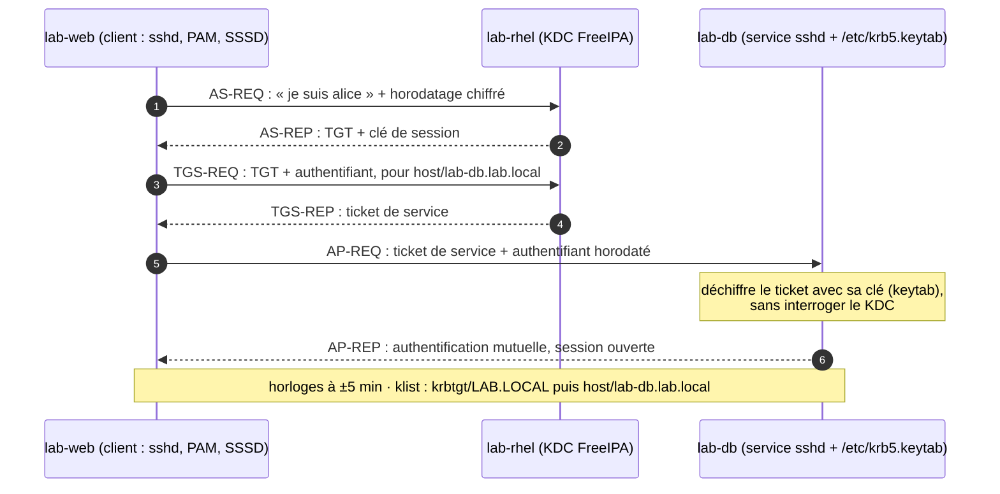

<!-- nav:début -->
[Accueil](../../README.md) › [Parcours](../../docs/parcours.md) › Partie V — Expertise système › **Module 28**  
[← Projet B](../../projets/P2-factura-devops/README.md) · [Corrigé](corrige.md) · [Projet C →](../../projets/P3-astreinte/README.md)

<details><summary>Scripts du module (8)</summary>

Sur la VM indiquée en section « Mise en place », depuis `~/workbook/scripts/` (voir [chapitre 0](../../docs/00-mise-en-place.md)).

| Script | Rôle |
|---|---|
| [`setup_M28.sh`](../../scripts/setup/setup_M28.sh) | prépare le module |
| [`check_M28_01.sh`](../../scripts/check/check_M28_01.sh) | vérifie L28.1 |
| [`check_M28_02.sh`](../../scripts/check/check_M28_02.sh) | vérifie L28.2 |
| [`check_M28_03.sh`](../../scripts/check/check_M28_03.sh) | vérifie L28.3 |
| [`check_M28_04.sh`](../../scripts/check/check_M28_04.sh) | vérifie L28.4 |
| [`break_M28_01.sh`](../../scripts/break/break_M28_01.sh) | installe la panne BF28.1 |
| [`break_M28_02.sh`](../../scripts/break/break_M28_02.sh) | installe la panne BF28.2 |
| [`break_M28_03.sh`](../../scripts/break/break_M28_03.sh) | installe la panne BF28.3 |

</details>
<!-- nav:fin -->

# Module 28 — Identité centralisée : LDAP, Kerberos, SSSD et FreeIPA

## 28.0 Objectifs et compétences

> [!NOTE]
> **Objectifs**
>
> À la fin de ce module, je sais :
>
> * lire un annuaire LDAP : DN, RDN, classes d'objets, attributs, base de
>   recherche, portée, filtre, et interroger FreeIPA avec `ldapsearch` en
>   anonyme puis en GSSAPI ;
> * expliquer le protocole Kerberos étape par étape (TGT, ticket de service,
>   authentifiant), dire ce que contient un keytab et pourquoi l'horloge compte ;
> * installer un serveur FreeIPA sur Rocky 9 et vérifier ses prérequis (FQDN,
>   résolution directe et inverse, synchronisation horaire, mémoire) ;
> * inscrire des clients Ubuntu dans le domaine et comprendre ce que
>   `ipa-client-install` a modifié (SSSD, `krb5.conf`, PAM, NSS, sshd) ;
> * gérer utilisateurs, groupes, politique de mots de passe et verrouillage
>   depuis la ligne de commande `ipa` ;
> * centraliser `sudo` et le contrôle d'accès par machine (HBAC), et tester une
>   règle avec `ipa hbactest` **avant** qu'elle ne bloque quelqu'un ;
> * publier les clés SSH dans l'annuaire et authentifier un compte de service
>   par keytab, sans mot de passe ni clé privée ;
> * diagnostiquer SSSD (`sssctl`, journaux, cache) et une authentification
>   Kerberos (`KRB5_TRACE`, `klist`, `kvno`) ;
> * concevoir l'arrivée et le départ d'un administrateur de bout en bout.
>
> **Temps estimé** : 10 h
>
> **Prérequis** : module 04 (comptes, PAM, NSS, sudo), module 12 (DNS),
> module 14 (SSH), module 18 (pare-feu, SELinux).

---

## 28.1 Mise en place

VM concernées : **`lab-rhel`** (10.10.10.13), qui devient le serveur FreeIPA,
**`lab-web`** (10.10.10.11) et **`lab-db`** (10.10.10.12), qui deviennent
clients du domaine, et **`lab-adm`** (10.10.10.10), poste de pilotage, inscrit
lui aussi.
Domaine DNS `lab.local`, royaume Kerberos `LAB.LOCAL`.

FreeIPA (annuaire 389-DS, KDC MIT, autorité de certification Dogtag, Apache)
est gourmand : passe `lab-rhel` à **4 Go** de mémoire pour la durée du
module.

```bash
# depuis le shell Proxmox
for id in 9001 9002 9003 9004; do qm snapshot $id avant-lab28; done
qm shutdown 9004 && qm set 9004 --memory 4096 && qm start 9004
```

> [!CAUTION]
> **Attention**
>
> Le module modifie la façon dont les comptes s'authentifient sur `lab-adm`,
> `lab-web` et `lab-db` (PAM, NSS, sshd). Ton compte local `mathieu` n'est pas concerné, mais
> garde une session root ouverte sur chaque client pendant les inscriptions, et
> la console Proxmox à portée de main. Une règle HBAC mal pensée peut fermer la
> porte à tous les comptes du domaine.

Paquets, posés au fil des labs :

```bash
# lab-rhel (serveur)
sudo dnf install -y ipa-server
# lab-adm, lab-web, lab-db (clients Ubuntu)
sudo apt install -y freeipa-client sssd-tools ldap-utils krb5-user \
  libsasl2-modules-gssapi-mit
```

> [!IMPORTANT]
> **Variante Rocky / RHEL**
>
> Sur Rocky, le client s'installe avec `sudo dnf install -y ipa-client`, et
> `authselect` remplace `pam-auth-update` pour la pile PAM : `ipa-client-install`
> appelle lui-même `authselect select sssd with-mkhomedir`.

Terrain de jeu (idempotent, à lancer sur chaque VM concernée) :

```bash
sudo bash ~/workbook/scripts/setup/setup_M28.sh
```

Il crée `~/lab28/` (fichier d'utilisateurs à importer sur `lab-rhel`, paires
de clés SSH de test sur `lab-adm`, ancienne clé de sauvegarde sur `lab-web`),
et **vérifie les prérequis** de la machine : nom
pleinement qualifié, résolution directe et inverse, synchronisation horaire,
mémoire. Lis son bilan avant d'installer quoi que ce soit : neuf échecs
d'installation de FreeIPA sur dix viennent de là.

> [!TIP]
> **Astuce**
>
> Note les mots de passe d'administration de l'annuaire dans
> `~/lab28/secrets.md` : les fichiers `secrets*` ne sont jamais commités
> (§0.9). En production, ils iraient dans un coffre-fort de secrets, pas dans
> un fichier.

---

## 28.2 Rappel express

### Le modèle LDAP

Un annuaire est un **arbre** (DIT) d'entrées. Chaque entrée a un nom unique,
le **DN**, lu de la feuille vers la racine :

```text
uid=alice,cn=users,cn=accounts,dc=lab,dc=local
└─ RDN ─┘ └──────── DN du parent ──────────────┘
                                 └── base (suffixe) ──┘
```

| Notion | Exemple | Rôle |
|---|---|---|
| `objectClass` | `posixAccount`, `inetOrgPerson`, `ipaUser` | dit quels attributs l'entrée peut ou doit porter |
| attribut | `uid`, `uidNumber`, `homeDirectory`, `memberOf` | une donnée, éventuellement multivaluée |
| base (`-b`) | `cn=accounts,dc=lab,dc=local` | où commence la recherche |
| portée (`-s`) | `base`, `one`, `sub` | l'entrée seule, ses enfants, tout le sous-arbre |
| filtre | `(&(objectClass=posixAccount)(uid=alice))` | notation préfixée : `&` et, `\|` ou, `!` non |
| bind | anonyme, simple (DN + mot de passe), SASL (GSSAPI) | qui je suis pour l'annuaire |

```bash
ldapsearch -x -H ldap://lab-rhel.lab.local -b dc=lab,dc=local '(uid=alice)' uid
ldapsearch -Y GSSAPI -H ldap://lab-rhel.lab.local \
  -b cn=users,cn=accounts,dc=lab,dc=local '(uid=alice)' memberOf
```

`-x` = bind simple (anonyme sans `-D`) ; `-Y GSSAPI` = authentification par
ticket Kerberos (après `kinit`), sans mot de passe sur le réseau. LDAP en
clair sur 389 transporte un bind simple **en clair** : `ldaps://` (636) ou
`-ZZ` (StartTLS) pour tout ce qui porte un mot de passe.

### Kerberos



*Figure — Une connexion SSH vers lab-db avec Kerberos : le client obtient un TGT, puis un ticket de service qu'il présente à lab-db ; le service vérifie le ticket avec sa propre clé.*

| Terme | Sens |
|---|---|
| royaume (*realm*) | domaine d'administration Kerberos, en majuscules : `LAB.LOCAL` |
| principal | une identité : `alice@LAB.LOCAL`, `host/lab-web.lab.local@LAB.LOCAL`, `HTTP/lab-web.lab.local@LAB.LOCAL` |
| KDC | serveur d'authentification (AS) + serveur de tickets (TGS) |
| TGT | ticket pour le TGS, chiffré par la clé `krbtgt/LAB.LOCAL` ; durée de vie typique 24 h |
| ticket de service | chiffré par la clé du service ; le client le transmet sans pouvoir le lire |
| keytab | fichier contenant les **clés longues** d'un principal : qui le lit devient ce principal |
| tolérance d'horloge | 5 minutes par défaut (`clockskew`) : au-delà, `Clock skew too great` |

```bash
kinit alice            # demande un TGT (mot de passe)
klist                  # tickets en cache, dates d'expiration
kvno host/lab-db.lab.local    # force un ticket de service, affiche sa version de clé
kdestroy               # vide le cache
sudo klist -k /etc/krb5.keytab        # principaux d'un keytab (lecture root)
kinit -k -t /etc/sauvegarde.keytab svc-sauvegarde   # TGT sans mot de passe
KRB5_TRACE=/dev/stderr kinit alice    # déroulé détaillé : KDC contacté, erreurs
```

Le nom du service fait partie du principal : un ticket pour
`host/lab-db.lab.local` ne sert à rien si le client se connecte à
`10.10.10.12` ou à `lab-db` sans domaine. **DNS direct et inverse justes,
noms pleinement qualifiés partout.**

### SSSD

```text
login / sshd / su / sudo
   │ PAM (pam_sss)          │ NSS (libnss_sss)        sudo (sudoers: sss)
   └──────────────► sssd ◄──┴──────────────────────────┘
                     │  cache local (/var/lib/sss/db)
          id_provider / auth_provider / access_provider = ipa
                     ▼
              LDAP + Kerberos (FreeIPA)
```

| Élément | Où | À retenir |
|---|---|---|
| `/etc/sssd/sssd.conf` | client | **0600 root:root**, sinon sssd refuse de démarrer |
| `/etc/nsswitch.conf` | client | `passwd: files systemd sss` : fichiers locaux d'abord |
| `cache_credentials = True` | `[domain/…]` | connexion hors ligne pour qui s'est déjà connecté |
| `enumerate = False` | défaut | `getent passwd` sans argument ne liste **pas** les comptes du domaine |
| `sssctl domain-status lab.local` | client | en ligne ? quel serveur ? |
| `sssctl user-checks alice -s sshd` | client | rejoue PAM (auth, compte) comme le ferait sshd |
| `sss_cache -E` / `sssctl cache-expire -E` | client | invalide le cache (pas de suppression) |
| `/var/log/sssd/` | client | un journal par domaine, `krb5_child.log`, `ldap_child.log` |

### FreeIPA en commandes

| Tâche | Commande |
|---|---|
| état des services (serveur) | `sudo ipactl status` |
| utilisateur | `ipa user-add alice --first=Alice --last=Martin --password` |
| groupe | `ipa group-add admins-lab` puis `ipa group-add-member admins-lab --users=alice` |
| clé SSH | `ipa user-mod alice --sshpubkey="$(cat alice.pub)"` |
| politique de mots de passe | `ipa pwpolicy-mod --maxlife=90 --minlength=12 --history=5 --maxfail=5` |
| verrouillage | `ipa user-status alice` · `ipa user-unlock alice` · `ipa user-disable alice` |
| sudo | `ipa sudocmd-add`, `ipa sudorule-add`, `…-add-user`, `…-add-host`, `…-add-allow-command` |
| HBAC | `ipa hbacrule-add`, `…-add-user`, `…-add-host`, `…-add-service`, `ipa hbactest` |
| service et keytab | `ipa service-add`, `ipa-getkeytab -p <principal> -k <fichier>` |
| inscrire un client | `ipa-client-install --domain=lab.local --server=lab-rhel.lab.local --mkhomedir` |

Pièges classiques :

* la règle HBAC `allow_all` autorise tout le monde partout ; la désactiver
  **avant** d'avoir écrit les règles de remplacement ferme toutes les portes ;
* un changement de groupe ne s'applique qu'à la **prochaine ouverture de
  session** (et après expiration du cache SSSD) ;
* `ipa-getkeytab` sur un principal **régénère** ses clés : l'ancien keytab, ou
  le mot de passe d'un utilisateur, cesse de fonctionner (`-r` pour
  récupérer les clés existantes, si la politique l'autorise) ;
* `lab.local` est pratique au laboratoire, mais `.local` est réservé à mDNS
  (RFC 6762) : en production, un sous-domaine réel (`ipa.exemple.fr`).

---

## 28.3 Quiz — QCM

<a id="q28-1"></a>**[Q28.1](corrige.md#q28-1)** — Dans le DN `uid=alice,cn=users,cn=accounts,dc=lab,dc=local`,
quel est le RDN de l'entrée ?

a) `dc=lab,dc=local`
b) `uid=alice`
c) `cn=users,cn=accounts`
d) le DN entier : il n'y a pas de RDN sur une feuille

<a id="q28-2"></a>**[Q28.2](corrige.md#q28-2)** — `ldapsearch -x -H ldap://lab-rhel.lab.local -b dc=lab,dc=local '(uid=alice)'`
renvoie l'entrée mais sans l'attribut `memberOf`, que tu vois pourtant dans
l'interface web. L'explication la plus probable ?

a) `memberOf` n'existe pas dans 389-DS
b) le bind anonyme n'a pas le droit de lire cet attribut (ACI)
c) il faut ajouter `-s one`
d) `-x` désactive le retour des attributs multivalués

<a id="q28-3"></a>**[Q28.3](corrige.md#q28-3)** — Que peut faire un client avec son TGT ?

a) le déchiffrer pour lire sa date d'expiration
b) le présenter directement à `sshd` sur `lab-db`
c) le présenter au TGS pour obtenir des tickets de service
d) le transformer en mot de passe hors ligne

<a id="q28-4"></a>**[Q28.4](corrige.md#q28-4)** — `kinit alice` répond `Clock skew too great while getting initial credentials`.
Quel est l'écart d'horloge toléré par défaut entre le client et le KDC ?

a) 30 secondes
b) 5 minutes
c) 1 heure
d) aucun : l'horloge doit être identique à la seconde

<a id="q28-5"></a>**[Q28.5](corrige.md#q28-5)** — Pourquoi un keytab doit-il être en `0600` et appartenir au seul
compte qui l'utilise ?

a) parce que `kinit -k` refuse les fichiers lisibles par le groupe
b) parce qu'il contient les clés longues du principal : le lire, c'est
   pouvoir se faire passer pour lui sans connaître de mot de passe
c) parce que le KDC vérifie les droits du fichier à chaque demande
d) par convention seulement : il est chiffré par le mot de passe de root

<a id="q28-6"></a>**[Q28.6](corrige.md#q28-6)** — Sur un client du domaine, `getent passwd` liste les comptes locaux
mais aucun compte FreeIPA, alors que `getent passwd alice` répond. Pourquoi ?

a) SSSD est arrêté
b) `nsswitch.conf` ne contient pas `sss`
c) l'énumération est désactivée par défaut (`enumerate = False`)
d) alice n'a pas de `homeDirectory`

<a id="q28-7"></a>**[Q28.7](corrige.md#q28-7)** — Après une modification à la main, `sssd` refuse de démarrer et le
journal parle de *ownership and permissions*. Que faut-il vérifier ?

a) que `/etc/sssd/sssd.conf` est en `0600`, propriété de root
b) que `/etc/krb5.keytab` est en `0644`
c) que `/var/lib/sss/db` appartient à l'utilisateur `sssd`
d) que `/etc/nsswitch.conf` est en `0600`

<a id="q28-8"></a>**[Q28.8](corrige.md#q28-8)** — Tu désactives la règle HBAC `allow_all` sans avoir créé d'autre
règle. Qui peut encore ouvrir une session SSH sur `lab-web` ? *Plusieurs
réponses possibles.*

a) `admin` (compte FreeIPA)
b) `alice` (compte FreeIPA)
c) `mathieu` (compte local de la VM)
d) `root` en local sur la console

<a id="q28-9"></a>**[Q28.9](corrige.md#q28-9)** — Que fait `ipa hbactest --user=alice --host=lab-web.lab.local --service=sshd` ?

a) ouvre une session SSH de test sous l'identité d'alice
b) évalue les règles HBAC du serveur et dit quelle règle accorderait (ou
   non) l'accès, sans rien modifier
c) force la synchronisation des règles HBAC sur `lab-web`
d) vérifie que le port 22 de `lab-web` est ouvert

<a id="q28-10"></a>**[Q28.10](corrige.md#q28-10)** — Comment `sshd` d'un client FreeIPA trouve-t-il la clé publique
d'alice, absente de `~alice/.ssh/authorized_keys` ?

a) il interroge LDAP lui-même grâce à `UsePAM yes`
b) par `AuthorizedKeysCommand /usr/bin/sss_ssh_authorizedkeys`, qui lit la
   clé dans l'annuaire via SSSD
c) `ipa-client-install` recopie toutes les clés dans `/etc/ssh/authorized_keys`
d) par Kerberos : une clé SSH est un ticket

<a id="q28-11"></a>**[Q28.11](corrige.md#q28-11)** — `lab-rhel` est éteint. Qui peut se connecter sur `lab-web` avec un
compte du domaine ?

a) personne
b) tout utilisateur du domaine, SSSD fait l'authentification seul
c) les utilisateurs qui se sont déjà connectés sur `lab-web` et dont le mot
   de passe est en cache (`cache_credentials = True`)
d) seulement `admin`

<a id="q28-12"></a>**[Q28.12](corrige.md#q28-12)** — Un script tourne en `curl --negotiate` vers `http://10.10.10.11/`
et échoue, alors que `http://lab-web.lab.local/` fonctionne. Pourquoi ?

a) `--negotiate` ne marche qu'en HTTPS
b) le ticket demandé est `HTTP/10.10.10.11`, principal qui n'existe pas :
   le nom du service fait partie du principal
c) le KDC refuse les clients sans adresse IP déclarée
d) l'adresse IP déclenche un bind anonyme

<a id="q28-13"></a>**[Q28.13](corrige.md#q28-13)** — Tu lances `ipa-getkeytab -p alice@LAB.LOCAL -k /tmp/alice.keytab`.
Quel effet de bord ?

a) aucun
b) alice ne peut plus se connecter avec son mot de passe : ses clés ont été
   régénérées
c) le compte d'alice est verrouillé
d) le keytab est vide tant qu'alice ne s'est pas reconnectée

<a id="q28-14"></a>**[Q28.14](corrige.md#q28-14)** — Alice est ajoutée au groupe `admins-lab` à 10 h. Sa session SSH,
ouverte à 9 h, ne voit toujours pas le groupe dans `id`. Pourquoi ?

a) le groupe est mal créé
b) la liste des groupes d'un processus est calculée à l'ouverture de session ;
   il faut une nouvelle session (et un cache SSSD à jour)
c) `id` ne sait pas lire les groupes LDAP
d) il faut redémarrer `lab-web`

<a id="q28-15"></a>**[Q28.15](corrige.md#q28-15)** — Dans `/etc/nsswitch.conf`, que signifie `passwd: files systemd sss` ?

a) un compte présent dans `/etc/passwd` masque un compte de même nom dans
   l'annuaire
b) l'annuaire est interrogé en premier, les fichiers en secours
c) les trois sources sont fusionnées, la dernière l'emporte
d) seuls les comptes présents dans les trois sources sont valides

<a id="q28-16"></a>**[Q28.16](corrige.md#q28-16)** — Quel composant de FreeIPA émet les certificats des hôtes et des
services du domaine ?

a) 389-DS
b) le KDC MIT
c) Dogtag (autorité de certification intégrée)
d) certmonger, qui est une autorité de certification

---

## 28.4 Quiz — questions ouvertes

<a id="qo28-1"></a>**[QO28.1](corrige.md#qo28-1)** — Décris tout ce qui se passe, composant par composant, entre le
moment où alice tape son mot de passe dans `ssh alice@lab-web.lab.local` et
l'affichage de son invite de commande, jusqu'à la création de son répertoire
personnel.

<a id="qo28-2"></a>**[QO28.2](corrige.md#qo28-2)** — *On te demande en entretien* : « LDAP, Kerberos, SSSD, FreeIPA :
qui fait quoi ? Et pourquoi ne pas tout faire en LDAP ? »

<a id="qo28-3"></a>**[QO28.3](corrige.md#qo28-3)** — Pourquoi un bind simple LDAP sur le port 389 est-il dangereux pour
authentifier des utilisateurs ? Quelles sont les deux corrections, et qu'apporte
Kerberos de plus qu'un LDAP chiffré ?

<a id="qo28-4"></a>**[QO28.4](corrige.md#qo28-4)** — *On te demande en entretien* : « Ton serveur d'identité tombe un
lundi à 9 h. Qu'est-ce qui continue de marcher, qu'est-ce qui casse, et qu'as-tu
prévu pour que ça n'arrive pas ? »

<a id="qo28-5"></a>**[QO28.5](corrige.md#qo28-5)** — Un administrateur quitte l'entreprise ce soir. Dresse la liste
complète de ce qu'il faut faire pour qu'il n'ait plus aucun accès, dans le bon
ordre, en distinguant ce que FreeIPA règle seul de ce qu'il ne voit pas.

<a id="qo28-6"></a>**[QO28.6](corrige.md#qo28-6)** — Compare trois architectures : FreeIPA, Active Directory avec des
clients Linux joints par `realmd`/SSSD, et un OpenLDAP « nu » avec
`pam_ldap`. Pour quel contexte choisirais-tu chacune ?

<a id="qo28-7"></a>**[QO28.7](corrige.md#qo28-7)** — FreeIPA attribue aux comptes des UID à partir d'une plage
aléatoire élevée (souvent au-delà de 1 000 000). Pourquoi ? Que se passe-t-il
avec un partage NFS monté par des machines dont les comptes locaux ont des
UID 1001, 1002… ?

<a id="qo28-8"></a>**[QO28.8](corrige.md#qo28-8)** — Un compte de service authentifié par keytab est pratique et
dangereux. Quelles règles d'exploitation poses-tu (stockage, droits, rotation,
périmètre HBAC, surveillance) ?

---

## 28.5 Exercices guidés ★

<a id="e28-1"></a>**[E28.1](corrige.md#e28-1)** — Sur `lab-rhel`, prouve en quatre commandes que la machine remplit
les prérequis d'un serveur FreeIPA : nom pleinement qualifié, résolution
directe vers `10.10.10.13` (et pas vers `127.0.0.1`), résolution inverse,
horloge synchronisée.

<a id="e28-2"></a>**[E28.2](corrige.md#e28-2)** — Après l'installation (L28.1), obtiens un ticket pour `admin`,
affiche le cache avec les dates d'expiration et les types de chiffrement, puis
détruis-le.

<a id="e28-3"></a>**[E28.3](corrige.md#e28-3)** — Crée en ligne de commande l'utilisateur `bruno` (Bruno Lefèvre),
avec un mot de passe initial, et le groupe `devs` dont il est membre. Montre
avec une seule commande `ipa` les groupes de `bruno`.

<a id="e28-4"></a>**[E28.4](corrige.md#e28-4)** — Depuis `lab-adm`, cherche l'entrée d'`alice` avec `ldapsearch`,
d'abord en anonyme, puis en GSSAPI après `kinit alice`. Compare les attributs
obtenus et donne le DN complet d'un des groupes d'alice.

<a id="e28-5"></a>**[E28.5](corrige.md#e28-5)** — Sur `lab-web` inscrit (L28.2), affiche les sections de
`/etc/sssd/sssd.conf` et de `/etc/krb5.conf` écrites par `ipa-client-install`,
et explique en une ligne chacune des options suivantes : `id_provider`,
`ipa_server`, `cache_credentials`, `default_realm`, `dns_lookup_kdc`.

<a id="e28-6"></a>**[E28.6](corrige.md#e28-6)** — Sur `lab-web`, montre l'état du domaine vu par SSSD (en ligne ou
non, serveur utilisé), puis rejoue l'autorisation PAM de `sshd` pour `alice`
sans ouvrir de session.

<a id="e28-7"></a>**[E28.7](corrige.md#e28-7)** — Impose une politique de mots de passe globale : 12 caractères
minimum, 3 classes de caractères, durée de vie 90 jours, historique de 5,
verrouillage après 5 échecs pendant 15 minutes. Affiche la politique résultante.

<a id="e28-8"></a>**[E28.8](corrige.md#e28-8)** — Provoque le verrouillage de `bruno` par des échecs de connexion
depuis `lab-adm`, montre son état et le compteur d'échecs, puis déverrouille-le.

<a id="e28-9"></a>**[E28.9](corrige.md#e28-9)** — Publie dans l'annuaire la clé publique `~/lab28/cles/alice.pub`
(générée par le setup sur `lab-adm`), puis prouve sur `lab-web` que `sshd`
la trouve, **sans** qu'elle soit dans `~alice/.ssh/authorized_keys`.

<a id="e28-10"></a>**[E28.10](corrige.md#e28-10)** — Sur `lab-db`, lance `kinit alice` en traçant la bibliothèque
Kerberos, et retrouve dans la trace le KDC contacté, le protocole utilisé et le
type de chiffrement de la clé.

<a id="e28-11"></a>**[E28.11](corrige.md#e28-11)** — Depuis `lab-adm` avec un TGT d'alice, obtiens un ticket pour le
service `host` de `lab-db` sans t'y connecter, et affiche sa version de clé
(kvno). Compare-la à celle que montre le keytab de `lab-db`.

<a id="e28-12"></a>**[E28.12](corrige.md#e28-12)** — Ajoute `alice` au groupe `devs`. Montre que `id alice` sur
`lab-web` ne le voit pas encore, fais-le apparaître sans attendre l'expiration
naturelle du cache, et explique pourquoi la session SSH déjà ouverte d'alice
ne le verra toujours pas.

---

## 28.6 Labs ★★

### <a id="l28-1"></a>**[L28.1](corrige.md#l28-1)** — Le serveur d'identité de l'équipe

> **Contexte**
>
> Chaque VM du laboratoire a ses propres comptes, créés à la main, avec des UID
> différents d'une machine à l'autre. Deux personnes rejoignent l'équipe le mois
> prochain. Décision : un annuaire unique, sur `lab-rhel`, qui portera les
> comptes, les groupes, les droits sudo et l'accès aux machines.

1. Vérifie et corrige les prérequis (E28.1) : `hostnamectl` doit renvoyer
   `lab-rhel.lab.local`, `getent hosts lab-rhel.lab.local` l'adresse
   `10.10.10.13`, `getent hosts 10.10.10.13` le nom complet ; `chronyc
   tracking` doit montrer une source synchronisée. Mémoire : 4 Go.
2. Installe `ipa-server` et lance l'installation **non interactive**, sans DNS
   intégré (le DNS du lab reste `dnsmasq` sur le nœud) : domaine `lab.local`,
   royaume `LAB.LOCAL`, mots de passe du Directory Manager et d'`admin` notés
   dans `~/lab28/secrets.md`.
3. Ouvre dans firewalld les services nécessaires à FreeIPA (un seul service
   prédéfini les regroupe) et rends-les permanents.
4. Vérifie l'état de tous les composants, obtiens un ticket `admin`, et liste
   les utilisateurs.
5. Crée les comptes du fichier `~/lab28/utilisateurs.csv` (`alice`, `bruno`,
   `chloe`, `david`) et les groupes `admins-lab`, `devs`, `auditeurs` avec les
   appartenances indiquées, **en une boucle** qui lit le fichier.
6. Accède à l'interface web depuis ton poste par un tunnel SSH via
   `lab-adm` et connecte-toi en `admin` (le certificat est signé par la CA du
   domaine : explique l'avertissement du navigateur).

> [!TIP]
> **Critère de succès**
>
> Critère de succès : `ipactl status` montre tous les services `RUNNING`, les
> quatre comptes et trois groupes existent avec les bonnes appartenances, et le
> pare-feu laisse passer LDAP et Kerberos depuis `lab-web`.
>
> ```bash
> sudo bash check_M28_01.sh      # sur lab-rhel
> ```

### <a id="l28-2"></a>**[L28.2](corrige.md#l28-2)** — Inscrire les serveurs Ubuntu

> **Contexte**
>
> L'annuaire existe ; il faut maintenant que `lab-web` et `lab-db` lui fassent
> confiance. Exigence de l'équipe : un utilisateur du domaine qui se connecte
> pour la première fois doit trouver son répertoire personnel créé, et les
> comptes locaux existants (dont `mathieu`) ne doivent pas être affectés.

1. Sur `lab-web`, installe le client, puis inscris la machine avec le compte
   `admin`, en désignant explicitement le serveur et le domaine (pas
   d'enregistrements SRV dans `dnsmasq`), avec création automatique des
   répertoires personnels.
2. Liste ce qui a changé : `sssd.conf`, `krb5.conf`, `nsswitch.conf`, la pile
   PAM (`/etc/pam.d/common-*`), la configuration de `sshd`, le keytab de
   l'hôte. Pour chaque fichier, une ligne qui dit ce que la modification
   permet.
3. Vérifie : `id alice`, `getent passwd alice`, connexion SSH d'alice depuis
   `lab-adm` avec mot de passe, présence de `/home/alice` après coup, ticket
   Kerberos d'alice dans sa session (`klist`).
4. Inscris `lab-db` puis `lab-adm`, cette fois **sans taper le mot de passe
   d'`admin` sur le client** : l'hôte est déclaré d'abord sur le serveur avec
   un mot de passe à usage unique, et l'inscription tient en une commande
   reproductible que tu gardes dans `~/lab28/inscription.sh`.
5. Vérifie que l'hôte est enregistré côté serveur avec ses clés SSH d'hôte
   (`ipa host-show lab-db.lab.local`), et explique ce que ça apporte au
   client SSH de `lab-adm`.

> [!TIP]
> **Critère de succès**
>
> Critère de succès : sur les trois clients, `id alice` donne l'UID attribué par
> FreeIPA, alice peut s'y connecter et obtient un ticket, `mathieu` se connecte
> comme avant.
>
> ```bash
> sudo bash check_M28_02.sh      # sur lab-web, lab-db et lab-adm
> ```

### <a id="l28-3"></a>**[L28.3](corrige.md#l28-3)** — Sudo et accès aux machines, centralisés

> **Contexte**
>
> Politique validée par le responsable sécurité :
>
> | Groupe | Accès SSH | Sudo |
> |---|---|---|
> | `admins-lab` | `lab-adm`, `lab-web`, `lab-db` | tout, sur `lab-web` et `lab-db` |
> | `devs` | `lab-web` seulement | `systemctl restart nginx` et `journalctl -u nginx` sur `lab-web` |
> | `auditeurs` | `lab-web`, `lab-db` | rien |
> | `admin` (compte FreeIPA) | partout | tout (compte de dernier recours) |

1. Range les machines dans des **groupes d'hôtes** (`serveurs` : `lab-web`,
   `lab-db` ; `postes-admin` : `lab-adm`), puis crée les commandes et groupes
   de commandes sudo et les règles sudo qui traduisent la colonne « Sudo ».
   Les règles visent des **groupes**, jamais des personnes ni des machines
   isolées quand un groupe d'hôtes existe.
2. Crée les règles HBAC qui traduisent la colonne « Accès SSH » (service
   `sshd`), dont une règle explicite pour `admin`. La colonne « Sudo » a
   besoin de HBAC elle aussi : `sudo` passe par la phase *account* de PAM,
   donc par `pam_sss` et le contrôle d'accès de FreeIPA.
3. **Avant** de toucher à `allow_all`, teste chaque ligne du tableau avec
   `ipa hbactest`, y compris les refus attendus (`bruno` vers `lab-db`).
4. Désactive `allow_all`. Vérifie depuis `lab-adm` : `bruno` entre sur
   `lab-web` et pas sur `lab-db` ; `chloe` (auditrice) entre partout mais
   `sudo -l` ne lui donne rien.
5. Sur `lab-web`, montre la règle sudo d'un membre de `devs` telle que la voit
   `sudo -l`, et prouve qu'aucune règle n'a été écrite dans `/etc/sudoers.d/`.

> [!CAUTION]
> **Attention**
>
> L'ordre compte : règles de remplacement, `hbactest`, **puis** désactivation
> d'`allow_all`. Garde une session `mathieu` ouverte sur chaque client : un
> compte local n'est jamais soumis au HBAC.

> [!TIP]
> **Critère de succès**
>
> Critère de succès : le tableau est respecté à la lettre, `allow_all` est
> désactivée, et `/etc/sudoers.d/` ne contient aucune règle pour les groupes
> du domaine.
>
> ```bash
> sudo bash check_M28_03.sh      # sur lab-web
> ```

### <a id="l28-4"></a>**[L28.4](corrige.md#l28-4)** — Une sauvegarde sans mot de passe ni clé privée

> **Contexte**
>
> Le script de sauvegarde de `lab-db` récupère chaque nuit, en SSH, une archive
> de `/etc/nginx` sur `lab-web`. Il utilise aujourd'hui une clé SSH sans phrase
> de passe, copiée sur toutes les machines, que personne n'a jamais changée. On
> te demande de la remplacer par Kerberos.

1. Crée l'utilisateur de domaine `svc-sauvegarde` (shell `/bin/bash`, pas de
   mot de passe utilisable), et une règle HBAC qui ne lui ouvre que `lab-web`,
   pour les seuls services `sshd` et `sudo`.
2. Sur `lab-db`, récupère son keytab dans `/etc/svc-sauvegarde.keytab`,
   propriété de `svc-sauvegarde` en `0600`. Explique pourquoi cette commande
   rend inutilisable tout mot de passe qu'il aurait pu avoir.
3. Sur `lab-web`, donne à `svc-sauvegarde` la lecture de `/etc/nginx` via
   une règle sudo FreeIPA limitée à une seule commande (`tar` sur ce
   répertoire), sans mot de passe.
4. Écris `/usr/local/sbin/sauvegarde-nginx.sh` sur `lab-db` : obtient un
   ticket depuis le keytab, se connecte à `lab-web.lab.local` en GSSAPI,
   rapatrie l'archive horodatée dans `/srv/sauvegardes/nginx/`, garde les 7
   dernières, détruit le ticket en fin de script.
5. Lance-le par une unité `sauvegarde-nginx.service` + `.timer` (quotidien,
   `User=svc-sauvegarde`), déclenche un premier passage, et montre dans le
   journal de `lab-web` la ligne `Accepted gssapi-with-mic`.
6. Supprime l'ancienne clé SSH partout où elle traînait : le setup de
   `lab-web` l'a autorisée pour `mathieu` et en a laissé la paire dans
   `~/lab28/ancienne-cle/`, comme la copie qu'on retrouve toujours sur un
   serveur oublié. Dis comment tu vérifies qu'elle n'est plus autorisée
   nulle part.

> [!TIP]
> **Critère de succès**
>
> Critère de succès : l'archive du jour est présente sur `lab-db`, obtenue sans
> mot de passe ni clé privée, le keytab n'est lisible que par
> `svc-sauvegarde`, et sa règle HBAC ne lui ouvre que `lab-web`.
>
> ```bash
> sudo bash check_M28_04.sh      # sur lab-db, puis sur lab-web
> ```

---

## 28.7 Break & Fix ★★★

> [!CAUTION]
> **Attention**
>
> Avant chaque Break & Fix : `qm snapshot <vmid> avant-bf28`. Le snapshot
> `avant-lab28` reste le filet de sécurité, mais l'utiliser vaut échec. Garde
> une session `mathieu` ouverte sur la machine cassée.

### <a id="bf28-1"></a>**[BF28.1](corrige.md#bf28-1)** — « Plus personne ne peut se connecter sur le frontal »

À lancer sur `lab-web` :

```bash
sudo bash break_M28_01.sh
```

**Symptôme utilisateur** : depuis ce matin, une partie des comptes du domaine
ne peut plus se connecter à `lab-web` : `Permission denied, please try again.`
au mot de passe, alors que les mêmes comptes entrent sans problème sur
`lab-db`. D'autres entrent encore sur `lab-web`, mais leur session n'a pas de
ticket Kerberos (`klist` : *No credentials cache found*). Les comptes locaux
fonctionnent. `id alice` répond normalement. L'interface web de FreeIPA ne
signale rien d'anormal.

**Interdit** : désinscrire et réinscrire le client, redémarrer la VM.

**Objectif** : trouver la cause en partant des journaux de SSSD, rétablir les
connexions, et empêcher que cela se reproduise.

### <a id="bf28-2"></a>**[BF28.2](corrige.md#bf28-2)** — « Les comptes du domaine n'existent plus sur lab-db »

À lancer sur `lab-db` :

```bash
sudo bash break_M28_02.sh
```

**Symptôme utilisateur** : après une « petite modification de configuration »
d'un collègue, `id alice` répond `no such user` sur `lab-db`. Le script de
sauvegarde de L28.4 échoue, et `systemctl status sssd` n'a pas l'air content.
Sur `lab-web`, tout va bien.

**Interdit** : réinstaller `sssd` ou `freeipa-client`, réinscrire la machine.

**Objectif** : trouver **toutes** les modifications fautives (il y en a plus
d'une), rétablir `id alice` et la sauvegarde, et dire quel contrôle aurait
signalé le problème avant les utilisateurs.

### <a id="bf28-3"></a>**[BF28.3](corrige.md#bf28-3)** — « Elle a été retirée du groupe, et elle fait toujours sudo »

À lancer sur `lab-web`, puis suivre le scénario :

```bash
sudo bash break_M28_03.sh
```

**Scénario** : le script prépare la machine, puis te demande de jouer le rôle
du responsable sécurité. Sur `lab-rhel`, retire alice du groupe `admins-lab`
(`ipa group-remove-member admins-lab --users=alice`). Sur `lab-web`, une heure
plus tard (en pratique : tout de suite), `sudo -l -U alice` montre toujours
`(ALL) ALL`, `id alice` affiche toujours `admins-lab`, et la session SSH
qu'alice avait ouverte avant le retrait peut toujours passer root.

**Interdit** : redémarrer `lab-web`, supprimer le cache SSSD (`rm`).

**Objectif** : expliquer précisément pourquoi le retrait n'est pas appliqué,
le faire appliquer immédiatement, puis corriger la configuration pour que le
délai maximal d'application d'un retrait de droits soit de cinq minutes.
Chiffre le compromis que tu fais.

---

## 28.8 Défi du module ★★★

<a id="d28"></a>**[D28](corrige.md#d28) — Arrivée et départ d'un administrateur, sans rien oublier**

Livrable : deux scripts dans `~/lab28/defi/` sur `lab-adm`, un runbook et une
preuve.

1. `arrivee.sh <login> "<Prénom Nom>" <groupe> <fichier.pub>` : crée le compte
   avec mot de passe initial aléatoire à changer à la première connexion,
   l'ajoute au groupe, publie sa clé SSH, affiche le mot de passe une seule
   fois, et vérifie par `ipa hbactest` qu'il aura bien les accès de son groupe
   — et **pas** les autres.
2. `depart.sh <login>` : désactive le compte (sans le supprimer : les traces
   doivent rester attribuables), retire ses clés SSH, le retire de tous ses
   groupes, **termine ses sessions ouvertes** sur toutes les machines du
   domaine, invalide les caches SSSD des clients, et cherche sur chaque client
   les traces qu'il pourrait avoir laissées hors de l'annuaire
   (`authorized_keys` d'autres comptes, `crontab`, fichiers dans
   `/etc/sudoers.d/`, processus restants).
3. Les deux scripts : `set -euo pipefail`, `--help`, journalisation horodatée
   dans `~/lab28/defi/journal.log`, code de sortie non nul si une étape échoue,
   aucun mot de passe en argument ni dans le journal (le mot de passe
   d'`admin` est demandé par `kinit`, pas lu dans un fichier).
4. `~/lab28/defi/runbook.md` : quand utiliser chaque script, prérequis, ce que
   les scripts ne couvrent **pas** (comptes locaux, secrets partagés à
   changer, accès hors domaine), et la procédure de retour arrière.
5. Preuve : fais arriver `eve` dans `devs`, connecte-la, lance une session
   longue (`sleep 3600` dans `tmux`), puis fais-la partir. Montre qu'elle n'a
   plus aucune session, qu'elle ne peut plus se connecter, et que son compte
   existe toujours, désactivé.

---

## 28.9 Auto-évaluation

| Compétence | Acquis | À revoir |
|---|---|---|
| Lire un DN et écrire un filtre LDAP | ☐ | ☐ |
| Interroger l'annuaire en anonyme et en GSSAPI | ☐ | ☐ |
| Expliquer le protocole Kerberos et le rôle du keytab | ☐ | ☐ |
| Vérifier les prérequis et installer un serveur FreeIPA | ☐ | ☐ |
| Inscrire un client et dire ce qui a changé sur la machine | ☐ | ☐ |
| Gérer comptes, groupes, mots de passe, verrouillage | ☐ | ☐ |
| Écrire des règles sudo et HBAC, les tester avant de les appliquer | ☐ | ☐ |
| Authentifier un service par keytab, en SSH GSSAPI | ☐ | ☐ |
| Diagnostiquer SSSD : journaux, `sssctl`, cache | ☐ | ☐ |
| Diagnostiquer Kerberos : `KRB5_TRACE`, horloge, noms de principaux | ☐ | ☐ |
| Organiser l'arrivée et le départ d'un administrateur | ☐ | ☐ |

Pour aller plus loin :

* Installe un **réplica** FreeIPA (`ipa-replica-install`) sur une VM Rocky
  supplémentaire, coupe `lab-rhel` et vérifie que les clients basculent
  (`ipa_server = _srv_, lab-rhel.lab.local` ou deux serveurs explicites).
* Active le **DNS intégré** de FreeIPA sur un domaine dédié (`ipa.lab.local`)
  et laisse les clients découvrir le domaine par les enregistrements SRV
  (`_kerberos._udp`, `_ldap._tcp`) : plus besoin de `--server`.
* Lis la documentation Red Hat *Planning Identity Management* et l'examen
  **EX362** (Red Hat Certified Specialist in Identity Management) : ce module
  en couvre le cœur, hors trust Active Directory.
* Protège l'interface web et SSH par une authentification à deux facteurs
  (jetons OTP gérés par FreeIPA : `ipa otptoken-add`).

<!-- nav:début -->
---

[← Projet B](../../projets/P2-factura-devops/README.md) · [Corrigé](corrige.md) · [Projet C →](../../projets/P3-astreinte/README.md) · [Parcours](../../docs/parcours.md) · [Accueil](../../README.md)
<!-- nav:fin -->
