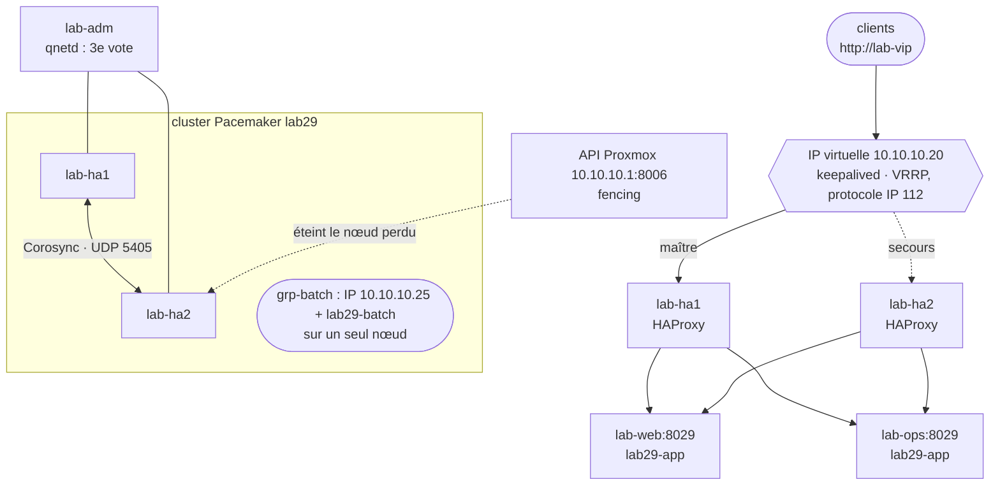

<!-- nav:début -->
[Accueil](../../README.md) › [Parcours](../../docs/parcours.md) › Partie V — Expertise système › **Module 29**  
[← Module 28](../28-identite-centralisee/README.md) · [Corrigé](corrige.md) · [Module 30 →](../30-sauvegarde-pra/README.md)

<details><summary>Scripts du module (8)</summary>

Sur la VM indiquée en section « Mise en place », depuis `~/workbook/scripts/` (voir [chapitre 0](../../docs/00-mise-en-place.md)).

| Script | Rôle |
|---|---|
| [`setup_M29.sh`](../../scripts/setup/setup_M29.sh) | prépare le module |
| [`check_M29_01.sh`](../../scripts/check/check_M29_01.sh) | vérifie L29.1 |
| [`check_M29_02.sh`](../../scripts/check/check_M29_02.sh) | vérifie L29.2 |
| [`check_M29_03.sh`](../../scripts/check/check_M29_03.sh) | vérifie L29.3 |
| [`check_M29_04.sh`](../../scripts/check/check_M29_04.sh) | vérifie L29.4 |
| [`break_M29_01.sh`](../../scripts/break/break_M29_01.sh) | installe la panne BF29.1 |
| [`break_M29_02.sh`](../../scripts/break/break_M29_02.sh) | installe la panne BF29.2 |
| [`break_M29_03.sh`](../../scripts/break/break_M29_03.sh) | installe la panne BF29.3 |

</details>
<!-- nav:fin -->

# Module 29 — Haute disponibilité : HAProxy, keepalived, Pacemaker et Corosync

## 29.0 Objectifs et compétences

> [!NOTE]
> **Objectifs**
>
> À la fin de ce module, je sais :
>
> * chiffrer une disponibilité (« trois neuf », composants en série et en
>   parallèle) et dire ce qu'un dispositif de haute disponibilité protège, et
>   ce qu'il ne protège pas ;
> * répartir la charge HTTP avec HAProxy : algorithmes, contrôles de santé
>   applicatifs, page de statistiques, socket d'administration, rechargement
>   sans coupure, mise en maintenance d'un serveur ;
> * porter une adresse IP virtuelle entre deux machines avec keepalived
>   (VRRP) : élection, priorités, préemption, script de suivi, ARP gratuit, et
>   **mesurer** la durée réelle d'une bascule ;
> * monter un cluster Pacemaker/Corosync à deux nœuds avec un arbitre de
>   quorum (qdevice), et expliquer pourquoi deux nœuds seuls ne suffisent pas ;
> * configurer et **tester** le fencing (STONITH) par l'API Proxmox, et dire
>   pourquoi un cluster sans fencing est plus dangereux qu'un serveur seul ;
> * déclarer des ressources (IP, service), des groupes, des contraintes et
>   l'adhérence, et opérer le cluster : déplacement, nœud en attente, nettoyage
>   des échecs ;
> * reconnaître et diagnostiquer un *split-brain*, une configuration
>   divergente entre nœuds et un fencing qui échoue.
>
> **Temps estimé** : 10 h
>
> **Prérequis** : module 08 (systemd), module 12 (ARP, routage), module 13
> (netfilter), module 15 (services web), module 18 (pare-feu).

---

## 29.1 Mise en place

Deux machines dédiées, parce que ce module éteint, coupe et redémarre des
nœuds sans prévenir :

| VM | VMID / IP | Ressources | Rôle |
|---|---|---|---|
| `lab-ha1` (Ubuntu 24.04) | 9021 / 10.10.10.21 | 1 vCPU, 1 Go, 20 Go | nœud de cluster |
| `lab-ha2` (Ubuntu 24.04) | 9022 / 10.10.10.22 | 1 vCPU, 1 Go, 20 Go | nœud de cluster |
| `lab-vip` | 10.10.10.20 | — | IP virtuelle du répartiteur (keepalived) |
| `lab-batch` | 10.10.10.25 | — | IP virtuelle du service unique (Pacemaker) |

Les applications servies restent sur `lab-web` et `lab-ops` (port 8029),
l'arbitre de quorum sur `lab-adm`, et le fencing passe par l'API du nœud
Proxmox (`10.10.10.1:8006`).

```bash
# depuis le shell Proxmox : deux clones du template Ubuntu (chapitre 0)
for n in 1 2; do
  id=$((9020 + n))
  qm clone 9000 $id --name lab-ha$n --full 1 --storage local-lvm
  qm set $id --cores 1 --memory 1024 --onboot 1 \
    --ipconfig0 ip=10.10.10.2$n/24,gw=10.10.10.1 \
    --nameserver 10.10.10.1 --searchdomain lab.local \
    --ciuser mathieu --sshkeys /root/lab/lab-keys.pub
  qm start $id
done
cat >> /root/lab/lab.hosts <<'EOF'
10.10.10.20 lab-vip
10.10.10.21 lab-ha1
10.10.10.22 lab-ha2
10.10.10.25 lab-batch
EOF
systemctl restart dnsmasq
```

Ajoute `lab-ha1` et `lab-ha2` à la ligne `Host … ProxyJump lab-adm` de ton
`~/.ssh/config` (§0.4), copie `bootstrap-lab.sh` sur les deux et lance-le
comme au chapitre 0, puis pose un snapshot `snap-clean` sur chacune.

Terrain de jeu (idempotent) :

```bash
sudo bash ~/workbook/scripts/setup/setup_M29.sh   # sur lab-web, lab-ops,
                                                  # lab-ha1, lab-ha2, lab-adm
```

Sur `lab-web` et `lab-ops`, il installe `lab29-app`, une petite application
HTTP sur le port 8029 : `/` répond le nom de la machine, `/sante` répond
`200` (ou `503` si le fichier `/run/lab29/maintenance` existe), `/lent?s=N`
répond au bout de N secondes. Sur `lab-ha1` et `lab-ha2`, il installe
l'unité `lab29-batch.service` (désactivée : c'est Pacemaker qui la
démarrera) et vérifie les prérequis. Sur `lab-adm`, il dépose
`~/lab29/sonde.sh`, qui interroge une URL dix fois par seconde et mesure
les interruptions.

Paquets, posés au fil des labs :

```bash
# lab-ha1, lab-ha2
sudo apt install -y haproxy keepalived pacemaker corosync pcs \
  fence-agents corosync-qdevice arping
# lab-adm (arbitre)
sudo apt install -y pcs corosync-qnetd
```

> [!CAUTION]
> **Attention**
>
> Le fencing éteint **vraiment** des machines par l'API Proxmox. L'utilisateur
> de fencing que tu vas créer ne doit avoir de droits **que** sur les VM 9021 et
> 9022 : une erreur de numéro dans la configuration et c'est une autre VM du
> laboratoire qui redémarre.

> [!IMPORTANT]
> **Variante Rocky / RHEL**
>
> Sur Rocky/RHEL, Pacemaker vient du dépôt `highavailability`
> (`dnf config-manager --set-enabled highavailability`), et
> `firewall-cmd --add-service=high-availability` ouvre d'un coup les ports de
> Corosync, pcsd et qnetd. Les commandes `pcs` sont identiques.

---

## 29.2 Rappel express

### Chiffrer la disponibilité

| Disponibilité | Indisponibilité par an | par mois (30 j) |
|---|---|---|
| 99 % | 3 j 15 h | 7 h 12 min |
| 99,9 % | 8 h 46 min | 43 min |
| 99,99 % | 52 min 36 s | 4 min 19 s |
| 99,999 % | 5 min 15 s | 26 s |

* Composants **en série** (tous nécessaires) : les disponibilités se
  multiplient. Un site qui dépend d'un frontal à 99,9 % et d'une base à
  99,9 % est à 99,8 %.
* Composants **en parallèle** (un seul suffit) : les indisponibilités se
  multiplient. Deux frontaux indépendants à 99 % : 1 − 0,01² = 99,99 %…
  à condition que leurs pannes soient **indépendantes** et que la bascule
  marche.
* **MTTR** (temps de réparation) pèse autant que **MTBF** (temps entre
  pannes) : disponibilité ≈ MTBF / (MTBF + MTTR).

La haute disponibilité protège contre la panne d'**une** machine ou d'**un**
processus. Elle ne protège ni contre une erreur de configuration répliquée
partout, ni contre une suppression de données (c'est le rôle des
sauvegardes, module 30), ni contre une panne commune (même hyperviseur,
même alimentation, même bogue logiciel).

### Les briques du module



*Figure — keepalived décide qui porte l'IP du répartiteur, HAProxy vers quel serveur envoyer chaque requête, Pacemaker où tourne le service unique ; l'arbitre et le fencing garantissent qu'il ne tourne jamais deux fois.*

### HAProxy

| Directive | Rôle |
|---|---|
| `frontend` / `bind :80` | où écouter |
| `backend` / `server app1 10.10.10.11:8029 check` | vers qui envoyer, avec contrôle de santé |
| `balance roundrobin \| leastconn \| source` | tour de rôle, moins de connexions, affinité par IP |
| `option httpchk` + `http-check send meth GET uri /sante` | contrôle de niveau 7 (sinon : simple connexion TCP) |
| `inter 2s fall 3 rise 2` | toutes les 2 s ; 3 échecs = DOWN ; 2 succès = UP |
| `option forwardfor` | ajoute `X-Forwarded-For` : le serveur voit l'IP du client |
| `timeout connect / client / server` | délais d'établissement et d'inactivité |
| `stats socket /run/haproxy/admin.sock level admin` | pilotage à chaud (`socat`) |

```bash
sudo haproxy -c -f /etc/haproxy/haproxy.cfg      # valider avant de recharger
sudo systemctl reload haproxy                    # sans couper les connexions
echo "show stat" | sudo socat stdio /run/haproxy/admin.sock | cut -d, -f1,2,18
echo "set server app/app1 state drain" | sudo socat stdio /run/haproxy/admin.sock
```

### keepalived (VRRP)

* Un **routeur virtuel** (`virtual_router_id`, de 1 à 255, unique sur le
  segment) a une adresse IP partagée et une adresse MAC virtuelle
  `00:00:5e:00:01:<vrid>`.
* Le **maître** envoie une annonce toutes les `advert_int` secondes
  (multicast `224.0.0.18` ou unicast vers ses pairs). Sans annonce pendant
  environ 3 intervalles, la sauvegarde de plus haute **priorité** devient
  maître, ajoute l'IP et envoie un **ARP gratuit** pour que le réseau mette à
  jour ses tables.
* **Préemption** : un nœud de priorité supérieure qui revient reprend l'IP
  (défaut) ; `nopreempt` ou `preempt_delay` évitent un aller-retour inutile.
* `vrrp_script` + `track_script` : un script de santé qui fait varier la
  priorité (`weight`), pour que l'IP quitte un nœud dont le service est mort
  même si la machine va bien.

### Pacemaker et Corosync

| Notion | Rôle |
|---|---|
| Corosync | appartenance au cluster et messagerie (qui est vivant ?), **quorum** |
| Pacemaker | décide où tournent les ressources, les démarre, les surveille |
| quorum | une partition ne fait tourner des ressources que si elle a la **majorité** des votes |
| qdevice / qnetd | un arbitre extérieur qui donne un 3e vote à un cluster de 2 nœuds |
| STONITH / fencing | mettre hors d'état de nuire un nœud dont on ne sait plus rien, **avant** de reprendre ses ressources |
| ressource | agent `ocf:heartbeat:IPaddr2`, `systemd:<unité>`… avec opérations `start`, `stop`, `monitor` |
| groupe | ressources démarrées dans l'ordre, sur le même nœud |
| contrainte | `location` (où), `colocation` (avec qui), `order` (avant qui) |
| adhérence (`resource-stickiness`) | coût d'un déplacement : évite qu'une ressource revienne dès qu'un nœud réapparaît |

```bash
sudo pcs status --full             # nœuds, quorum, ressources, échecs, fencing
sudo crm_mon -1Af                  # vue compacte, compteurs d'échecs
sudo corosync-quorumtool -s        # votes, quorum, qdevice
sudo pcs resource move grp-batch lab-ha2 && sudo pcs resource clear grp-batch
sudo pcs node standby lab-ha1      # vider un nœud pour maintenance (unstandby après)
sudo pcs resource cleanup          # oublier les échecs passés
sudo pcs stonith history           # qui a été fencé, quand, par qui
```

Pièges classiques :

* un cluster à **deux nœuds** sans arbitre ne peut pas distinguer « l'autre
  est mort » de « je ne le vois plus » : soit il s'arrête (perte de quorum),
  soit, avec `two_node`, les deux se croient seuls ;
* `stonith-enabled=false` « pour tester », oublié en production : en cas de
  coupure réseau, les deux nœuds démarrent le service, avec des données qui
  divergent (*split-brain*) ;
* une bascule jamais testée ne marche pas : chaque dispositif se **mesure**
  (durée de coupure) et se rejoue régulièrement ;
* deux nœuds HAProxy avec des configurations différentes : la bascule
  change le comportement du site.

---

## 29.3 Quiz — QCM

<a id="q29-1"></a>**[Q29.1](corrige.md#q29-1)** — Un site dépend d'un répartiteur (99,95 %), de deux serveurs web
redondants (99 % chacun, pannes indépendantes) et d'une base unique
(99,9 %). Sa disponibilité théorique est d'environ :

a) 99,9 %
b) 99 %
c) 99,84 %
d) 99,99 %

<a id="q29-2"></a>**[Q29.2](corrige.md#q29-2)** — Quel protocole et quelle adresse utilise VRRP par défaut pour ses
annonces ?

a) protocole IP 112 vers le multicast `224.0.0.18`
b) UDP 112 vers `255.255.255.255`
c) TCP 5405 vers le pair
d) ARP gratuit toutes les secondes

<a id="q29-3"></a>**[Q29.3](corrige.md#q29-3)** — Juste après une bascule VRRP, pourquoi le nouveau maître
envoie-t-il un ARP gratuit ?

a) pour vérifier que l'adresse n'est pas déjà utilisée
b) pour prévenir l'ancien maître qu'il doit s'arrêter
c) c'est inutile : l'adresse MAC virtuelle ne change pas
d) pour que les commutateurs du segment apprennent sur quel port se trouve
   désormais l'IP virtuelle, et que les machines mettent à jour leur cache ARP

<a id="q29-4"></a>**[Q29.4](corrige.md#q29-4)** — `lab-ha1` (priorité 150) est maître ; son script de suivi échoue
et a un `weight -60`. `lab-ha2` a une priorité 100. Que se passe-t-il ?

a) rien : la priorité configurée de `lab-ha1` reste 150
b) `lab-ha1` passe à 90, `lab-ha2` devient maître
c) les deux nœuds deviennent maîtres
d) keepalived s'arrête sur `lab-ha1`

<a id="q29-5"></a>**[Q29.5](corrige.md#q29-5)** — Deux paires keepalived de deux projets différents, sur le même
réseau, utilisent toutes les deux `virtual_router_id 51`. Conséquence
probable ?

a) la seconde paire refuse de démarrer
b) aucune, les IP virtuelles sont différentes
c) annonces mélangées, journaux pleins d'erreurs, bascules intempestives
d) les deux paires partagent automatiquement leurs IP

<a id="q29-6"></a>**[Q29.6](corrige.md#q29-6)** — Quelle différence entre un contrôle de santé HAProxy sans
`option httpchk` et avec ?

a) aucune
b) sans : le serveur n'est jamais contrôlé
c) avec : le contrôle se fait en HTTPS
d) sans : HAProxy vérifie seulement qu'une connexion TCP s'établit ; avec :
   il envoie une requête HTTP et juge le code de réponse

<a id="q29-7"></a>**[Q29.7](corrige.md#q29-7)** — `HAProxy` est configuré avec `bind 10.10.10.20:80` (l'IP
virtuelle). Sur le nœud de secours, il refuse de démarrer : *cannot bind
socket*. Quelle est la correction propre ?

a) `net.ipv4.ip_nonlocal_bind = 1`, ou écouter sur `*:80`
b) démarrer HAProxy seulement sur le maître, par le script de notification
c) donner l'IP virtuelle aux deux nœuds en permanence
d) passer HAProxy en mode TCP

<a id="q29-8"></a>**[Q29.8](corrige.md#q29-8)** — Que fait `systemctl reload haproxy` sur Ubuntu 24.04 ?

a) arrête et redémarre le processus : les connexions en cours sont coupées
b) relit seulement la liste des serveurs
c) le processus maître démarre de nouveaux workers avec la nouvelle
   configuration ; les anciens finissent leurs connexions puis s'arrêtent
d) rien sans `-sf`

<a id="q29-9"></a>**[Q29.9](corrige.md#q29-9)** — Un cluster Corosync de **deux** nœuds, sans arbitre ni option
particulière, perd la liaison entre ses nœuds. Que fait chaque nœud ?

a) chacun continue avec ses ressources
b) le nœud d'identifiant le plus bas garde le quorum
c) les deux fusionnent après 30 secondes
d) chacun a 1 vote sur 2, aucun n'a la majorité : les deux perdent le quorum
   et arrêtent leurs ressources

<a id="q29-10"></a>**[Q29.10](corrige.md#q29-10)** — À quoi sert le fencing (STONITH) ?

a) à garantir qu'un nœud dont on n'a plus de nouvelles ne fait plus rien
   (en l'éteignant) avant que ses ressources démarrent ailleurs
b) à redémarrer un service qui a planté
c) à chiffrer les échanges entre nœuds
d) à équilibrer la charge

<a id="q29-11"></a>**[Q29.11](corrige.md#q29-11)** — Dans un groupe Pacemaker `vip-batch` puis `batch`, quelles
contraintes sont implicites ? *Plusieurs réponses possibles.*

a) `batch` démarre après `vip-batch`
b) `batch` tourne sur le même nœud que `vip-batch`
c) `vip-batch` s'arrête avant `batch`
d) `batch` et `vip-batch` tournent toujours sur `lab-ha1`

<a id="q29-12"></a>**[Q29.12](corrige.md#q29-12)** — `resource-stickiness=100` et une contrainte `location grp-batch
prefers lab-ha1=50`. `grp-batch` tourne sur `lab-ha2` après une panne de
`lab-ha1`, qui revient. Où va `grp-batch` ?

a) sur `lab-ha1`, la préférence l'emporte
b) il reste sur `lab-ha2` : rester vaut 100, partir vaut 50
c) il s'arrête
d) il tourne sur les deux

<a id="q29-13"></a>**[Q29.13](corrige.md#q29-13)** — `pcs status` affiche `Failed Resource Actions: batch_monitor_15000
on lab-ha1 'not running'`, alors que le service tourne de nouveau sur
`lab-ha2`. Comment effacer cet historique, une fois la cause comprise ?

a) `pcs resource restart batch`
b) `pcs cluster stop --all`
c) `pcs resource cleanup batch`
d) il disparaît seul au redémarrage du nœud

<a id="q29-14"></a>**[Q29.14](corrige.md#q29-14)** — Un nœud de cluster ne répond plus. Le fencing échoue (mauvais
mot de passe de l'agent). Que fait Pacemaker des ressources du nœud perdu ?

a) il ne les démarre pas ailleurs : sans confirmation que le nœud est
   éteint, les démarrer risquerait de les faire tourner deux fois
b) il les démarre ailleurs immédiatement
c) il les démarre après 60 secondes
d) il les supprime de la configuration

<a id="q29-15"></a>**[Q29.15](corrige.md#q29-15)** — Quel algorithme de qnetd donne, en cas de partition 50/50, le
vote de l'arbitre à une seule des deux moitiés ?

a) `lms`
b) `two_node`
c) `ffsplit`
d) `wait_for_all`

<a id="q29-16"></a>**[Q29.16](corrige.md#q29-16)** — keepalived et Pacemaker : laquelle de ces affirmations est
juste ?

a) keepalived fait du fencing
b) Pacemaker ne sait pas gérer une IP virtuelle
c) keepalived convient à une IP devant des services sans état ; Pacemaker,
   avec quorum et fencing, convient à un service qui ne doit **jamais**
   tourner deux fois
d) les deux sont interchangeables dans tous les cas

---

## 29.4 Quiz — questions ouvertes

<a id="qo29-1"></a>**[QO29.1](corrige.md#qo29-1)** — Décris tout ce qui se passe, de la seconde où `lab-ha1` est
éteint brutalement à celle où un client de `lab-adm` obtient de nouveau une
réponse par `http://lab-vip/`. Où passe le temps ? Comment le réduire, et
qu'est-ce que ça coûte ?

<a id="qo29-2"></a>**[QO29.2](corrige.md#qo29-2)** — *On te demande en entretien* : « Qu'est-ce qu'un split-brain ?
Donne un exemple concret de dégâts, et les deux mécanismes qui l'empêchent
dans Pacemaker. »

<a id="qo29-3"></a>**[QO29.3](corrige.md#qo29-3)** — keepalived seul, HAProxy + keepalived, Pacemaker : pour chacun,
un cas d'usage où c'est le bon choix et un cas où c'est une erreur.

<a id="qo29-4"></a>**[QO29.4](corrige.md#qo29-4)** — Que doit vérifier l'URL `/sante` qu'interroge le répartiteur ?
Compare un contrôle « superficiel » (le processus répond) et « profond » (la
base, le cache, l'API d'un partenaire répondent aussi), et décris la panne en
cascade que provoque un contrôle trop profond.

<a id="qo29-5"></a>**[QO29.5](corrige.md#qo29-5)** — *On te demande en entretien* : « On a deux serveurs, on veut de
la haute disponibilité. On met un cluster Pacemaker à deux nœuds. » Qu'est-ce
que tu réponds ?

<a id="qo29-6"></a>**[QO29.6](corrige.md#qo29-6)** — Pour la plateforme Factura (projets A et B : nginx, API, worker,
PostgreSQL, Redis), propose une architecture haute disponibilité couche par
couche, en disant pour chaque composant s'il est sans état ou avec état, et
le mécanisme retenu.

<a id="qo29-7"></a>**[QO29.7](corrige.md#qo29-7)** — Comment mets-tu un serveur d'application en maintenance derrière
HAProxy **sans** couper aucune requête en cours ? Et un nœud Pacemaker ?

<a id="qo29-8"></a>**[QO29.8](corrige.md#qo29-8)** — Pourquoi un dispositif de haute disponibilité non testé est-il
souvent **pire** qu'aucun dispositif ? Propose un programme de tests
réguliers.

---

## 29.5 Exercices guidés ★

<a id="e29-1"></a>**[E29.1](corrige.md#e29-1)** — Sur `lab-web` et `lab-ops`, vérifie que `lab29-app` répond, puis,
depuis `lab-adm`, interroge `/`, `/sante` et `/lent?s=2` des deux serveurs en
mesurant le temps de réponse.

<a id="e29-2"></a>**[E29.2](corrige.md#e29-2)** — Mets `lab-ops` en maintenance applicative (fichier
`/run/lab29/maintenance`) et montre le code renvoyé par `/sante`. Retire la
maintenance.

<a id="e29-3"></a>**[E29.3](corrige.md#e29-3)** — Après L29.1, montre l'état des deux serveurs vu par HAProxy sur
`lab-ha1` en une ligne chacun (nom, état, dernier contrôle), par le socket
d'administration.

<a id="e29-4"></a>**[E29.4](corrige.md#e29-4)** — Toujours par le socket, passe `app2` en `drain`, montre que les
nouvelles requêtes ne vont plus que sur `app1`, puis remets-le en `ready`.
Quelle différence entre `drain` et `maint` ?

<a id="e29-5"></a>**[E29.5](corrige.md#e29-5)** — Après L29.2, dis quel nœud porte l'IP virtuelle, en une commande
sur chaque nœud, puis trouve dans le journal de keepalived la dernière
transition d'état.

<a id="e29-6"></a>**[E29.6](corrige.md#e29-6)** — Depuis `lab-adm`, montre l'adresse MAC associée à `10.10.10.20`
dans le cache ARP, provoque une bascule, et montre que l'association a
changé.

<a id="e29-7"></a>**[E29.7](corrige.md#e29-7)** — Capture sur `lab-ha2` les annonces VRRP de `lab-ha1` pendant
5 secondes et lis-y le numéro de routeur virtuel, la priorité et l'intervalle.

<a id="e29-8"></a>**[E29.8](corrige.md#e29-8)** — Après L29.3, affiche l'état du quorum : nombre de votes attendus,
votes présents, rôle du qdevice. Combien de machines peut-on perdre sans
perdre le quorum ?

<a id="e29-9"></a>**[E29.9](corrige.md#e29-9)** — Montre la liste des propriétés du cluster qui ne sont pas à leur
valeur par défaut, puis la valeur de `stonith-enabled`, `no-quorum-policy` et
`resource-stickiness`.

<a id="e29-10"></a>**[E29.10](corrige.md#e29-10)** — Après L29.4, liste toutes les contraintes du cluster avec leur
identifiant, y compris celles créées implicitement par un `pcs resource
move`, et supprime une contrainte de déplacement oubliée.

<a id="e29-11"></a>**[E29.11](corrige.md#e29-11)** — Mets `lab-ha1` en *standby*, observe le déplacement des
ressources avec `crm_mon`, puis ramène-le. Les ressources reviennent-elles ?
Pourquoi ?

<a id="e29-12"></a>**[E29.12](corrige.md#e29-12)** — Depuis `lab-adm`, lance la sonde sur `http://lab-batch:9029/`
pendant un `pcs resource move grp-batch` et relève la durée d'interruption.
Compare-la à celle de la bascule keepalived de L29.2.

---

## 29.6 Labs ★★

### <a id="l29-1"></a>**[L29.1](corrige.md#l29-1)** — Un répartiteur devant deux serveurs d'application

> **Contexte**
>
> L'application `lab29-app` tourne sur `lab-web` et `lab-ops`. Les clients
> l'interrogent aujourd'hui directement sur `lab-web` : quand `lab-web`
> redémarre, le service est coupé. On place un répartiteur HAProxy sur
> `lab-ha1` et `lab-ha2`, avec une configuration **strictement identique** sur
> les deux.

1. Installe HAProxy sur les deux nœuds et écris une configuration qui
   écoute sur le port 80, répartit en tour de rôle vers `app1`
   (`lab-web:8029`) et `app2` (`lab-ops:8029`), contrôle chaque serveur toutes
   les 2 secondes par `GET /sante` (code 200 attendu, 3 échecs pour le
   déclarer hors service, 2 succès pour le réintégrer), et transmet l'IP du
   client.
2. Ajoute à chaque réponse un en-tête `X-Backend` contenant le nom du
   serveur qui a répondu.
3. Publie une page de statistiques sur le port 8404, rafraîchie toutes les
   5 secondes et accessible **seulement** depuis `lab-adm`.
4. Valide la configuration, recharge, et prouve depuis `lab-adm` que les
   requêtes alternent entre les deux serveurs.
5. Arrête `lab29-app` sur `lab-ops` : combien de temps avant qu'HAProxy le
   retire ? Combien de requêtes échouent pendant ce délai ? Redémarre-le.
6. Rends la configuration identique sur `lab-ha2` **par copie**, et prouve
   l'identité des deux fichiers par une empreinte.

> [!TIP]
> **Critère de succès**
>
> Critère de succès : sur chaque nœud, HAProxy répond sur le port 80, alterne
> entre les deux serveurs, retire un serveur dont `/sante` échoue, et les
> deux configurations ont la même empreinte.
>
> ```bash
> sudo bash check_M29_01.sh      # sur lab-ha1 puis sur lab-ha2
> ```

### <a id="l29-2"></a>**[L29.2](corrige.md#l29-2)** — Une IP virtuelle qui bascule

> **Contexte**
>
> Deux répartiteurs, c'est bien ; encore faut-il que les clients n'aient
> qu'une adresse à connaître. `lab-vip` (10.10.10.20) doit être portée par
> `lab-ha1` en temps normal, passer sur `lab-ha2` si `lab-ha1` ou son HAProxy
> tombe, et l'interruption vue par les clients doit rester sous 5 secondes.

1. Configure keepalived sur les deux nœuds : routeur virtuel 29, annonces en
   **unicast** entre les deux nœuds, intervalle d'1 seconde, priorités 150
   (`lab-ha1`) et 100 (`lab-ha2`), IP `10.10.10.20/24` sur `ens18`.
2. Ajoute un script de suivi qui vérifie toutes les 2 secondes que HAProxy
   tourne, et fait baisser la priorité de `lab-ha1` sous celle de `lab-ha2`
   en cas d'échec.
3. Ajoute un script de notification qui journalise chaque transition
   (horodatage, nœud, nouvel état) dans `/var/log/keepalived-transitions.log`.
4. Si un pare-feu est actif sur les nœuds, autorise VRRP (protocole IP 112)
   **entre les deux nœuds seulement**.
5. Depuis `lab-adm`, lance la sonde sur `http://lab-vip/` et provoque trois
   pannes successives : arrêt de HAProxy sur `lab-ha1`, arrêt de keepalived
   sur `lab-ha1`, extinction brutale de `lab-ha1` (`qm stop 9021` sur le
   nœud Proxmox). Relève la durée d'interruption de chacune.
6. Remets `lab-ha1` en route. L'IP revient-elle ? Faut-il le vouloir ?
   Choisis entre préemption immédiate et `preempt_delay`, et justifie.

> [!TIP]
> **Critère de succès**
>
> Critère de succès : l'IP virtuelle est portée par un seul nœud, suit l'état
> de HAProxy, chaque transition est journalisée, et les trois mesures
> d'interruption sont consignées dans `~/lab29/mesures.md` sur `lab-adm`.
>
> ```bash
> sudo bash check_M29_02.sh      # sur lab-ha1 puis sur lab-ha2
> ```

### <a id="l29-3"></a>**[L29.3](corrige.md#l29-3)** — Un cluster qui sait se compter et éteindre un nœud

> **Contexte**
>
> Le traitement de facturation par lots (`lab29-batch`) ne doit **jamais**
> tourner sur deux machines à la fois : deux instances factureraient deux fois
> les mêmes clients. keepalived ne sait pas garantir cela. On monte un cluster
> Pacemaker sur `lab-ha1` et `lab-ha2`, avec `lab-adm` comme arbitre de quorum
> et un fencing par l'API Proxmox. **Aucune ressource ne sera créée avant que
> le fencing soit prouvé.**

1. Sur les deux nœuds, installe la pile, donne un mot de passe à
   `hacluster`, démarre `pcsd`, et supprime le cluster par défaut que pose le
   paquet Ubuntu. Crée le cluster `lab29` (adresses explicites), démarre-le
   et active-le au démarrage.
2. Sur `lab-adm`, installe et démarre l'arbitre `qnetd`, puis ajoute au
   cluster un qdevice `net` avec l'algorithme `ffsplit`. Vérifie : 3 votes
   attendus.
3. Sur le nœud Proxmox, crée un rôle `Fencing` limité aux privilèges
   `VM.PowerMgmt` et `VM.Audit`, un utilisateur `fence@pve`, et donne-lui ce
   rôle **uniquement** sur `/vms/9021` et `/vms/9022`.
4. Depuis `lab-ha1`, interroge l'état de la VM 9022 avec l'agent `fence_pve`
   en ligne de commande, avant toute configuration de cluster.
5. Crée une ressource de fencing unique `fence-pve` qui associe `lab-ha1` à
   9021 et `lab-ha2` à 9022, puis vérifie que `stonith-enabled` vaut `true`.
6. **Teste** : fence `lab-ha2` depuis `lab-ha1`. Montre dans l'historique que
   l'opération a réussi, et que `lab-ha2` revient dans le cluster après son
   redémarrage.

> [!TIP]
> **Critère de succès**
>
> Critère de succès : cluster `lab29` à deux nœuds en ligne, 3 votes avec le
> qdevice, fencing actif, un fencing réussi dans l'historique.
>
> ```bash
> sudo bash check_M29_03.sh      # sur lab-ha1
> ```

### <a id="l29-4"></a>**[L29.4](corrige.md#l29-4)** — Un service unique, et la preuve qu'il le reste

> **Contexte**
>
> Le cluster sait compter et éteindre : on peut lui confier `lab29-batch`.
> Exigences : le service et son IP (`lab-batch`, 10.10.10.25) tournent
> ensemble sur un seul nœud, de préférence `lab-ha1`, ne reviennent pas
> automatiquement après une panne (un déplacement coûte une interruption), et
> une coupure réseau entre les nœuds ne doit **jamais** produire deux
> instances.

1. Fixe l'adhérence par défaut des ressources à 100 et la politique de perte
   de quorum à `stop`.
2. Crée le groupe `grp-batch` : l'IP `10.10.10.25/24` (agent `IPaddr2`,
   surveillée toutes les 10 s), puis le service `lab29-batch` (agent
   `systemd`, surveillé toutes les 15 s).
3. Ajoute une préférence de placement (50) pour `lab-ha1`.
4. Déplace le groupe sur `lab-ha2` puis **retire la contrainte** créée par le
   déplacement. Le groupe revient-il sur `lab-ha1` ? Pourquoi ?
5. Tue le processus de `lab29-batch` sur le nœud actif (`kill -9`) :
   Pacemaker le relance-t-il sur place ou ailleurs ? Lis le compteur
   d'échecs, puis nettoie-le.
6. **Simule une coupure réseau** : sur le nœud qui **ne** porte **pas** le
   groupe, bloque Corosync (UDP 5405) en entrée et en sortie avec nftables.
   Observe : quelle partition garde le quorum, qui est fencé, combien de
   temps le service est-il interrompu (sonde sur `http://lab-batch:9029/`) ?
   Recommence en bloquant Corosync sur le nœud **actif**.

> [!TIP]
> **Critère de succès**
>
> Critère de succès : `grp-batch` démarré sur un seul nœud, adhérence et
> politique de quorum en place, aucune contrainte de déplacement oubliée, et
> l'historique montre le fencing provoqué par la coupure.
>
> ```bash
> sudo bash check_M29_04.sh      # sur lab-ha1
> ```

---

## 29.7 Break & Fix ★★★

> [!CAUTION]
> **Attention**
>
> Avant chaque Break & Fix : `qm snapshot 9021 avant-bf29` et
> `qm snapshot 9022 avant-bf29`. Garde la sonde de `lab-adm` ouverte dans un
> `tmux` : c'est elle qui montre ce que voient les clients.

### <a id="bf29-1"></a>**[BF29.1](corrige.md#bf29-1)** — « Le site répond une fois sur deux »

À lancer sur `lab-ha2` :

```bash
sudo bash break_M29_01.sh
```

**Symptôme utilisateur** : depuis un « durcissement » de `lab-ha2`, le site
`http://lab-vip/` répond par intermittence : des séries de requêtes passent,
puis plusieurs secondes de délais d'attente, puis ça repasse. HAProxy est
actif et sain sur les deux nœuds. `ip -br addr` sur chaque nœud…
mérite un coup d'œil.

**Interdit** : arrêter keepalived sur un nœud pour « régler » le problème.

**Objectif** : expliquer précisément ce qui se passe sur le réseau, trouver
la cause, la corriger, et proposer une supervision qui aurait détecté la
situation en moins d'une minute.

### <a id="bf29-2"></a>**[BF29.2](corrige.md#bf29-2)** — « Les exports tombent en 504, sauf pendant les tests »

À lancer sur `lab-ha1` :

```bash
sudo bash break_M29_02.sh
```

**Symptôme utilisateur** : depuis la « mise à jour » d'hier, les exports
longs (`http://lab-vip/lent?s=8`) échouent en `504 Gateway Time-out`. Les
pages courtes marchent. Le plus étrange : pendant le test de bascule de ce
matin, les exports fonctionnaient.

**Interdit** : augmenter les délais sur les serveurs d'application.

**Objectif** : trouver la cause, la corriger sur le bon nœud, et mettre en
place ce qui empêchera que les deux nœuds divergent de nouveau.

### <a id="bf29-3"></a>**[BF29.3](corrige.md#bf29-3)** — « lab-ha2 est mort, et le service ne repart pas »

À lancer sur `lab-ha1`, puis suivre le scénario :

```bash
sudo bash break_M29_03.sh
```

**Scénario** : le script prépare le cluster, déplace `grp-batch` sur
`lab-ha2`, puis te demande de simuler la panne de `lab-ha2` (blocage de
Corosync). Résultat : `lab-ha2` est perdu, mais `grp-batch` ne redémarre pas
sur `lab-ha1`. `pcs status` montre `lab-ha2` en `UNCLEAN` et les ressources
arrêtées. Le responsable d'astreinte propose de lancer
`pcs stonith confirm lab-ha2` « pour débloquer ».

**Interdit** : `pcs stonith confirm` tant que tu n'as pas **prouvé** l'état
réel de `lab-ha2` ; `stonith-enabled=false`.

**Objectif** : expliquer pourquoi Pacemaker refuse de démarrer le service,
trouver ce qui empêche le fencing, le réparer, et dire dans quel cas précis
`stonith confirm` serait légitime.

---

## 29.8 Défi du module ★★★

<a id="d29"></a>**[D29](corrige.md#d29) — Mesurer la disponibilité, panne par panne**

Livrable : `~/lab29/defi/chaos.sh` sur `lab-adm`, son rapport, et une page de
runbook.

1. `chaos.sh` enchaîne au moins **six** pannes, une à la fois, sur le
   dispositif complet (keepalived + HAProxy pour `lab-vip`, Pacemaker pour
   `lab-batch`) : arrêt de HAProxy, arrêt de keepalived, `lab29-app` en
   maintenance sur un serveur, extinction brutale d'un nœud par l'API
   Proxmox, coupure de Corosync sur un nœud, mise en standby.
2. Pour chaque panne : déclenchement, mesure continue (une requête toutes les
   100 ms sur les deux IP virtuelles), détection du retour à la normale,
   **remise en état** et attente que le dispositif soit de nouveau nominal
   avant la panne suivante.
3. Le script refuse de démarrer si le dispositif n'est pas nominal au départ
   (IP virtuelle sur un seul nœud, deux serveurs UP, cluster sans échec), et
   s'arrête proprement (trap) en remettant en état si on l'interrompt.
4. Le rapport (`rapport-AAAAMMJJ.md`) donne, par panne : durée
   d'interruption, nombre de requêtes perdues, durée de retour au nominal,
   et une ligne d'interprétation. Il conclut par une disponibilité calculée
   pour une hypothèse de fréquence des pannes que tu exposes.
5. `runbook.md` : pour chaque alerte possible (IP virtuelle absente ou en
   double, serveur DOWN, nœud fencé, ressource en échec), le diagnostic en
   trois commandes et l'action.

---

## 29.9 Auto-évaluation

| Compétence | Acquis | À revoir |
|---|---|---|
| Calculer une disponibilité en série et en parallèle | ☐ | ☐ |
| Configurer HAProxy : backends, contrôles L7, statistiques | ☐ | ☐ |
| Piloter HAProxy à chaud (socket, drain, rechargement) | ☐ | ☐ |
| Configurer keepalived : VRRP unicast, suivi, notification | ☐ | ☐ |
| Mesurer une bascule et expliquer où passe le temps | ☐ | ☐ |
| Monter un cluster Pacemaker avec qdevice | ☐ | ☐ |
| Configurer et tester le fencing par l'API Proxmox | ☐ | ☐ |
| Déclarer groupes, contraintes, adhérence | ☐ | ☐ |
| Diagnostiquer split-brain, configuration divergente, fencing en échec | ☐ | ☐ |

Pour aller plus loin :

* Ajoute un **troisième** nœud au cluster et retire le qdevice : comparer les
  deux façons d'obtenir un nombre impair de votes.
* Réplique PostgreSQL en streaming (module 30) et confie la promotion du
  secondaire à **Patroni** (avec etcd) : c'est l'outil de référence pour une
  base PostgreSQL hautement disponible, plutôt que Pacemaker.
* Lis la documentation *ClusterLabs — Pacemaker Explained* (contraintes,
  scores, règles) et l'examen **EX436** (Red Hat High Availability).
* Remplace l'IP virtuelle par un **anycast** BGP (FRRouting) : l'approche des
  grands sites, sans domaine de diffusion partagé.

<!-- nav:début -->
---

[← Module 28](../28-identite-centralisee/README.md) · [Corrigé](corrige.md) · [Module 30 →](../30-sauvegarde-pra/README.md) · [Parcours](../../docs/parcours.md) · [Accueil](../../README.md)
<!-- nav:fin -->
