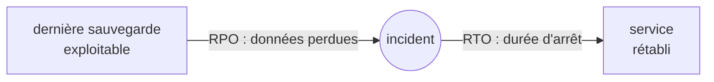

<!-- nav:début -->
[Accueil](../../README.md) › [Parcours](../../docs/parcours.md) › Partie V — Expertise système › **Module 30**  
[← Module 29](../29-haute-disponibilite/README.md) · [Corrigé](corrige.md) · [Module 31 →](../31-tracage-ebpf-perf/README.md)

<details><summary>Scripts du module (8)</summary>

Sur la VM indiquée en section « Mise en place », depuis `~/workbook/scripts/` (voir [chapitre 0](../../docs/00-mise-en-place.md)).

| Script | Rôle |
|---|---|
| [`setup_M30.sh`](../../scripts/setup/setup_M30.sh) | prépare le module |
| [`check_M30_01.sh`](../../scripts/check/check_M30_01.sh) | vérifie L30.1 |
| [`check_M30_02.sh`](../../scripts/check/check_M30_02.sh) | vérifie L30.2 |
| [`check_M30_03.sh`](../../scripts/check/check_M30_03.sh) | vérifie L30.3 |
| [`check_M30_04.sh`](../../scripts/check/check_M30_04.sh) | vérifie L30.4 |
| [`break_M30_01.sh`](../../scripts/break/break_M30_01.sh) | installe la panne BF30.1 |
| [`break_M30_02.sh`](../../scripts/break/break_M30_02.sh) | installe la panne BF30.2 |
| [`break_M30_03.sh`](../../scripts/break/break_M30_03.sh) | installe la panne BF30.3 |

</details>
<!-- nav:fin -->

# Module 30 — Sauvegarde et reprise d'activité : restic, borg, PostgreSQL PITR, Proxmox

## 30.0 Objectifs et compétences

> [!NOTE]
> **Objectifs**
>
> À la fin de ce module, je sais :
>
> * fixer une politique de sauvegarde à partir de deux chiffres, le **RPO**
>   (combien de données je peux perdre) et le **RTO** (combien de temps je peux
>   être arrêté), et appliquer la règle 3-2-1-1-0 ;
> * sauvegarder des fichiers avec **restic** (dépôt chiffré, déduplication,
>   rétention, contrôle d'intégrité) vers un serveur SFTP en prison chroot ;
> * rendre une sauvegarde **inattaquable** depuis la machine sauvegardée avec
>   **borg** en mode ajout seul, et récupérer un dépôt après une suppression
>   malveillante ;
> * sauvegarder PostgreSQL de façon physique et continue (sauvegarde de base +
>   archivage des WAL) et restaurer **à la seconde près** avant une erreur
>   humaine (PITR), sur une autre machine ;
> * sauvegarder et restaurer une VM entière avec `vzdump` et `qmrestore`, dans
>   un réseau isolé, sans perturber la production ;
> * mesurer le RPO et le RTO **réellement atteints** par un exercice de reprise,
>   et en tirer un plan de reprise d'activité (PRA) écrit.
>
> **Temps estimé** : 11 h
>
> **Prérequis** : module 11 (stockage, LVM), module 14 (SSH, clés restreintes),
> module 15 (PostgreSQL), module 17 (timers systemd), module 20
> (virtualisation).

---

## 30.1 Mise en place

| VM | Rôle dans le module |
|---|---|
| `lab-web` (10.10.10.11) | sauvegardé par restic (`/etc`, `/var/www`) |
| `lab-db` (10.10.10.12) | PostgreSQL 16 : archivage des WAL ; sauvegardé par borg |
| `lab-ops` (10.10.10.14) | **serveur de sauvegarde** : dépôts restic, borg, WAL et sauvegardes de base ; instance PostgreSQL de restauration |
| nœud Proxmox | `vzdump`, `qmrestore`, réseau isolé `vmbr9` pour les exercices |

```bash
# depuis le shell Proxmox
for id in 9002 9003 9005; do qm snapshot $id avant-lab30; done
```

> [!CAUTION]
> **Attention**
>
> Une sauvegarde qui partage le sort de ce qu'elle protège n'en est pas une.
> Dans ce laboratoire, `lab-ops` est sur le même nœud Proxmox que tout le
> reste : c'est acceptable pour apprendre, et c'est exactement ce que le PRA
> de D30 devra signaler comme risque.

Paquets, posés au fil des labs :

```bash
sudo apt install -y restic                         # lab-web
sudo apt install -y borgbackup zstd                # lab-db et lab-ops
sudo apt install -y postgresql-16 zstd rsync       # lab-ops (restauration)
```

> [!IMPORTANT]
> **Variante Rocky / RHEL**
>
> Sur Rocky, `restic` et `borgbackup` viennent d'EPEL
> (`dnf install epel-release`), PostgreSQL du dépôt AppStream ou du dépôt
> PGDG (`postgresql16-server`), avec les données dans `/var/lib/pgsql/16/data`
> au lieu de `/var/lib/postgresql/16/main` et sans les outils `pg_ctlcluster`
> de Debian.

Terrain de jeu (idempotent) :

```bash
sudo bash ~/workbook/scripts/setup/setup_M30.sh   # sur lab-web, lab-db, lab-ops
```

* **`lab-db`** : base `lab30` avec une table `factures` de 1 000 lignes et
  une table témoin `pra.temoin`, alimentée chaque minute par un timer
  (`lab30-temoin.timer`) : la dernière ligne présente dans une restauration
  donne le RPO **réellement** obtenu ;
* **`lab-ops`** : comptes `restic`, `borg` et `pgwal` sans mot de passe,
  répertoires `/srv/restic`, `/srv/borg`, `/srv/pgwal`, `/srv/pgbase` ;
* **`lab-web`** : un peu de contenu dans `/var/www/lab30`.

---

## 30.2 Rappel express

### RPO, RTO et la règle 3-2-1-1-0



*Figure — Le RPO se mesure en arrière depuis l'incident (que perd-on ?), le RTO en avant (combien de temps dure l'arrêt ?).*

| Règle | Sens |
|---|---|
| **3** copies | la donnée de production + deux sauvegardes |
| **2** supports | deux types de stockage différents (disque local, serveur distant, bande, objet) |
| **1** hors site | une copie dans un autre lieu (incendie, vol, panne du site) |
| **1** hors ligne ou immuable | une copie que la machine sauvegardée ne peut **ni modifier ni effacer** (rançongiciel) |
| **0** erreur | des restaurations testées, vérifiées, sans erreur |

Ce qui **n'est pas** une sauvegarde :

* un RAID (une suppression est répliquée instantanément sur tous les disques) ;
* un instantané LVM, ZFS ou Proxmox sur le même stockage (il meurt avec lui) ;
* une réplication (une erreur humaine est répliquée aussi, en quelques
  millisecondes) ;
* une copie que personne n'a jamais restaurée.

### Les outils du module

| Outil | Nature | Points forts | Limite |
|---|---|---|---|
| restic | fichiers, dépôt chiffré dédupliqué | un binaire, nombreux stockages (SFTP, S3, REST), `check --read-data` | ajout seul seulement avec `rest-server --append-only` |
| borg | fichiers, dépôt chiffré dédupliqué, via SSH | `borg serve --append-only`, compression fine, très rapide | stockage SSH uniquement |
| `pg_basebackup` + WAL | PostgreSQL physique | restauration à la seconde (PITR), RPO de quelques minutes | même version majeure, instance entière |
| `pg_dump` | PostgreSQL logique | portable entre versions, table par table | instantané unique, restauration lente sur gros volume |
| `vzdump` | VM entière | restauration de la machine telle quelle | lourd, RPO d'une journée en général |

### restic

```bash
export RESTIC_REPOSITORY=sftp:restic@lab-ops.lab.local:/lab-web
export RESTIC_PASSWORD_FILE=/etc/restic/mot-de-passe
restic init
restic backup /etc /var/www --exclude-file /etc/restic/exclusions --tag quotidien
restic snapshots                         # liste des instantanés
restic ls latest /etc/nginx              # contenu d'un instantané
restic diff 4f1a2c3d latest              # ce qui a changé entre deux instantanés
restic find nginx.conf                   # dans quels instantanés est ce fichier ?
restic restore latest --target /tmp/restau --include /etc/nginx
restic forget --keep-daily 7 --keep-weekly 4 --keep-monthly 6 --prune
restic check --read-data-subset=10%      # relit 10 % des données
restic stats --mode raw-data             # place réellement occupée
```

### borg

```bash
export BORG_REPO=ssh://borg@lab-ops.lab.local/srv/borg/lab-db
export BORG_PASSCOMMAND='cat /root/.config/borg/phrase'
borg init --encryption=repokey-blake2
borg key export :: /root/borg-cle-lab-db.txt    # à mettre HORS de la machine
borg create --stats --compression zstd,6 ::'{hostname}-{now:%Y-%m-%dT%H:%M}' /etc /var/backups/pg
borg list ; borg info ::<archive>
borg prune --keep-daily 7 --keep-weekly 4 --keep-monthly 6
borg extract ::<archive> etc/postgresql
```

Côté serveur, la clé SSH du client est restreinte dans `authorized_keys` :

```text
command="borg serve --append-only --restrict-to-path /srv/borg/lab-db",restrict ssh-ed25519 AAAA… root@lab-db
```

### PostgreSQL : sauvegarde physique continue

```text
 sauvegarde de base (pg_basebackup)        archivage continu des WAL (archive_command)
 ─────────────●─────────────────────────────────────────────────────────►  temps
              │ base.tar.gz                 000…0A  000…0B  000…0C …
              │                                         ▲
              └── restauration = base + rejeu des WAL jusqu'à recovery_target_time
```

| Paramètre | Rôle |
|---|---|
| `archive_mode = on` | active l'archivage (redémarrage nécessaire) |
| `archive_command` | copie un segment terminé ; doit renvoyer 0 **seulement** si la copie est sûre |
| `archive_timeout = 300` | force un changement de segment toutes les 5 min : borne le RPO |
| `restore_command` | à la restauration : comment récupérer un segment archivé |
| `recovery_target_time` / `_lsn` / `_xid` | où s'arrêter |
| `recovery_target_inclusive` | s'arrêter juste après (`on`) ou juste avant (`off`) la cible |
| `recovery.signal` | fichier vide dans le répertoire de données : « démarre en restauration » |

```sql
SELECT * FROM pg_stat_archiver;        -- dernier segment archivé, échecs
SELECT pg_switch_wal();                -- forcer un changement de segment
SELECT pg_current_wal_lsn(), now();
```

### Proxmox

```bash
vzdump 9002 --storage local --mode snapshot --compress zstd
pvesm list local --content backup
qmrestore /var/lib/vz/dump/vzdump-qemu-9002-….vma.zst 9102 --unique 1 --storage local-lvm
pvesm prune-backups local --vmid 9002 --keep-last 3 --dry-run 1
```

Pièges classiques :

* le travail de sauvegarde est vert depuis des mois… et ne contient pas ce
  qu'on croit (exclusion trop large, montage absent, base vide) ;
* la clé ou la phrase de chiffrement n'existe que sur la machine
  sauvegardée : le jour où elle brûle, la sauvegarde est illisible ;
* la machine sauvegardée peut effacer ses sauvegardes : un attaquant (ou un
  rançongiciel) les efface en premier ;
* une restauration de VM démarrée sur le réseau de production avec la même
  adresse que l'originale.

---

## 30.3 Quiz — QCM

<a id="q30-1"></a>**[Q30.1](corrige.md#q30-1)** — Une base doit perdre au plus 15 minutes de données et être
rétablie en moins d'une heure. Quel couple de chiffres décrit cet objectif ?

a) RTO 15 min, RPO 1 h
b) RPO 15 min, RTO 1 h
c) MTBF 15 min, MTTR 1 h
d) SLA 15 min, SLO 1 h

<a id="q30-2"></a>**[Q30.2](corrige.md#q30-2)** — Lequel de ces dispositifs protège contre un `DROP TABLE` exécuté
par erreur ?

a) un RAID 1 sur deux disques
b) une réplique PostgreSQL synchrone
c) un instantané LVM pris toutes les heures sur le même groupe de volumes,
   conservé 24 h
d) un archivage continu des WAL vers un autre serveur, avec une sauvegarde
   de base

<a id="q30-3"></a>**[Q30.3](corrige.md#q30-3)** — Que fait `restic forget --keep-daily 7` **sans** `--prune` ?

a) supprime les références aux instantanés au-delà de la politique ; les
   données ne sont libérées qu'au `prune`
b) supprime les instantanés au-delà de la politique **et** libère la place
c) n'a aucun effet sans `--dry-run`
d) supprime les données mais garde la liste des instantanés

<a id="q30-4"></a>**[Q30.4](corrige.md#q30-4)** — Pourquoi restic et borg découpent-ils les fichiers en blocs de
taille **variable**, déterminée par le contenu ?

a) pour chiffrer plus vite
b) pour respecter la taille des blocs du système de fichiers
c) pour qu'une insertion au début d'un gros fichier ne décale pas tous les
   blocs suivants, et que la déduplication continue de reconnaître le reste
d) pour compresser davantage

<a id="q30-5"></a>**[Q30.5](corrige.md#q30-5)** — Un dépôt borg est servi avec `borg serve --append-only`. La
machine sauvegardée, compromise, lance `borg delete` sur toutes ses archives.
Que se passe-t-il ?

a) les archives sont perdues
b) la commande est refusée par le serveur
c) la suppression est enregistrée comme une nouvelle transaction ; les
   données restent sur le serveur et l'administrateur peut revenir à l'état
   antérieur
d) le dépôt est chiffré de nouveau avec une autre clé

<a id="q30-6"></a>**[Q30.6](corrige.md#q30-6)** — Quelle phrase sur `archive_command` est juste ?

a) PostgreSQL considère le segment archivé dès que la commande est lancée
b) une commande qui échoue fait perdre le segment
c) elle est exécutée par root
d) une commande qui renvoie 0 alors que la copie a échoué fait croire à
   PostgreSQL que le segment est en sécurité : il pourra le recycler

<a id="q30-7"></a>**[Q30.7](corrige.md#q30-7)** — Pour une restauration à un instant précis (PITR), de quoi a-t-on
besoin au minimum ?

a) d'une sauvegarde de base prise **avant** l'instant visé, et de **tous**
   les segments WAL entre la fin de cette sauvegarde et l'instant visé
b) d'un `pg_dump` de la veille
c) des seuls segments WAL, sans sauvegarde de base
d) d'une réplique en streaming

<a id="q30-8"></a>**[Q30.8](corrige.md#q30-8)** — Depuis PostgreSQL 12, comment indique-t-on à une instance de
démarrer en mode restauration d'archive ?

a) avec un fichier `recovery.conf`
b) avec un fichier vide `recovery.signal` dans le répertoire de données, et
   les paramètres de restauration dans la configuration
c) avec l'option `--recovery` de `pg_ctl`
d) avec `standby_mode = on`

<a id="q30-9"></a>**[Q30.9](corrige.md#q30-9)** — `pg_dump` ou `pg_basebackup` : laquelle de ces affirmations est
juste ?

a) `pg_dump` permet une restauration à la seconde près
b) une sauvegarde `pg_basebackup` se restaure dans une version majeure
   différente
c) `pg_dump` produit une sauvegarde logique, portable entre versions et
   restaurable table par table ; `pg_basebackup` une copie physique de
   l'instance entière, base du PITR
d) les deux sont équivalentes

<a id="q30-10"></a>**[Q30.10](corrige.md#q30-10)** — Une sauvegarde `vzdump` en mode `snapshot` d'une VM Linux en
fonctionnement : qu'est-ce qui garantit la cohérence des systèmes de
fichiers invités ?

a) rien : la sauvegarde est toujours incohérente
b) l'arrêt de la VM pendant la sauvegarde
c) le format `vma`
d) l'agent invité QEMU, qui gèle les systèmes de fichiers le temps de
   prendre l'instantané (`fsfreeze`)

<a id="q30-11"></a>**[Q30.11](corrige.md#q30-11)** — Pourquoi `qmrestore … --unique 1` pour un exercice de
restauration ?

a) pour donner de nouvelles adresses MAC aux cartes réseau, afin que la
   copie n'entre pas en conflit avec l'originale
b) pour compresser la restauration
c) pour garder le même VMID
d) pour restaurer plus vite

<a id="q30-12"></a>**[Q30.12](corrige.md#q30-12)** — Le dépôt restic est chiffré par une phrase de passe stockée dans
`/etc/restic/mot-de-passe`, sur `lab-web`, et nulle part ailleurs. `lab-web`
est détruit. Conséquence ?

a) aucune : le dépôt est sur `lab-ops`
b) restic régénère la clé à partir du dépôt
c) les sauvegardes sont illisibles : sans la phrase, pas de clé
d) l'administrateur de `lab-ops` peut les déchiffrer

<a id="q30-13"></a>**[Q30.13](corrige.md#q30-13)** — Que vérifie `restic check --read-data-subset=10%` de plus que
`restic check` ?

a) rien
b) il répare 10 % des erreurs
c) il compare 10 % des fichiers avec la source
d) il relit et vérifie réellement 10 % des paquets de données (contenu,
   empreintes), au lieu de la seule structure du dépôt

<a id="q30-14"></a>**[Q30.14](corrige.md#q30-14)** — Le serveur de sauvegarde **tire** les données (il se connecte au
serveur à sauvegarder), au lieu que celui-ci les **pousse**. Quel est
l'avantage principal ?

a) le serveur sauvegardé n'a aucun accès au stockage des sauvegardes : sa
   compromission ne permet pas de les effacer
b) la sauvegarde est plus rapide
c) on n'a plus besoin de chiffrement
d) les sauvegardes sont automatiquement hors site

<a id="q30-15"></a>**[Q30.15](corrige.md#q30-15)** — Le RPO réel d'un archivage WAL configuré avec `archive_timeout
= 300`, sur une base active, est d'environ :

a) 0 seconde
b) 5 minutes au plus (plus le temps de copie), en régime normal
c) 24 heures
d) la durée entre deux sauvegardes de base

<a id="q30-16"></a>**[Q30.16](corrige.md#q30-16)** — Pendant un exercice de reprise, la restauration réussit
techniquement, mais personne ne sait dans quel ordre redémarrer la base,
le cache, l'API et le frontal, ni qui prévenir. Qu'est-ce qui manque ?

a) une sauvegarde supplémentaire
b) un RAID
c) un plan de reprise d'activité écrit : dépendances, ordre, responsables,
   critères de validation, communication
d) un RPO plus court

---

## 30.4 Quiz — questions ouvertes

<a id="qo30-1"></a>**[QO30.1](corrige.md#qo30-1)** — *On te demande en entretien* : « Comment conçois-tu la
sauvegarde d'un service ? Par quoi commences-tu ? »

<a id="qo30-2"></a>**[QO30.2](corrige.md#qo30-2)** — Un attaquant a obtenu root sur `lab-db`. Pour chacune des trois
sauvegardes du module (restic poussé depuis `lab-web`, borg en ajout seul
depuis `lab-db`, sauvegarde de base PostgreSQL tirée par `lab-ops`), dis ce
qu'il peut détruire, et comment on le limiterait davantage.

<a id="qo30-3"></a>**[QO30.3](corrige.md#qo30-3)** — Explique la restauration à un instant précis de PostgreSQL :
ce que contient une sauvegarde de base, ce que sont les WAL, ce qui se passe
au démarrage de l'instance restaurée, et pourquoi la restauration crée une
nouvelle *timeline*.

<a id="qo30-4"></a>**[QO30.4](corrige.md#qo30-4)** — Le directeur financier demande « zéro perte de données, zéro
interruption ». Comment réponds-tu, chiffres et coûts à l'appui ?

<a id="qo30-5"></a>**[QO30.5](corrige.md#qo30-5)** — Qu'est-ce qu'un test de restauration **réussi** ? Propose une
liste de critères et une fréquence par type de sauvegarde.

<a id="qo30-6"></a>**[QO30.6](corrige.md#qo30-6)** — Où ranges-tu les clés et phrases de chiffrement des
sauvegardes ? Que se passe-t-il si l'administrateur qui les connaît quitte
l'entreprise, ou si l'unique coffre-fort de secrets est lui-même à
restaurer ?

<a id="qo30-7"></a>**[QO30.7](corrige.md#qo30-7)** — Pourquoi sauvegarder une base PostgreSQL en copiant
`/var/lib/postgresql/16/main` avec restic, base démarrée, est-il une erreur ?
Dans quelles conditions une copie de fichiers serait-elle acceptable ?

<a id="qo30-8"></a>**[QO30.8](corrige.md#qo30-8)** — restic, borg, `vzdump`, Proxmox Backup Server : pour la
plateforme Factura, qu'utilises-tu pour quoi, et pourquoi pas un seul outil
pour tout ?

---

## 30.5 Exercices guidés ★

<a id="e30-1"></a>**[E30.1](corrige.md#e30-1)** — Sur `lab-db`, montre que la table témoin s'alimente : les trois
dernières lignes, et l'écart entre la plus récente et l'heure actuelle.

<a id="e30-2"></a>**[E30.2](corrige.md#e30-2)** — Après L30.1, liste les instantanés restic de `lab-web`, puis le
contenu de `/etc/nginx` dans le plus récent, sans rien restaurer.

<a id="e30-3"></a>**[E30.3](corrige.md#e30-3)** — Trouve dans quels instantanés figure `nginx.conf`, et ce qui a
changé entre les deux derniers instantanés.

<a id="e30-4"></a>**[E30.4](corrige.md#e30-4)** — Calcule, **sans rien supprimer**, quels instantanés une
politique `--keep-daily 7 --keep-weekly 4` conserverait.

<a id="e30-5"></a>**[E30.5](corrige.md#e30-5)** — Montre la place réellement occupée par le dépôt restic, et le
volume que représenteraient tous les instantanés restaurés. Explique l'écart.

<a id="e30-6"></a>**[E30.6](corrige.md#e30-6)** — Après L30.2, liste les archives borg de `lab-db` et affiche les
statistiques de la dernière (taille originale, compressée, dédupliquée).

<a id="e30-7"></a>**[E30.7](corrige.md#e30-7)** — Exporte la clé du dépôt borg sous forme imprimable (format
papier), et dis où tu la ranges.

<a id="e30-8"></a>**[E30.8](corrige.md#e30-8)** — Après L30.3, montre l'état de l'archivage des WAL sur `lab-db` :
dernier segment archivé, heure, nombre d'échecs. Force un changement de
segment et vérifie qu'il arrive sur `lab-ops`.

<a id="e30-9"></a>**[E30.9](corrige.md#e30-9)** — Sur `lab-db`, affiche la position actuelle dans les WAL (LSN), le
nom du segment correspondant, et le nombre de segments présents dans
`pg_wal`.

<a id="e30-10"></a>**[E30.10](corrige.md#e30-10)** — Sur `lab-ops`, lis le fichier `backup_label` de la dernière
sauvegarde de base sans extraire toute l'archive, et dis à partir de quel
segment WAL elle a besoin des archives.

<a id="e30-11"></a>**[E30.11](corrige.md#e30-11)** — Sur le nœud Proxmox, liste les sauvegardes `vzdump` de
`lab-web`, avec leur taille, et affiche les notes de la plus récente.

<a id="e30-12"></a>**[E30.12](corrige.md#e30-12)** — Calcule le RPO **réellement** obtenu par une restauration
PostgreSQL à partir de la table témoin, et explique d'où vient l'écart avec
`archive_timeout`.

---

## 30.6 Labs ★★

### <a id="l30-1"></a>**[L30.1](corrige.md#l30-1)** — Les fichiers de lab-web, chiffrés, hors de lab-web

> **Contexte**
>
> `lab-web` n'a aucune sauvegarde. On veut chaque nuit `/etc` et `/var/www`,
> chiffrés, sur `lab-ops`, avec 7 quotidiennes, 4 hebdomadaires et
> 6 mensuelles, et la garantie que le compte utilisé sur `lab-ops` ne peut rien
> faire d'autre que déposer des fichiers dans **son** répertoire.

1. Sur `lab-ops`, enferme le compte `restic` : SFTP seulement
   (`internal-sftp`), prison chroot dans `/srv/restic`, pas de redirection
   ni de terminal. Le dépôt de `lab-web` sera `/srv/restic/lab-web`.
2. Sur `lab-web`, crée pour root une clé SSH dédiée, autorise-la sur le
   compte `restic`, et vérifie qu'un `ssh restic@lab-ops` interactif est
   refusé alors qu'un `sftp` fonctionne.
3. Génère une phrase de passe aléatoire dans `/etc/restic/mot-de-passe`
   (`0600`), écris `/etc/restic/lab-web.env` (dépôt, fichier de phrase) et
   `/etc/restic/exclusions` (journaux, caches), puis initialise le dépôt.
4. Écris l'unité `restic-sauvegarde.service` (sauvegarde, puis rétention
   avec nettoyage, puis contrôle rapide) et son timer quotidien, et lance un
   premier passage.
5. **Restaure** `/etc/nginx` dans `/tmp/restau` et prouve par `diff` que
   c'est identique à l'original.
6. Range une copie de la phrase de passe **hors** de `lab-web` (où ? dis-le
   dans `~/lab30/cles.md` sur `lab-adm`, sans la phrase elle-même).

> [!TIP]
> **Critère de succès**
>
> Critère de succès : un instantané de moins de 24 h contenant
> `/etc/nginx/nginx.conf`, une rétention en place, une phrase en `0600`, un
> compte `restic` incapable d'ouvrir un shell.
>
> ```bash
> sudo bash check_M30_01.sh      # sur lab-web, puis sur lab-ops
> ```

### <a id="l30-2"></a>**[L30.2](corrige.md#l30-2)** — Une sauvegarde que lab-db ne peut pas effacer

> **Contexte**
>
> Hypothèse de travail : un jour, quelqu'un aura root sur `lab-db`. Ce jour-là,
> ses sauvegardes doivent survivre. On sauvegarde `/etc` et un `pg_dump`
> quotidien de `lab30` avec borg, dans un dépôt que `lab-db` peut **compléter**
> mais pas **effacer**.

1. Sur `lab-db`, un timer quotidien produit
   `/var/backups/pg/lab30-AAAAMMJJ.dump` (`pg_dump -Fc`), avec 3 jours de
   rétention locale.
2. Sur `lab-ops`, autorise la clé de root@lab-db sur le compte `borg`, avec
   une commande forcée `borg serve` en **ajout seul**, limitée à
   `/srv/borg/lab-db`, et l'option `restrict`.
3. Sur `lab-db`, initialise le dépôt (`repokey-blake2`), phrase dans
   `/root/.config/borg/phrase` (`0600`), **exporte la clé** et range-la hors
   de `lab-db` (sur `lab-adm`, puis à côté de la phrase restic).
4. Écris l'unité et le timer `borg-sauvegarde` : création de l'archive
   (`/etc`, `/var/backups/pg`), puis `borg prune` (7/4/6). Lance un passage.
5. **Joue l'attaquant** : depuis `lab-db`, supprime toutes les archives.
   Vérifie sur `lab-ops` que l'espace occupé n'a pas diminué.
6. **Joue l'administrateur** de `lab-ops` : à l'aide du journal
   `transactions` du dépôt, ramène-le à l'état d'avant l'attaque, vérifie-le
   (`borg check`) et prouve que les archives sont de retour.

> [!TIP]
> **Critère de succès**
>
> Critère de succès : une archive récente contenant le dump, une clé restreinte
> en ajout seul côté serveur, et un dépôt revenu intact après l'attaque.
>
> ```bash
> sudo bash check_M30_02.sh      # sur lab-db, puis sur lab-ops
> ```

### <a id="l30-3"></a>**[L30.3](corrige.md#l30-3)** — Revenir à la seconde qui précède l'erreur

> **Contexte**
>
> Un développeur a exécuté sur la base de production `lab30` une commande qui
> a détruit la table `factures`. Les `pg_dump` de L30.2 datent de cette nuit :
> on perdrait la journée. On veut un RPO de quelques minutes, et la capacité de
> revenir **juste avant** l'erreur, sur une autre machine, sans toucher à la
> production.

1. Sur `lab-db`, crée pour `postgres` une clé SSH dédiée et, sur `lab-ops`,
   autorise-la sur le compte `pgwal` en écriture seule dans `/srv/pgwal`
   (`rrsync -wo`).
2. Écris `/usr/local/bin/archive-wal` (compression `zstd`, copie par rsync,
   refus d'écraser un segment existant, code de retour fiable), et active
   l'archivage : `archive_mode`, `archive_command`, `archive_timeout = 300`.
   Vérifie dans `pg_stat_archiver` que les segments partent.
3. Crée un rôle de réplication `sauvegarde_pg`, autorise-le depuis `lab-ops`
   seulement, et, **depuis `lab-ops`**, prends une sauvegarde de base
   compressée dans `/srv/pgbase/<date>`.
4. Note l'heure, puis provoque l'accident sur `lab-db` :
   `psql -d lab30 -c 'DROP TABLE factures;'`. Continue d'utiliser la base
   quelques minutes (le témoin tourne).
5. Retrouve **précisément** le moment de l'accident : par le journal de
   PostgreSQL, puis par `pg_waldump` sur les WAL archivés (la validation de
   la transaction qui contient le `DROP`).
6. Sur `lab-ops`, crée une instance `16/restau` sur le port 5439, remplace
   ses données par la sauvegarde de base, configure la restauration jusqu'à
   **juste avant** l'accident, démarre-la et vérifie : `factures` contient ses
   1 000 lignes. L'instance restaurée ne doit **pas** archiver dans
   `/srv/pgwal`.
7. Calcule le RPO réel avec la table témoin, et note le RTO (de la décision
   de restaurer à l'instance utilisable).
8. Termine l'incident : réinjecte la table `factures` restaurée dans la base
   de production (`pg_dump -t` depuis `restau`, `pg_restore` sur `lab-db`),
   **sans** écraser ce qui a été écrit depuis l'accident.

> [!TIP]
> **Critère de succès**
>
> Critère de succès : archivage sans échec, une sauvegarde de base sur
> `lab-ops`, une instance `restau` promue avec la table `factures` complète, et
> sans archivage ; la table est de retour en production.
>
> ```bash
> sudo bash check_M30_03.sh      # sur lab-db, puis sur lab-ops
> ```

### <a id="l30-4"></a>**[L30.4](corrige.md#l30-4)** — Restaurer une VM entière, à l'écart de la production

> **Contexte**
>
> Scénario de PRA : le disque de `lab-web` est perdu. On veut savoir combien
> de temps prend la restauration complète de la VM depuis `vzdump`, et le
> vérifier **sans** que la copie puisse perturber le vrai `lab-web`.

1. Sur le nœud Proxmox, crée un pont isolé `vmbr9`, sans port physique ni
   adresse : un réseau où rien ne sort.
2. Sauvegarde `lab-web` (`vzdump`, mode `snapshot`, `zstd`, une note
   explicite) et vérifie que l'agent invité a gelé les systèmes de fichiers
   pendant l'instantané.
3. Mets en place une rétention : 3 dernières sauvegardes + 1 hebdomadaire
   pour la VM 9002 (tâche de sauvegarde planifiée ou paramètre du stockage).
4. **Chronomètre** la restauration dans une nouvelle VM 9102 nommée
   `lab-web-pra`, avec de **nouvelles** adresses MAC, rattachée à `vmbr9`, non
   démarrée au boot du nœud.
5. Démarre-la et prouve, **sans réseau**, que nginx y tourne et que sa
   configuration est celle de la production (agent invité).
6. Consigne le RTO mesuré (sauvegarde, restauration, démarrage, vérification)
   dans `~/lab30/rto.md` sur le nœud ou sur `lab-adm`.

> [!TIP]
> **Critère de succès**
>
> Critère de succès : une sauvegarde récente de 9002, une rétention, une VM
> `lab-web-pra` sur `vmbr9` avec une MAC différente, et un RTO consigné.
>
> ```bash
> sudo bash check_M30_04.sh      # sur le nœud Proxmox
> ```

---

## 30.7 Break & Fix ★★★

> [!CAUTION]
> **Attention**
>
> Avant chaque Break & Fix, snapshot de la VM concernée (`avant-bf30`).

### <a id="bf30-1"></a>**[BF30.1](corrige.md#bf30-1)** — « La sauvegarde est verte, et /etc/nginx n'y est pas »

À lancer sur `lab-web` :

```bash
sudo bash break_M30_01.sh
```

**Symptôme utilisateur** : on te demande de restaurer `/etc/nginx` dans
l'état d'hier. `restic-sauvegarde.service` est en succès tous les jours,
`restic check` ne trouve rien. Pourtant, `restic restore latest --include
/etc/nginx` ne restaure… rien.

**Interdit** : relancer une sauvegarde complète « pour voir » avant d'avoir
compris.

**Objectif** : trouver depuis quand et pourquoi le répertoire manque,
corriger, et mettre en place un contrôle qui aurait levé une alerte le
premier jour.

### <a id="bf30-2"></a>**[BF30.2](corrige.md#bf30-2)** — « Le disque de lab-db fond, et rien dans les journaux applicatifs »

À lancer sur `lab-db` :

```bash
sudo bash break_M30_02.sh
```

**Symptôme utilisateur** : depuis la « rotation des clés SSH » d'hier,
l'espace libre de `/var/lib/postgresql` diminue à vue d'œil. L'application
fonctionne. Un collègue propose de « faire de la place dans `pg_wal`, c'est
juste des journaux ».

**Interdit** : supprimer quoi que ce soit dans `pg_wal`, désactiver
l'archivage.

**Objectif** : trouver la cause, la corriger, vérifier que le retard est
rattrapé sans aucune perte, et dire ce que la suppression proposée aurait
coûté.

### <a id="bf30-3"></a>**[BF30.3](corrige.md#bf30-3)** — « Depuis l'exercice de PRA, lab-web décroche »

À lancer **sur le nœud Proxmox** :

```bash
sudo bash break_M30_03.sh
```

**Symptôme utilisateur** : depuis qu'un collègue a « testé une restauration »
ce matin, les sessions SSH vers `lab-web` se figent par moments, le site
répond une fois sur deux, et `ssh-keyscan` donne pourtant toujours la même
clé d'hôte. `lab-web` lui-même ne voit rien d'anormal.

**Interdit** : redémarrer ou restaurer le vrai `lab-web`.

**Objectif** : trouver la cause, rétablir la production sans détruire le
travail du collègue, et écrire la règle qui rend cette erreur impossible.

---

## 30.8 Défi du module ★★★

<a id="d30"></a>**[D30](corrige.md#d30) — Un exercice de reprise chronométré, et le PRA qui va avec**

Livrables dans `~/lab30/defi/` sur `lab-ops` : `exercice-pra.sh`, son
rapport, et `pra.md`.

1. `exercice-pra.sh` rejoue sans intervention, sur `lab-ops` :
   * la restauration de PostgreSQL depuis la **dernière** sauvegarde de base
     et **tous** les WAL archivés (fin de l'archive, pas d'heure cible) dans
     une instance jetable, détruite à la fin ;
   * la restauration de `/etc/nginx` du dernier instantané restic de
     `lab-web` (le script obtient la phrase de passe sans qu'elle soit écrite
     dans le script) ;
   * l'extraction du dernier dump de la dernière archive borg de `lab-db`.
2. Pour chaque restauration, des **vérifications métier**, pas seulement
   techniques : nombre de lignes de `factures`, présence de `nginx.conf` et
   d'au moins un site activé, `pg_restore --list` lisible et contenant les
   données de `factures`.
3. Le script mesure le **RPO réel** (dernière ligne témoin restaurée par
   rapport à l'heure de lancement) et le **RTO** de chaque étape, écrit un
   rapport daté, et sort en erreur si un RPO dépasse 10 minutes ou si une
   vérification échoue.
4. `pra.md`, une page : périmètre, RPO/RTO visés et mesurés par composant,
   ordre de reprise et dépendances, emplacements des sauvegardes et des clés,
   risques non couverts (dont le fait que tout tourne sur un seul nœud
   Proxmox), responsables, fréquence des exercices.
5. Planifie l'exercice chaque semaine (timer) avec notification en cas
   d'échec.

---

## 30.9 Auto-évaluation

| Compétence | Acquis | À revoir |
|---|---|---|
| Fixer RPO et RTO, appliquer 3-2-1-1-0 | ☐ | ☐ |
| Sauvegarder et restaurer avec restic, rétention, contrôle | ☐ | ☐ |
| Enfermer un compte de dépôt (SFTP chroot, commande forcée) | ☐ | ☐ |
| Mettre en place borg en ajout seul et récupérer après attaque | ☐ | ☐ |
| Archiver les WAL et prendre une sauvegarde de base | ☐ | ☐ |
| Restaurer PostgreSQL à un instant précis (PITR) | ☐ | ☐ |
| Sauvegarder et restaurer une VM dans un réseau isolé | ☐ | ☐ |
| Mesurer RPO et RTO réels, écrire un PRA | ☐ | ☐ |

Pour aller plus loin :

* Remplace l'archivage maison par **pgBackRest** (sauvegardes
  incrémentales, parallélisme, chiffrement, vérification) ou **Barman** :
  les outils de référence en production.
* Installe **Proxmox Backup Server** dans une VM (ou mieux, sur une autre
  machine) : sauvegardes incrémentales dédupliquées des VM, vérification
  planifiée, synchronisation vers un second PBS hors site.
* Envoie une copie restic vers un stockage objet compatible S3 avec
  **verrouillage d'objet** (*object lock*), l'équivalent cloud de l'ajout
  seul.
* Lis le guide de l'ANSSI sur les sauvegardes et le *NIST SP 800-34*
  (plans de continuité) : ils formalisent ce que ce module fait à la main.

<!-- nav:début -->
---

[← Module 29](../29-haute-disponibilite/README.md) · [Corrigé](corrige.md) · [Module 31 →](../31-tracage-ebpf-perf/README.md) · [Parcours](../../docs/parcours.md) · [Accueil](../../README.md)
<!-- nav:fin -->
