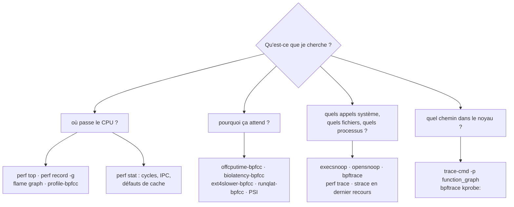

<!-- nav:début -->
[Accueil](../../README.md) › [Parcours](../../docs/parcours.md) › Partie V — Expertise système › **Module 31**  
[← Module 30](../30-sauvegarde-pra/README.md) · [Corrigé](corrige.md) · [Module 32 →](../32-fs-avances/README.md)

<details><summary>Scripts du module (8)</summary>

Sur la VM indiquée en section « Mise en place », depuis `~/workbook/scripts/` (voir [chapitre 0](../../docs/00-mise-en-place.md)).

| Script | Rôle |
|---|---|
| [`setup_M31.sh`](../../scripts/setup/setup_M31.sh) | prépare le module |
| [`check_M31_01.sh`](../../scripts/check/check_M31_01.sh) | vérifie L31.1 |
| [`check_M31_02.sh`](../../scripts/check/check_M31_02.sh) | vérifie L31.2 |
| [`check_M31_03.sh`](../../scripts/check/check_M31_03.sh) | vérifie L31.3 |
| [`check_M31_04.sh`](../../scripts/check/check_M31_04.sh) | vérifie L31.4 |
| [`break_M31_01.sh`](../../scripts/break/break_M31_01.sh) | installe la panne BF31.1 |
| [`break_M31_02.sh`](../../scripts/break/break_M31_02.sh) | installe la panne BF31.2 |
| [`break_M31_03.sh`](../../scripts/break/break_M31_03.sh) | installe la panne BF31.3 |

</details>
<!-- nav:fin -->

# Module 31 — Observer le noyau : perf, flame graphs, ftrace et eBPF

## 31.0 Objectifs et compétences

> [!NOTE]
> **Objectifs**
>
> À la fin de ce module, je sais :
>
> * choisir l'outil d'observation selon la question posée et son coût :
>   `strace`, `perf`, `ftrace`, `bpftrace`, les outils BCC, et mesurer leur
>   surcoût ;
> * profiler l'activité CPU d'un processus avec `perf` (échantillonnage,
>   piles d'appels, symboles), lire un **flame graph** et y trouver la fonction
>   qui coûte ;
> * mesurer l'efficacité d'un code avec les compteurs matériels (`perf stat` :
>   cycles, instructions, IPC, défauts de cache) ;
> * analyser le temps **hors CPU** (attentes disque, verrous, sommeil) avec
>   `offcputime`, `biolatency`, `ext4slower`, et la pression de ressources
>   (PSI) ;
> * expliquer ce qu'est eBPF (programmes vérifiés, compilés à la volée,
>   attachés à des sondes, résultats dans des *maps*), et écrire des sondes
>   `bpftrace` sur tracepoints, kprobes et uprobes ;
> * tracer le chemin d'un appel dans le noyau avec `ftrace` (`trace-cmd`,
>   traceur `function_graph`) ;
> * diagnostiquer un profil qui ment : symboles absents, piles cassées ou
>   tronquées, charge élevée sans CPU.
>
> **Temps estimé** : 10 h
>
> **Prérequis** : module 08 (processus, signaux), module 09 (noyau, `/proc`,
> `/sys`), module 19 (méthode de dépannage, USE), notions de C (lire une
> fonction de vingt lignes).

---

## 31.1 Mise en place

VM concernée : **`lab-web`** (10.10.10.11), dont le type de CPU `host`
(chapitre 0) expose les compteurs matériels du processeur à la VM.

```bash
# depuis le shell Proxmox
qm snapshot 9002 avant-lab31
```

Paquets :

```bash
sudo apt install -y linux-tools-common linux-tools-generic "linux-tools-$(uname -r)" \
  bpftrace bpfcc-tools trace-cmd strace gcc libc6-dev
git clone https://github.com/brendangregg/FlameGraph.git ~/FlameGraph
```

> [!IMPORTANT]
> **Variante Rocky / RHEL**
>
> Sur Rocky : `dnf install perf bpftrace bcc-tools trace-cmd`. Les outils BCC
> s'appellent `execsnoop`, `biolatency`… (dans `/usr/share/bcc/tools/`), sans
> le suffixe `-bpfcc` d'Ubuntu.

Terrain de jeu (idempotent) :

```bash
sudo bash ~/workbook/scripts/setup/setup_M31.sh
```

Il compile et installe trois programmes de charge, avec leurs sources dans
`/usr/local/src/lab31/` :

| Programme | Ce qu'il fait | Service |
|---|---|---|
| `lab31-calcul` | compte les occurrences d'un motif dans 8 Mo de texte, en boucle ; affiche ses passes par seconde | `lab31-calcul.service` |
| `lab31-ecrit` | écrit un fichier de 2 Mo, avec une taille d'écriture réglable (`--tampon N`) | — (lancé à la main) |
| `lab31-journal` | traite des « requêtes » : un peu de calcul, une ligne de journal, un `fsync` ; affiche requêtes/s et latence | `lab31-journal.service` |

Les services ne démarrent **pas** au boot : on les lance quand un lab le
demande, et on les arrête après.

> [!CAUTION]
> **Attention**
>
> Les outils de ce module s'exécutent en root et s'attachent au noyau. Ils sont
> sûrs par conception (le vérificateur eBPF refuse un programme qui pourrait
> planter le noyau), mais pas gratuits : un `strace` sur un processus très
> actif peut le ralentir d'un facteur 10 ou plus, et un `perf record` à haute
> fréquence produit des centaines de Mo. Sur une machine de production, on
> commence toujours par l'outil le plus léger et la durée la plus courte.

---

## 31.2 Rappel express

### Quel outil pour quelle question



*Figure — Partir de la question, pas de l'outil : le CPU, l'attente, les événements, ou le chemin dans le noyau.*

### Les sources d'événements

| Source | Exemple | Stabilité | Usage |
|---|---|---|---|
| échantillonnage temporel | `perf record -F 99` | — | profil CPU, coût proportionnel à la fréquence |
| compteurs matériels (PMU) | `cycles`, `instructions`, `cache-misses` | selon le processeur | efficacité du code |
| tracepoints | `syscalls:sys_enter_write`, `block:block_rq_issue` | **stables** (interface prévue) | à préférer |
| kprobes / kretprobes | `kprobe:vfs_read` | changent avec le noyau | n'importe quelle fonction du noyau |
| uprobes / uretprobes | `uprobe:/usr/local/bin/lab31-calcul:compte_naif` | changent avec le binaire | fonctions d'un programme |
| USDT | `usdt:/usr/bin/python3:function__entry` | prévues par le programme | sondes posées par les développeurs |

### perf

```bash
perf list | head                          # événements disponibles
perf stat -p PID -- sleep 10              # compteurs d'un processus pendant 10 s
perf stat -e cycles,instructions,cache-misses ./programme
perf top -p PID                           # profil en direct
perf record -F 99 -g -p PID -- sleep 30   # échantillonnage + piles (pointeurs de cadre)
perf record -F 99 --call-graph dwarf -p PID -- sleep 10   # piles par DWARF (sans pointeur de cadre)
perf report --stdio --no-children | head -40
perf annotate --stdio -s compte_naif      # instructions chaudes d'une fonction
perf script > perf.txt                    # échantillons bruts, pour un flame graph
perf trace -s -p PID                      # appels système, beaucoup moins coûteux que strace
```

Flame graph :

```bash
perf script | ~/FlameGraph/stackcollapse-perf.pl | ~/FlameGraph/flamegraph.pl > cpu.svg
```

* **largeur** d'une case = proportion des échantillons où la fonction est
  sur la pile ; l'axe horizontal n'est **pas** le temps (tri alphabétique) ;
* **hauteur** = profondeur de la pile ; la case du dessus est celle qui
  s'exécute ;
* on cherche les **plateaux** larges au sommet.

### eBPF et bpftrace

* Un programme eBPF est chargé dans le noyau, **vérifié** (bornes, boucles,
  accès mémoire), compilé en code machine (JIT), puis attaché à une sonde.
  Il ne peut pas planter le noyau, et communique avec l'espace utilisateur
  par des **maps** (tables, histogrammes, files).
* **BTF** (description des types du noyau, `/sys/kernel/btf/vmlinux`) permet
  de lire les structures du noyau sans en-têtes et de faire tourner le même
  programme sur plusieurs noyaux (CO-RE).

```bash
bpftrace -l 'tracepoint:syscalls:sys_enter_open*'      # sondes disponibles
bpftrace -lv tracepoint:syscalls:sys_enter_write       # leurs arguments
bpftrace -e 'tracepoint:raw_syscalls:sys_enter { @[comm] = count(); }'
bpftrace -e 'tracepoint:syscalls:sys_enter_write /comm == "lab31-ecrit"/ { @taille = hist(args.count); }'
bpftrace -e 'kprobe:vfs_read { @debut[tid] = nsecs; }
             kretprobe:vfs_read /@debut[tid]/ { @us = hist((nsecs - @debut[tid]) / 1000); delete(@debut[tid]); }'
```

| Construction | Sens |
|---|---|
| `sonde /filtre/ { action }` | structure d'une règle |
| `@nom[clé] = count()` / `sum(x)` / `hist(x)` / `lhist(x, min, max, pas)` | agrégations dans une map, affichées à la fin |
| `comm`, `pid`, `tid`, `nsecs`, `kstack`, `ustack`, `args`, `retval` | variables intégrées |
| `interval:s:5 { print(@); clear(@); }` | affichage périodique |

### Outils BCC (Ubuntu : suffixe `-bpfcc`)

| Outil | Question |
|---|---|
| `execsnoop-bpfcc` | quels processus démarrent (même ceux qui vivent 1 ms) ? |
| `opensnoop-bpfcc -x` | quels fichiers ouverts, lesquels en échec ? |
| `biolatency-bpfcc` | distribution des latences des E/S disque |
| `ext4slower-bpfcc 10` | opérations ext4 de plus de 10 ms |
| `offcputime-bpfcc -p PID 10` | où le processus **attend** (piles hors CPU) |
| `runqlat-bpfcc` | combien de temps les tâches attendent un CPU |
| `profile-bpfcc -F 99 10` | profil CPU par eBPF, sans fichier intermédiaire |
| `tcpconnect-bpfcc`, `tcpretrans-bpfcc` | connexions sortantes, retransmissions |

### ftrace

```bash
sudo trace-cmd record -p function_graph -g do_sys_openat2 -F cat /etc/hostname
sudo trace-cmd report | head -40
cat /sys/kernel/tracing/available_tracers
```

### La pression des ressources (PSI)

```bash
cat /proc/pressure/cpu /proc/pressure/io /proc/pressure/memory
# some avg10=12.50 avg60=8.10 avg300=3.02 total=…   <- % du temps où au moins une tâche attend
# full avg10=…                                        <- % du temps où TOUTES attendent
```

Pièges classiques :

* conclure sur la charge (*load average*) : sous Linux, elle compte aussi les
  tâches en **attente non interruptible** (état `D`), qui n'utilisent pas le
  CPU ;
* un profil CPU ne montre rien d'un processus lent qui **attend** : il faut
  l'analyse hors CPU ;
* un binaire sans symboles ou compilé sans pointeurs de cadre donne des
  piles en `[unknown]` ;
* `strace` sur un processus de production : il l'arrête à chaque appel
  système (ptrace).

---

## 31.3 Quiz — QCM

<a id="q31-1"></a>**[Q31.1](corrige.md#q31-1)** — Pourquoi échantillonne-t-on souvent à `-F 99` plutôt qu'à 100 Hz ?

a) parce que 100 Hz n'est pas accepté par `perf`
b) pour réduire la taille du fichier de 1 %
c) par convention, sans raison technique
d) pour ne pas tomber en phase avec une activité périodique (minuteries à
   100 Hz) qui fausserait le profil

<a id="q31-2"></a>**[Q31.2](corrige.md#q31-2)** — Sur un flame graph, que représente l'axe horizontal ?

a) le temps, de gauche à droite
b) l'ordre de démarrage des fonctions
c) rien de temporel : les cases sont triées par ordre alphabétique, leur
   largeur est la proportion d'échantillons
d) l'identifiant des threads

<a id="q31-3"></a>**[Q31.3](corrige.md#q31-3)** — `perf report` affiche des piles réduites à une ou deux
fonctions, puis `[unknown]`. Cause la plus fréquente ?

a) le programme a été compilé sans pointeurs de cadre et `perf` déroule les
   piles par pointeurs de cadre
b) le noyau est trop récent
c) la fréquence d'échantillonnage est trop basse
d) le programme est multithread

<a id="q31-4"></a>**[Q31.4](corrige.md#q31-4)** — `perf stat` mesure un IPC (instructions par cycle) de 0,3 sur un
processeur capable de 4. Qu'est-ce que cela suggère ?

a) le code est très efficace
b) le programme fait beaucoup d'appels système
c) le processeur attend beaucoup, typiquement la mémoire (défauts de cache)
   ou des branches mal prédites
d) la mesure est impossible en VM

<a id="q31-5"></a>**[Q31.5](corrige.md#q31-5)** — Un service répond en 300 ms, et `top` le montre à 2 % de CPU.
Quel outil donnera la réponse la plus directe ?

a) `offcputime-bpfcc`, qui montre où le processus passe le temps **hors** du
   CPU (piles d'attente)
b) `perf top`
c) `perf stat`
d) `htop`

<a id="q31-6"></a>**[Q31.6](corrige.md#q31-6)** — Pourquoi `strace` ralentit-il fortement le processus observé,
alors que `bpftrace` sur les mêmes appels système presque pas ?

a) `strace` écrit sur le disque
b) `bpftrace` échantillonne au lieu de tout compter
c) `strace` est écrit en Python
d) `strace` utilise `ptrace` : le processus est arrêté à chaque appel
   système, le temps que `strace` lise ses registres, avec deux changements
   de contexte ; eBPF exécute un petit programme dans le noyau, sans arrêt

<a id="q31-7"></a>**[Q31.7](corrige.md#q31-7)** — Que garantit le vérificateur eBPF avant de charger un programme ?
*Plusieurs réponses possibles.*

a) qu'il se termine (boucles bornées)
b) qu'il n'accède qu'à de la mémoire autorisée
c) qu'il est écrit en C
d) qu'il ne dépasse pas une taille et une complexité maximales

<a id="q31-8"></a>**[Q31.8](corrige.md#q31-8)** — Pourquoi préférer un tracepoint à une kprobe quand les deux
existent ?

a) le tracepoint est une interface stable, prévue par les développeurs du
   noyau ; une kprobe s'attache à une fonction interne qui peut changer de
   nom, de signature ou disparaître d'une version à l'autre
b) le tracepoint est plus rapide à écrire
c) une kprobe nécessite de recompiler le noyau
d) un tracepoint fonctionne sans root

<a id="q31-9"></a>**[Q31.9](corrige.md#q31-9)** — À quoi sert `/sys/kernel/btf/vmlinux` ?

a) c'est l'image du noyau
b) c'est la table des symboles exportés
c) il décrit les types de données du noyau (structures, champs), ce qui
   permet aux outils eBPF de les lire sans en-têtes et de s'adapter au noyau
   courant (CO-RE)
d) il contient les programmes eBPF chargés

<a id="q31-10"></a>**[Q31.10](corrige.md#q31-10)** — Une machine affiche une charge (*load average*) de 8 sur
2 vCPU, avec 95 % de temps inactif. Explication possible ?

a) impossible : la charge mesure le CPU
b) un bogue de `top`
c) des processus zombies
d) des tâches en attente non interruptible (état `D`), par exemple sur des
   E/S lentes, que Linux compte dans la charge

<a id="q31-11"></a>**[Q31.11](corrige.md#q31-11)** — Dans `bpftrace`, que fait `@lat = hist(x)` ?

a) affiche `x` à chaque événement
b) range chaque valeur `x` dans un histogramme à échelle de puissances de 2,
   tenu dans une map du noyau et affiché à la fin
c) calcule la moyenne de `x`
d) écrit `x` dans un fichier

<a id="q31-12"></a>**[Q31.12](corrige.md#q31-12)** — Quelle commande montre l'arbre des fonctions du noyau appelées
pendant un `openat`, avec leur durée ?

a) `strace -T`
b) `trace-cmd record -p function_graph -g do_sys_openat2`
c) `perf stat`
d) `bpftrace -l`

<a id="q31-13"></a>**[Q31.13](corrige.md#q31-13)** — Sur Ubuntu 24.04, pourquoi les piles traversant la glibc et
les bibliothèques système sont-elles complètes avec `perf record -g`, alors
qu'elles étaient souvent cassées sur les versions précédentes ?

a) perf utilise DWARF par défaut depuis 24.04
b) la glibc est liée statiquement
c) depuis 24.04, les paquets Ubuntu sont compilés avec les pointeurs de
   cadre (`-fno-omit-frame-pointer`)
d) elles ne le sont pas

<a id="q31-14"></a>**[Q31.14](corrige.md#q31-14)** — Que mesure `/proc/pressure/io` (ligne `some`) ?

a) le débit disque
b) le nombre d'E/S en file
c) le taux d'erreurs disque
d) le pourcentage de temps pendant lequel au moins une tâche était bloquée en
   attente d'E/S

<a id="q31-15"></a>**[Q31.15](corrige.md#q31-15)** — `uprobe:/usr/local/bin/lab31-calcul:compte_naif` ne s'attache
pas : *could not resolve symbol*. Cause probable ?

a) le binaire est dépouillé de sa table des symboles (`strip`)
b) le programme ne tourne pas
c) uprobe ne fonctionne qu'avec les bibliothèques
d) il faut une kprobe

<a id="q31-16"></a>**[Q31.16](corrige.md#q31-16)** — `perf record -g` sur un processus Java ou Python montre surtout
des adresses dans l'interpréteur. Que faut-il pour voir les fonctions du
langage ?

a) rien : c'est impossible
b) que l'environnement d'exécution publie la correspondance adresses →
   fonctions (fichier `/tmp/perf-PID.map` : `-X perf` pour Python 3.12,
   `-XX:+PreserveFramePointer` et un agent pour Java)
c) recompiler le noyau
d) passer en `--call-graph lbr`

---

## 31.4 Quiz — questions ouvertes

<a id="qo31-1"></a>**[QO31.1](corrige.md#qo31-1)** — *On te demande en entretien* : « Un serveur est lent. Tu as
60 secondes. Quelles commandes, dans quel ordre, et que cherches-tu dans
chacune ? »

<a id="qo31-2"></a>**[QO31.2](corrige.md#qo31-2)** — Explique ce qui se passe, du code source à l'affichage, quand tu
lances `bpftrace -e 'tracepoint:syscalls:sys_enter_openat { @[comm] =
count(); }'` puis `Ctrl-C`.

<a id="qo31-3"></a>**[QO31.3](corrige.md#qo31-3)** — Profil sur CPU et profil hors CPU : définis-les, dis ce que
chacun ne voit pas, et pourquoi il faut souvent les deux pour expliquer une
latence.

<a id="qo31-4"></a>**[QO31.4](corrige.md#qo31-4)** — Comment `perf` retrouve-t-il le nom d'une fonction à partir d'une
adresse échantillonnée ? Cite trois raisons pour lesquelles il peut échouer, et
la correction de chacune.

<a id="qo31-5"></a>**[QO31.5](corrige.md#qo31-5)** — Tu dois tracer un service en production, très sollicité.
Quelles règles te fixes-tu (outil, durée, fréquence, filtre, volume de
sortie, communication) ?

<a id="qo31-6"></a>**[QO31.6](corrige.md#qo31-6)** — Pourquoi les moyennes de latence mentent-elles ? Que montre un
histogramme (`biolatency`, `hist()`) qu'une moyenne cache ?

<a id="qo31-7"></a>**[QO31.7](corrige.md#qo31-7)** — eBPF sert aussi en dehors de l'observation : cite trois usages
en production (réseau, sécurité, ordonnancement…) et un risque.

<a id="qo31-8"></a>**[QO31.8](corrige.md#qo31-8)** — Tracer un processus qui tourne dans un conteneur : qu'est-ce qui
change pour les PID, les chemins de binaires et les symboles ? Depuis où
lances-tu les outils ?

---

## 31.5 Exercices guidés ★

<a id="e31-1"></a>**[E31.1](corrige.md#e31-1)** — Vérifie que la VM dispose des compteurs matériels : affiche les
événements matériels disponibles et compte les cycles et instructions de
`sleep 1`. Que vaut `kernel.perf_event_paranoid`, et qu'est-ce que cela
interdit à un utilisateur non privilégié ?

<a id="e31-2"></a>**[E31.2](corrige.md#e31-2)** — Démarre `lab31-calcul` et affiche en direct, pendant
10 secondes, les fonctions où il passe le plus de temps.

<a id="e31-3"></a>**[E31.3](corrige.md#e31-3)** — Compte, pendant 10 secondes, les appels système de toute la
machine par processus, avec une seule commande `bpftrace`.

<a id="e31-4"></a>**[E31.4](corrige.md#e31-4)** — Liste les tracepoints du sous-système `block` et affiche les
arguments de `block:block_rq_issue`.

<a id="e31-5"></a>**[E31.5](corrige.md#e31-5)** — Lance `execsnoop-bpfcc` pendant que tu ouvres une session SSH
sur `lab-web` : quels processus sont créés par une simple connexion ?

<a id="e31-6"></a>**[E31.6](corrige.md#e31-6)** — Avec `opensnoop-bpfcc -x`, trouve les ouvertures de fichiers **en
échec** sur la machine pendant 20 secondes. Lesquelles sont normales ?

<a id="e31-7"></a>**[E31.7](corrige.md#e31-7)** — Affiche la distribution des latences des E/S disque pendant
10 secondes, avec et sans `lab31-journal` en marche.

<a id="e31-8"></a>**[E31.8](corrige.md#e31-8)** — Mesure le temps que les tâches passent à attendre un CPU
(`runqlat-bpfcc`) pendant que `lab31-calcul` tourne, puis avec quatre
instances en parallèle sur les 2 vCPU.

<a id="e31-9"></a>**[E31.9](corrige.md#e31-9)** — Lis la pression CPU et E/S (`/proc/pressure/`) au repos, puis avec
`lab31-calcul` et `lab31-journal` en marche. Explique `some` et `full`.

<a id="e31-10"></a>**[E31.10](corrige.md#e31-10)** — Avec `trace-cmd`, affiche l'arbre des fonctions du noyau
appelées par un `cat /etc/hostname` à partir de `do_sys_openat2`.

<a id="e31-11"></a>**[E31.11](corrige.md#e31-11)** — Avec une uprobe, compte combien de fois par seconde
`lab31-calcul` appelle sa fonction `compte_naif`.

<a id="e31-12"></a>**[E31.12](corrige.md#e31-12)** — Compare le temps d'exécution de `lab31-ecrit --tampon 1` seul,
sous `strace -c`, et pendant qu'un `bpftrace` compte ses `write`. Chiffre le
surcoût de chaque outil.

---

## 31.6 Labs ★★

### <a id="l31-1"></a>**[L31.1](corrige.md#l31-1)** — Où passe le CPU ?

> **Contexte**
>
> `lab31-calcul` est un traitement de recherche dans des documents. Il occupe
> un cœur entier pour un débit jugé décevant. On te demande de trouver **où**
> part le temps, de le prouver par un flame graph, et de mesurer le gain
> d'un correctif, chiffres à l'appui.

1. Démarre `lab31-calcul.service` et relève son débit (passes par seconde,
   dans son journal).
2. Mesure ses compteurs matériels pendant 10 secondes : cycles,
   instructions, IPC, branches et défauts de branche, défauts de cache.
3. Enregistre un profil avec piles à 99 Hz pendant 30 secondes, et affiche
   les cinq fonctions les plus coûteuses (en propre, puis en cumulé).
4. Produis le flame graph `~/lab31/cpu-naif.svg` et identifie la fonction
   responsable. Montre ses instructions les plus chaudes avec `perf annotate`.
5. Lis la fonction dans `/usr/local/src/lab31/lab31-calcul.c` et explique son
   coût. Le programme accepte `--rapide`, qui utilise `memmem()` de la
   glibc : modifie le service pour l'utiliser.
6. Refais les mesures 1 à 4 (`~/lab31/cpu-rapide.svg`) et rédige dans
   `~/lab31/rapport-cpu.md` le gain mesuré : débit, IPC, et où passe
   désormais le temps.

> [!TIP]
> **Critère de succès**
>
> Critère de succès : deux flame graphs, un service qui tourne en mode
> `--rapide`, et un rapport chiffré.
>
> ```bash
> sudo bash check_M31_01.sh
> ```

### <a id="l31-2"></a>**[L31.2](corrige.md#l31-2)** — Les appels système, sans ralentir personne

> **Contexte**
>
> `lab31-ecrit` produit un fichier de 2 Mo et met plusieurs secondes là où
> `cp` mettrait quelques millisecondes. Un collègue a lancé `strace` dessus,
> et le programme est devenu encore dix fois plus lent. On veut comprendre
> avec des outils qui ne perturbent pas la mesure.

1. Chronomètre `lab31-ecrit` (`time`) avec sa taille d'écriture par défaut.
2. Compte ses appels système avec `perf trace -s`, puis avec `strace -c`, en
   chronométrant chaque fois. Compare les durées.
3. Avec `bpftrace`, dessine l'histogramme des tailles demandées à `write()`
   par `lab31-ecrit`, puis l'histogramme des **durées** de ces `write()`.
4. Explique le coût d'un appel système (transition utilisateur ↔ noyau,
   atténuations des failles de canal auxiliaire), et calcule le coût moyen
   d'un `write` d'un octet à partir de tes mesures.
5. Trouve la taille d'écriture (`--tampon N`) au-delà de laquelle le gain
   devient négligeable, mesures à l'appui (1, 512, 4096, 65536, 1048576).
6. Écris `~/lab31/ecritures.bt`, un script qui affiche toutes les
   5 secondes, par processus, le nombre de `write()` et le volume écrit, en
   ignorant les processus qui écrivent moins de 100 fois.

> [!TIP]
> **Critère de succès**
>
> Critère de succès : le script `ecritures.bt` fonctionne, et
> `~/lab31/rapport-syscalls.md` donne les mesures des étapes 1, 2 et 5.
>
> ```bash
> sudo bash check_M31_02.sh
> ```

### <a id="l31-3"></a>**[L31.3](corrige.md#l31-3)** — Lent, et pourtant le CPU dort

> **Contexte**
>
> `lab31-journal` est un service de prise de commandes. Il traite environ
> 100 requêtes par seconde avec une latence moyenne d'environ 10 ms, alors
> qu'une requête ne demande que quelques dizaines de microsecondes de calcul.
> `top` le montre presque inactif, et le profil CPU ne montre rien
> d'intéressant. On veut savoir **à quoi** il attend.

1. Démarre `lab31-journal.service` et relève son débit et sa latence dans
   son journal. Montre que le profil CPU (`perf top -p`) n'explique pas la
   latence.
2. Lis la pression E/S (`/proc/pressure/io`) et l'état des threads du
   service (`ps -L -o stat,wchan`).
3. Avec `offcputime-bpfcc`, récupère pendant 10 secondes les piles hors CPU
   du service, et produis un flame graph hors CPU `~/lab31/offcpu.svg`.
4. Confirme par la couche disque : `biolatency-bpfcc` et
   `ext4slower-bpfcc` pendant que le service tourne.
5. Lis le code, trouve l'appel responsable et explique pourquoi il est
   indispensable à la **durabilité** des commandes.
6. Le programme accepte `--groupe N` (un `fsync` toutes les N requêtes,
   *group commit*). Mesure débit et latence pour N = 1, 10, 100, et explique
   dans `~/lab31/rapport-offcpu.md` ce que l'on gagne et ce que l'on risque.
   Choisis une valeur et justifie-la.

> [!TIP]
> **Critère de succès**
>
> Critère de succès : le flame graph hors CPU montre la pile de `fsync`, le
> service tourne avec la valeur de `--groupe` choisie, et le rapport chiffre
> le compromis.
>
> ```bash
> sudo bash check_M31_03.sh
> ```

### <a id="l31-4"></a>**[L31.4](corrige.md#l31-4)** — Tes propres sondes

> **Contexte**
>
> L'équipe veut trois outils maison, petits, sûrs en production, pour les
> questions qui reviennent sans cesse en astreinte.

1. `~/lab31/latence-open.bt` : histogramme de la latence de `openat()`
   **par processus**, en microsecondes, affiché et remis à zéro toutes les
   10 secondes ; filtrable par nom de processus (premier argument du script).
2. `~/lab31/processus-courts.bt` : chaque processus qui vit **moins de
   100 ms** : nom, PID, parent, durée de vie, ligne de commande. Lance-le
   pendant `for i in $(seq 50); do /bin/true; done` et pendant une
   connexion SSH.
3. `~/lab31/compte-naif.bt` : latence de la fonction `compte_naif` de
   `lab31-calcul` (uprobe + uretprobe), en histogramme. Montre la différence
   quand le service tourne en `--rapide` (la fonction n'est plus appelée :
   que fait ton script ?).
4. Pour chaque script, mesure son surcoût sur la machine (temps CPU de
   `bpftrace` sur 60 s) et documente-le en tête du fichier.

> [!TIP]
> **Critère de succès**
>
> Critère de succès : les trois scripts se chargent sans erreur
> (`bpftrace --dry-run`) et contiennent leur documentation de surcoût.
>
> ```bash
> sudo bash check_M31_04.sh
> ```

---

## 31.7 Break & Fix ★★★

> [!CAUTION]
> **Attention**
>
> Avant chaque Break & Fix : `qm snapshot 9002 avant-bf31`.

### <a id="bf31-1"></a>**[BF31.1](corrige.md#bf31-1)** — « Le profil ne montre que des adresses »

À lancer sur `lab-web` :

```bash
sudo bash break_M31_01.sh
```

**Symptôme utilisateur** : après une « mise à jour » de `lab31-calcul` et un
« durcissement » de la machine, ton flame graph de L31.1 n'est plus qu'une
forêt de `[unknown]` et d'adresses hexadécimales, côté programme **et** côté
noyau. Le programme, lui, tourne normalement. Le livreur de la mise à jour
assure avoir fourni « les symboles de débogage à part, dans
`/usr/local/lib/lab31/` ».

**Interdit** : recompiler le programme à partir des sources (on suppose que
tu ne les as pas).

**Objectif** : trouver toutes les causes, obtenir de nouveau un profil
lisible, et expliquer ce que chaque cause masque.

### <a id="bf31-2"></a>**[BF31.2](corrige.md#bf31-2)** — « Le flame graph ment »

À lancer sur `lab-web` :

```bash
sudo bash break_M31_02.sh
```

**Symptôme utilisateur** : le flame graph de `lab31-calcul` est lisible,
avec de beaux noms de fonctions… mais il est bizarre : les tours ne
descendent plus jusqu'à `main` ni `_start`, elles commencent au milieu de la
pile, et `perf report --children` n'attribue plus rien à `main`, qui
représentait pourtant 100 % du programme en L31.1.

**Interdit** : passer en `--call-graph dwarf` pour contourner sans avoir
trouvé la cause.

**Objectif** : trouver pourquoi les piles sont incomplètes, corriger, et dire
comment tu reconnais un profil tronqué au premier coup d'œil.

### <a id="bf31-3"></a>**[BF31.3](corrige.md#bf31-3)** — « Charge à 8, et la machine ne fait rien »

À lancer sur `lab-web` :

```bash
sudo bash break_M31_03.sh
```

**Symptôme utilisateur** : la supervision alerte : *load average* au-dessus
de 6 sur une machine à 2 vCPU. `top` montre le CPU à plus de 90 % inactif,
aucun processus gourmand, et la machine répond normalement. Personne n'a
rien changé, « à part l'archivage des journaux qu'on a mis en place
hier ».

**Interdit** : redémarrer la machine, tuer des processus au hasard.

**Objectif** : expliquer la charge, trouver ce qui la cause et pourquoi ces
processus sont bloqués, corriger, et proposer une alerte plus juste que le
*load average*.

---

## 31.8 Défi du module ★★★

<a id="d31"></a>**[D31](corrige.md#d31) — Le diagnostic en soixante secondes, outillé**

Livrable : `~/lab31/defi/diag60.sh` sur `lab-web`, et un exemple de rapport.

1. Le script, lancé en root, collecte en **60 secondes au plus** et sans
   jamais dépasser 5 % d'un CPU en moyenne :
   * la méthode USE pour CPU, mémoire, disque, réseau : utilisation,
     saturation (file d'exécution, PSI, swap, E/S en attente), erreurs ;
   * pendant 10 s chacun, en parallèle quand c'est possible : processus
     courts (`execsnoop`), ouvertures en échec (`opensnoop -x`),
     distribution des latences disque (`biolatency`), attente de CPU
     (`runqlat`), retransmissions TCP (`tcpretrans`) ;
   * un profil CPU de 10 s de toute la machine (`profile-bpfcc` ou
     `perf record`), réduit aux 15 piles les plus fréquentes.
2. Il produit un rapport Markdown daté, et une section **Constats** en tête,
   générée par des règles : PSI E/S `some avg10` > 10 %, processus en état
   `D`, p99 de latence disque > 50 ms, plus de 100 processus courts par
   seconde, retransmissions, file d'exécution > 2 × nombre de CPU, etc.
3. Il dégrade proprement : si un outil manque (pas de BCC, pas de PMU), il le
   dit dans le rapport et continue.
4. Démontre-le sur deux situations : machine au repos, puis pendant BF31.3
   rejouée (ou `lab31-journal` + quatre `lab31-calcul`). Les constats doivent
   pointer la bonne ressource dans chaque cas.

---

## 31.9 Auto-évaluation

| Compétence | Acquis | À revoir |
|---|---|---|
| Choisir l'outil selon la question et son coût | ☐ | ☐ |
| Profiler avec `perf record` et lire un flame graph | ☐ | ☐ |
| Interpréter `perf stat` : IPC, cache, branches | ☐ | ☐ |
| Analyser le temps hors CPU et la pression (PSI) | ☐ | ☐ |
| Expliquer eBPF : vérificateur, JIT, maps, BTF | ☐ | ☐ |
| Écrire des sondes `bpftrace` (tracepoint, kprobe, uprobe) | ☐ | ☐ |
| Tracer le noyau avec `trace-cmd` | ☐ | ☐ |
| Diagnostiquer un profil sans symboles ou tronqué | ☐ | ☐ |
| Expliquer une charge élevée sans CPU (état `D`) | ☐ | ☐ |

Pour aller plus loin :

* Lis *Systems Performance* (2e éd.) et *BPF Performance Tools* de Brendan
  Gregg : la référence de ce module, avec la méthode USE et des dizaines
  d'outils commentés.
* Installe **Parca** ou **Pyroscope** : profilage continu de toute la
  flotte par eBPF, flame graphs dans le temps.
* Écris un premier programme eBPF en C avec **libbpf** et CO-RE
  (`libbpf-bootstrap`) : ce que `bpftrace` génère pour toi.
* Explore `perf c2c` (faux partage de lignes de cache entre threads) et
  `perf sched` (latences d'ordonnancement).

<!-- nav:début -->
---

[← Module 30](../30-sauvegarde-pra/README.md) · [Corrigé](corrige.md) · [Module 32 →](../32-fs-avances/README.md) · [Parcours](../../docs/parcours.md) · [Accueil](../../README.md)
<!-- nav:fin -->
