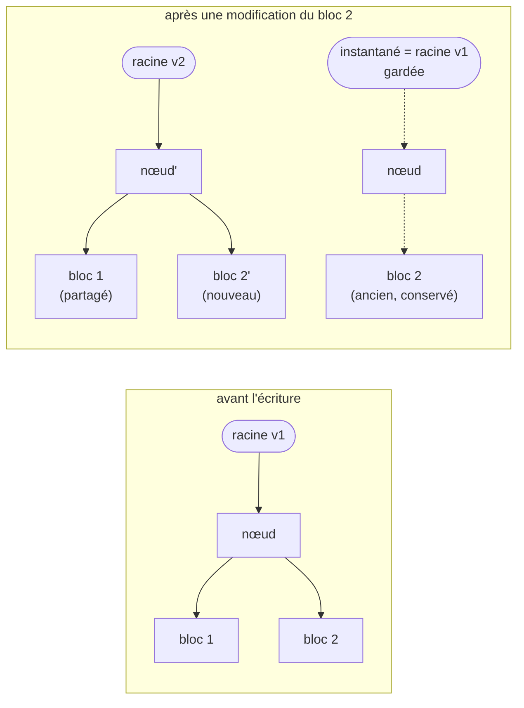

<!-- nav:début -->
[Accueil](../../README.md) › [Parcours](../../docs/parcours.md) › Partie V — Expertise système › **Module 32**  
[← Module 31](../31-tracage-ebpf-perf/README.md) · [Corrigé](corrige.md) · [Projet C →](../../projets/P3-astreinte/README.md)

<details><summary>Scripts du module (8)</summary>

Sur la VM indiquée en section « Mise en place », depuis `~/workbook/scripts/` (voir [chapitre 0](../../docs/00-mise-en-place.md)).

| Script | Rôle |
|---|---|
| [`setup_M32.sh`](../../scripts/setup/setup_M32.sh) | prépare le module |
| [`check_M32_01.sh`](../../scripts/check/check_M32_01.sh) | vérifie L32.1 |
| [`check_M32_02.sh`](../../scripts/check/check_M32_02.sh) | vérifie L32.2 |
| [`check_M32_03.sh`](../../scripts/check/check_M32_03.sh) | vérifie L32.3 |
| [`check_M32_04.sh`](../../scripts/check/check_M32_04.sh) | vérifie L32.4 |
| [`break_M32_01.sh`](../../scripts/break/break_M32_01.sh) | installe la panne BF32.1 |
| [`break_M32_02.sh`](../../scripts/break/break_M32_02.sh) | installe la panne BF32.2 |
| [`break_M32_03.sh`](../../scripts/break/break_M32_03.sh) | installe la panne BF32.3 |

</details>
<!-- nav:fin -->

# Module 32 — Systèmes de fichiers avancés : intégrité, Btrfs, ZFS et mesures

## 32.0 Objectifs et compétences

> [!NOTE]
> **Objectifs**
>
> À la fin de ce module, je sais :
>
> * expliquer ce qu'un système de fichiers garantit, et ne garantit pas,
>   après une coupure : journal, modes de journalisation d'ext4, sémantique de
>   `fsync`, motif « écrire, synchroniser, renommer » ;
> * **démontrer** une corruption silencieuse sur ext4, et la détection et la
>   réparation automatiques sur un système de fichiers à sommes de contrôle ;
> * expliquer la copie sur écriture (CoW) et ses conséquences : instantanés
>   gratuits, copies `reflink`, fragmentation, espace « libre » trompeur ;
> * administrer **Btrfs** : miroir de données et de métadonnées,
>   sous-volumes, instantanés, `send`/`receive`, compression, `scrub`,
>   remplacement d'un disque perdu, montage dégradé ;
> * administrer **ZFS** : pool en miroir, datasets et propriétés
>   (`compression`, `recordsize`, `atime`), quotas et réservations,
>   instantanés, clones, réplication incrémentale, autoréparation, cache ARC ;
> * comprendre l'allocation fine (*thin provisioning*) d'un disque de VM et
>   rendre l'espace à l'hyperviseur (`discard`, `fstrim`) ;
> * comparer des systèmes de fichiers avec `fio` **honnêtement** : charge
>   représentative, caches neutralisés, résultats reproductibles.
>
> **Temps estimé** : 10 h
>
> **Prérequis** : module 11 (partitions, LVM, ext4, XFS, quotas), module 19
> (mesures d'E/S), module 30 (sauvegardes).

---

## 32.1 Mise en place

VM concernée : **`lab-db`** (10.10.10.12), à laquelle on ajoute **quatre
disques neufs de 3 Go**, avec un numéro de série lisible :

```bash
# depuis le shell Proxmox
qm snapshot 9003 avant-lab32
for n in 3 4 5 6; do
  qm set 9003 --scsi$n local-lvm:3,discard=on,ssd=1,serial=lab32-$n
done
```

Ils apparaissent à chaud dans la VM. Le setup les repère par leur numéro de
série et écrit leurs chemins **stables** (`/dev/disk/by-id/…`) dans
`~/lab32/disques.env` :

```bash
sudo bash ~/workbook/scripts/setup/setup_M32.sh
. ~/lab32/disques.env ; echo "$A $B $C $D"
```

| Disque | Variable | Usage |
|---|---|---|
| `lab32-3` | `$A` | ext4 et XFS (L32.1), banc d'essai (L32.4) |
| `lab32-4` | `$B` | Btrfs (L32.2), puis ZFS (L32.3) |
| `lab32-5` | `$C` | Btrfs (L32.2), puis ZFS (L32.3) |
| `lab32-6` | `$D` | disque de remplacement (L32.2), pool de réplication (L32.3) |

Paquets :

```bash
sudo apt install -y btrfs-progs zfsutils-linux xfsprogs fio
```

> [!CAUTION]
> **Attention**
>
> Tout ce module écrit sur des disques **bruts**, parfois avec `dd`
> directement sur le périphérique. Vérifie trois fois la variable avant chaque
> commande destructrice : `$A` vide fait de `dd of=$A` une écriture… sur
> rien, mais `dd of=/dev/sda` détruit le système de `lab-db`. Le setup refuse
> de proposer un disque qui contient des partitions ou un système de fichiers.

> [!IMPORTANT]
> **Variante Rocky / RHEL**
>
> Rocky/RHEL ne fournit ni Btrfs (retiré de RHEL 8) ni ZFS (licence CDDL,
> incompatible avec la GPL du noyau). ZFS s'installe depuis le dépôt du
> projet OpenZFS en module DKMS ou kABI ; Red Hat oriente vers **Stratis**
> (XFS + LVM thin avec gestion intégrée). Ubuntu est la seule grande
> distribution qui livre le module ZFS précompilé avec son noyau.

---

## 32.2 Rappel express

### Ce qu'une écriture garantit

| Étape | Où sont les données | Survit à une coupure ? |
|---|---|---|
| `write()` revient | cache de pages (mémoire) | non |
| quelques secondes plus tard (écriture différée) | sur le disque, si le noyau a écrit | peut-être |
| `fsync(fd)` revient | données **et** métadonnées du fichier sur le support, cache du disque vidé | oui |
| `rename()` sans `fsync` du répertoire | l'entrée de répertoire peut être perdue | non garanti |

Le motif d'une mise à jour **atomique** d'un fichier :

```text
écrire fichier.tmp → fsync(fichier.tmp) → rename(fichier.tmp, fichier) → fsync(répertoire)
```

Après une coupure, on trouve soit l'ancien fichier entier, soit le nouveau
entier, jamais un mélange.

### Modes de journalisation d'ext4

| Mode | Journal | Après une coupure |
|---|---|---|
| `data=ordered` (défaut) | métadonnées ; données écrites **avant** les métadonnées qui y renvoient | pas de déchets dans un fichier, mais des données récentes peuvent manquer |
| `data=writeback` | métadonnées seules, sans ordre | un fichier peut contenir d'anciens blocs (données d'autrui) |
| `data=journal` | données **et** métadonnées | le plus sûr, chaque donnée écrite deux fois |

Aucun de ces modes ne **vérifie** les données relues : un bloc corrompu par
le disque, le contrôleur ou la mémoire est rendu tel quel, sans erreur.

### Copie sur écriture



*Figure — Une écriture en copie sur écriture ne modifie jamais un bloc en place : elle écrit ailleurs et remonte l'arbre jusqu'à une nouvelle racine. Garder l'ancienne racine, c'est un instantané.*

Conséquences :

* **cohérence** sans journal ni `fsck` : la racine bascule atomiquement ;
* **instantanés** instantanés et gratuits à la création… qui retiennent
  ensuite l'espace des blocs remplacés ;
* **sommes de contrôle** de chaque bloc, stockées dans le parent : une
  corruption est **détectée** à la lecture, et **réparée** s'il existe une
  autre copie (miroir) ;
* **fragmentation** des fichiers réécrits en place (images de VM, bases de
  données) ;
* l'espace libre ne se lit plus avec `df` seul.

### Btrfs

```bash
mkfs.btrfs -L donnees -d raid1 -m raid1 "$B" "$C"
mount -o compress=zstd:3,noatime "$B" /srv/btrfs
btrfs subvolume create /srv/btrfs/@donnees
btrfs subvolume snapshot -r /srv/btrfs/@donnees /srv/btrfs/.instantanes/@donnees-$(date +%F)
btrfs send -p <parent> <instantané> | btrfs receive /autre/btrfs
btrfs filesystem usage /srv/btrfs        # la vraie répartition : données, métadonnées, non alloué
btrfs device stats /srv/btrfs            # erreurs par disque
btrfs scrub start -B /srv/btrfs          # relit et vérifie tout, répare depuis le miroir
btrfs replace start <ancien|id> <nouveau> /srv/btrfs
mount -o degraded …                      # monter avec un disque absent
```

### ZFS

```bash
zpool create -o ashift=12 tank mirror "$B" "$C"
zfs create -o compression=zstd -o atime=off tank/donnees
zfs set recordsize=16K tank/pg ; zfs set quota=1G tank/donnees ; zfs set reservation=200M tank/pg
zfs snapshot tank/donnees@2026-11-09
zfs list -t snapshot -o name,used,refer
zfs list -o space                        # où est l'espace : données, instantanés, réservations
zfs rollback tank/donnees@2026-11-09 ; zfs clone tank/donnees@x tank/essai
zfs send -i @hier tank/donnees@aujourdhui | zfs receive sauve/donnees
zpool status -v ; zpool scrub tank ; zpool iostat -v 1
arc_summary | head -40                   # cache ARC
```

| Propriété | Rôle |
|---|---|
| `ashift=12` | blocs de 4 Kio sur le support (fixé à la création, irréversible) |
| `recordsize` | taille maximale d'un bloc de fichier (128K par défaut ; 16K pour une base) |
| `compression=zstd` / `lz4` | compression transparente, souvent **plus rapide** que sans |
| `atime=off` | pas d'écriture à chaque lecture |
| `quota` / `refquota` | plafond, instantanés compris ou non |
| `reservation` / `refreservation` | espace garanti |

### Allocation fine

```text
VM : ext4 « 1 Go utilisé sur 3 »      ->  nœud : volume LVM thin « 2,8 Go alloués »
```

Un disque de VM en allocation fine ne prend de la place sur l'hyperviseur
qu'à mesure qu'on y écrit. Quand l'invité **supprime** un fichier, il ne
prévient personne : les blocs restent alloués sur l'hôte, sauf si l'invité
envoie un **TRIM/discard** (montage `discard`, ou `fstrim` périodique) et
que le disque virtuel le transmet (`discard=on`).

### fio

```bash
fio --name=base --filename=/point/essai --size=1G --direct=1 --ioengine=libaio \
    --rw=randwrite --bs=8k --iodepth=1 --fsync=1 --runtime=60 --time_based --group_reporting
```

Pièges classiques :

* mesurer le cache mémoire au lieu du disque (`--direct=1`, fichier plus
  grand que la RAM, ou ARC limité pour ZFS) ;
* comparer des systèmes de fichiers sur des **charges** qui ne ressemblent
  pas à la vraie (8 Kio aléatoire synchrone pour une base, gros blocs
  séquentiels pour des sauvegardes) ;
* retenir le débit moyen et oublier la **latence** (p99) ;
* créer un pool ZFS avec `/dev/sdb` au lieu de `/dev/disk/by-id/…` : au
  prochain démarrage, les noms ont pu changer ;
* activer le RAID 5/6 de Btrfs, encore déconseillé pour les données.

---

## 32.3 Quiz — QCM

<a id="q32-1"></a>**[Q32.1](corrige.md#q32-1)** — Une application écrit `config.json.tmp`, appelle `fsync()` dessus,
puis le renomme en `config.json`. Après une coupure, `config.json` est
l'ancienne version. Qu'a-t-elle oublié ?

a) rien, c'est impossible
b) `fsync()` sur le **répertoire** après `rename()`
c) `sync` en fin de programme
d) d'ouvrir le fichier avec `O_APPEND`

<a id="q32-2"></a>**[Q32.2](corrige.md#q32-2)** — Sur ext4 en `data=ordered`, un bloc de données se corrompt sur le
disque (erreur du contrôleur). Que se passe-t-il quand on relit le fichier ?

a) ext4 renvoie une erreur d'E/S
b) ext4 répare le bloc depuis son journal
c) le contenu corrompu est rendu sans aucune erreur
d) `e2fsck` se lance automatiquement

<a id="q32-3"></a>**[Q32.3](corrige.md#q32-3)** — Sur ZFS, une somme de contrôle de bloc ne correspond pas à la
lecture. Quand ZFS peut-il **réparer** le bloc ?

a) quand une autre copie existe (miroir, RAID-Z, ou `copies=2`)
b) toujours
c) seulement après un `fsck`
d) jamais : il signale seulement l'erreur

<a id="q32-4"></a>**[Q32.4](corrige.md#q32-4)** — Pourquoi une base de données ou une image de VM se fragmente-t-elle
fortement sur Btrfs ?

a) parce que Btrfs n'a pas de journal
b) à cause de la compression
c) elle ne se fragmente pas
d) parce que chaque réécriture en place d'un bloc est écrite ailleurs (copie
   sur écriture), et le fichier finit éparpillé

<a id="q32-5"></a>**[Q32.5](corrige.md#q32-5)** — `df -h` sur un Btrfs en miroir de deux disques de 3 Go affiche une
taille de 3 Go et 1,2 Go libres, et pourtant une écriture de 800 Mo échoue
avec `ENOSPC`. Quelle commande donne la vraie répartition ?

a) `du -sh`
b) `lsblk -f`
c) `btrfs filesystem usage`
d) `df -i`

<a id="q32-6"></a>**[Q32.6](corrige.md#q32-6)** — Que fait `cp --reflink=always gros.img copie.img` sur XFS ou
Btrfs ?

a) une copie octet par octet, plus rapide
b) une copie instantanée qui partage les blocs, chacun n'étant dupliqué que
   lorsqu'il est modifié dans l'une des deux copies
c) un lien dur
d) un lien symbolique

<a id="q32-7"></a>**[Q32.7](corrige.md#q32-7)** — Pourquoi crée-t-on un pool ZFS avec les chemins
`/dev/disk/by-id/…` plutôt que `/dev/sdb` ?

a) c'est plus court
b) parce que l'ordre des noms `sdX` peut changer d'un démarrage à l'autre,
   alors que l'identifiant suit le disque
c) parce que ZFS refuse `/dev/sdX`
d) pour activer le chiffrement

<a id="q32-8"></a>**[Q32.8](corrige.md#q32-8)** — Après `zfs snapshot tank/donnees@lundi`, tu supprimes un fichier
de 1 Go dans `tank/donnees`. L'espace libre du pool :

a) ne change presque pas : les blocs sont toujours référencés par
   l'instantané
b) augmente de 1 Go
c) diminue de 1 Go
d) dépend de la compression seulement

<a id="q32-9"></a>**[Q32.9](corrige.md#q32-9)** — Que faut-il pour envoyer une réplication **incrémentale**
`zfs send -i @hier tank/d@aujourdhui | zfs receive sauve/d` ?

a) rien de particulier
b) que les deux pools aient la même taille
c) une connexion SSH
d) que `sauve/d` possède déjà l'instantané `@hier`, et n'ait pas été modifié
   depuis

<a id="q32-10"></a>**[Q32.10](corrige.md#q32-10)** — Quelle propriété ZFS ajuster pour une base PostgreSQL (pages de
8 Kio) dans un dataset dédié ?

a) `ashift=16`
b) `copies=3`
c) `recordsize=8K` ou `16K`, au lieu de 128K par défaut
d) `dedup=on`

<a id="q32-11"></a>**[Q32.11](corrige.md#q32-11)** — Sur `lab-db` (2 Go de RAM), pourquoi limiter le cache ARC de ZFS ?

a) parce que par défaut il peut grossir jusqu'à la moitié de la mémoire, au
   détriment de PostgreSQL et de son propre cache
b) parce qu'il est désactivé par défaut
c) parce qu'il ralentit les écritures
d) ce n'est pas nécessaire

<a id="q32-12"></a>**[Q32.12](corrige.md#q32-12)** — Un Btrfs en miroir a perdu un disque. Au redémarrage, le montage
échoue. Quelle est la bonne première étape ?

a) `btrfs check --repair`
b) reformater le disque restant
c) `mkfs.btrfs` sur un nouveau disque et restaurer la sauvegarde
d) monter avec `-o degraded`, puis remplacer le disque (`btrfs replace`)

<a id="q32-13"></a>**[Q32.13](corrige.md#q32-13)** — Dans une VM sur un stockage en allocation fine, l'invité a
supprimé 2 Go de fichiers. Que faut-il pour que l'hyperviseur récupère cet
espace ? *Plusieurs réponses possibles.*

a) un disque virtuel qui transmet les demandes de TRIM (`discard=on`)
b) un `fstrim` dans l'invité (ou le montage `discard`)
c) un redémarrage de la VM
d) rien : c'est automatique

<a id="q32-14"></a>**[Q32.14](corrige.md#q32-14)** — Que fait un `scrub` (Btrfs ou ZFS) ?

a) défragmente le système de fichiers
b) supprime les instantanés anciens
c) relit toutes les données et métadonnées, vérifie leurs sommes de
   contrôle, et répare depuis une copie saine quand il en existe une
d) libère l'espace non utilisé

<a id="q32-15"></a>**[Q32.15](corrige.md#q32-15)** — Pourquoi lancer `fio` avec `--direct=1` pour comparer des
systèmes de fichiers ?

a) pour contourner le cache de pages et mesurer le système de fichiers et le
   disque plutôt que la mémoire
b) pour aller plus vite
c) parce que `fio` l'exige
d) pour tester le réseau

<a id="q32-16"></a>**[Q32.16](corrige.md#q32-16)** — Le RAID 5/6 de Btrfs :

a) est le mode recommandé pour les gros volumes
b) n'existe pas
c) est identique au RAID-Z de ZFS
d) reste déconseillé pour les données en production (trou d'écriture,
   reconstruction lente), malgré des progrès

---

## 32.4 Quiz — questions ouvertes

<a id="qo32-1"></a>**[QO32.1](corrige.md#qo32-1)** — *On te demande en entretien* : « Qu'est-ce que la copie sur
écriture apporte, et qu'est-ce qu'elle coûte ? Dans quels cas éviterais-tu
un système de fichiers CoW ? »

<a id="qo32-2"></a>**[QO32.2](corrige.md#qo32-2)** — Explique pourquoi « le disque ne peut pas mentir » est faux, avec
au moins trois sources de corruption silencieuse, et comment ZFS et Btrfs
les détectent alors qu'ext4 et XFS ne le peuvent pas.

<a id="qo32-3"></a>**[QO32.3](corrige.md#qo32-3)** — Un développeur écrit un fichier de configuration avec
`open(..., O_TRUNC)` puis `write()`. Après une coupure, le fichier est vide.
Explique pourquoi, et écris la séquence d'appels correcte.

<a id="qo32-4"></a>**[QO32.4](corrige.md#qo32-4)** — Instantané ZFS ou Btrfs, instantané LVM, sauvegarde restic :
quelles différences de coût, de cohérence et de protection ? Peut-on
remplacer une sauvegarde par des instantanés ?

<a id="qo32-5"></a>**[QO32.5](corrige.md#qo32-5)** — ext4, XFS, Btrfs, ZFS : pour chacun, un cas où c'est le meilleur
choix, avec une raison technique.

<a id="qo32-6"></a>**[QO32.6](corrige.md#qo32-6)** — Décris la méthode d'un banc d'essai de stockage digne de
confiance : ce qu'on mesure, comment, combien de fois, et ce qu'on publie.

<a id="qo32-7"></a>**[QO32.7](corrige.md#qo32-7)** — L'allocation fine sur l'hyperviseur : avantages, risques (sur-
allocation), et ce qu'il faut surveiller. Que se passe-t-il quand le pool
d'allocation fine est plein ?

<a id="qo32-8"></a>**[QO32.8](corrige.md#qo32-8)** — ZFS est livré par Ubuntu, pas par Red Hat ni Debian (qui le
fournit en DKMS). Pourquoi ? Quelles conséquences pratiques pour une équipe
qui choisit ZFS ?

---

## 32.5 Exercices guidés ★

<a id="e32-1"></a>**[E32.1](corrige.md#e32-1)** — Après le setup, affiche pour les quatre disques : nom noyau,
numéro de série, chemin `by-id`, taille, prise en charge du discard.

<a id="e32-2"></a>**[E32.2](corrige.md#e32-2)** — Crée un ext4 sur `$A`, et affiche le mode de journalisation, la
taille du journal et l'option de montage qui s'appliquent.

<a id="e32-3"></a>**[E32.3](corrige.md#e32-3)** — Écris en shell, avec `dd` et `sync`, la mise à jour atomique d'un
fichier `etat.txt` (fichier temporaire, synchronisation, renommage,
synchronisation du répertoire).

<a id="e32-4"></a>**[E32.4](corrige.md#e32-4)** — Sur un XFS (`$A`), crée un fichier de 1 Go, copie-le avec
`--reflink=always`, et montre que l'espace utilisé n'a presque pas changé.
Modifie 10 Mo de la copie : combien d'espace en plus ?

<a id="e32-5"></a>**[E32.5](corrige.md#e32-5)** — Sur le Btrfs de L32.2, montre la répartition réelle de l'espace
(données, métadonnées, système, non alloué) et le taux de compression
obtenu sur `/srv/btrfs/@donnees`.

<a id="e32-6"></a>**[E32.6](corrige.md#e32-6)** — Liste les sous-volumes et les instantanés du Btrfs, avec leur
identifiant et leur parent.

<a id="e32-7"></a>**[E32.7](corrige.md#e32-7)** — Montre les compteurs d'erreurs par disque du Btrfs, puis remets-les
à zéro après les avoir notés.

<a id="e32-8"></a>**[E32.8](corrige.md#e32-8)** — Sur le pool ZFS de L32.3, affiche les propriétés non par défaut de
`tank/donnees` avec leur source.

<a id="e32-9"></a>**[E32.9](corrige.md#e32-9)** — Montre où est l'espace du pool : données vives, instantanés,
enfants, réservations (`zfs list -o space`).

<a id="e32-10"></a>**[E32.10](corrige.md#e32-10)** — Affiche la taille courante, la cible et le taux de réussite du
cache ARC.

<a id="e32-11"></a>**[E32.11](corrige.md#e32-11)** — Crée un clone d'un instantané, modifie-le, puis promeus-le ou
détruis-le. Que se passe-t-il si tu essaies de détruire l'instantané d'origine
tant que le clone existe ?

<a id="e32-12"></a>**[E32.12](corrige.md#e32-12)** — Sur le nœud Proxmox, montre l'occupation réelle du volume thin du
disque `lab32-3` de `lab-db` (`lvs`), puis remplis et vide son système de
fichiers dans la VM, et observe l'occupation avant et après `fstrim`.

---

## 32.6 Labs ★★

### <a id="l32-1"></a>**[L32.1](corrige.md#l32-1)** — Ce que le disque peut faire dans ton dos

> **Contexte**
>
> L'équipe hésite à migrer un serveur de fichiers d'ext4 vers ZFS. Argument
> d'un collègue : « un disque qui se trompe renvoie une erreur, ext4 est donc
> aussi sûr ». On te demande de **démontrer** le contraire, puis de vérifier
> que les applications maison écrivent leurs fichiers correctement.

1. Crée un ext4 sur `$A`, monte-le sur `/srv/lab32/ext4`, et écris-y
   `temoin.bin` (32 Mo de données aléatoires). Note son empreinte SHA-256.
2. Trouve l'emplacement physique de ses blocs sur le disque (`filefrag -v`,
   taille de bloc), démonte le système de fichiers et écrase **4 Kio au
   milieu du fichier** directement sur `$A` avec `dd` (en calculant le bon
   décalage).
3. Remonte, vide les caches, relis le fichier : y a-t-il une erreur ?
   L'empreinte a-t-elle changé ? Lance `e2fsck -fn` : que dit-il ?
4. Rédige `~/lab32/corruption.md` : ce que tu as fait, ce que tu as observé,
   et la conclusion pour la décision de l'équipe.
5. Le programme `/usr/local/bin/lab32-sauve-etat` (fourni par le setup)
   met à jour un fichier d'état et annonce « état sauvegardé ». Lis-le et
   trouve ses **deux** défauts de durabilité.
6. Corrige-le dans `~/lab32/sauve-etat-corrige.sh` (en Python ou en shell)
   avec le motif « écrire, synchroniser, renommer, synchroniser le
   répertoire », et prouve avec `strace -f -e trace=openat,write,fsync,rename`
   que les appels se font dans le bon ordre.

> [!TIP]
> **Critère de succès**
>
> Critère de succès : le rapport montre une empreinte changée **sans** erreur
> de lecture ni d'`e2fsck`, et le script corrigé fait `fsync` du fichier avant
> le renommage puis `fsync` du répertoire.
>
> ```bash
> sudo bash check_M32_01.sh
> ```

### <a id="l32-2"></a>**[L32.2](corrige.md#l32-2)** — Btrfs : miroir, instantanés, panne de disque

> **Contexte**
>
> Un serveur de fichiers doit garder une semaine d'historique consultable,
> détecter toute corruption, survivre à la perte d'un disque et se répliquer
> ailleurs. Premier essai avec Btrfs, sur `$B` et `$C`.

1. Crée un Btrfs **miroir** (données et métadonnées) sur `$B` et `$C`,
   monte-le sur `/srv/btrfs` avec compression zstd et sans `atime`, et ajoute
   la ligne `fstab` correspondante (par UUID).
2. Crée les sous-volumes `@donnees` et `.instantanes`, copie dans `@donnees`
   le contenu de `/usr/share/doc` (texte : il se compresse bien), et mesure le
   taux de compression.
3. Prends un instantané **en lecture seule** de `@donnees`, supprime un
   répertoire dans `@donnees`, et restaure-le depuis l'instantané.
4. Corromps 4 Kio des **données** sur `$B` seulement (comme en L32.1, avec
   `btrfs inspect-internal` ou `filefrag` pour trouver l'adresse physique),
   relis le fichier : que se passe-t-il ? Lance un `scrub` et lis les
   compteurs d'erreurs.
5. **Perds un disque** : retire `$C` à chaud (`echo 1 >
   /sys/block/<nom>/device/delete`), constate l'état, démonte, remonte en mode
   dégradé, puis remplace le disque perdu par `$D` et vérifie que le miroir
   est de nouveau complet.
6. Réplique `@donnees` vers un fichier de flux avec `btrfs send` (un
   instantané complet, puis un incrémental après une modification), et
   restaure le flux incrémental dans un sous-volume de test pour le vérifier.

> [!TIP]
> **Critère de succès**
>
> Critère de succès : Btrfs en miroir sur `$B` et `$D`, sans disque manquant,
> monté par UUID avec compression, au moins un instantané en lecture seule, un
> scrub qui a corrigé des erreurs, et les deux flux `send`.
>
> ```bash
> sudo bash check_M32_02.sh
> ```

### <a id="l32-3"></a>**[L32.3](corrige.md#l32-3)** — ZFS : pool, datasets, autoréparation, réplication

> **Contexte**
>
> Deuxième essai, avec ZFS, sur les mêmes disques `$B` et `$C` (le Btrfs de
> L32.2 est démantelé), et `$D` comme pool de réplication. `lab-db` n'a que
> 2 Go de mémoire et fait tourner PostgreSQL.

1. Démonte et efface le Btrfs (et sa ligne `fstab`). Limite d'abord le cache
   ARC à 256 Mio, de façon persistante et immédiate.
2. Crée le pool `tank` en **miroir** sur `$B` et `$C` (chemins `by-id`,
   `ashift=12`), et le pool `sauve` sur `$D`.
3. Crée `tank/donnees` (compression zstd, `atime=off`, quota de 1 Gio) et
   `tank/pg` (`recordsize=16K`, `compression=lz4`, réservation de 200 Mio).
   Copie `/usr/share/doc` dans `tank/donnees` et compare le taux de
   compression avec celui de Btrfs.
4. Corromps une partie de `$B` **pendant que le pool est en service**
   (plusieurs Mo au milieu du disque), relis les données, lance un `scrub`, et
   montre les compteurs `CKSUM` et la ligne « repaired ».
5. Prends trois instantanés de `tank/donnees` à quelques minutes
   d'intervalle avec des modifications entre chacun, réplique-les vers
   `sauve` (un envoi complet, puis deux incrémentaux), et montre que `sauve`
   a les mêmes instantanés.
6. Simule une erreur humaine (`rm -rf` d'un répertoire) et restaure-la de
   deux façons : un fichier depuis `.zfs/snapshot/`, puis tout le dataset par
   `zfs rollback`.

> [!TIP]
> **Critère de succès**
>
> Critère de succès : `tank` en miroir sain (par identifiants), ARC limité,
> propriétés et quotas en place, un scrub qui a réparé des erreurs, et les
> instantanés présents des deux côtés.
>
> ```bash
> sudo bash check_M32_03.sh
> ```

### <a id="l32-4"></a>**[L32.4](corrige.md#l32-4)** — Comparer sans se mentir

> **Contexte**
>
> La décision finale se prendra sur des mesures. Deux charges comptent : la
> base de données (écritures aléatoires de 8 Kio, chacune synchronisée) et la
> sauvegarde nocturne (lecture séquentielle de gros blocs). On compare ext4,
> XFS, Btrfs et ZFS sur le **même** disque `$A`, à tour de rôle.

1. Écris `~/lab32/banc.sh`, qui pour un point de montage donné lance deux
   tâches `fio` de 60 s : `base` (8 Kio aléatoires, une synchronisation par
   écriture, une seule E/S en vol) et `sauvegarde` (lecture séquentielle de
   blocs de 1 Mio), en neutralisant les caches, et extrait en JSON les IOPS,
   le débit et la latence p99.
2. Pour chaque système de fichiers : formate `$A` (pour ZFS : un pool d'un
   seul disque, ARC limité, `recordsize` adapté à la charge), monte, lance le
   banc **trois fois**, démonte.
3. Rédige `~/lab32/banc.md` : tableau des médianes (IOPS, Mio/s, p99), écart
   entre les trois passages, et une interprétation qui explique **pourquoi**
   chaque système de fichiers se comporte ainsi sur chaque charge.
4. Ajoute une section « limites de la mesure » : ce que ce banc ne dit pas
   (disque virtuel sur un stockage partagé, une seule VM, compression et
   données aléatoires, etc.).

> [!TIP]
> **Critère de succès**
>
> Critère de succès : `banc.sh` exécutable, quatre systèmes de fichiers
> mesurés trois fois chacun, et un rapport avec médianes, p99 et limites.
>
> ```bash
> sudo bash check_M32_04.sh
> ```

---

## 32.7 Break & Fix ★★★

> [!CAUTION]
> **Attention**
>
> Avant chaque Break & Fix : `qm snapshot 9003 avant-bf32`.

### <a id="bf32-1"></a>**[BF32.1](corrige.md#bf32-1)** — « J'ai supprimé 1,5 Go, et le disque est toujours plein »

À lancer sur `lab-db` (pool `tank` de L32.3 en place) :

```bash
sudo bash break_M32_01.sh
```

**Symptôme utilisateur** : l'application qui écrit dans `tank/exports`
échoue : `No space left on device`. Hier, quelqu'un a supprimé un très gros
export pour faire de la place ; `du -sh /tank/exports` ne montre plus que
quelques centaines de Mo, loin de la taille du pool. `df` affiche pourtant le
pool plein.

**Interdit** : augmenter le quota, détruire le dataset.

**Objectif** : expliquer où est l'espace, le libérer sans perdre ce qui doit
être gardé, et mettre en place ce qui empêchera la récidive.

### <a id="bf32-2"></a>**[BF32.2](corrige.md#bf32-2)** — « Le volume de fichiers ne se monte plus »

À lancer sur `lab-db`. Le script crée son propre volume Btrfs en miroir,
`/srv/btrfs-bf`, sur deux disques virtuels (fichiers en boucle), pour ne pas
toucher aux pools de L32.3 :

```bash
sudo bash break_M32_02.sh
```

**Symptôme utilisateur** : après une « intervention matérielle », le volume
`/srv/btrfs-bf` ne se monte plus : `mount /srv/btrfs-bf` échoue avec un
message peu explicite. Au prochain redémarrage, d'après la configuration actuelle, la
machine s'arrêterait en mode de secours.

**Interdit** : `btrfs check --repair`, reformater.

**Objectif** : remettre les données en ligne, rétablir la redondance, et
corriger la configuration pour qu'un disque absent ne bloque plus le
démarrage.

### <a id="bf32-3"></a>**[BF32.3](corrige.md#bf32-3)** — « Le stockage du nœud se remplit tout seul »

À lancer sur `lab-db` (le script reformate `$A`), puis observer sur le nœud
Proxmox :

```bash
sudo bash break_M32_03.sh
```

**Symptôme utilisateur** : la supervision du nœud Proxmox signale le stockage
`local-lvm` (allocation fine) en forte hausse. Dans `lab-db`, le volume
d'archives `/srv/lab32/archives` est presque vide d'après `df`. Personne
n'a rien ajouté.

**Interdit** : agrandir le stockage du nœud, supprimer le disque de la VM.

**Objectif** : expliquer l'écart entre ce que voit l'invité et ce que voit
l'hôte, rendre l'espace à l'hôte, et faire en sorte que cela reste vrai.

---

## 32.8 Défi du module ★★★

<a id="d32"></a>**[D32](corrige.md#d32) — Instantanés automatiques, restauration en libre-service, réplication**

Livrable : `/usr/local/sbin/instantanes.sh`, ses unités systemd et une page
de documentation pour les utilisateurs.

1. `instantanes.sh <dataset>` prend un instantané horodaté de chaque dataset
   **et de ses enfants** (`-r`), nommé `auto-AAAAMMJJ-HHMM`, et applique une
   rétention : les 4 derniers quarts d'heure, 24 heures (un par heure),
   7 jours (un par jour), 4 semaines. Il ne détruit **jamais** un instantané
   qui ne commence pas par `auto-`.
2. Après chaque instantané, il **réplique** de façon incrémentale vers
   `sauve`, en retrouvant lui-même le dernier instantané commun ; si aucun
   n'existe, il fait un envoi complet ; il ne détruit côté `sauve` que des
   instantanés qui n'existent plus côté `tank`.
3. Il journalise chaque action, sort en erreur si la réplication échoue, et
   un verrou empêche deux exécutions simultanées.
4. Un timer le lance tous les quarts d'heure ; une unité `OnFailure=` le
   signale.
5. `~/lab32/defi/restaurer-un-fichier.md` explique à un utilisateur non
   administrateur comment retrouver lui-même l'état d'hier d'un fichier
   (`.zfs/snapshot`, `snapdir=visible`), et ce qu'il ne peut **pas** faire.
6. Preuve : après deux heures (ou en accélérant l'horloge de rétention par
   une option de test), montre la liste des instantanés des deux côtés et une
   restauration réussie depuis `sauve`.

---

## 32.9 Auto-évaluation

| Compétence | Acquis | À revoir |
|---|---|---|
| Expliquer `fsync`, les modes d'ext4 et l'écriture atomique | ☐ | ☐ |
| Démontrer une corruption silencieuse et sa détection | ☐ | ☐ |
| Expliquer la copie sur écriture et ses coûts | ☐ | ☐ |
| Administrer Btrfs : miroir, sous-volumes, instantanés, remplacement | ☐ | ☐ |
| Administrer ZFS : pool, datasets, propriétés, ARC | ☐ | ☐ |
| Répliquer par `send`/`receive` incrémental | ☐ | ☐ |
| Rendre l'espace à un hyperviseur en allocation fine | ☐ | ☐ |
| Mesurer un stockage avec `fio`, honnêtement | ☐ | ☐ |

Pour aller plus loin :

* Lis l'article *Files are hard* (Dan Luu) et l'étude *All File Systems Are
  Not Created Equal* (OSDI 2014) : ce que les applications réelles font mal
  avec `fsync`.
* Essaie **bcachefs** dans une VM jetable, et le chiffrement natif de ZFS
  (`encryption=aes-256-gcm`) avec envoi « brut » (`zfs send -w`) : la
  réplication vers un site qui ne possède pas la clé.
* Installe **sanoid/syncoid** : l'outil de référence pour ce que fait D32.
* Mets un dataset ZFS sous PostgreSQL de test et mesure l'effet de
  `recordsize`, `logbias` et d'un journal séparé (SLOG) avec `pgbench`.

<!-- nav:début -->
---

[← Module 31](../31-tracage-ebpf-perf/README.md) · [Corrigé](corrige.md) · [Projet C →](../../projets/P3-astreinte/README.md) · [Parcours](../../docs/parcours.md) · [Accueil](../../README.md)
<!-- nav:fin -->
