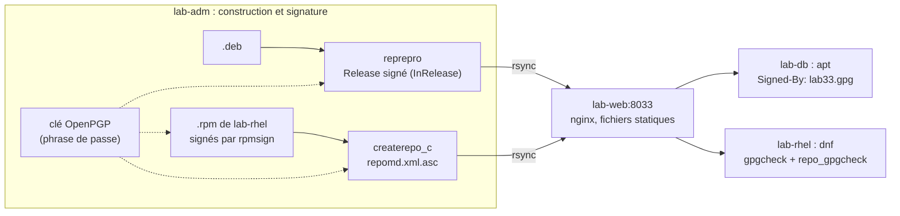

<!-- nav:début -->
[Accueil](../../README.md) › [Parcours](../../docs/parcours.md) › Partie V — Expertise système › **Module 33**  
[← Module 32](../32-fs-avances/README.md) · [Corrigé](corrige.md) · [Projet C →](../../projets/P3-astreinte/README.md)

<details><summary>Scripts du module (8)</summary>

Sur la VM indiquée en section « Mise en place », depuis `~/workbook/scripts/` (voir [chapitre 0](../../docs/00-mise-en-place.md)).

| Script | Rôle |
|---|---|
| [`setup_M33.sh`](../../scripts/setup/setup_M33.sh) | prépare le module |
| [`check_M33_01.sh`](../../scripts/check/check_M33_01.sh) | vérifie L33.1 |
| [`check_M33_02.sh`](../../scripts/check/check_M33_02.sh) | vérifie L33.2 |
| [`check_M33_03.sh`](../../scripts/check/check_M33_03.sh) | vérifie L33.3 |
| [`check_M33_04.sh`](../../scripts/check/check_M33_04.sh) | vérifie L33.4 |
| [`break_M33_01.sh`](../../scripts/break/break_M33_01.sh) | installe la panne BF33.1 |
| [`break_M33_02.sh`](../../scripts/break/break_M33_02.sh) | installe la panne BF33.2 |
| [`break_M33_03.sh`](../../scripts/break/break_M33_03.sh) | installe la panne BF33.3 |

</details>
<!-- nav:fin -->

# Module 33 — Construire et distribuer : compilation, paquets .deb et .rpm, dépôts signés

## 33.0 Objectifs et compétences

> [!NOTE]
> **Objectifs**
>
> À la fin de ce module, je sais :
>
> * compiler un logiciel depuis ses sources proprement : préfixe, installation
>   dans un répertoire de transit (`DESTDIR`), dépendances d'exécution,
>   options de durcissement, et dire pourquoi on n'installe jamais avec
>   `make install` dans `/usr` ;
> * construire un paquet **Debian** avec debhelper : `debian/control`,
>   `changelog`, `rules`, `copyright`, unité systemd, fichiers de configuration
>   protégés, utilisateur système ; le vérifier avec `lintian` ;
> * construire un paquet **RPM** : fichier `.spec`, macros, `%files`,
>   `%config(noreplace)`, scriptlets systemd ; le vérifier avec `rpmlint` ;
> * gérer une montée de version : numéros de version et de révision, fichiers
>   de configuration modifiés localement, `Replaces`/`Breaks` ;
> * publier des dépôts **signés** pour apt (`reprepro`) et dnf
>   (`createrepo_c`, paquets et métadonnées signés), avec une clé OpenPGP
>   dédiée qui ne quitte pas la station de construction, et configurer les
>   clients sans `apt-key` ;
> * faire tourner une clé de signature sans casser les clients ;
> * livrer un module noyau qui se recompile tout seul à chaque mise à jour du
>   noyau (DKMS).
>
> **Temps estimé** : 11 h
>
> **Prérequis** : module 07 (scripts), module 08 (systemd), module 10
> (paquets, dépôts), module 15 (nginx), notions de C et de `make`.

---

## 33.1 Mise en place

| VM | Rôle |
|---|---|
| `lab-adm` (10.10.10.10) | **station de construction et de signature** : compilation, paquets Debian, clé OpenPGP, génération des dépôts |
| `lab-rhel` (10.10.10.13) | construction des RPM ; client `dnf` |
| `lab-web` (10.10.10.11) | **sert** les dépôts (nginx, port 8033), ne signe rien |
| `lab-db` (10.10.10.12) | client `apt` |

```bash
# depuis le shell Proxmox
for id in 9001 9002 9003 9004; do qm snapshot $id avant-lab33; done
```

Paquets :

```bash
# lab-adm
sudo apt install -y build-essential devscripts debhelper dh-dkms lintian \
  reprepro createrepo-c rpm gnupg rsync dkms
# lab-rhel
sudo dnf install -y rpm-build rpmdevtools rpmlint gcc make systemd-rpm-macros
# lab-db (pour le défi)
sudo apt install -y dkms "linux-headers-$(uname -r)"
```

Terrain de jeu (idempotent) :

```bash
sudo bash ~/workbook/scripts/setup/setup_M33.sh   # sur lab-adm, lab-rhel, lab-web
```

Sur `lab-adm` et `lab-rhel`, il dépose dans `~/lab33/amont/` les archives
« amont » de **`lab33-sante`**, un petit outil en C qui vérifie que des
services TCP répondent (liste dans `/etc/lab33-sante.conf`), livré avec son
`Makefile`, sa page de manuel, une unité et un minuteur systemd :
`lab33-sante-1.0.tar.gz` et `lab33-sante-1.1.tar.gz`. Sur `lab-web`, il
prépare `/srv/depot/` (propriété d'un compte `depot`, qui recevra les
publications) et un site nginx sur le port 8033.

> [!CAUTION]
> **Attention**
>
> La clé de signature des dépôts est le secret le plus précieux du module :
> qui la possède peut faire installer **n'importe quel** programme, en root,
> sur toutes les machines qui font confiance au dépôt. Elle reste sur `lab-adm`,
> protégée par une phrase de passe ; `lab-web` ne reçoit que des fichiers déjà
> signés.

> [!IMPORTANT]
> **Variante Rocky / RHEL**
>
> Côté RPM, `mock` construit dans un chroot propre, avec les seules
> dépendances déclarées, ce que fait aussi `sbuild` ou `pbuilder` côté Debian :
> c'est la façon professionnelle de garantir qu'un paquet ne dépend pas de ce
> qui traîne sur la machine de construction (« pour aller plus loin »).

---

## 33.2 Rappel express

### Compiler sans abîmer le système

```bash
tar xf lab33-sante-1.0.tar.gz && cd lab33-sante-1.0
make                                         # compile dans l'arborescence des sources
make PREFIX=/usr/local install               # pour soi, hors des chemins du gestionnaire de paquets
make PREFIX=/usr DESTDIR=/tmp/transit install   # pour un paquet : arborescence de transit
ldd lab33-sante ; readelf -d lab33-sante | grep -E 'NEEDED|RUNPATH|BIND_NOW|FLAGS'
```

| Variable | Rôle |
|---|---|
| `PREFIX` | où le logiciel **croira** être installé (chemins compilés, `/usr` dans un paquet) |
| `DESTDIR` | où les fichiers sont **réellement** copiés lors de `make install` (racine de transit) |
| `CFLAGS`, `LDFLAGS` | options de compilation et d'édition de liens (durcissement : `-fstack-protector-strong`, `-D_FORTIFY_SOURCE=3`, PIE, `-Wl,-z,relro,-z,now`) |

`/usr` appartient au gestionnaire de paquets ; `/usr/local` et `/opt` à
l'administrateur. Un `make install` dans `/usr` écrase des fichiers d'autres
paquets et ne se désinstalle pas.

### Paquet Debian

```text
lab33-sante-1.0/
└── debian/
    ├── control          paquet source et paquets binaires : nom, dépendances, description
    ├── changelog        versions (format strict, édité avec dch)
    ├── rules            Makefile : « dh $@ » et quelques surcharges
    ├── copyright        licence (format lisible par machine)
    ├── source/format    « 3.0 (quilt) » : archive amont + debian/
    ├── lab33-sante.service, lab33-sante.timer   si l'amont ne les installe pas ; activés par dh_installsystemd
    └── lab33-sante.sysusers                     utilisateur système (dh_installsysusers)
```

Avec debhelper 13 (Ubuntu 24.04), `dh_installsysusers` ne s'exécute que si
`Build-Depends` contient `dh-sequence-installsysusers` ; il fait partie de
la séquence par défaut à partir du niveau de compatibilité 14.

```bash
dch --create -v 1.0-1 --package lab33-sante "Premier paquet."
dpkg-buildpackage -us -uc -b           # construit le .deb (sans signer)
lintian ../lab33-sante_1.0-1_amd64.deb
dpkg-deb -I paquet.deb ; dpkg-deb -c paquet.deb      # en-têtes ; contenu
dpkg -L lab33-sante ; dpkg -S /usr/bin/lab33-sante   # fichiers installés ; à qui est ce fichier
```

Version Debian : `[époque:]amont-révision`, par exemple `1:1.1-2`. La
**révision** change quand seul l'empaquetage change.

### Paquet RPM

```bash
rpmdev-setuptree                        # ~/rpmbuild/{SOURCES,SPECS,BUILD,RPMS,SRPMS}
rpmdev-newspec -o ~/rpmbuild/SPECS/lab33-sante.spec lab33-sante
rpmbuild -ba ~/rpmbuild/SPECS/lab33-sante.spec
rpmlint ~/rpmbuild/SPECS/lab33-sante.spec ~/rpmbuild/RPMS/x86_64/*.rpm
rpm -qpl paquet.rpm ; rpm -qp --scripts paquet.rpm ; rpm -qp --requires paquet.rpm
rpm -K paquet.rpm                       # sommes et signature
```

| Section du `.spec` | Rôle |
|---|---|
| `Name`, `Version`, `Release: 1%{?dist}`, `Source0` | identité, archive amont |
| `BuildRequires` / `Requires` | dépendances de construction / d'exécution (les bibliothèques sont détectées seules) |
| `%prep` (`%autosetup`), `%build` (`%make_build`), `%install` (`%make_install`) | préparation, compilation, installation dans `%{buildroot}` |
| `%files` | la liste **exhaustive** de ce que livre le paquet ; `%config(noreplace)`, `%doc`, `%license` |
| `%post`, `%preun`, `%postun` | scriptlets : `%systemd_post`, `%systemd_preun`, `%systemd_postun_with_restart` |
| `%changelog` | historique |

### Fichiers de configuration lors d'une mise à jour

| | Debian (`conffile`) | RPM (`%config(noreplace)`) |
|---|---|---|
| fichier non modifié localement | remplacé par la nouvelle version | remplacé |
| modifié localement, inchangé dans le paquet | gardé | gardé |
| modifié des deux côtés | **question** à l'administrateur (`--force-confold`/`confnew` en automatique) | local gardé, nouveau écrit en `.rpmnew` |

### Dépôts signés



*Figure — Le serveur web ne fait que servir des fichiers déjà signés ; c'est la clé publique installée sur chaque client qui établit la confiance, pas le serveur.*

Client apt moderne (format deb822, clé dédiée au dépôt) :

```text
# /etc/apt/sources.list.d/lab33.sources
Types: deb
URIs: http://lab-web.lab.local:8033/debian
Suites: lab33
Components: main
Signed-By: /etc/apt/keyrings/lab33.gpg
```

Client dnf :

```ini
# /etc/yum.repos.d/lab33.repo
[lab33]
name=Dépôt lab33
baseurl=http://lab-web.lab.local:8033/rpm/el9/x86_64/
gpgcheck=1
repo_gpgcheck=1
gpgkey=http://lab-web.lab.local:8033/lab33.asc
```

### DKMS

```bash
dkms add -m lab33-compteur -v 1.0       # sources dans /usr/src/lab33-compteur-1.0/
dkms build -m lab33-compteur -v 1.0
dkms install -m lab33-compteur -v 1.0
dkms status
dkms autoinstall -k <version>           # pour un autre noyau installé
```

Pièges classiques :

* `make install` en root dans `/usr`, puis plus moyen de savoir quoi
  supprimer ;
* un paquet qui dépend de ce qu'il y avait sur la machine de construction
  (bibliothèque dans `/usr/local`, outil installé à la main) ;
* `apt-key add` (déprécié, retiré) : la clé est approuvée pour **tous** les
  dépôts, pas seulement le sien ;
* `gpgcheck=0` « le temps que ça marche » ;
* changer la clé de signature du dépôt sans avoir d'abord distribué la
  nouvelle aux clients.

---

## 33.3 Quiz — QCM

<a id="q33-1"></a>**[Q33.1](corrige.md#q33-1)** — Quelle commande prépare correctement les fichiers d'un logiciel
pour un paquet, sans rien toucher au système ?

a) `make PREFIX=/usr DESTDIR="$PWD/transit" install`
b) `sudo make install`
c) `make PREFIX="$PWD/transit" install`
d) `sudo make PREFIX=/usr/local install`

<a id="q33-2"></a>**[Q33.2](corrige.md#q33-2)** — Pourquoi `make PREFIX="$PWD/transit" install` est-il une erreur
pour un paquet ?

a) parce que `make` refuse un chemin relatif
b) parce que `PREFIX` n'existe pas
c) parce que le programme aurait les chemins de transit compilés en dur
   (configuration, données), et chercherait ses fichiers au mauvais endroit
   une fois installé
d) ce n'est pas une erreur

<a id="q33-3"></a>**[Q33.3](corrige.md#q33-3)** — Dans `1:2.4.1-3ubuntu2`, que désigne `3ubuntu2` ?

a) la version amont
b) l'époque
c) le numéro de compilation
d) la révision de l'empaquetage (troisième révision Debian, deuxième
   modification Ubuntu)

<a id="q33-4"></a>**[Q33.4](corrige.md#q33-4)** — À quoi sert l'**époque** (`1:`) dans une version Debian ou RPM ?

a) à forcer l'ordre quand un schéma de version amont change et qu'une
   nouvelle version paraîtrait sinon plus ancienne
b) à indiquer l'année de publication
c) à signer le paquet
d) à rien : elle est décorative

<a id="q33-5"></a>**[Q33.5](corrige.md#q33-5)** — Que fait `dh $@` dans `debian/rules` ?

a) il compile le paquet avec `gcc`
b) il signe le paquet
c) il enchaîne la séquence standard de debhelper (configuration,
   compilation, tests, installation, `dh_installsystemd`, compression,
   dépendances, construction du .deb), chaque étape étant surchargeable par
   une cible `override_dh_…`
d) il télécharge les sources

<a id="q33-6"></a>**[Q33.6](corrige.md#q33-6)** — Comment debhelper sait-il que le paquet dépend de
`libc6 (>= 2.34)` sans qu'on l'écrive dans `debian/control` ?

a) il ne le sait pas
b) par Internet
c) grâce à `lintian`
d) `dh_shlibdeps` examine les bibliothèques liées aux binaires et remplit
   `${shlibs:Depends}`

<a id="q33-7"></a>**[Q33.7](corrige.md#q33-7)** — Un administrateur a modifié `/etc/lab33-sante.conf` ; la
nouvelle version du paquet `.deb` modifie aussi ce fichier. Lors de
`apt upgrade` interactif :

a) le fichier est écrasé sans prévenir
b) dpkg demande quoi faire (garder, remplacer, comparer)
c) le fichier local est supprimé
d) la mise à jour échoue

<a id="q33-8"></a>**[Q33.8](corrige.md#q33-8)** — Dans un `.spec`, que signifie `%config(noreplace)` lors d'une
mise à jour où le fichier a été modifié localement et dans le paquet ?

a) le fichier local est écrasé, l'ancien sauvegardé en `.rpmsave`
b) la mise à jour échoue
c) le fichier local est gardé, la nouvelle version écrite à côté en `.rpmnew`
d) le fichier n'est pas installé du tout

<a id="q33-9"></a>**[Q33.9](corrige.md#q33-9)** — Pourquoi `apt-key add` est-il déprécié au profit de
`Signed-By:` ?

a) parce qu'une clé ajoutée par `apt-key` était approuvée pour **tous** les
   dépôts configurés : la clé d'un dépôt tiers pouvait signer un faux
   paquet `openssh-server`
b) parce qu'il est lent
c) parce que GnuPG n'est plus utilisé
d) pour des raisons de licence

<a id="q33-10"></a>**[Q33.10](corrige.md#q33-10)** — Que signe-t-on dans un dépôt apt ?

a) chaque paquet `.deb`
b) rien : HTTPS suffit
c) seulement l'index `Packages`
d) le fichier `Release` (ou `InRelease`), qui contient les empreintes des
   index `Packages`, qui contiennent eux-mêmes les empreintes de chaque
   `.deb`

<a id="q33-11"></a>**[Q33.11](corrige.md#q33-11)** — `dnf` avec `gpgcheck=1` et `repo_gpgcheck=1` vérifie :

a) seulement la signature des métadonnées
b) la signature de chaque paquet **et** celle des métadonnées du dépôt
   (`repomd.xml`)
c) seulement la signature de chaque paquet
d) le certificat HTTPS du serveur

<a id="q33-12"></a>**[Q33.12](corrige.md#q33-12)** — Pourquoi la station de signature n'est-elle pas le serveur web
qui publie le dépôt ?

a) parce qu'un serveur web exposé est la machine la plus attaquable : si la
   clé y est, sa compromission permet de signer et diffuser des paquets
   malveillants
b) pour des raisons de performances
c) parce que nginx ne sait pas lire les clés
d) ce n'est pas nécessaire

<a id="q33-13"></a>**[Q33.13](corrige.md#q33-13)** — Un dépôt change de clé de signature ; les clients n'ont que
l'ancienne. Que voient-ils à `apt update` ?

a) rien : apt accepte toute clé valide
b) une demande de confirmation
c) le dépôt est mis à jour sans vérification
d) une erreur de signature (`NO_PUBKEY …`), et le dépôt est ignoré

<a id="q33-14"></a>**[Q33.14](corrige.md#q33-14)** — Lors de `apt install`, dpkg échoue : *trying to overwrite
'/usr/bin/lab33-sante', which is also in package lab33-sante*. Quelle
correction côté empaquetage ?

a) `--force-overwrite` sur tous les clients
b) déclarer `Replaces:` (et `Breaks:`) de l'ancien paquet dans le nouveau, ou
   ne plus livrer le fichier en double
c) supprimer `/usr/bin/lab33-sante` à la main
d) renommer le paquet

<a id="q33-15"></a>**[Q33.15](corrige.md#q33-15)** — Que fait DKMS quand un nouveau noyau est installé ?

a) rien : il faut recompiler le module à la main
b) il supprime le module
c) il recompile et installe automatiquement, pour ce noyau, les modules
   enregistrés avec `AUTOINSTALL="yes"`, à condition que les en-têtes du
   noyau soient présents
d) il télécharge un module précompilé

<a id="q33-16"></a>**[Q33.16](corrige.md#q33-16)** — Sur une machine avec démarrage sécurisé (Secure Boot) actif, un
module construit par DKMS refuse de se charger. Pourquoi ?

a) DKMS ne fonctionne pas avec UEFI
b) le noyau n'accepte que des modules signés par une clé de confiance ; il
   faut signer le module avec une clé enregistrée comme MOK
c) le module est trop gros
d) il faut le compiler en statique

---

## 33.4 Quiz — questions ouvertes

<a id="qo33-1"></a>**[QO33.1](corrige.md#qo33-1)** — *On te demande en entretien* : « Un développeur te donne une
archive de sources et te demande de l'installer sur trente serveurs. Comment
t'y prends-tu ? »

<a id="qo33-2"></a>**[QO33.2](corrige.md#qo33-2)** — Explique la chaîne de confiance d'un `apt install` depuis un
dépôt signé, de la clé publique sur le client jusqu'aux octets du `.deb`.
Qu'est-ce qui empêche un miroir malveillant de servir une vieille version
vulnérable ?

<a id="qo33-3"></a>**[QO33.3](corrige.md#qo33-3)** — Paquet natif (`.deb`, `.rpm`), conteneur, binaire statique
(Go), Flatpak/Snap : pour quels cas chacun ?

<a id="qo33-4"></a>**[QO33.4](corrige.md#qo33-4)** — Décris une procédure de rotation de la clé de signature d'un
dépôt qui ne casse aucun client, et ce qu'on fait si l'ancienne clé est
**compromise** plutôt que simplement ancienne.

<a id="qo33-5"></a>**[QO33.5](corrige.md#qo33-5)** — Qu'est-ce qu'une construction **reproductible**, pourquoi
compte-t-elle pour la sécurité de la chaîne d'approvisionnement, et qu'est-ce
qui empêche souvent deux constructions d'être identiques ?

<a id="qo33-6"></a>**[QO33.6](corrige.md#qo33-6)** — Scriptlets de paquet (`postinst`, `%post`) : que doivent-ils
faire, que ne doivent-ils jamais faire, et pourquoi doivent-ils être
idempotents ?

<a id="qo33-7"></a>**[QO33.7](corrige.md#qo33-7)** — Pourquoi DKMS plutôt qu'un module compilé une fois et copié ?
Quels sont ses risques en production (mise à jour du noyau, Secure Boot,
compilation qui échoue) ?

<a id="qo33-8"></a>**[QO33.8](corrige.md#qo33-8)** — Comment intégrerais-tu la construction et la publication de ces
paquets dans une CI (module 25), sans que la clé de signature soit exposée ?

---

## 33.5 Exercices guidés ★

<a id="e33-1"></a>**[E33.1](corrige.md#e33-1)** — Sur `lab-adm`, liste le contenu de l'archive amont 1.0 sans
l'extraire, et lis son `Makefile` : quelles variables peut-on surcharger ?

<a id="e33-2"></a>**[E33.2](corrige.md#e33-2)** — Compile `lab33-sante` 1.0 et affiche ses bibliothèques
dynamiques, son type ELF (PIE ou non) et ses protections (`RELRO`,
`BIND_NOW`, canari de pile).

<a id="e33-3"></a>**[E33.3](corrige.md#e33-3)** — Montre la différence de chemins compilés entre une compilation
`PREFIX=/usr` et `PREFIX=/usr/local` (où le programme cherche-t-il sa
configuration ?).

<a id="e33-4"></a>**[E33.4](corrige.md#e33-4)** — Affiche les options de compilation que `dpkg-buildpackage`
injecte par défaut sur Ubuntu 24.04 (`dpkg-buildflags`).

<a id="e33-5"></a>**[E33.5](corrige.md#e33-5)** — Après L33.2, affiche les en-têtes du `.deb`, sa liste de
fichiers, et ses fichiers de configuration protégés.

<a id="e33-6"></a>**[E33.6](corrige.md#e33-6)** — Trouve à quel paquet appartient `/usr/bin/ssh`, puis la liste
des fichiers de configuration du paquet `openssh-server` et lesquels ont été
modifiés localement.

<a id="e33-7"></a>**[E33.7](corrige.md#e33-7)** — Sur `lab-rhel`, affiche les macros `%{_bindir}`, `%{_sysconfdir}`,
`%{_unitdir}` et `%{?dist}`.

<a id="e33-8"></a>**[E33.8](corrige.md#e33-8)** — Après L33.3, affiche les dépendances détectées automatiquement
par `rpmbuild` pour le RPM, et ses scriptlets.

<a id="e33-9"></a>**[E33.9](corrige.md#e33-9)** — Sur `lab-adm`, affiche l'empreinte, la date d'expiration et les
capacités de la clé du dépôt et de sa sous-clé.

<a id="e33-10"></a>**[E33.10](corrige.md#e33-10)** — Après L33.4, montre d'où `lab-db` prendrait `lab33-sante`
(`apt-cache policy`), et télécharge à la main `InRelease` pour en vérifier
la signature avec `gpgv`.

<a id="e33-11"></a>**[E33.11](corrige.md#e33-11)** — Sur `lab-rhel`, vérifie la signature d'un RPM téléchargé et
liste les clés importées dans la base RPM.

<a id="e33-12"></a>**[E33.12](corrige.md#e33-12)** — Après le défi, montre sur `lab-db` l'état DKMS du module, son
emplacement, et la trace de sa compilation.

---

## 33.6 Labs ★★

### <a id="l33-1"></a>**[L33.1](corrige.md#l33-1)** — Compiler proprement

> **Contexte**
>
> Avant de penser paquet, l'équipe veut savoir ce que produit la compilation
> de `lab33-sante`, et une installation de test sur `lab-adm` qui ne pollue
> pas le système.

1. Extrais l'archive 1.0 dans `~/lab33/src/` et compile. Lance le programme
   depuis l'arborescence des sources sur un fichier de configuration de test
   qui vérifie `lab-web:80`, `lab-db:5432` et `lab-db:9999`.
2. Installe-le pour toi dans `/usr/local` et vérifie qu'il trouve sa
   configuration dans `/usr/local/etc/`. Puis désinstalle-le proprement
   (le `Makefile` le permet-il ? sinon, comment fais-tu ?).
3. Fais une installation de transit pour un paquet (`PREFIX=/usr`,
   `DESTDIR=~/lab33/transit`) et liste l'arborescence obtenue.
4. Compare les protections du binaire (`hardening-check`) entre la
   compilation par défaut, une compilation `CFLAGS='-O0 -g'`, et une
   compilation avec les options de la distribution (`dpkg-buildflags`,
   `hardening=+all`) : qu'apporte déjà le compilateur d'Ubuntu, et pourquoi
   un paquet passe-t-il quand même par `dpkg-buildflags` ?
5. Note dans `~/lab33/compilation.md` : dépendances d'exécution, fichiers
   installés, protections, et pourquoi `make install` dans `/usr` est proscrit.

> [!TIP]
> **Critère de succès**
>
> Critère de succès : un binaire durci, une arborescence de transit complète,
> `/usr/local` propre après désinstallation, et le rapport.
>
> ```bash
> bash check_M33_01.sh      # sur lab-adm
> ```

### <a id="l33-2"></a>**[L33.2](corrige.md#l33-2)** — Un paquet Debian digne de ce nom

> **Contexte**
>
> `lab33-sante` doit être installable par apt sur les serveurs Ubuntu, avec
> son minuteur activé, sa configuration protégée, un utilisateur système
> dédié, et se désinstaller sans laisser de trace.

1. Dans `~/lab33/deb/`, prépare le paquet source à partir de l'archive amont
   (`lab33-sante_1.0.orig.tar.gz`) et crée `debian/` : `control` (paquet
   source et binaire, dépendances de construction, description),
   `changelog` (avec `dch`), `rules` (`dh $@`, en passant `PREFIX=/usr` au
   `Makefile`), `copyright` (format machine), `source/format`.
2. Ajoute l'unité et le minuteur (`dh_installsystemd` les active à
   l'installation), et un utilisateur système `lab33` déclaré pour
   `systemd-sysusers`. Le service s'exécute sous cet utilisateur.
3. Construis le paquet binaire, et corrige **tous** les avertissements et
   erreurs de `lintian` qui relèvent de l'empaquetage.
4. Installe-le sur `lab-db` avec `apt install ./…deb` (copie le `.deb`) :
   vérifie les fichiers, le minuteur actif, l'utilisateur, le journal du
   service.
5. Modifie `/etc/lab33-sante.conf` sur `lab-db`, construis le paquet 1.1-1
   à partir de l'archive amont 1.1 (`uscan` n'est pas nécessaire : nouvelle
   archive, `dch -v 1.1-1`), et mets à jour : que se passe-t-il pour la
   configuration ? Refais la mise à jour en mode non interactif en gardant la
   version locale.
6. Désinstalle avec `apt remove` puis `apt purge` : que reste-t-il après
   chacun ?

> [!TIP]
> **Critère de succès**
>
> Critère de succès : un `.deb` 1.1-1 sans erreur `lintian`, installé sur
> `lab-db` avec minuteur actif sous l'utilisateur `lab33`, et la configuration
> locale conservée.
>
> ```bash
> bash check_M33_02.sh      # sur lab-adm, puis sur lab-db
> ```

### <a id="l33-3"></a>**[L33.3](corrige.md#l33-3)** — Le même logiciel en RPM

> **Contexte**
>
> `lab-rhel` doit pouvoir installer le même outil, avec les conventions de la
> famille Red Hat.

1. Prépare l'arborescence de construction et place l'archive 1.0 dans
   `SOURCES`.
2. Écris `lab33-sante.spec` : métadonnées, licence, `BuildRequires`,
   `%autosetup`, `%make_build` et `%make_install` (avec `PREFIX=%{_prefix}`),
   `%files` exhaustif avec `%config(noreplace)`, `%license`, `%doc`, la page
   de manuel, l'unité et le minuteur dans `%{_unitdir}`, l'utilisateur
   système (fichier `sysusers.d` et macro `%sysusers_create_compat`), les
   scriptlets systemd, un `%changelog`.
3. Construis paquet source et paquet binaire, corrige les remarques de
   `rpmlint` qui relèvent de l'empaquetage.
4. Installe avec `dnf install ./…rpm`, vérifie fichiers, minuteur,
   utilisateur, et le contexte SELinux du binaire.
5. Passe à la version 1.1 (`Version`, `Release: 1`, `%changelog`), modifie
   d'abord la configuration installée, mets à jour, et trouve le `.rpmnew`.

> [!TIP]
> **Critère de succès**
>
> Critère de succès : RPM 1.1-1 construit sans erreur `rpmlint` d'empaquetage,
> installé, minuteur actif, `.rpmnew` présent à côté de la configuration
> locale.
>
> ```bash
> sudo bash check_M33_03.sh      # sur lab-rhel
> ```

### <a id="l33-4"></a>**[L33.4](corrige.md#l33-4)** — Des dépôts signés pour tout le parc

> **Contexte**
>
> Copier des fichiers `.deb` et `.rpm` sur chaque machine ne tient pas à
> trente serveurs. On publie deux dépôts signés sur `lab-web`, alimentés depuis
> `lab-adm`, et les clients installent et mettent à jour par apt et dnf.

1. Sur `lab-adm`, crée une clé OpenPGP **dédiée** au dépôt (identité « Dépôt
   lab33 », sous-clé de signature, expiration à deux ans, phrase de passe), et
   exporte la clé publique dans `~/lab33/publication/lab33.asc` (format
   armé) et `lab33.gpg` (format binaire).
2. Crée le dépôt apt avec `reprepro` : base (configuration et base de
   données, **jamais publiées**) dans `~/lab33/reprepro/`, sortie publiable
   dans `~/lab33/publication/debian/` ; distribution `lab33`, composant
   `main`, architectures `amd64` et `source`, signature avec la clé. Ajoute
   les paquets 1.0-1 puis 1.1-1 : que garde `reprepro` ?
3. Rapatrie les RPM de `lab-rhel`, **signe-les** sur `lab-adm` avec
   `rpmsign`, génère le dépôt avec `createrepo_c` dans
   `~/lab33/publication/rpm/el9/x86_64/`, et signe `repomd.xml` (signature
   détachée armée).
4. Publie `~/lab33/publication/` vers `lab-web:/srv/depot/` par rsync, avec
   une clé SSH dédiée `~/.ssh/id_depot` autorisée sur le compte `depot` en
   **écriture seule** dans `/srv/depot`, et vérifie avec `curl` que nginx
   sert les fichiers sur le port 8033.
5. Sur `lab-db` : installe la clé dans `/etc/apt/keyrings/`, écris
   `lab33.sources` (format deb822, `Signed-By`), désinstalle le paquet copié
   en L33.2 et installe-le depuis le dépôt.
6. Sur `lab-rhel` : écris `lab33.repo` avec vérification des paquets et des
   métadonnées, et installe ou mets à jour depuis le dépôt.
7. Écris `~/lab33/publier.sh` sur `lab-adm`, qui ajoute un `.deb` ou un
   `.rpm` au bon dépôt, signe ce qui doit l'être, régénère, vérifie les
   signatures **avant** de publier, et pousse vers `lab-web`.

> [!TIP]
> **Critère de succès**
>
> Critère de succès : dépôts signés servis par `lab-web`, clients configurés
> sans `apt-key` ni `gpgcheck=0`, version 1.1 installée depuis les dépôts sur
> `lab-db` et `lab-rhel`.
>
> ```bash
> bash check_M33_04.sh           # sur lab-adm
> bash check_M33_04.sh           # sur lab-db
> sudo bash check_M33_04.sh      # sur lab-rhel
> ```

---

## 33.7 Break & Fix ★★★

> [!CAUTION]
> **Attention**
>
> Avant chaque Break & Fix : `qm snapshot <vmid> avant-bf33` pour `lab-adm`,
> `lab-db` et `lab-rhel`.

### <a id="bf33-1"></a>**[BF33.1](corrige.md#bf33-1)** — « apt update refuse notre dépôt »

À lancer sur `lab-adm` :

```bash
bash break_M33_01.sh
```

**Symptôme utilisateur** : depuis la « modernisation de la clé du dépôt »
faite par un collègue, `apt update` sur `lab-db` affiche une erreur de
signature pour `lab-web.lab.local:8033` et ignore le dépôt ; plus aucune
mise à jour de `lab33-sante` ne passe. Le collègue assure avoir « bien publié
la nouvelle clé sur le serveur ».

**Interdit** : `[trusted=yes]`, `--allow-unauthenticated`, `apt-key`.

**Objectif** : expliquer l'erreur, rétablir les mises à jour, et écrire la
procédure de rotation qui aurait évité la coupure.

### <a id="bf33-2"></a>**[BF33.2](corrige.md#bf33-2)** — « Le nouveau paquet d'outils ne s'installe pas »

À lancer sur `lab-adm` :

```bash
bash break_M33_02.sh
```

**Symptôme utilisateur** : l'équipe a publié `lab33-outils`, un paquet de
petits scripts d'exploitation. Sur `lab-db`, `apt install lab33-outils`
échoue avec une erreur de dpkg, et `apt --fix-broken install`, tenté par
l'équipe, ne répare rien.

**Interdit** : `dpkg --force-overwrite`, supprimer des fichiers à la main sur
le client.

**Objectif** : trouver la cause, corriger **l'empaquetage** et republier,
pour que l'installation passe partout sans intervention sur les clients.

### <a id="bf33-3"></a>**[BF33.3](corrige.md#bf33-3)** — « dnf refuse d'installer notre paquet »

À lancer sur `lab-adm`, puis suivre les instructions affichées pour
`lab-rhel` :

```bash
bash break_M33_03.sh
```

**Symptôme utilisateur** : un collègue a « republié le dépôt RPM depuis un
poste de secours ». Depuis, l'installation de `lab33-sante` sur une machine
Rocky échoue, avec un message de dnf sur une signature. Le dépôt est bien
joignable, et ses métadonnées sont acceptées.

**Interdit** : `gpgcheck=0`, `--nogpgcheck`.

**Objectif** : trouver ce qui n'est plus signé, réparer la publication, et
ajouter à `publier.sh` le contrôle qui aurait bloqué l'erreur.

---

## 33.8 Défi du module ★★★

<a id="d33"></a>**[D33](corrige.md#d33) — Un module noyau livré par le dépôt, recompilé tout seul**

Livrable : le paquet `lab33-compteur-dkms` publié dans le dépôt apt, installé
sur `lab-db`, et une page de documentation.

1. Écris un petit module noyau `lab33_compteur` (fourni en squelette dans
   `~/lab33/amont/lab33-compteur/` par le setup) qui crée
   `/proc/lab33_compteur` et y renvoie le nombre de lectures depuis son
   chargement.
2. Écris son `dkms.conf` (installation automatique pour chaque noyau) et
   empaquette-le en `lab33-compteur-dkms` (architecture `all`, sources dans
   `/usr/src/lab33-compteur-1.0/`, debhelper avec la séquence DKMS).
3. Publie-le dans le dépôt avec `publier.sh`, installe-le sur `lab-db` par
   apt : le module doit être compilé à l'installation, chargé par
   `modprobe`, et `/proc/lab33_compteur` doit répondre.
4. Prouve la recompilation pour un **autre** noyau : installe les en-têtes
   d'une autre version disponible (ou du noyau HWE) et montre que DKMS a
   construit le module pour elle (`dkms status`), sans action manuelle.
5. Dans `~/lab33/defi/dkms.md`, documente : ce qui se passe à chaque mise à
   jour du noyau, comment diagnostiquer une compilation DKMS qui échoue
   (journal de construction), et ce qu'il faudrait de plus avec Secure Boot.

---

## 33.9 Auto-évaluation

| Compétence | Acquis | À revoir |
|---|---|---|
| Compiler avec `PREFIX`, `DESTDIR` et le durcissement | ☐ | ☐ |
| Construire un paquet Debian avec debhelper, sans erreur `lintian` | ☐ | ☐ |
| Écrire un `.spec` et construire un RPM propre | ☐ | ☐ |
| Gérer versions, configuration protégée, `Replaces`/`Breaks` | ☐ | ☐ |
| Créer et protéger une clé de signature de dépôt | ☐ | ☐ |
| Publier un dépôt apt (`reprepro`) et dnf (`createrepo_c`) signés | ☐ | ☐ |
| Configurer les clients avec `Signed-By` et `gpgcheck` | ☐ | ☐ |
| Faire tourner une clé de dépôt sans coupure | ☐ | ☐ |
| Livrer un module noyau par DKMS | ☐ | ☐ |

Pour aller plus loin :

* Construis les paquets dans un environnement propre : `sbuild` ou
  `pbuilder` côté Debian, `mock` côté RPM, et compare avec la construction
  directe (dépendances oubliées).
* Remplace `reprepro` par **aptly** (instantanés de dépôt, publication
  atomique) ou par **Pulp** (dépôts apt, RPM et conteneurs gérés ensemble).
* Rends la construction **reproductible** (`SOURCE_DATE_EPOCH`,
  `reprotest`, `diffoscope`) et produis un SBOM (`syft`) pour chaque paquet.
* Signe aussi tes images de conteneur avec **cosign** et vérifie-les à
  l'admission dans k3s (module 26).

<!-- nav:début -->
---

[← Module 32](../32-fs-avances/README.md) · [Corrigé](corrige.md) · [Projet C →](../../projets/P3-astreinte/README.md) · [Parcours](../../docs/parcours.md) · [Accueil](../../README.md)
<!-- nav:fin -->
